# C++ 面向对象程序设计 · 第五讲：友元与程序组织

> [!abstract] 本章学习路线
> **封装访问的矛盾 → 友元关系与声明 → 普通函数友元 → 两类数据转换 → 指定成员函数友元 → 友元类与链式栈 → 工程组织、预处理 → 类名、静态成员与资源管理。** 重点不仅是记住 `friend` 的语法，更要理解**谁授予谁权限、权限为什么需要、程序执行时对象与指针究竟发生什么变化**。

## 一、友元为何存在：封装与协作的权衡

### 1. 封装的边界

C++ 类把数据成员和操作整合在一个对象中。设 `CPoint` 的坐标 `mX`、`mY` 为 `private`：外部普通函数不能直接读取 `point.mX`，通常要通过公开接口 `GetX()`。这有利于隔离内部实现，但在两个对象密切协作时，也可能增加接口设计和调用步骤。

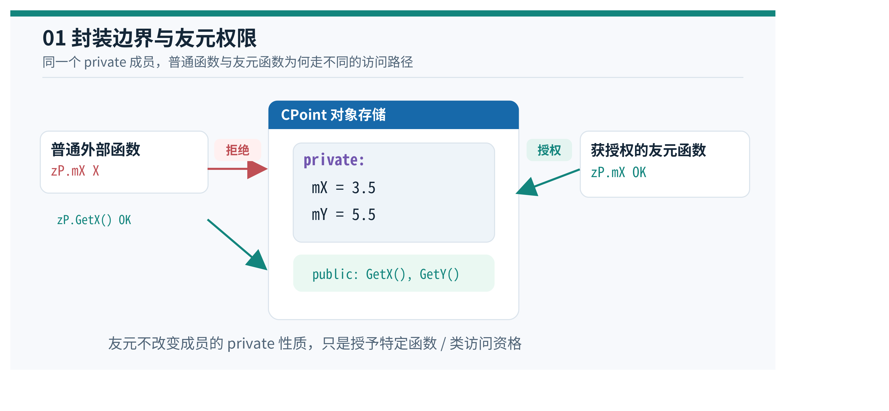

`friend` 在**授予权限的类内部声明**，使某个外部函数或另一个类能够访问该类的 `private`、`protected` 成员。它不会把私有成员变为 `public`，不会自动改变对象的内存布局，也不意味着被授权方就成为这个类的成员。

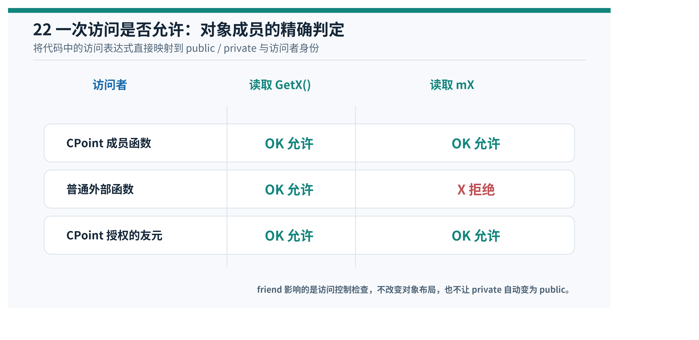

> [!important] 一句最重要的判断规则
> **谁的私有成员需要被访问，谁就在自身类定义中写 `friend` 声明。** 被访问的对象可以是该类的不同实例；授权针对函数或类，而不是针对某个单独对象。

### 2. 三种友元形式

```cpp
class CPoint {                                                     // 几何点类
    double mX, mY;                                                 // 默认 private
public:
    friend double Distance(const CPoint&, const CPoint&);          // 授权普通函数
};
```

```cpp
class CTwo;                                                         // 先声明目标类名
class COne {
public:
    void SetMemberOfCTwo(CTwo& target) const;                       // 声明成员函数
};

class CTwo {
    int mY1, mY2;                                                  // 私有数据
    friend void COne::SetMemberOfCTwo(CTwo&) const;                 // 仅授权指定成员
};
```

```cpp
class CStack;                                                       // 先声明类名
class CNode {
    int mData;                                                      // 私有数据
    CNode* pPrev;                                                  // 私有指针
    friend class CStack;                                           // 授权整类的全部成员
};
```

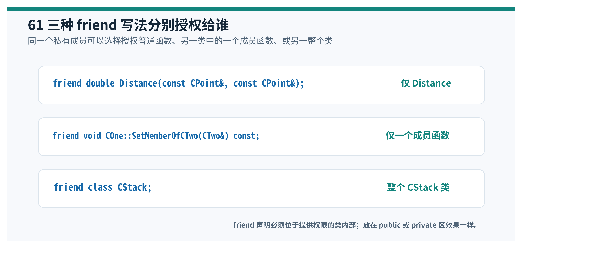

友元声明可位于类定义体内的 `public`、`protected` 或 `private` 部分，访问授权的含义相同。以上三个代码片段分别说明三种形式；每个片段都只需其自身的必要上下文，不需要把它们强行拼成一个程序。

### 3. 权限方向与范围

友元关系具有**单向、不传递、不继承**的特点。例如 A 允许 B 访问，并不代表 B 允许 A 访问；即使 B 允许 C 访问，也不代表 C 可直接访问 A；B 的派生类也不会仅凭继承而获得 B 的友元权限。

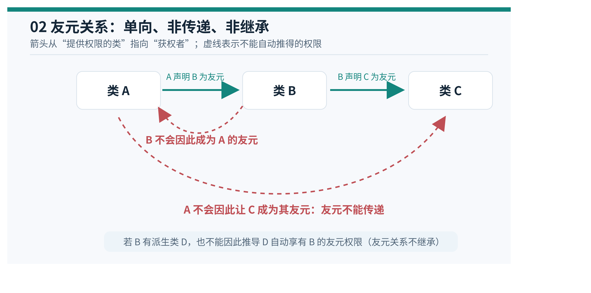

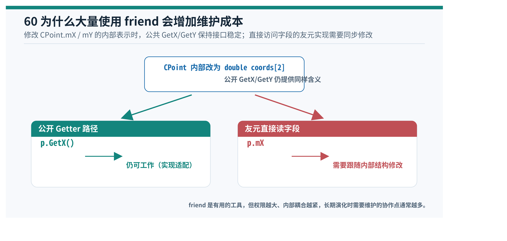

> [!warning] 友元不是性能优化“万能钥匙”
> 成员访问器若定义合理，编译器可能内联它们；“少调用一次函数”不保证运行时必然更快。友元增加的是访问耦合：当类的内部表示改变时，直接读取私有数据的友元实现也可能要同步更新。应优先考虑维护性、最小授权与接口清晰度。

## 二、普通函数作为友元：两点间距离

### 1. 数学模型与对象访问

若两点坐标为 $(x_1,y_1)$ 与 $(x_2,y_2)$，欧氏距离为

$$
 d=\sqrt{(x_2-x_1)^2+(y_2-y_1)^2}.
$$

对 $P_1=(3.5,5.5)$、$P_2=(6.5,9.5)$，有 $\Delta x=3$、$\Delta y=4$，因此 $d=5$。真正的编程要点不在公式，而在 `Distance()` 如何读取两个对象中被封装的坐标。

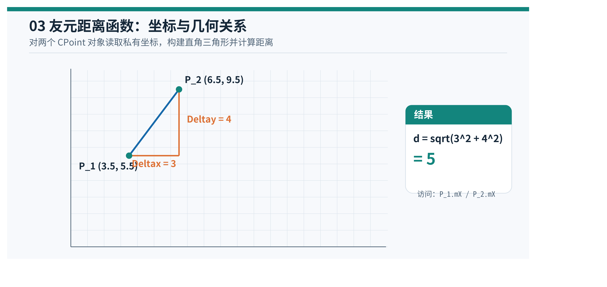

### 2. 在 .h 中声明，在 .cpp 中定义

**Point.h** 的核心声明：

```cpp
#ifndef CPOINT_H
#define CPOINT_H

class CPoint {
    double mX, mY;
public:
    CPoint(double zX = 0, double zY = 0);                        // 构造时提供默认坐标
    double GetX() const;                                       // 只读访问 x
    double GetY() const;                                       // 只读访问 y
    friend double Distance(const CPoint& a, const CPoint& b);  // 普通函数获授权
};
#endif
```

**Point.cpp** 的核心实现：

```cpp
#include "Point.h"                                              // 获得完整类声明
#include <cmath>                                                 // 提供 std::sqrt

double Distance(const CPoint& a, const CPoint& b) {
    double dx = b.mX - a.mX;                                    // 访问两实例的私有 x
    double dy = b.mY - a.mY;                                    // 访问两实例的私有 y
    return std::sqrt(dx * dx + dy * dy);                         // 返回几何距离
}
```

这是一段**独立的非成员函数定义**：没有 `CPoint::` 作用域限定，也没有隐式 `this`。调用形式是 `Distance(p1, p2)`，而不是 `p1.Distance(p2)`；`friend` 声明与普通函数定义不必写在同一处。

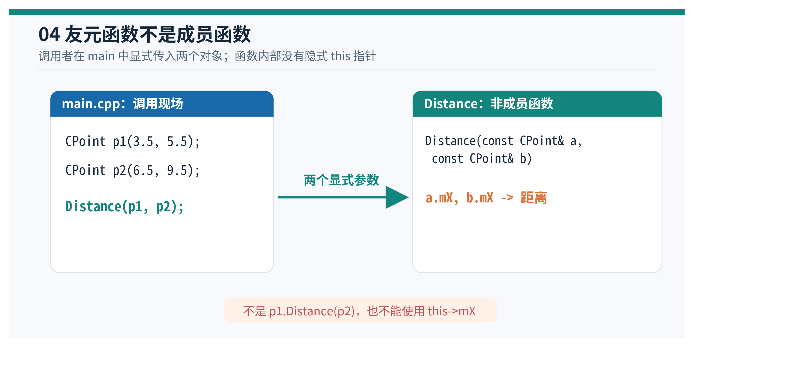

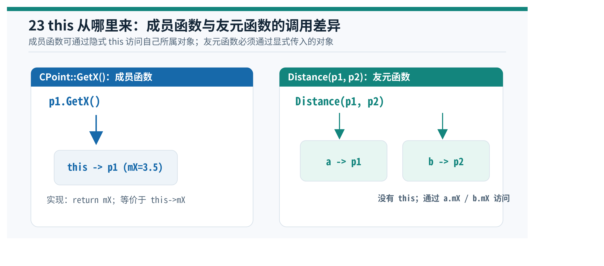

### 3. `const CPoint&` 的真实作用

- `&` 将参数绑定到调用者的现有对象；在这里不需要为每个实参再拷贝一份 `CPoint`。
- `const` 约束通过该引用访问对象时不可修改其非 `mutable` 状态，因此特别适合只读计算。
- `friend` 授予的是**访问资格**，并不取消 `const` 对修改操作的限制。

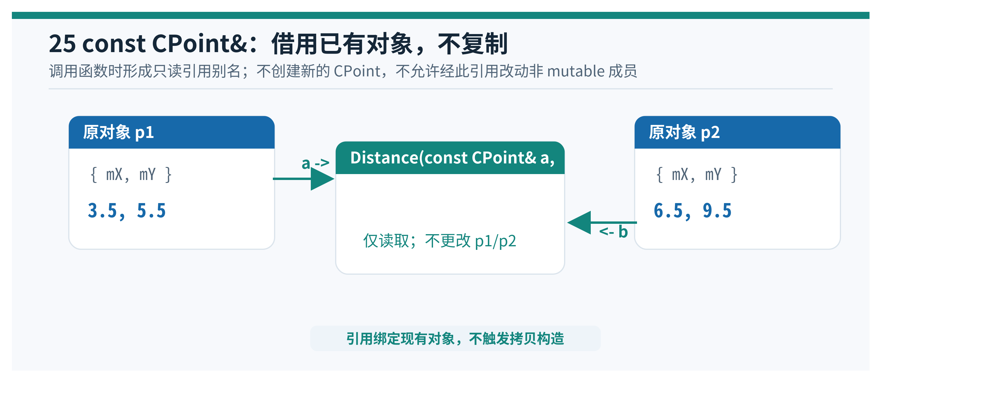

非友元也能正确计算距离，只要通过 `GetX()` / `GetY()` 获取坐标：

```cpp
double DistanceByGetters(const CPoint& a, const CPoint& b) {
    double dx = b.GetX() - a.GetX();                              // 通过公开接口读取
    double dy = b.GetY() - a.GetY();                              // 不直接访问 private
    return std::sqrt(dx * dx + dy * dy);                          // 与友元结果相同
}
```

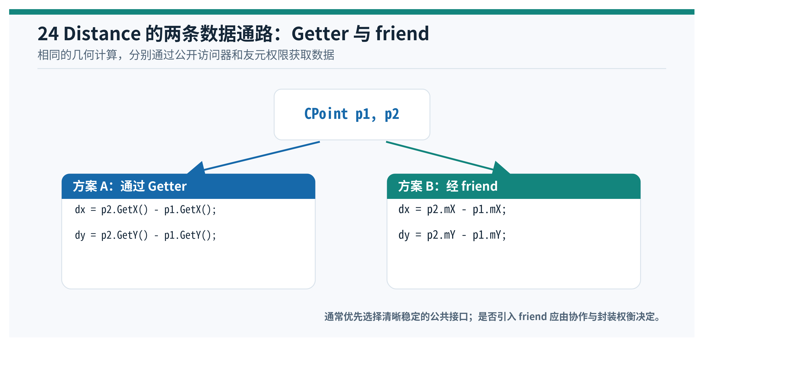

> [!example] 完整可运行例程
> ZIP 的 `code/01_PointDistance/` 含 `Point.h`、`Point.cpp`、`main.cpp`。输出为 `Distance = 5`。**两条实现路径数值相同，区别在权限与耦合。**

## 三、两个集合类的相互转换：友元的价值与代价

这一案例同时涉及 **类间协作、数组、查重、容量控制、数值类型转换、友元授权范围**，是本讲需要完整理解的核心应用。

### 1. 数据结构和约束

`CIntSet` 保存整数，`CRealSet` 保存实数；均有定长数组 `mElems[MAXCARD]` 和有效元素数 `mCard`。`MAXCARD = 32`，`NOERR` 表示成功，`ZOVERFLOW` 表示不同元素插入时容量已满。简化接口包括：构造、`Empty()`、`AddItem()`、`Print()`，以及两个方向的集合转换。

```cpp
const int MAXCARD = 32;                                        // 最多存储 32 个元素
enum ErrCode { NOERR, ZOVERFLOW };                             // 操作返回状态
class CIntSet;                                                 // 整数集合前向声明
class CRealSet;                                                // 实数集合前向声明
```

以上通用声明放在 `Defines.h`；类声明再放到 `IntSet.h` 和 `RealSet.h`。真正运行时，只有 `mElems[0]` 到 `mElems[mCard-1]` 是有效成员，且同一集合内不允许重复元素。

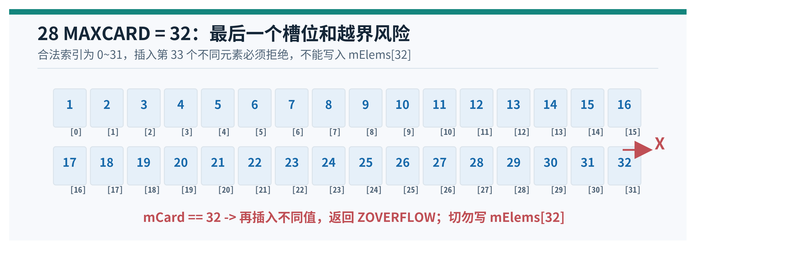

### 2. `AddItem` 为什么先查重、后判断是否溢出

```cpp
ErrCode CIntSet::AddItem(int value) {
    for (int i = 0; i < mCard; ++i) {                            // 遍历有效元素
        if (mElems[i] == value) return NOERR;                     // 重复值不插入
    }
    if (mCard >= MAXCARD) return ZOVERFLOW;                      // 新值且已满才失败
    mElems[mCard++] = value;                                     // 写入并增加基数
    return NOERR;                                                // 插入成功
}
```

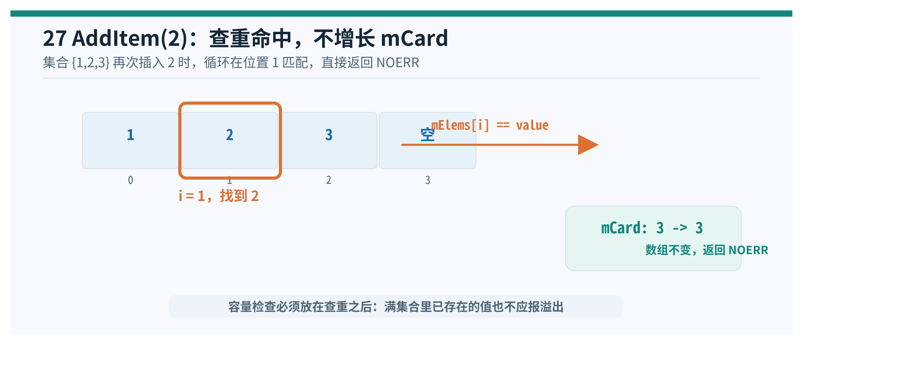

若一个包含 32 个不同元素的集合已满，再次添加其已有值仍应返回成功而不修改数组；如果先检查满容量再查重，就会误报溢出。

`Empty()` 可以只将 `mCard` 置为零：它实现**逻辑清空**而不需要逐格写零；`Print()` 则必须按有效范围访问数组，对空集、单元素集都要正确处理分隔符。

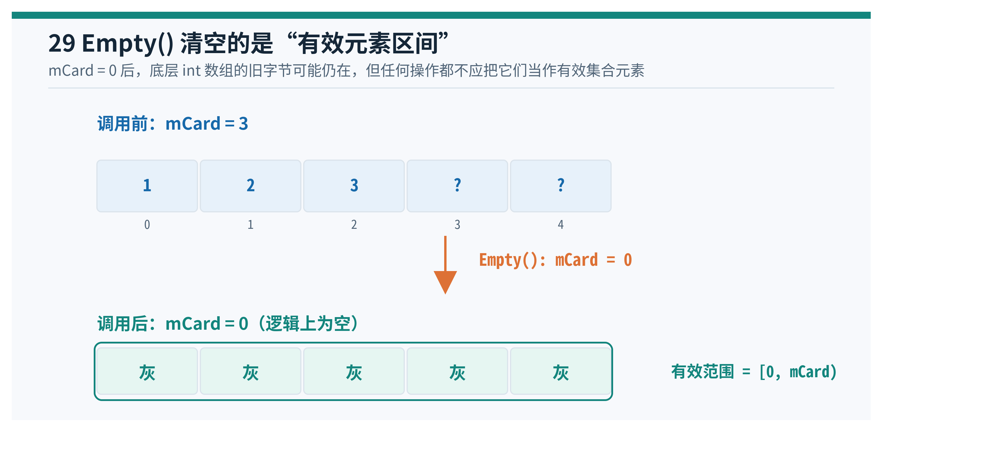

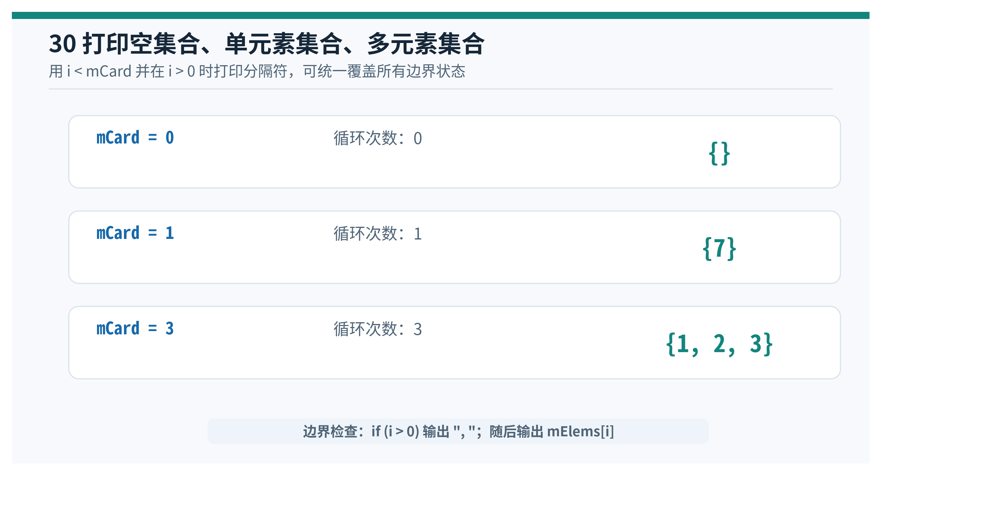

### 3. 整数集合转换为实数集合

从 `{1,2,3}` 到 `{1.0,2.0,3.0}`，每个 `int` 转换成相应的 `double` 数值。在课程示例的整数取值范围内，目标集合仍保有相同元素数量和顺序。

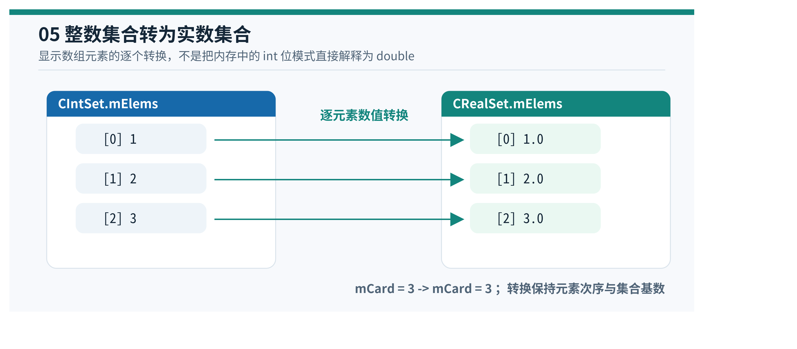

一个不依赖友元的实现会先 `target.Empty()`，再遍历源集合并逐个调用 `target.AddItem(value)`。它使用目标类的公开接口，能够重用目标类自己的查重、容量控制机制。

```cpp
void CIntSet::SetToReal(CRealSet& target) const {
    target.Empty();                                             // 清空目标的有效元素
    for (int i = 0; i < mCard; ++i) {                            // 遍历当前整数集合
        target.AddItem(mElems[i]);                              // 目标类负责维护约束
    }
}
```

> [!note] 数值转换与字节重解释不同
> 转换后的 `double(1)` 表示数值 $1.0$，不是把某四个字节形式的 `int` 直接当成八字节的 `double` 解读。此处没有 `reinterpret_cast`，也没有进行任何二进制指针强制转换。

### 4. 实数集合转换为整数集合：隐藏的重复问题

从 `{4.8,4.2,-3.7}` 转换时，C++ 的 `static_cast<int>` **丢弃小数部分、向零截断**，得到 `{4,4,-3}`。因此两个原本不同的实数可能转换成相同整数，目标整数集合必须去重，最终为 `{4,-3}`，其 `mCard = 2`。

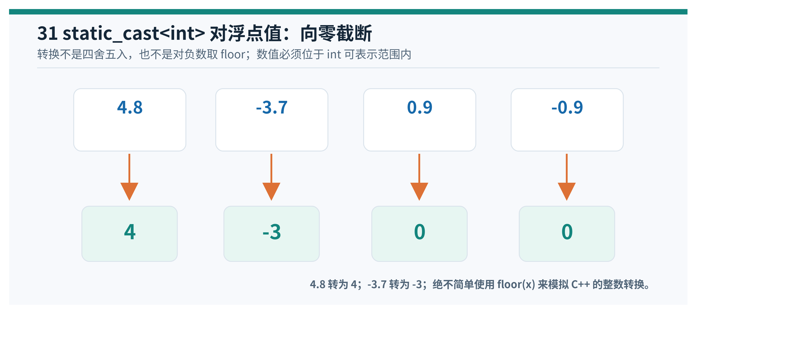

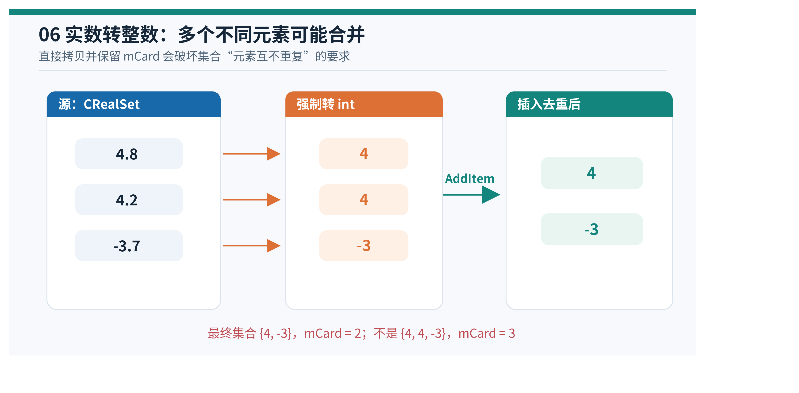

> [!warning] 原课件友元版本中的重要陷阱
> 若直接执行 `target.mCard = source.mCard`，再把所有转换后的整数直接写入数组，可能得到 `{4,4,-3}`：它虽然有三个数组项，却**不再满足集合无重复的语义**。因此不能照抄这种直接赋值写法而忽略重复检查。对于超出 `int` 可表示范围的浮点值，也不能直接转换；本例假设输入处于可表示范围内。

安全写法之一是调用公开 `AddItem`；另一种是友元函数内部自行维护查重逻辑。后者的关键是**让目标 `mCard` 从 0 开始，只有插入新整数时才加一**：

```cpp
void SetToInt(const CRealSet& source, CIntSet& target) {
    target.mCard = 0;                                           // 不能预设目标基数
    for (int i = 0; i < source.mCard; ++i) {                     // 依次读取源实数
        int value = static_cast<int>(source.mElems[i]);         // 向零截断（范围合法）
        bool found = false;                                     // 默认目标中不存在
        for (int j = 0; j < target.mCard; ++j) {                 // 查找目标已有值
            if (target.mElems[j] == value) found = true;         // 标记重复项
        }
        if (!found) target.mElems[target.mCard++] = value;       // 只添加新值
    }
}
```

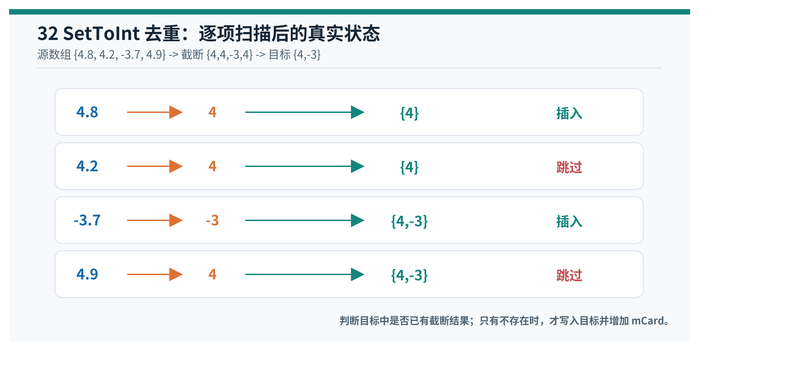

### 5. 何时两类都需要友元声明

```cpp
// CIntSet 的类定义内部
friend void SetToReal(const CIntSet& source, CRealSet& target);  // 同时读写两类
friend void SetToInt(const CRealSet& source, CIntSet& target);   // 同时读写两类

// CRealSet 的类定义内部：同样声明这两个友元
```

`SetToReal()` 如果直接读 `CIntSet::mElems`，又直接写 `CRealSet::mElems`，就需要两类分别同意。单纯在 `CIntSet` 内声明并不能让它越过 `CRealSet` 的封装边界。

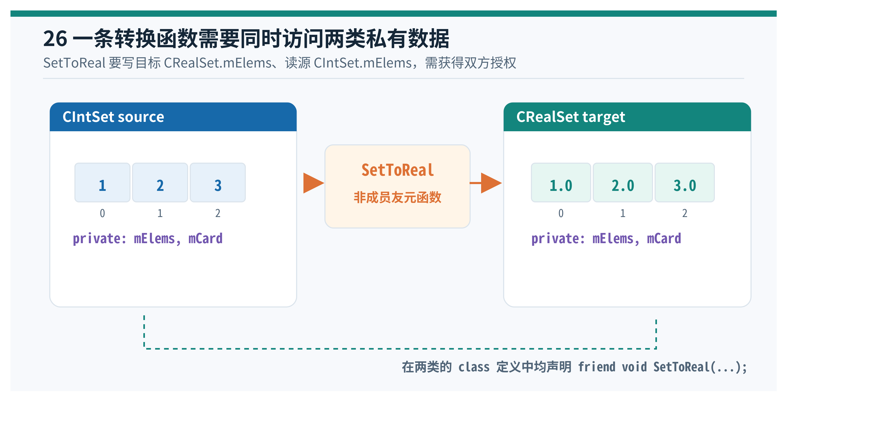

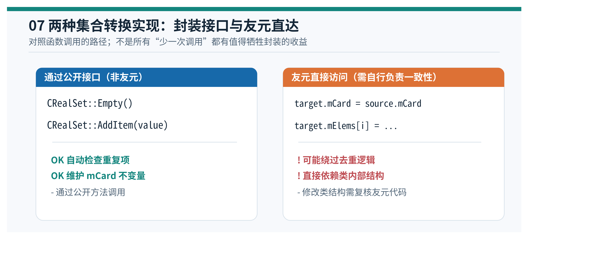

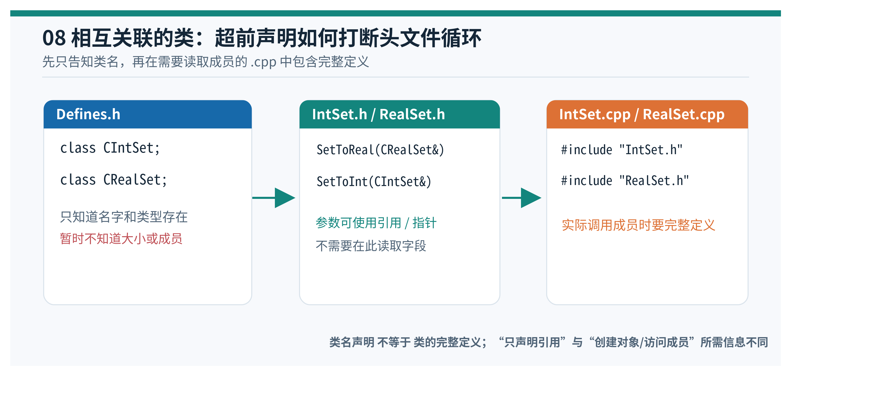

> [!tip] 选择实现路径
> 非友元方案：重用 `Empty()`、`AddItem()`，接口稳定，约束易于统一维护。友元方案：可直接读写数组，但必须自己保证**目标容量、去重、`mCard` 一致性**。友元不是跳过数据结构不变量的许可。

## 四、类的某个成员函数作为另一类的友元

### 1. 具体需求：把 `COne` 的计算结果写进 `CTwo`

设源对象 `COne(7,1)`，目标对象 `CTwo(3,8)`。调用 `source.SetMemberOfCTwo(target)` 后，目标私有成员变为：

$$
 mY1=mX1+mX2=7+1=8,\qquad mY2=mX1-mX2=7-1=6.
$$

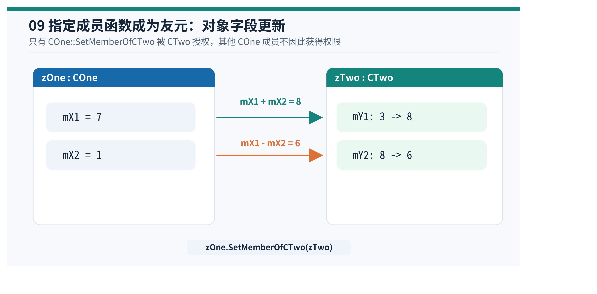

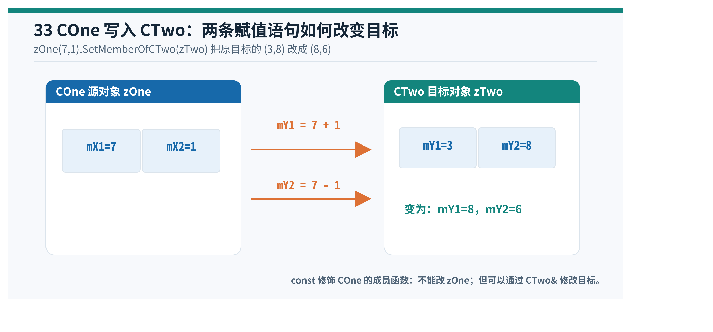

`COne::SetMemberOfCTwo(CTwo&) const` 只需要一条特定跨类写入通路，不一定要把 `CTwo` 的整个内部结构公开给 `COne` 的所有成员。

### 2. 声明次序是能否通过编译的关键

**One.h** 先前向声明 `CTwo`，使成员函数能够以 `CTwo&` 为参数：

```cpp
#ifndef CONE_H
#define CONE_H
class CTwo;                                                       // 只需要知道这个类名
class COne {
    int mX1, mX2;                                                 // 源对象的私有状态
public:
    COne(int x1, int x2);                                         // 两个整数初始化状态
    void SetMemberOfCTwo(CTwo& target) const;                     // 先声明成员函数
};
#endif
```

**Two.h** 必须先包含 `One.h`，因为 `friend void COne::...` 提到了 `COne` 中已经声明的成员：

```cpp
#ifndef CTWO_H
#define CTWO_H
#include "One.h"                                                  // 获知 COne 成员声明
class CTwo {
    int mY1, mY2;                                                 // 目标私有成员
public:
    CTwo(int y1, int y2);                                         // 构造时初始化目标
    friend void COne::SetMemberOfCTwo(CTwo&) const;               // 仅授权这个成员
};
#endif
```

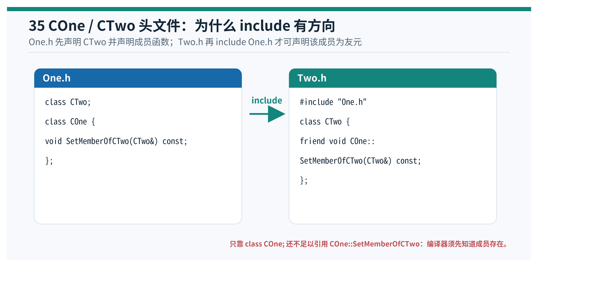

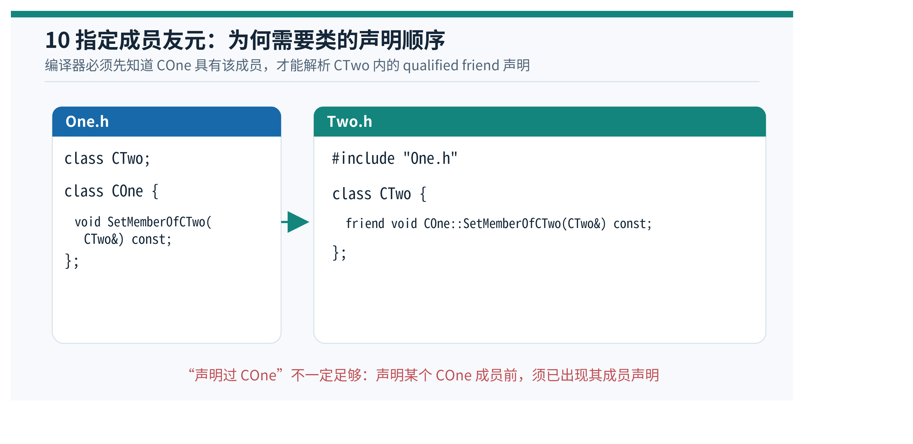

如果这里只有 `class COne;` 而没有 `COne` 的完整成员声明，编译器无法确认 `COne::SetMemberOfCTwo` 的存在及函数签名。类成员函数作为友元的声明，`const`、参数类型、类名限定都要对应准确。

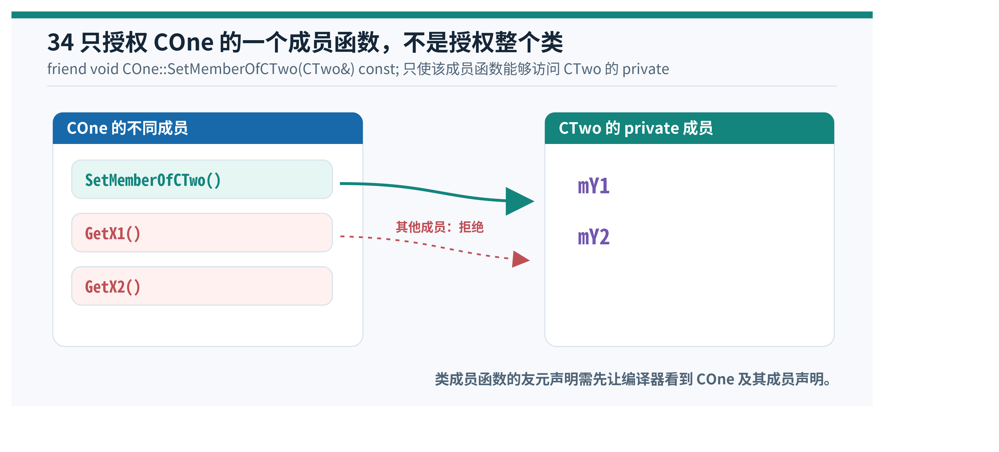

### 3. 具体实现中 `const` 限制的对象

```cpp
void COne::SetMemberOfCTwo(CTwo& target) const {
    target.mY1 = mX1 + mX2;                                     // 可改另一个对象的状态
    target.mY2 = mX1 - mX2;                                     // 本对象不变
}
```

末尾 `const` 指的是此函数不能通过通常途径改变**当前 `COne` 对象**的非 `mutable` 成员；参数却是 `CTwo&`，所以可以对目标对象赋值。这是“当前对象的只读性”与“外部目标的可修改性”的区别。

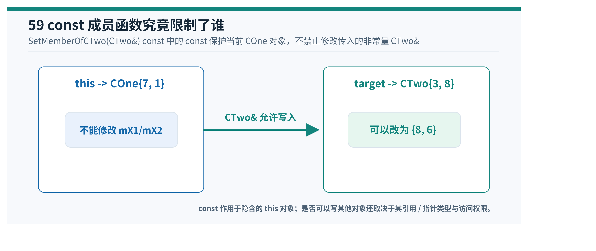

> [!example] 配套项目
> `code/03_MemberFriend/` 的完整代码验证：调用前 `CTwo(3,8)`，调用后输出 `8, 6`。一个普通成员函数只因明确获得了 **CTwo 的友元授权**，才允许写 `target.mY1`、`target.mY2`。

## 五、友元类与链式整数栈：指针变化全过程

这一部分需同时理解链式结点、栈顶指针、`new/delete`、构造与析构、友元类的授权范围。链式栈遵循 **LIFO（Last In, First Out，后进先出）**：`Push` 从栈顶增加结点，`Pop` 从栈顶删除结点。

### 1. 为什么 `CNode` 要将 `CStack` 声明为友元类

结点类 `CNode` 包含 `mData`（数据）和 `pPrev`（指向栈中下一个结点的指针）；栈类 `CStack` 维护 `pTop`。`Push` 要设置新结点链接，`Pop` 要读旧栈顶数据和后继地址，析构函数要沿链释放结点，多个成员函数都需要访问 `CNode` 私有字段。此时授权给**整个栈类**比较契合协作需求。

```cpp
class CStack;                                                    // 声明另一个类的名称
class CNode {
    int mData;                                                  // 当前结点存储的数据
    CNode* pPrev;                                               // 下一个结点 / 旧栈顶
public:
    CNode(int data, CNode* prev);                               // 构造时保存数据和链接
    friend class CStack;                                        // 授权 CStack 的成员访问
};
```

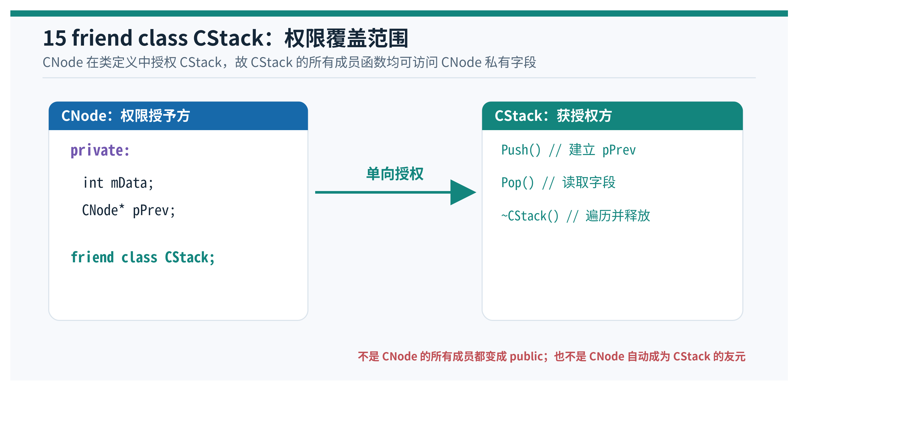

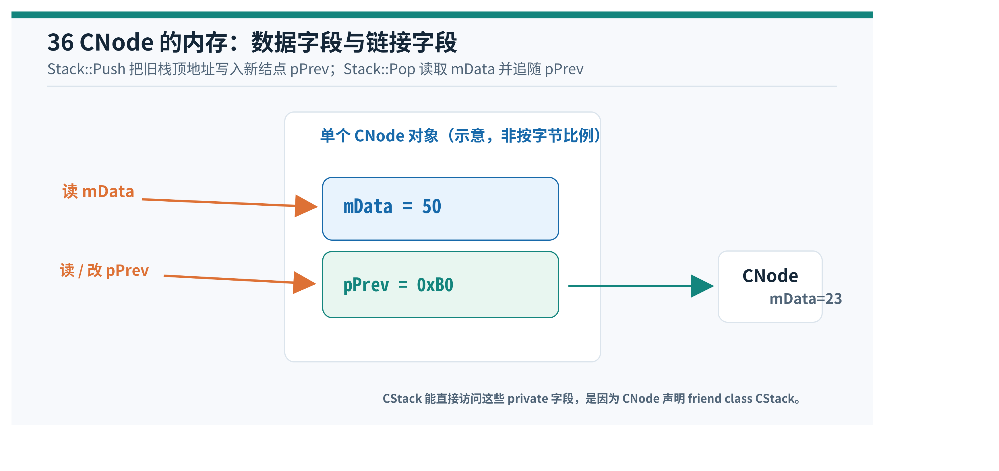

栈结构示例：`pTop → [50|→] → [23|→] → [10|nullptr]`。左侧是栈顶，右侧是栈底；箭头表示**实际指针指向**，不是数组位置，也不意味着结点必须连续存放在内存中。

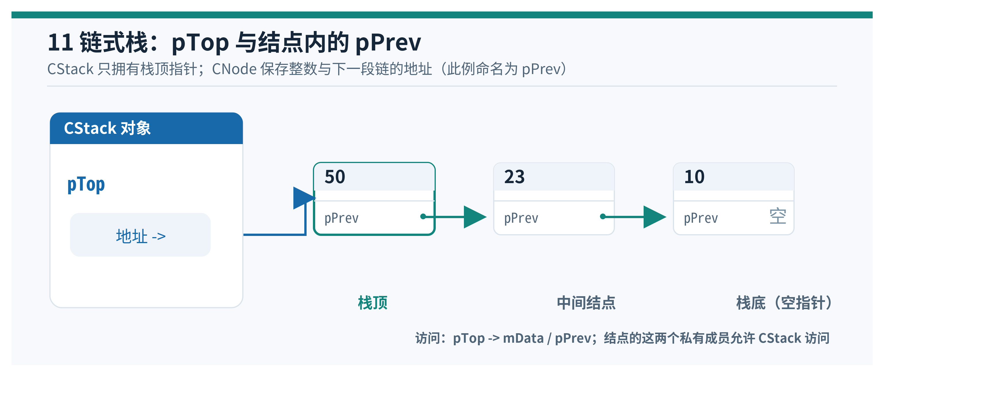

### 2. Push：先创建、接到旧链，再更新栈顶

```cpp
void CStack::Push(int data) {
    CNode* pNode = new CNode(data, pTop);                         // 新结点链接旧栈顶
    pTop = pNode;                                                // 新结点成为栈顶
}
```

`new CNode(data, pTop)` 先分配新结点并执行构造函数；构造函数将旧 `pTop` 保存到 `pNode->pPrev`。第二句把 `pTop` 改为新结点地址。以原链 `23 → 10` 为例，`Push(50)` 完成后链为 `50 → 23 → 10`，原有结点不搬家。

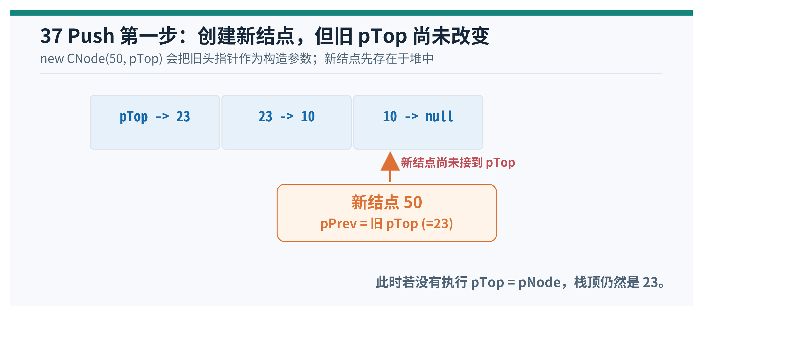

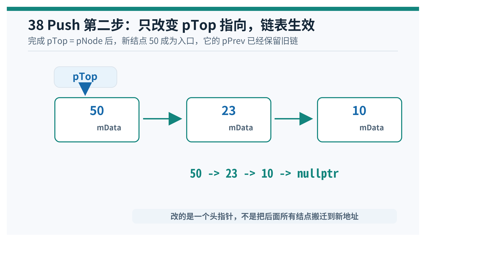

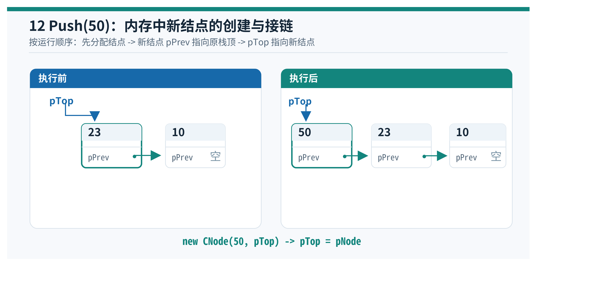

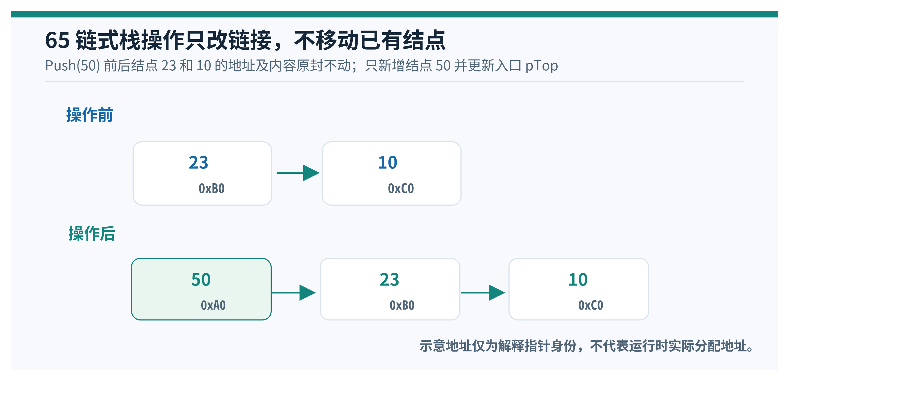

### 3. Pop：要先保存必要信息，再释放旧结点

```cpp
int CStack::Pop() {
    if (pTop == nullptr) {                                      // 没有可以弹出的结点
        throw std::underflow_error("empty stack");               // 报告空栈失败
    }
    CNode* oldTop = pTop;                                       // 保存旧栈顶地址
    pTop = oldTop->pPrev;                                       // 更新为下一结点
    int data = oldTop->mData;                                   // 保存待返回的数据
    delete oldTop;                                              // 释放已经脱链的结点
    return data;                                                // 返回弹出值
}
```

代码片段要求在实现文件中包含 `<stdexcept>`，此处省略类声明上下文。操作时先把 `oldTop` 指向值 50 的结点，更新 `pTop` 后再读取数据，最后 `delete oldTop`。删除之后，不能再读取 `oldTop->pPrev`。


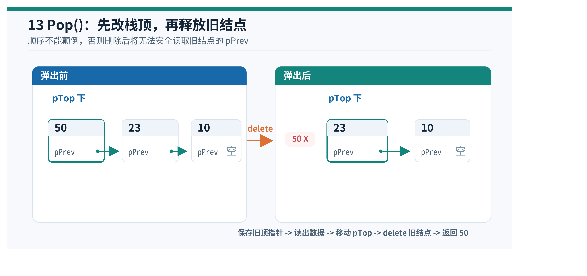

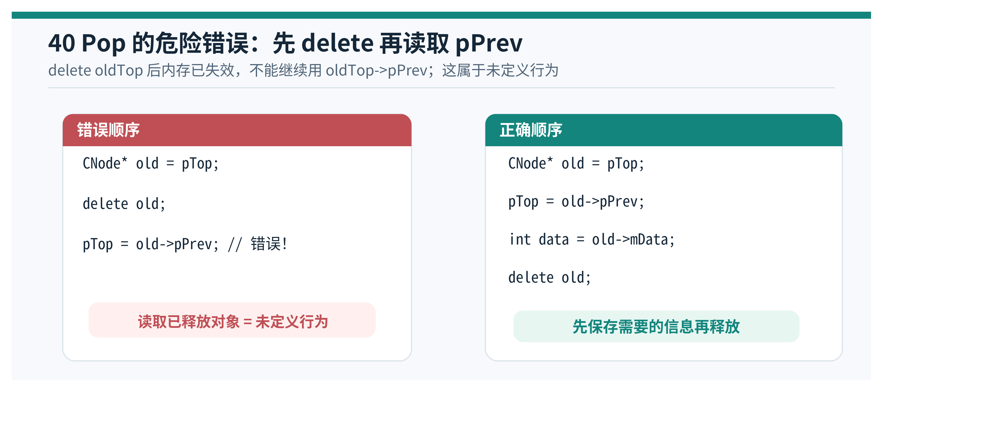

> [!warning] 空栈不能无条件 `return 0`
> 旧例程中 `Pop()` 对空栈返回 `0`，但整数 0 本来也是合法数据，因此调用方无法区分“真正弹出 0”与“空栈失败”。演示项目采用 `std::underflow_error` 报告失败；也可以通过返回状态与输出参数分别传递结果。

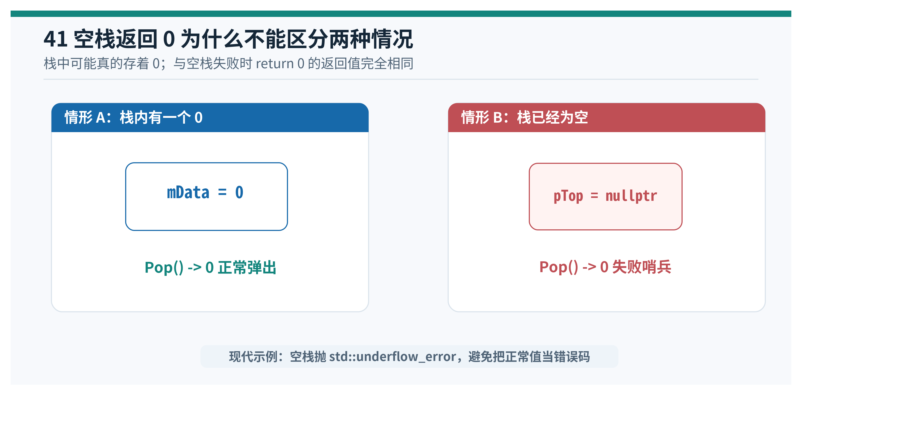

### 4. 析构函数：为什么循环时不能先 delete 再取下一结点

```cpp
CStack::~CStack() {
    while (pTop != nullptr) {                                   // 直到没有结点
        CNode* oldTop = pTop;                                   // 保存待释放结点
        pTop = oldTop->pPrev;                                   // 先保存后继地址
        delete oldTop;                                          // 再释放旧结点
    }
}
```

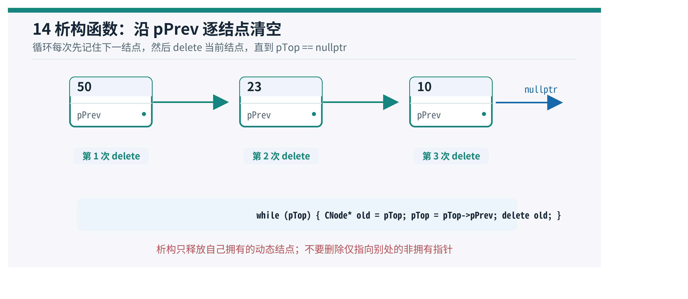

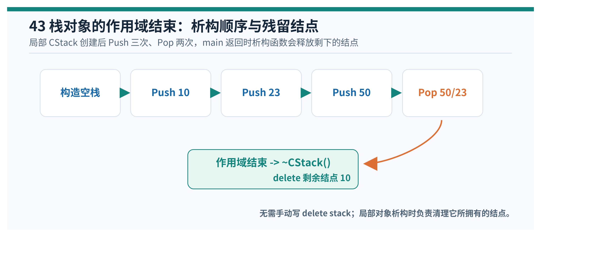

如果 `main` 创建局部栈并执行 `Push(10)`、`Push(23)`、`Push(50)`、连续 `Pop()` 两次，返回的数依次为 `50,23`；作用域结束后，`~CStack()` 应释放仍存留的结点 10。

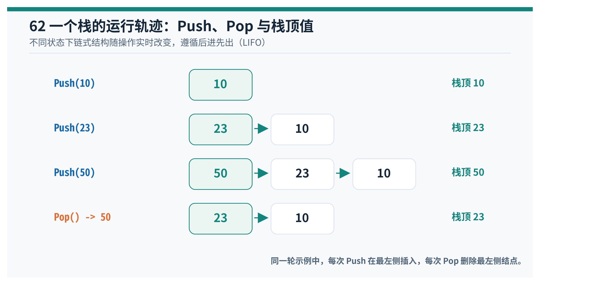

### 5. 一个不能忽略的资源所有权问题：复制

这个栈自行 `new` 结点、析构时自行 `delete`，因此是资源拥有者。编译器自动产生的拷贝操作可能只是复制 `pTop` 地址，让两个栈指向同一链；如果两个对象析构时都释放它，会重复释放结点，造成未定义行为。

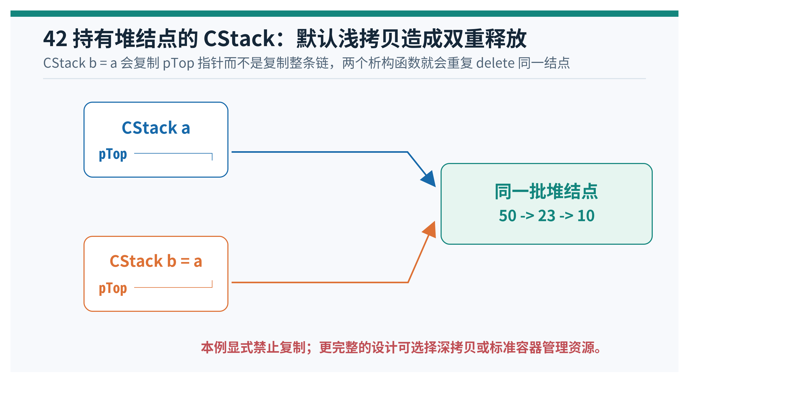

配套工程明确阻止了意外浅复制：

```cpp
CStack(const CStack&) = delete;                                // 禁止拷贝构造
CStack& operator=(const CStack&) = delete;                     // 禁止拷贝赋值
```

> [!tip] 这属于直接关联的必要补充
> 在需要可复制栈的设计中，应实现真正的深拷贝，或使用标准容器和资源管理机制。这里的重点不是提前展开复杂的拷贝控制理论，而是确保“链式栈 + 动态分配 + 析构”三者逻辑一致。

## 六、C++ 工程组织与编译链接

### 1. 从编辑到运行的真实过程

常见流程为：编辑 `.h` / `.cpp` → 预处理（处理 `#include` / 宏）→ 分别编译各源文件得到目标文件 → 链接目标文件与所需库 → 得到可执行程序 → 运行。头文件主要表示**声明与接口契约**，源文件提供具体函数定义。

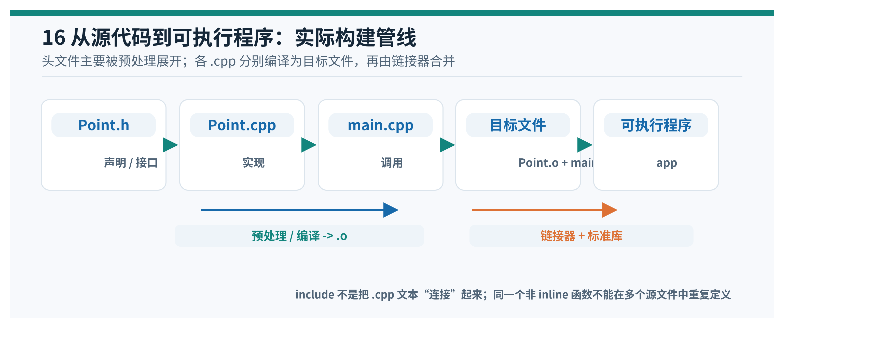

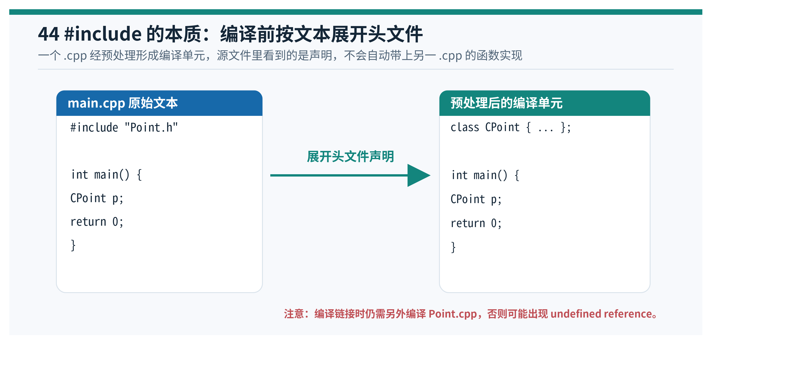

### 2. 三文件编程：.h、.cpp 与 main.cpp 各做什么

- **头文件 `.h`**：放类的定义、需要暴露的函数声明、保护宏；决定外部代码能调用什么。
- **实现文件 `.cpp`**：包含对应头文件，实现非内联成员函数及普通函数；主要解决“怎么做”。
- **测试入口 `main.cpp`**：包含声明并创建对象、调用方法；不需要复制类的实现代码。

例如一个复数类的三文件结构：`Complex.h` 声明 `CComplex`，`Complex.cpp` 定义构造与 `Add`，`main.cpp` 组合两个对象并输出结果。

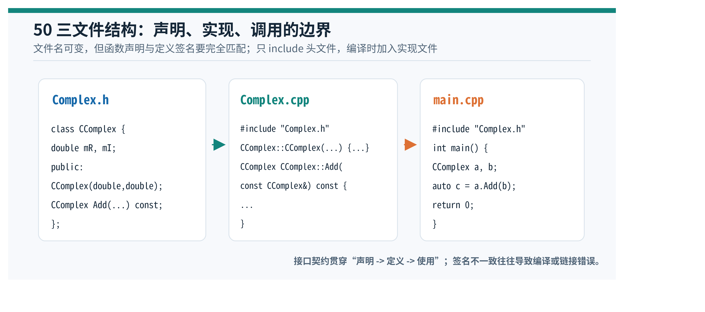

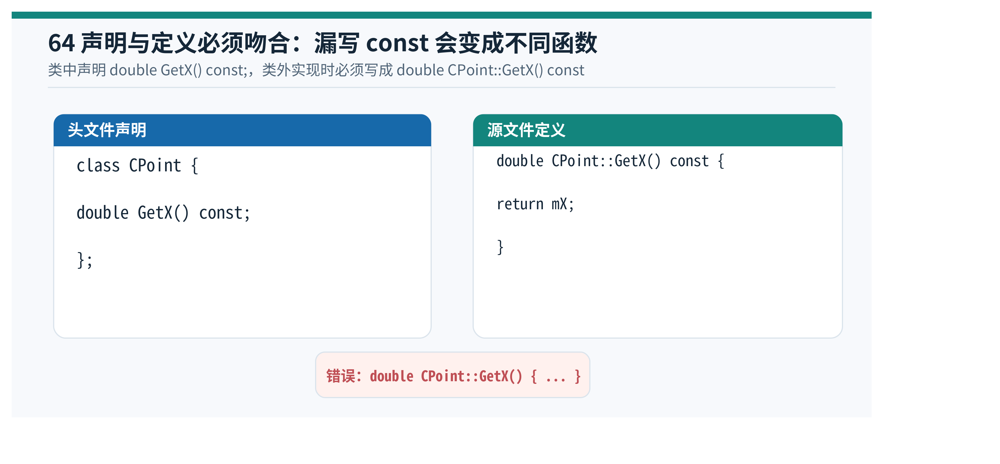

完整样例 `code/06_ComplexThreeFiles/` 输出 `6, 2`，对应复数 $(2+3i)+(4-i)=6+2i$。对于普通函数和成员函数，声明、定义、调用应在参数类型、数量、`const` 等约束上保持一致。

### 3. 头文件保护与相互包含

```cpp
#ifndef CCOMPLEX_H                                               // 若尚未定义此标识
#define CCOMPLEX_H                                               // 标记已开始包含

class CComplex {                                                 // 同一编译单元中只展开一次
    double mR, mI;
};

#endif                                                           // 结束条件编译段
```

一个编译单元可以沿多个 `#include` 路径反复遇到同一头文件。如果缺少保护，可能重复出现一个类定义。现代编译器还广泛支持 `#pragma once`，不过标准形式的保护宏有明确的预处理语义。

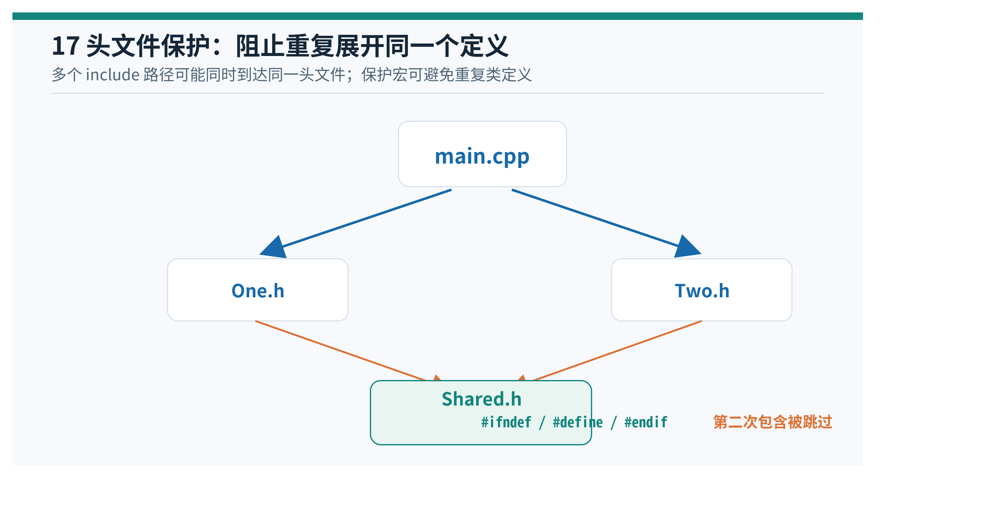

仅有 `#include "Point.h"` 不意味着 `Point.cpp` 会自动参与编译。若调用了缺失的外部定义，链接器会报告未定义引用。相反，普通非 `inline` 函数若在多个编译单元重复定义，则可能报告重定义或多重定义错误。

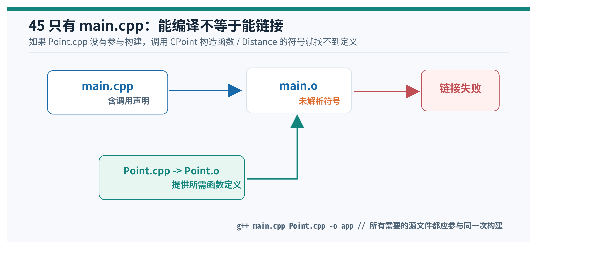

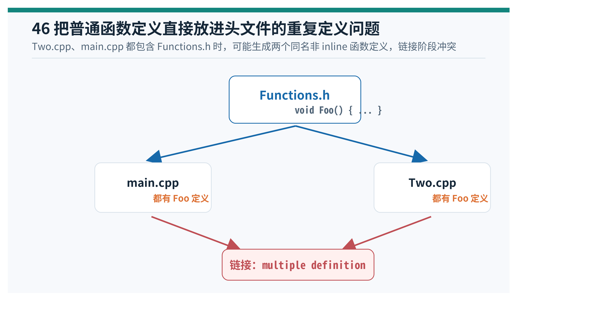

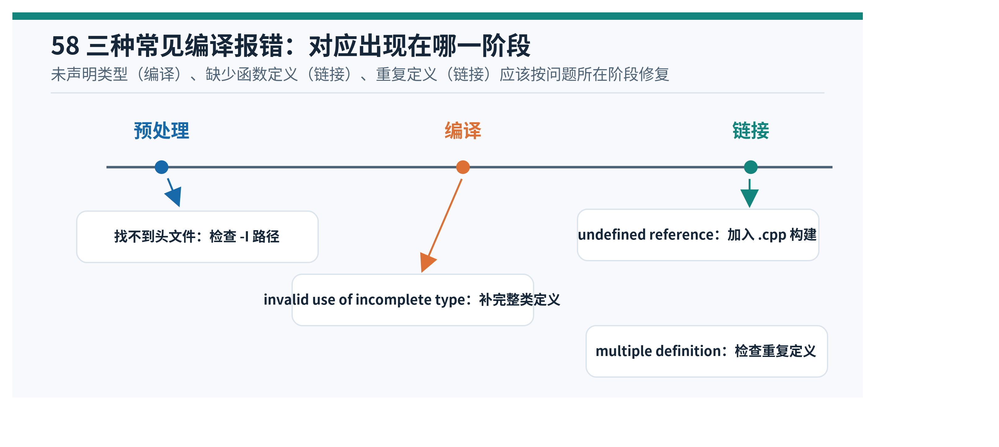

```bash
g++ -std=c++17 -Wall -Wextra -pedantic main.cpp Point.cpp -o app  # 编译链接点距离例程
./app                                                               # 执行生成的程序
```

### 4. `#include` 两种形式与路径写法

`#include <iostream>` 一般用于标准库或其他已配置的头文件搜索路径；`#include "Complex.h"` 常用于工程自身的头文件，通常先按编译器的本地查找规则定位。头文件搜索顺序由编译器和工程配置决定，不应把不同工具链的细节混为一谈。

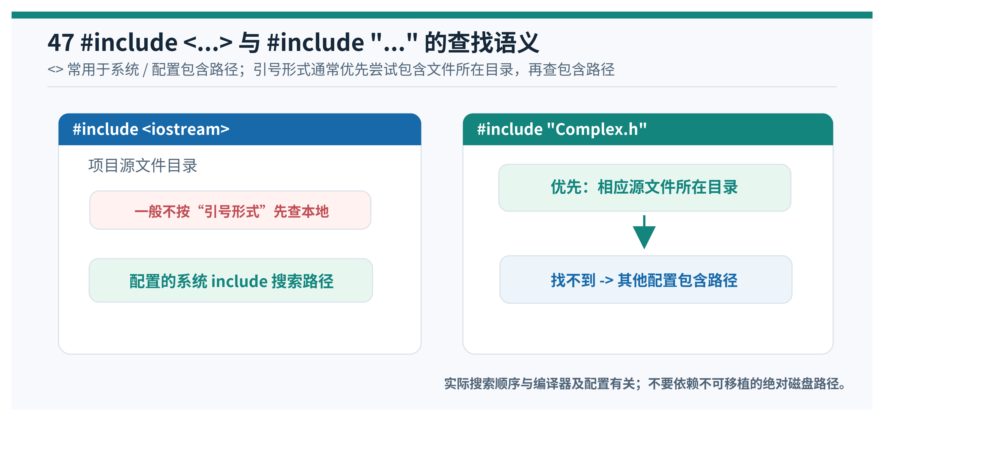

Windows 风格路径若写在 C++ 字符串中，需要注意 `\` 的转义作用。一般不建议把源文件放入写死绝对路径的头文件依赖中，更推荐项目相对路径与构建系统的 include 目录配置。

```cpp
const char* fileName = "D:\\course\\Complex.h";                // 转义反斜杠
const char* other = R"(D:\course\Complex.h)";                   // C++ 原始字符串
```


## 七、宏定义与条件编译：源代码在编译前如何变化

### 1. 函数式宏不是普通函数

旧式面积宏可以写成：

```cpp
#define PI 3.1415926                                             // 替换用的常量文本
#define Area(r) PI*r*r                                           // 缺少参数括号，存在陷阱
```

若设 `R=2`、`blue=1`，执行 `Area(R-blue)` 不是先计算半径再平方，而是被**文本替换**为 `PI*R-blue*R-blue`，按运算优先级得到 $2\pi-3$，并非期待的 $\pi$。加括号可避免此处错误，但宏还存在重复求值等风险。


更推荐把普通数值计算写成函数：

```cpp
double CircleArea(double radius) {
    const double PI = 3.1415926;                                // 局部常量
    return PI * radius * radius;                                // 参数只求值一次
}
```

> [!warning] `SQR(++i)` 的危险与“多计算几次”不是一回事
> 宏 `#define SQR(x) ((x)*(x))` 展开 `SQR(++i)` 后，在乘法表达式内对同一 `i` 进行未定序的重复修改，可能产生**未定义行为**；不能简单地预言得到某个固定数值。使用 `inline int Square(int x)` 避免这种宏替换问题。

### 2. 条件编译是编译前筛选，而不是运行时 `if`

```cpp
#define DEBUG_                                                   // 控制调试输出开关
#if defined(DEBUG_)                                              // 预处理阶段判断
std::cout << "Radius = " << radius << '\n';                      // 定义宏时保留
#else
std::cout << "Debug output disabled\n";                         // 未定义宏时保留
#endif
```

这段片段假设已包含 `<iostream>` 且变量 `radius` 已在上下文中声明。`#ifdef NAME` 等价于 `#if defined(NAME)` 的条件含义；`#ifndef` 表示宏尚未定义。`#elif` 表示后续条件分支，`#error` 可以在条件编译中主动触发错误信息。


## 八、类名可在何处使用：不完整类型、静态成员与指针

### 1. 仅做前向声明时能做什么

```cpp
class CTwo;                                                      // 只有类型名字，尚无完整布局
CTwo* ptr = nullptr;                                             // ✓ 指针可先声明
void Apply(CTwo& object);                                        // ✓ 引用参数可先声明
// CTwo value;                                                   // ✕ 不能定义完整对象
```

前向声明后的类型称为**不完整类型**。编译器可处理其指针或引用的声明，但不知道实例大小、成员布局；要创建对象、访问成员、求 `sizeof(CTwo)`，就应先包含完整类定义。


### 2. 为什么本类内部不能直接放一个同类型普通成员对象

如果 `CObject` 内直接包含 `CObject child;`，每个对象都必须再装一个 `CObject`，后者又必须再装一个……布局无限递归，无法得到有限 `sizeof(CObject)`。

```cpp
class CObject {
    int mID;                                                     // 普通对象数据
    // CObject child;                                             // ✕ 类型布局递归，非法
    CObject* pObject;                                            // ✓ 地址大小固定
    static CObject zStaticObject;                               // ✓ 静态对象不嵌入实例
    static CObject* pStaticObject;                              // ✓ 静态指针属于类
public:
    explicit CObject(int id);
};
```


### 3. 普通成员与静态成员的存储差别

`mID`、`pObject` 随每个 `CObject` 实例各有一份；`zStaticObject`、`pStaticObject` 是**类级共享的静态数据成员**。非 `inline` 静态数据成员通常还需要在类外提供一次定义：

```cpp
CObject CObject::zStaticObject(0);                              // 类外定义静态对象
CObject* CObject::pStaticObject = nullptr;                     // 类外定义静态指针
```


在示例里，`a.SetPtrObject(&b)` 只改变 a 的普通成员指针，而 `a.SetStaticPtrObject(&c)` 改的是类级共享指针。指向局部对象的非拥有指针**不能因为保存了地址就盲目 `delete`**。


`CObject::zStaticObject(0)` 是静态存储期对象；`main` 中 `a(1),b(2),c(3)` 则是局部自动对象，离开作用域时按 `c,b,a` 的顺序析构。静态对象一般在程序正常终止阶段销毁。完整样例可观察构造输出 `0,1,2,3`，析构输出 `3,2,1,0`。


### 4. 指针成员与动态字符数组：`new[]` / `delete[]`

课程中的学生类案例包含动态姓名 `m_pName`、固定编号数组 `mNo` 和静态计数 `mCount`。典型任务是给对象分配 `strlen(name)+1` 个字符以容纳结尾的 `\0`，新数组通过 `new char[...]` 创建，与 `delete[]` 配对。


> [!warning] 输入参数别名与异常安全
> 旧式 `SetName` 的“先 `delete[] m_pName`，再 `strlen(pName)` 和 `strcpy`”在 `pName` 恰好指向旧缓冲区时，会读取已释放内存；如果分配失败，也可能破坏旧状态。实际项目更推荐直接把姓名成员定义为 `std::string`；如果必须使用裸指针，至少先准备新缓冲区，成功后再替换旧地址。


这里强调的是**所有权和内存安全**：`CStudent` 持有自己通过 `new[]` 获取的字符缓冲区；`CObject::pObject` 只是指向其他局部对象，两者不能套用相同的删除策略。

## 九、友元与其他面向对象机制的易错对照

| 问题 | 正确结论 | 常见误解 |
| --- | --- | --- |
| `friend` 是成员函数吗？ | 普通函数友元仍是普通函数 | 友元一定带 `this` |
| `friend` 能访问 `private` 吗？ | 可以访问授予方的私有和保护成员 | 私有成员因此变成公开 |
| 友元是否双向？ | 否，单向授权 | A 授予 B 等于 B 授予 A |
| `friend class` 授权多大范围？ | 该友元类的成员函数 | 只有某个同名函数 |
| `const COne::f(CTwo&)` 能改 `CTwo` 吗？ | 可以，前提是参数非 const 且有访问权限 | 末尾 const 禁止一切写入 |
| `class CTwo;` 后能创建 `CTwo` 吗？ | 不能直接定义其完整实例 | 已有名字就知道布局 |
| `Empty()` 是否必须清零数组？ | 不必，`mCard=0` 可逻辑清空 | 每个内存字节必须清零 |
| `Pop()` 对空栈返回 0 安全吗？ | 不安全，0 可能是正常元素 | 0 永远是错误标志 |
| `#include "X.h"` 会编译 `X.cpp` 吗？ | 不会 | 头文件自动携带实现文件 |
| `#define Area(r)` 等价函数吗？ | 否，是预处理文本替换 | 会自动按参数优先级求值 |
| 类的静态对象是每个实例一份吗？ | 否，类级共享 | 所有成员都存在各自对象内 |

## 十、综合练习与检验

> [!question] 练习 A：比较学生成绩
> 设计 `CStudent`，含私有 `int mScore`；实现一个比较两个学生分数的功能。先使用公开 `GetScore()`，再尝试把 `CompareScore(const CStudent&, const CStudent&)` 声明为友元。讨论哪种设计更容易维护，为什么。


> [!question] 练习 B：链式栈运行跟踪
> 从空栈开始依次 `Push(10)`、`Push(23)`、`Push(50)`、`Pop()`、`Push(7)`、`Pop()`、`Pop()`。画出每步 `pTop` 与 `pPrev` 所指向的对象，给出后三次弹出的值，并说明作用域结束时还剩哪些结点需要析构释放。

> [!question] 练习 C：复数类三文件工程
> 以 `Complex.h`、`Complex.cpp`、`main.cpp` 分别放声明、实现和测试，实现复数的加减乘除。设 $z_1=a+bi$、$z_2=c+di$，加减法分别对实部和虚部运算，乘法为 $(ac-bd)+(ad+bc)i$，除法为
>
> $$
> \frac{a+bi}{c+di}=\frac{ac+bd}{c^2+d^2}+\frac{bc-ad}{c^2+d^2}i,
> $$
>
> 其中 **$c^2+d^2\ne0$**；必须处理除数为零的情况。

### 练习参考要点

**B 的结果**：操作轨迹为 `[] → [10] → [23,10] → [50,23,10] → [23,10] → [7,23,10] → [23,10] → [10]`。三次 `Pop()` 分别返回 `50、7、23`，最后留有值 10 的结点，由析构函数释放。

**A 的关键点**：先想清楚是否有真正的跨类私有协作需要；只读取学生成绩时，公开只读接口通常足以完成比较。若选友元，应尽量授予指定函数而非整个管理类。

**C 的关键点**：保留正确的三文件接口边界；运算方法可返回新的 `CComplex` 对象，不要求在原对象上原地修改；对除法先计算分母并判断是否为零，再使用上述公式。

> [!summary] 全章速查
> 1. **友元关系**：单向、不传递、不继承；三种授权分别是普通函数、指定成员函数、整类。
> 2. **调用与权限**：普通友元无 `this`，要通过参数对象访问；`const` 仍按常规生效。
> 3. **类间协作**：跨两个类私有数据的普通函数要分别取得两类授权；直接写数组必须维护容量、查重和基数。
> 4. **链式栈**：`Push` 先接链再改栈顶；`Pop` 先保存地址和数据再 `delete`；析构沿链逐结点释放，禁止意外浅拷贝。
> 5. **工程组织**：`.h` 声明、`.cpp` 实现、`main.cpp` 测试；预处理、编译、链接是不同阶段；头文件保护、宏括号和完整类型都与编译正确性直接相关。
