---
tags:
  - C++/面向对象
  - C++/运算符重载
  - C++/类型转换
---

# 第六讲：重载与类型转换（系统图解笔记）

> [!info] 资料范围与阅读说明
> 主线依据《06_C++ZGS第六讲重载与类型转换.pptx》（46 页），对应 **6.1 函数重载、6.2 运算符重载、6.3 特殊运算符重载、6.4 类类型转换函数**。保留课程中的 `CComplex`、相关向量及作业场景，另补充必要的现代标准 C++ 校订和独立示例。
>
> 本文引用 46 幅原创教学图。配图展示调用路径、内存身份、状态转移与数据结构，不以重复文字列表凑数量。带 **“现代 C++ 校订”** 的内容是对课件旧写法的规范化说明，不冒充课件原文。

## 本讲知识路线

| 课程模块 | 最核心的问题 | 学习成果 |
|---|---|---|
| 6.1 函数重载 | 同名函数为什么能被正确选中？ | 能判断重载、隐藏与二义性 |
| 6.2 运算符重载 | `a+b` 如何成为类的函数调用？ | 会区分成员/非成员形式、返回值/引用与流运算符 |
| 6.3 特殊运算符 | `++x` 与 `x++`、`a[key]` 如何工作？ | 能追踪对象变化、返回旧值、下标引用及容器状态 |
| 6.4 类型转换 | 基本类型与类对象如何自动转换？ | 会设计转换构造函数、`operator double()` 并控制隐式转换 |

---

# 6.1 函数重载

## 6.1.1 概念与意义

**函数重载（function overloading）**：在同一可重载作用域内，定义多个同名函数，根据参数数量、参数类型或相关限定进行区分。调用写法相似，实际运行的是所选版本。课件强调“关键在于同名”，但**同名不代表函数定义相同**。

```cpp
int maxValue(int a, int b) {                 // 处理整数
    return a > b ? a : b;                    // 取两个整数中较大的值
}

double maxValue(double a, double b) {       // 同名函数，参数类型不同
    return a > b ? a : b;                    // 取两个实数中较大的值
}

int a = maxValue(2, 5);                      // 选择 int 版本

double b = maxValue(2.5, 5.1);               // 选择 double 版本
```

代码片段假设位于允许变量声明的合适作用域中（如 `main` 内）。在同一个调用点，编译器基于**可见候选、实参个数和类型、转换的优劣**做出重载决议。

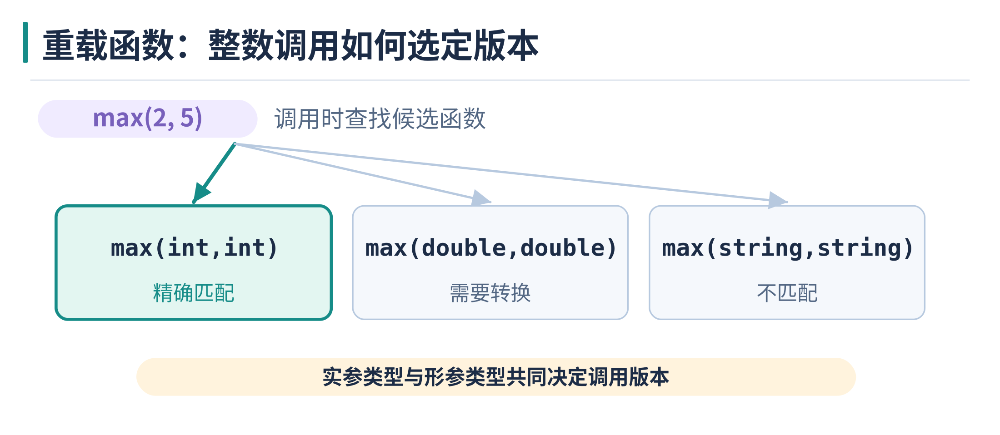

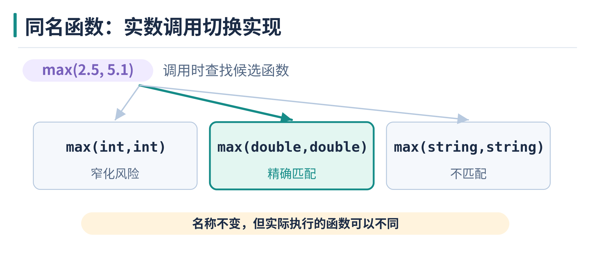

## 6.1.2 怎样才构成重载？

- **可以区分**：参数个数不同、参数类型不同、参数类型顺序不同；类的非静态成员函数还可按 `const`、引用限定符等规则区分。
- **不能区分**：仅返回类型不同；仅形参变量名不同；仅默认实参的写法不同。
- `void f(int)` 与 `int f(int)` 不能在相同作用域作为合法重载，仅凭调用者是否接收返回值不能选中版本。

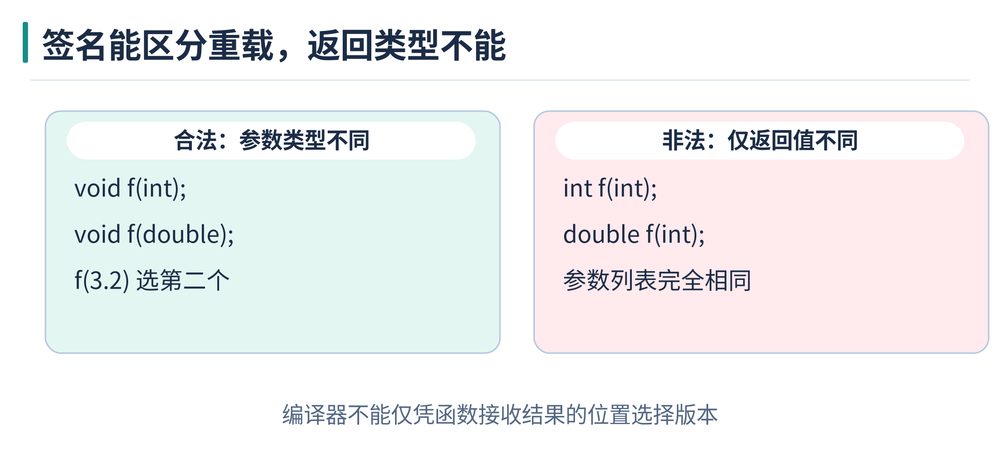

> [!important] 区分形参类型与顶层 const
> `void f(int)` 与 `void f(const int)` 的**按值形参**不构成不同的重载；`void f(int&)` 与 `void f(const int&)` 则是不同签名，因为引用所指类型的 `const` 关系不同。

### 默认实参与重载二义性（课件第 5 页）

```cpp
class CComplex {
public:
    CComplex(double r, double i = 0);       // 一个实参时可由默认值补齐
    CComplex(double r);                     // 也接受一个实参
};

// CComplex x(3);                           // 错误：两个构造函数都能匹配
```

两个函数并非“签名相同”，但单实参调用时均可行，且没有唯一更优项，因此形成二义性。相反，`CComplex(3,4)` 只匹配第一项。如果把第一个构造函数的首参数也设默认值，空实参调用可能只匹配它，不能由此推导 `CComplex(3)` 也不歧义。

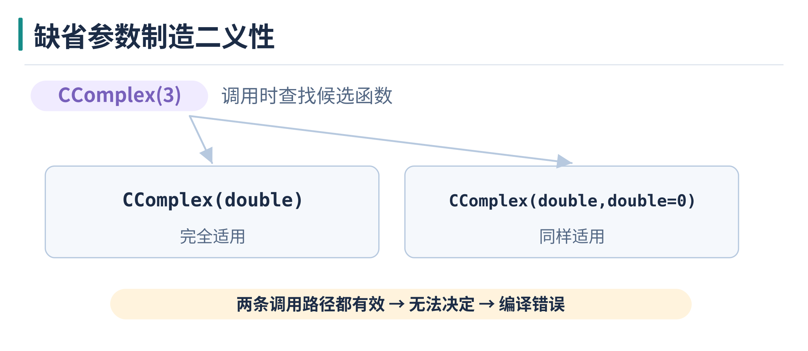

## 6.1.3 重载决议如何发生

第一步进行**名称查找**，确定此处可见的同名声明；第二步考虑参数个数等形成可行候选；第三步比较隐式转换序列，尝试找出唯一最佳函数。

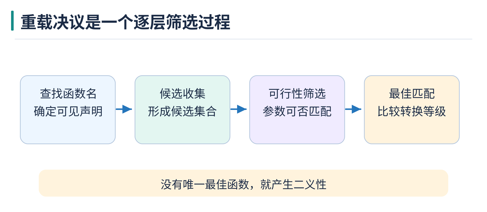

常见匹配优先级：**精确匹配**通常优于**提升转换**（如 `char` 到 `int`），提升通常优于**普通标准转换**（如 `int` 到 `double`）。但实际重载规则具有多参数、引用绑定、用户定义转换等额外细节，不能只用一个简单总分解释所有情况。

> [!example] 两个参数为什么可能仍然二义？
>
> 假设同时有 `f(int,double)` 与 `f(double,int)`，调用 `f(1,1)` 时前者第一个参数更优，后者第二个参数更优。没有函数在各个参数上均不劣且至少一个严格更优，因此调用可能产生**二义性**。

## 6.1.4 同名隐藏、作用域与类

课件介绍“同类成员函数”“不同类的成员函数”“父类与子类”几种情况。重点区分：

- **同一个类作用域内**：`show(int)` 和 `show(double)` 可以重载。
- **无继承关系的两个类**：各有 `show(int)` 完全合法，分属于不同作用域。
- **继承关系中的同名成员**：派生类的同名声明通常会隐藏基类同名声明，**并不会自动将两个类的函数合成一个重载集**。

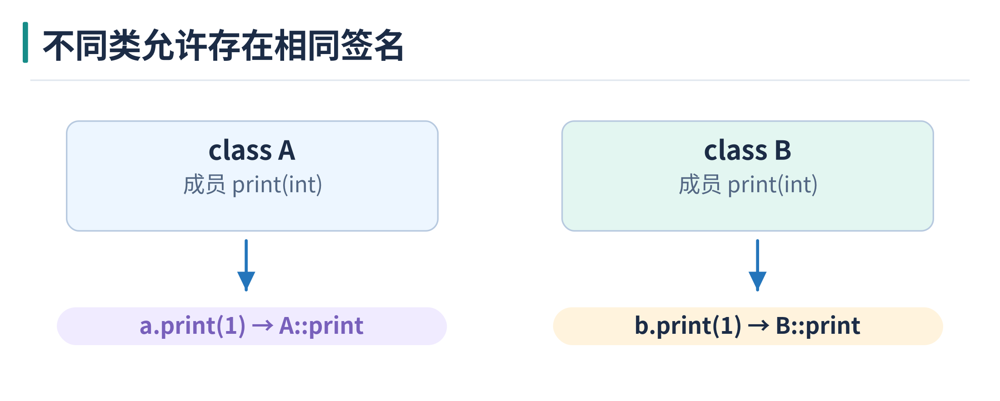

```cpp
class Base {
public:
    void show(int x) {                       // 基类版本
    }
};

class Derived : public Base {
public:
    void show(double x) {                    // 默认隐藏基类同名 show
    }
};

int main() {                                 // 标准程序入口
    Derived d;                              // 派生类对象
    d.show(2);                              // 调用 Derived::show(double)
    return 0;                               // 正常结束
}
```

如果确实希望让基类同名版本参与派生类上的重载决议，可在派生类加入 `using Base::show;`。这样 `d.show(2)` 能优先选择 `Base::show(int)`。课件所说“优先本类成员函数”适合作为直观提示，**严格分析要先考虑名称隐藏和可见声明，再进行重载决议**。

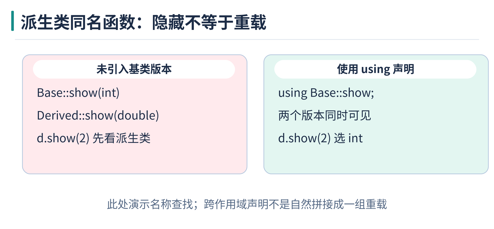

> [!warning] 6.1 常见易错点
> 同名不一定重载：不同作用域、隐藏、覆盖（虚函数）、同名不同参数是不同概念。仅修改返回值不可完成重载；带默认参数的重载尤其要测试每一种实参数量。

---

# 6.2 运算符重载

## 6.2.1 为什么需要运算符重载

内置类型自然支持 `3 + 5`，自定义复数、分数或矩阵则需要定义自己的“加法”等操作。**运算符重载本质是为特定运算符定义函数调用方式**，不是改写 C++ 的语法规则。

基本形式：

```cpp
class CComplex {
public:
    CComplex operator+(const CComplex& rhs) const;   // 成员形式的 +
};
```

其中 `operator+` 是特殊的函数名；`const CComplex&` 避免不必要复制；末尾 `const` 表示此成员操作不修改当前复数对象。二元运算符至少有一个操作数必须是类类型或枚举类型；不能自定义 `int + int` 的全新行为。

## 6.2.2 可重载范围与固定规则

**不能改变**运算符原有的操作数个数、优先级、结合性；不能创造此前不存在的新运算符。即使重载了 `+` 与 `*`，`a + b * c` 仍依旧按 `a + (b * c)` 进行语法组合。

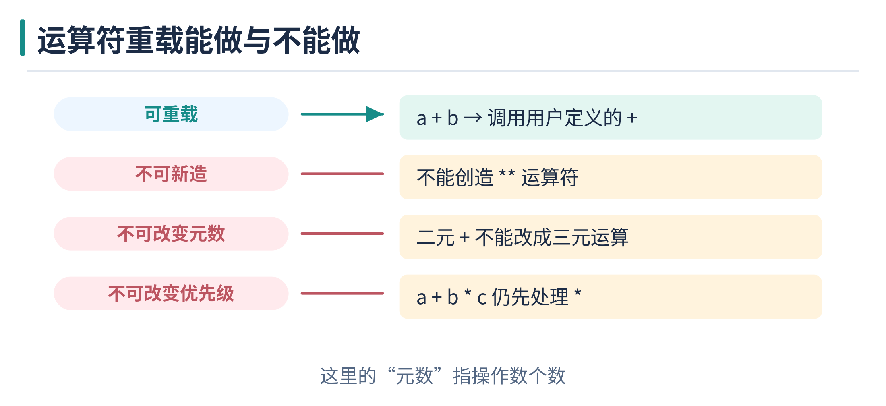

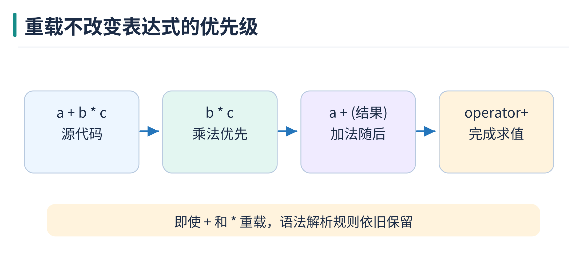

> [!warning] 课件第 8 页的运算符名单需要校订
> 标准 C++ 中不可重载的典型符号包括 `::`、`.`、`.*`、`?:`；`#`、`##` 属于预处理宏中的特殊符号，也不是可重载运算符。**`*` 可以重载**（解引用或乘法），**`->*` 也可以重载**，因此不得把课件表格里混杂的 `*`、`->*` 误记为“不可重载”。`sizeof`、`typeid` 等也不能通过运算符重载改变其语义。

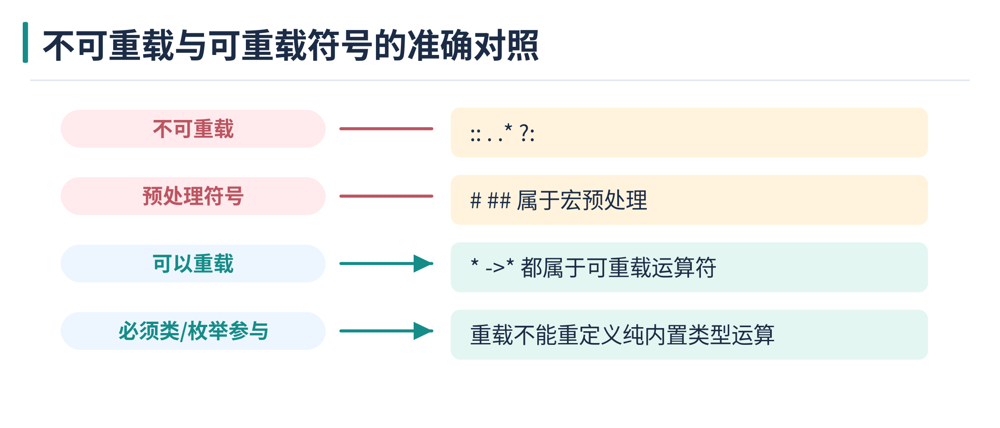

> [!note] 课件第 9—10 页 `#`、`##`、`.*`、`->*` 的作用
> `#` 把宏参数转为字符串，`##` 粘贴预处理标记；`.*`、`->*` 分别用对象和对象指针访问**成员指针所指的成员**。这部分展示运算符/预处理符号的实际用途，并**不意味着这些符号都能重载**。标准入口函数应该写 `int main()`，而非旧课件中的 `void main()`。

## 6.2.3 成员重载与非成员（友元）重载

同一个表达式 `a+b` 可采用两种典型实现，隐含的左操作数和所需形参个数不同。

### 成员形式

```cpp
class CComplex {
    double real_;                             // 实部
    double imag_;                             // 虚部
public:
    CComplex(double r = 0, double i = 0)      // 构造复数
        : real_(r), imag_(i) {}               // 初始化两个数据成员

    CComplex operator+(const CComplex& rhs) const {   // 右操作数是显式参数
        return CComplex(real_ + rhs.real_, imag_ + rhs.imag_); // 新结果按值返回
    }
};
```

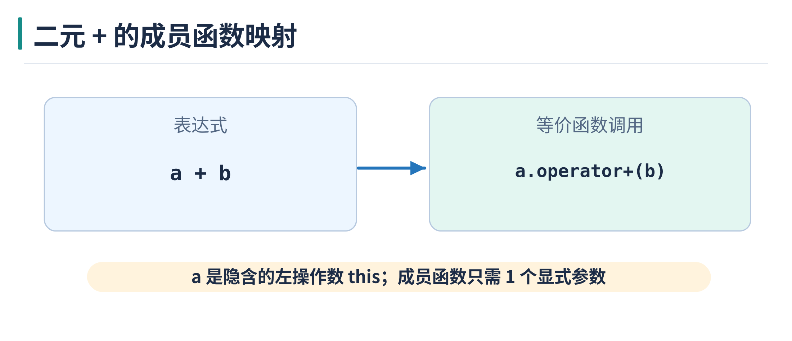

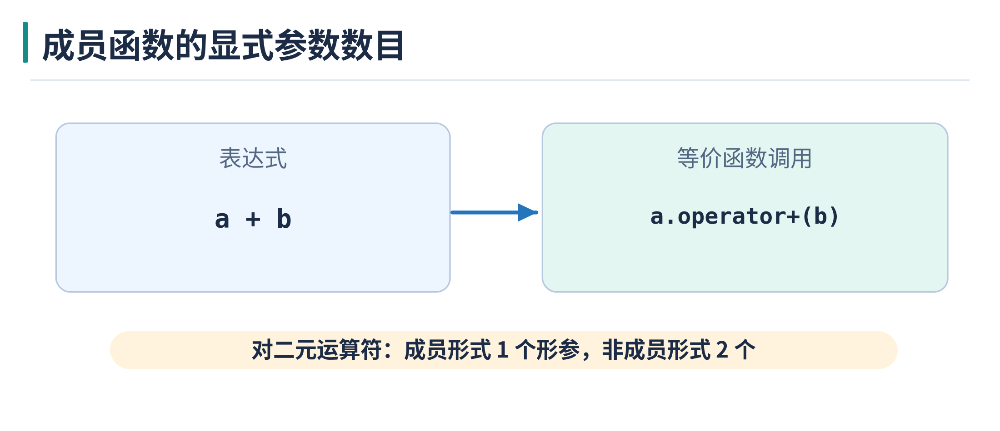

### 非成员形式（必要时友元）

```cpp
class CComplex {
    double real_;                             // 私有实部
    double imag_;                             // 私有虚部
public:
    CComplex(double r = 0, double i = 0)      // 构造复数
        : real_(r), imag_(i) {}               // 初始化成员

    friend CComplex operator-(const CComplex& a, const CComplex& b); // 友元声明
};

CComplex operator-(const CComplex& a, const CComplex& b) { // 非成员定义
    return CComplex(a.real_ - b.real_, a.imag_ - b.imag_); // 分别计算两部分
}
```

`friend` 只授予访问私有成员的权限；**友元函数不是类的成员函数**。如果非成员运算符能够利用公开接口实现，并不一定需要声明友元。`=`、`()`、`[]`、`->` 等必须作为成员运算符进行重载（此处按传统课程范围讨论）。

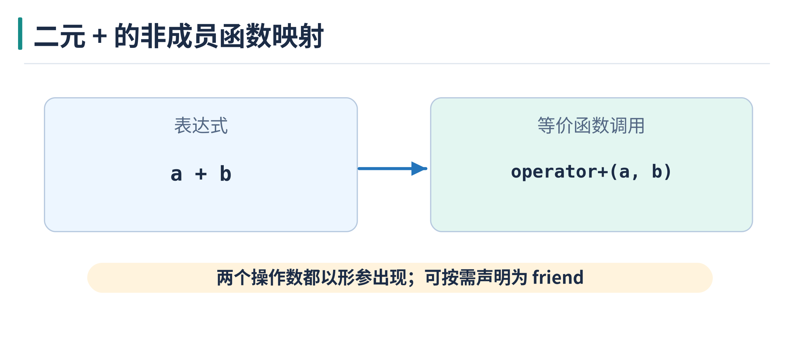

### 为什么对称运算常考虑非成员形式？

假设 `Fraction` 支持由整数隐式构造：`f + 3` 可通过转换右操作数调用成员 `operator+`；但 `3 + f` 的左操作数是原生 `int`，不能把这次调用当成 `f` 的成员 `operator+`。若定义适合的非成员 `operator+(Fraction,Fraction)`，两边便都可以考虑隐式转换。

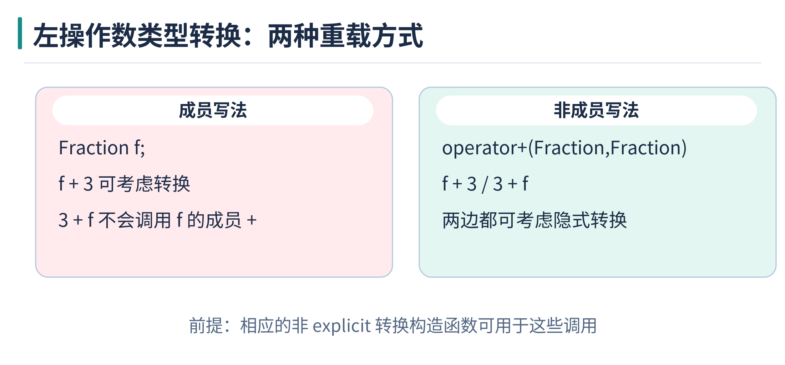

> [!tip] 一个判断方法
> **观察左操作数能否自然作为当前类对象**：若必须允许“整数 + 分数”这样的对称表达式，经常考虑非成员运算符；若是赋值、下标、调用之类作用于某个对象自身的操作，使用成员形式。

## 6.2.4 按值返回与按引用返回

```cpp
CComplex operator+(const CComplex& rhs) const;      // 新对象：通常按值返回
CComplex& operator=(const CComplex& rhs);          // 赋给自身：通常按引用返回
```

`a+b` 产生新的结果对象，不能返回一个局部临时变量的引用；`a=b` 修改的是 `a` 本身，常返回 `*this` 的引用，使 `a=b=c` 等连续赋值可以成立。`*this` 表示“当前对象本身”。

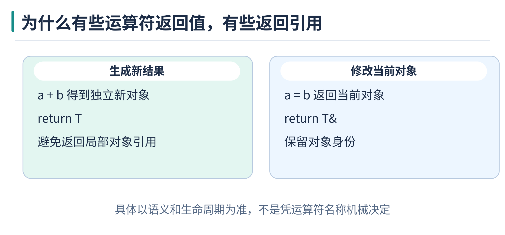

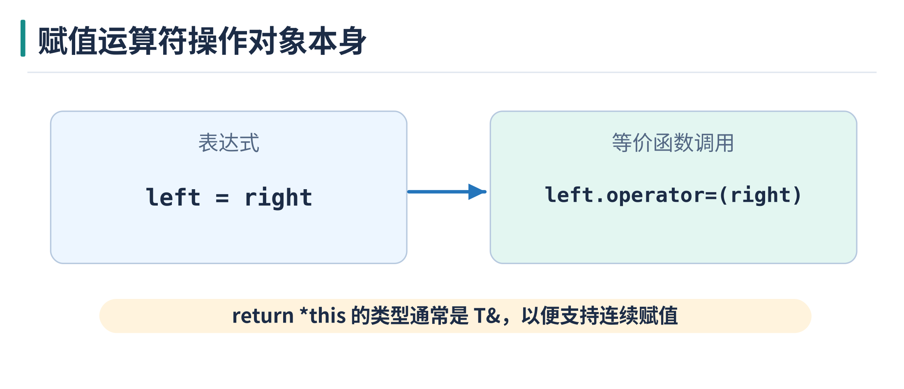

> [!important] 返回引用的前提
> 引用必须指向调用结束后依然有效的对象。绝不能写 `T& operator+(...) { T temp; return temp; }`，因为 `temp` 函数结束就被销毁，引用悬空。

## 6.2.5 拷贝赋值、浅拷贝和资源所有权

课件的“有名复数类”包含 `char* mpName` 这样的动态资源，因此**赋值不只是复制实部与虚部**。课件第 15 页展示过 `mpName = zC.mpName` 这样的指针赋值，它**只复制地址而不是复制字符串内容**，容易使两个对象共用同一块堆内存。

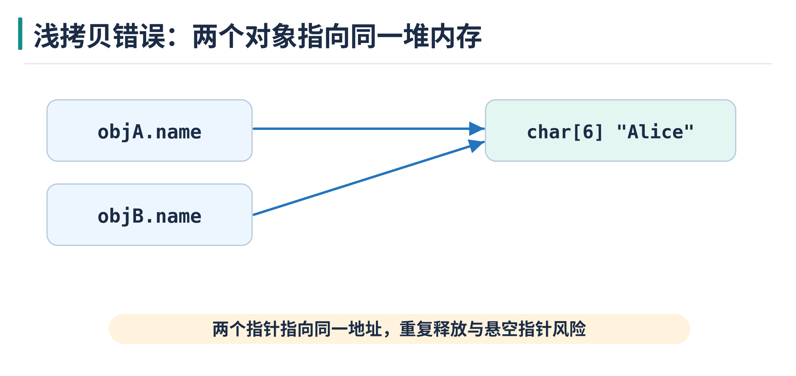

如果两个对象都以为自己拥有这块数据并各自 `delete[]`，就可能发生重复释放。需要的是两份独立存储空间：

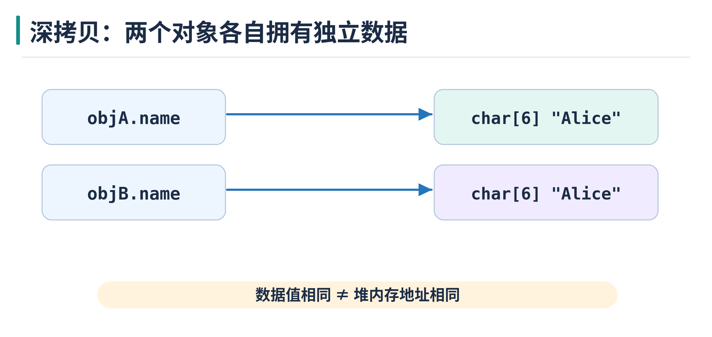

### 先复制、再替换：一个安全的赋值写法

下例假设类已经正确实现了**复制构造函数和析构函数**，并拥有 `char* name_`、`double real_`、`double imag_` 成员。这里单独展示拷贝赋值的关键逻辑，而不是完整的类定义。

```cpp
CComplex& CComplex::operator=(const CComplex& rhs) {       // 复制赋值
    if (this == &rhs) return *this;                         // 处理自身赋值
    char* fresh = nullptr;                                  // 暂存新空间
    if (rhs.name_ != nullptr) {                              // 源对象有名称
        fresh = new char[std::strlen(rhs.name_) + 1];        // 为完整字符串分配空间
        std::strcpy(fresh, rhs.name_);                       // 包含结尾的 '\0'
    }
    delete[] name_;                                         // 释放旧字符数组
    name_ = fresh;                                          // 接管新资源
    real_ = rhs.real_;                                      // 更新实部
    imag_ = rhs.imag_;                                      // 更新虚部
    return *this;                                           // 返回当前对象引用
}
```

该片段的 `.cpp` 实现文件需要 `<cstring>`；它故意不展示未定义的拷贝构造函数，以免误以为“只写赋值函数就能安全管理原始指针”。**资源所有权类应遵循 Rule of Three/Five**；现代工程中优先用 `std::string`、`std::vector` 等自动管理资源。打包示例中的 `CComplex` 使用 `std::string`，因而可直接依赖安全的默认复制语义。

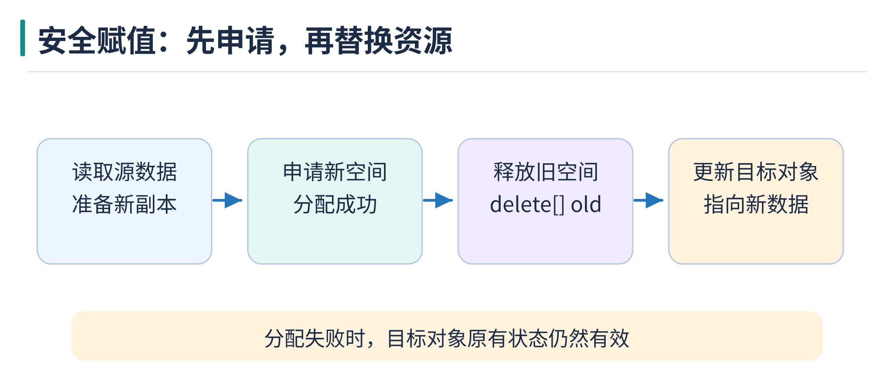

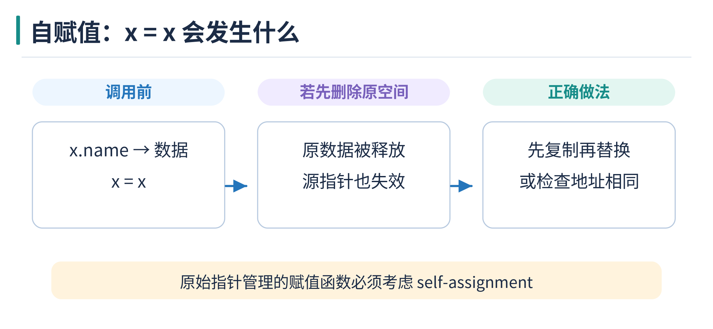

> [!warning] 一定分清 `delete` 与 `delete[]`
> `new char[n]` 与 `delete[]` 配对；`new T` 与 `delete` 配对。课件相关向量示例对 `char*` 使用了不合适的数组释放写法；应校订后使用。先释放旧指针再从同一源对象复制还可能在 `x=x` 时读到已释放内容。

## 6.2.6 复数加法与减法（课件第 14—16 页）

设 $z_1=a+bi$、$z_2=c+di$，则：

$$
z_1+z_2=(a+c)+(b+d)i
$$

$$
z_1-z_2=(a-c)+(b-d)i
$$

其几何意义就是复平面上的向量加减。注意：**本讲复数类中的“每个分量分别计算”不是所有运算符的普适定义**，只是本类对加、减运算符的合理约定。

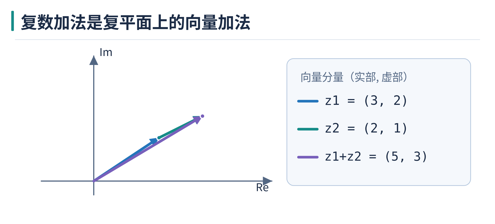

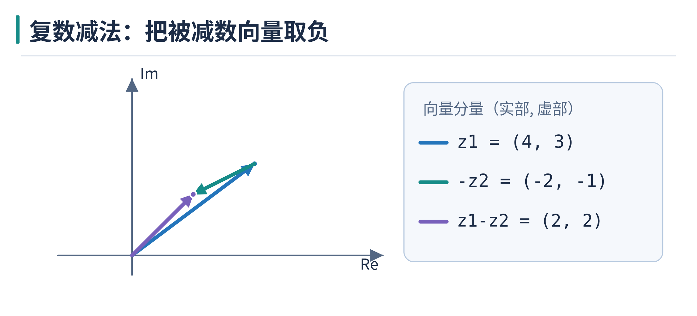

成员加法的参数 `rhs` 是右侧复数，当前对象是左侧复数；若用非成员减法，两个对象均为显式参数。课件示例还使用“`z1 + (-z2)`”演示减法可以转化为加法，本质上与逐分量相减一致。

## 6.2.7 `<<` 与 `>>` 流运算符（课件第 17—19 页）

典型形式：

```cpp
friend std::ostream& operator<<(std::ostream& out, const CComplex& value); // 输出
friend std::istream& operator>>(std::istream& in, CComplex& value);        // 输入
```

**为何第一个参数是流？** 因为表达式是 `std::cout << z`，左操作数是 `std::ostream`，不属于我们自己创建的 `CComplex` 对象，通常将其定义为非成员函数；为读取私有数据可声明友元。输出操作不修改复数，故用 `const CComplex&`；输入要修改复数，故不能加 `const`。

### 输出流的连续运算

```cpp
std::ostream& operator<<(std::ostream& out, const CComplex& z) { // 输出函数
    out << z.real() << "+" << z.imag() << "i";                    // 向同一流写入数据
    return out;                                                    // 返回流引用
}
```

上述代码依赖 `CComplex` 已提供 `real()`、`imag()` 公开读取函数，并在实现文件中包含 `<ostream>`；为了独立展示“流引用”的机制，暂未处理虚部为负时的符号排版。完整、规范的复数格式化请使用附带的可编译示例。

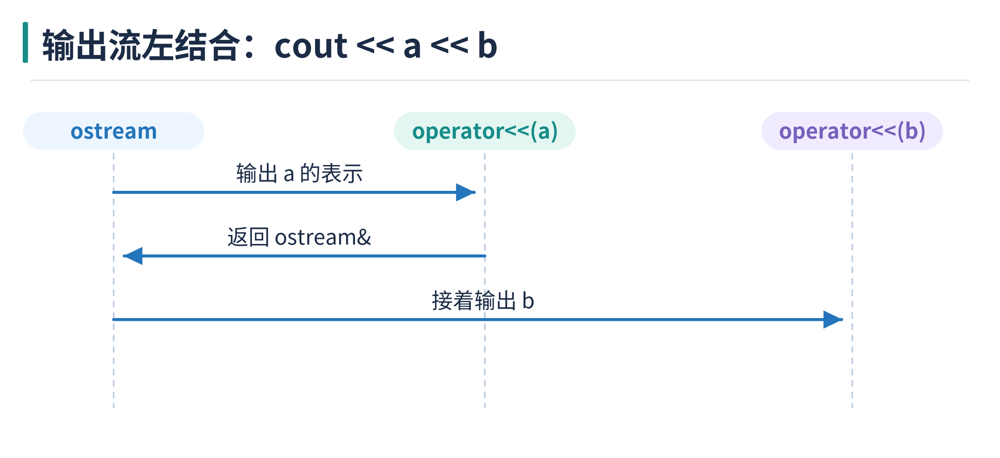

输入流也必须返回**同一个输入流引用**，以支持 `std::cin >> z1 >> z2`。

```cpp
std::istream& operator>>(std::istream& in, CComplex& z) { // 从流读取复数
    double r = 0, i = 0;                                   // 临时存放输入
    if (in >> r >> i) {                                     // 两个数均读取成功
        z = CComplex(r, i);                                 // 再更新目标对象
    }
    return in;                                              // 保留流状态并支持链式读取
}
```

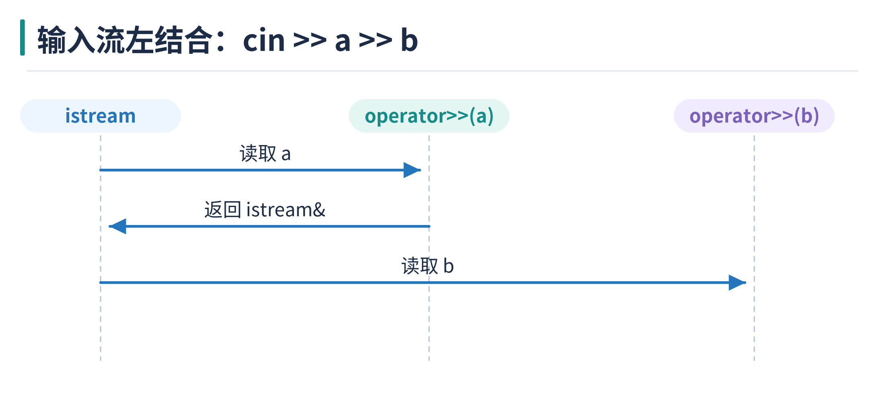

> [!note] 输入与提示语要分层
> 课件的 `operator>>` 中包含交互提示（“请输入一个复数”等），适合当时的教学演示；更通用的流运算符只负责从传入的流中读取，提示语交给 `main()`，否则文件流、字符串流的复用可能不方便。

---

# 6.3 特殊运算符重载

## 6.3.1 前置与后置 `++`、`--`

课件第 21—25 页特意对比**成员形式的 `++`** 与**友元形式的 `--`**。区别首先在函数签名：

```cpp
CComplex& operator++();                              // 成员前置 ++
CComplex operator++(int);                            // 成员后置 ++，int 为区分参数
friend CComplex& operator--(CComplex& x);            // 非成员/友元前置 --
friend CComplex operator--(CComplex& x, int);        // 非成员/友元后置 --
```

> [!important] 核心语义
> **前置**先修改对象，再返回更新后的自身（典型为引用）；**后置**先保存旧值，再修改对象，最后返回旧值副本。后置形式的 `int` 是 C++ 语法特有的区分参数，通常不会在函数内部实际使用。

### 前置：`++x`

```cpp
CComplex& CComplex::operator++() {       // 前置：不带 int
    ++real_;                              // 课件约定：实部加 1
    ++imag_;                              // 课件约定：虚部加 1
    return *this;                         // 返回更新后的当前对象
}
```

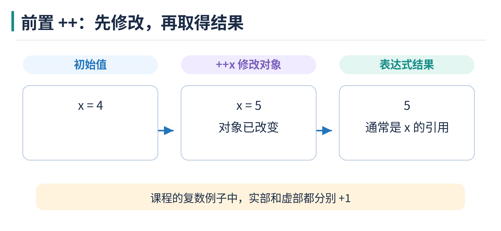

### 后置：`x++`

```cpp
CComplex CComplex::operator++(int) {     // 后置：带占位 int
    CComplex old = *this;                // 先复制修改前的对象
    ++real_;                              // 再修改原对象实部
    ++imag_;                              // 再修改原对象虚部
    return old;                           // 按值返回旧副本
}
```

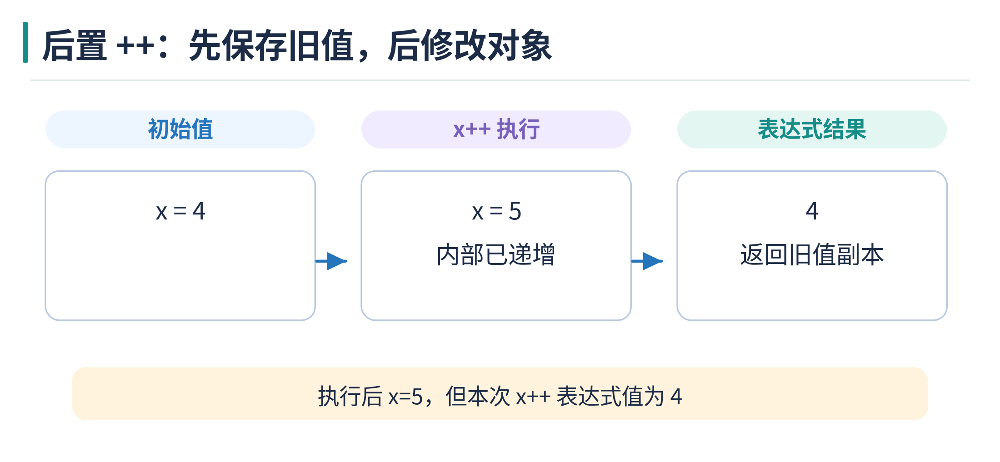

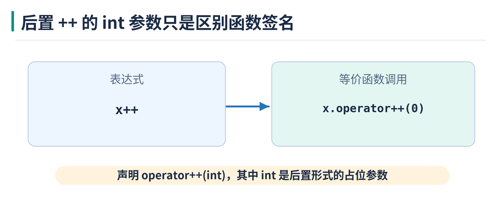

例如初始 `x=(2.3,4.6)`：求值 `y=++x` 后 `x=(3.3,5.6)` 且 `y=(3.3,5.6)`；重新从同样初始值出发，求值 `y=x++` 后 `x=(3.3,5.6)`、`y=(2.3,4.6)`。**不要把 `x++` 的表达式结果和执行后的 x 混为一谈。**

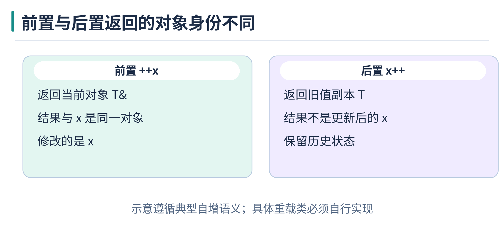

### 友元形式的 `--`

```cpp
CComplex& operator--(CComplex& x) {       // 前置：对象作为显式参数
    --x.real_;                            // 访问私有实部（因是友元）
    --x.imag_;                            // 访问私有虚部
    return x;                             // 返回当前对象引用
}

CComplex operator--(CComplex& x, int) {  // 后置：增加占位 int
    CComplex old = x;                     // 保存旧副本
    --x.real_;                            // 递减当前对象
    --x.imag_;                            // 递减当前对象
    return old;                           // 返回旧值
}
```

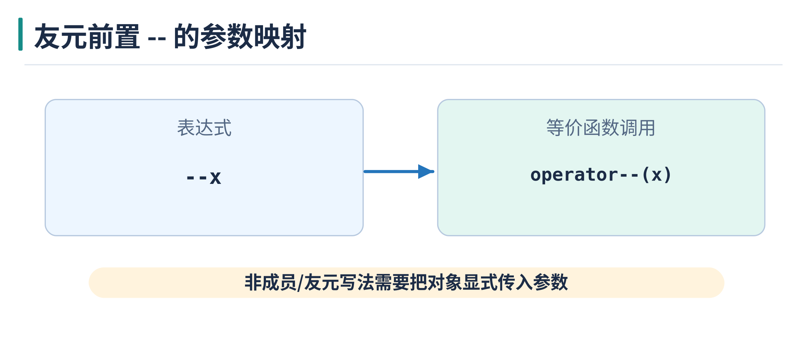

这些成员名属于示范类的私有字段；若要脱离该类独立编译，需在同一类中声明上述友元。一个运算符的**成员写法**和**友元写法**并不由功能名称天然决定，实际选择取决于运算的语义与操作数设计。

## 6.3.2 `operator[]`：为什么返回 `int&`（课件第 26—35 页）

课件构造一个**相关向量（`CAssociateVector`）**：以字符串作为索引，查找对应的整数值。它不是 C++ 标准库 `std::vector` 的固定数字下标，也不是现成的 `std::map`；它是课程自行实现的一个**键—值关联结构**。

类内存在三种重要状态：

- `mElems`：动态数组中每个结点保存 `mIndex`（名称）与 `mValue`（整数值）。
- `mDim`：最多允许的结点数。
- `mUsed`：当前实际使用的结点数。

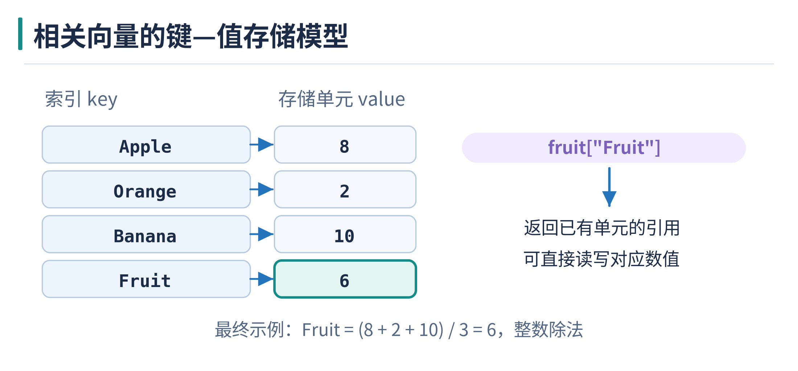

### 操作一：访问已有的键

```cpp
fruit["Apple"] = 8;                       // 返回 Apple 对应值的引用并写入 8
int x = fruit["Apple"];                  // 再次索引得到同一个单元中的 8
```

如果 `operator[]` 返回 `int`，读出数值没问题，但表达式 `fruit["Apple"] = 8` 的左边是一个临时值，不能完成对容器内部单元的赋值。因此需要返回 **`int&`，即现有或新建数值单元的引用**。

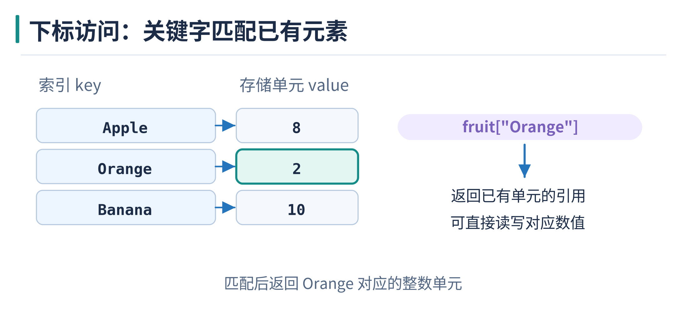

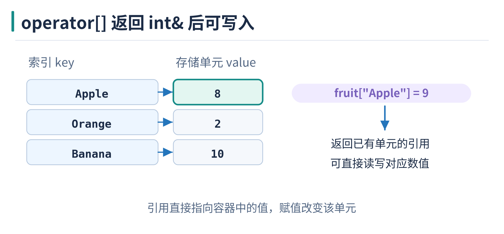

### 操作二：访问此前不存在的键

课件实现先线性扫描名称；找不到时，若容量尚有剩余，就申请新的键名空间，复制字符串，将新元素赋初值 **`mUsed+1`**，然后递增 `mUsed` 并返回新数值的引用。于是课件原示例中：

```cpp
CAssociateVector fruit(8);               // 最多 8 个结点
fruit["Apple"] = 8;                      // 第 1 个元素：之后值为 8
fruit["Orange"];                         // 第 2 个元素：初值为 2
fruit["Banana"] = 10;                    // 第 3 个元素：之后值为 10
fruit["Fruit"] = (fruit["Apple"] + fruit["Orange"] + fruit["Banana"]) / 3; // 整数平均数
```

结果为 `Apple=8`、`Orange=2`、`Banana=10`、`Fruit=6`。最后一个值是 `(8+2+10)/3=20/3`，赋给 `int` 后整数除法得到 **6**。

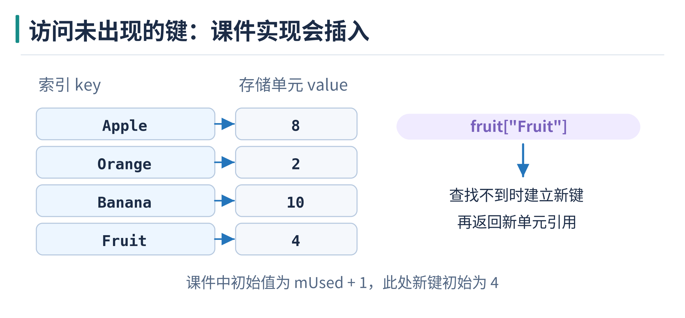

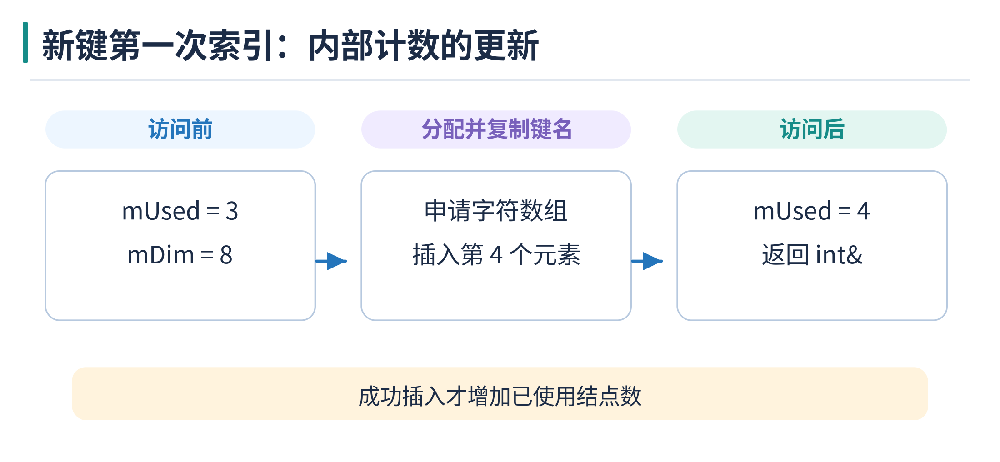

> [!important] 这和 `std::map::operator[]` 的默认插入值不同
> 课件实现的新键整数初值是 **`mUsed+1`**，因此 `Orange=2`；标准库 `std::map<std::string,int>` 新键通常初始化为 `int{}`，即 **0**。不能把课件具体实现的行为混写成标准容器规则。

### 线性查找与容量限制

直接按照课件思路，已有 `mUsed` 个元素时，最坏情况下要逐个比较键名，访问成本随 `mUsed` 增长。`mUsed<mDim` 时才允许新增，因此**满容量**必须处理。

课件第 34 页：若空间不足，就返回 `static int dummy` 的引用。该方案虽使函数能够继续返回 `int&`，却会导致看似赋值成功、实际上只改变共享哑变量，隐藏插入失败。

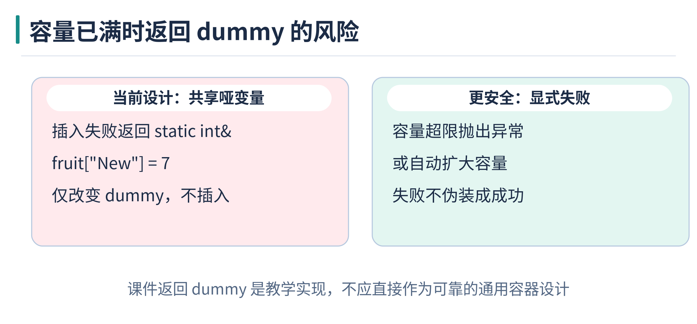

更稳妥的教学实现可以直接抛出 `std::out_of_range`；若不希望定长容量，也可以设计自动扩容。随包附带的 `AssociatedVectorDemo.cpp` 使用 **`std::vector` + `std::string`** 管理存储与名字，但保留**初始值 = 第几个结点**这一课件行为，并采用**容量满时抛异常**，方便在现代 C++ 中复现和理解。

### `new[]` / `delete[]` 与析构函数

课件 `mIndex` 是动态字符串：新增一个名称用 `new char[strlen(idx)+1]` 创建存储；析构时要对每一个名字使用 `delete[]`，最后再对结点数组执行 `delete[]`。

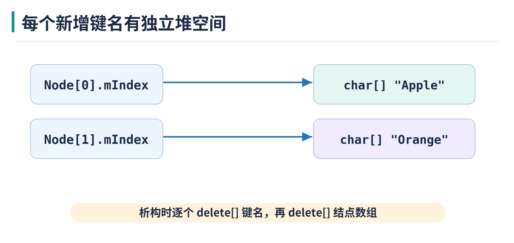

> [!warning] 课件旧代码的资源问题
> 第 32 页使用 `delete mElems[i].mIndex` 的写法无法与 `new char[...]` 正确配对，应改成 `delete[] mElems[i].mIndex`。此外，只有析构而未合理处理复制构造和复制赋值的原始指针类，复制对象可能造成浅拷贝与重复释放；需要完整的资源管理设计，而不是仅改一处释放语句。

### 三文件结构（课件第 28 页）

```text
AssociateVectors.h             类定义、节点结构、成员声明
AssociateVectors.cpp           构造、析构、Print、operator[] 的实现
AssociateVectorsMain.cpp       创建对象、读写键值与打印
```

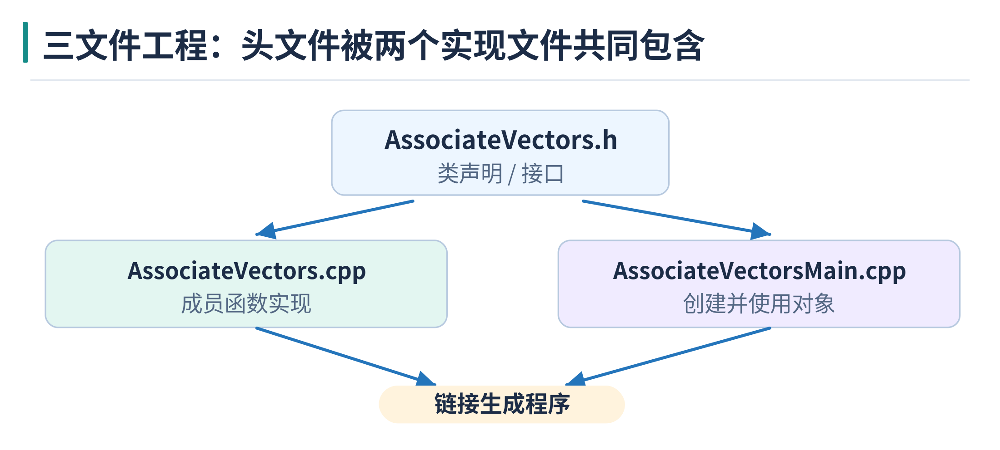

> [!tip] 核心理解
> `[]` 不一定是“根据数字位置访问数组”；它可以由类设计为字符串索引、矩阵坐标索引等。但必须清楚索引访问是只读、可写、可插入，还是可能失败，以及返回的引用在容器修改后是否仍然有效。

---

# 6.4 类类型转换函数

## 6.4.1 标准转换、显式转换和用户定义转换

**类型转换**：把一个类型的值变为另一个类型的值。课件先介绍内置类型的隐式转换和 C 风格显式转换，再重点讨论自定义类与内置数值之间的转换。

```cpp
double a = 5;                               // int -> double：标准隐式转换
int b = static_cast<int>(3.9);             // double -> int：显式转换，截去小数部分
```

用户定义类型有两条重要方向：

| 转换方向 | 典型机制 | 含义 |
|---|---|---|
| 基本值 → 类对象 | 转换构造函数 `CComplex(double)` | 用一个数构造一个复数 |
| 类对象 → 基本值 | 转换函数 `operator double() const` | 按类作者定义的方式得到数值 |

## 6.4.2 转换构造函数：基本类型到类

课件复数类构造函数 `CComplex(double r=0, double i=0)` 允许只给一个数。没有 `explicit` 时，某些场合可把 `5` 自动构造成虚部为零的复数 `CComplex(5,0)`。

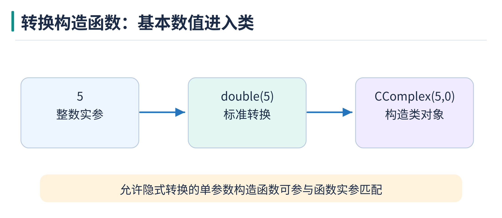

```cpp
class CComplex {
    double r_, i_;                                // 两个数据成员
public:
    CComplex(double r = 0, double i = 0)          // 非 explicit 的转换构造函数
        : r_(r), i_(i) {}                         // 设置实部与虚部

    CComplex Add(const CComplex& other) const {   // 接受一个复数
        return CComplex(r_ + other.r_, i_ + other.i_); // 返回计算结果
    }
};

CComplex z(3, 4);                                 // 初始复数
CComplex sum = z.Add(5);                          // 5 隐式转为 CComplex(5,0)
```

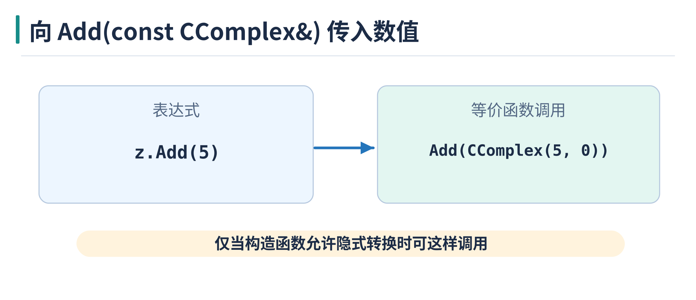

> [!warning] 自动转换会提高方便性，也可能隐藏意外操作
> 单参数可调用的构造函数是否允许隐式转换，需要根据类的实际数学意义决定。现代 C++ 常使用 `explicit` 防止无意间自动创建对象。

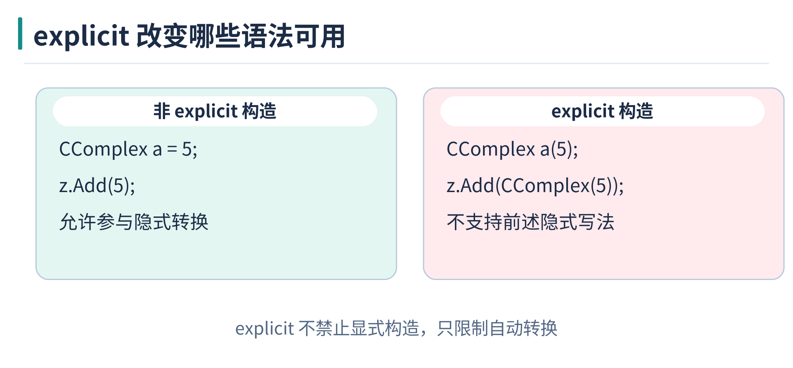

```cpp
class CComplex {
public:
    explicit CComplex(double r, double i = 0);    // 不允许从数字隐式生成复数
};

CComplex a(5);                                    // 正确：直接构造
// CComplex b = 5;                                // 错误：复制初始化需要隐式转换
```

`explicit` 不妨碍 `CComplex(5)` 这种明确写出构造函数的调用。注意：**是否该用 explicit 取决于 API 设计**，不能把课件中的非 explicit 构造函数一律判为错误；它只是允许隐式转换的选择。

## 6.4.3 类到基本类型：`operator double() const`

课件第 39—40 页定义复数到 `double` 的转换：**把复数转成模长**。若 $z=a+bi$，则

$$
|z|=\sqrt{a^2+b^2}
$$

当 $z=3+4i$ 时，模长是 $5$。转换运算符的函数声明**不单独写返回类型**，因为类型已经出现在 `operator double` 中。

```cpp
#include <cmath>                                 // std::hypot

class CComplex {
    double r_, i_;                               // 实部、虚部
public:
    CComplex(double r, double i) : r_(r), i_(i) {} // 构造函数

    operator double() const {                    // 转换目标类型写在 operator 后
        return std::hypot(r_, i_);               // 得到 sqrt(r*r+i*i) 的稳定实现
    }
};
```

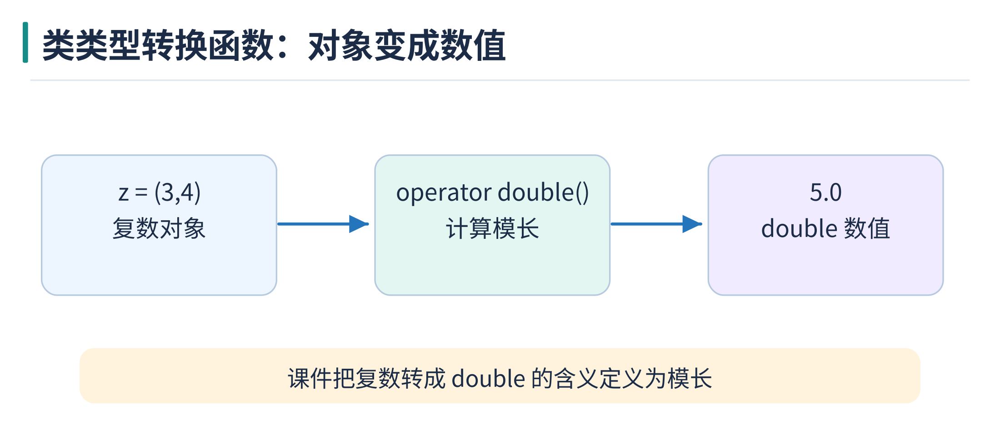

课件中的三种使用思路：

```cpp
CComplex z(3, 4);                                // 一个模长为 5 的复数
double a = double(z);                             // 函数式显式类型转换
double b = z.operator double();                   // 显式调用转换函数
double c = static_cast<double>(z);                // 推荐的清晰写法
```

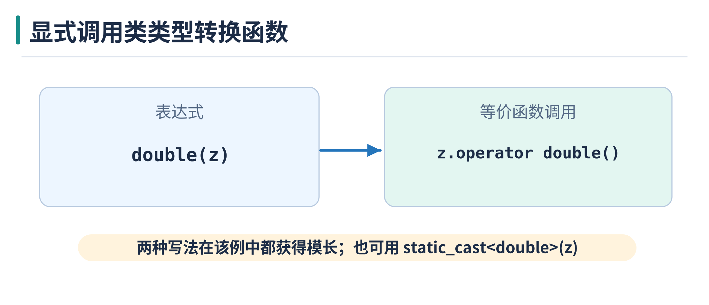

如果 `operator double()` 是非 `explicit`，在需要 `double` 的表达式里也可能发生隐式转换，例如课件中的 `sqrt(z)`。**其含义不是求复数平方根，而是先取模长，再求这个实数的平方根。**

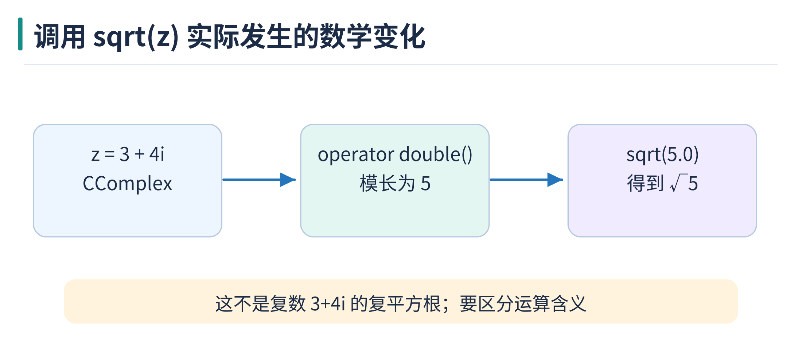

> [!important] `explicit operator double()` 的作用
> 将转换运算符声明为 `explicit operator double() const` 后，`static_cast<double>(z)` 等显式转换仍可用，而要求自动转成 `double` 的一般函数实参不再依靠该转换。对于“复数 → 模长”这种**损失虚部与相位信息**的转换，显式转换通常更易维护。

## 6.4.4 类型转换与重载二义性

重载和用户定义转换可以一起使用，但若一个对象能通过多条路径参与同一调用，可能产生意外歧义。需要记住：**合法候选不等于有唯一最佳候选**；应从调用点反向检查所有转换路径。

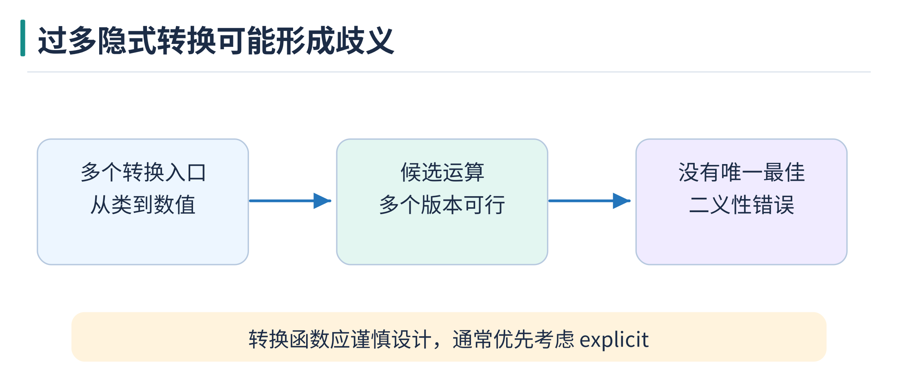

### 旧式强制类型转换与指针安全

课件第 37 页将显式转换列为 `(类型)表达式`、`类型(表达式)`，并谈到不同指针类型的转换。现代 C++ 更推荐意图明确的 `static_cast`、`dynamic_cast`、`const_cast`、`reinterpret_cast`（用途各异），但**能够写出指针转换，不等于转换后的解引用安全**。

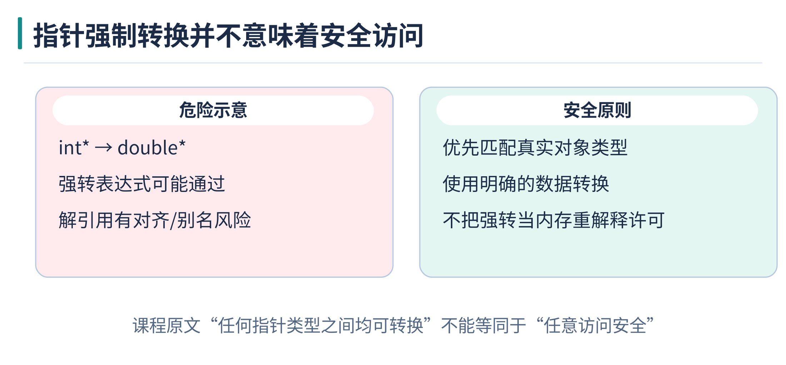

例如把 `int*` 强行转成 `double*` 再解引用，可能同时触及对象实际类型、内存对齐、别名访问规则等问题。想要把一个整数的数值转换为 `double`，应直接进行值转换，而不是重解释其二进制地址。

---

# 课件代码校订与现代 C++ 使用习惯

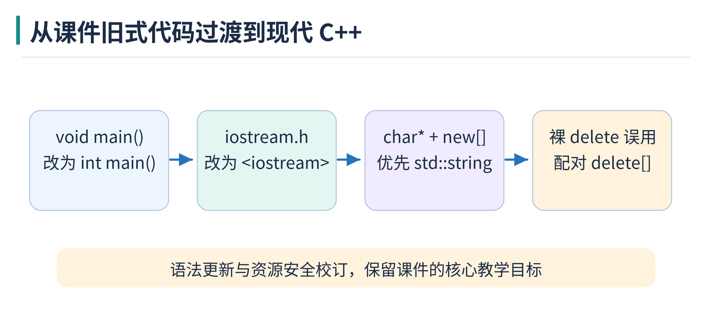

| 课件出现的写法或说法 | 推荐规范化处理 | 原因 |
|---|---|---|
| `void main()` | `int main()` | 标准 C++ 主程序入口返回 `int` |
| `<iostream.h>` | `<iostream>` 及 `std::` | 标准库命名空间与标准头文件 |
| `char*` 直接赋值 | 深拷贝或使用 `std::string` | 避免指针别名与重复释放 |
| `new char[n]` / `delete p` | `new char[n]` / `delete[] p` | 数组分配与释放须配对 |
| `operator>>(istream&,T&)` 内提示用户 | 输入与界面提示分开 | 方便复用文件流、字符串流 |
| 满容量返回共享 `dummy` | 抛异常或扩容 | 防止把插入失败伪装成成功 |
| “基类/派生类同名就是重载” | 先分析隐藏与名称查找 | 不同作用域不能直接按普通同域重载处理 |
| 运算符不可重载名单混入 `*`、`->*` | 明确它们均可重载 | 不应机械记忆课件存在的符号混排 |

> [!note] 保留与校订的边界
> 以上校订不改变课件所讲的重载、赋值、流输入输出及类类型转换的学习目标；它们主要解决现代标准兼容性、资源安全和概念严谨性。课件的 `CComplex` 递增“实部和虚部都 +1”是类作者定义的教学示例，并非复数在数学上唯一应有的递增含义。

---

# 综合例题与课后作业

## 例题 1：判断哪种表达式合法

已知 `struct Number { Number(int); Number operator+(const Number&) const; };`，仅提供**成员 `operator+`**，且构造函数不带 `explicit`。

1. `Number n(2); n + 3;`：合法。右操作数整数可隐式构造为 `Number`。
2. `3 + n;`：在此定义下不合法。左侧的原生 `int` 不会把 `n` 的成员函数拿来当左操作数上的成员函数。
3. 若另外定义恰当的非成员 `operator+(Number,Number)`：可能使 `3+n` 合法；仍需注意已有成员版本是否造成其它调用歧义。

## 例题 2：跟踪前置与后置

```cpp
CComplex x(2, 3);                     // 初始为 (2,3)
CComplex a = x++;                    // a = (2,3)；x 变为 (3,4)
CComplex b = ++x;                    // x 再变为 (4,5)；b = (4,5)
```

**结论**：最后 `x=(4,5)`、`a=(2,3)`、`b=(4,5)`。最稳定的做法是先单独追踪对象最终状态，再追踪该表达式的返回值，避免混淆。

## 例题 3：相关向量中的键值追踪

按课件初始化规则，执行 `fruit["A"]=7; fruit["B"]; fruit["C"]=3;`，得到 `A=7, B=2, C=3`。如果此时计算 `fruit["D"]=(fruit["A"]+fruit["B"]+fruit["C"])/3;`，新键 D 最初自动赋值 4，但**立刻被右侧计算结果赋值覆盖**，最后 D 为 `(7+2+3)/3=4`。

## 作业 10：复数加、减、乘、除

课件布置实现两个复数的四则运算。加减法已在本讲正文给出；乘法与除法公式为：

$$
(a+bi)(c+di)=(ac-bd)+(ad+bc)i
$$

$$
\frac{a+bi}{c+di}=\frac{ac+bd}{c^2+d^2}+\frac{bc-ad}{c^2+d^2}i,\qquad c^2+d^2\ne 0
$$

应在除法时检查除数是否为零；`operator+`、`operator-`、`operator*`、`operator/` 通常可按值返回新对象。ZIP 内的 `ComplexDemo` 提供加减和流、递增、转换的可编译演示，可在其基础上独立补充乘除。

## 作业 11：有理数的四则运算

令 $a/b$、$c/d$ 为两个有理数（$b,d\ne0$）：

$$
\frac ab+\frac cd=\frac{ad+bc}{bd},\qquad
\frac ab-\frac cd=\frac{ad-bc}{bd}
$$

$$
\frac ab\cdot\frac cd=\frac{ac}{bd},\qquad
\frac ab\div\frac cd=\frac{ad}{bc}\quad(c\ne0)
$$

使用整数分子分母；构造时应检查分母非零、约分并统一分母符号。不要将整数除法写成“小数近似”后再反向转换，避免破坏精确分数语义。

## 作业 12：矩阵的加、减、乘

矩阵加减的前提是**行列数完全相同**；若 $A$ 为 $m\times n$、$B$ 为 $n\times p$，矩阵乘积 $AB$ 的尺寸为 $m\times p$，第 $(i,j)$ 项是

$$
(AB)_{ij}=\sum_{k=1}^{n}A_{ik}B_{kj}
$$

矩阵乘法不等同逐元素相乘，且一般不满足交换律 `A*B == B*A`。建议用二维 `std::vector` 保存矩阵元素，对尺寸不匹配的运算显式报错。

---

# 速查与自检

| 要求 | 典型写法 / 结论 |
|---|---|
| 两个普通同名函数的区别 | 不能只改返回值；应有可区分的参数列表 |
| 二元成员 `+` | `a.operator+(b)`，一个显式参数 |
| 二元非成员 `+` | `operator+(a,b)`，两个显式参数 |
| 复制赋值 | `T& operator=(const T&)`，返回 `*this` 引用 |
| 前置自增 | `T& operator++()`，先改再返回 |
| 后置自增 | `T operator++(int)`，先存旧值、再改，返回旧值 |
| 成员下标 | `int& operator[](const std::string&)` 可支持赋值 |
| 流输出与输入 | 返回 `std::ostream&` / `std::istream&` 以实现链式操作 |
| 转换构造 | `CComplex(double)` 将数值变成类对象 |
| 类型转换函数 | `operator double() const`，不写单独返回类型 |
| 隐式转换限制 | `explicit` 使转换必须明确写出（少数上下文有特例） |
| 原始动态数组释放 | `new[]` 必须匹配 `delete[]` |

> [!summary] 五条最重要的理解线索
> 1. **重载决议**：先可见，后可行，再比最佳。
> 2. **运算符是函数**：分清成员的隐含左操作数与非成员的全部显式参数。
> 3. **返回值与引用**：新结果通常值返回，返回当前对象通常引用返回。
> 4. **对象生命周期**：动态资源的复制、赋值、析构要协调，不能只复制地址。
> 5. **隐式转换**：便利性必须以明确、无歧义的语义为前提。

## 随包可编译代码

资源文件夹 `code/` 中包括：

- `ComplexDemo/Complex.h`、`Complex.cpp`、`main.cpp`：课程复数类的四个重点——加减、流输入输出、前后置递增递减、转 `double`。
- `AssociatedVectorDemo.cpp`：模拟课件的字符串键索引、未命中插入与 `int&` 赋值，使用现代资源管理方式。

示例源码使用 **C++17** 编译，目的是复现本讲核心机制；源文件保留了关键注释，适合继续独立扩展课后作业。按本规范，将本 ZIP 内唯一的资源文件夹移动到当前 Obsidian 仓库根目录已有的 `Assets/` 之下，再把这份 Markdown 放入任意知识笔记位置即可。图片采用**仓库完整路径 Wiki 嵌入**，普通 Markdown/HTML 阅读器未必直接识别该链接方式。
