# GPT7 C++ 第七讲｜继承与派生类（图解系统笔记）

> [!info] 来源与整理说明
> 主体依据所附《07_C++ZGS第七讲继承与派生类.pptx》72 页课件，保留课程的 **7.1—7.6** 组织及 CPoint/CCircle、CComplex/CNamedComplex、CPerson/CDate/CChiefExecutive、CBird/CBeast/CBat/CAnimal 四组代表性例程。已按《知识整理 Skills 4.3》重组解释和增加原创图解。
>
> **原课件内容**与**现代标准 C++ 的必要校订**分别说明；旧代码中不规范的 `void main()`、手动字符数组管理和虚基类构造限制，不能直接照抄为现代 C++ 规范。

**本讲主线：** 为什么要继承 → 派生类如何定义 → 哪些成员可访问 → 派生对象能否当基类使用 → 构造析构执行顺序 → 多重继承歧义与虚基类共享。

| 本讲知识 | 最值得掌握的具体问题 |
|---|---|
| 7.1 继承机制 | `CCircle` 中究竟包含哪些 `CPoint` 成员？ |
| 7.2 派生类定义 | `public CPoint`、成员对象和同名成员函数是什么关系？ |
| 7.3 访问权限 | `public` / `protected` / `private` 继承如何改变访问？ |
| 7.4 赋值兼容 | `CPoint& = CCircle` 与 `CPoint = CCircle` 为什么不同？ |
| 7.5 生命周期 | 基类、成员对象、派生类谁先构造、谁先析构？ |
| 7.6 多重继承 | 菱形里有几份 `CAnimal`？谁构造虚基类？ |

---

# 7.1 继承机制及引入理由

## 7.1.1 继承的意义及类别

**继承（inheritance）** 是一种类之间的机制：新类（派生类/子类）在已有类（基类/父类）的基础上复用其功能，并添加或修改自己的数据和行为。继承结构通常体现一种 **is-a**（“属于某一类”）关系，而不是“拥有某物”的 **has-a** 关系。

从课件角度看，它的设计动机有两条：**共享公共特性**与**保留派生类自身差异**。把所有共性都写在不同类中会造成代码重复；抽取一个基类能形成清晰的层次。继承类型分为单一继承（一个直接基类）与多重继承（多个直接基类）。

> [!warning] 不要用“想复用代码”作为继承的唯一理由
> `is-a` 不成立时，成员对象（组合）、函数复用等机制通常更合适。课程里的“圆继承点”是一种便于演示 C++ 语法的设计，真实几何建模中“圆拥有圆心”也可以自然地使用组合。


**图组：继承层级、单继承与多重继承**


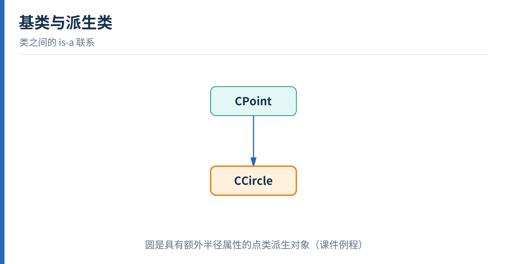

*圆是具有额外半径属性的点类派生对象（课件例程）*


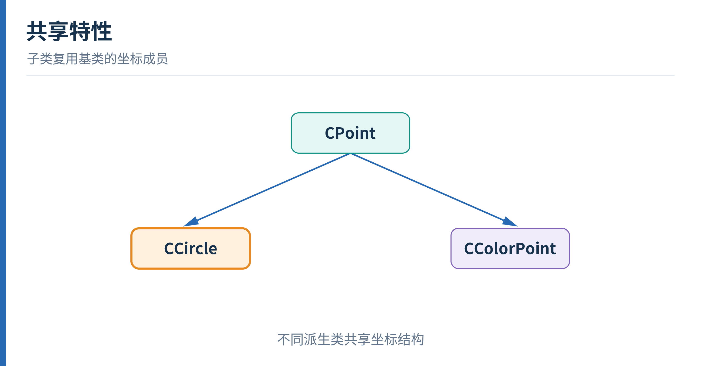

*不同派生类共享坐标结构*


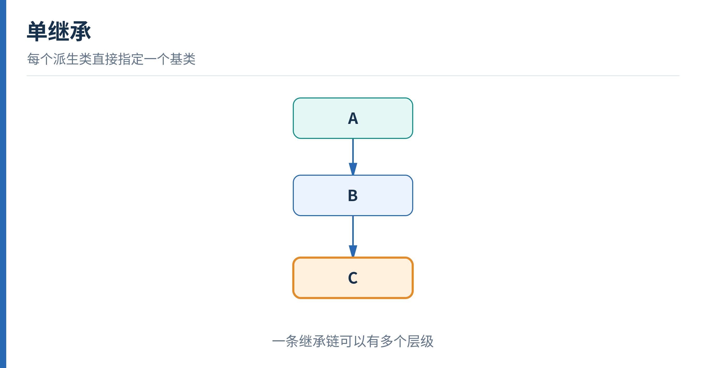

*一条继承链可以有多个层级*


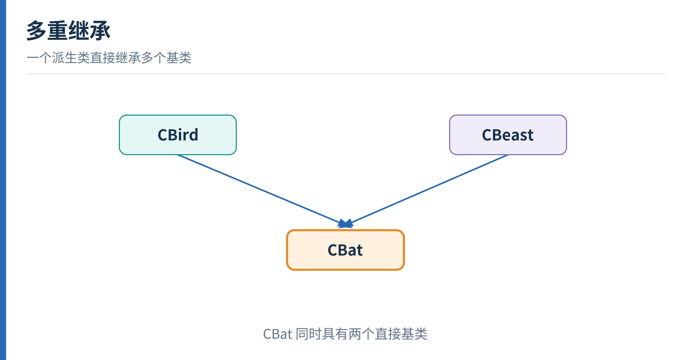

*CBat 同时具有两个直接基类*


## 7.1.2 点类、圆类与派生对象的组成

课件使用 `CPoint` 保存二维坐标，`CCircle` 公有继承 `CPoint` 并增加半径 `mR`。**CCircle 对象内部有一个 CPoint 基类子对象**；继承不意味着派生类重新“声明了一遍”基类成员。

- `CPoint`：`mX`、`mY`，构造函数、析构函数、`Show()`。
- `CCircle`：通过基类子对象保存圆心坐标，新增 `mR`，可定义自己的 `Show()`。
- 从 `CCircle` 访问 `mX`、`mY` 的前提是它们是 `protected`（或公开成员），若它们是 `private`，派生类不能直接读写。

> [!important] 对象子结构
> “继承来的成员”在对象内部属于基类子对象。继承类型主要改变 **可访问性与转换性质**，不意味着被禁止访问的基类私有数据会从对象中消失。


**图组：同一个圆对象从基类与派生类视角观察**


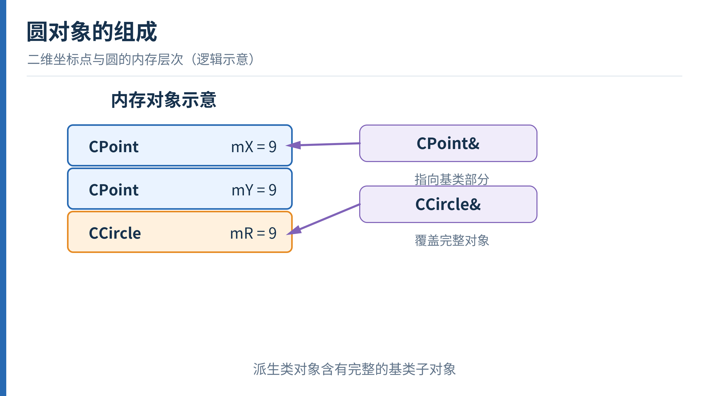

*派生类对象含有完整的基类子对象*


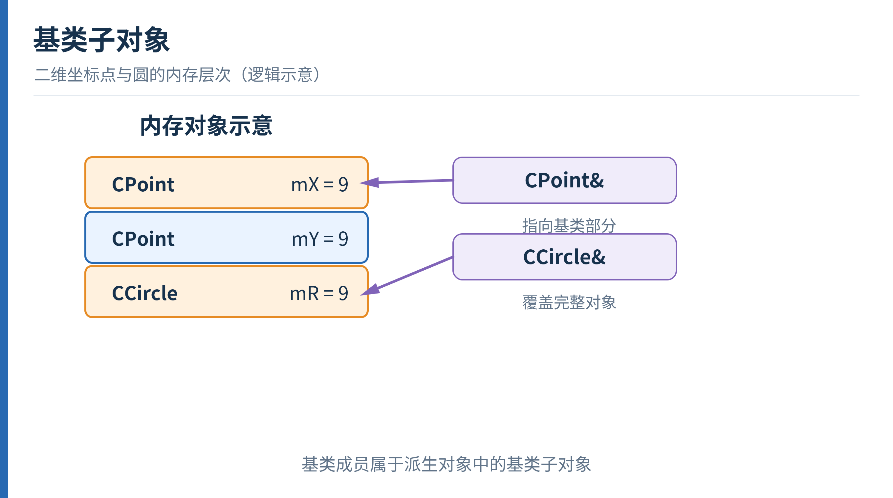

*基类成员属于派生对象中的基类子对象*


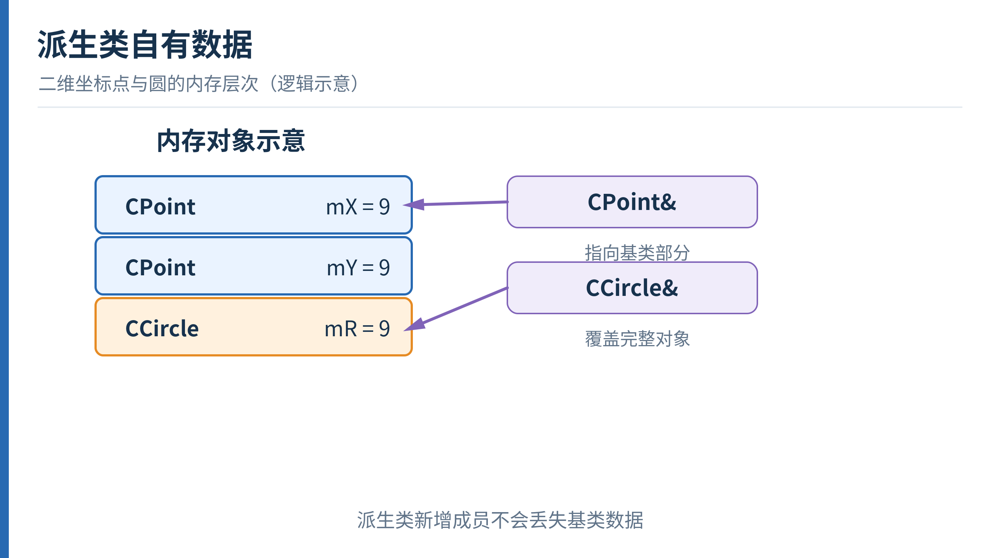

*派生类新增成员不会丢失基类数据*


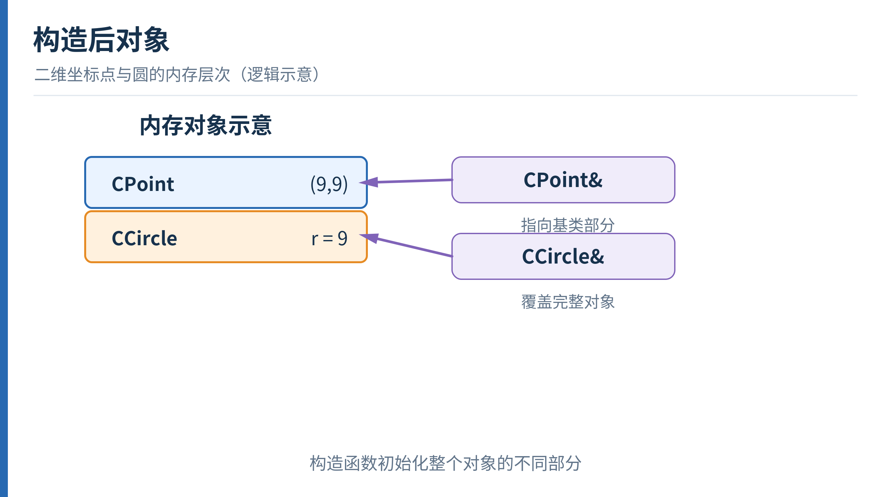

*构造函数初始化整个对象的不同部分*


## 7.1.3 成员函数隐藏与显式调用

若两个类都声明了 `void Show() const`，`CCircle` 中这个同名声明会**隐藏**基类的同名成员；可显式写 `zCircle.CPoint::Show()` 调用基类版本。**隐藏（name hiding）** 是名称查找规则，而**重写（override）** 必须讨论虚函数，本讲 `Show()` 不是 `virtual`。

在课件的 `main` 调用顺序中：`zPoint.Show()` 调用 `CPoint::Show()`；`zCircle.Show()` 调用 `CCircle::Show()`；`zCircle.CPoint::Show()` 调用基类版本。


**图组：同名 Show 的静态查找与显式限定**


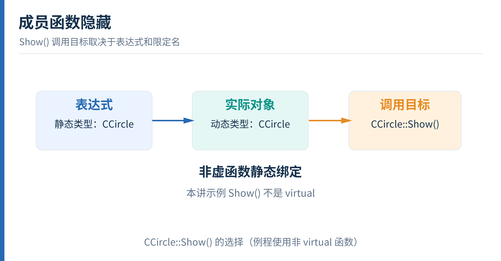

*CCircle::Show() 的选择（例程使用非 virtual 函数）*


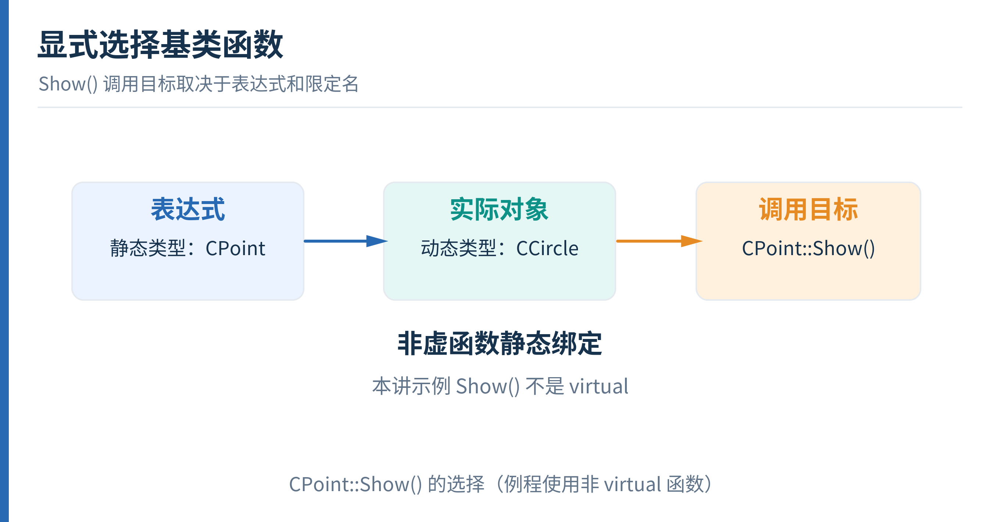

*CPoint::Show() 的选择（例程使用非 virtual 函数）*


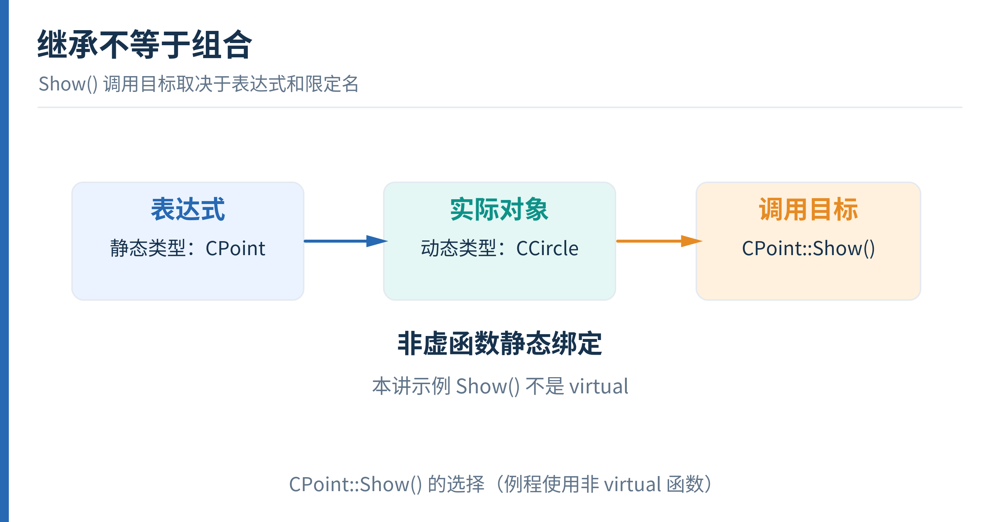

*CPoint::Show() 的选择（例程使用非 virtual 函数）*


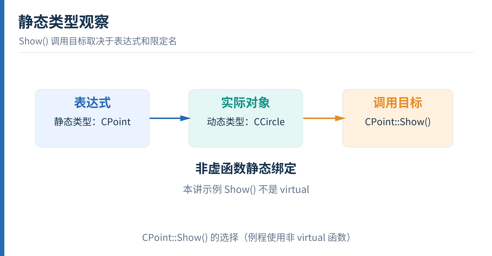

*CPoint::Show() 的选择（例程使用非 virtual 函数）*


# 7.2 继承实现机制：派生类定义

## 7.2.1 派生类语法与基类列表

C++ 用冒号后的**基类说明列表**定义继承。基本格式：

```cpp
class Derived : public Base {  // 公有继承 Base
public:
    Derived(int x);              // 声明派生类构造函数
};
```

**语法中的 `public` 属于继承方式，不是后面类体内的 `public:` 成员访问区段。** C++ 的 `class` 默认继承方式是 `private`，`struct` 默认是 `public`，最好显式写出避免误解。

在一个类中也可以指定两个直接基类：

```cpp
class CBat : public CBird, public CBeast {  // 按先 Bird 后 Beast 的次序声明
public:
    CBat();                                   // 声明构造函数
};
```

这里 `CBat` 的**直接非虚基类**构造按 `CBird`、`CBeast` 的声明顺序进行；与构造函数初始化列表中的书写先后无关。


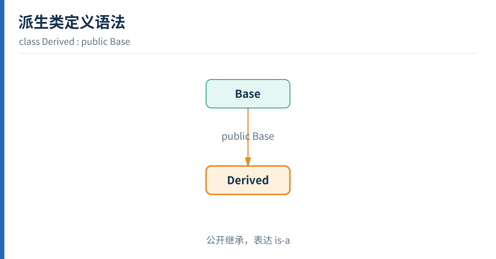

*公开继承，表达 is-a*


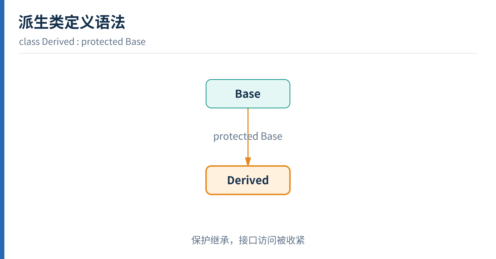

*保护继承，接口访问被收紧*


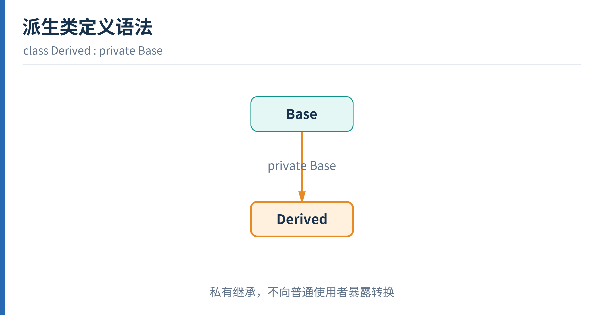

*私有继承，不向普通使用者暴露转换*


**图组：拆解继承声明与初始化列表语法**


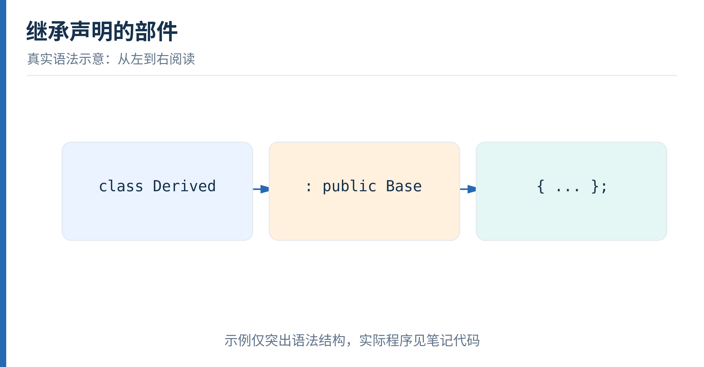

*示例仅突出语法结构，实际程序见笔记代码*


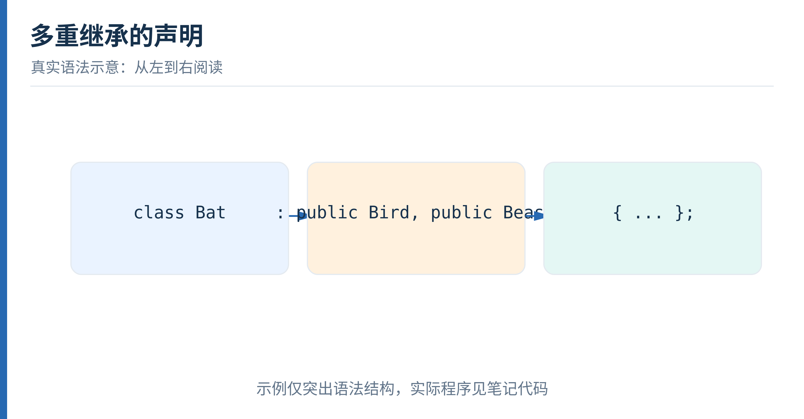

*示例仅突出语法结构，实际程序见笔记代码*


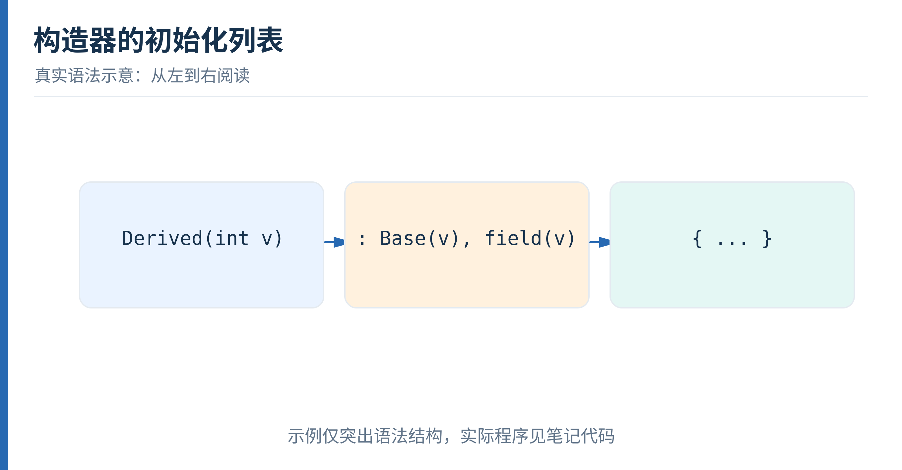

*示例仅突出语法结构，实际程序见笔记代码*


## 7.2.2 完整的单继承例程（现代标准写法）

下面保留课件中“点—圆”的类名与行为，但把 `void main()` 修正为标准的 `int main()`，并使用**成员初始化列表**。可以直接在 C++17 环境编译执行。

**Point.h**


```cpp
#ifndef CPOINT_H
#define CPOINT_H

#include <iostream>                         // 使用 std::cout

class CPoint {
protected:
    int mX, mY;                             // 派生类可以访问的坐标
public:
    CPoint(int x = 0, int y = 0);           // 声明有默认参数的构造函数
    void Show() const;                      // 不改变对象的成员函数
    ~CPoint();                              // 基类析构函数，课件示例为非虚
};

#endif
```


**Point.cpp**


```cpp
#include "Point.h"                         // 引入 CPoint 声明

CPoint::CPoint(int x, int y) : mX(x), mY(y) {  // 初始化坐标
    std::cout << "Point...\n";              // 输出构造提示
}

void CPoint::Show() const {
    std::cout << "X = " << mX << ", Y = " << mY << '\n'; // 输出坐标
}

CPoint::~CPoint() {
    std::cout << "Delete Point!\n";         // 输出析构提示
}
```


**Circle.h**


```cpp
#ifndef CCIRCLE_H
#define CCIRCLE_H

#include "Point.h"                         // 定义基类时必须可见完整类型

class CCircle : public CPoint {             // CCircle 公有继承 CPoint
    int mR;                                 // 新增半径
public:
    CCircle(int x, int y, int r);           // 声明派生类构造函数
    void Show() const;                      // 隐藏基类同名 Show
    ~CCircle();                             // 声明析构函数
};

#endif
```


**Circle.cpp**


```cpp
#include "Circle.h"                        // 获得派生类声明

CCircle::CCircle(int x, int y, int r)
    : CPoint(x, y), mR(r) {                 // 先初始化基类，再初始化半径
    std::cout << "Circle...\n";            // 输出构造提示
}

void CCircle::Show() const {
    std::cout << "圆心为点(" << mX << ", " << mY << ")\n"; // 访问保护坐标
    std::cout << "半径为 " << mR << '\n';   // 输出新增数据
}

CCircle::~CCircle() {
    std::cout << "Delete Circle!\n";       // 先输出本类析构提示
}
```


**main.cpp**


```cpp
#include "Circle.h"                       // 包含完整的派生类声明

int main() {
    CPoint point(7, 1);                    // 创建基类对象
    CCircle circle(9, 9, 9);               // 创建派生类对象，先构造基类
    point.Show();                          // 调用基类 Show
    circle.Show();                         // 调用派生类 Show
    circle.CPoint::Show();                 // 显式调用基类 Show
    return 0;                              // 标准 main 函数返回值
}
```


**编译方式：** `g++ -std=c++17 Point.cpp Circle.cpp main.cpp -o demo && ./demo`。

**输出：**

```text
Point...
Point...
Circle...
X = 7, Y = 1
圆心为点(9, 9)
半径为 9
X = 9, Y = 9
Delete Circle!
Delete Point!
Delete Point!
```

构造和析构的关键机制将在 7.5 单独展开。这里的非虚析构函数只用于示范局部对象；**不要通过 `CPoint*` 删除动态创建的 `CCircle` 对象**，那需要基类虚析构函数。


**图组：Point/Circle 三文件组织与依赖**


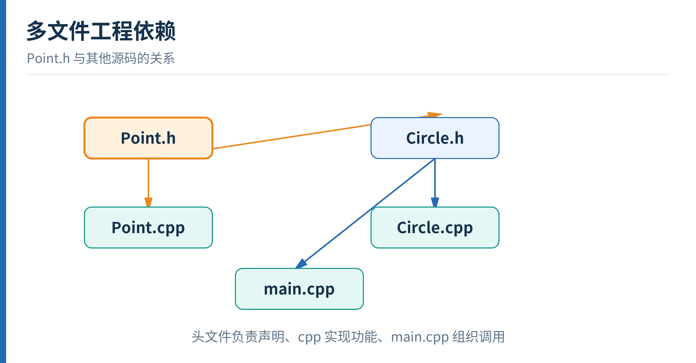

*头文件负责声明、cpp 实现功能、main.cpp 组织调用*


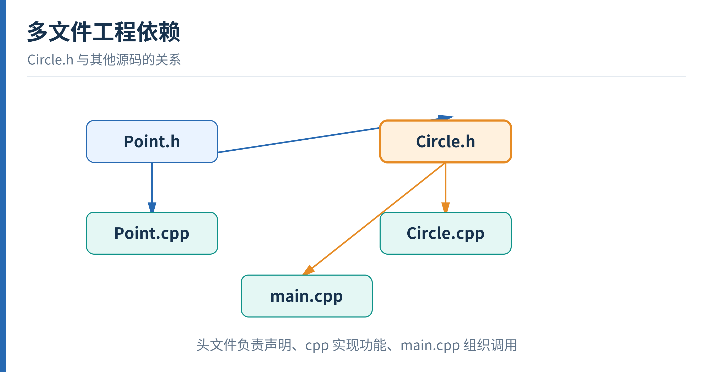

*头文件负责声明、cpp 实现功能、main.cpp 组织调用*


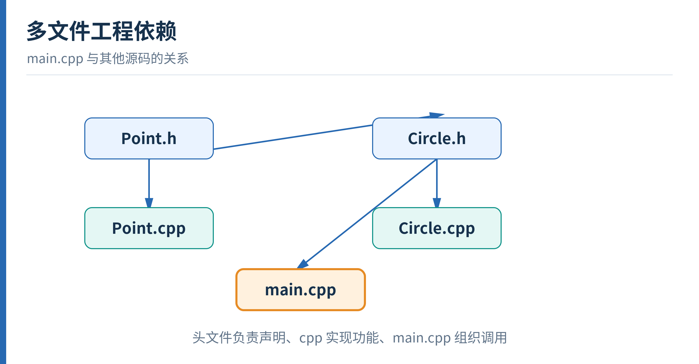

*头文件负责声明、cpp 实现功能、main.cpp 组织调用*


## 7.2.3 复数类与有名复数类

课件的第二个案例是 `CComplex`（保存实部、虚部）与 `CNamedComplex`（额外保存名称）。此例用来说明：

1. **继承只处理共性部分。** 实部、虚部、复数运算由基类承担。
2. **派生类拥有自己的数据。** `mpName` 指向名称字符数组（课件写法）。
3. 派生类构造先初始化基类，再管理自己的名称资源。
4. 派生类对基类重名 `SetValues` 需注意名称隐藏，可使用 `CComplex::SetValues(r, i)`。

> [!warning] 课件手动管理 `char*` 的安全问题
> 课件通过 `new char[]` 和 `delete[]` 管理名字。这需要仔细处理**复制构造、复制赋值**和异常情况，否则编译器默认浅拷贝可能导致重复释放；`SetValues` 若传入指向旧内部数组的指针，还可能产生悬空读取。现代 C++ 通常优先 `std::string`，而不是照抄旧代码。


**图组：名字指针的分配、替换、释放全过程**


> [!example]- 展开连续插图（5 幅）
> 这些图从不同时间或访问视角展示同一机制，请依次对照。
>
> 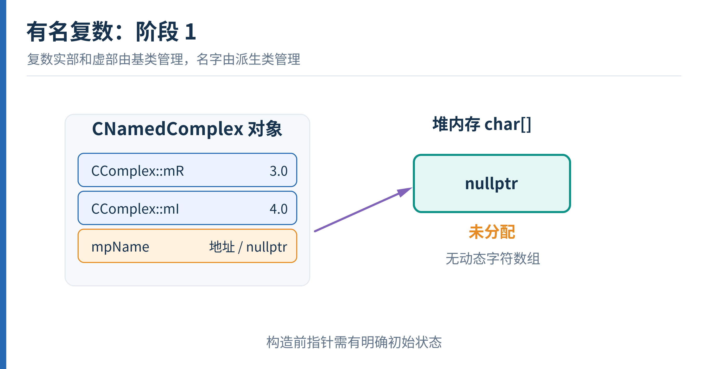
> *构造前指针需有明确初始状态*
>
> 
> *new[] 创建动态字符串数组*
>
> 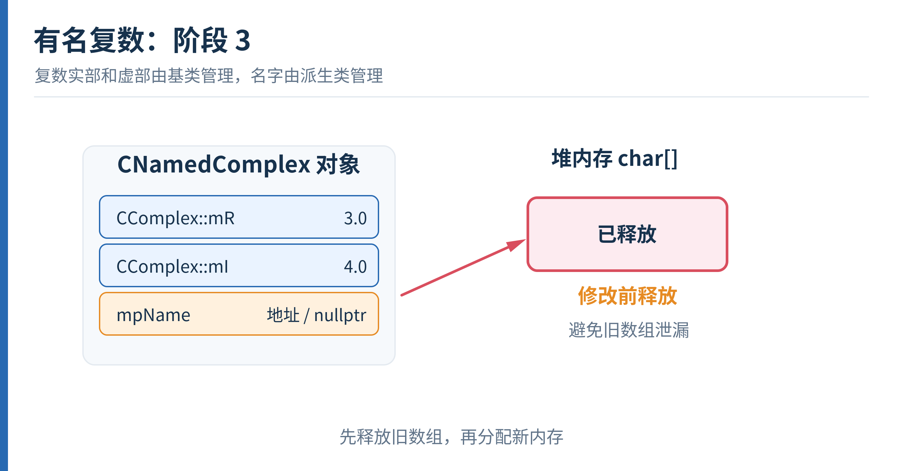
> *先释放旧数组，再分配新内存*
>
> 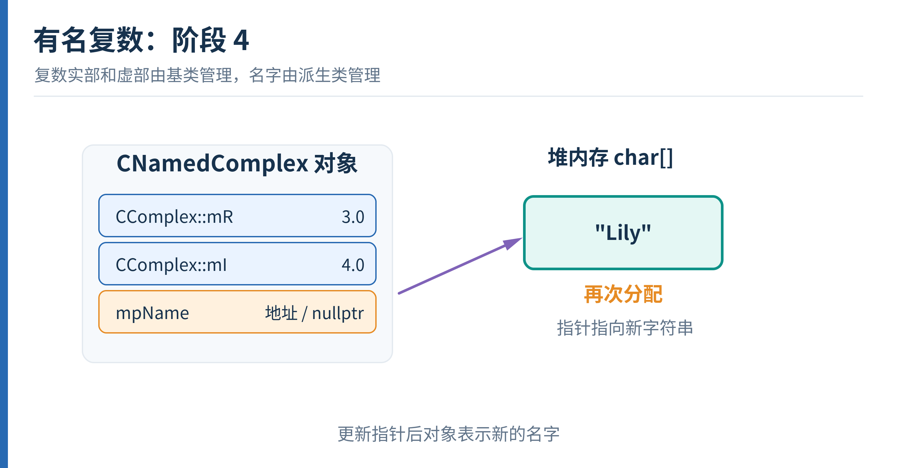
> *更新指针后对象表示新的名字*
>
> 
> *析构时配对 delete[] 释放资源*


**适合学习阶段的安全改写：**


```cpp
#include <string>                          // 使用标准字符串

class CComplex {
protected:
    double mR, mI;                         // 复数实部、虚部
public:
    CComplex(double r, double i) : mR(r), mI(i) {} // 初始化复数值
    void SetValues(double r, double i) { mR = r; mI = i; } // 修改复数值
};

class CNamedComplex : public CComplex {   // 通过继承复用实部、虚部
    std::string mName;                    // 自动管理字符内存
public:
    CNamedComplex(const std::string& name, double r, double i)
        : CComplex(r, i), mName(name) {}  // 基类先于成员初始化
    void SetValues(const std::string& name, double r, double i) {
        mName = name;                      // 安全更新字符串
        CComplex::SetValues(r, i);        // 明确调用基类版本
    }
};
```


## 7.2.4 继承与组合不能混淆

`class Circle : public Point` 是继承；`class ChiefExecutive { Date date; };` 中的 `Date` 是**成员对象（组合）**。成员对象和基类对象都会参与构造过程，但**不会**因此变成同一种类型关系。


**图组：继承关系、组合关系与层次变化**


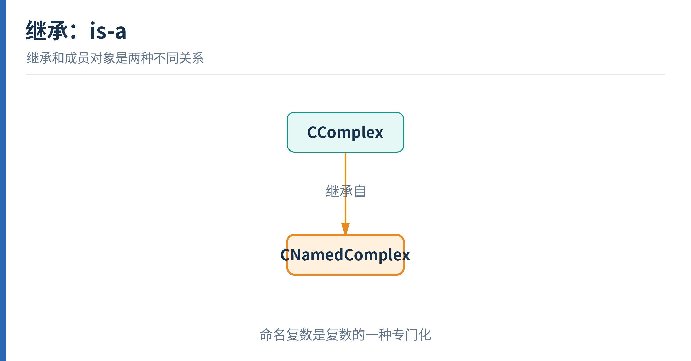

*命名复数是复数的一种专门化*


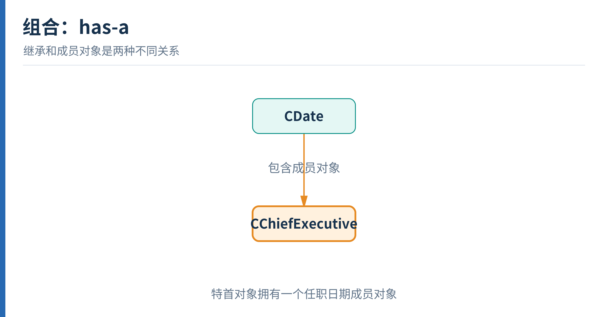

*特首对象拥有一个任职日期成员对象*


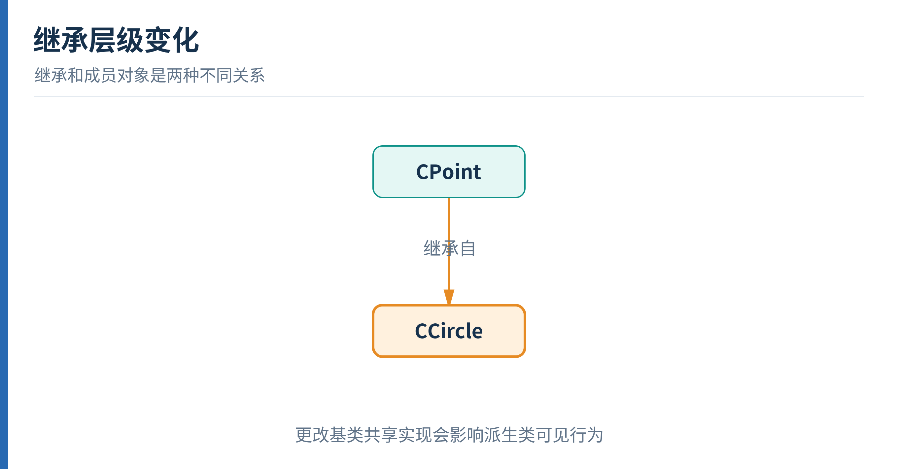

*更改基类共享实现会影响派生类可见行为*


## 7.2.5 同名函数与查找规则

派生类声明一个 `SetValues(std::string, double, double)`，并不自动与基类的 `SetValues(double, double)` 组成一个跨类重载集。**名称查找先看派生类作用域**；找到同名成员后通常隐藏基类同名声明。需要基类成员时可显式限定 `Base::SetValues(...)`；也可以在适用情况下使用 `using Base::SetValues;` 引入重载候选，但本讲以**显式限定**为主。


**图组：名称隐藏与指定调用目标**


> [!example]- 展开连续插图（4 幅）
> 这些图从不同时间或访问视角展示同一机制，请依次对照。
>
> 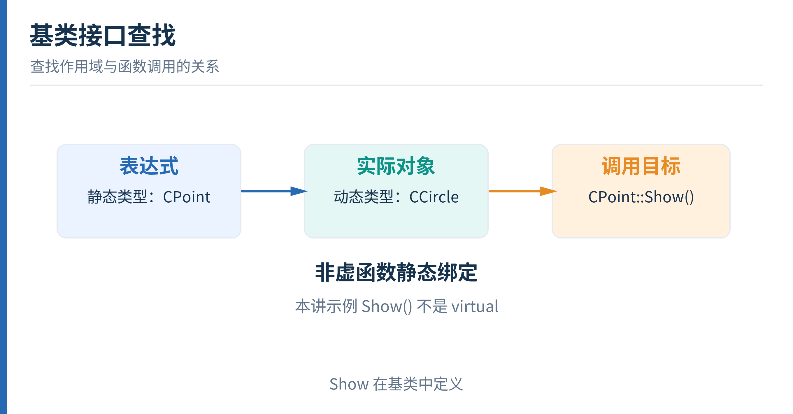
> *Show 在基类中定义*
>
> 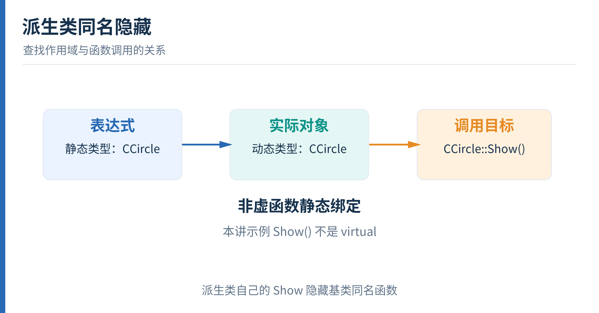
> *派生类自己的 Show 隐藏基类同名函数*
>
> 
> *可使用 object.CPoint::Show() 指定基类函数*
>
> 
> *派生类定义同名函数后，基类重载集通常被隐藏*


# 7.3 派生类对基类成员的访问权

## 7.3.1 两套权限必须同时看

**判断某个成员能否访问，要区分两件事：**

1. 成员在**基类中原来是** `public` / `protected` / `private` 哪一种。
2. 派生时指定的是 **`public` / `protected` / `private` 继承**哪一种；这还关系到最终从派生类外部观察的可访问级别。

**直接派生类中，继承后的访问级别（课件核心表）：**

| 基类原成员 | `public` 继承后 | `protected` 继承后 | `private` 继承后 |
|---|---|---|---|
| `public` | `public` | `protected` | `private` |
| `protected` | `protected` | `protected` | `private` |
| `private` | 不可直接访问 | 不可直接访问 | 不可直接访问 |

**“不可直接访问”不表示该数据已被删除。** 基类自己的成员函数仍然可以按其权限操作自己的私有数据。派生类可以调用适当公开或保护的基类接口来间接完成操作。


**图组：公有继承时三类基类成员**


> [!example]- 展开连续插图（3 幅）
> 这些图从不同时间或访问视角展示同一机制，请依次对照。
>
> 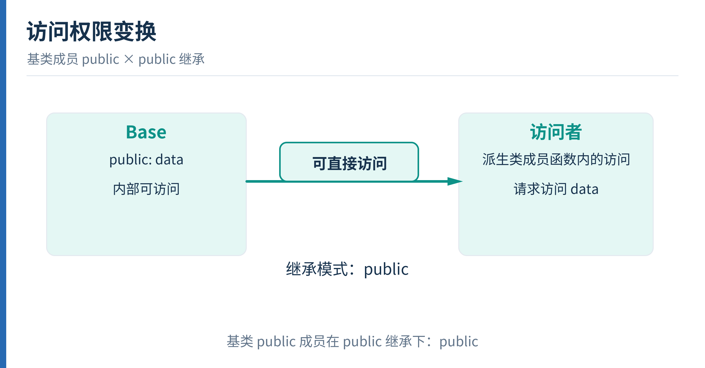
> *基类 public 成员在 public 继承下：public*
>
> 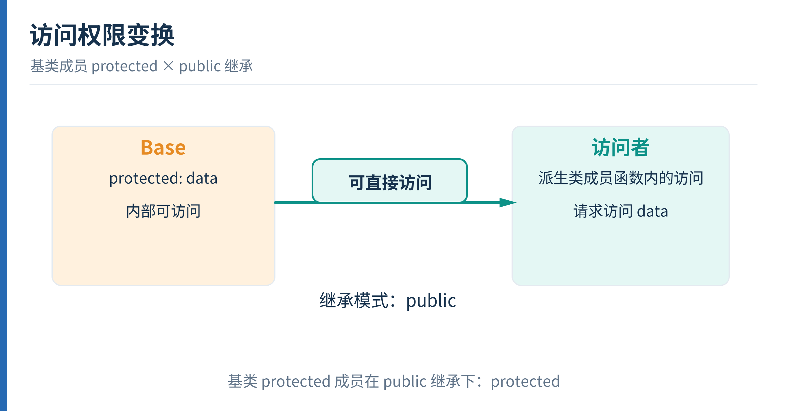
> *基类 protected 成员在 public 继承下：protected*
>
> 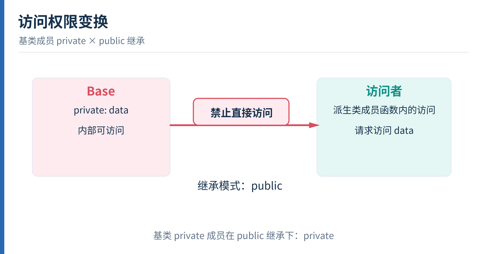
> *基类 private 成员在 public 继承下：private*


**图组：保护继承时三类基类成员**


> [!example]- 展开连续插图（3 幅）
> 这些图从不同时间或访问视角展示同一机制，请依次对照。
>
> 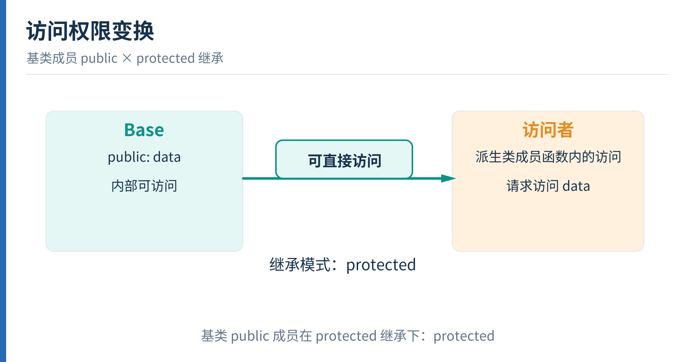
> *基类 public 成员在 protected 继承下：protected*
>
> 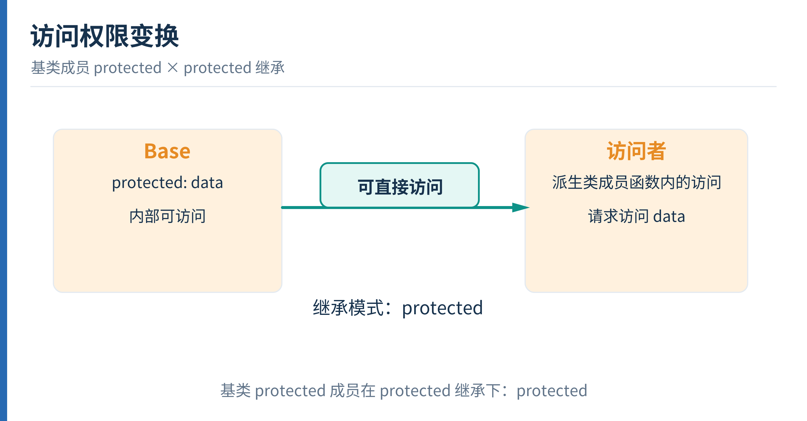
> *基类 protected 成员在 protected 继承下：protected*
>
> 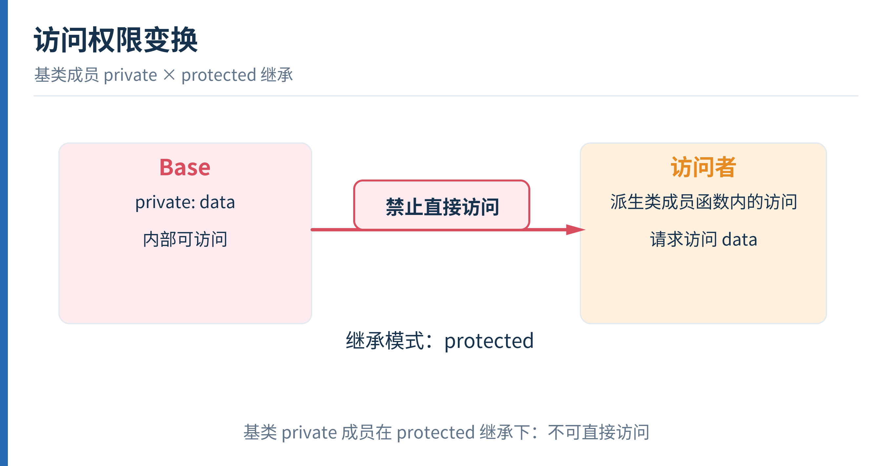
> *基类 private 成员在 protected 继承下：不可直接访问*


**图组：私有继承时三类基类成员**


> [!example]- 展开连续插图（3 幅）
> 这些图从不同时间或访问视角展示同一机制，请依次对照。
>
> 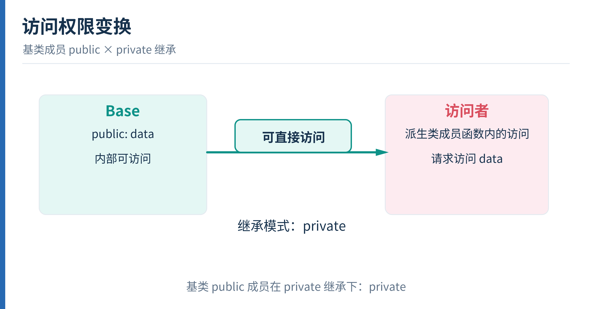
> *基类 public 成员在 private 继承下：private*
>
> 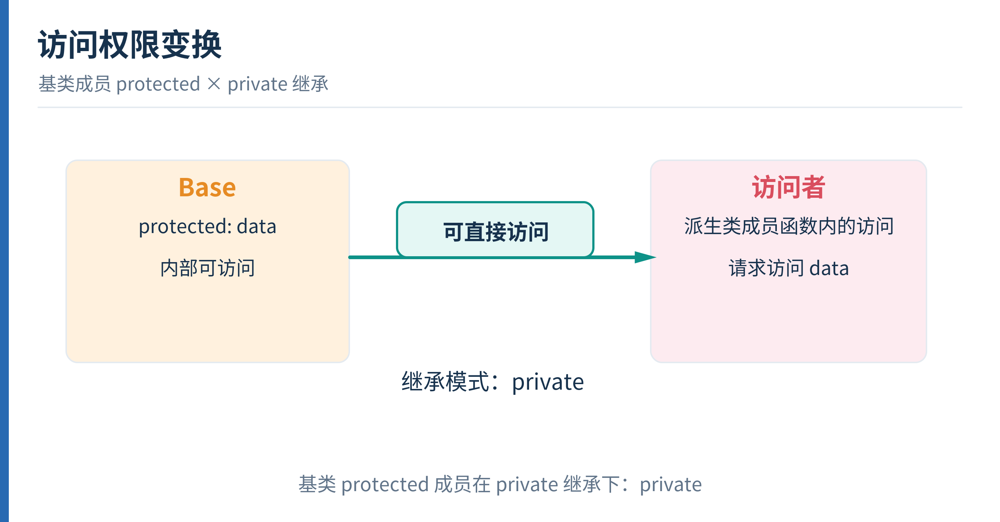
> *基类 protected 成员在 private 继承下：private*
>
> 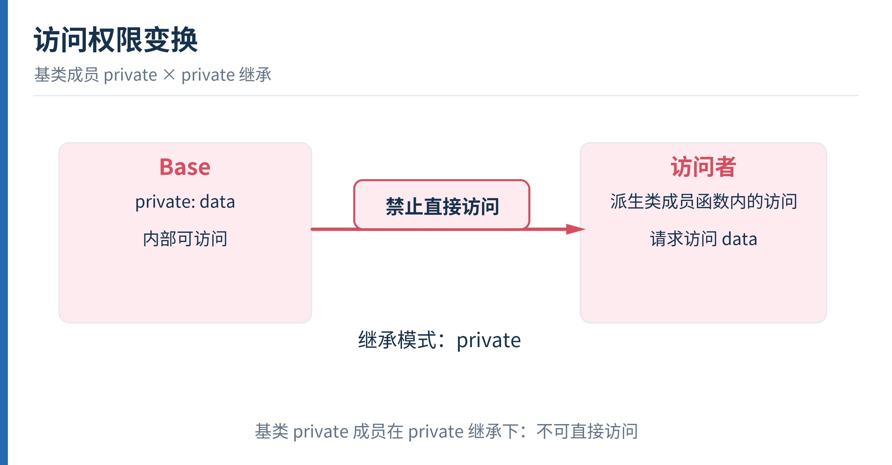
> *基类 private 成员在 private 继承下：不可直接访问*


## 7.3.2 各类访问者的区别

- **基类自己的成员函数**可访问基类全部成员。
- **派生类成员函数**可访问合法继承路径下的 `public`、`protected` 基类成员，但不能直接访问基类 `private`。
- **普通使用者**只能访问对象对外可见的 `public` 接口；通过 `Derived` 对象访问时还受继承方式的限制。
- **友元**关系必须明确授予，并非继承获得：`Derived` 的友元不会自动成为 `Base` 的友元；`Base` 的友元可以访问适当的 `Base` 私有成员。

> [!note] 进阶但直接相关的限制
> 派生类成员并不一定可以经由**任意 Base 对象**访问其保护成员；受保护成员还有对象表达式的限制。初学时先掌握 `Derived` 自身对象内访问继承来的保护数据，避免误以为“从任何 Base 对象都可以随意读 protected”。


**图组：派生类、外部使用者、友元以及更深层派生的访问差异**


> [!example]- 展开连续插图（9 幅）
> 这些图从不同时间或访问视角展示同一机制，请依次对照。
>
> 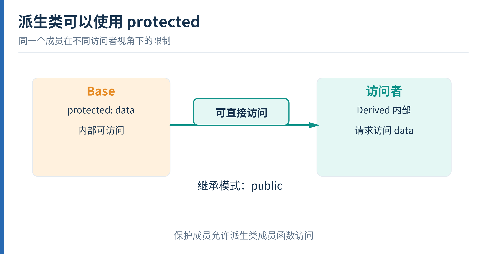
> *保护成员允许派生类成员函数访问*
>
> 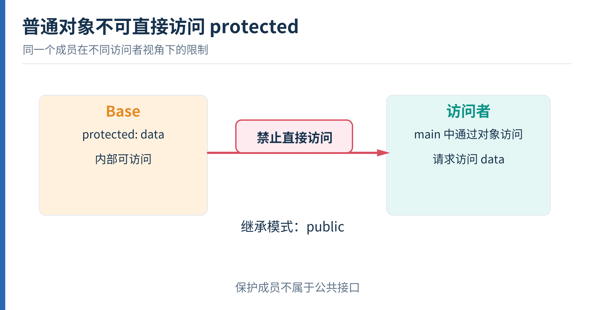
> *保护成员不属于公共接口*
>
> 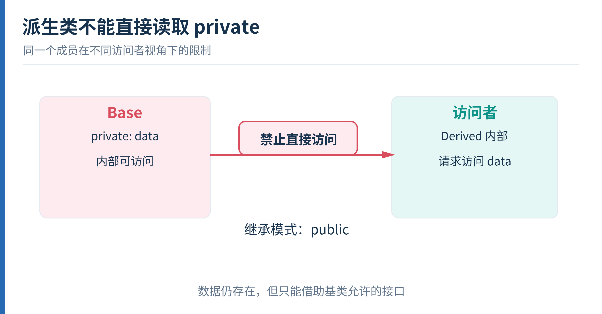
> *数据仍存在，但只能借助基类允许的接口*
>
> 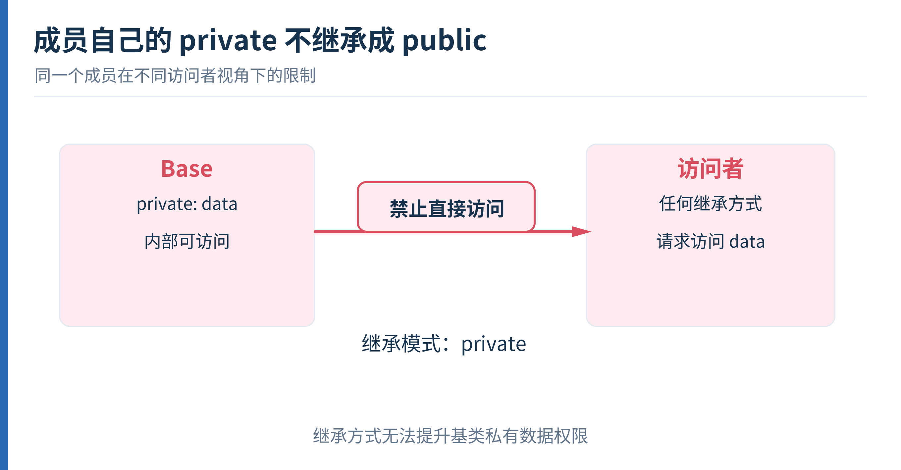
> *继承方式无法提升基类私有数据权限*
>
> 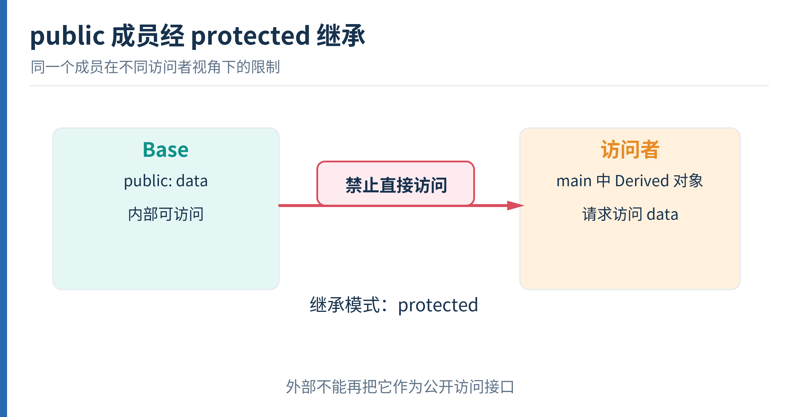
> *外部不能再把它作为公开访问接口*
>
> 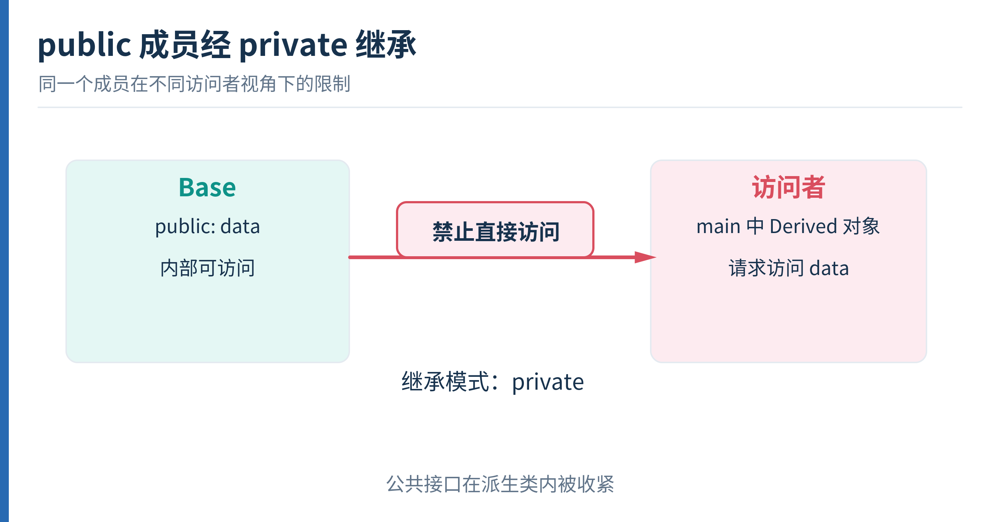
> *公共接口在派生类内被收紧*
>
> 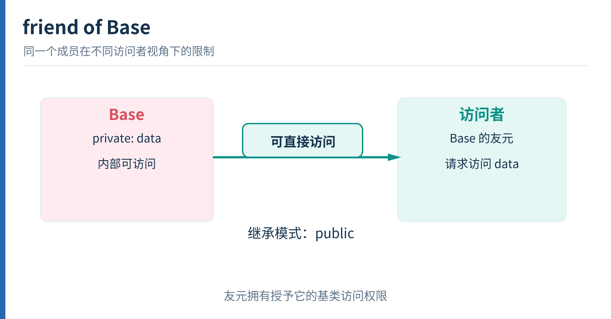
> *友元拥有授予它的基类访问权限*
>
> 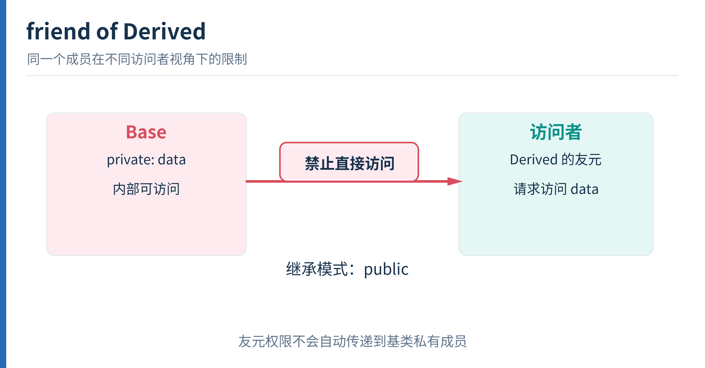
> *友元权限不会自动传递到基类私有成员*
>
> 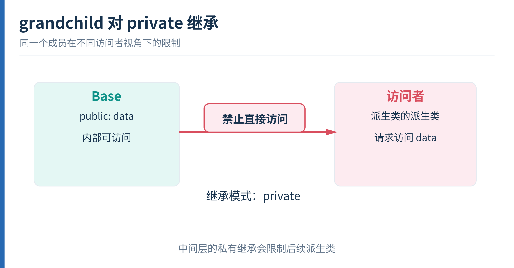
> *中间层的私有继承会限制后续派生类*


**简短、可编译的权限示例：**


```cpp
class Base {
private:
    int a = 1;                             // 仅 Base 及其友元可直接访问
protected:
    int b = 2;                             // 派生类可在合法上下文中访问
public:
    int c = 3;                             // 公有接口
};

class Derived : public Base {             // 公有继承 Base
public:
    void Change() {
        b = 20;                            // 合法：访问保护成员
        c = 30;                            // 合法：访问公有成员
        // a = 10;                         // 非法：基类私有成员不可直接访问
    }
};
```


# 7.4 定义惯例及赋值兼容原则

## 7.4.1 公有继承允许向上转换

课程给出的**赋值兼容原则**：`public` 派生类对象可以在需要基类对象、基类引用或基类指针的场合使用。这里的三种使用方式行为不完全相同：

- `Base& r = derived;`：**引用绑定**已有派生对象的基类子对象，**不复制**。
- `Base* p = &derived;`：指向该基类子对象，**不复制**。
- `Base b = derived;` 或 `b = derived;`：**按值复制基类部分**，派生类新增的数据没有进入 `b`，称为**对象切片**（slicing）。

> [!important] 关键分界
> “可以当成 Base 使用”不等于“一个 Base 对象能完整保存 Derived 的所有数据”。指针和引用保存原对象身份；**按值复制会切片**。


**图组：赋值兼容与通过不同类型表达式调用 Show**


> [!example]- 展开连续插图（7 幅）
> 这些图从不同时间或访问视角展示同一机制，请依次对照。
>
> 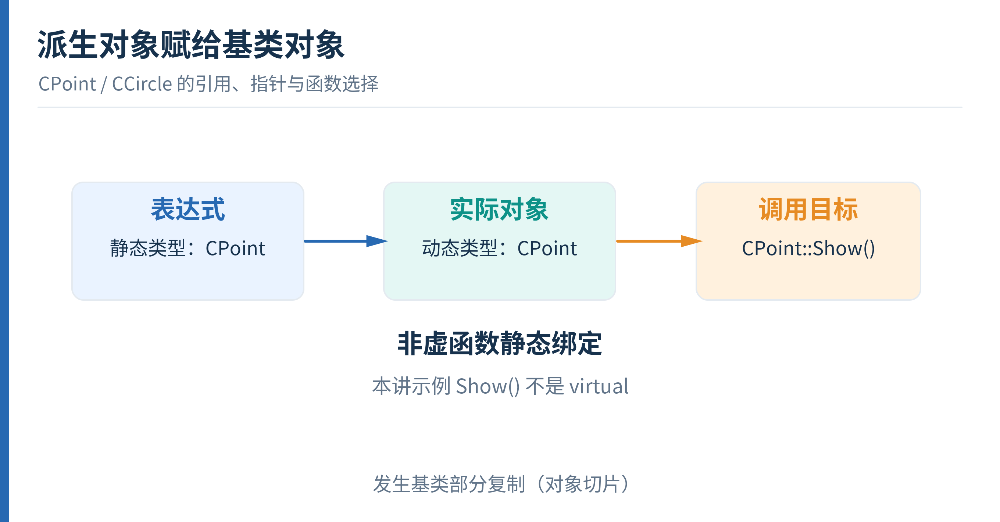
> *发生基类部分复制（对象切片）*
>
> 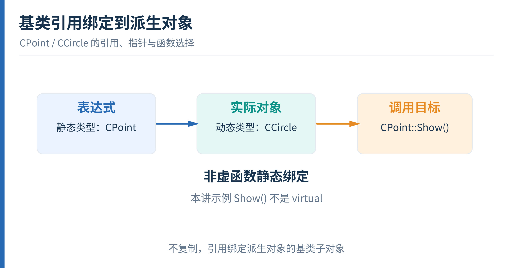
> *不复制，引用绑定派生对象的基类子对象*
>
> 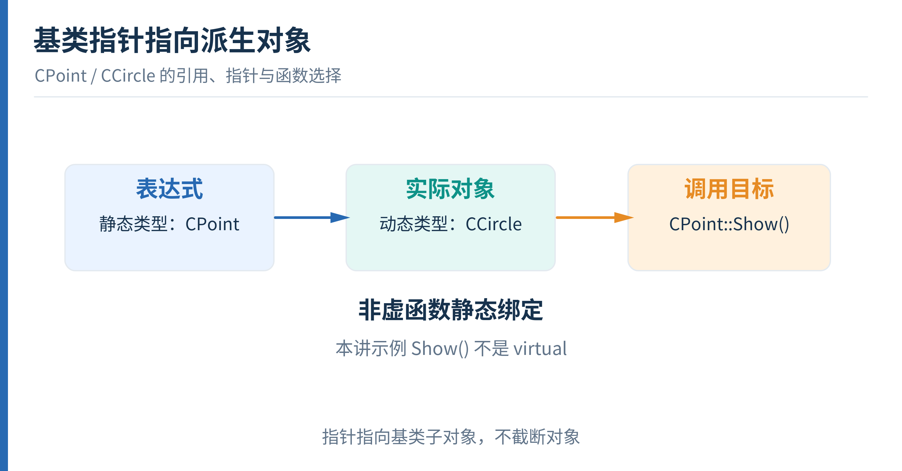
> *指针指向基类子对象，不截断对象*
>
> 
> *可通过派生类接口访问 mR / Show*
>
> 
> *显式 CPoint::Show 读取坐标*
>
> 
> *课件 Show 非虚，取静态类型所见版本*
>
> 
> *CCircle::Show 隐藏基类同名函数*


**图组：复制切片前后与指针/引用所指位置**


*源对象仍含有半径*


*zPoint = zCircle 不会把 mR 复制到 zPoint*


*向上转换没有销毁派生部分*


*静态类型限定可见接口*


**例题：课件 `zPoint = zCircle` 与 `rPoint.Show()` 的结果**


```cpp
CCircle circle(9, 9, 9);                // 派生对象：圆心(9,9)、半径9
CPoint point(7, 1);                       // 独立基类对象
CPoint& rPoint = circle;                  // 引用绑定基类子对象，无复制
CPoint* pPoint = &circle;                 // 指针指向基类子对象，无复制
point = circle;                           // 只复制 CPoint 基类部分
rPoint.Show();                            // 调用非虚 CPoint::Show
pPoint->Show();                           // 调用非虚 CPoint::Show
point.Show();                             // 坐标已变为(9,9)
```


这段是依赖前面 `CPoint/CCircle` 声明的代码片段，不独立定义 `main`。`Show()` **非虚函数**，故通过基类类型的引用/指针调用时依然选择 `CPoint::Show()`。如果换成满足动态绑定条件的虚函数，才会出现不同结果；那是第八讲内容。

## 7.4.2 不能把反向转换看成理所当然

从 `Derived` 到公开且无歧义的 `Base` 可以自动转换；反过来从普通 `Base` 到 `Derived` **不能自动进行**，因为基类对象不一定包含派生类额外部分。`private`/`protected` 继承也会影响在普通外部代码中能否发生此类隐式转换；普通非虚菱形继承甚至可能使通往共同基类的转换产生歧义。


**图组：不合法、受限或不安全的转换**


> [!example]- 展开连续插图（5 幅）
> 这些图从不同时间或访问视角展示同一机制，请依次对照。
>
> 
> *Base 不保证具备 Derived 需要的额外信息*
>
> 
> *普通代码不可执行 private 继承向上转换*
>
> 
> *通过基类指针不能直接访问派生特有接口*
>
> 
> *绑定引用保留实际的 CCircle 对象*
>
> 
> *对象实际不是 CCircle 时不可随意当作它*


# 7.5 构造函数定义及执行准则

## 7.5.1 最重要的顺序规则

**一个派生类完整对象的构造顺序：**

1. **虚基类（如有）**按语言规定的虚基类次序初始化（详见 7.6）；
2. **直接非虚基类子对象**按基类说明列表中的声明次序；
3. **非静态成员对象**按其在类内的声明次序；
4. **派生类构造函数体**最后执行。

析构顺序完全相反（先执行派生类析构函数体，再销毁成员对象及基类子对象）。**构造函数初始化列表的排列顺序，不会改变上述真正执行顺序**。

> [!warning] 细节：类成员的默认成员初始化与初始化列表
> 有 `const`、引用或无默认构造函数的成员时，必须确保这些成员被正确初始化。不能指望进入构造函数体后再给引用成员“绑定对象”。

课件中的 `CCircle(int x,int y,int r) : CPoint(x,y)`，意味着 **调用基类构造函数准备好圆心**，然后才执行派生类构造函数体并处理半径。


**图组：圆对象构造的三步执行**


*基类子对象必须先初始化*


*基类子对象必须先初始化*


*基类子对象必须先初始化*


**图组：圆对象析构的三步执行**


*对象的销毁次序与构造相反*


*对象的销毁次序与构造相反*


*对象的销毁次序与构造相反*


## 7.5.2 人、日期与特首例程

课件的三个类可以用下列逻辑关系理解：

- `CPerson` 是**基类**，保存姓名。
- `CDate` 是**成员对象的类**，保存年、月、日。
- `CChiefExecutive : public CPerson` 是派生类，**包含**一个 `CDate mWorkDate`。

定义 `CChiefExecutive(name, y, m, d)` 时，构造次序 **Person → Date → ChiefExecutive**；对象离开作用域时逆序 **ChiefExecutive → Date → Person**。这并非代码“先显示了哪句话就先构造了谁”，而是语言规定了子对象建立的顺序。

**可运行的精简例程：**


```cpp
#include <iostream>                         // 使用控制台输出
#include <string>                           // 安全存储姓名

class CPerson {
    std::string mName;                     // 使用自动管理内存的字符串
public:
    explicit CPerson(const std::string& name) : mName(name) {
        std::cout << "Person...\n";       // 先构造基类
    }
    ~CPerson() { std::cout << "Delete Person!\n"; } // 最后析构基类
};

class CDate {
    int mYear, mMonth, mDay;               // 保存日期各部分
public:
    CDate(int y, int m, int d) : mYear(y), mMonth(m), mDay(d) {
        std::cout << "Date...\n";         // 先于派生类自身构造函数体
    }
    ~CDate() { std::cout << "Delete Date!\n"; } // 晚于派生类自身析构
};

class CChiefExecutive : public CPerson {  // CPerson 是基类
    CDate mWorkDate;                       // CDate 是成员对象
public:
    CChiefExecutive(const std::string& name, int y, int m, int d)
        : CPerson(name), mWorkDate(y, m, d) { // 初始化基类和成员
        std::cout << "ChiefExecutive...\n"; // 最后执行派生类函数体
    }
    ~CChiefExecutive() {
        std::cout << "Delete ChiefExecutive!\n"; // 最先执行析构函数体
    }
};

int main() {
    CChiefExecutive ce("DJH", 1997, 7, 1); // 创建完整派生类对象
    return 0;                              // 离开作用域后自动销毁
}
```


**核对输出：** `Person...` → `Date...` → `ChiefExecutive...` → `Delete ChiefExecutive!` → `Delete Date!` → `Delete Person!`。


**图组：构造过程中哪些对象部分已存在**


*成员对象总在派生类构造函数体之前初始化*


*成员对象总在派生类构造函数体之前初始化*


*成员对象总在派生类构造函数体之前初始化*


**图组：析构过程中哪些对象部分正在销毁**


*成员和基类的析构由语言自动完成*


*成员和基类的析构由语言自动完成*


*成员和基类的析构由语言自动完成*


## 7.5.3 初始化列表次序不是构造次序

如下代码中，虽然初始化列表先写 `b(v)` 后写 `a(v)`，只要类体内的数据成员声明顺序是 `a`、`b`，**仍然先初始化 a，再初始化 b**。若 b 的初始化表达式依赖 a，必须考虑此实际顺序；建议让初始化列表顺序与声明顺序一致，提高可读性。

```cpp
class Pair {
    int a;                                 // 成员 a 先声明
    int b;                                 // 成员 b 后声明
public:
    explicit Pair(int v) : b(v + 1), a(v) {} // 实际先初始化 a，再初始化 b
};
```


**图组：初始化列表顺序的误区**


> [!example]- 展开连续插图（2 幅）
> 这些图从不同时间或访问视角展示同一机制，请依次对照。
>
> 
> *构造顺序由继承列表和成员声明顺序决定*
>
> 
> *构造顺序由继承列表和成员声明顺序决定*


**图组：基类与成员的真实初始化顺序、特殊成员要求**


> [!example]- 展开连续插图（5 幅）
> 这些图从不同时间或访问视角展示同一机制，请依次对照。
>
> 
> *不能根据初始化列表的文字先后猜测执行顺序*
>
> 
> *不能根据初始化列表的文字先后猜测执行顺序*
>
> 
> *不能根据初始化列表的文字先后猜测执行顺序*
>
> 
> *不能根据初始化列表的文字先后猜测执行顺序*
>
> 
> *不能根据初始化列表的文字先后猜测执行顺序*


**图组：把完整构造和析构过程串成时间线**


> [!example]- 展开连续插图（6 幅）
> 这些图从不同时间或访问视角展示同一机制，请依次对照。
>
> 
> *完整生命周期的第 1 阶段：构造 CPerson*
>
> 
> *完整生命周期的第 2 阶段：构造 CDate*
>
> 
> *完整生命周期的第 3 阶段：构造自身*
>
> 
> *完整生命周期的第 4 阶段：析构自身*
>
> 
> *完整生命周期的第 5 阶段：析构 CDate*
>
> 
> *完整生命周期的第 6 阶段：析构 CPerson*


# 7.6 多重继承与虚基类

## 7.6.1 多重继承的两个不同问题

**多重继承：** 一个类可以同时从多个基类继承，例如 `CBat : public CBird, public CBeast`。本讲最重要的是区分：

- **成员名称歧义**：`CBird` 和 `CBeast` 都有 `ShowBodyFeature()`，`CBat` 若不自己给出明确接口，直接写 `bat.ShowBodyFeature()` 可能歧义。
- **重复祖先子对象**：如果 `CBird`、`CBeast` 又都继承同一个 `CAnimal`，最派生 `CBat` 里可能有**两份** `CAnimal` 基类子对象，导致重复与转换歧义。

前者可以通过 `bat.CBird::ShowBodyFeature()` 或 `bat.CBeast::ShowBodyFeature()` 明确指定；**后者**需要了解虚继承来共享公共祖先。**虚继承不会自动解决两个兄弟基类中同名成员函数的名称查找歧义。**


**图组：同名函数、共同基类转换与消歧**


> [!example]- 展开连续插图（6 幅）
> 这些图从不同时间或访问视角展示同一机制，请依次对照。
>
> 
> *CBat 无法仅凭同名确定选哪个基类*
>
> 
> *使用作用域限定名解决同名成员歧义*
>
> 
> *也可以明确选择另一支的成员*
>
> 
> *未虚继承时同一 CAnimal 类型出现两次*
>
> 
> *虚继承时共享一份 CAnimal 子对象*
>
> 
> *虚继承不会自动消除两个不同基类同名函数的歧义*


**同名成员消歧的最小示例：**


```cpp
#include <iostream>                         // 输出演示结果

class CBird {
public:
    void ShowBodyFeature() const { std::cout << "Bird\n"; } // 鸟的特征
};

class CBeast {
public:
    void ShowBodyFeature() const { std::cout << "Beast\n"; } // 兽的特征
};

class CBat : public CBird, public CBeast { // 多重继承
};

int main() {
    CBat bat;                               // 创建多重派生对象
    bat.CBird::ShowBodyFeature();          // 显式选择 CBird 的函数
    bat.CBeast::ShowBodyFeature();         // 显式选择 CBeast 的函数
    return 0;                               // 输出 Bird 与 Beast
}
```


## 7.6.2 菱形继承：为何会重复 CAnimal

普通菱形结构：

`CAnimal → CBird → CBat` 与 `CAnimal → CBeast → CBat`。如果中间两条边只是普通继承，则两条路径带来**两个不同的 `CAnimal` 基类子对象**。这些子对象虽然类型相同，却位于不同继承路径，并不会因为名字相同自动合并。


**图组：普通菱形中两条不同的继承路径**


> [!example]- 展开连续插图（4 幅）
> 这些图从不同时间或访问视角展示同一机制，请依次对照。
>
> 
> *普通菱形结构可能出现两份 CAnimal 基类子对象*
>
> 
> *普通菱形结构可能出现两份 CAnimal 基类子对象*
>
> 
> *普通菱形结构可能出现两份 CAnimal 基类子对象*
>
> 
> *普通菱形结构可能出现两份 CAnimal 基类子对象*


**图：普通菱形在完整对象中的重复基类子对象**


*虚继承解决重复基类子对象问题*


## 7.6.3 虚继承：共享一个虚基类子对象

在 `CBird`、`CBeast` 的**直接继承声明**中写 `virtual public CAnimal`：

```cpp
class CAnimal {};                          // 公共祖先
class CBird : virtual public CAnimal {};   // 虚继承 CAnimal
class CBeast : virtual public CAnimal {};  // 也虚继承 CAnimal
class CBat : public CBird, public CBeast {}; // 最派生类仅含一份共享 CAnimal
```

> [!important] 为什么叫“虚基类”？
> 它改变了**子对象共享方式以及构造责任**，并不要求基类中必须有虚函数。`virtual` 用在继承列表和用在 `virtual void f()`，作用完全不同。


**图组：引入虚基类后，同一个 Animal 被多个路径共享**


> [!example]- 展开连续插图（5 幅）
> 这些图从不同时间或访问视角展示同一机制，请依次对照。
>
> 
> *最派生对象仅包含一份共享 CAnimal 虚基类子对象*
>
> 
> *最派生对象仅包含一份共享 CAnimal 虚基类子对象*
>
> 
> *最派生对象仅包含一份共享 CAnimal 虚基类子对象*
>
> 
> *最派生对象仅包含一份共享 CAnimal 虚基类子对象*
>
> 
> *最派生对象仅包含一份共享 CAnimal 虚基类子对象*


**图：虚基类让最终对象只保留一份共享祖先**


*虚继承解决重复基类子对象问题*


## 7.6.4 虚基类构造：由最派生类负责

**普通规则升级：最派生类负责初始化它的虚基类。** 即使中间层 `CBird()`、`CBeast()` 的初始化列表也写了 `CAnimal(...)`，当你正在构造的是完整的 `CBat` 对象时，它们对共享虚基类的初始化说明会被忽略，统一由最派生类 `CBat` 初始化。

课件中的 `CBat : public CBird, public CBeast`，实际构造先后是：

**CAnimal（虚）→ CBird → CBeast → CBat**。

其析构反向：**CBat → CBeast → CBird → CAnimal**。课件第 55—58 页的示例故意在初始化列表中写出 `CBeast()` 和 `CBird()` 的不同顺序，目的正是提醒：**不能根据初始化列表的书写顺序判断实际构造次序。**

> [!warning] 校订课件关于“虚基类一般只允许无参/全默认参数构造”的表述
> 这**不是 C++ 语法限制**。虚基类完全可以定义必须传实参的构造函数。关键在于：**最派生类负责向该虚基类传递参数**。若最派生类不能提供可用的初始化方式，才会产生构造失败。


**图组：共享虚基类构造的四步状态**


*构造先后：CAnimal → CBird → CBeast → CBat*


*构造先后：CAnimal → CBird → CBeast → CBat*


*构造先后：CAnimal → CBird → CBeast → CBat*


*构造先后：CAnimal → CBird → CBeast → CBat*


**图组：共享虚基类析构的四步状态**


*析构先后：CBat → CBeast → CBird → CAnimal*


*析构先后：CBat → CBeast → CBird → CAnimal*


*析构先后：CBat → CBeast → CBird → CAnimal*


*析构先后：CBat → CBeast → CBird → CAnimal*


**标准 C++17：虚基类带参构造的可编译例子**


```cpp
#include <iostream>                         // 观察构造先后

class CAnimal {
    int mTag;                               // 虚基类保存共同数据
public:
    explicit CAnimal(int tag) : mTag(tag) {
        std::cout << "Animal(" << mTag << ")\n"; // 输出被选中的实参
    }
    int GetTag() const { return mTag; }     // 提供读取接口
};

class CBird : virtual public CAnimal {     // 声明共享虚基类
public:
    CBird() : CAnimal(1) { std::cout << "Bird\n"; } // 单独构造 Bird 时用 1
};

class CBeast : virtual public CAnimal {    // 同样共享虚基类
public:
    CBeast() : CAnimal(2) { std::cout << "Beast\n"; } // 单独构造 Beast 时用 2
};

class CBat : public CBird, public CBeast { // Bird 在继承列表中排在 Beast 前
public:
    CBat() : CAnimal(99), CBeast(), CBird() { // 实际顺序不由这里排列决定
        std::cout << "Bat\n";              // 在全部基类初始化后执行
    }
};

int main() {
    CBat bat;                               // 创建最派生对象
    std::cout << bat.GetTag() << '\n';      // 从共享的 Animal 读取标签 99
    return 0;                               // 对象自动销毁
}
```


**预期输出：** `Animal(99)` → `Bird` → `Beast` → `Bat` → `99`。`CAnimal(1)` 与 `CAnimal(2)` 在构造 `CBat` 时**不负责**初始化共享的 `CAnimal`。


## 7.6.5 多层次、多虚基类时怎么看顺序

更复杂的类层次需要分清虚基类和非虚基类：

1. **先处理完整对象中的全部虚基类**：按标准规定的**深度优先、从左至右的首次遇见顺序**；同一虚基类只初始化一次。
2. 再初始化**直接非虚基类**，按最派生类基类说明列表顺序。
3. 再初始化成员对象，按声明次序。
4. 最后执行最派生类构造函数体。

课件第 60—65 页给出连续的类层次图，比较虚基类与普通基类的不同组合。这里通过图示拆解原则；实际复杂题应先画出类层次，再按虚基类首次出现顺序排出清单，最后排非虚基类和成员。


**图组：一般多继承、声明顺序、最派生类角色**


> [!example]- 展开连续插图（4 幅）
> 这些图从不同时间或访问视角展示同一机制，请依次对照。
>
> 
> *不涉及重复祖先*
>
> 
> *在 class Derived : public B, public A 中先 B 后 A*
>
> 
> *virtual 写在直接继承关系上*
>
> 
> *CAnimal 构造实参由最派生类决定*


**图组：不同多重继承关系的初始化／销毁顺序**


> [!example]- 展开连续插图（5 幅）
> 这些图从不同时间或访问视角展示同一机制，请依次对照。
>
> 
> *完整对象里共享 VBase*
>
> 
> *中间类对同一虚基类的指定会被忽略*
>
> 
> *深度优先、从左到右的首次遇见顺序*
>
> 
> *虚基类最后才析构*
>
> 
> *两条路径分别构造 Animal，随后构造 Most*


**图组：多重继承三类高频误区**


> [!example]- 展开连续插图（3 幅）
> 这些图从不同时间或访问视角展示同一机制，请依次对照。
>
> 
> *ShowBodyFeature() 不应直接等同于 选择 CBird 或 CBeast*
>
> 
> *初始化列表 不应直接等同于 遵循声明顺序*
>
> 
> *派生类 不应直接等同于 只复用合法可见基类接口*


---

# 课程小结与练习（PPT 第 67—70 页）

## 核心区分速查

| 容易混淆的两者 | 关键区别 |
|---|---|
| **继承** / **组合** | is-a 类间接口关系 / has-a 成员对象关系 |
| `private` 成员 / `private` 继承 | 前者是成员级权限，后者是继承方式 |
| 函数隐藏 / 虚函数重写 | 同名查找与可见性 / 必须依靠 `virtual` 语义与匹配的函数声明 |
| 基类引用 / 基类对象复制 | 引用不复制；按值复制会对象切片 |
| 构造列表顺序 / 构造执行顺序 | 真实顺序由虚基类、基类列表、成员声明决定 |
| 普通菱形 / 虚菱形 | 共同祖先两份 / 共享一份虚基类子对象 |
| 虚基类 / 虚函数 | 继承子对象共享与初始化 / 动态绑定（下讲重点） |

> [!warning] 课件中的“继承与封装均属于代码共享手段”
> 课件第 68 页把它们并列比较：**继承**确实是类间代码复用的直接机制；**封装**的主要职责是隐藏表示细节、约束接口与维护不变量，不能简单把它等同为继承那样的代码共享机制。学习时分清两者的设计职责。

## 练习 1：追踪完整对象的构造与析构

`Derived : public Base` 同时拥有成员 `Member date`，假设无虚基类，声明顺序为 `Base` 后 `date`，输出先后应为：

`Base()` → `Member()` → `Derived()` → `~Derived()` → `~Member()` → `~Base()`。

**检查点：** 无论初始化列表写成 `date(...), Base(...)` 还是 `Base(...), date(...)`，真实子对象执行顺序不变。

## 练习 2：判断 Show() 的调用目标

```cpp
CPoint& r = circle;                         // 引用静态类型为 CPoint
r.Show();                                  // 本讲例程调用 CPoint::Show
circle.Show();                             // 调用 CCircle::Show
circle.CPoint::Show();                     // 明确选择 CPoint::Show
```

**结论：** 本讲的 `Show()` 是非虚函数，不能根据实际对象是 `CCircle` 就认定 `r.Show()` 会动态调用派生类版本。

## 练习 3：圆与圆柱体的面积、体积（课件第 69 页作业）

设计 `Circle` 与 `Cylinder`：

- `Circle` 保存半径 `radius`，提供 `Area()` 计算 $\pi r^2$。
- `Cylinder : public Circle` 增加 `height`，提供 `Volume()` 计算 $\pi r^2 h$，也可提供总表面积 $2\pi r(r+h)$。
- 通过构造函数初始化列表让 `Cylinder` 调用 `Circle` 构造函数，检验继承结构与计算结果。

> [!example]- 参考实现（独立可编译）
> ```cpp
> #include <iostream>                        // 标准输出
> class Circle {
>     double radius;                         // 圆半径
> public:
>     explicit Circle(double r) : radius(r) {} // 初始化圆半径
>     double Area() const { return 3.141592653589793 * radius * radius; } // 圆面积
> };
> class Cylinder : public Circle {          // 圆柱公有继承 Circle
>     double height;                         // 圆柱高度
> public:
>     Cylinder(double r, double h) : Circle(r), height(h) {} // 先构造圆
>     double Volume() const { return Area() * height; } // 体积=底面积×高
> };
> int main() {
>     Cylinder c(2.0, 3.0);                  // 半径2，高3
>     std::cout << c.Area() << ' ' << c.Volume() << '\n'; // 输出面积和体积
>     return 0;
> }
> ```
>
> **核验：** 面积 $4\pi$，体积 $12\pi$。

## 阅读课件与实践时的五项校订

1. **标准入口：** `int main()`，不是旧课件的 `void main()`。
2. **保护数据：** 课件倾向基类数据 `protected`，实际工程常优先 `private` 加受控接口；不是一律必须 `protected`。
3. **动态内存：** 原始 `char*` 不等于安全的现代复制语义，优先 `std::string` 和资源自动管理。
4. **虚基类：** 不禁止带参数构造；关键是由最派生类初始化。
5. **析构安全：** 若未来要通过基类指针删除派生对象，基类析构函数通常应当为 `virtual`；本讲直接局部对象不涉及这类删除。

> [!summary] 考前六句话
> **继承看 is-a，组合看 has-a；访问看成员权限与继承方式；向上转换分引用指针与对象切片；构造看虚基类→基类→成员→自身；析构反向；普通菱形会重复祖先，虚继承共享祖先。**

*整理基于所上传 72 页课件；图解均为本次重新绘制，没有直接截取 PPT 图像。编译验证的 C++17 测试源码与检查记录随 ZIP 附带。*
