# 第八讲 多态性与虚函数（图解系统笔记）

> [!info] 资料依据与阅读说明
> **主要依据**：《面向对象程序设计与 C++》第八讲《多态性与虚函数》（57 页 PPT，翟高寿）。课件的核心章节为 **8.1～8.5**；第 50～54 页的学生管理程序是附加讲解，整理于本文附录。课程概念、Animal / Bird / Beast / Bat 案例及主要执行结果以 PPT 为依据。文中的 `override`、`final`、`std::string`、`dynamic_cast` 及部分安全性说明属于**必要的现代 C++ 补充或校订**，不能当作 PPT 原文。
>
> - 适合 Obsidian，数学公式使用 `$...$` 或 `$$...$$`；图中的颜色通常表示 **蓝色：基类/静态接口；青色：派生对象；金色：运行时目标；红色：陷阱或需特别辨析的行为**。
> - 原创插图均有 `.png` 阅读文件及 `.svg` 编辑文件。每幅图都对应一个具体机制，图注紧随其后。

## 学习路线

1. **8.1 多态性概念与分类**：同一消息、静态联编、动态联编，区分静态类型和动态类型。
2. **8.2 为什么引入虚函数**：赋值兼容、基类指针/引用、非虚函数的局限、对象切片。
3. **8.3 虚函数定义及使用**：`virtual`、`override`、动态分派、虚表、调用阶段、虚析构。
4. **8.4 多重继承与虚函数**：菱形继承、虚继承、不同指针视角下的调用。
5. **8.5 纯虚函数与抽象类**：`= 0`、抽象接口、派生类实现与多态应用。
6. **补充附录**：学生管理程序、典型图形作业、校订说明与判断速查。

---

## 一、8.1 多态性概念及分类（课件第 3 页）

### 1.1 多态性究竟是什么

**多态性（polymorphism）**：不同对象收到相同消息时，可以产生不同的反应与行为。对象可以同样提供 `Who()`、`Area()` 等接口，但执行行为各不相同。这使调用者能够**围绕统一接口编程**，降低与具体类型的耦合。

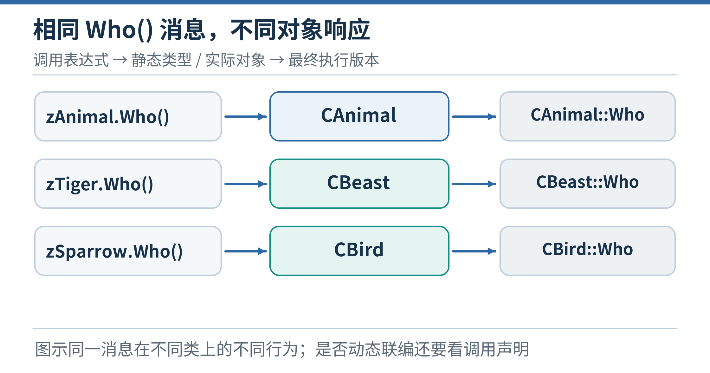

图：`CAnimal`、`CBeast`、`CBird` 都响应 `Who()`；“表现不同”是多态的直观现象，是否为**运行时多态**还需要进一步判断。

### 1.2 静态多态：编译时联编

**联编（binding）**是把某个函数调用表达式与具体函数实现联系起来的过程。**静态联编**在编译期能够确定调用目标，最典型的是函数重载及运算符重载。

```cpp
void Print(int x) {                // int 版本
    std::cout << x << '\n';       // 输出整数
}
void Print(double x) {             // double 版本
    std::cout << x << '\n';       // 输出浮点数
}

Print(3);                          // 编译期选择 Print(int)
Print(2.5);                        // 编译期选择 Print(double)
```

以上片段假定程序已包含 `<iostream>`，并处于允许调用 `Print` 的函数体内。参数类型是编译期选择重载函数的主要依据之一。

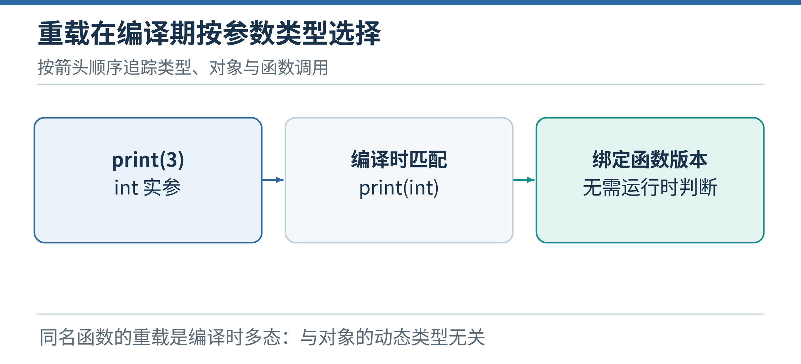

图：`Print(3)` 从实参类型到最终重载版本的编译期匹配过程。

### 1.3 动态多态：运行时联编

**动态联编**指特定虚函数调用的执行版本，要依据运行时对象的实际类型确定。核心构造是：**继承关系 + 基类虚函数 + 派生类重写 + 经合适的基类指针或引用调用**。

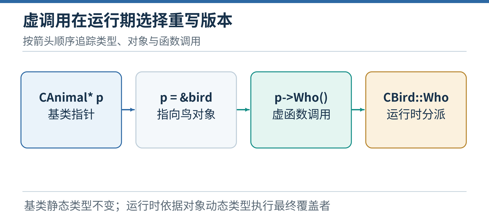

图：`CAnimal*` 的静态类型保持不变，`p->Who()` 却可以在运行时选中 `CBird::Who()`。

### 1.4 最容易混淆：静态类型和动态类型

```cpp
CBird bird;                         // 创建 CBird 对象
CAnimal* p = &bird;                 // p 的静态类型是 CAnimal*
p->Who();                           // 是否动态分派，取决于 CAnimal::Who 是否为虚函数
```

- **静态类型（static type）**：由表达式、声明在编译期确定。`p` 的类型是 `CAnimal*`；通过 `p` 调用成员时以 `CAnimal` 视角进行名称查找和访问检查。
- **动态类型（dynamic type）**：对象在运行时的实际类型，此处为 `CBird`。
- **声明为虚函数**：使符合要求的成员调用能够按动态类型选择最终覆盖者（final overrider）。

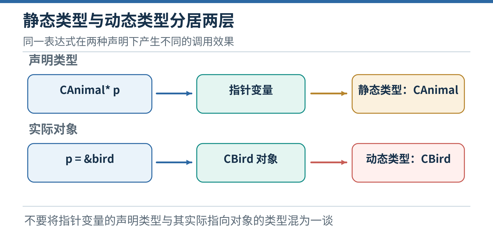

图：指针变量的声明类型与所指对象实际类型并不是同一件事。

> [!important] 三个判断顺序
> 1. **表达式的静态类型是什么？**
> 2. 在这个静态类型下，当前调用的函数**是否具有虚特性**？调用是否有显式类名限定？
> 3. 若是正常虚调用，**当前对象动态类型**是什么、对应最终覆盖者是谁？

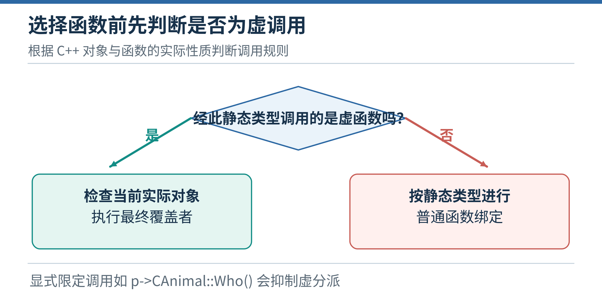

图：先判断调用是否具有虚特性，再判断实际对象；不能只看到派生对象就认定会调用派生版本。

| 维度 | 静态多态 | 动态多态 |
|---|---|---|
| 典型机制 | 函数重载、运算符重载 | 虚函数重写 |
| 决定调用的时间 | 编译期 | 运行期（语义上） |
| 主要依据 | 实参类型、可见重载及转换规则 | 虚声明、实际对象和最终覆盖者 |
| 是否必需继承 | 不必 | 本课典型场景需要继承 |
| 优势 | 简洁、可提前检查与优化 | 统一接口下灵活扩展派生类型 |

---

## 二、8.2 虚函数为什么有必要（课件第 5～13 页）

### 2.1 赋值兼容原则与向上类型转换

公有继承（`public`）表达一种可替代关系：在适当场景中，派生类对象可以当作基类对象使用。但要分清三种操作：

- **基类指针指向派生对象**：`CAnimal* p = &bird;`，对象本身没有被复制。
- **基类引用绑定派生对象**：`CAnimal& r = bird;`，同样不创建新对象。
- **用派生对象初始化基类对象**：`CAnimal a = bird;`，会构造一个新的基类对象，发生**对象切片（slicing）**。

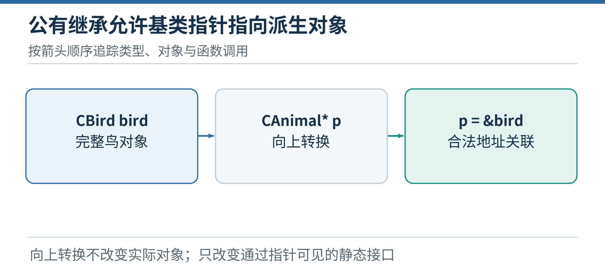

图：向上转换是改变访问视角，不会把派生对象本身变成基类对象。

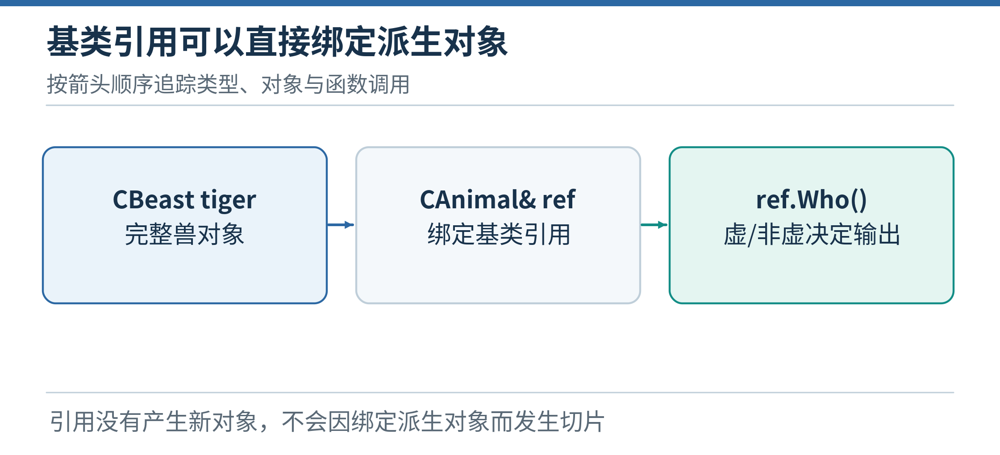

图：引用同样保持原有对象身份，后续是否调用派生函数由虚特性决定。

### 2.2 没有 virtual 的森林动物案例

课件第 8～12 页设计了 `CAnimal`、`CBeast` 和 `CBird`。在没有虚函数时，三个类各有同名无参 `Who()`，并分别输出以下信息：

- `CAnimal::Who()`：我不是飞禽就是走兽！
- `CBeast::Who()`：我是森林之王！
- `CBird::Who()`：我是一只小小鸟！

以下是整理后的核心 C++ 示例（与 PPT 逻辑一致，更新为标准头文件和入口）：

```cpp
#include <iostream>                // 标准输入输出库

class CAnimal {                     // 动物基类
public:
    void Who() {                     // 非虚函数
        std::cout << "动物版本\n";   // 基类输出
    }
};

class CBeast : public CAnimal {     // 兽类公有继承动物
public:
    void Who() {                     // 同名函数，但并非虚重写
        std::cout << "兽类版本\n";   // 派生类输出
    }
};

int main() {
    CBeast tiger;                    // 创建兽类对象
    CAnimal* p = &tiger;             // 基类指针指向兽类对象
    p->Who();                        // 输出“动物版本”
    tiger.Who();                     // 输出“兽类版本”
    return 0;                        // 程序正常结束
}
```

这里 `p->Who()` 的静态类型视角是 `CAnimal`，而 `CAnimal::Who()` **不是虚函数**，所以编译期绑定基类版本。

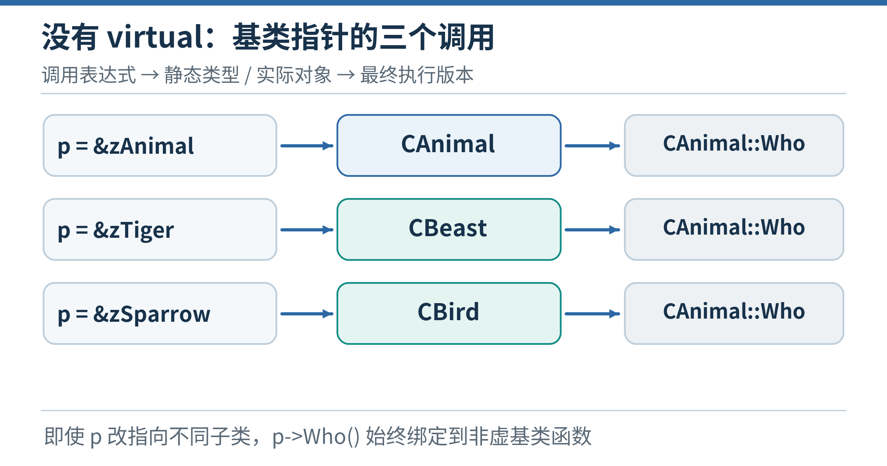

图：即使 `p` 先后指向动物、老虎、鸟，非虚 `p->Who()` 的最终函数始终是基类版本。

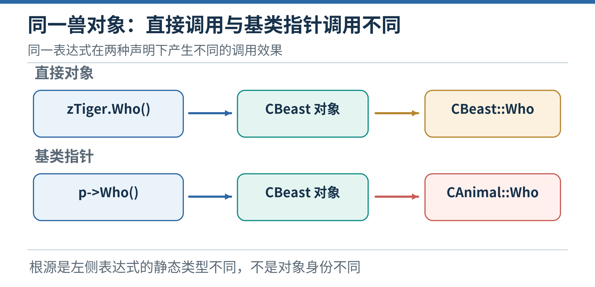

图：两个表达式访问同一个兽对象，因表达式静态类型不同而输出不同内容。

### 2.3 基类引用作为参数时仍会遇到同样的问题

```cpp
void Show(CAnimal& animal) {         // 引用形参的静态类型是 CAnimal
    animal.Who();                    // 若非虚，调用 CAnimal::Who()
}

// Show(tiger);                      // 向上转换合法，但不会自动动态分派
```

**函数参数是引用**可以避免切片，但**并不自动保证虚函数多态**。这也是课件第 11 页基于引用参数的三次 `Show` 均输出基类消息的原因。

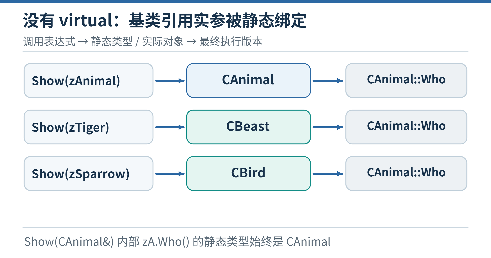

图：参数的实际对象不同，但 `Show(CAnimal&)` 中的非虚函数绑定结果不变。

### 2.4 强制类型转换不是通用解决方案

课件第 13 页示意通过把基类指针强转为某个派生类指针，再调用派生函数。这依赖你能确信所指对象的真实类型；假如判断错了，可能出现未定义行为。

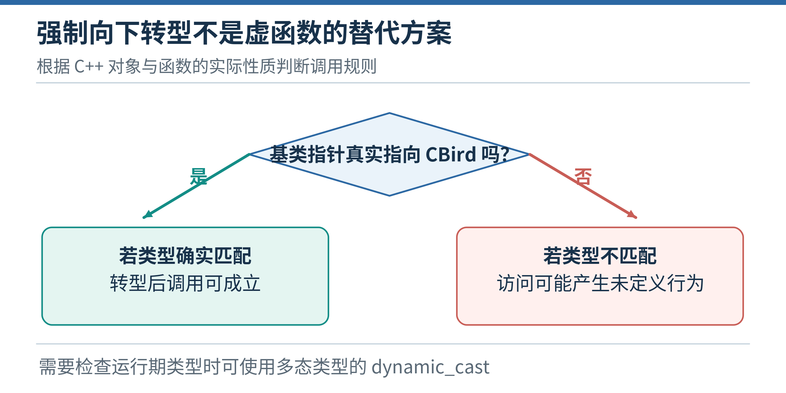

图：向下转型必须确认真实类型；不要把未经检查的 C 风格强制类型转换当作多态机制。

**必要补充**：对于具有至少一个虚函数的多态基类，可在适用场景使用 `dynamic_cast<CBird*>(p)` 检查转换；若不需要知道具体派生类型，优先直接设计虚接口。

### 2.5 对象切片与指针/引用多态的边界

```cpp
CBird bird;                          // 创建派生对象
CAnimal animal = bird;              // 只把 CAnimal 子对象复制出来
CAnimal& ref = bird;                // 引用仍绑定完整的 CBird 对象
```

对象切片后，`animal` 是独立的 `CAnimal` 对象，即使 `Who()` 是虚函数，`animal.Who()` 也只对应 `CAnimal` 动态类型；对 `ref.Who()` 的虚调用则仍能选择 `CBird` 的重写版本。

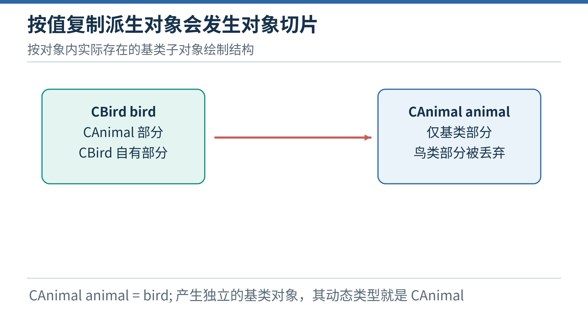

图：**按值复制**让派生部分丢失；**指针或引用绑定**不切片。

> [!warning] 小心“派生类可当基类使用”的过度理解
> 赋值兼容不等于“派生类所有成员都能通过基类指针直接访问”；也不等于“任何调用都会自动选中派生版本”；更不等于“按值接收派生对象可以保留其派生身份”。

---

## 三、8.3 虚函数的定义、覆盖与使用（课件第 15～32 页）

### 3.1 virtual 的基本语法

在基类声明中用 `virtual` 修饰非静态成员函数：

```cpp
class CAnimal {                     // 基类
public:
    virtual void Who();             // 声明虚函数
    virtual ~CAnimal() = default;   // 支持通过基类指针安全删除对象
};

class CBird : public CAnimal {      // 派生类
public:
    void Who() override;            // 表示必须正确覆盖基类虚函数
};
```

`override` 是 C++11 起的明确检查标记；PPT 旧例中没有它，但**建议所有重写虚函数的派生类都加**。基类 `virtual` 一旦建立虚特性，沿相应覆盖链继续传递；派生类即使省略 `virtual`，对应重写仍为虚函数。

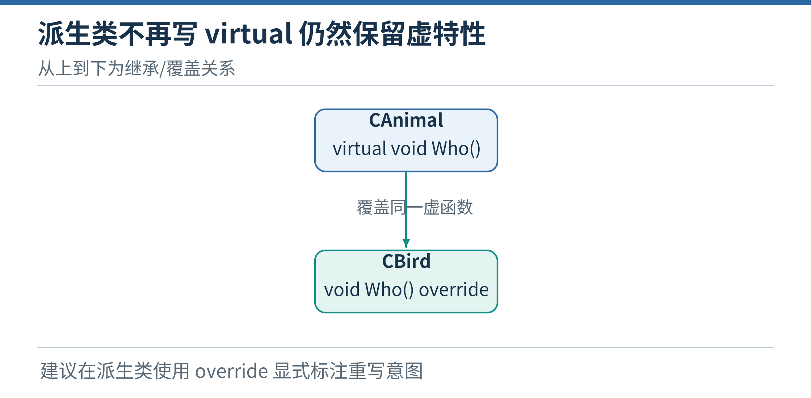

图：虚特性从基类继承，派生类的 `override` 使重写关系更明确。

### 3.2 加 virtual 后的实际结果

只要在原先动物例程的 `CAnimal::Who()` 声明前加 `virtual`，而保留 `CBeast::Who()`、`CBird::Who()` 对应实现，基类指针调用结果就发生改变。

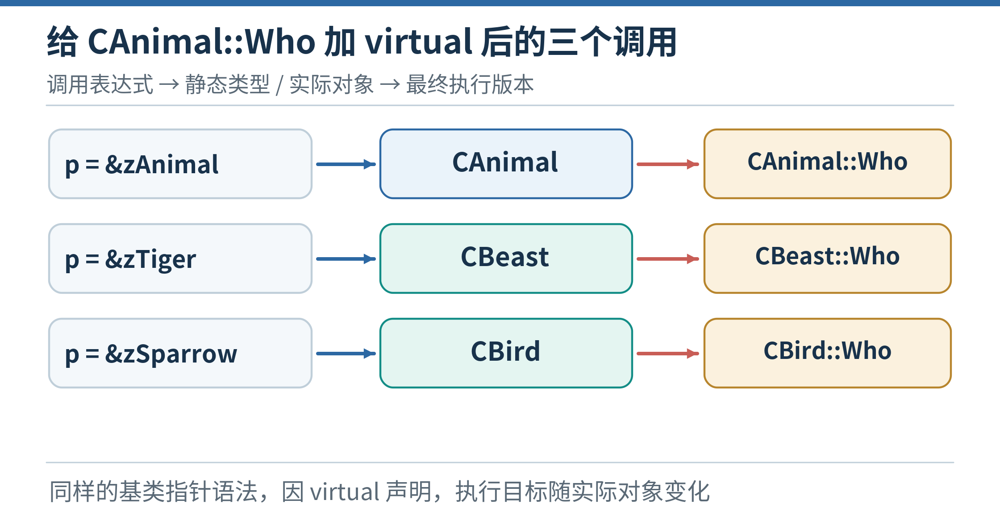

图：同一 `CAnimal*`，依次指向动物、兽、鸟，按对象动态类型选择不同函数版本（课件第 19 页）。

**原因分三层：**

1. 编译期确认调用的是 `CAnimal::Who()` 所代表的**虚函数接口**。
2. 运行时指针实际指向 `CAnimal`、`CBeast` 或 `CBird` 的完整对象。
3. 调用最终覆盖者：基类对象调用基类版本，兽对象调用兽版本，鸟对象调用鸟版本。

### 3.3 引用与指针形参：只写一次 Show

```cpp
void Show(CAnimal& animal) {         // 基类引用参数
    animal.Who();                    // 经引用发起虚调用
}

void Show(CAnimal* animal) {         // 基类指针参数
    if (animal != nullptr) {         // 先判断指针非空
        animal->Who();               // 经指针发起虚调用
    }
}
```

这两个 `Show` 函数在同一代码作用域下构成函数重载，选择哪一个 `Show` 是静态的；**进入所选 `Show` 后的 `Who()` 虚分派则是动态的**。这说明一次程序中静态重载与动态多态可以同时存在。

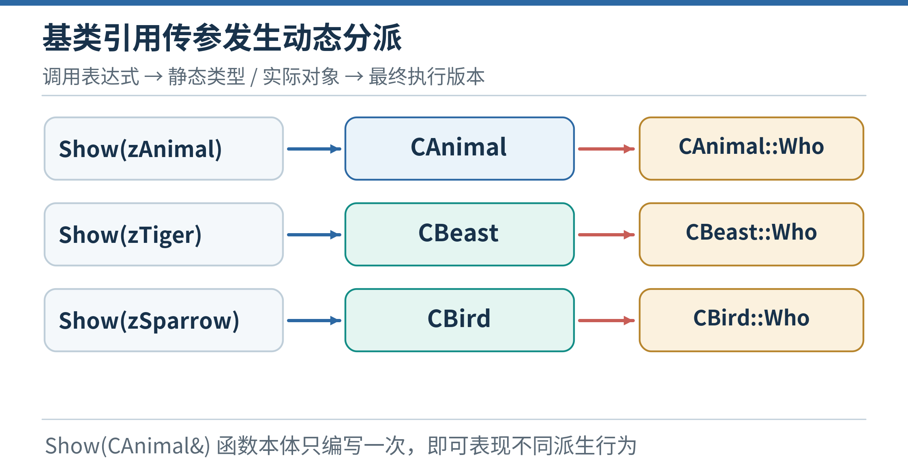

图：课件第 20 页——同一个引用形参函数按实际对象执行各自的 `Who()`。

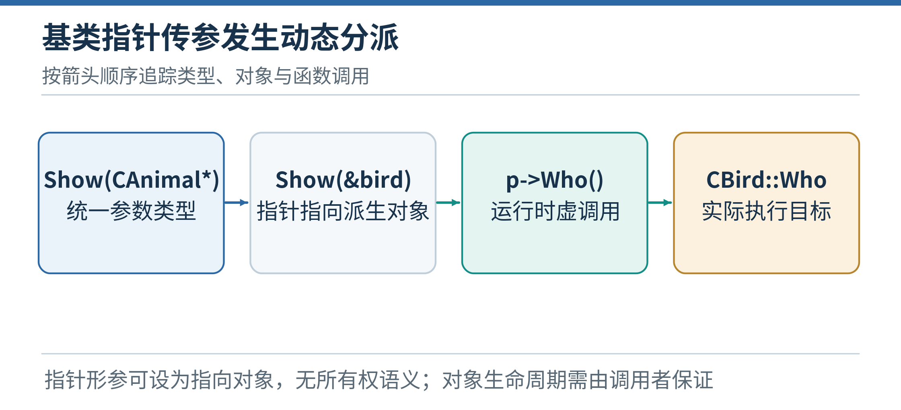

图：课件第 21 页——指针形参也能形成同样的动态分派，且允许统一传参。

### 3.4 非虚成员函数可以在内部调用虚函数

课件第 22、31～32 页把 `Show()` 放在基类中，`Show()` 本身不声明为虚函数，但它在内部调用虚函数 `Who()`：

```cpp
class CAnimal {                     // 定义动物基类
public:
    void Show() {                    // 普通非虚成员函数
        std::cout << "开始介绍\n"; // 统一输出前缀
        Who();                       // 仍会发起虚调用
    }
    virtual void Who() {            // 虚成员函数
        std::cout << "动物版本\n";   // 默认实现
    }
    virtual ~CAnimal() = default;   // 安全的多态析构接口
};
```

如果 `p` 的静态类型为 `CAnimal*`、实际指向 `CBird`，那么 `p->Show()` 在非虚成员函数 `CAnimal::Show()` 中执行，但其中的 `Who()` 仍会动态分派到 `CBird::Who()`（前提是对象已经完整构造、且不是构造/析构期间的特殊情形）。

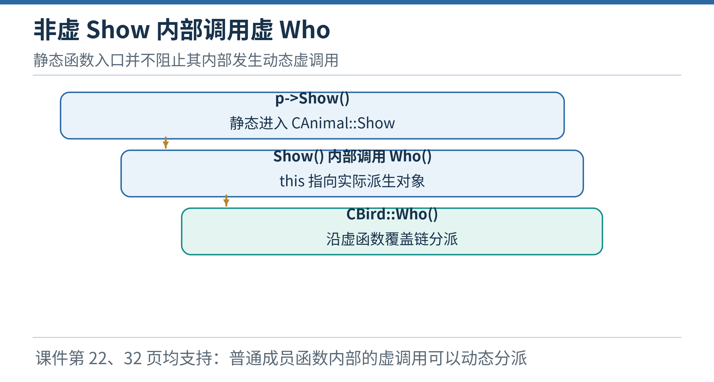

图：固定进入基类 `Show()` 与内部虚调用动态进入派生 `Who()`，是两次不同的函数选择。

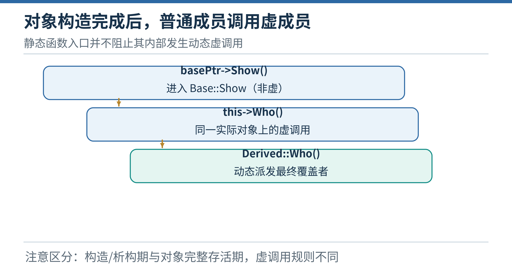

图：完整对象存活期间，`this` 保持实际对象身份，普通成员函数内部可调用派生重写版本。

> [!important] 对课件的一处表述做明确校订
> 课件第 26 页“普通成员函数中调用虚函数，原则上调用成员函数所在类中的函数版本”容易引起误解。**对于完整对象上的正常虚调用，实际上仍按动态类型分派**；课件第 22 页和第 32 页的实际运行结果正好证明这一点。不能把它与“构造/析构函数期间的虚调用”混为一谈。

### 3.5 重写（override）、重载（overload）和同名隐藏（hiding）

**重写**要求匹配同一个虚函数的函数名、参数类型与必要的 `const` / 引用限定符；返回类型通常匹配，存在特定协变返回例外。**重载**主要是同一作用域中同名但参数列表不同。**同名隐藏**则是派生类声明某个名字，使基类同名函数在普通名称查找时被隐藏，并不等于重写。

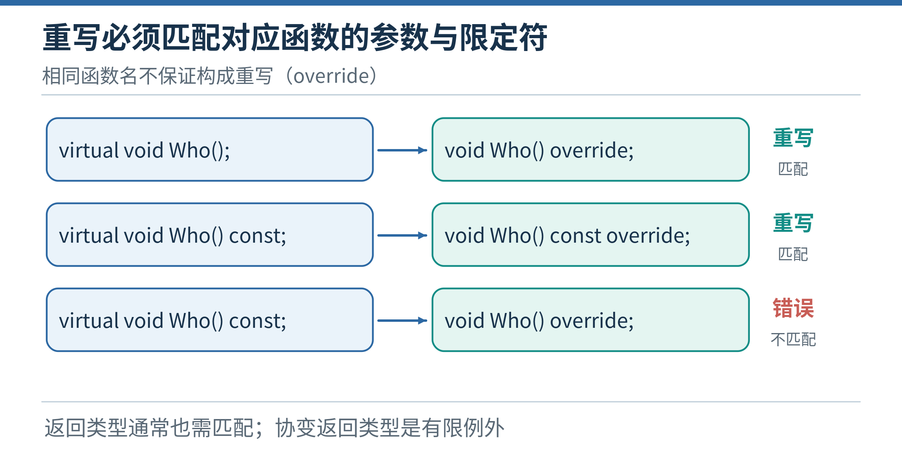

图：只有签名符合虚函数覆盖规则，派生版本才能真正 `override`。

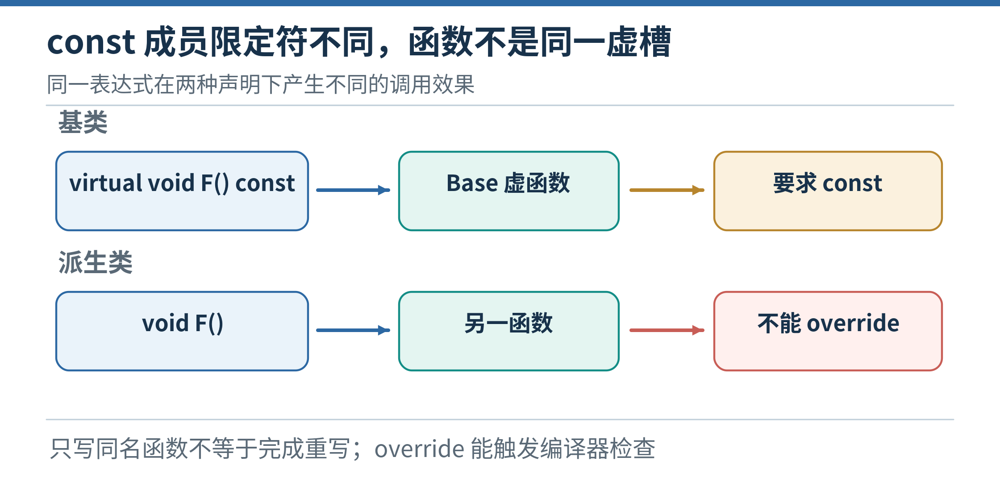

图：`void F()` 和 `void F() const` 是不同成员函数，不能误以为只要同名就是重写。

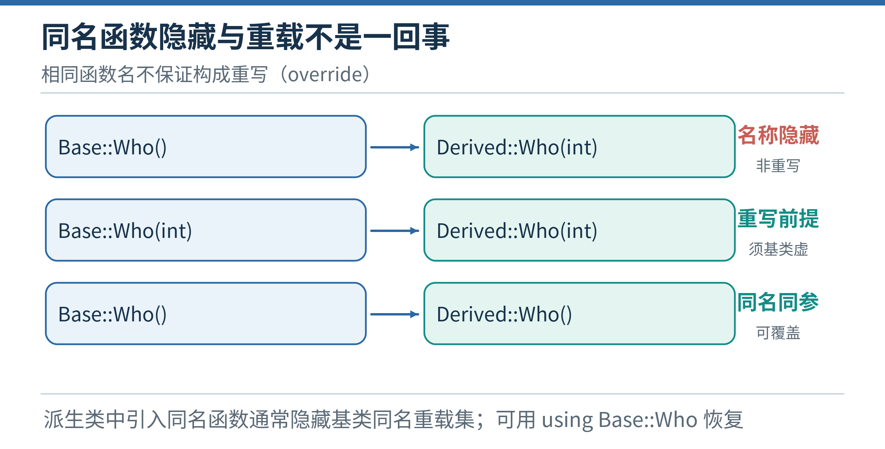

图：`Derived::Who(int)` 会隐藏基类的同名成员；是否重写还取决于是否存在匹配的虚函数。

```cpp
class Base {                        // 基类
public:
    virtual void F() const {}       // const 虚函数
};

class Derived : public Base {      // 派生类
public:
    void F() const override {}      // 匹配并覆盖基类虚函数
};
```

如果把 `Derived::F() const` 错写成 `Derived::F()`，`override` 会让编译器报错，防止“看起来重写了，实际没有重写”的错误。

**补充：协变返回类型**允许特定的指针/引用返回：

```cpp
class Base {                        // 基类
public:
    virtual Base* Clone() const;    // 返回指向基类的指针
};

class Derived : public Base {      // 派生类
public:
    Derived* Clone() const override;// 合法的协变指针返回类型
};
```

该例展示合法的**声明关系**，不是一个已实现的可独立链接程序。

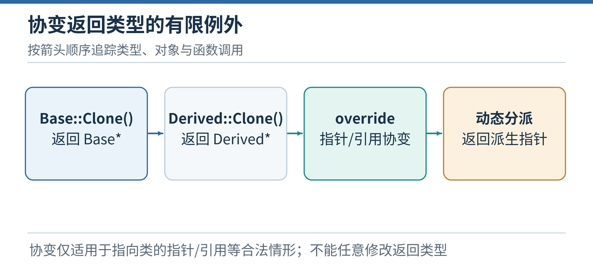

图：协变返回类型的实质是：派生重写函数可返回更具体的派生类型指针或引用，且必须满足标准规定的条件。

### 3.6 有时即使是虚函数，也可以明确调用基类版本

使用限定名 `p->CAnimal::Who()`，是**明确要求调用该基类实现**，不走普通的虚分派。和此不同，`p->Who()` 正常按虚函数机制工作。

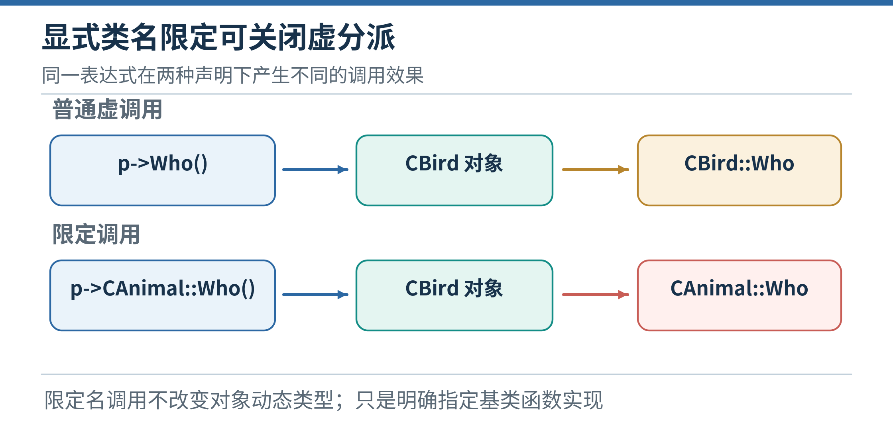

图：显式 `CAnimal::` 限定是对调用方式的改变，不是对实际对象类型的改变。

### 3.7 虚函数的运行原理：理解 vptr 与 vtable，但不要把它当作标准规定的内存格式

C++ 标准规定**运行时虚调用的行为**，不强制所有编译器使用某种固定的对象布局。在常见实现模型中：

- 带有虚函数的对象会保存某种虚调度相关信息（常用示意名为 `vptr`）。
- `vptr` 可关联一张虚函数表 `vtable`，表的条目对应特定虚函数槽位。
- 派生类覆盖虚函数时，对应表项可指向派生版本。
- 同一个动态类型的不同对象可能共享一张表；**不要据此假定表的固定顺序、字节数或对象中偏移**。

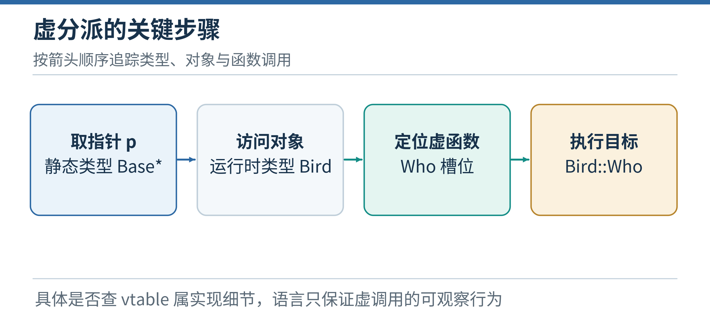

图：由基类指针开始，识别对象实际类型并选定最终覆盖者。

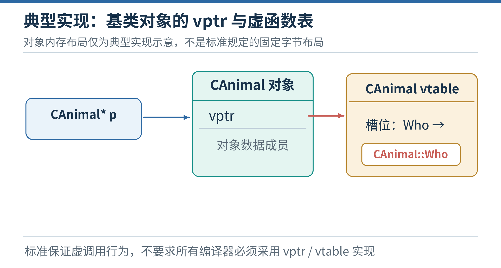

图：基类对象在典型 `vptr` / `vtable` 模型下的示意布局。

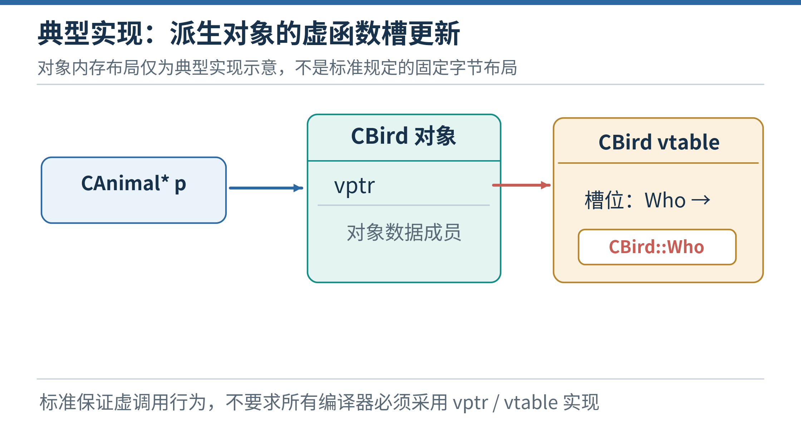

图：派生对象将 `Who` 对应的常见虚表条目指向派生版本。

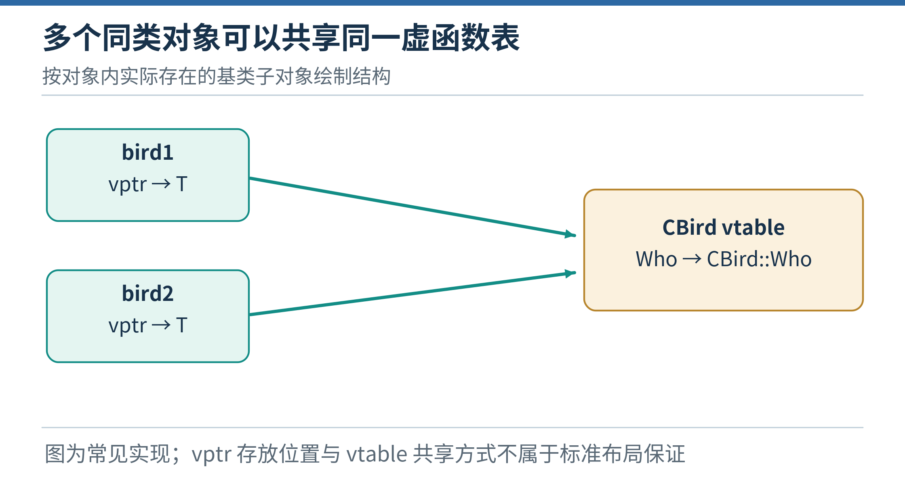

图：两个相同派生类型对象可有各自的 `vptr`，但共用虚表信息。

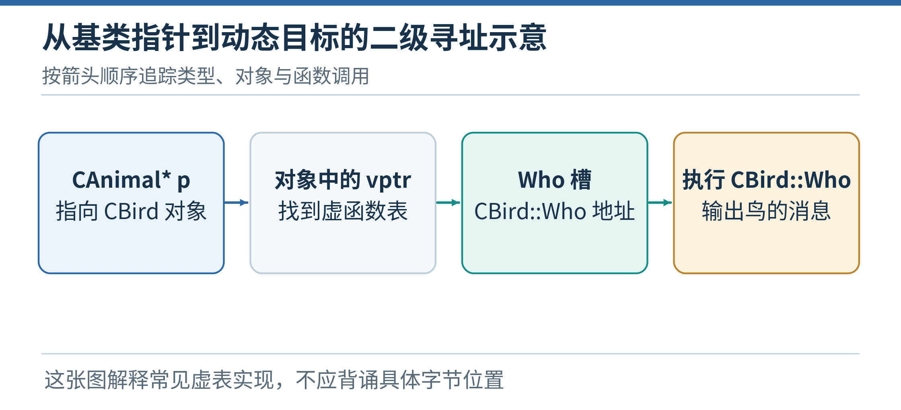

图：典型实现中“基类指针 → 对象 → 虚表槽位 → 派生函数”的调用链。

> [!note] vptr 不是标准语法
> 你无法在普通 C++ 源程序中直接写 `obj.vptr` 去访问编译器内部实现。图中的 `vptr`、`vtable` 是**解释常见 ABI 实现机制的教学模型**，不是标准库公开成员或需要手写的字段。

### 3.8 构造函数与析构函数中的虚调用：非常重要的例外

课件第 27～29 页的基类构造函数调用 `Who()`，即使该函数是虚函数，在**基类构造阶段**也只调用基类版本。原因是派生类部分尚未完成构造，不可像完整派生对象那样分派。

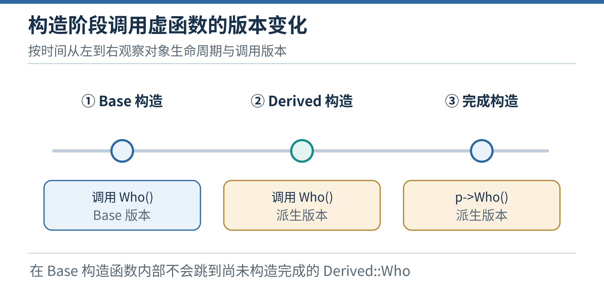

图：基类构造阶段、派生构造阶段和完整对象阶段的虚调用目标不同。

类似地，析构时先执行派生类析构函数，再执行基类析构函数；进入基类析构阶段时，已经不能动态分派到被销毁的派生部分。


图：析构阶段由最派生类逐层退回基类，虚函数调用遵守当前析构阶段的类身份。

```cpp
#include <iostream>                // 输入输出

class Base {                        // 基类
public:
    Base() { F(); }                 // Base 构造阶段调用 Base::F
    virtual void F() {              // 基类虚函数
        std::cout << "Base\n";    // 构造阶段输出 Base
    }
    virtual ~Base() = default;      // 多态基类虚析构
};

class Derived : public Base {      // 派生类
public:
    void F() override {             // 覆盖 F
        std::cout << "Derived\n"; // 正常虚调用选中此版本
    }
};

int main() {                        // 程序入口
    Derived d;                      // 构造 Base 时输出 Base
    Base& ref = d;                  // 基类引用绑定完整派生对象
    ref.F();                        // 输出 Derived
    return 0;                       // 正常结束
}
```

> [!warning] 重要警惕
> 不要在基类构造或析构函数中依靠虚函数“寻找尚未构造或已经析构的派生行为”。如果必须执行这种行为，应该设计为构造完成后明确调用的普通成员流程。

### 3.9 虚析构函数是多态基类的重要设计要求

如果经 `Base*` 删除由 `new Derived` 创建的对象，通常要求 `Base` 有虚析构函数，否则会出现**未定义行为**（不是简单地、必然地“只执行基类析构”）。

```cpp
class Base {                        // 多态基类
public:
    virtual ~Base() = default;      // 允许安全的基类指针删除
};

class Derived : public Base {      // 派生类
public:
    ~Derived() override = default;  // 参与正确的虚析构链
};

Base* p = new Derived();           // 基类指针指向堆上的派生对象
delete p;                           // 先析构派生部分，再析构基类部分
```

以上 `new` / `delete` 片段需放在函数体内。

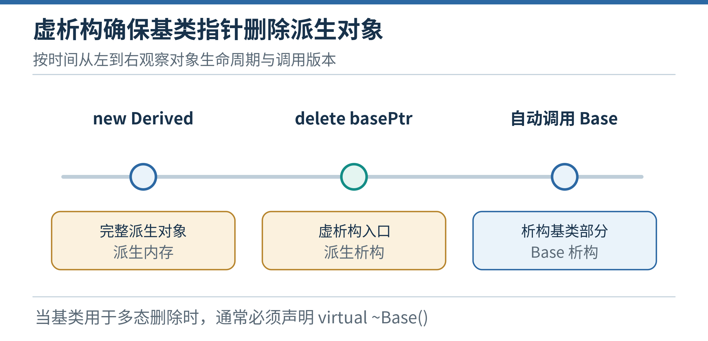

图：虚析构把通过基类指针的删除分派到完整派生对象的析构链。

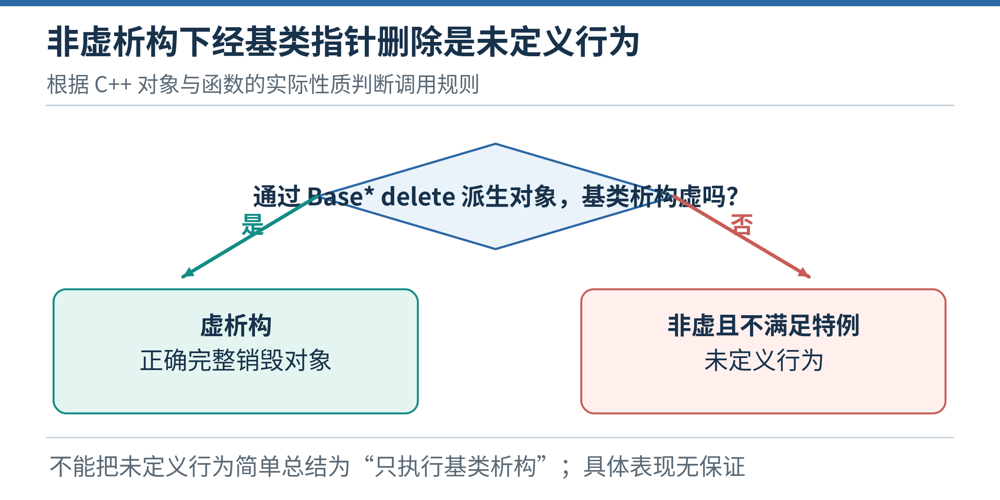

图：不具有合适虚析构机制时，通过基类指针删除派生对象可能是未定义行为。

### 3.10 哪些函数不能声明为虚函数？

- **构造函数**：不能声明 `virtual`，对象的动态类型构建本身依赖构造过程。
- **静态成员函数**：没有隐式的对象 `this`，不能声明为虚函数。
- **普通非静态成员函数**：可以是虚函数。
- **析构函数**：可以、而且多态基类通常应将其声明为虚函数。
- **类内定义的成员函数 / `inline` 函数**：**可以同时是虚函数**，不能笼统说“内联函数不能虚”。是否真正内联展开是编译器优化问题。

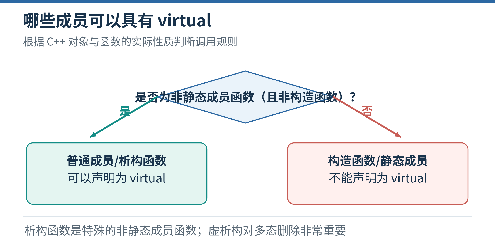

图：判断函数能否声明为 `virtual`，关键是它是不是可动态分派的非静态成员（析构函数允许）。

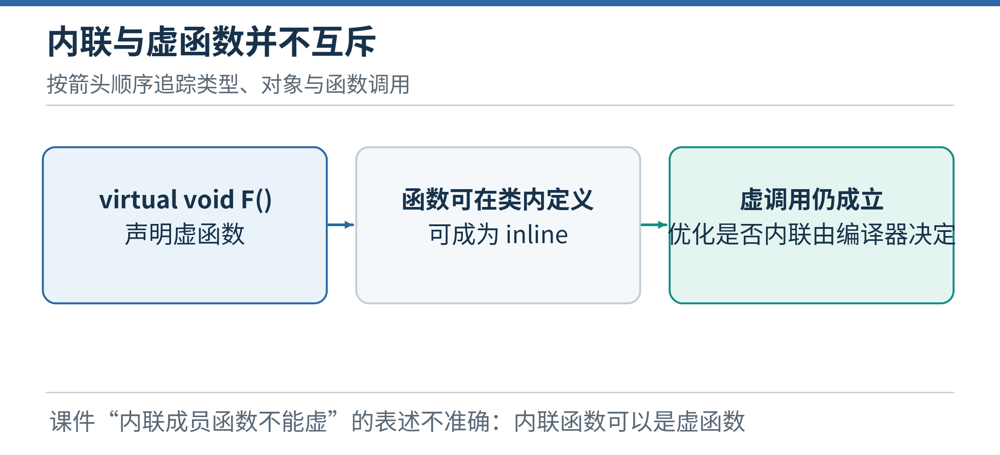

图：`inline` 与 `virtual` 作用不同，二者不是互斥概念。

### 3.11 现代 C++ 的 override 与 final

`override` 表示“这个函数必须覆盖某个基类虚函数”，不匹配时立即产生编译错误。`final` 可以禁止派生类继续覆盖特定虚函数，或禁止类继续被继承。

```cpp
class Base {                        // 基类
public:
    virtual void F() {}            // 可覆盖的虚函数
};
class Middle : public Base {       // 中间派生类
public:
    void F() override final {}     // 合法覆盖且禁止后续覆盖
};
```

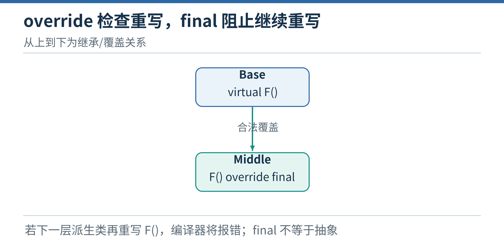

图：`Middle::F` 可以覆盖 `Base::F`，但下一层的同名重写将被 `final` 禁止。

---

## 四、8.4 多重继承与虚函数（课件第 33～40 页）

### 4.1 为什么会出现菱形继承问题

课件第 35～39 页新增蝙蝠类 `CBat`：蝙蝠同时具有兽类与鸟类两条继承链。若两条链都普通继承同一祖先类，最派生对象内可能有**两份祖先基类子对象**，导致重复状态与成员访问歧义。

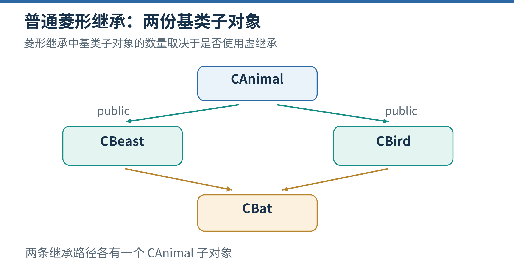

图：**普通菱形继承**，从 `CBat` 到 `CAnimal` 有两条子对象路径。

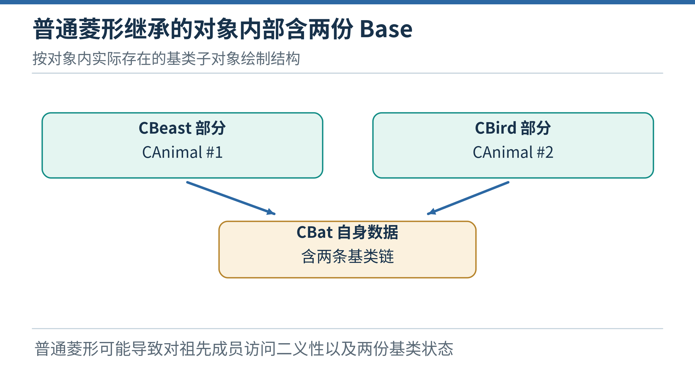

图：对象内部示意——普通继承情形可以包含独立的两份 `CAnimal` 子对象。

### 4.2 虚继承解决共享基类子对象的问题

课件中采用：

```cpp
class CAnimal {                     // 共同祖先类
public:
    void Who();                     // 本例此时是非虚函数
};

class CBeast : virtual public CAnimal { // 虚继承共同祖先
public:
    void Who();                     // 兽类版本（非虚）
};

class CBird : virtual public CAnimal {  // 与兽类共享同一祖先
public:
    virtual void Who();             // 鸟类在此引入虚特性
};

class CBat : public CBeast, public CBird { // 同时继承兽类和鸟类
public:
    void Who() override;            // 覆盖 CBird::Who
};
```

`virtual public CAnimal` 与 `virtual void Who()` 虽都包含关键字 `virtual`，意义完全不同：

- **虚继承**：在这种菱形体系下，让最派生类共享一份共同基类子对象。
- **虚函数**：让特定函数调用可以按对象动态类型分派。

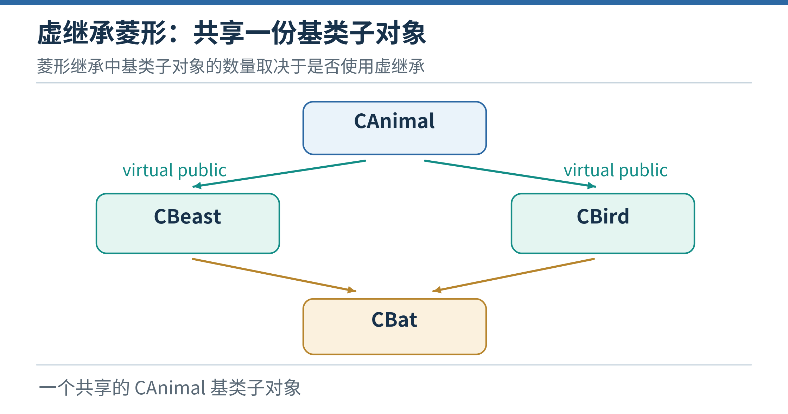

图：`CBeast` 与 `CBird` 虚继承 `CAnimal` 后，`CBat` 中只共享一个祖先子对象。

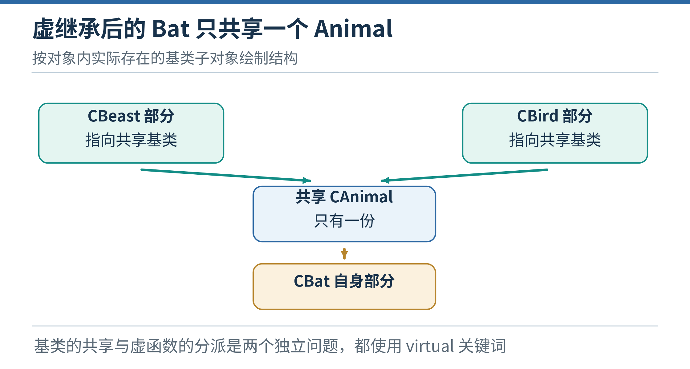

图：共享的基类状态不需要复制为两份；虚继承负责对象结构，而非 `Who()` 分派。

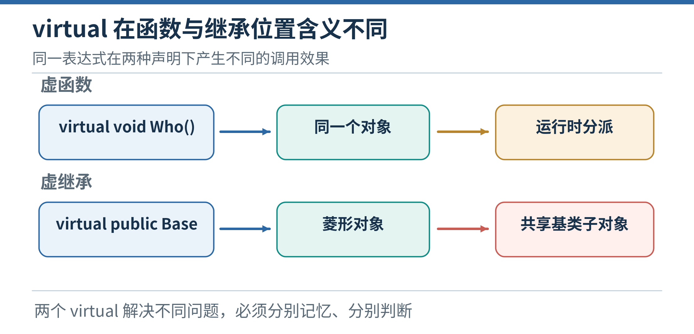

图：一边是函数分派，一边是继承结构，必须分别分析。

### 4.3 PPT 第 40 页的蝙蝠题：三个基类指针为什么输出不一样？

课件设置：`CAnimal::Who()` **非虚**，`CBeast::Who()` **非虚**，`CBird::Who()` **虚**，`CBat::Who()` 覆盖鸟类的那个虚函数。

```cpp
CBat bat;                           // 创建完整 CBat 对象
CAnimal* pa = &bat;                 // 共享的祖先基类指针
CBeast* pb = &bat;                  // 兽类基类指针
CBird* pc = &bat;                   // 鸟类基类指针

pa->Who();                          // CAnimal::Who，非虚静态绑定
pb->Who();                          // CBeast::Who，非虚静态绑定
pc->Who();                          // CBat::Who，虚函数动态分派
```

这三个调用**所指对象都是同一个 `CBat`**。输出不同的真正原因是：经不同静态类型发起的函数调用，其虚特性不同。

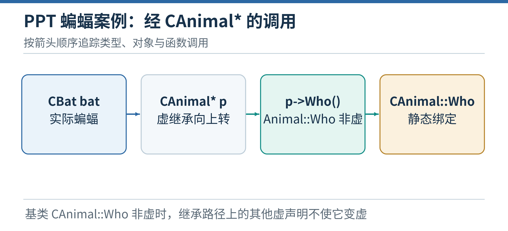

图：经 `CAnimal*` 调用，祖先 `Who` 非虚，因此执行祖先版本。

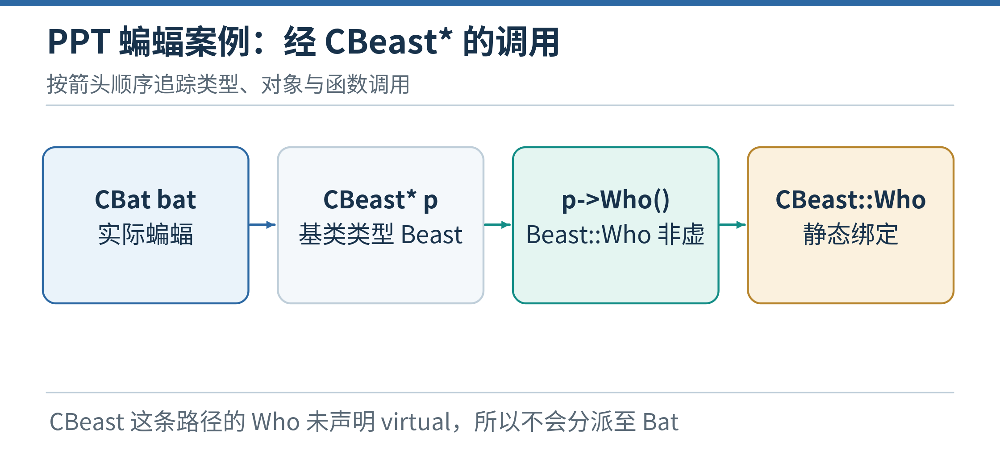

图：经 `CBeast*` 调用，兽类 `Who` 非虚，因此执行兽类版本。

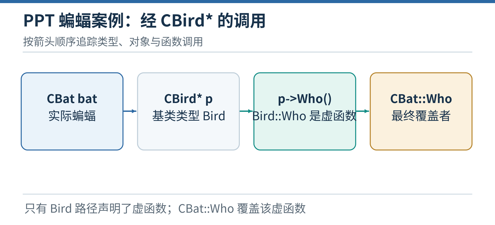

图：经 `CBird*` 调用，鸟类虚函数被 `CBat` 重写，执行蝙蝠版本。

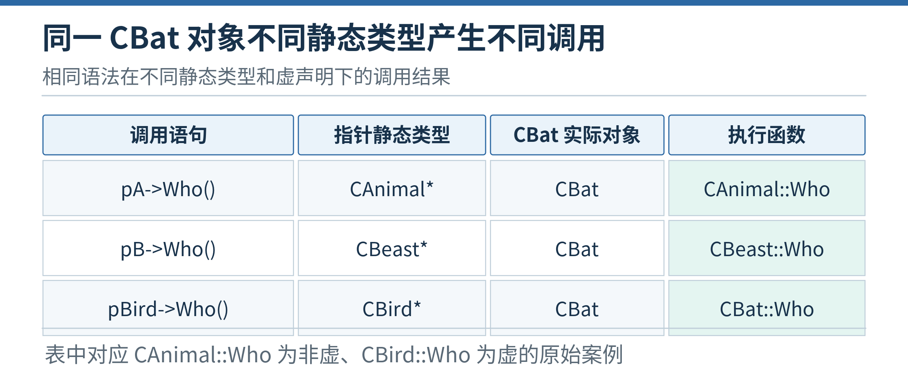

图：**同一实际对象 + 不同指针静态类型 + 不同虚声明**产生三种调用路径。

> [!important] 第 40 页第一问结论
> 输出次序依次为：**“我不是飞禽就是走兽！” → “我是森林之王！” → “我是蝙蝠大侠！”**。

### 4.4 如果 CAnimal::Who 也改为虚函数，会怎样？

当最顶层 `CAnimal::Who()` 声明为虚函数时，这条虚特性传递到其派生链。`CBeast::Who()`、`CBird::Who()` 以及 `CBat::Who()` 都在相应继承关系下参与覆盖；最终对象是 `CBat`，其 `Who()` 是最终覆盖者。

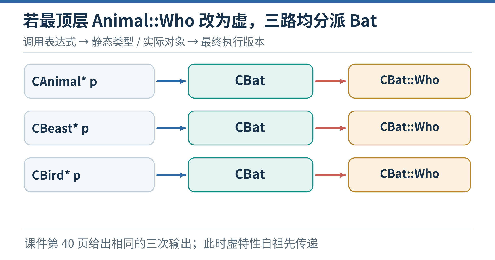

图：经 `CAnimal*`、`CBeast*`、`CBird*` 的虚调用全部执行 `CBat::Who()`。

> [!important] 第 40 页第二问结论
> 若将 `CAnimal::Who()` 改为虚函数，三次均输出：**“我是蝙蝠大侠！”**。

### 4.5 多重继承对象地址与转换的细节

多重继承时，`CBat*` 转换为某个基类指针后，其数值地址**可能发生调整**，因为不同基类子对象可能位于完整对象的不同位置。不要凭 `pa == pb` 的表面写法来推断物理结构；不同基类指针甚至无法在未经转换时直接作常规比较。

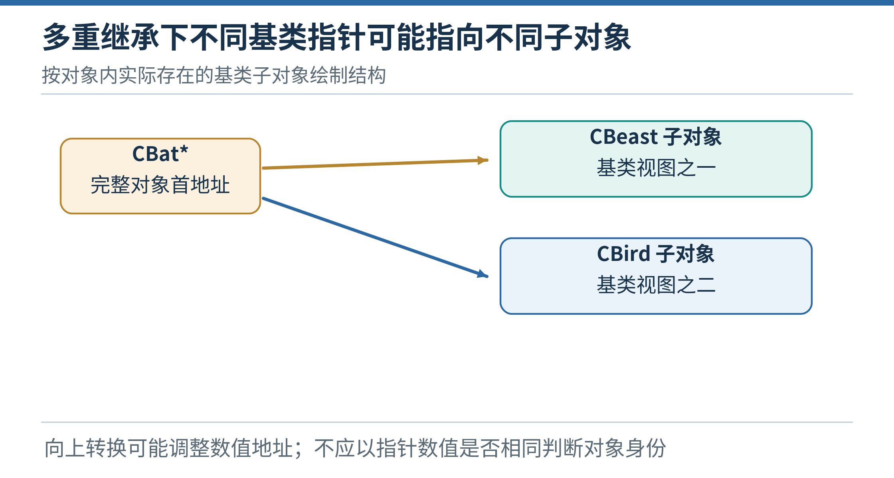

图：基类指针定位相应的子对象视图，不意味着每种指针都保存相同起始地址。

### 4.6 虚基类的初始化顺序

含虚继承时，最派生类负责初始化共享的**虚基类**。典型构造顺序是：先虚基类，再非虚直接基类，再非静态数据成员，最后执行最派生类构造函数体；具体基类和成员之间的先后顺序由标准规则与声明顺序决定。

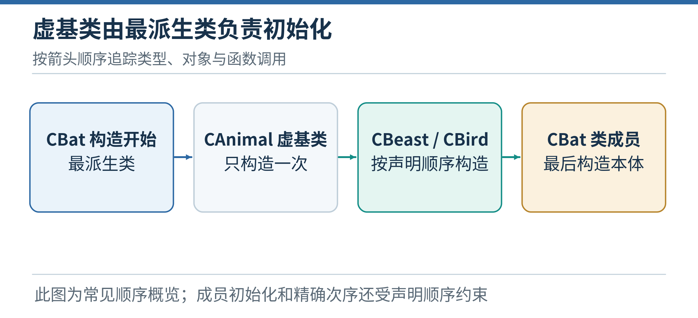

图：在蝙蝠类体系中，共享祖先 `CAnimal` 的构造仅发生一次。

### 4.7 同名成员与二义性

若两个基类分别提供相同名字的成员，而最派生类没有作出明确统一处理，那么直接 `bat.F()` 可能发生名称查找二义性。可以在最派生类重新定义合适接口，或通过 `Base1::F()` / `Base2::F()` 限定访问。

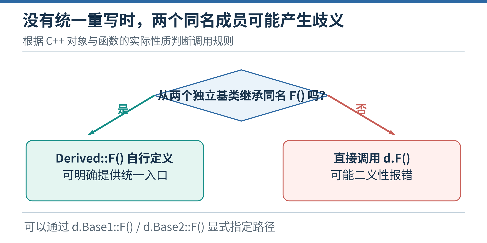

图：二义性不是虚函数分派本身；它首先属于**成员名称查找与继承结构**的问题。

> [!warning] 多重继承题目必分开两件事
> **第一步**：判断菱形里有多少个基类子对象（普通继承 vs 虚继承）。**第二步**：判断当前指针静态类型下 `Who()` 是否是虚函数、谁是最终覆盖者。把两个 `virtual` 的作用混在一起，是本节最常见错误。

---

## 五、8.5 纯虚函数与抽象类（课件第 42～46 页）

### 5.1 纯虚函数与抽象类的定义

**纯虚函数（pure virtual function）**：声明时使用 `= 0` 标记的虚函数，例如：

```cpp
class CAnimal {                     // 抽象动物类
public:
    virtual void Who() = 0;         // 纯虚函数：定义统一接口
    virtual ~CAnimal() = default;   // 保证多态基类正确析构
};
```

**抽象类（abstract class）**：具有至少一个最终纯虚函数的类，不能直接实例化。它可以为派生类定义统一的访问接口。不能用 `CAnimal a;` 创建抽象对象，但可以定义 `CAnimal*`、`CAnimal&`，指向或绑定合适的具体派生对象。

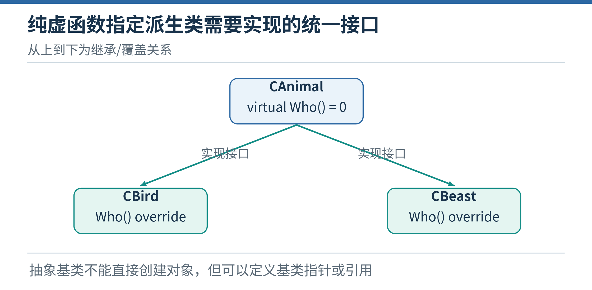

图：`CAnimal` 规定 `Who()` 接口；派生类各自实现，调用者不必直接依赖派生类型。

### 5.2 为什么不能定义抽象基类对象

课件第 45 页把 `CAnimal::Who()` 改为 `virtual void Who() = 0;`，第 46 页仍在例程里尝试定义 `CAnimal zA`，并追问“问题何在”。

**问题所在**：`CAnimal` 已经是抽象类，不能实例化；编译会失败。必须删除该对象定义，或者改为实际构造一个已实现所有纯虚函数的具体派生类对象，并通过基类指针/引用访问。

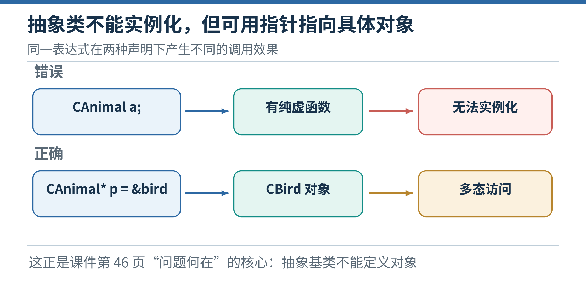

图：抽象类对象实例化是编译错误；抽象类型的指针与引用仍然有意义。

### 5.3 派生类没有全部实现纯虚函数时会怎样？

若派生类仍保留未实现的最终纯虚函数，它也仍然是抽象类。直到某个后续派生类给出了完整覆盖，才可以创建这种具体类的对象。

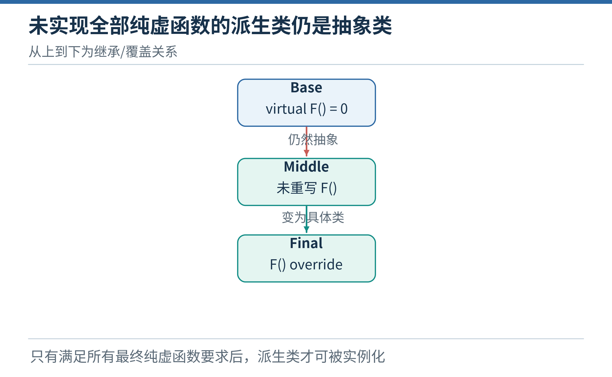

图：一个中间派生类可以仍是抽象类，而下一层类完成纯虚函数实现后才变成可实例化类型。

> [!important] 抽象类的使用要点
> - 抽象类本身不能作为**按值**创建的对象、函数形参类型或返回对象类型；但可以用其**引用和指针**作形参或返回类型。
> - 派生类只有完成所有最终纯虚函数的要求，才是具体类。
> - 抽象基类尤其适合描述共同接口，而非表示“一个有意义的普通实例”。

### 5.4 纯虚函数不等于没有函数定义，也不等于空函数

课件第 42 页用“没有实现体的函数”解释纯虚函数，是有助于初学者理解的直观说法，但需要补充：**纯虚函数在 C++ 中也可以在类外提供定义，类仍然保持抽象**。相反，`virtual void F() {}` 是一个有空函数体的普通虚函数，不会因为函数体为空就变成纯虚函数。


图：`= 0` 是纯虚声明的标志；空函数体 `{} ` 与“纯虚”是不同的概念。

### 5.5 典型应用：抽象平面图形与面积计算

以下是围绕课件第 49 页“实现典型平面图形的处理”布置的**理解性示例**，并非 PPT 提供的详细原题：

```cpp
#include <iostream>                // 标准输出

class Shape {                       // 抽象图形基类
public:
    virtual double Area() const = 0;// 各图形必须定义面积计算
    virtual ~Shape() = default;     // 正确析构多态对象
};

class Circle : public Shape {      // 圆形派生类
    double radius;                  // 保存半径
public:
    explicit Circle(double r) : radius(r) {} // 初始化半径
    double Area() const override {  // 计算圆形面积
        return 3.141592653589793 * radius * radius;
    }
};

class Rectangle : public Shape {   // 矩形派生类
    double width, height;           // 长和宽
public:
    Rectangle(double w, double h) : width(w), height(h) {}
    double Area() const override {  // 计算矩形面积
        return width * height;
    }
};

int main() {                        // 程序入口
    Circle circle(2.0);             // 半径为 2 的圆
    Rectangle rectangle(3.0, 4.0);  // 宽 3、高 4 的矩形
    const Shape* shapes[] = {&circle, &rectangle}; // 统一接口数组
    for (const Shape* p : shapes) {  // 逐个访问图形对象
        std::cout << p->Area() << '\n'; // 虚调用各自的面积函数
    }
    return 0;                       // 正常结束
}
```

运行结果第一行约为 `12.5664`，第二行是 `12`（默认输出精度下）。注意 `const Shape*` 对应 `Area() const`；实现函数也必须保持 `const`，否则不能正确 `override`。


图：新增圆形、矩形、三角形时，都只需遵守 `Shape::Area()` 的统一接口。


图：三种具体几何形状及计算结果（圆半径 2、矩形 3×4、三角形底 6 高 3）。

### 5.6 纯虚析构函数是特别的情况（必要补充）

纯虚析构函数本身也能使类成为抽象类，但基类析构函数在派生对象销毁时始终需要执行，因此**纯虚析构函数必须提供定义**。

```cpp
class Base {                        // 抽象基类
public:
    virtual ~Base() = 0;           // 纯虚析构声明
};

Base::~Base() {}                    // 纯虚析构必须有函数定义
```


图：即使声明为纯虚析构，实际析构链仍需执行 `Base::~Base()` 的定义。

---

## 六、PPT 附加内容：学生管理程序（第 50～54 页）

这一部分不是“多态性与虚函数”的主线，而是对之前知识的回顾和综合应用，**作为附录保留**，避免整套课件后半部分被忽略。

### 6.1 CStudent 的结构与静态重载

课件中的学生类包括：`char mNo[9]`（学号）、`char* mpName`（动态姓名）和 `int mScore[5]`（5 门成绩）；接口还包括默认构造、复制构造、析构、输入/显示、两种 `Compare`、友元比较函数与流操作符重载。

**要分清**：这里两个 `Compare` 成员函数的参数分别是 `const CStudent&` 与 `const CStudent*`，属于**静态重载**；`operator>>` / `operator<<` 属于运算符重载，**不是虚函数覆盖**。


图：`Compare(zS2)` 和 `Compare(&zS2)` 的参数形式不同，由编译期选择重载。


图：友元流操作符承担对象输入与格式化输出，并不具有运行时虚分派含义。

### 6.2 原始指针管理姓名时，为什么必须深拷贝？

若对象拥有自己分配的动态数组，默认成员逐一复制只会复制指针地址。两个对象随后若都析构，会尝试释放同一块内存，可能导致重复释放、悬空指针等严重问题。


图：两个 `mpName` 指向同一堆字符数组，是不正确的资源共享方式。

复制构造函数必须为副本单独分配存储空间，并复制实际字符内容。


图：深拷贝后的两个对象拥有独立的姓名数组，任何一方释放内存都不会破坏另一方。

课件第 53 页的核心意图是对姓名指针执行深拷贝。但应注意：默认构造将 `mpName` 设为 `NULL` 后，复制构造若直接写 `strlen(zS.mpName)`，当原对象未输入姓名时会对空指针调用 `strlen`，产生未定义行为。应先判断源指针是否为空。


图：复制构造时先分支判断源指针状态，再决定是否分配并复制字符数组。

```cpp
CStudent::CStudent(const CStudent& other) : mpName(nullptr) { // 初始化空指针
    for (int i = 0; i < 5; ++i) {   // 复制五门课程成绩
        mScore[i] = other.mScore[i];// 按元素复制数组
    }
    std::strcpy(mNo, other.mNo);   // 复制学号字符数组
    if (other.mpName != nullptr) { // 先检查姓名指针有效
        int size = static_cast<int>(std::strlen(other.mpName)) + 1; // 含终止符
        mpName = new char[size];   // 副本独立分配空间
        std::strcpy(mpName, other.mpName); // 复制姓名字符
    }
}
```

此片段是**在已存在 `mNo[9]`、`mpName`、`mScore[5]` 成员的 CStudent 类环境下的定义**，需要 `<cstring>` 头文件，且要求源对象成员已正确初始化、姓名满足以 `\0` 结尾的字符串契约。为了处理异常和赋值，实际现代程序更推荐 `std::string`。

> [!warning] 课件学生类还缺少一个关键复制控制
> **有自定义析构与复制构造、又自己管理动态内存的类，通常还必须正确实现复制赋值运算符 `operator=`**（传统 Rule of Three）。否则 `a = b;` 仍可能复制裸指针，引发重复释放。课堂第 51～54 页的实现应视为教学阶段示例，而不是健壮完整的资源管理方案。

### 6.3 输入与数组越界风险

课件用 `char mNo[9]` 存 8 位学号加字符串结束符；若直接 `std::cin >> mNo`，不限制输入长度，存在溢出风险。更推荐使用 `std::string` 作为学号、姓名存储；若必须保持数组，则需要显式限制输入大小并处理无效输入。


图：定长缓冲区无界输入有风险，使用 `std::string` 可简化安全管理。

### 6.4 构造、复制、析构全过程


图：从默认空指针、输入姓名、深拷贝到释放动态数组，梳理资源生命周期。

> [!tip] 关于这部分代码的学习顺序
> 先掌握“复制构造与析构为什么要配对思考”；再学习 `operator=`、异常安全与 Rule of Three；最后对照现代 `std::string` 和标准库容器如何自动管理存储。这些是对课件示例的必要理解性补充。

---

## 七、课程作业与巩固（第 49 页）

课件给出的作业主题是：**实现典型平面图形的处理**，没有展开完整评分标准。下述是便于学习的建议方案，不冒充老师给出的完整题目。

### 7.1 建议的类与接口设计

- 抽象基类 `Shape`：声明 `virtual double Area() const = 0;` 并提供虚析构。
- `Circle`：保存半径并覆盖 `Area()`；`Rectangle`：保存宽高并覆盖 `Area()`。
- 用 `Shape*` 或 `Shape&` 写一个统一的计算/打印函数，要求无需判断具体类型即可调用。
- 进一步扩展：新增 `Triangle`，观察调用接口是否需要改动。


图：一份合理的抽象接口与两个具体图形类的继承方案。


图：基类指针数组如何统一处理多种图形并调用派生类面积计算。

### 7.2 四组关键自测

> [!question] 自测 1：基类函数不是虚函数
> `Base* p = &derived; p->F();` 其中 `Base::F` 是普通成员函数、`Derived` 有同名同参 `F`。执行哪个？
>
> **答案：** `Base::F`。这里是按静态类型绑定的非虚调用。

> [!question] 自测 2：构造函数内部
> `Base` 构造函数内部调用其虚 `F()`，随后构造 `Derived` 对象。构造 `Base` 的这一阶段执行哪个？
>
> **答案：** `Base::F`，不会跳过构造阶段调用尚未完成构造的 `Derived::F`。

> [!question] 自测 3：抽象类
> `Base` 定义了 `virtual void F() = 0;`，`Derived` 继承它但不实现 `F()`。可否创建 `Derived d;`？
>
> **答案：** 不可以，`Derived` 仍是抽象类。

> [!question] 自测 4：蝙蝠多继承
> `Animal::Who` 非虚、`Beast::Who` 非虚、`Bird::Who` 虚、`Bat::Who` 正确覆盖；同一 `Bat` 经三个指针分别调用时的函数版本？
>
> **答案：** 分别为 `Animal::Who`、`Beast::Who`、`Bat::Who`，与课件第 40 页一致。

---

## 八、易错点统一辨析与课程资料校订

### 8.1 判断虚函数调用的四步法


图：从表达式静态类型出发，逐步核实虚特性、动态对象和最终覆盖者。

| 容易误判的说法 | 正确理解 |
|---|---|
| “指向派生对象，所以必调用派生函数” | 非虚函数仍按静态类型决定；必须先看调用是否为虚调用。 |
| “用引用参数就自动多态” | 引用避免切片，但被调用函数必须符合虚分派条件。 |
| “同名同参函数都算重写” | 必须匹配相应**基类虚函数**的覆盖规则，`const` 等限定符也要匹配。 |
| “普通成员函数内部调用虚函数一定调用本类版本” | 完整对象的正常虚调用仍可选派生最终覆盖者。 |
| “构造期一定调用最派生类虚函数” | 构造/析构期的虚调用遵循当前阶段的类。 |
| “菱形共享基类意味着所有函数都自动成为虚函数” | 虚继承仅影响共享子对象，函数虚特性需分别声明。 |
| “纯虚函数就是函数体为空” | `= 0` 才是纯虚声明；纯虚函数有时也有类外定义。 |
| “基类析构非虚也只是少调用一个析构函数” | 经基类指针删除动态派生对象，可能是未定义行为。 |
| “虚函数表是 C++ 强制的固定内存结构” | `vptr` / `vtable` 是常见实现模型，并非标准固定布局。 |

### 8.2 课件与现代标准 C++ 的差异清单

1. **标准头文件**：课件多次使用 `#include <iostream.h>`；现代 C++ 使用 `#include <iostream>`，并通过 `std::cout` / `std::endl` 等命名空间成员输出。
2. **程序入口**：课件使用 `void main()`；标准 C++ 应使用 `int main()`，并可返回 `0`。
3. **内联虚函数**：课件第 15 页“静态/内联成员函数及构造函数不能是虚函数”的合并表述不准确。**静态成员函数与构造函数不能是虚函数，但内联成员函数可以是虚函数**。
4. **普通函数内的虚调用**：课件第 26 页“普通成员函数中调用虚函数”的简述不应解读为静态绑定；第 22、32 页的例程证明动态虚调用仍然有效。
5. **重写与同名隐藏**：第 15 页把不匹配情形概括为普通重载不够严谨，应区分覆盖失败、名称隐藏与确实的重载集；现代 C++ 用 `override` 检查最可靠。
6. **纯虚函数**：第 42 页的“没有实现体”是便于理解的简化说法，标准 C++ 允许纯虚函数提供类外定义；纯虚析构函数还要求提供定义。
7. **虚表布局**：第 25 页的示意有教学价值，但不能据此推断某个编译器必然存在固定 `vptr` 字段或表结构。
8. **学生类复制**：第 53 页 `strlen(zS.mpName)` 需要先检查空指针，动态资源拥有者还需处理复制赋值，且默认构造后的成绩数组也应初始化；第 54 页定长字符数组输入存在边界问题。
9. **强制转换**：第 13 页的 C 风格派生指针转换不能替代动态多态，实际项目避免未经验证地向下转换。
10. **本文现代补充**：`override`、`final`、`std::string`、`dynamic_cast`、虚析构及修订代码均为兼顾标准规范和可学习性的补充，未将其伪称为 PPT 原文。

### 8.3 最终速查表

| 情形 | 选择规则 | 关键结论 |
|---|---|---|
| `Base*` 访问非虚 `F()` | 按静态类型 | 一般执行 `Base::F` |
| `Base*` 访问虚 `F()` | 按实际对象的最终覆盖者 | 可执行 `Derived::F` |
| `Base&` 访问虚 `F()` | 同上 | 引用也能动态分派 |
| `Base b = derived` | 对象切片 | `b` 的动态类型为 `Base` |
| `p->Base::F()` | 显式限定调用 | 抑制常规虚分派 |
| `Base` 构造函数内调用虚 `F()` | 按当前构造阶段 | 不调用尚未构造的派生覆盖版本 |
| `Base` 析构函数内调用虚 `F()` | 按当前析构阶段 | 不调用已析构的派生覆盖版本 |
| 虚继承共同祖先 | 共享基类子对象 | 不自动决定 `F()` 是否为虚 |
| `virtual F() = 0` | 定义纯虚函数 | 含未实现最终纯虚函数的类为抽象类 |
| `delete Base*` 指向动态派生对象 | 通常要求基类虚析构 | 不满足相应规则可能发生未定义行为 |

> [!summary] 本讲最重要的一句话
> **多态题首先判断调用表达式是否构成虚调用，然后才看运行时对象到底是什么；不要把同名函数、继承路径和动态对象类型混成一个判断。**

---

## 附：可运行示例与图件使用说明

附件目录内 `code/` 提供多组可编译的 C++17 小程序（非虚调用、虚函数与引用、菱形继承、纯虚图形、构造阶段、学生对象复制），用于独立验证本文主要结论；它们不替代正文中的分章节解释。

**编译形式**：在对应项目目录运行 `g++ -std=c++17 -Wall -Wextra ... -o demo`，具体命令写在 `code/README.md`。

**插图路径策略**：采用 Obsidian 仓库完整路径 Wiki 嵌入。将 ZIP 顶层唯一的 `CppOOP_..._assets` 文件夹移动到当前 Vault 的 `Assets/` 文件夹下；正文 `.md` 可放入任意课程目录。最终资源路径为 `Assets/CppOOP_..._assets/images/...png`。SVG 供编辑，PNG 供稳定阅读，不把两种格式重复计为两幅图。

**内容范围声明**：第 55 页的“第九讲模板与类属机制”是下一讲预习安排，第 56～57 页为课堂答疑与结束页，不属于本讲需展开的核心知识，因此本文只作范围记录，不无边界扩写模板内容。
