# 第六章　树和二叉树

> [!abstract] 本章知识主线
> 树是一种**层次化的非线性数据结构**。先理解树与二叉树的结构、性质和存储方式，再掌握在结构中系统访问结点的**遍历算法**；进一步利用遍历实现建树、求深度和序列还原；借助**线索化**保存前驱、后继信息；最后通过**孩子—兄弟表示**连接一般树、森林与二叉树，并学习使带权路径长度最小的**哈夫曼树与前缀编码**。
>
> **学习重心**：二叉树存储结构与适用范围；先序、中序、后序的递归及非递归遍历；中序线索化；树和森林的存储与转换；哈夫曼树及编码。


## 一、树的定义与基本概念

### 1. 树为什么是递归定义的

**树（Tree）**是 $n\,(n\ge 0)$ 个结点的有限集合。$n=0$ 时为空树。非空树有且仅有一个**根结点（root）**；除根之外的结点可划分成若干个互不相交的集合，每个集合本身仍是一棵树，称为根的**子树（subtree）**。

以根结点为 $A$ 的树为例，它的子树可以分别以 $B,C,D$ 为根；而 $B$ 的子树又可以继续划分。因此：一棵树可以理解为一个结点和一组子树的组合，直至走到没有孩子的叶子结点。

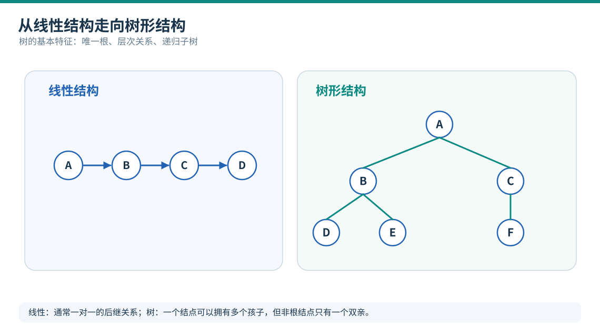

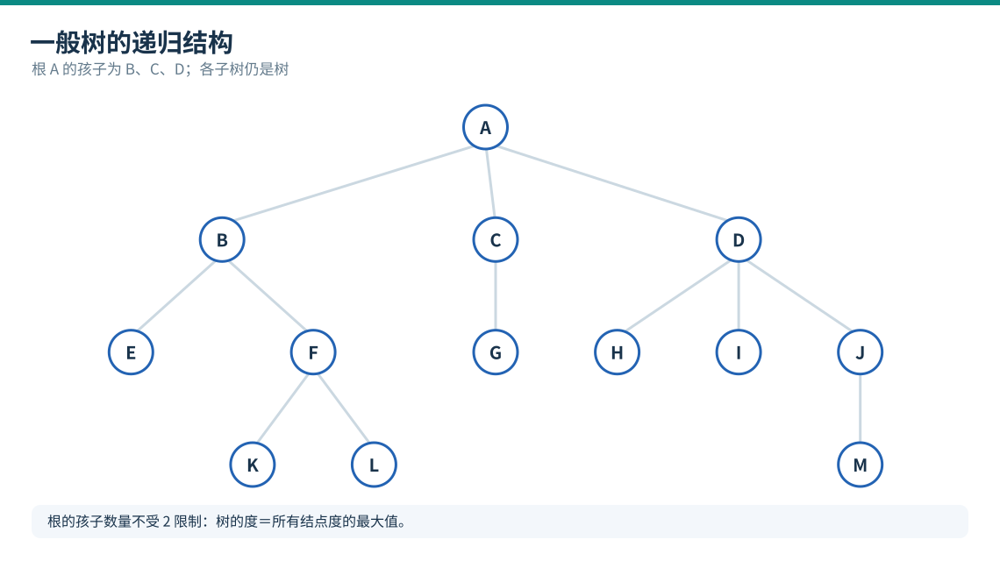

> [!important] 树的三项结构约束
> 1. **根唯一**：非空树只有一个根。
> 2. **子树不相交**：不能让同一个结点属于两个不同的子树。
> 3. **双亲唯一**：除根之外，每个结点恰有一个直接双亲；从根到任一结点存在唯一的简单路径。
>
> 从图的角度看，有 $n$ 个结点的非空树恰有 $n-1$ 条边，不能包含回路。

树可以采用形式化表示 $T=(root,F)$，其中 $root$ 是根，$F$ 是根下所有子树形成的森林。**森林（Forest）**是 $m\,(m\ge0)$ 棵互不相交的树的集合，空森林允许存在。

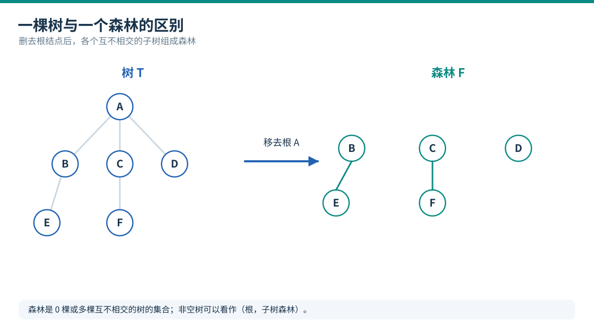

### 2. 树中的亲属关系与度

| 名称 | 准确含义 |
| --- | --- |
| 结点的度 | 该结点直接拥有的**孩子数**，即子树数 |
| 树的度 | 整棵树所有结点度数的最大值 |
| 叶子结点（终端结点） | 度为 $0$ 的结点 |
| 分支结点（非终端结点） | 度大于 $0$ 的结点 |
| 双亲、孩子 | 直接相连的上一层与下一层结点 |
| 兄弟 | 双亲相同的结点 |
| 堂兄弟 | 双亲位于同一层的不同结点；通常与兄弟区分 |
| 祖先 | 从根通往某结点的路径上、位于该结点之前的结点 |
| 子孙 | 某结点所辖子树中的其他结点 |

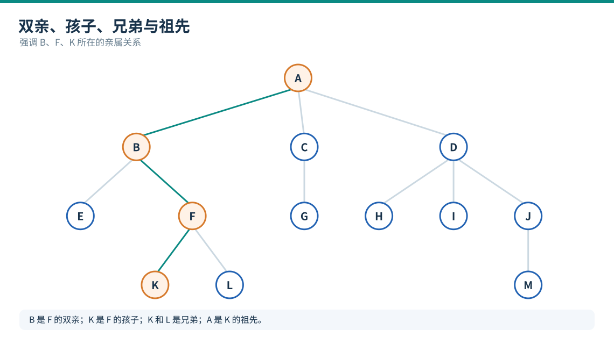

在示例树中，$B$ 是 $F$ 的双亲；$F$ 与 $E$ 是兄弟；$K$ 与 $L$ 是兄弟；$A,B,F$ 都是 $K$ 的祖先。**结点的度不是它所在的层次，也不是它到根的距离。**

### 3. 层次、深度与路径长度

本章采用**根所在层为第 1 层**的约定。结点的层次等于从根到该结点经过的边数加 $1$；树的深度（高度）是所有结点层次的最大值：

$$
\operatorname{level}(v)=\operatorname{distance}(root,v)+1,
\qquad
\operatorname{Depth}(T)=\max_v\operatorname{level}(v).
$$

规定空树深度为 $0$，非空单结点树深度为 $1$。因此，树的深度为 $4$ 时，从根到最深结点有 $3$ 条边，不能把两者混用。

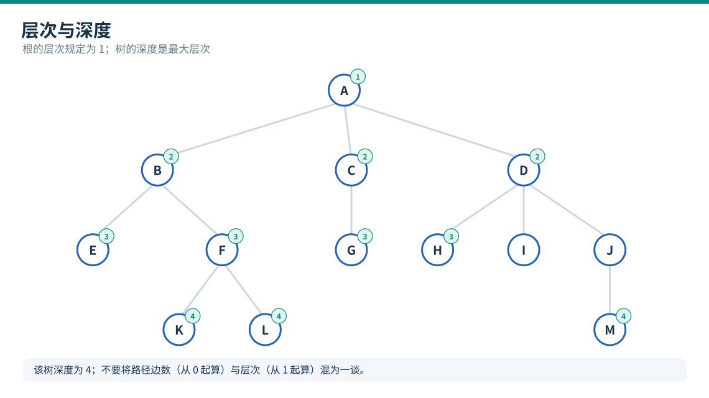

### 4. 有序树、无序树与树的抽象操作

**有序树**规定一个结点的孩子从左到右的次序，不能任意交换；**无序树**不区分孩子的排列。孩子—兄弟表示法和树与二叉树的转换，都需要明确孩子次序，因此通常以有序树为基础。

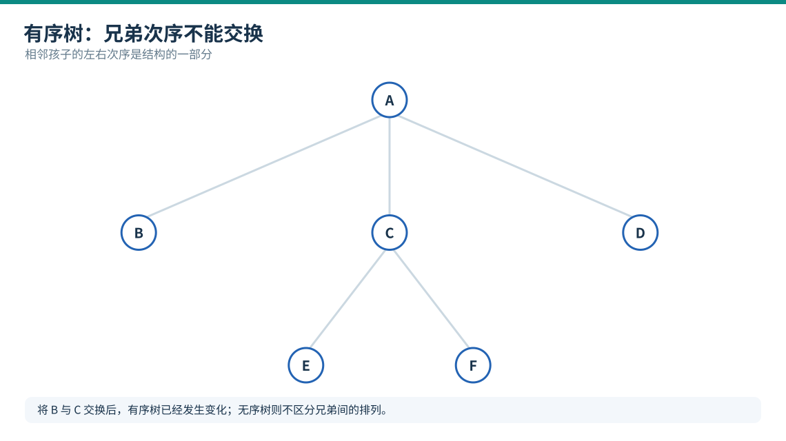

从抽象数据类型（ADT）角度，树的基本操作包括三类。**查询**：求根、结点值、双亲、最左孩子、右兄弟，判空，求深度与遍历；**构造或修改**：初始化、创建树、赋值、插入第 $i$ 棵子树；**删除**：清空、销毁、删除某个孩子子树。它们描述的是操作能力，**并不等同于某一种 C++ 代码接口**；具体实现要由存储结构决定。

> [!note] 树形结构与线性结构的本质区别
> 线性结构通常每个内部元素只有一个直接前驱和一个直接后继；树形结构的非根结点只有一个直接双亲，却可以有多个孩子。即使按某种遍历顺序把树的结点排成一列，也不表示树已经变成线性结构：原来的亲子关系仍需另外保存。

## 二、二叉树及其性质

### 1. 什么是二叉树

**二叉树（Binary Tree）**是由根结点及两棵互不相交的**左子树、右子树**构成的递归结构；也允许整棵二叉树为空。每个结点**最多有两个孩子**，而且左子树与右子树必须严格区分。

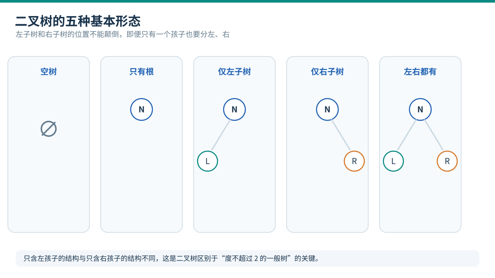

二叉树的五种基本形态依次为：空树、只有根、根仅有左子树、根仅有右子树、左右子树都非空。**一个只有右孩子的结点**不能因为只有一个孩子，就将该孩子随意画到左边。

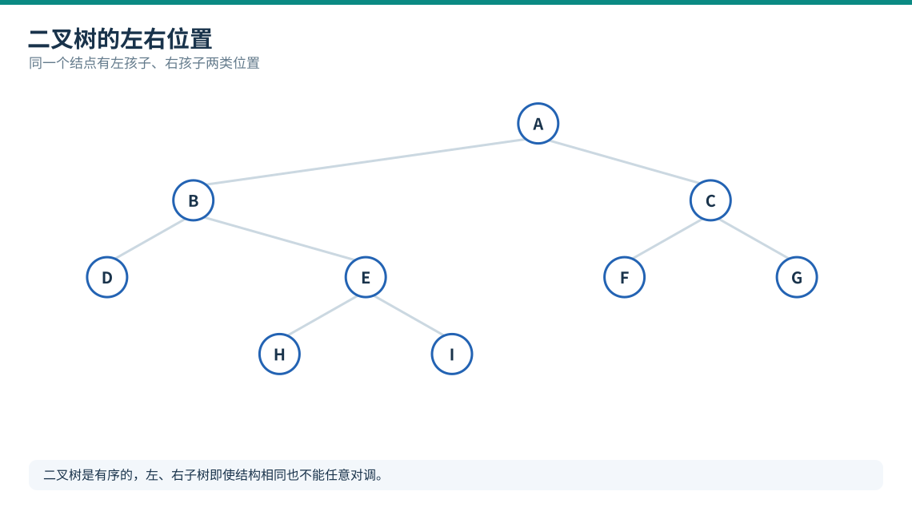

> [!warning] “度不超过 2 的一般树”不完全等于二叉树
> 一般无序树不区分仅有的一个孩子属于左侧还是右侧，而二叉树区分。二叉树天然有序，左右位置是结构的一部分。

### 2. 二叉树的三条普遍性质

**性质一：第 $i$ 层最多有 $2^{i-1}$ 个结点**，$i\ge1$。

这是因为第 1 层只有根，下一层的结点数至多是上一层的两倍。由数学归纳法可逐层验证。

**性质二：深度为 $k$ 的二叉树最多有 $2^k-1$ 个结点**，$k\ge1$。

$$
N_{\max}=1+2+2^2+\cdots+2^{k-1}=2^k-1.
$$

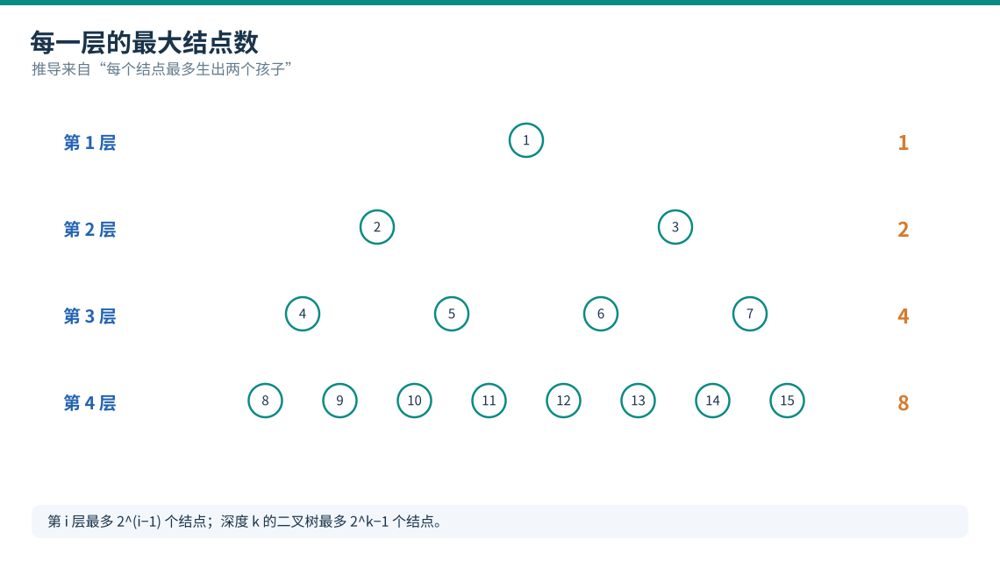

**性质三：对任意非空二叉树，叶子数 $n_0$ 与度为 2 的结点数 $n_2$ 满足**

$$
\boxed{n_0=n_2+1}.
$$

证明不是记忆某一特殊树的图形，而是统计**边的总数**。设度为 $1$ 的结点数为 $n_1$，有

$$
\begin{aligned}
n&=n_0+n_1+n_2,\\
n-1&=n_1+2n_2,\\
\therefore\quad n_0&=n_2+1.
\end{aligned}
$$

第一式由按度分类计数得出；第二式一方面因为非根结点各有一条入边，另一方面因为度为 $1,2$ 的结点分别贡献 $1,2$ 条出边。

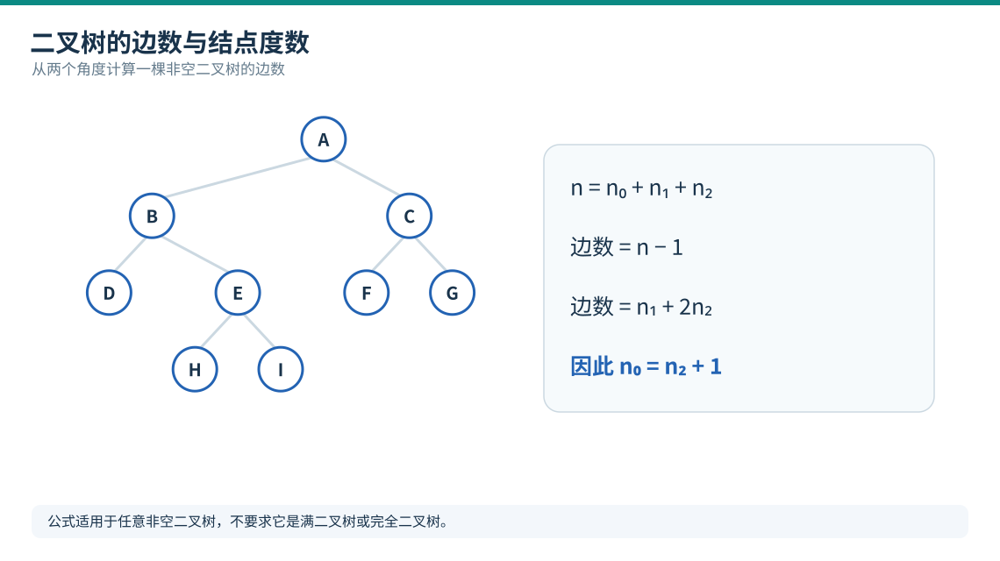

> [!example] 已知度为 2 的结点有 8 个
> 则叶子结点一定有 $n_0=8+1=9$ 个，不需要知道度为 1 的结点数量，也不要求这棵树完全或满。

### 3. 满二叉树和完全二叉树

**满二叉树**：深度为 $k$，且恰有 $2^k-1$ 个结点；每一层都已填满。

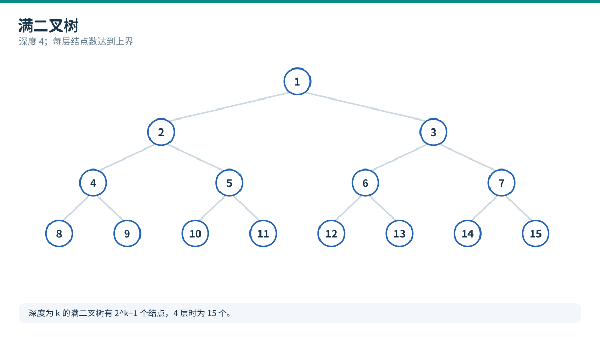

**完全二叉树**：按层次从上到下、从左到右依次给结点编号 $1,2,\ldots,n$，恰与某棵满二叉树编号为 $1$ 到 $n$ 的位置一一对应。更直观地说，最后一层可以不满，但结点必须**从左端起连续排列，不能跳过空位**。

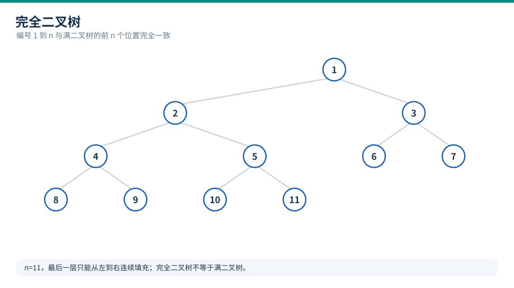

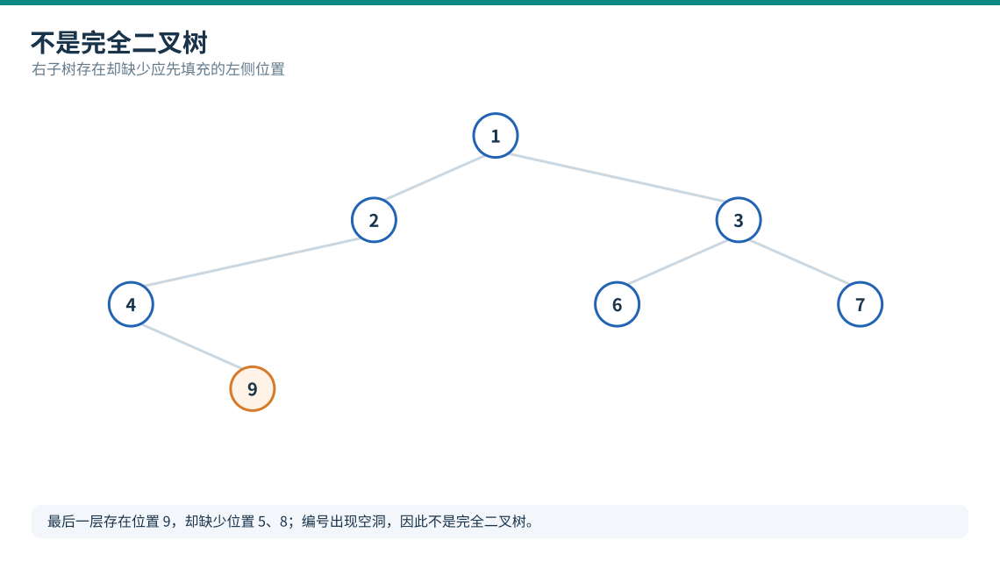

| 对比 | 满二叉树 | 完全二叉树 |
| --- | --- | --- |
| 最后一层 | 全满 | 允许不满，但必须向左连续 |
| 其他层 | 全满 | 全满 |
| 结点数 | 固定为 $2^k-1$ | 满足 $2^{k-1}\le n\le2^k-1$ |
| 关系 | 一定是完全二叉树 | 不一定是满二叉树 |

对 $n\ge1$ 的完全二叉树，其深度为

$$
\boxed{k=\lfloor\log_2 n\rfloor+1}.
$$

注意：这公式**不能套用在任意二叉树上**。一般二叉树有相同 $n$ 时，深度可能大得多，例如一条单链的深度就是 $n$。

### 4. 完全二叉树的编号规律

采用 $1$ 开始的顺序编号，编号为 $i$ 的结点满足：

$$
\begin{aligned}
\operatorname{parent}(i)&=\lfloor i/2\rfloor\quad(i>1),\\
\operatorname{left}(i)&=2i\quad(2i\le n),\\
\operatorname{right}(i)&=2i+1\quad(2i+1\le n).
\end{aligned}
$$

编号 $1$ 为根，没有双亲；孩子编号超过 $n$ 即不存在。若在 C++ `vector` 中用从 $0$ 开始的下标，则要**整体改用另一套公式**：$parent(i)=\lfloor(i-1)/2\rfloor$、$left(i)=2i+1$、$right(i)=2i+2$。两套编号不能混用。

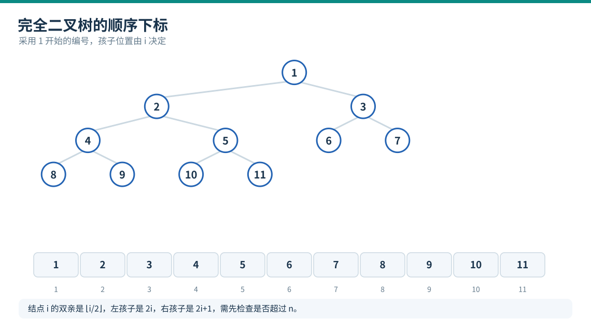

## 三、二叉树的存储结构

### 1. 顺序存储：完全二叉树最适合

顺序存储按层次从上到下、从左到右存放结点。对完全二叉树，无需额外存左右孩子指针，利用下标公式即可寻找孩子与双亲，空间利用率好。

对**一般二叉树**，若仍按完全二叉树的对应下标放置结点，为保存左右孩子的位置，空缺位置也需要保留占位符。偏斜二叉树的下标可能增长得很快。

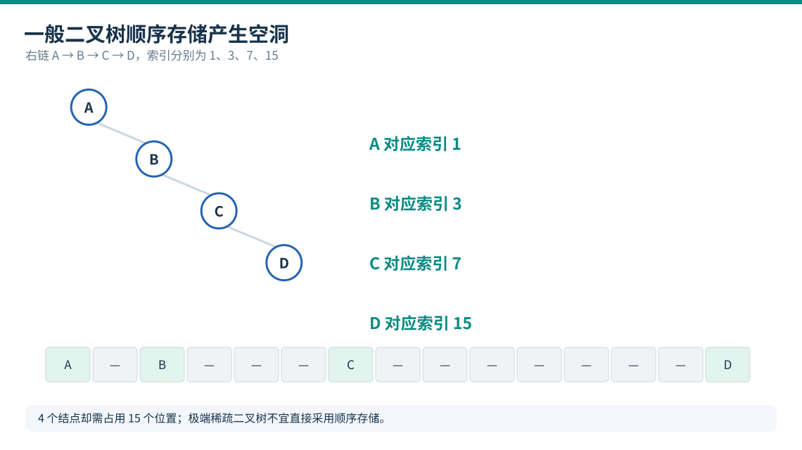

例如只有一条四结点的右链，4 个真实结点分别落在编号 $1,3,7,15$，即使只有 4 个结点，也需要占到编号 15 的存储空间。若把结点硬塞到下标 $1,2,3,4$，则**无法直接使用上述孩子编号公式**恢复结构。

> [!tip] 存储结构选择
> 近似完全、经常按下标访问的二叉树适合顺序存储；结点形态稀疏、需要动态增删子树时，通常采用链式存储。

### 2. 二叉链表（两个孩子指针）

二叉链表的一个结点包含：数据域 `data`、左孩子指针 `left`、右孩子指针 `right`。如果缺少某一侧孩子，就把对应指针设为 `nullptr`。

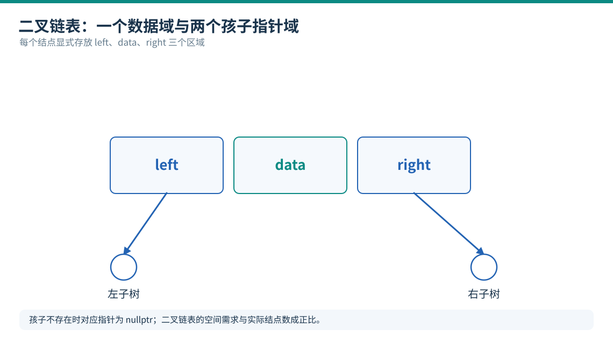

下面是后续遍历示例共同使用的 C++ 结点类型，数据元素使用具体的 `char`，不引入教学上没有必要的 `typedef` 或抽象别名。

```cpp
struct BiNode {
    char data;                  // 当前结点的数据
    BiNode* left = nullptr;     // 指向左孩子；不存在时为空
    BiNode* right = nullptr;    // 指向右孩子；不存在时为空
};
```

可以用 `new BiNode{'A', nullptr, nullptr}` 创建一个新结点，再通过指针连接孩子。**仅复制 `data` 并不等于复制一整棵子树**；浅复制指针还可能造成多个结点共享同一子树，销毁时必须特别注意。

### 3. 三叉链表与双亲表示

三叉链表额外保存 `parent`，便于从当前结点直接返回双亲：

```cpp
struct TriNode {
    char data;                   // 结点内容
    TriNode* left = nullptr;    // 左孩子
    TriNode* right = nullptr;   // 右孩子
    TriNode* parent = nullptr;  // 双亲；根结点的该指针为空
};
```

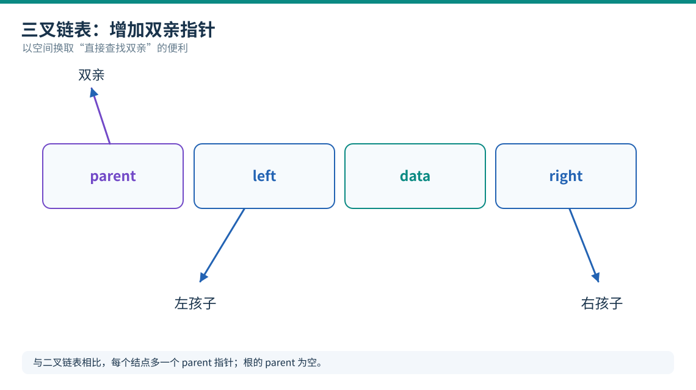

**双亲表示**可把所有结点放在数组中，每个记录保存结点值及双亲下标；一个结点属于左孩子还是右孩子，必须再有额外标志或位置约定，否则单凭 `parent` 信息不足以还原二叉树的左右位置。例如：

```cpp
struct ParentNode {
    char data;     // 结点的数据
    int parent;    // 双亲下标，根用 -1
    char side;     // 'L' 表示左孩子，'R' 表示右孩子
};
```

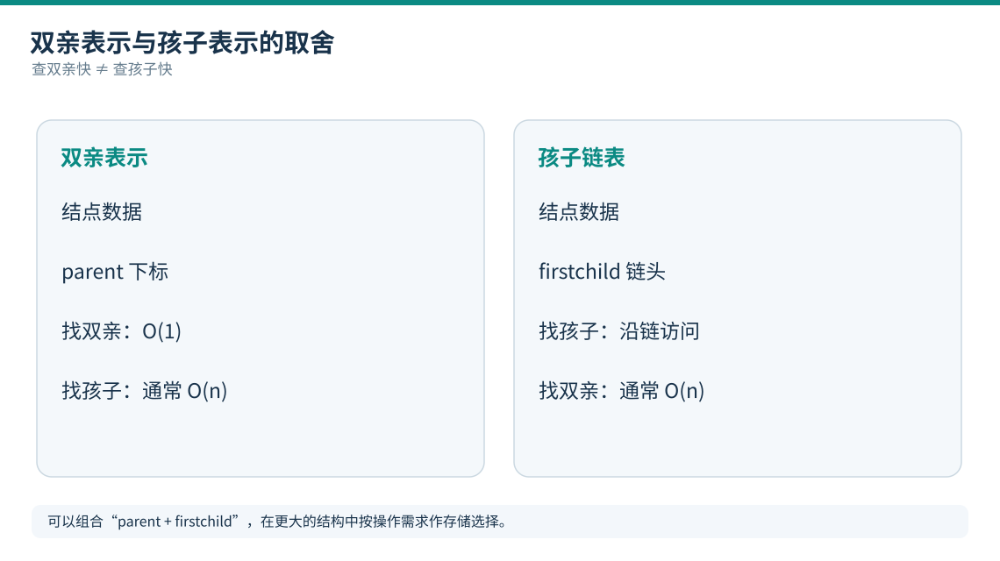

| 表示方法 | 找孩子 | 找双亲 | 主要特点 |
| --- | --- | --- | --- |
| 顺序存储（完全二叉树） | 用下标直接计算 | 用下标直接计算 | 紧凑，适合完全二叉树 |
| 二叉链表 | $O(1)$ | 一般需要遍历 | 结构清晰，适合递归 |
| 三叉链表 | $O(1)$ | $O(1)$ | 每个结点多占一个指针 |
| 双亲数组（带左右标志） | 通常需要搜索 | $O(1)$ | 查双亲快捷，增删不一定方便 |

> [!warning] 存储形式与算法复杂度有关
> 下文递归和栈式遍历假设能够通过指针在 $O(1)$ 时间访问 `left`、`right`。若存储的是双亲数组或其他形式，代码需要相应变化，不能只替换类型名称。

## 四、二叉树遍历与算法应用

### 1. 什么是遍历

**遍历**指按照一定搜索顺序，访问二叉树中的每个结点**恰好一次**。访问可以表示输出数据、计数、查找或修改，并不限定为 `cout`。

以“先左后右”为统一约定，三种深度优先遍历是：**先序：根—左—右；中序：左—根—右；后序：左—右—根**。另一种常用策略是**层序遍历**：逐层从左到右访问。


### 2. 先序、中序、后序的访问实例

下面四张图采用同一棵二叉树；结点旁的数字标识其被访问的先后次序。对整棵树应用同一递归规则，子树也必须如此，不是只将最外层划成三部分。

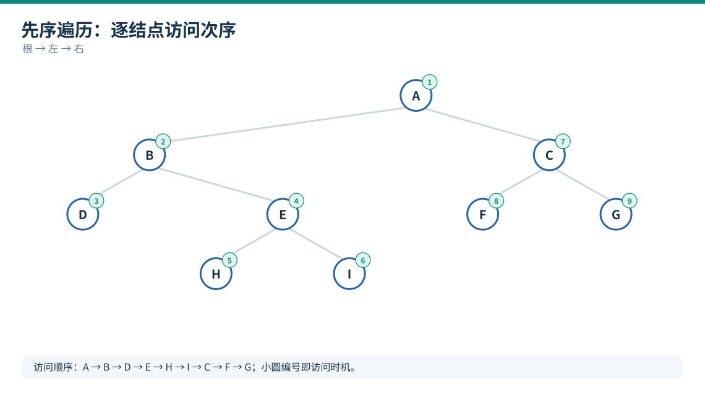


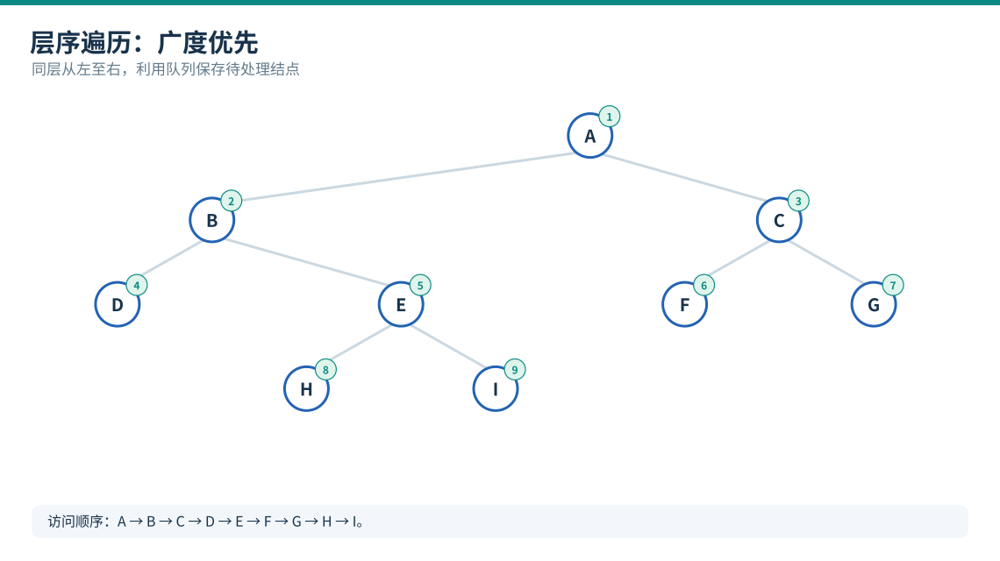

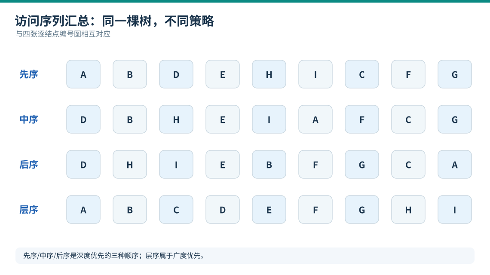

对示例树，具体序列为：

| 方式 | 访问次序 |
| --- | --- |
| 先序 | `A B D E H I C F G` |
| 中序 | `D B H E I A F C G` |
| 后序 | `D H I E B F G C A` |
| 层序 | `A B C D E F G H I` |

> [!important] 递归三要素
> **终止条件**：空树立即返回；**访问时机**：确定访问根的前、中、后位置；**递归对象**：分别遍历左子树与右子树。三种深度优先遍历主要区别就在访问根的位置。

### 3. 三种递归遍历的 C++ 实现

以下函数默认可以使用前面定义的 `BiNode`，输出流需包含 `<iostream>`。它们都是合法的**函数定义片段**，不必为了讲清算法而把它们拼接成一个庞大程序。

**先序（Preorder）：进入结点时就访问。**

```cpp
void preorder(BiNode* root) {
    if (root == nullptr) return;    // 空树是递归终点
    std::cout << root->data;        // 先访问根
    preorder(root->left);           // 再遍历左子树
    preorder(root->right);          // 最后遍历右子树
}
```

**中序（Inorder）：先处理完左子树才访问根。**

```cpp
void inorder(BiNode* root) {
    if (root == nullptr) return;    // 空子树不产生访问
    inorder(root->left);            // 左子树
    std::cout << root->data;        // 根结点
    inorder(root->right);           // 右子树
}
```

**后序（Postorder）：左右子树全部处理完才访问根。**

```cpp
void postorder(BiNode* root) {
    if (root == nullptr) return;    // 空树直接结束
    postorder(root->left);          // 先处理左子树
    postorder(root->right);         // 再处理右子树
    std::cout << root->data;        // 最后访问根
}
```

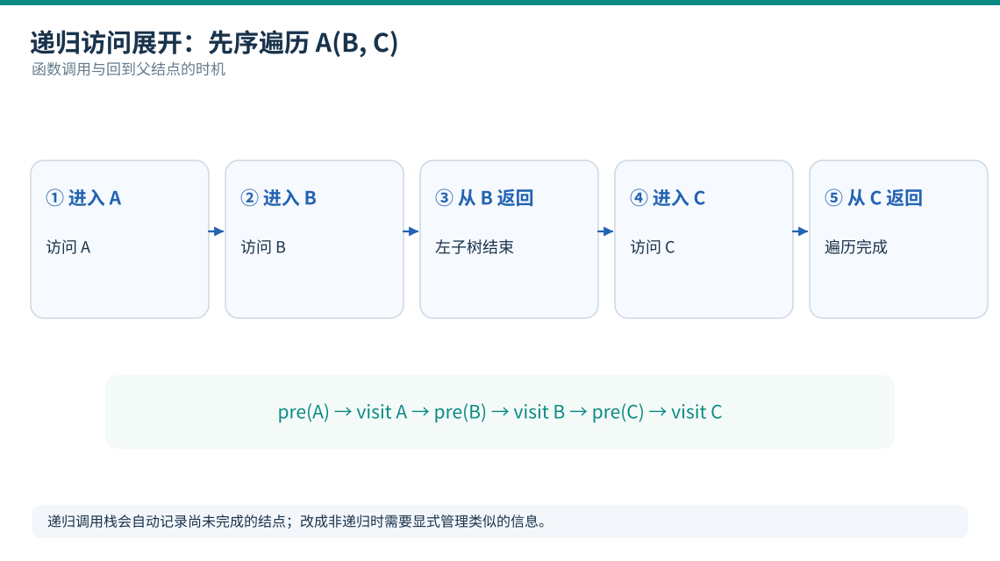

每个结点仅被处理常数次，所以三种遍历时间复杂度均为 $O(n)$；递归调用栈的空间为 $O(h)$，其中 $h$ 是树的深度。完全二叉树的 $h=O(\log n)$，极端单链树的 $h=O(n)$。

### 4. 先序非递归遍历：栈 + 右先入、左后入

递归会隐式保存尚待处理的结点。改成非递归后，可以把尚未访问的结点显式压入**栈**。每次弹出一个结点并访问，然后先把右孩子入栈，再把左孩子入栈，使左孩子下一次先弹出。

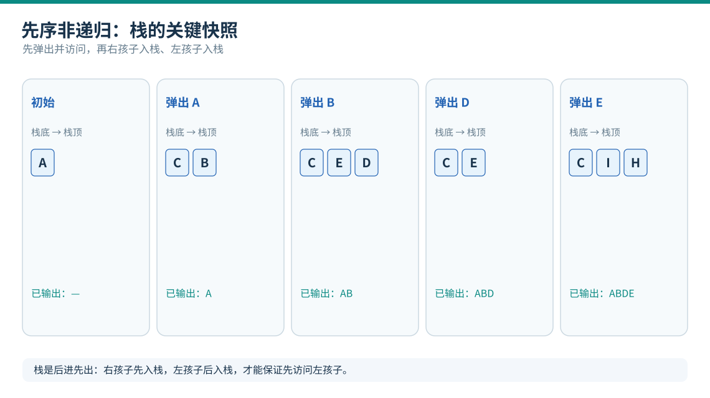

```cpp
void preorderIterative(BiNode* root) {
    if (root == nullptr) return;             // 空树无须入栈
    std::stack<BiNode*> st;                  // 保存待访问的结点
    st.push(root);                           // 根先入栈
    while (!st.empty()) {                    // 栈非空则继续
        BiNode* p = st.top();                // 读取栈顶
        st.pop();                            // 弹出当前结点
        std::cout << p->data;                // 先序：立即访问
        if (p->right) st.push(p->right);     // 右孩子先入栈
        if (p->left) st.push(p->left);       // 左孩子后入栈，先访问
    }
}
```

使用该片段需包含 `<stack>` 和 `<iostream>`。这里**后进先出**是决定入栈次序的根本原因。

### 5. 中序非递归遍历：一路向左，弹栈时访问

中序遍历的核心是“**左子树未完成，就不能访问根**”。因此，先从根沿着左孩子一直压栈，直到走到空，再弹出栈顶进行访问；如果该结点还有右孩子，则对它的右子树重复这一过程。

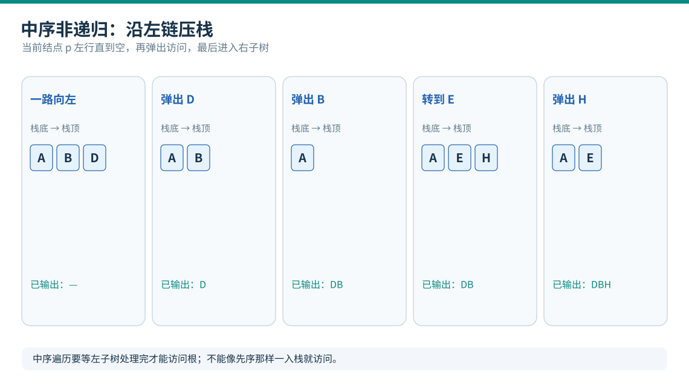

```cpp
void inorderIterative(BiNode* root) {
    std::stack<BiNode*> st;                   // 保存回溯路径
    BiNode* p = root;                         // 从根开始
    while (p != nullptr || !st.empty()) {    // 当前非空或栈非空
        while (p != nullptr) {               // 沿左孩子下降
            st.push(p);                       // 暂存尚未访问的根
            p = p->left;                      // 继续向左
        }
        p = st.top();                         // 当前左子树已结束
        st.pop();                             // 弹出该根
        std::cout << p->data;                 // 中序：此时访问
        p = p->right;                         // 处理右子树
    }
}
```

> [!warning] 中序的常见误写
> 若把访问语句放到一路左行的入栈循环中，就会优先输出根，相当于改变了遍历次序。**压栈不是访问，出栈后才访问**，这两件事要分清。

### 6. 后序非递归遍历：右子树完成后才能访问根

后序更难，因为回到一个结点时还要判断：是**刚处理完左子树**（接下来应去右子树），还是**已经处理完右子树**（现在才可以访问该结点）。课程中常用“结点栈 + 状态标志栈”；下面给出等价且更直观的“**单栈 + 最近访问指针**”实现。

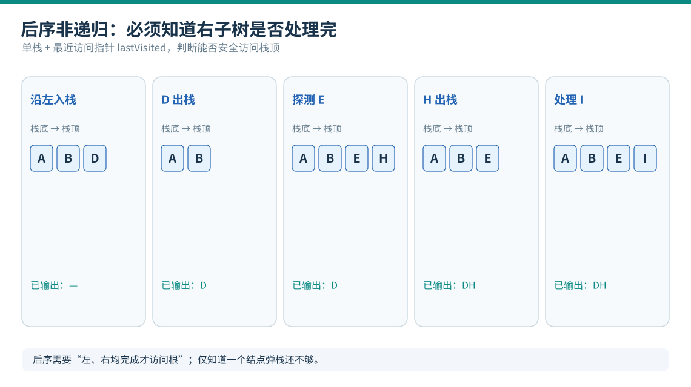

```cpp
void postorderIterative(BiNode* root) {
    std::stack<BiNode*> st;                   // 保存当前访问路径
    BiNode* p = root;                         // 正在下降的结点
    BiNode* lastVisited = nullptr;           // 最近完成的子树根
    while (p != nullptr || !st.empty()) {    // 尚有结点待处理
        if (p != nullptr) {
            st.push(p);                       // 先一路压入左链
            p = p->left;                      // 继续走左孩子
        } else {
            BiNode* top = st.top();           // 暂不弹出根
            if (top->right != nullptr && lastVisited != top->right) {
                p = top->right;               // 右子树尚未完成
            } else {
                std::cout << top->data;       // 左、右均已完成
                lastVisited = top;           // 记录刚完成的结点
                st.pop();                     // 返回它的双亲
            }
        }
    }
}
```

条件 `lastVisited != top->right` 表示“该右子树还没有完整处理结束”；不能仅凭 `right != nullptr` 判断，否则会在右子树遍历完毕后反复进入。另一个常用办法是给栈中每条记录设置**第一次到达/第二次返回**的状态位，本质相同。

### 7. 层序遍历：队列实现广度优先搜索

把根先入队；从队首取出一个结点并访问，然后**先左后右**把非空孩子入队；重复直到队列空。队列的先进先出机制保证上一层先于下一层，且同层从左到右。

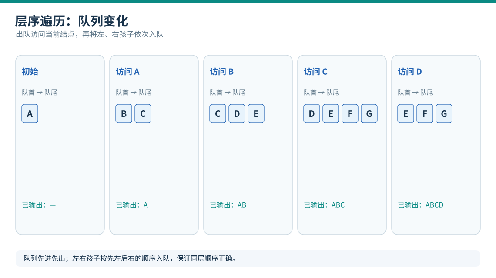

```cpp
void levelOrder(BiNode* root) {
    if (root == nullptr) return;            // 空树不入队
    std::queue<BiNode*> q;                  // 先进先出的队列
    q.push(root);                           // 根先入队
    while (!q.empty()) {                    // 队列非空则继续
        BiNode* p = q.front();              // 取队首
        q.pop();                             // 队首出队
        std::cout << p->data;               // 访问当前结点
        if (p->left) q.push(p->left);       // 左孩子先入队
        if (p->right) q.push(p->right);     // 右孩子后入队
    }
}
```

需要包含 `<queue>`、`<iostream>`。在一般情况下遍历时间为 $O(n)$；队列中最多可能同时存放某一层或相邻层的多个结点，最坏辅助空间为 $O(n)$。

> [!tip] 四种遍历的算法选择
> 先序：访问根较早，适合先处理父结点；中序：适合表达式的中缀形式及线索化；后序：适合子树信息合并、求深度、释放整树；层序：适合按层输出和逐层处理。

### 8. 遍历的直接应用：叶子统计、求深度与镜像

**统计叶子结点**：递归遇到空结点返回 $0$，遇到左右孩子均空的叶子返回 $1$，其他结点返回左右子树的叶子数之和。

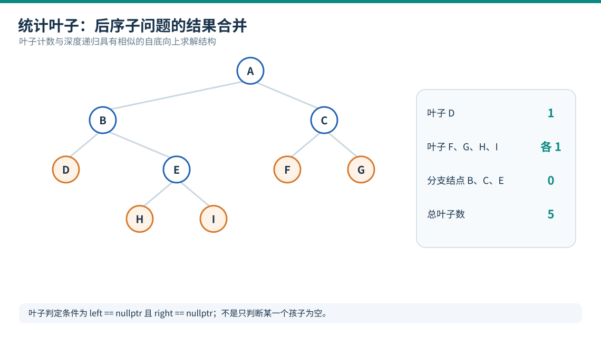

```cpp
int countLeaves(BiNode* root) {
    if (root == nullptr) return 0;                     // 空树没有叶子
    if (root->left == nullptr && root->right == nullptr)
        return 1;                                      // 叶子本身贡献 1
    return countLeaves(root->left) + countLeaves(root->right); // 合并子树
}
```

**求深度**：必须先得到左右子树的深度，再取较大者加一，因此是典型的**后序思想**。

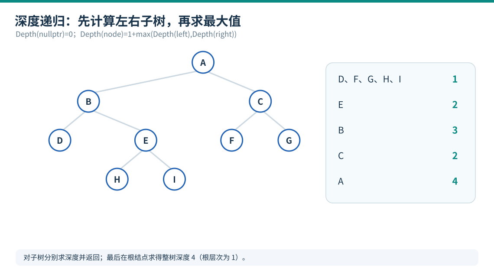

$$
\operatorname{Depth}(T)=
\begin{cases}
0,&T=\varnothing,\\
1+\max(\operatorname{Depth}(T_L),\operatorname{Depth}(T_R)),&T\ne\varnothing.
\end{cases}
$$

```cpp
int treeDepth(BiNode* root) {
    if (root == nullptr) return 0;                 // 空树深度 0
    int leftDepth = treeDepth(root->left);         // 先求左子树深度
    int rightDepth = treeDepth(root->right);       // 再求右子树深度
    return 1 + std::max(leftDepth, rightDepth);    // 合并子问题
}
```

此代码需包含 `<algorithm>`。当树极深时，递归栈同样可能很深，应结合数据规模判断是否用非递归方法。

**左右子树交换（镜像）**：真正交换的是两个子树指针，而不只是左右孩子结点的数据。

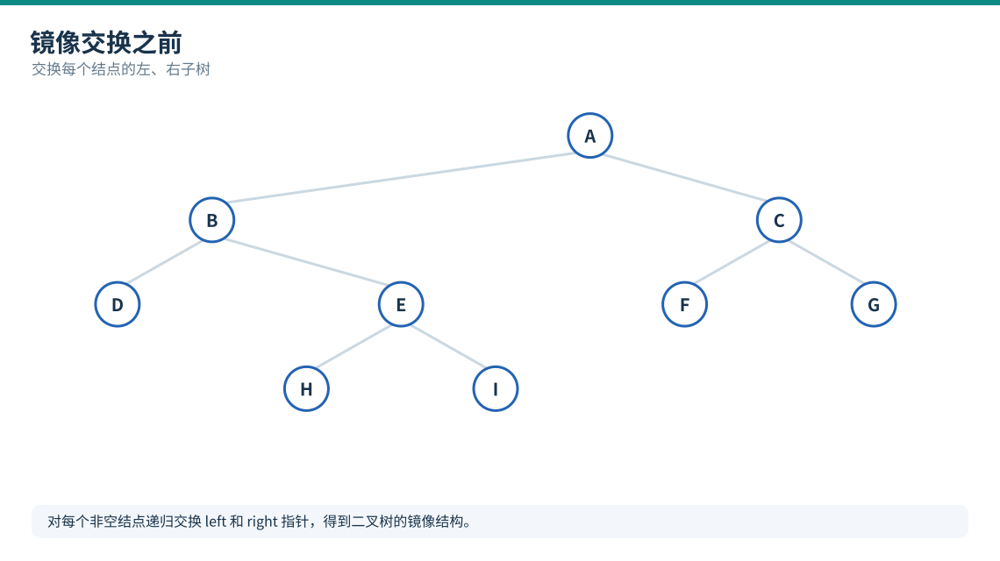

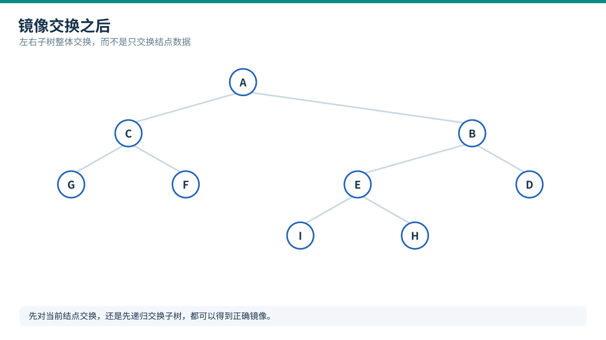

```cpp
void mirrorTree(BiNode* root) {
    if (root == nullptr) return;            // 空树无需操作
    std::swap(root->left, root->right);     // 当前结点左右子树互换
    mirrorTree(root->left);                 // 再镜像新的左子树
    mirrorTree(root->right);                // 再镜像新的右子树
}
```

需要 `<utility>` 或 `<algorithm>`。**时间复杂度均为 $O(n)$**；镜像算法不重新分配结点，只重排指针连接。

### 9. 先序序列建树：为什么必须记录空子树

仅有结点值的先序序列通常不足以确定二叉树的**形态**，因为先序没有告诉我们某个结点缺的是左孩子还是右孩子。一个常用办法是先序输入时，用特殊字符（如 `#`）表示空子树。每读到一个非空字符就创建结点，随后递归创建左、右子树。

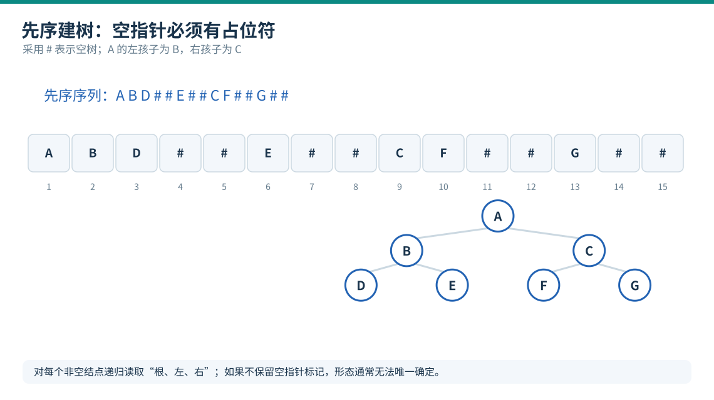

例如以 `ABD##E##CF##G##` 表示一棵二叉树：`A` 是根，左子树为 `B(D,E)`，右子树为 `C(F,G)`。这里一个 `#` 仅代表**一棵空子树**，不能省略或随意合并。

```cpp
BiNode* buildFromPreorder(const std::string& text, int& pos) {
    if (pos >= static_cast<int>(text.size()))
        throw std::invalid_argument("先序表示不完整");  // 输入提前结束
    char value = text[pos++];                       // 读取当前根标记
    if (value == '#') return nullptr;               // # 对应空子树
    BiNode* root = new BiNode{value, nullptr, nullptr}; // 建立当前根
    root->left = buildFromPreorder(text, pos);      // 先建立左子树
    root->right = buildFromPreorder(text, pos);     // 再建立右子树
    return root;                                    // 返回子树根指针
}
```

需要包含 `<string>`、`<stdexcept>`；使用时令 `int pos = 0;` 并传入引用。该示例假设字符型结点值不包含 `#`；有效输入应确保最终 `pos` 恰好到达字符串末尾。若处理恶意或可能中途失败的输入，应进一步使用智能指针和异常安全的构建方式释放已经分配的内存。

### 10. 表达式树：遍历与算术式相互对应

表达式树中，**运算数通常位于叶子，运算符位于分支结点**。例如 `(a+b)*c-d/e` 的根是最外层的减号，减号左子树表示 `(a+b)*c`，右子树表示 `d/e`。

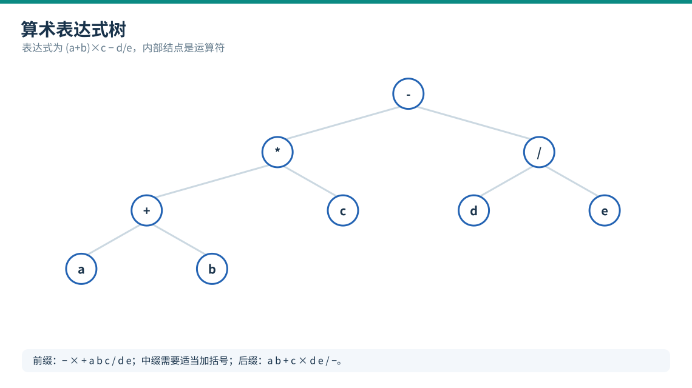

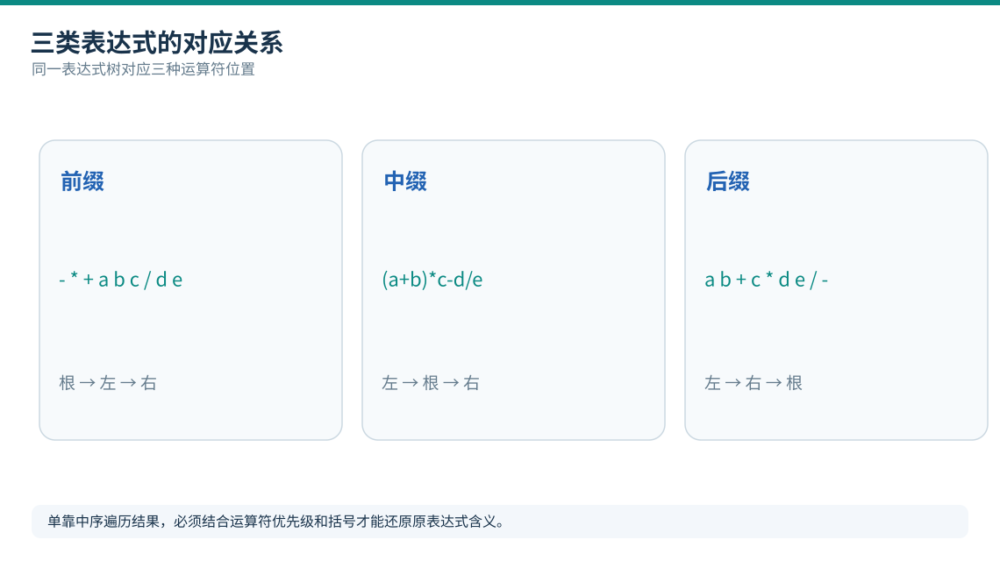

对这棵树，先序相当于前缀形式 `- * + a b c / d e`，中序按括号明确分组可写为 `(a+b)*c-d/e`，后序相当于后缀形式 `a b + c * d e / -`。

构造表达式树的一种经典办法是使用**两个栈**：一个保存已建立的运算数结点或子树，另一个保存待处理的运算符。扫描到运算数就建立叶子并压入结点栈；遇到运算符时依据优先级与结合性决定暂存还是进行规约。**规约一个二元运算符时，必须先弹出右子树，再弹出左子树**，否则减法和除法的含义会倒置。

以下是真实 C++ 实现的关键规约逻辑，函数预设 `nodes` 为 `std::stack<BiNode*>`、`ops` 为 `std::stack<char>`，并需包含 `<stack>`、`<stdexcept>`：

```cpp
void reduceOperator(std::stack<BiNode*>& nodes, std::stack<char>& ops) {
    if (ops.empty() || nodes.size() < 2)
        throw std::invalid_argument("表达式缺少操作数"); // 检查状态
    char op = ops.top();                      // 取得本次规约的运算符
    ops.pop();                                // 从运算符栈中移除
    BiNode* right = nodes.top();              // 后入栈的是右操作数
    nodes.pop();                              // 右操作数出栈
    BiNode* left = nodes.top();               // 再取左操作数
    nodes.pop();                              // 左操作数出栈
    nodes.push(new BiNode{op, left, right});  // 构造新的运算子树
}
```

> [!warning] 构造完整表达式树还需处理的条件
> `+ - * /` 的优先级、括号配对、同级运算符的左结合性、非法字符以及表达式结束时清空运算符栈。上面的函数只演示**规约一步**，并不是完整表达式解析器。若处理多位数、小数、负号作为一元运算符等，还需要词法分词，不能将每个字符都直接视为独立操作数。

### 11. 已知遍历序列重建二叉树

**先序 + 中序**：先序第一个结点确定根，在中序中找到根以后，中序的左半部分恰好是左子树的全部结点，右半部分是右子树的全部结点；左子树的结点个数又帮助切割先序序列，递归继续即可。

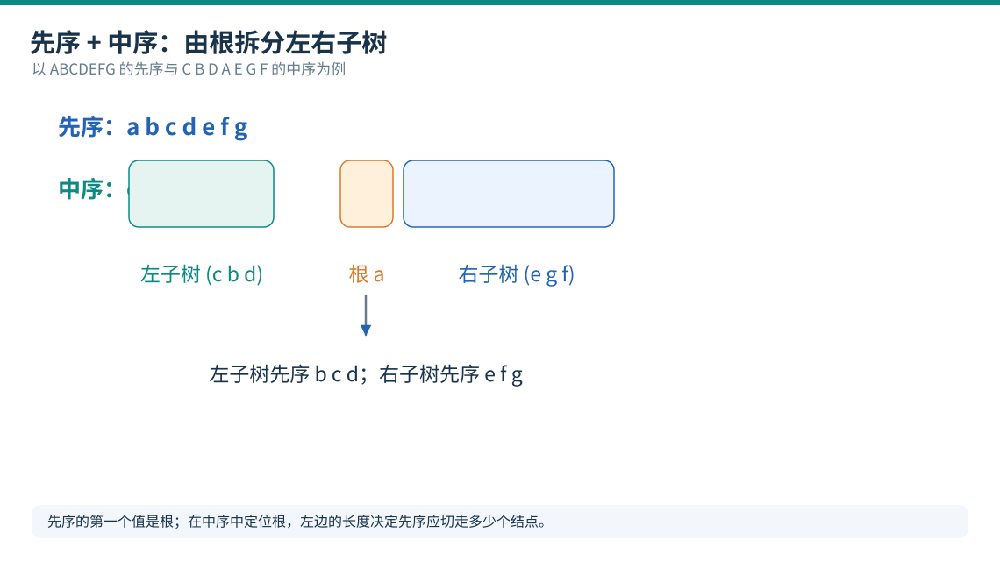

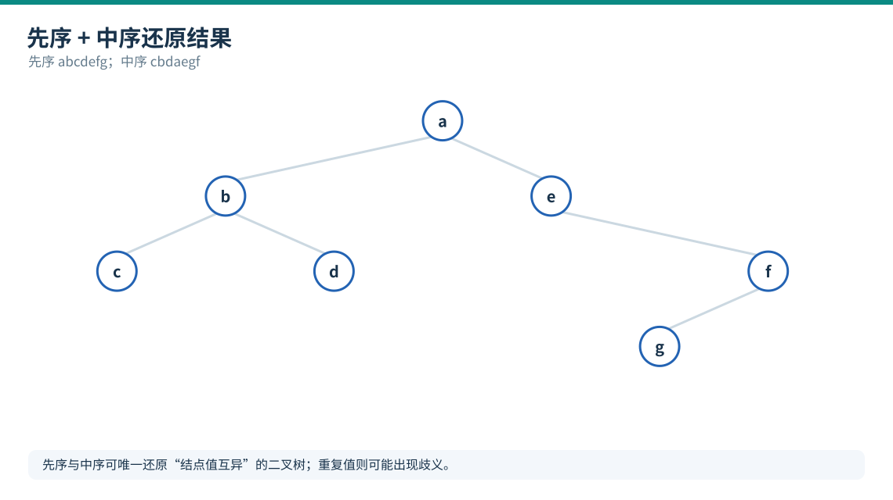

以先序 `abcdefg`、中序 `cbdaegf` 为例：根是 `a`；中序在 `a` 两侧拆成 `cbd` 和 `egf`，所以先序拆成左侧 `bcd`、右侧 `efg`。继续递归后得到图中的唯一结构。

```cpp
BiNode* buildPreIn(const std::string& pre, int ps, int pe,
                   const std::string& in, int is, int ie) {
    if (ps == pe) return nullptr;                   // 当前子树为空
    char value = pre[ps];                          // 先序首元素是根
    int k = is;                                    // 在中序中定位根
    while (k < ie && in[k] != value) ++k;           // 顺序查找根
    if (k == ie) throw std::invalid_argument("序列不匹配");
    int leftCount = k - is;                        // 左子树结点数
    BiNode* root = new BiNode{value, nullptr, nullptr}; // 建立根
    root->left = buildPreIn(pre, ps + 1, ps + 1 + leftCount,
                            in, is, k);            // 递归建立左子树
    root->right = buildPreIn(pre, ps + 1 + leftCount, pe,
                             in, k + 1, ie);        // 递归建立右子树
    return root;                                    // 返回该子树根
}
```

上述区间统一使用**左闭右开**的形式 `[start, end)`，首次可调用 `buildPreIn(pre, 0, pre.size(), in, 0, in.size())`。调用前应验证两序列长度一致且结点值互异；必要时用映射保存中序值到下标的位置，可将不断扫描中序序列造成的最坏 $O(n^2)$ 降为构建索引后的 $O(n)$。演示代码聚焦划分逻辑，面向不可信输入时还需完善边界与异常清理。

**后序 + 中序**：后序**最后一个结点**确定根，其余切分与先序 + 中序相同。

**层序 + 中序**：层序首元素确定根，用中序划分左右子树；再将层序中的其余结点按是否属于左、右子树进行过滤，递归构建两侧。这种方法也可以在结点值互异时确定唯一结构，但直接重复过滤通常成本较高。

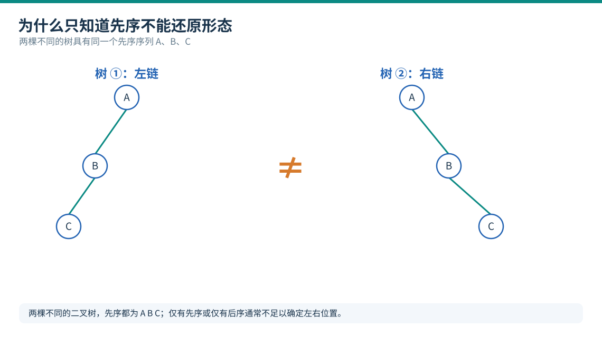

> [!important] 重建的唯一性有条件
> **结点值互不相同时**，先序 + 中序、后序 + 中序、层序 + 中序都能确定唯一二叉树。仅知道一种普通遍历序列一般不行；仅知道先序 + 后序通常也不行。若出现重复结点值或输入序列彼此不一致，不能直接套用唯一性结论。

### 12. 三道典型序列还原题

**例一：先序 `EBADCFHGIKJ`，中序 `ABCDEFGHIJK`。** 先序首字母 `E` 是根；中序以 `E` 为界，左侧 `ABCD`、右侧 `FGHIJK`，递归划分即可。

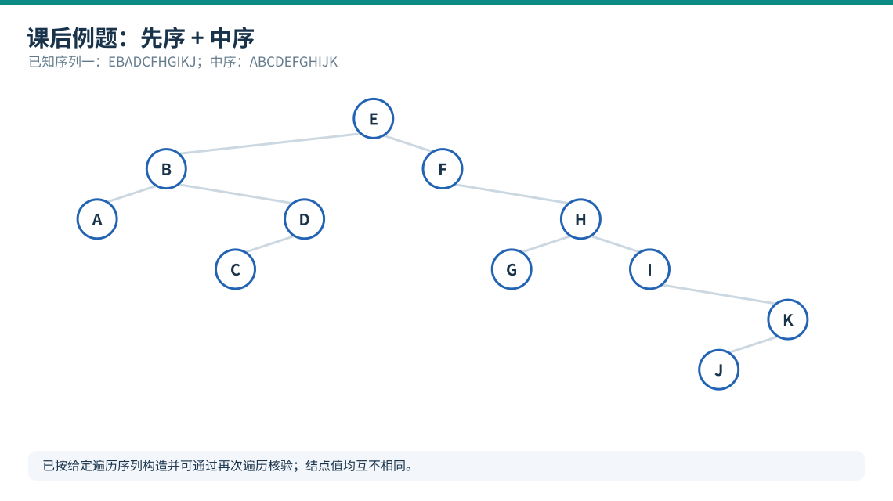

**例二：中序 `DCBGEAHFIJK`，后序 `DCEGBFHKJIA`。** 后序末字母 `A` 是根；先还原左、右子树，再将每一侧继续分解。

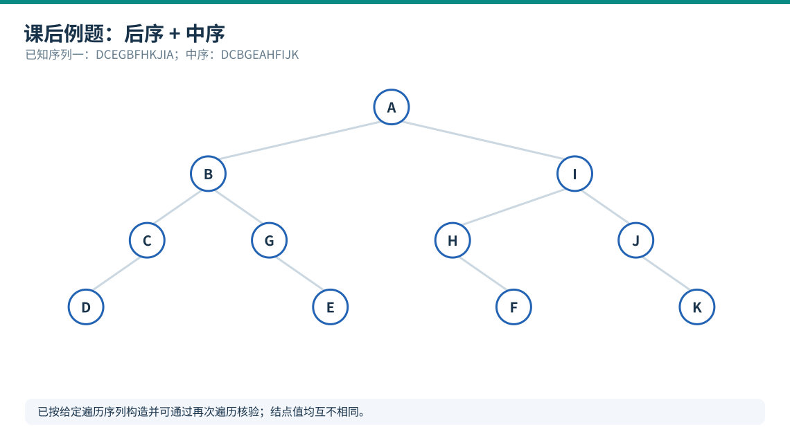

**例三：层序 `ABCDEFGHIJ`，中序 `DBGEHJACIF`。** 根为 `A`；中序分成 `DBGEHJ` 与 `CIF`，剩余层序结点在各自集合中过滤，递归下去。

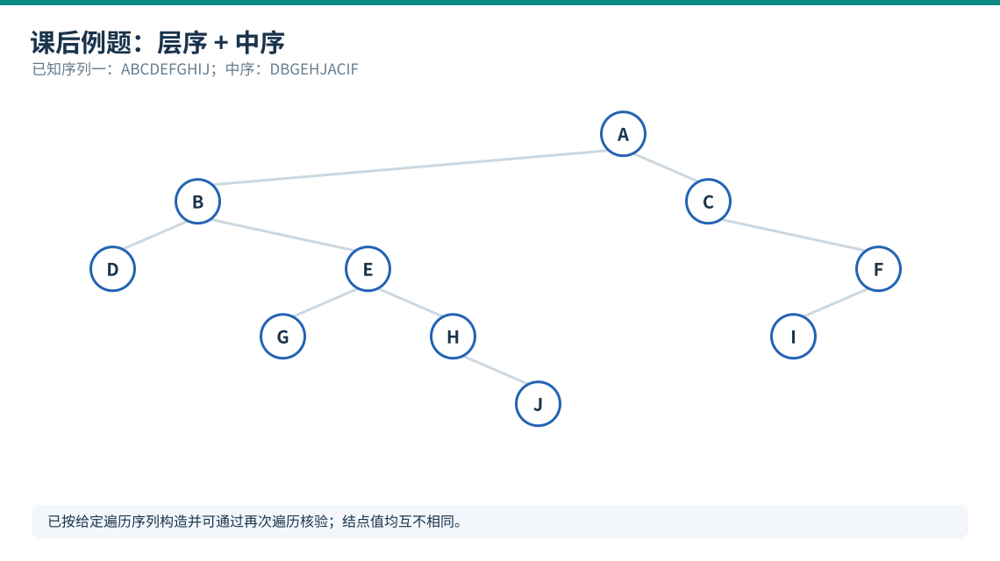

三幅还原图均可使用对应的遍历算法重新计算序列作交叉核验。**最有效的检查方式并非与图片轮廓相似，而是让题目提供的两种序列都完全一致。**

## 五、线索二叉树

### 1. 为什么需要线索化

普通二叉链表只记录“父到孩子”的连接，不能直接找到结点在某一种遍历序列中的**前驱**和**后继**。例如，对一棵树做中序遍历时，我们可以知道 `B` 之前是谁、之后是谁，但普通结点结构并没有专门保存这种次序关系。

一棵有 $n$ 个结点的非空二叉树共有 $2n$ 个左右孩子指针域，其中真正被用来指向孩子的只有 $n-1$ 个。因此，空指针域数量为

$$
2n-(n-1)=\boxed{n+1}.
$$

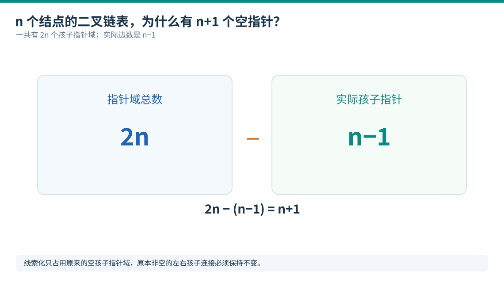

**线索化（Threading）**就是在某种遍历次序确定之后，利用这些**原本为空**的指针域存放前驱或后继，形成**线索二叉树（Threaded Binary Tree）**。线索是对遍历关系的记录，不应破坏原有的真实孩子连接。

### 2. 标志位 LTag、RTag 的意义

因为 `left`、`right` 可能指向孩子，也可能指向遍历前驱或后继，必须增加标志位：

| 标志 | 值 | 对应指针的含义 |
| --- | --- | --- |
| `LTag` | `0` | `left` 是真正的左孩子 |
| `LTag` | `1` | `left` 是本次遍历的前驱线索 |
| `RTag` | `0` | `right` 是真正的右孩子 |
| `RTag` | `1` | `right` 是本次遍历的后继线索 |

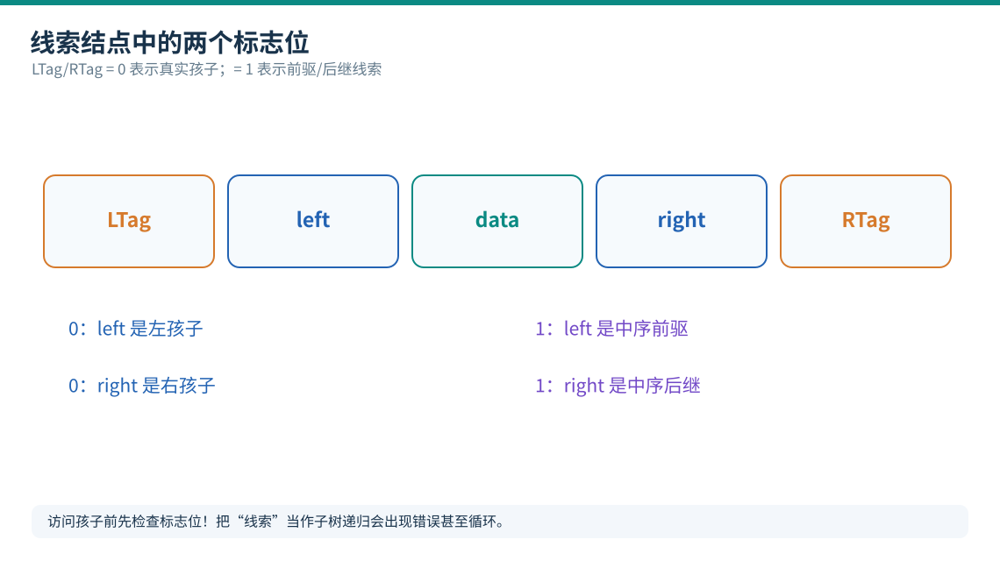

```cpp
struct ThreadNode {
    char data;                            // 结点内容
    ThreadNode* left = nullptr;           // 左孩子或前驱线索
    ThreadNode* right = nullptr;          // 右孩子或后继线索
    bool leftIsThread = false;            // true 表示 left 是线索
    bool rightIsThread = false;           // true 表示 right 是线索
};
```

这里用 `bool` 与 `0/1` 标志语义一致，不额外引入抽象枚举名称；如果课程代码使用 `LTag/RTag`，两者只是字段名称不同。

> [!danger] 线索化后的递归陷阱
> 遍历线索树时，只有 `leftIsThread == false` 才能把 `left` 当作左子树继续递归，右侧同理。直接把所有非空指针都当作孩子会访问错误结点，遇到头结点回指时甚至可能循环。

### 3. 中序线索化：从访问序列建立前驱、后继

以原始中序序列 `D B E A C F` 为例，图中的实线是原有的孩子关系，紫色虚线示意部分新增的中序线索关系。**只能改写为空的孩子指针域**，不能为了让线条看起来连续就给每一对相邻结点都建立线索。

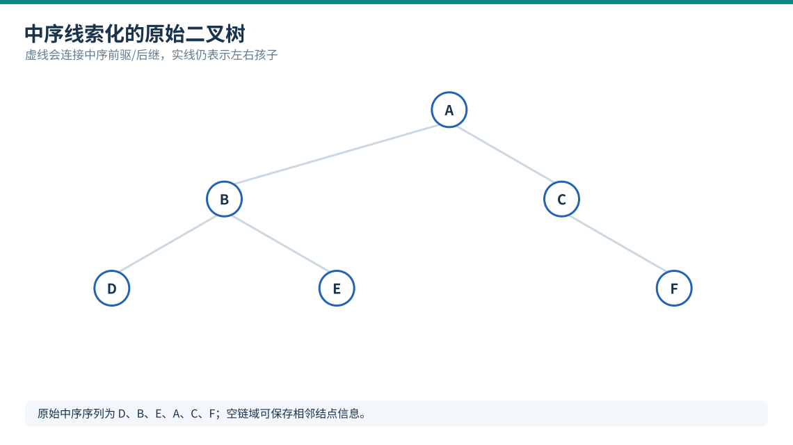

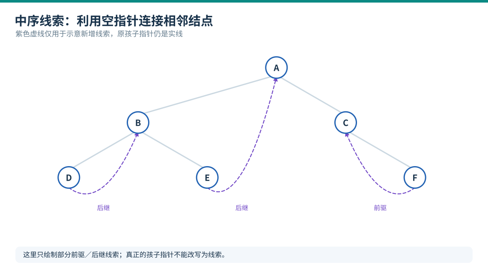

例如结点 `D` 没有右孩子，其 `right` 可建立指向中序后继 `B` 的线索；结点 `E` 没有右孩子，其 `right` 可以指向 `A`。但是 `A` 本来就有右孩子 `C`，不允许把 `A.right` 直接改写为后继线索。

在线索化时使用两个指针：`p` 指向**当前中序访问的结点**，`pre` 指向**刚刚访问过的结点**。访问 `p` 时：

1. 若 `p.left` 为空，将其设为 `pre`，并标记前驱线索。
2. 若 `pre` 存在且 `pre.right` 为空，将其设为 `p`，并标记后继线索。
3. 使 `pre=p`，再继续访问下一个结点。

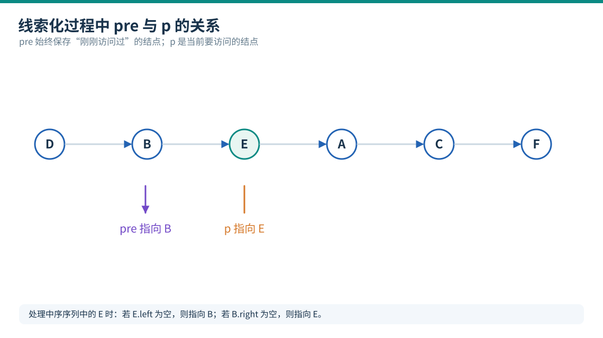

下面的函数预设所有结点尚未线索化，并使用前面定义的 `ThreadNode`；采用**不额外设置头结点**的版本，以突出核心原理。

```cpp
void inorderThreading(ThreadNode* p, ThreadNode*& pre) {
    if (p == nullptr) return;                  // 空子树结束
    inorderThreading(p->left, pre);            // 先线索化左子树
    if (p->left == nullptr) {                  // 原本没有左孩子
        p->leftIsThread = true;                // 左指针改为前驱线索
        p->left = pre;                         // 指向刚访问的结点
    }
    if (pre != nullptr && pre->right == nullptr) {
        pre->rightIsThread = true;             // 前驱无右孩子
        pre->right = p;                       // 其右线索指向当前结点
    }
    pre = p;                                   // 更新当前遍历前驱
    inorderThreading(p->right, pre);           // 继续真正的右子树
}
```

首次调用前要设置 `ThreadNode* pre = nullptr;`，然后调用 `inorderThreading(root, pre);`。完成后如果 `pre != nullptr && pre->right == nullptr`，还应将最后结点的 `rightIsThread` 设为 `true`，使其右线索指向 `nullptr`。第一个中序结点的前驱线索同样可以指向 `nullptr`。该算法只对**未线索化**的树调用一次；直接重复线索化会把已有线索误当孩子访问。

### 4. 在线索二叉树上找中序后继、前驱

中序后继只有两种情况：

- `RTag=1`：`right` 已保存后继，直接取它。
- `RTag=0`：结点有真正的右子树，后继是**右子树中最靠左的结点**。

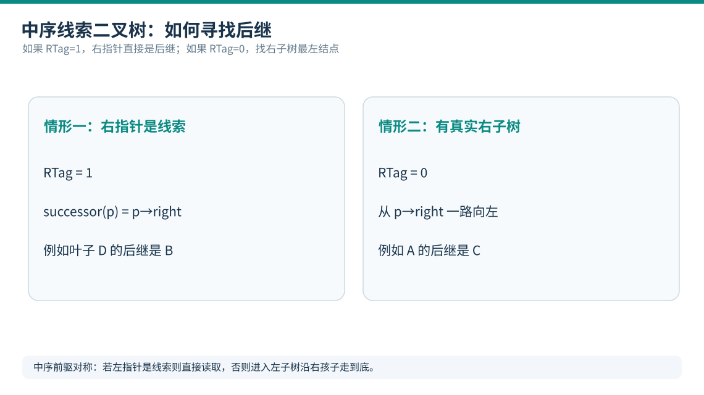

```cpp
ThreadNode* firstInorder(ThreadNode* p) {
    if (p == nullptr) return nullptr;                 // 空子树无首结点
    while (!p->leftIsThread && p->left != nullptr)    // 沿真实左边下降
        p = p->left;                                 // 逼近最左结点
    return p;                                         // 中序第一个结点
}

ThreadNode* nextInorder(ThreadNode* p) {
    if (p == nullptr) return nullptr;                // 已无当前结点
    if (p->rightIsThread) return p->right;           // 直接读取后继线索
    return firstInorder(p->right);                   // 从右子树找最左结点
}
```

因此，对无头结点的线索树，可以从 `firstInorder(root)` 开始，不断调用 `nextInorder(p)`，直到返回 `nullptr`。若是查前驱，则对称地判断 `LTag`：有前驱线索则直接读取，否则去左子树**沿真实右孩子走到底**。

### 5. 带头结点的中序线索树

课程还讨论了给线索链表添加**头结点**的方案。规定头结点的 `left` 指向树根，`right` 指向中序最后一个结点；中序首结点的前驱线索、末结点的后继线索均回指头结点。对于空树，头结点的 `left` 可以回指自己。

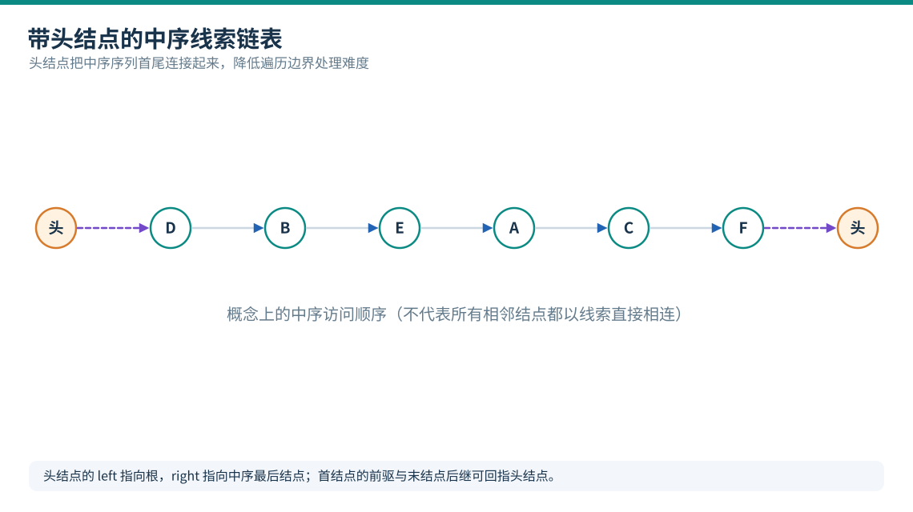

头结点使某些遍历写法不必反复判断 `nullptr`，而是以“是否回到头结点”为终止条件。但必须注意：**有头结点和无头结点是两种不同的约定**；上面的 `firstInorder`、`nextInorder` 是无头结点版本，不能不加修改地直接搬到含回指头结点的实现中。

> [!summary] 线索二叉树三步速记
> **先规定遍历次序 → 只使用原本为空的链域 → 通过 Tag 区分“孩子”和“线索”。** 中序时，`pre` 保存上一个访问的结点；找后继先看 `RTag`，找前驱先看 `LTag`。

## 六、树和森林的存储、转换及遍历

### 1. 一般树为什么不能简单使用二叉链表

普通树的结点可以有 $0,1,2,3,\ldots$ 个孩子，不存在“每个结点至多两个孩子”的限制。如果强行为一般树的每个结点开辟多个孩子指针，就面临孩子数不统一的问题。因此需要不同的表示方法。

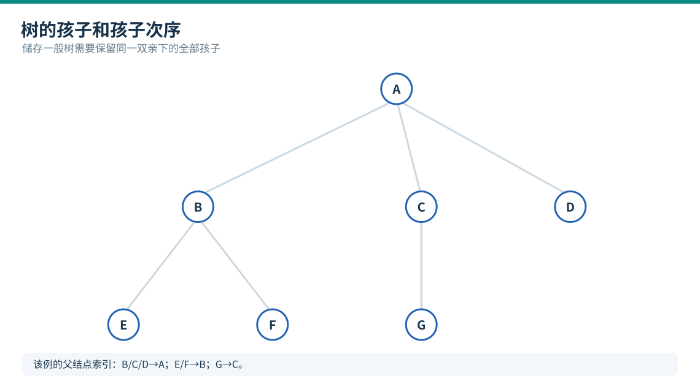

### 2. 双亲表示法

把结点放在一个顺序表中，每个元素除保存数据，还保存其**双亲在顺序表中的下标**。根的 `parent=-1`。这种结构利用了“根之外每个结点双亲唯一”的性质，查双亲只需直接取一个下标。

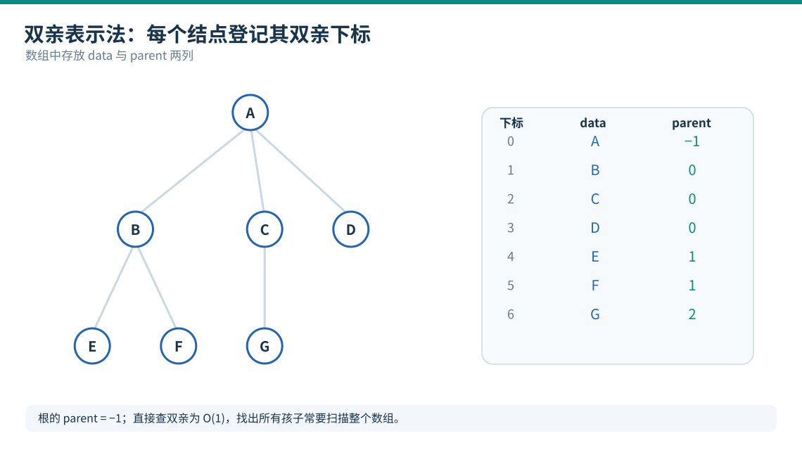

```cpp
struct TreeParentNode {
    char data;      // 结点数据
    int parent;     // 双亲下标，-1 表示根
};

int findRootIndex(const std::vector<TreeParentNode>& nodes, int index) {
    while (nodes[index].parent != -1) {  // 尚未到达根
        index = nodes[index].parent;      // 沿双亲下标向上移动
    }
    return index;                         // 返回根结点下标
}
```

代码假设索引合法，`parent` 链不形成回路。需要 `<vector>`；查某个结点的双亲为 $O(1)$，但从任意结点连续回溯到根，需要 $O(h)$ 次向上移动。若要找某个结点的**所有孩子**，通常需要扫描全表，时间为 $O(n)$。

### 3. 多重链表表示：孩子指针数可以固定，也可以变化

一种方式是按照结点各自的孩子数开设相应数量的指针，但结点长度不同、管理复杂；另一种方式是依照**树的最大度 $d$**，给所有结点统一设置 $d$ 个孩子指针，结构整齐却可能浪费大量空链域。

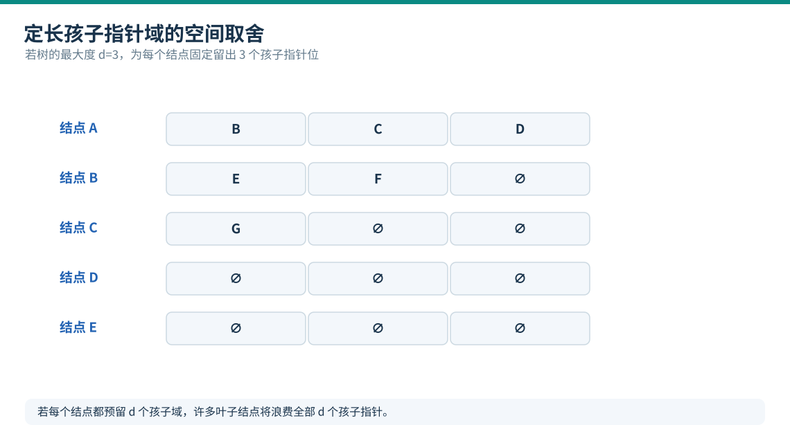

对有 $n$ 个结点、最大度为 $d$ 的非空树，若每结点都分配 $d$ 个孩子指针，则共有 $nd$ 个指针域，非空孩子连接恰有 $n-1$ 条，所以空指针域数为

$$
nd-(n-1)=\boxed{n(d-1)+1}.
$$

这与二叉链表空指针总数公式具有相同的“指针总量减真实边数”的思想，只是结点允许的最大孩子数不同。

### 4. 孩子链表表示法

把每个结点的**所有孩子作为一条单链表**保存；与此同时，用顺序表存储每个结点对应的结点值与该孩子链表的起始位置。这种表示方法能灵活存储不同数量的孩子。

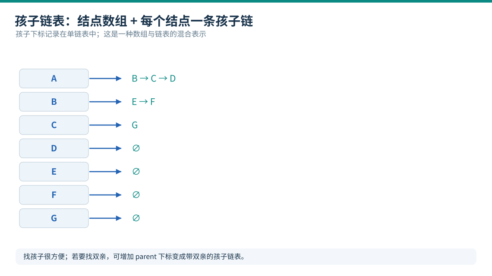

孩子链表中的每个链结点通常存放一个**孩子结点下标**和一个 `next` 指针；顺序表中的每个结点有 `data`、`firstChild`。可用如下简化的 C++ 结构说明：

```cpp
struct ChildIndexNode {
    int childIndex;                       // 被记录的孩子下标
    ChildIndexNode* next = nullptr;       // 指向下一个孩子下标结点
};

struct ChildListHead {
    char data;                            // 当前树结点的值
    ChildIndexNode* firstChild = nullptr; // 本结点的孩子链表表头
};
```

这种办法找孩子方便，但没有额外信息时反向查双亲并不直接。可以把 `parent` 下标也保存到结点数组中，组成**带双亲的孩子链表**。它是两种结构的组合，不是另外一套完全不同的树定义。

### 5. 孩子—兄弟表示法：关键的“左孩子右兄弟”

**孩子—兄弟表示法（first child / next sibling）**只保留两个指针：

- `firstChild`：指向当前结点的**第一个孩子**。
- `nextSibling`：指向当前结点的**右边紧邻兄弟**。

其存储结构与二叉链表形式相同，因此也称树的**二叉链表表示法**，但两个指针的语义已经发生变化。


```cpp
struct CSNode {
    char data;                          // 结点数据
    CSNode* firstChild = nullptr;       // 指向第一个孩子
    CSNode* nextSibling = nullptr;      // 指向右边紧邻兄弟
};
```

例如一般树根 `A` 有三个孩子 `B,C,D`，则 `A.firstChild=B`、`B.nextSibling=C`、`C.nextSibling=D`、`D.nextSibling=nullptr`；`A.nextSibling` 在表示**单棵树**时为空。


> [!important] “左孩子、右兄弟”不是“左孩子、右孩子”
> 同一个二叉链表外形，可以解释为一般二叉树，也可以解释为有序树的孩子—兄弟表示。作为后者使用时，**右指针表达的是同一层的兄弟关系**，不是双亲到孩子的关系。单棵树根结点的右指针必为空。

### 6. 一般树转换为二叉树

一棵**有序树**可唯一转换为一棵采用“左孩子—右兄弟”规则的二叉树。具体操作可以理解为：

1. 对每组同一双亲的孩子，按原次序**连接相邻兄弟**。
2. 每个双亲只保留指向**第一个孩子**的连接，原先指向其他孩子的直接连线由兄弟链代替。
3. 调整树形布局，使原本的第一个孩子位于左边、右兄弟位于右边。


转换不改变结点数量，也不改变孩子的先后次序。它建立的是**数据结构表示上的对应关系**，不表示在原树中 `C` 就从 `A` 的孩子变成了 `B` 的孩子：`B.right=C` 在新表示里仍解释为两者是兄弟。

### 7. 森林与二叉树的转换

一片有序森林由 $T_1,T_2,\ldots,T_m$ 组成。其对应二叉树可以递归地分成三个部分：

- **根结点**：来自第一棵树 $T_1$ 的根。
- **左子树**：来自 $T_1$ 根的全部孩子构成的森林。
- **右子树**：来自其余 $T_2,\ldots,T_m$ 组成的森林。


在图中，原来三棵树的根 `A、G、J` 通过 `A.right=G`、`G.right=J` 串起来，组成森林对应二叉树的根级右链。需要还原时，只需按“右指针代表同级兄弟、左指针代表第一个孩子”的规则逐层展开：


> [!tip] 快速还原森林
> 沿对应二叉树**根的右链**依次拆开多棵树；对每棵树，各结点的左子树代表其孩子集合，左子树中沿右链相连的结点是同一个双亲的兄弟。这样就能恢复有序森林。

### 8. 树、森林的遍历与对应二叉树的关系

一般树常用：**先根遍历**（访问根，再按序遍历各棵子树）、**后根遍历**（先按序遍历各棵子树，再访问根）、**按层次遍历**（逐层、从左至右）。森林则按树的排列顺序逐棵访问。


对图中的树：先根遍历得到 `A B E F C D G H I J K`；后根遍历得到 `E F B C G I J K H D A`。

对于一棵有序树或森林转换成的二叉树，遍历有下列重要对应：


| 原结构操作 | 对应二叉树的操作 |
| --- | --- |
| 树的先根遍历 | 先序遍历 |
| 树的后根遍历 | 中序遍历 |
| 森林的先序遍历 | 先序遍历 |
| 森林的中序遍历 | 中序遍历 |

> [!warning] 区分“树的后根”与“二叉树的后序”
> **树的后根遍历对应转换后二叉树的中序遍历**，不是后序遍历！原因是孩子链条通过“左孩子、右兄弟”保存。一般树不存在唯一自然定义的“中序”，不能把二叉树术语机械套用到一般树。

基于 `CSNode` 的两段简短 C++ 示例如下。前者遍历**单棵树**，后者遍历一片**森林**：

```cpp
void treePreorder(CSNode* root) {
    if (root == nullptr) return;                      // 空树直接返回
    std::cout << root->data;                          // 先访问当前树根
    for (CSNode* p = root->firstChild; p; p = p->nextSibling)
        treePreorder(p);                              // 逐个遍历孩子子树
}

void forestPreorder(CSNode* firstRoot) {
    for (CSNode* p = firstRoot; p; p = p->nextSibling)
        treePreorder(p);                              // 按顺序遍历每棵树
}
```

用后根遍历时，只需在 `treePreorder` 中将访问当前根的语句移到循环之后，就得到先处理全部孩子、再处理根的顺序。两个函数之所以分开，是因为**遍历单棵树不能自动跟着根的 `nextSibling` 走到另一棵树**。

### 9. 孩子—兄弟表示下求树的深度

对一片由若干棵树组成的森林，用 `firstChild` 向下走**增加层次**，沿 `nextSibling` 向右走仅切换到同层的另一棵树。因此，若函数参数表示“当前结点及其右侧兄弟组成的森林”，其最大深度可写为：

$$
H(p)=\begin{cases}
0,&p=\varnothing,\\
\max\{1+H(p.\mathrm{firstChild}),\ H(p.\mathrm{nextSibling})\},&p\ne\varnothing.
\end{cases}
$$


```cpp
int forestHeight(CSNode* p) {
    if (p == nullptr) return 0;                       // 空森林高度 0
    int childHeight = forestHeight(p->firstChild);    // 孩子层级贡献
    int siblingHeight = forestHeight(p->nextSibling); // 同层其他树
    return std::max(childHeight + 1, siblingHeight);  // 求森林最大高度
}
```

**特别注意**：这段代码给出的是以 `p` 为第一棵树根的**森林最大深度**；如果仅希望求 `p` 所在**单棵树**的深度，应排除根结点的兄弟树，即计算 `1 + forestHeight(p->firstChild)`（在 `p != nullptr` 时）。这一区别是孩子—兄弟结构中很容易混淆的地方。

## 七、哈夫曼树与哈夫曼编码

### 1. 结点路径长度、WPL 与最优二叉树

从根到结点的**路径长度**，指所经过的**边数**。因此根结点路径长度为 $0$，它的孩子路径长度为 $1$，再下一层为 $2$。这和前面用来求深度的“根为第 1 层”是一致但不同的计数方式。

如果叶子 $i$ 的权值是 $w_i$，从根到它的路径长度为 $l_i$，则树的**带权路径长度（Weighted Path Length, WPL）**为：

$$
\boxed{\operatorname{WPL}(T)=\sum_{i=1}^{n}w_i l_i}.
$$


对**相同的一组叶子权值**，把不同叶子放在不同深度，会得到不同 WPL。要尽量让出现频繁或权值较大的叶子距离根更近，才有希望使加权总长度更短。


在图示的四权值例子中，满两层分支的 WPL 为 $7\times2+5\times2+2\times2+4\times2=36$；另一种结构的 WPL 为 $7\times1+5\times2+2\times3+4\times3=35$，因此后者较优。

> [!important] 最优二叉树（哈夫曼树）
> 在给定同一组**非负叶子权值**的二叉树中，使所有叶子带权路径长度达到最小的树，称为最优二叉树或**哈夫曼树**。最常见的构造基于二叉分支。若研究 $m$ 叉前缀编码，还需要另行考虑 $m$ 叉哈夫曼构造规则，不能直接混用。

### 2. 哈夫曼构造算法：重复合并最小权值

给定权值 $W=\{5,6,2,9,7\}$，开始时每个权值单独构成一棵只有根的树。重复执行：

1. 从当前森林中选出根权值**最小的两棵树**。
2. 新建一个双亲结点，左右孩子分别指向选中的两棵树，其权值等于两者根权值之和。
3. 从森林中移除原来的两棵树，再加入合并后的新树。
4. 直到森林中只剩一棵树。

接下来四张过程图分别表示四轮合并。因为原始权值集合含有两个相同权值的选择情形，**在权值相同时左右次序或选择顺序可能不同**，但最终都可以得到相同的最小 WPL。


最终结构如下：


对本例，一种有效的合并序列所得到的新根权值为 $7,13,16,29$。哈夫曼树的 WPL 等于所有合并中新建内部结点权值的总和，因此：

$$
\operatorname{WPL}=7+13+16+29=\boxed{65}.
$$

为什么可以这样相加？因为每次两棵树被新根接入，原有全部叶子的路径长度都增加 $1$；这一次使 WPL 增加的量恰好就是两棵子树的权值之和。把各次增量累计便得到最终 WPL。

### 3. 用最小堆实现哈夫曼算法

如果每轮都线性扫描森林寻找两个最小值，实现虽然直观，但可达到 $O(n^2)$ 时间。使用**最小优先队列（最小堆）**，初始建堆与后续 $n-1$ 次合并可在 $O(n\log n)$ 时间内完成。

下面的代码使用具体的 C++ 结点类型；`priority_queue` 默认是最大堆，所以通过自定义比较规则让**最小权值先弹出**。需要包含 `<queue>`、`<vector>`、`<utility>`、`<stdexcept>`。

```cpp
struct HNode {
    int weight;                        // 叶子的频次或内部权值
    char symbol;                       // 叶子的字符；内部结点可用 '\0'
    HNode* left = nullptr;             // 哈夫曼左子树
    HNode* right = nullptr;            // 哈夫曼右子树
};

struct SmallerFirst {
    bool operator()(const HNode* a, const HNode* b) const {
        return a->weight > b->weight; // priority_queue 中较小值优先
    }
};

HNode* buildHuffman(const std::vector<std::pair<char, int>>& freq) {
    if (freq.empty()) return nullptr;  // 空频率表对应空树
    std::priority_queue<HNode*, std::vector<HNode*>, SmallerFirst> pq;
    for (const auto& item : freq) {
        if (item.second < 0) throw std::invalid_argument("权值不得为负");
        pq.push(new HNode{item.second, item.first, nullptr, nullptr});
    }
    while (pq.size() > 1) {           // 至少有两棵树才能合并
        HNode* left = pq.top();       // 第一个最小权值树
        pq.pop();
        HNode* right = pq.top();      // 第二个最小权值树
        pq.pop();
        HNode* parent = new HNode{left->weight + right->weight,
                                   '\0', left, right}; // 创建新根
        pq.push(parent);              // 合并后的树重新入堆
    }
    return pq.top();                  // 最终唯一的根
}
```

该代码用于教学：调用者应最终**后序释放整棵树**；对可能异常退出的工业代码，推荐以智能指针管理所有权。若多个权值相同，比较器可以采用额外的固定序号作为第二排序关键字，以便在多次运行中选择一致的合并结果。

### 4. 前缀编码与哈夫曼编码

**前缀编码（Prefix Code）**要求任何一个字符的编码都不是另一字符编码的前缀。例如 `A=0、B=10、C=11` 是前缀码；但 `A=0、B=01` 不满足，因为 `0` 是 `01` 的前缀。


如果规定哈夫曼树的**左分支代表 0，右分支代表 1**，则从根走向叶子经过的比特组成该叶子对应符号的编码。任一叶子都不可能是另一个叶子的祖先，所以这些编码天然满足前缀约束。


本例的编码表为（与图中构造的左右孩子次序一致）：

| 字符 | 权值 | 编码 | 码长 |
| --- | ---: | --- | ---: |
| `a` | 5 | `101` | 3 |
| `b` | 6 | `00` | 2 |
| `c` | 2 | `100` | 3 |
| `d` | 9 | `11` | 2 |
| `e` | 7 | `01` | 2 |


整组权值总和为 $29$，若各权值表示字符实际出现次数，用固定 3 位编码需要 $29\times3=87$ 位；用本例哈夫曼编码只需要 $65$ 位，平均每个字符需要

$$
\bar L=\frac{65}{29}\approx2.2414\text{ 位/字符}.
$$


对于只有一种字符的特殊输入，根本身是唯一叶子，理论 WPL 为 $0$；**实际编码不能使用空比特串来区分字符个数**，常额外约定该唯一字符使用 `0`，并在协议中保存消息长度或字符数量。

### 5. 解码：逐位沿树行走，到叶子立即输出

前缀码的一个重要好处是：接收方不需要在码字之间插入分隔符。读取比特 `0` 向左走，读取 `1` 向右走；一旦到达叶子，就输出该符号并回到根结点，继续处理剩余比特。


> [!warning] 哈夫曼编码的最优性有边界
> 哈夫曼算法对**已知符号频率、逐符号编码、前缀码约束**具有最小平均码长的性质；它不等于对任意消息、任意压缩方式都达到最小文件大小。实际保存文件时还可能需要记录编码树或频率表，增加额外开销。

### 6. 典型应用：让高频结果先判定

将大量数据按照多个类别进行判定时，可以把每一类看作带有出现频率的叶子，利用最优判定树减少**按出现概率加权后的平均判定深度**。例如若某些成绩等级经常出现，可让这些等级更靠近树根，使平均比较次数下降。

但需要区分：**一般哈夫曼树并不自动成为合法的数值区间判定树**。成绩等级对应有序区间，若每一步只能做“分数是否达到某阈值”的比较，则合法判定必须保持区间次序，这还涉及**最优有序判定树**的问题。哈夫曼思想可以解释“高频类应尽可能靠近根”的优化动机，不能脱离比较条件把任意哈夫曼树直接套用于数值区间测试。

### 7. 综合练习：八个字符的频率编码

已知八种字符的出现频率为

$$
(0.07,\ 0.19,\ 0.02,\ 0.06,\ 0.32,\ 0.03,\ 0.21,\ 0.10).
$$

可将它们分别记为 `A` 到 `H`，乘以 $100$ 得到等比例整数权值 $7,19,2,6,32,3,21,10$。用相同的贪心合并法构造哈夫曼树。


一个合法的二进制前缀编码解为：

| 字符 | 频率 | 示例编码 | 码长 |
| --- | ---: | --- | ---: |
| `A` | 0.07 | `1010` | 4 |
| `B` | 0.19 | `00` | 2 |
| `C` | 0.02 | `10000` | 5 |
| `D` | 0.06 | `1001` | 4 |
| `E` | 0.32 | `11` | 2 |
| `F` | 0.03 | `10001` | 5 |
| `G` | 0.21 | `01` | 2 |
| `H` | 0.10 | `1011` | 4 |


此时（频率总和为 $1$）最优加权平均码长为 **2.61 位/字符**；若采用二进制固定长度编码，八种符号需要 $\lceil\log_2 8\rceil=3$ 位/字符。哈夫曼码能够降低平均长度，但不同码字长短不一；定长编码则更便于直接定位第 $k$ 个符号且不需要额外变长解码过程。

## 八、综合复习与自测

### 1. 六类知识的对照速查

| 知识主题 | 核心公式或判断 | 首要易错点 |
| --- | --- | --- |
| 树结构 | 非空树边数 $n-1$ | 根唯一；子树不相交 |
| 二叉树性质 | $n_0=n_2+1$ | 任意非空二叉树均适用 |
| 层数上界 | 第 $i$ 层最多 $2^{i-1}$ | 根所在层是第 1 层 |
| 结点数上界 | 深度 $k$ 最多 $2^k-1$ | 不等号不等于每棵树达到上界 |
| 完全二叉树 | 深度 $\lfloor\log_2n\rfloor+1$ | 不能套用任意二叉树 |
| 顺序存储 | 左 $2i$、右 $2i+1$ | 前提是 1 起始下标体系 |
| 三种 DFS | 前根、中根、后根 | 区分访问与入栈 |
| 后序非递归 | 左右子树完成后访问根 | 必须辨别从左还是从右返回 |
| 中序线索 | 空指针改写为前驱/后继 | 读取孩子前要检查 Tag |
| 孩子—兄弟 | `left=首孩子`，`right=右兄弟` | 右兄弟不是右孩子 |
| 树与森林遍历 | 树后根 ↔ 二叉树中序 | 不是二叉树后序 |
| 哈夫曼树 | $\sum w_i l_i$ 最小 | 路径长度按边数计算 |

### 2. 自测题与参考提示

**题 1（性质）**：一棵非空二叉树有 $n_2=12$ 个度为 2 的结点，另有 $n_1=7$ 个度为 1 的结点。求叶子数和总结点数。**参考**：$n_0=13$，$n=13+7+12=32$。

**题 2（完全二叉树）**：完全二叉树有 $n=37$ 个结点，问深度与编号为 $19$ 的结点的双亲、左右孩子编号。**参考**：深度 $\lfloor\log_2 37\rfloor+1=6$；双亲编号 9，左孩子 38、右孩子 39 均超过 37，因此不存在。

**题 3（遍历）**：对图示的二叉树 `A(B(D,E),C(F,G))` 分别写先序、中序、后序，并画出先序非递归第一个弹栈后的内容。**提示**：先序首个弹出 A 后，右 C 先压栈，再左 B 压栈，栈底到顶为 `C、B`。

**题 4（线索化）**：一棵中序线索树上，结点 `p` 的 `RTag=0`，能否直接认为 `p.right` 是后继？**参考**：不能；它是右子树的根，应沿该右子树真实左孩子一路走到最左结点。

**题 5（树转换）**：有序树根 A 的三个孩子依次是 B、C、D。用孩子—兄弟表示法指出 A、B、C 的相应指针。**参考**：`A.firstChild=B`、`B.nextSibling=C`、`C.nextSibling=D`；作为单棵树的根，`A.nextSibling=nullptr`。

**题 6（哈夫曼）**：权值为 $2,3,7,8$，依次合并两棵最小权值树。**参考**：先 $2+3=5$，再 $5+7=12$，最后 $8+12=20$，因此最小 WPL 为 $5+12+20=37$。

**题 7（建树验证）**：从先序 `EBADCFHGIKJ` 与中序 `ABCDEFGHIJK` 还原二叉树后，如何验证？**提示**：对得到的树重新执行先序与中序遍历，两种结果必须都与题目完全一致；不能只检查根。

**题 8（实用编程）**：编写函数把一棵二叉树中每个结点的左右子树相互交换。**参考思路**：对每个非空结点交换 `left`、`right` 指针，再递归对两个子树进行同样处理。参见前面镜像函数。

> [!summary] 完成本章后应能独立完成的任务
> 从文字或序列画出树形；解释顺序与链式存储结构；写出四种遍历并模拟栈和队列；计算叶子数、树深度及镜像；利用两种遍历序列还原二叉树；对一棵树进行中序线索化并寻找前驱、后继；在一般树、森林与二叉树之间转换；按权值构造哈夫曼树并计算 WPL、列出前缀编码。


<!-- 本文使用 Obsidian 仓库路径引用；附件归档到 Vault/Assets/DataStructures_20261029_Ch06Trees_5ba43f2604d74acf_assets/images/。 -->
