# 第七章 图｜数据结构系统化图解笔记

> [!info] 资料范围与阅读说明
> 本笔记以《数据结构第7章.pptx》（152页）为主要依据，保留课件的 **7.1—7.7** 主线：图的定义和术语、存储表示、图的遍历、生成树与最小生成树、最短路径、拓扑排序、关键路径。配图均为**重新设计的教学示例**，不是课件截图；自拟数据会明确说明，不能误当成课件原例。代码采用 C++17，避免课件伪代码中的抽象占位类型及 `typedef`。
>
> 本笔记使用 Obsidian 的 Callout 与仓库路径图片嵌入。将独立资源文件夹放进知识库根目录的 `Assets/`，即可按现有引用显示图片。**本笔记不代替课件原图逐页转写**，但完整覆盖授课的主要知识结构与算法。

**学习路线：** 图有什么元素 → 如何存储 → 如何访问全部顶点 → 如何选出最省成本的连通方案 → 如何找最短路 → 如何安排先后顺序 → 如何计算项目最短工期。

> [!important] 全章核心辨析
> - **DFS / BFS** 是遍历策略；BFS 求的是**无权图按边数计的最短路径**。
> - **Prim / Kruskal** 求的是**整张连通无向带权图的最小生成树**，不直接求指定两个顶点之间的最短路。
> - **Dijkstra / Floyd** 用于**最短路径**，而 AOE 关键路径是确定工程工期的**最长路径**问题。
> - **拓扑排序、关键路径** 依赖于有向无环结构；Dijkstra 的常规实现要求**非负边权**。

---

## 7.1 图的定义和术语

### 7.1.1 图的数学定义与有向/无向图

图由顶点集合与边（弧）集合组成：

$$G=(V,E)$$

- **顶点（vertex）**：被连接的对象，例如城市、课程或网络设备。
- **无向边（edge）**：无方向的连接，记为 $(u,v)$，这里 $(u,v)$ 和 $(v,u)$ 代表同一条边。
- **有向弧（arc）**：从弧尾 $u$ 指向弧头 $v$，记为 $\langle u,v\rangle$。通常 $\langle u,v\rangle$ 不等于 $\langle v,u\rangle$。
- **网（network）**：边或弧附有权值的图；权值可以表示距离、费用、耗时等。

课件用 $VR$ 表示弧集。对于无向图，通常写作边集 $E$；这只是记号区别，并不影响概念。

**图：无向边没有箭头，关系双向**

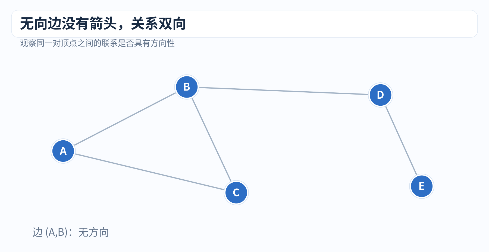

**图：有向弧具有弧尾和弧头**

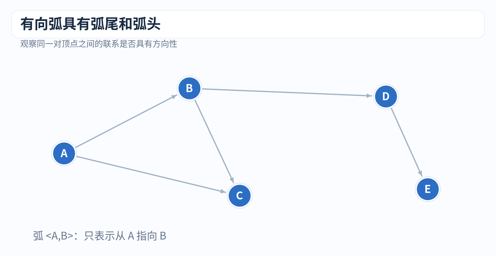

**图：带权图的权值标注**

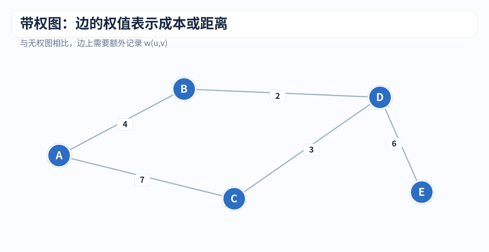

### 7.1.2 子图、完全图、稀疏图与稠密图

若 $G'=(V',E')$ 满足 $V'\subseteq V$、$E'\subseteq E$，且 $E'$ 的端点属于 $V'$，则 $G'$ 是 $G$ 的子图。**不能只检查两集合包含，还要检查每条边的端点存在。**

在不允许自环、平行边的简单图中：

- $n$ 个顶点的**无向完全图**边数为 $\dfrac{n(n-1)}{2}$。
- $n$ 个顶点的**有向完全图**弧数为 $n(n-1)$（两个方向分别计数）。
- 稀疏与稠密强调边数相对 $n^2$ 的多少；课件以 $e<n\log n$ 等方式介绍稀疏图，这可理解为**教材的粗略判别阈值**，不是所有算法教材统一采用的严格定义。

**图：原图与子图的关系**

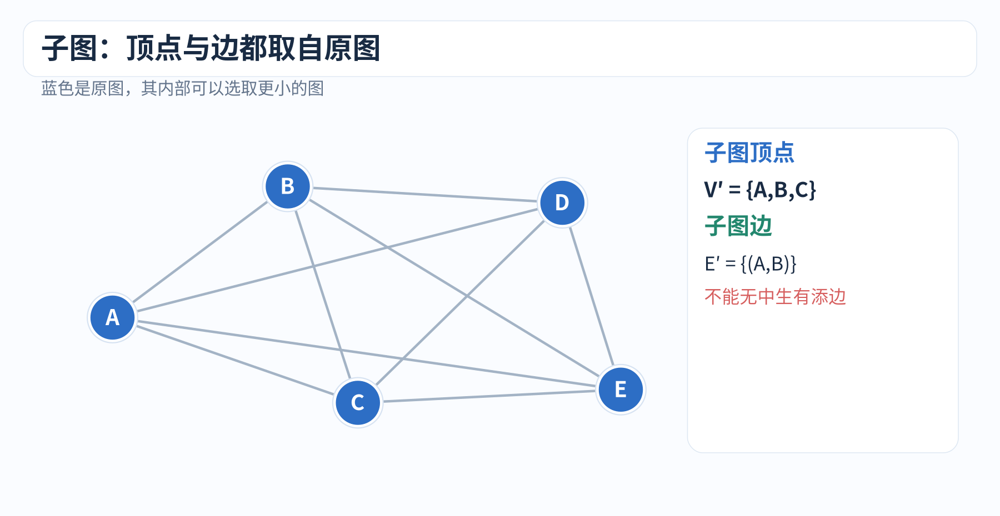

**图：无向完全图 K5**

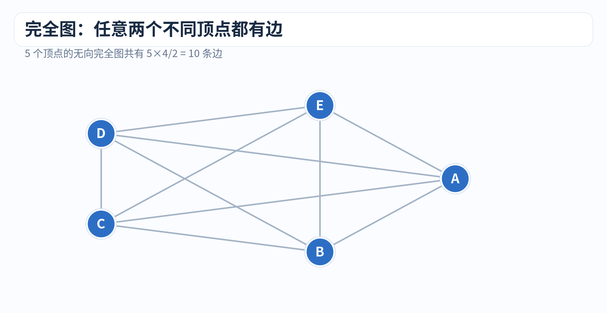

### 7.1.3 邻接、度、入度与出度

无向图中，与顶点 $v$ 直接相连的顶点称为 $v$ 的邻接点。顶点 $v$ 的**度** $\deg(v)$ 是与它关联的边的数量。有向图需要分别计算：

$$\deg^+(v)=\text{以 }v\text{ 为弧尾的弧数}$$
$$\deg^-(v)=\text{以 }v\text{ 为弧头的弧数}$$
$$\deg(v)=\deg^+(v)+\deg^-(v)$$

无向图中 $\sum_{v\in V}\deg(v)=2|E|$，因为每条边贡献两个端点；有向图中所有入度之和与所有出度之和均等于弧数。

**图：有向图的入度与出度**

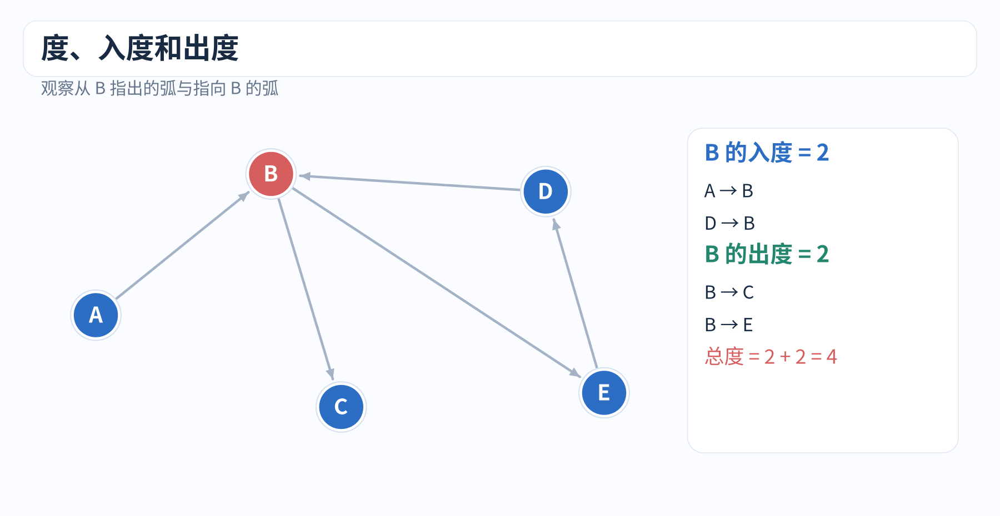

### 7.1.4 路径、回路与长度

**路径**是相邻顶点依次连接而成的序列。讲义以“所经过的边数”定义路径长度；若图带权，则**路径的总代价**需要将经过的边权相加，两个概念不可混同。

- **简单路径**：除非另有定义，顶点不重复的路径。
- **回路**：起点与终点相同的路径；简单回路仅首尾允许重合，中间顶点不重复。
- 对有向图，路径必须按弧的箭头方向走。

> [!warning] 遍历次序不是一条完整路径
> DFS 输出 $A,B,C,D,\dots$ 仅表示访问先后，不保证相邻的两个输出顶点之间存在边。若要输出**从指定起点到终点的真正路径**，必须保存搜索过程中的前驱或递归路径栈。

**图：简单路径与有向回路**

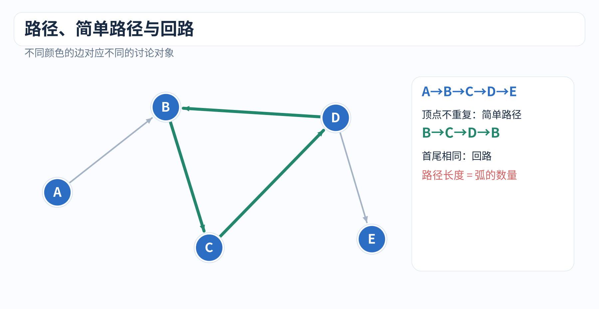

### 7.1.5 连通图、强连通图、分量

- **无向连通图**：任意两顶点间都有路径；**连通分量**是极大连通子图。
- **有向强连通图**：任意两顶点互相可经有向路径到达；**强连通分量**是极大强连通子图。
- “有向图忽略箭头后连通”和“强连通”不是一个概念。

**图：非连通无向图的三个连通分量**

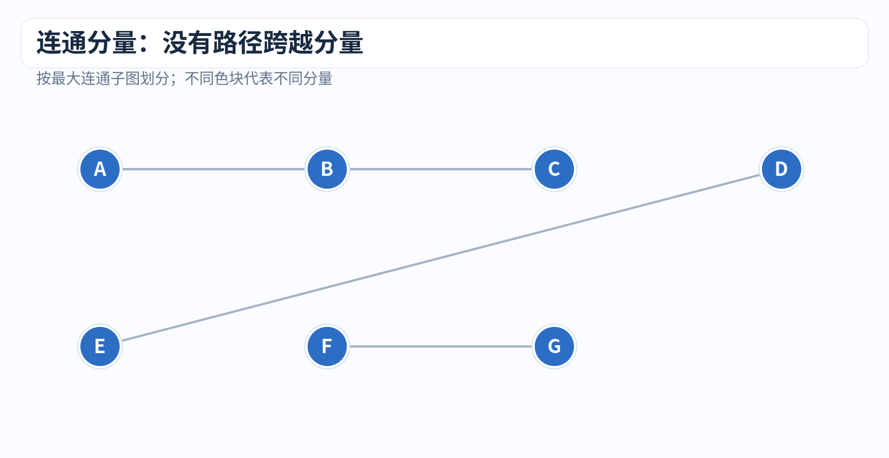

**图：有向图中的强连通分量**

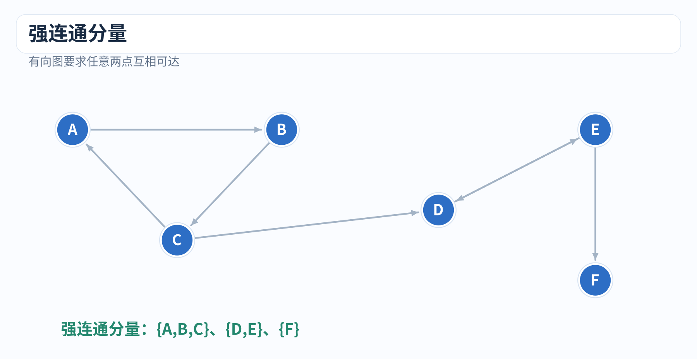

### 7.1.6 生成树、生成森林与图 ADT

连通无向图的**生成树**保留所有 $n$ 个顶点，边数恰好为 $n-1$，同时连通且无环。不连通无向图的各连通分量可各自形成生成树，合起来称**生成森林**。课件还展示了图 ADT 的常见操作：建立/销毁图，顶点定位与访问，查找第一/下一邻接点，插入/删除顶点与弧，以及深度/广度优先遍历。

> [!important] 树的等价判别（针对有限简单无向图）
> 以下任意两个条件中适当的组合可以刻画树：**连通且无环**；**连通且恰有 $n-1$ 条边**；**无环且恰有 $n-1$ 条边**。单独“有 $n-1$ 条边”并不能保证是树。

**图：从连通图抽取一棵生成树**

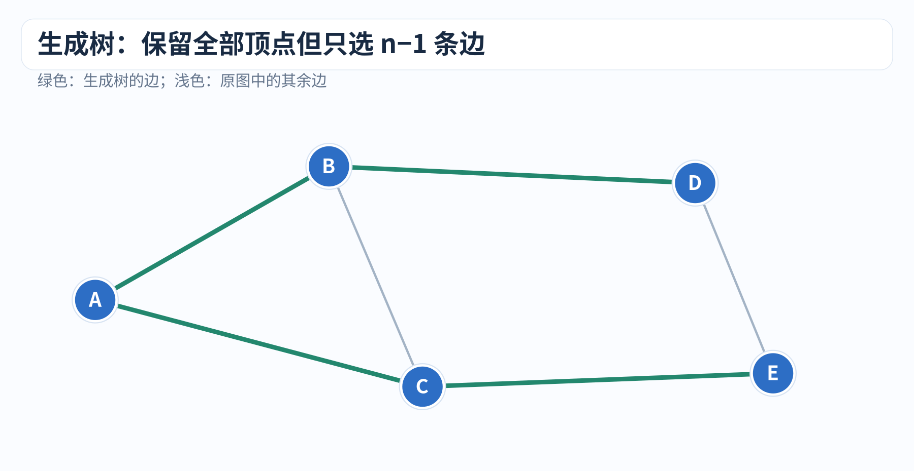

---

## 7.2 图的存储表示

同一张图可以有多种存储方式，数据结构的选择会显著影响空间消耗与查询/遍历效率。课件依次介绍**邻接矩阵、邻接表、逆邻接表和有向图的十字链表**。

### 7.2.1 邻接矩阵：用二维数组表示边

设顶点按 $v_0,v_1,\ldots,v_{n-1}$ 排列，无权图的邻接矩阵为：

$$M[i][j]=\begin{cases}1,&(v_i,v_j)\text{ 有边或弧},\0,&\text{否则}。\end{cases}$$

- **无向图**：$M[i][j]=M[j][i]$，矩阵对称。
- **有向图**：第 $i$ 行的 1 的个数为 $v_i$ 的出度，第 $i$ 列的 1 的个数为入度。
- **带权图**：存在边记相应权值 $w_{ij}$；不存在边常用 $+\infty$ 或足够大的哨兵值（具体取值应与算法约定一致）；最短路径算法常把对角线初始化为 0。
- 空间复杂度 **$O(n^2)$**；查看任意两个顶点是否相邻为 **$O(1)$**；扫描某个顶点的全部邻接点为 $O(n)$。

**图：无向图与对称邻接矩阵**

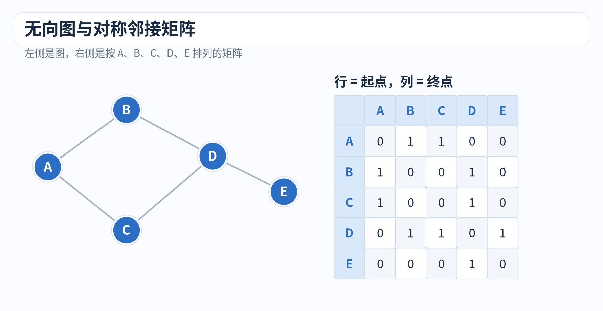

**图：无向图矩阵关于主对角线对称**

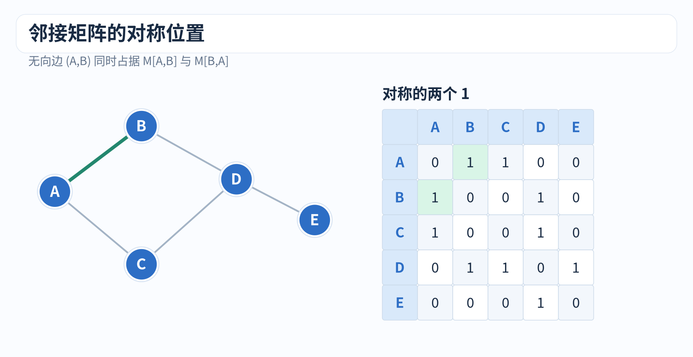

**图：有向图的邻接矩阵**

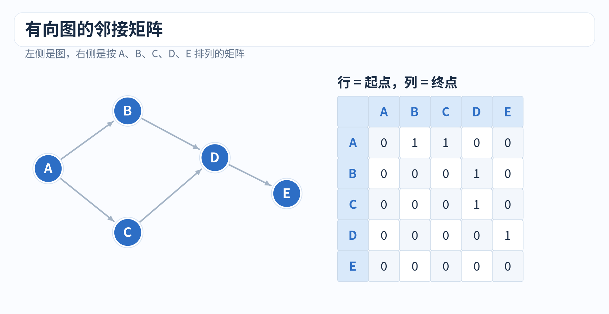

**图：有向图按行求出度、按列求入度**

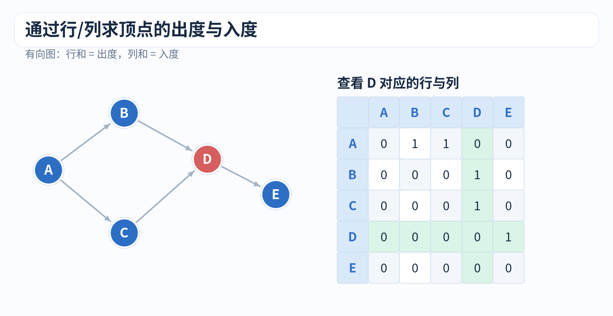

**图：带权网的矩阵：权值和无穷大**

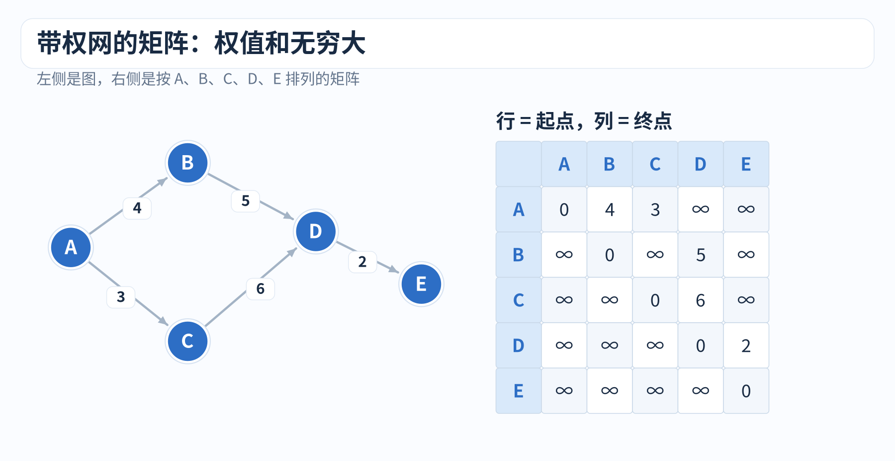

> [!warning] 0 与“无边”的区别
> 无权图中 0 常表示无边；**带权图可能存在权值为 0 的有效边**，因此不能总用 0 代表无边。涉及最短路时要统一“无边”“自身到自身”“真实零权边”三类状态。

用标准 C++ 容器可以直接建立简单邻接矩阵：

```cpp
int n = 5;                                                        // 顶点个数
std::vector<std::vector<int>> matrix(n, std::vector<int>(n, 0)); // 创建 n×n 的零矩阵
matrix[0][1] = 1;                                                // 存入从顶点 0 到顶点 1 的弧
matrix[1][0] = 1;                                                // 若是无向图，同时写入反向位置
```

这段代码片段需要包含 `<vector>`。课堂 PPT 使用固定规模的二维数组和 `GraphKind` 结构描述图；这里以常用的 `std::vector` 展示相同的结构含义，便于理解与测试。

### 7.2.2 邻接表：每个顶点维护一条链/列表

邻接表将**顶点表**和**各顶点的邻接点表**结合起来。经典教材的弧结点具有 `adjvex`（邻接点索引）、`info`（权值等信息）与 `nextarc`（下一弧结点指针），顶点结点具有 `data` 与 `firstarc`。在现代 C++ 中，可先用二维动态数组理解这种“按顶点分类存储”的思想。

- 无向图：每条边通常在两个端点的链中分别存一次，表结点总数约为 $2e$。
- 有向图：每条弧只进入弧尾顶点的链中，表结点总数为 $e$；这条链长度对应**出度**。
- 表空间通常为 **$O(n+e)$**；遍历所有邻接边很方便；但判定任意指定两点是否直接相邻，可能需要扫描一整条链。

**图：无向图与邻接表存储**

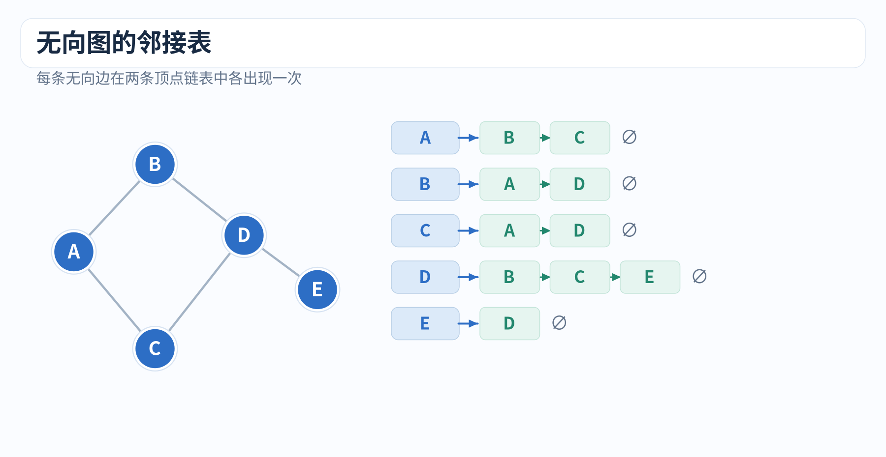

**图：有向图与邻接表**

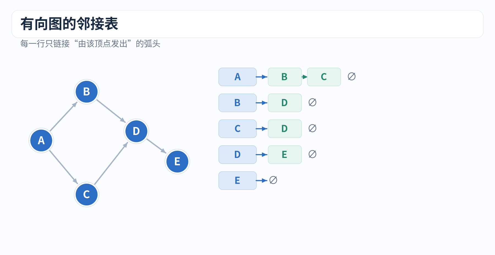

**图：邻接表表头与弧结点的指针关系**

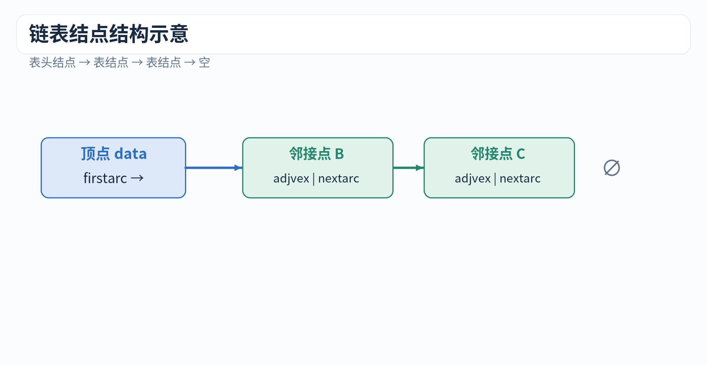

```cpp
int n = 5;                                       // 顶点数
std::vector<std::vector<int>> adj(n);            // 每个顶点有一份邻接点序列
adj[0].push_back(1);                             // 添加 0→1
adj[1].push_back(0);                             // 无向图还需要添加 1→0
```

### 7.2.3 逆邻接表：方便枚举入弧

普通有向邻接表按照弧尾保存后继；**逆邻接表**按照弧头保存前驱。若目标是反复查询“谁指向顶点 $v$”，单独维护逆邻接表更方便。普通邻接表中一个顶点的链表长度直接给出**出度**，逆邻接表则直接给出**入度**。

**图：有向图与逆邻接表**

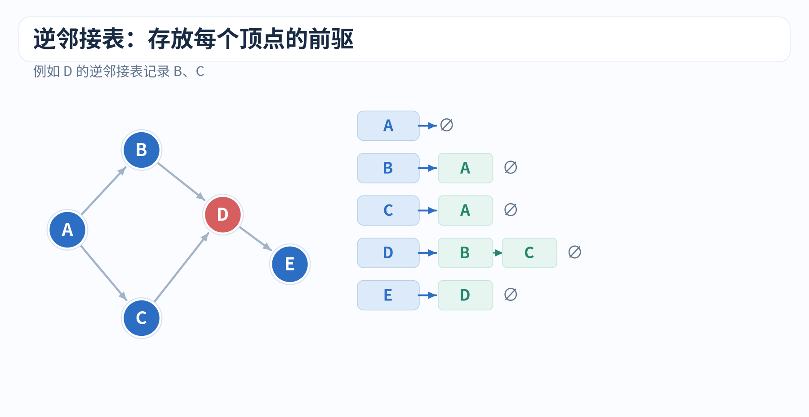

### 7.2.4 十字链表：一条弧进入两条链

十字链表将邻接表与逆邻接表的优点结合。每个**弧结点**记录：`tailvex`、`headvex`、`tlink`（指向下一条同弧尾的弧）与 `hlink`（指向下一条同弧头的弧），还可保存权值信息；每个**顶点结点**维护 `firstout` 与 `firstin` 两个入口。

> [!tip] 理解指针的诀窍
> 一条实际的弧**只有一个弧结点**，但可以沿着“出弧链”或“入弧链”访问到它。这不等于把同一条弧的数据完整复制两份。

**图：十字链表弧结点的四个关键域**


**图：十字链表顶点结点的双入口**

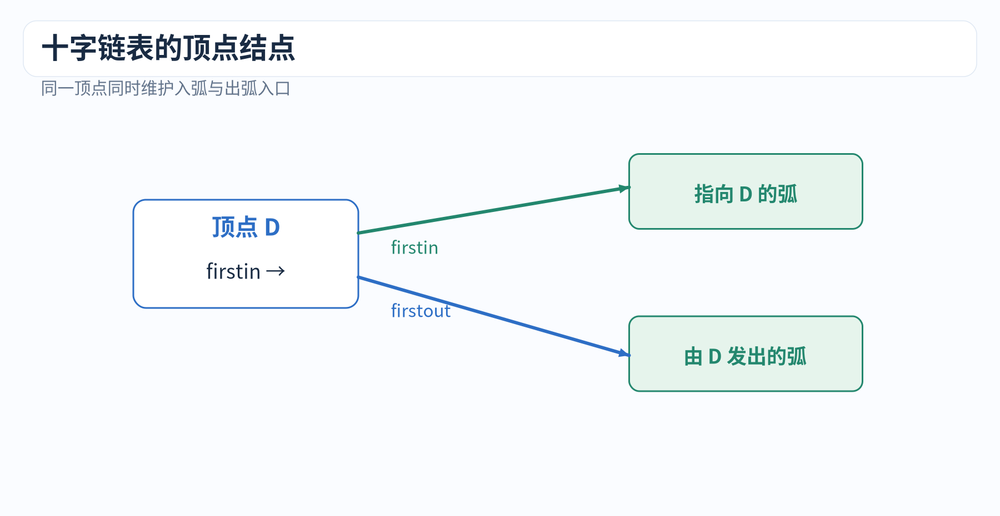

**图：十字链表能够同时枚举入弧和出弧**

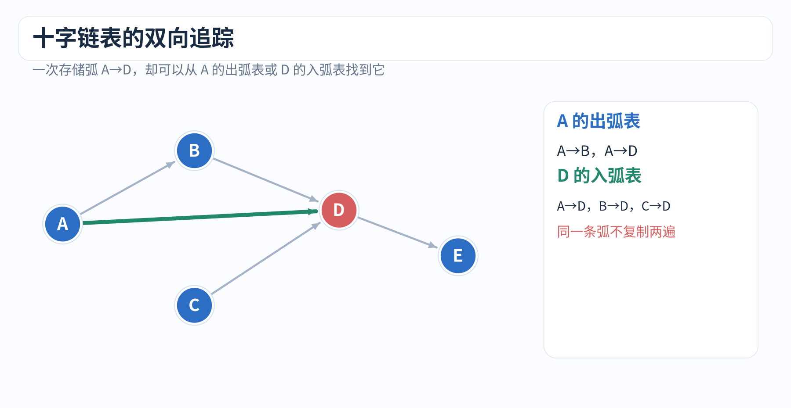

### 7.2.5 三类结构如何选择

| 结构 | 主要存储量 | 查询指定两点是否相邻 | 访问所有出邻接点 | 典型用途 |
|---|---:|---|---|---|
| 邻接矩阵 | $O(n^2)$ | $O(1)$ | $O(n)$ | 顶点数较小、较稠密的图 |
| 邻接表 | $O(n+e)$ | $O(\deg(v))$ | $O(\deg(v))$ | 大部分稀疏图、DFS/BFS |
| 逆邻接表 | $O(n+e)$ | 与邻接表类似 | 直接访问**前驱** | 计算入度、反向搜索 |
| 十字链表 | $O(n+e)$ | 需沿相关链查找 | 入弧/出弧均方便 | 需要双向维护的有向图 |

上述邻接表复杂度使用简单邻接序列作近似，若存在平行边或额外辅助结构，应按具体实现调整。

**图：稀疏图与稠密图的存储适配**

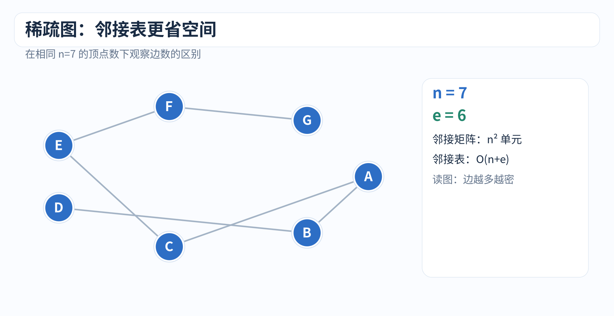

**图：稠密图与稀疏图的存储适配**

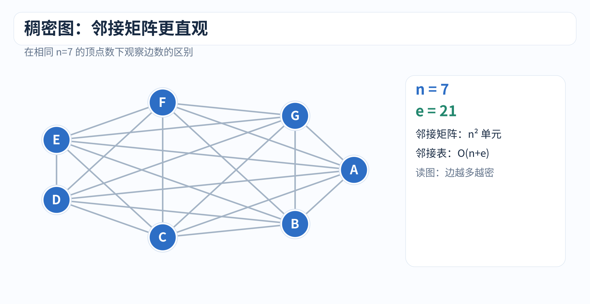

---

## 7.3 图的遍历

**图的遍历**是从指定顶点出发访问可达顶点，并在需要时遍历其他连通分量，使每个顶点只处理一次的过程。与树不同，图可能有回路，必须使用 `visited[]` 防止反复访问。课件中的 DFS 和 BFS 都可用于整图遍历、路径判断和构造搜索生成树。

**图：图遍历中的访问标记**

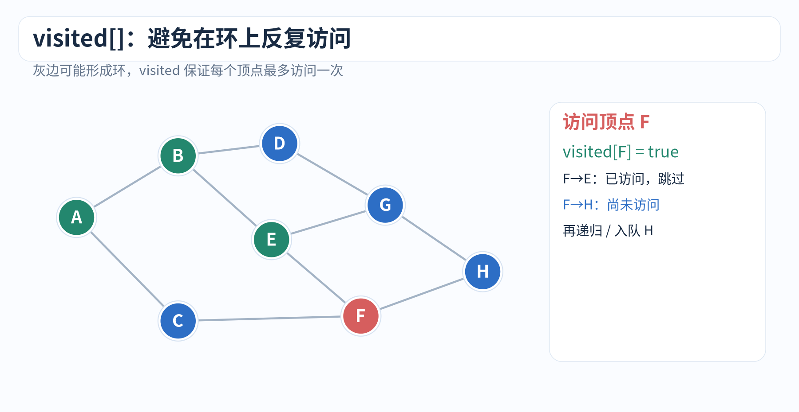

### 7.3.1 深度优先搜索 DFS

DFS 的核心过程是：**访问当前顶点 → 递归进入第一个尚未访问的邻点 → 走到底后回溯 → 继续尚未搜索的分支**。典型实现依赖递归调用栈，也可以显式使用栈。

```cpp
void dfs(int u, const std::vector<std::vector<int>>& adj,
         std::vector<bool>& visited, std::vector<int>& order) {
    visited[u] = true;                              // 访问时立即标记，避免重复递归
    order.push_back(u);                             // 记录访问顺序
    for (int v : adj[u]) {                          // 按邻接表的顺序检查邻接点
        if (!visited[v]) {                          // 只进入没有访问过的顶点
            dfs(v, adj, visited, order);             // 深入后继分支
        }
    }
}
```

调用前应准备长度为 $n$、初值为 `false` 的 `visited`，并把 `start` 传给 `dfs(start, adj, visited, order)`。若要遍历非连通图，外层还需从每个未访问顶点重新启动 DFS。

> [!example] 自拟图，按字母顺序考察邻点
> 使用下面的 8 顶点示例，DFS 访问次序为 **A → B → D → G → E → F → C → H**。重点不是死记这个序列，而是观察递归如何进入与返回。**更改邻接表存储顺序，DFS 顺序就可能改变。**

**图：一次 DFS 得到的生成树**

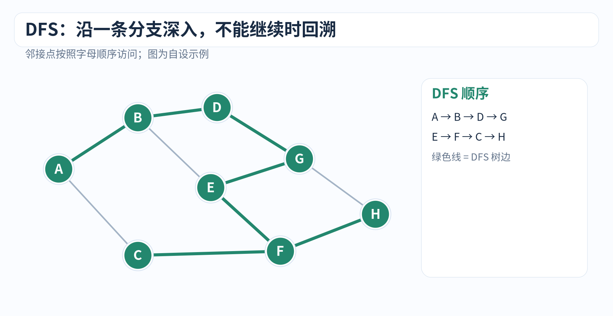

#### DFS 演示第 1 步：访问 A

**图：DFS 第 1 步访问 A**

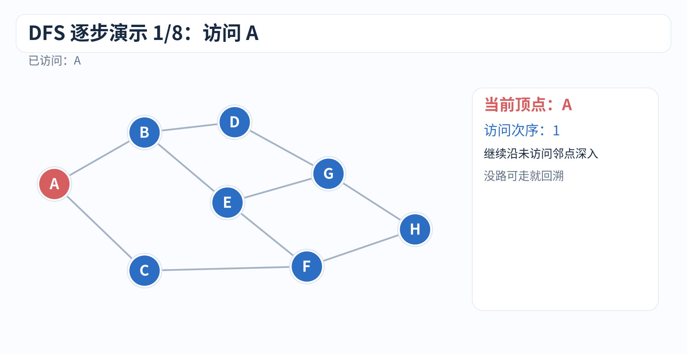

先访问起点 A 并标记，寻找字母序最前的未访问邻点。

#### DFS 演示第 2 步：访问 B

**图：DFS 第 2 步访问 B**

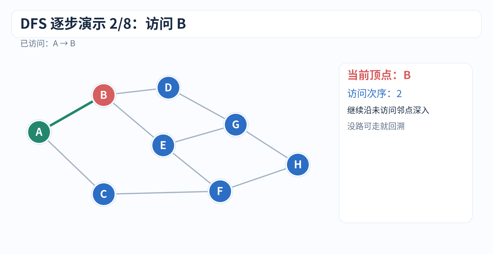

沿当前顶点尚未访问的邻接点继续深入；若没有可走的邻接点就返回上一层。

#### DFS 演示第 3 步：访问 D

**图：DFS 第 3 步访问 D**

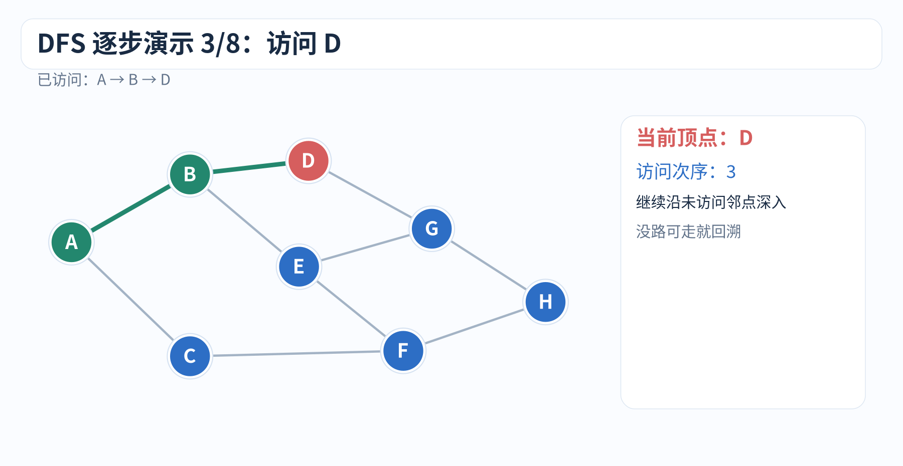

沿当前顶点尚未访问的邻接点继续深入；若没有可走的邻接点就返回上一层。

#### DFS 演示第 4 步：访问 G

**图：DFS 第 4 步访问 G**

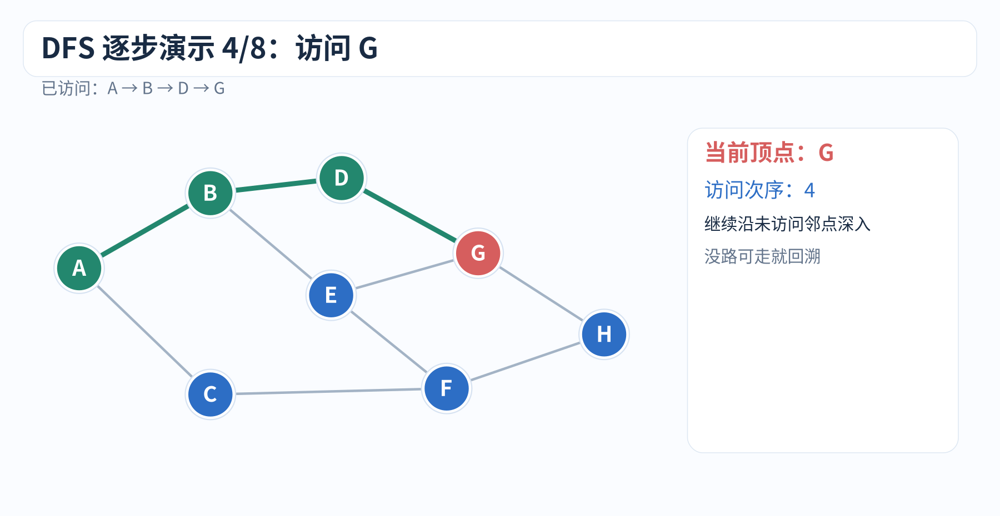

当前分支进入更深一层；后续遇到已访问顶点时必须跳过，避免沿环重复搜索。

#### DFS 演示第 5 步：访问 E

**图：DFS 第 5 步访问 E**

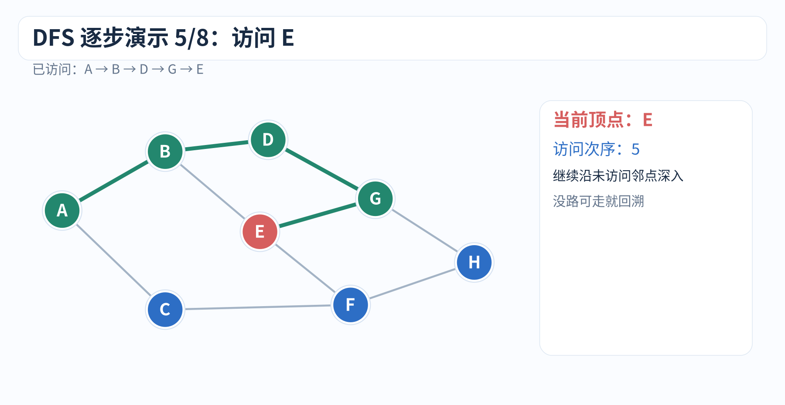

沿当前顶点尚未访问的邻接点继续深入；若没有可走的邻接点就返回上一层。

#### DFS 演示第 6 步：访问 F

**图：DFS 第 6 步访问 F**

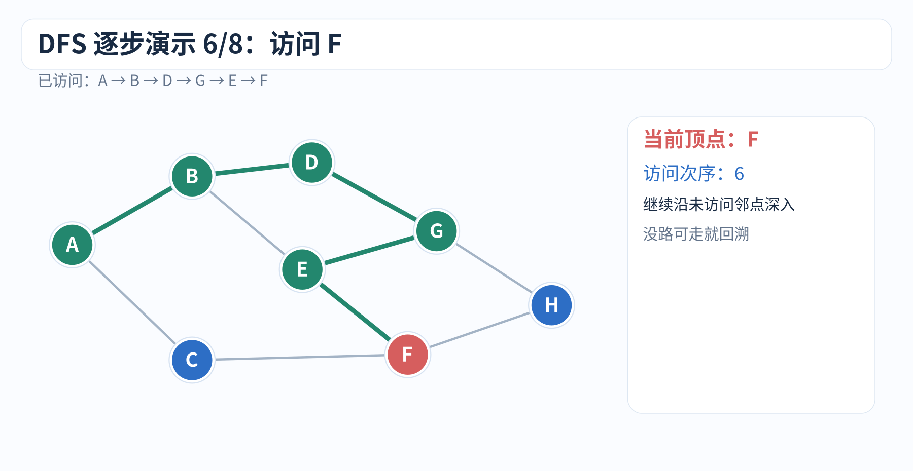

沿当前顶点尚未访问的邻接点继续深入；若没有可走的邻接点就返回上一层。

#### DFS 演示第 7 步：访问 C

**图：DFS 第 7 步访问 C**

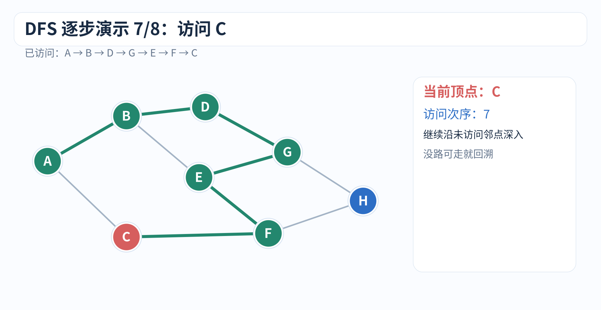

当前分支进入更深一层；后续遇到已访问顶点时必须跳过，避免沿环重复搜索。

#### DFS 演示第 8 步：访问 H

**图：DFS 第 8 步访问 H**

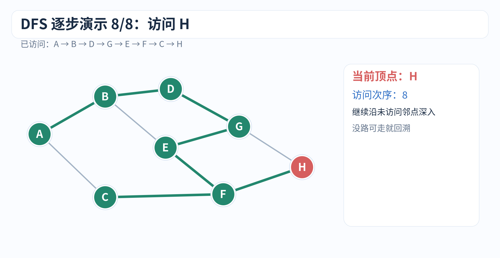

最后访问 H，全部顶点已访问；回溯会结束尚未返回的函数调用。

#### DFS 回溯、非连通图与复杂度

DFS **不是沿图中的某条固定“回程路线”反向移动**：递归返回发生在函数调用关系中；只有为了展示搜索树才会画出回溯箭头。在邻接表上遍历一张图的复杂度为 $O(n+e)$，在邻接矩阵上需要检查每行，通常为 $O(n^2)$。

**图：DFS 递归与回溯**

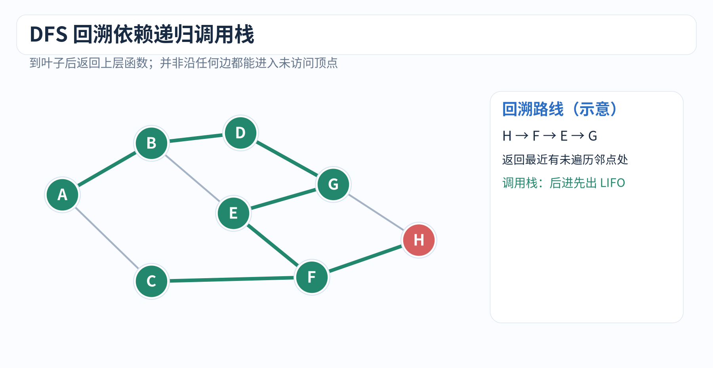

**图：在非连通图上继续遍历其他分量**

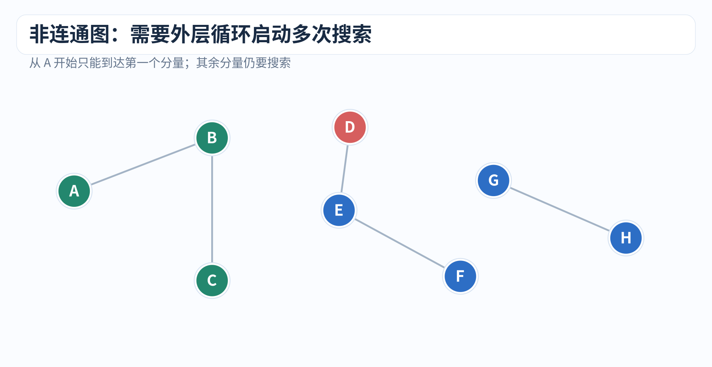

### 7.3.2 广度优先搜索 BFS

BFS 按最少边数形成的层次依次访问顶点。它不是深入一条分支，而是先处理所有距离起点 1 条边的顶点，再处理 2 条边的顶点……因此需要**队列**保存已经发现但尚未扩展的顶点。

**关键时机**：在顶点第一次入队时就将它标记为已访问，而不是出队时才标记；否则同一顶点可能被重复加入队列。

```cpp
void bfs(int start, const std::vector<std::vector<int>>& adj,
         std::vector<int>& order, std::vector<int>& parent) {
    int n = static_cast<int>(adj.size());          // 顶点数量
    std::vector<bool> visited(n, false);           // 访问标记
    std::queue<int> q;                             // 广度优先队列
    parent.assign(n, -1);                         // -1 表示暂时没有前驱
    visited[start] = true;                        // 起点第一次入队前标记
    q.push(start);                                // 起点入队
    while (!q.empty()) {                          // 队列非空时继续扩展
        int u = q.front();                         // 获取待处理的队头
        q.pop();                                   // 将队头出队
        order.push_back(u);                        // 记录出队访问顺序
        for (int v : adj[u]) {                     // 枚举 u 的邻接点
            if (!visited[v]) {                     // 忽略已发现的顶点
                visited[v] = true;                // 立即标记，防止重复入队
                parent[v] = u;                    // 记录第一次发现 v 的前驱
                q.push(v);                        // 新顶点排到队尾
            }
        }
    }
}
```

调用上面函数需要包含 `<vector>` 和 `<queue>`。注意本例把“访问结果”定义为**出队时记录的顺序**，但图中 `visited` 表示的是**已发现（入队）的顶点**；两者在某些中间状态并不完全相同。

**图：BFS 按最少边数分层**

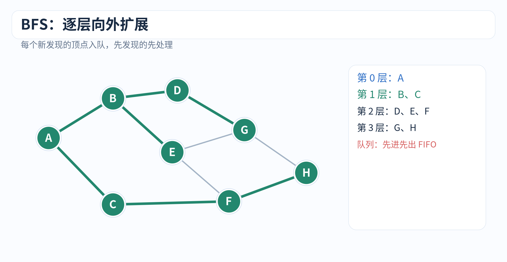

#### BFS 演示第 1 个状态：起点入队

**图：BFS 第 1 个状态**

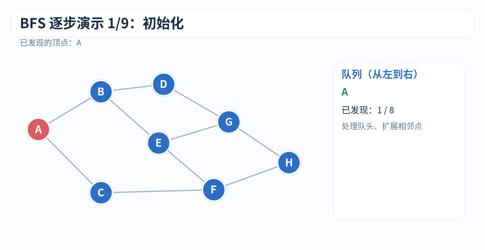

当前待处理队列：**A**。新发现的结点会标记后进入队尾。

#### BFS 演示第 2 个状态：处理 A

**图：BFS 第 2 个状态**

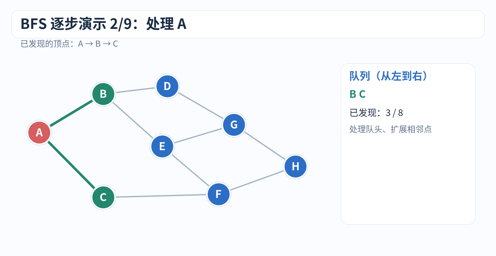

当前待处理队列：**B、C**。新发现的结点会标记后进入队尾。

#### BFS 演示第 3 个状态：处理 B

**图：BFS 第 3 个状态**

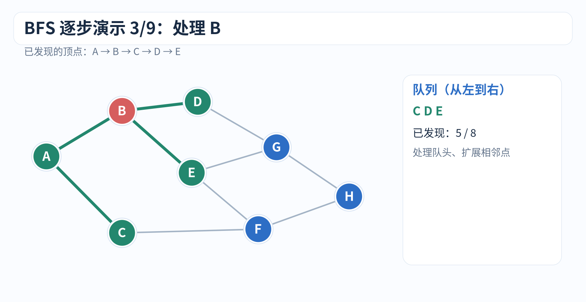

当前待处理队列：**C、D、E**。新发现的结点会标记后进入队尾。

#### BFS 演示第 4 个状态：处理 C

**图：BFS 第 4 个状态**

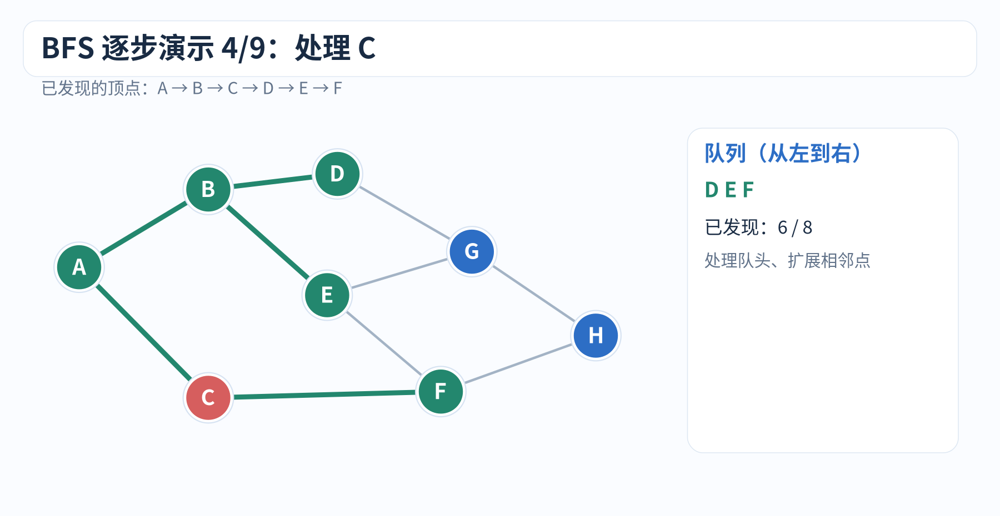

当前待处理队列：**D、E、F**。新发现的结点会标记后进入队尾。

#### BFS 演示第 5 个状态：处理 D

**图：BFS 第 5 个状态**

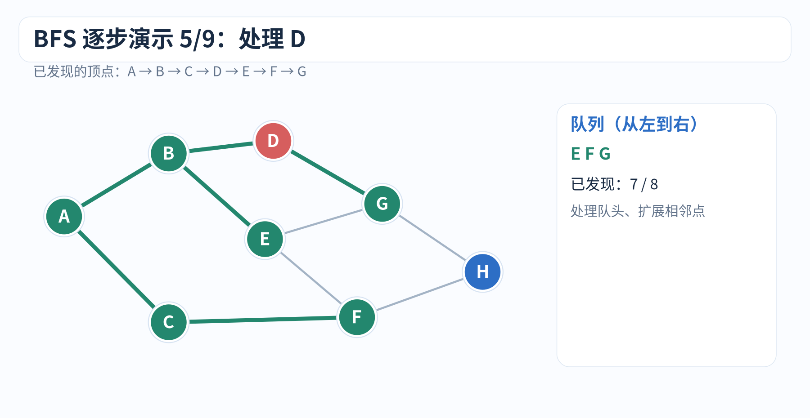

当前待处理队列：**E、F、G**。新发现的结点会标记后进入队尾。

#### BFS 演示第 6 个状态：处理 E

**图：BFS 第 6 个状态**

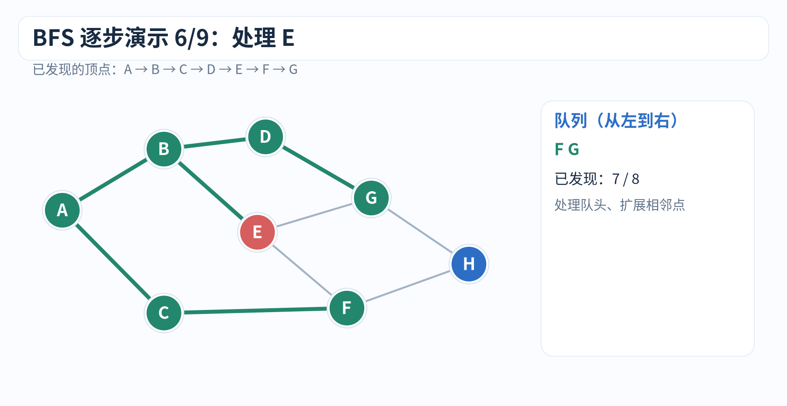

当前待处理队列：**F、G**。新发现的结点会标记后进入队尾。

#### BFS 演示第 7 个状态：处理 F

**图：BFS 第 7 个状态**

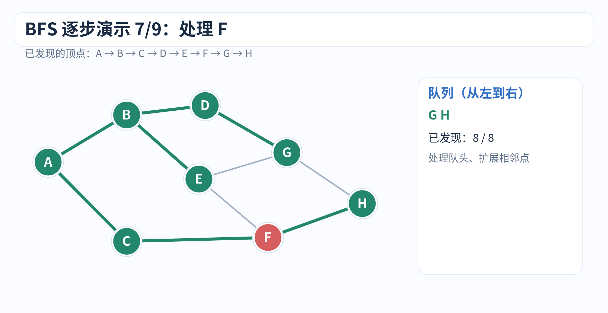

当前待处理队列：**G、H**。新发现的结点会标记后进入队尾。

#### BFS 演示第 8 个状态：处理 G

**图：BFS 第 8 个状态**

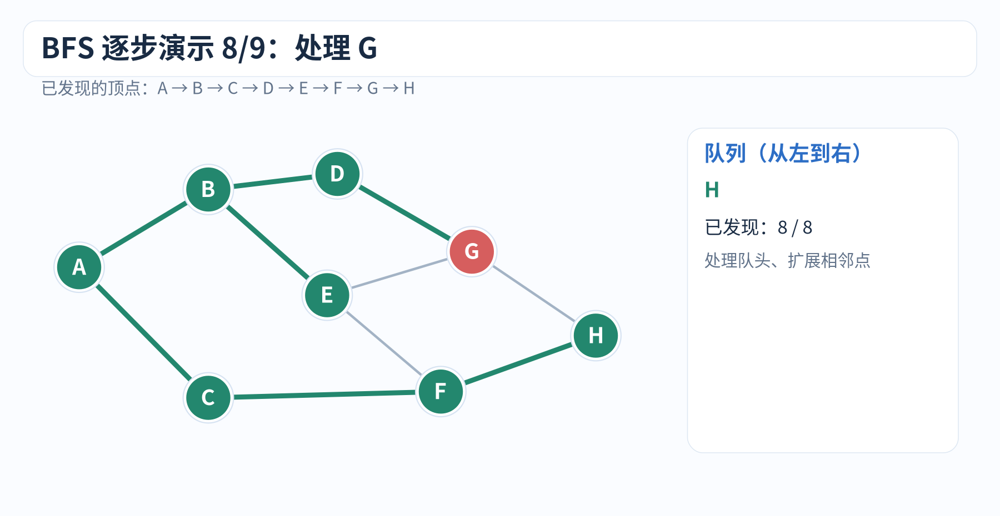

当前待处理队列：**H**。新发现的结点会标记后进入队尾。

#### BFS 演示第 9 个状态：处理 H

**图：BFS 第 9 个状态**

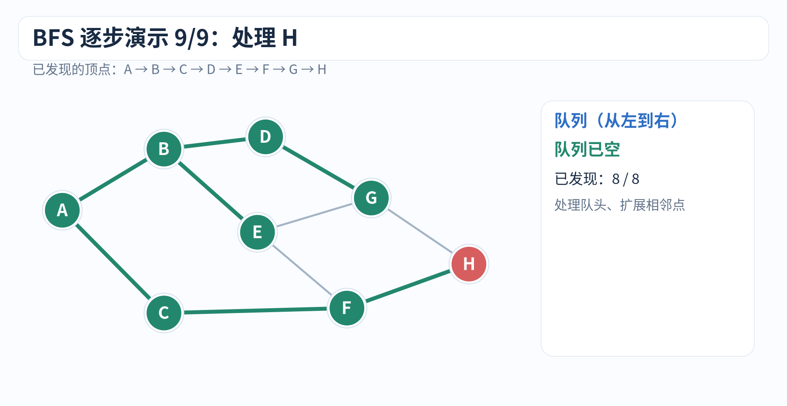

当前待处理队列：**空**。队列清空，搜索结束。

> [!tip] BFS 的层序性质
> 在**所有边权视为 1** 时，BFS 第一次发现顶点 $v$ 的层数就是从起点到 $v$ 所需的最少边数。它不能代替 Dijkstra 计算一般非负带权图的最小权值和。

**图：BFS 的入队和 visited 时机**

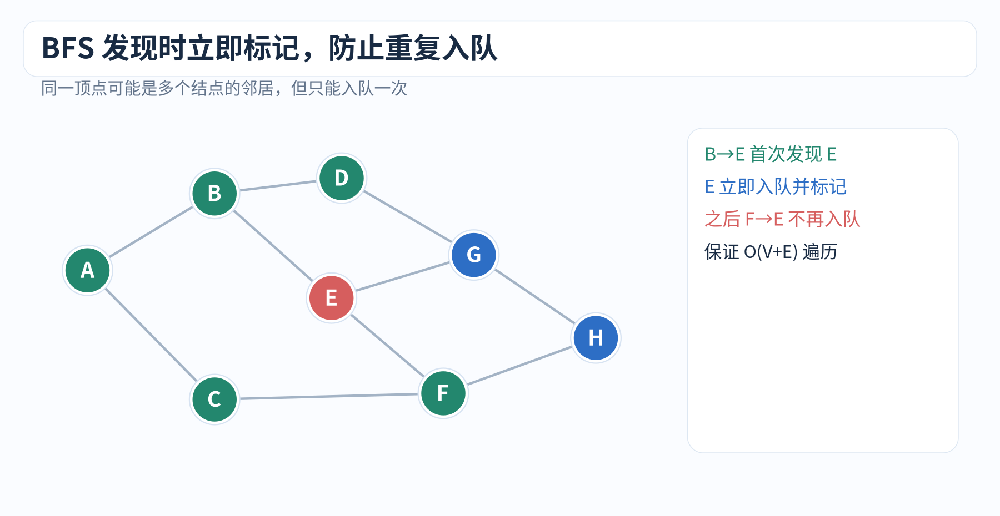

**图：用 BFS 的前驱指针恢复最短路径**

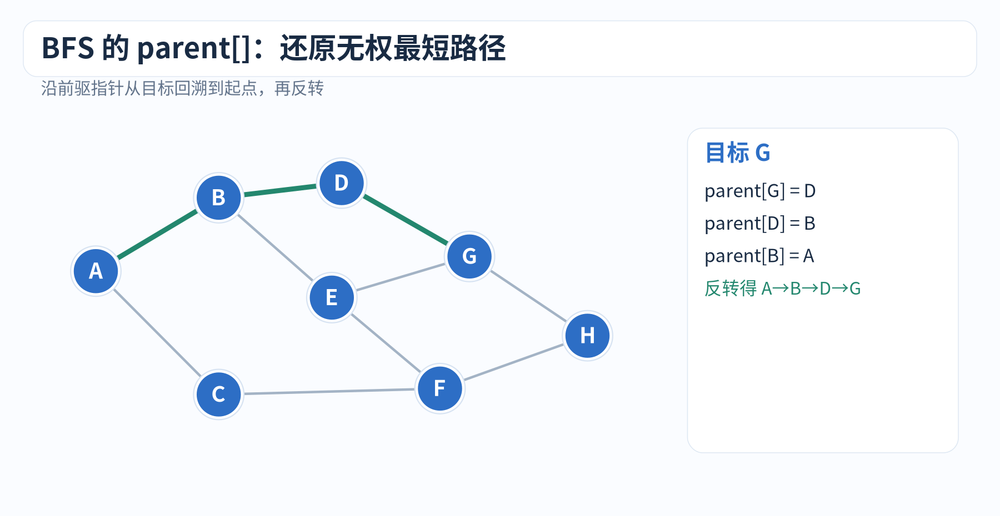

**图：同一个图的 DFS 与 BFS 次序**

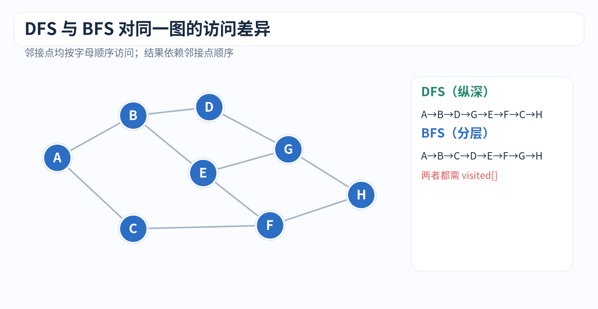

### 7.3.3 图遍历在路径问题中的应用

课件主要提出两个任务：**判断 / 寻找从 $i$ 到 $s$ 的简单路径**，以及**寻找边数最少的路径**。

1. DFS 搜索时遇到目标立即记录路径；回溯时撤销路径末尾结点。注意访问顺序≠实际路径。
2. BFS 第一次发现目标时，其 `parent[]` 链可恢复最少边数路径。按“目标→前驱→…→起点”反向追踪，再反转数组。
3. 判断两点是否可达可用 DFS 或 BFS。若图可能不连通，必须从指定起点搜索，不能误将另一分量中顶点也视为可达。

> [!example] 自拟示例的 BFS 路径
> 上面的 BFS 示例中，按字母顺序考察邻点，第一次发现 G 时前驱依次为 `G←D←B←A`，所以可以还原 **A→B→D→G**，长度为 3 条边。

**复杂度速查：** 邻接表上 DFS、BFS 均为 $O(n+e)$；辅助 `visited`、父指针及 BFS 队列空间为 $O(n)$，递归 DFS 可能消耗 $O(n)$ 的调用栈。

---

## 7.4 图的生成树与最小生成树

### 7.4.1 生成树与最小生成树 MST

在连通无向带权图中，最小生成树（Minimum Spanning Tree，MST）是所有生成树中**边权总和最小**的一棵。MST 必须覆盖每个顶点，只选择 $n-1$ 条边，不允许成环。

生成树一般不唯一；最小生成树也不一定唯一（例如出现多条并列权值的边），但其最小总代价是确定的。MST 的边选择结果不是“每个顶点到起点的最短路径树”。

**图：最小生成树需要同时满足三项条件**

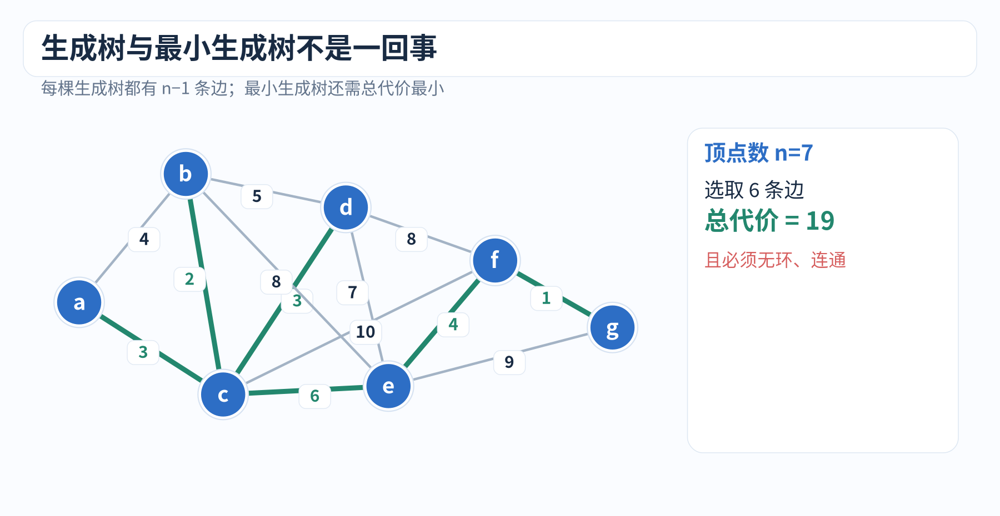

### 7.4.2 Prim 算法：从一个顶点不断长出树

设 $U$ 是已进入生成树的顶点集合，初始 $U=\{s\}$。每轮选择所有连接 $U$ 与 $V-U$ 的边中**权值最小**的一条，把新顶点纳入 $U$；重复到所有顶点纳入。

Prim 的关键是**跨越两个顶点集合的最小权值边**，而不是简单挑当前顶点的最小邻边。课件用 `closedge[]` 存储尚未加入的顶点到 $U$ 的最低连接代价，以及对应的 $U$ 内顶点。

**图：Prim 的割与跨割最小边**

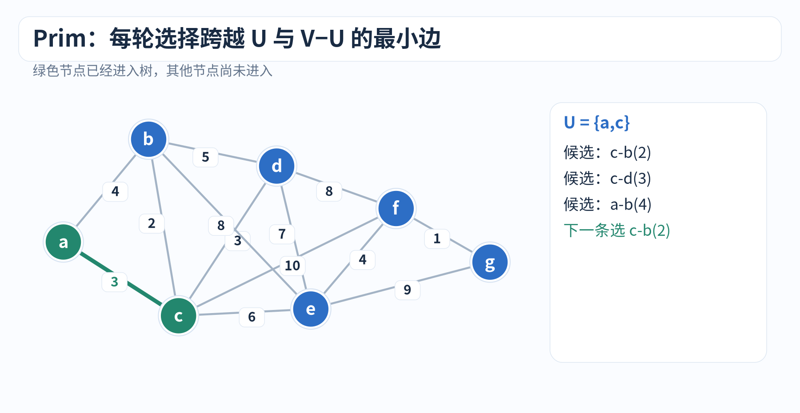

#### Prim 演算第 0 轮

**图：Prim 的第 0 个状态**


起点设为 a，此时尚未选边。

#### Prim 演算第 1 轮

**图：Prim 的第 1 个状态**


本轮增加 **a–c**，边权 3；累计代价 **3**，已进入生成树的顶点为 `a, c`。

#### Prim 演算第 2 轮

**图：Prim 的第 2 个状态**


本轮增加 **b–c**，边权 2；累计代价 **5**，已进入生成树的顶点为 `a, b, c`。

#### Prim 演算第 3 轮

**图：Prim 的第 3 个状态**


本轮增加 **c–d**，边权 3；累计代价 **8**，已进入生成树的顶点为 `a, b, c, d`。

#### Prim 演算第 4 轮

**图：Prim 的第 4 个状态**


本轮增加 **c–e**，边权 6；累计代价 **14**，已进入生成树的顶点为 `a, b, c, d, e`。

#### Prim 演算第 5 轮

**图：Prim 的第 5 个状态**


本轮增加 **e–f**，边权 4；累计代价 **18**，已进入生成树的顶点为 `a, b, c, d, e, f`。

#### Prim 演算第 6 轮

**图：Prim 的第 6 个状态**


本轮增加 **f–g**，边权 1；累计代价 **19**，已进入生成树的顶点为 `a, b, c, d, e, f, g`。

**图：Prim 的 lowcost/adjvex 更新**


**邻接矩阵版 Prim 的真实 C++ 实现**（`INF` 表示无边，要求简单连通无向网）：

```cpp
bool prim(const std::vector<std::vector<int>>& weight, int start,
          std::vector<std::pair<int, int>>& tree) {
    int n = static_cast<int>(weight.size());      // 顶点数
    const int INF = 1000000000;                   // 无边哨兵值
    std::vector<int> best(n, INF);                // 当前到生成树的最小边权
    std::vector<int> parent(n, -1);               // 最小边对应的树内顶点
    std::vector<bool> inTree(n, false);           // 是否已经纳入生成树
    tree.clear();                                 // 清空上一轮结果
    best[start] = 0;                              // 从指定顶点启动
    for (int count = 0; count < n; ++count) {      // 每轮加入一个顶点
        int u = -1;                               // 当前候选顶点
        for (int v = 0; v < n; ++v) {              // 遍历尚未加入的顶点
            if (!inTree[v] && (u == -1 || best[v] < best[u])) u = v;
        }
        if (u == -1 || best[u] == INF) return false; // 无法连接，图不连通
        inTree[u] = true;                         // 加入顶点 u
        if (parent[u] != -1) tree.push_back({parent[u], u}); // 收录树边
        for (int v = 0; v < n; ++v) {              // 逐一尝试更新跨割边
            if (!inTree[v] && weight[u][v] < best[v]) { // 找到更低代价
                best[v] = weight[u][v];           // 更新最小代价
                parent[v] = u;                    // 保存对应树内端点
            }
        }
    }
    return true;                                  // 已连通全部顶点
}
```

> [!note] Prim 代码的结构
> 这里用 `best[v]` 对应课件 `closedge[v].lowcost`，用 `parent[v]` 对应 `closedge[v].adjvex`。矩阵版时间复杂度为 **$O(n^2)$**；使用邻接表和堆还可以改善稀疏图上的效率。

### 7.4.3 Kruskal 算法：从所有边中挑不成环的最小边

Kruskal 先按边权从小到大排序，然后依次取边：若边的两端已经连通，则加入这条边必定形成回路，**丢弃**；否则**合并两个连通分量**并保留该边。累计到 $n-1$ 条树边即可。

**图：Kruskal 的边排序及环检测**


#### Kruskal 检查第 1 条边：f–g（权 1）

**图：Kruskal 检查 f-g：保留**


**保留**：两个端点还没有通过已选边连接。 本轮已选 1 条边，累计权值 1。

#### Kruskal 检查第 2 条边：b–c（权 2）

**图：Kruskal 检查 b-c：保留**


**保留**：两个端点还没有通过已选边连接。 本轮已选 2 条边，累计权值 3。

#### Kruskal 检查第 3 条边：a–c（权 3）

**图：Kruskal 检查 a-c：保留**


**保留**：两个端点还没有通过已选边连接。 本轮已选 3 条边，累计权值 6。

#### Kruskal 检查第 4 条边：c–d（权 3）

**图：Kruskal 检查 c-d：保留**


**保留**：两个端点还没有通过已选边连接。 本轮已选 4 条边，累计权值 9。

#### Kruskal 检查第 5 条边：a–b（权 4）

**图：Kruskal 检查 a-b：成环舍弃**


**舍弃**：两个端点已有路径相连，加入会成环。 本轮已选 4 条边，累计权值 9。

#### Kruskal 检查第 6 条边：e–f（权 4）

**图：Kruskal 检查 e-f：保留**


**保留**：两个端点还没有通过已选边连接。 本轮已选 5 条边，累计权值 13。

#### Kruskal 检查第 7 条边：b–d（权 5）

**图：Kruskal 检查 b-d：成环舍弃**


**舍弃**：两个端点已有路径相连，加入会成环。 本轮已选 5 条边，累计权值 13。

#### Kruskal 检查第 8 条边：c–e（权 6）

**图：Kruskal 检查 c-e：保留**


**保留**：两个端点还没有通过已选边连接。 本轮已选 6 条边，累计权值 19。

**图：并查集识别成环边**


Kruskal 最自然的实现工具是**并查集**：`find` 查询所属连通分量，`merge` 合并两个分量。相比遍历图检查环，并查集能高效判断新边是否导致回路。

```cpp
struct Edge {                                    // 无向带权边
    int u, v, weight;                           // 两端点索引和权值
};

struct DisjointSet {                             // 并查集结构
    std::vector<int> parent;                     // 保存每个顶点的父结点
    explicit DisjointSet(int n) : parent(n) {    // 初始化 n 个独立集合
        for (int i = 0; i < n; ++i) parent[i] = i;
    }
    int find(int x) {                            // 查找代表元素
        if (parent[x] != x) parent[x] = find(parent[x]); // 路径压缩
        return parent[x];                        // 返回集合根
    }
    bool merge(int a, int b) {                   // 尝试合并两个分量
        a = find(a);                             // 查询 a 的根
        b = find(b);                             // 查询 b 的根
        if (a == b) return false;                // 同一分量，加边将成环
        parent[a] = b;                           // 合并不同分量
        return true;                             // 本条边可以被保留
    }
};
```

完整 Kruskal 流程只需对 `std::vector<Edge> edges` 按 `weight` 排序，依次运行 `if (ds.merge(e.u,e.v))`，记录保留边，直到得到 $n-1$ 条边。若所有边检查后仍不足 $n-1$ 条，说明原图不连通，只得到生成森林。

**本图组中的两种算法均得到最小权值和 $19$**，但选边的顺序完全不同。

| 比较 | Prim | Kruskal |
|---|---|---|
| 生长方式 | 从一个顶点形成逐渐扩张的树 | 从全图的多个连通分量逐步合并 |
| 每次选择 | 连接 $U$ 与 $V-U$ 的最小边 | 全局剩余权值最小的无环边 |
| 常见实现 | 矩阵 + `best` / 堆 | 边排序 + 并查集 |
| 典型时间 | 矩阵实现 $O(n^2)$ | $O(e\log e)$ |
| 适用倾向 | 稠密图常用矩阵版 | 稀疏图更常用 |

---

## 7.5 两点之间的最短路径

课件区分 **单源最短路径**（一个起点到其余顶点）与 **所有顶点对之间的最短路径**。带权图中，路径距离是边权之和；若没有任何路径，距离为 $+\infty$。

### 7.5.1 Dijkstra：非负边权的单源最短路

维护 `dist[v]`（目前已发现的起点到 $v$ 的最好距离）、`prev[v]`（对应路径的前驱）和已确定集合 $S$：

1. `dist[start]=0`，其他顶点初值为 $\infty$。
2. 选取未确定且 `dist` 最小的顶点 $u$，把它加入 $S$；**选中后其距离不再改变**。
3. 对从 $u$ 发出的每条弧 $(u,v)$ 进行**松弛**：若 `dist[u]+w(u,v)<dist[v]`，更新 `dist[v]` 和 `prev[v]`。
4. 重复至待处理集合为空；不可达顶点保持 $\infty$。

> [!important] 非负边权是算法成立的重要条件
> Dijkstra 的“当前最小暂定距离可以最终确定”依赖边权非负。**存在负权边时不能直接套用普通 Dijkstra。** 若需处理负权但没有负环的单源最短路，可考虑 Bellman–Ford（属于补充知识，本课件未重点展开）。

**图：带权有向图的单源最短路径问题**


#### Dijkstra 第 0 轮：初始化

**图：Dijkstra 第 0 轮距离表**


已确定集合：`空`；本轮初始化全部暂定距离。

#### Dijkstra 第 1 轮：确定 S

**图：Dijkstra 第 1 轮距离表**


已确定集合：`S`；已完成对从 S 发出的边的松弛操作。

#### Dijkstra 第 2 轮：确定 B

**图：Dijkstra 第 2 轮距离表**


已确定集合：`B, S`；已完成对从 B 发出的边的松弛操作。

#### Dijkstra 第 3 轮：确定 A

**图：Dijkstra 第 3 轮距离表**


已确定集合：`A, B, S`；已完成对从 A 发出的边的松弛操作。

#### Dijkstra 第 4 轮：确定 C

**图：Dijkstra 第 4 轮距离表**


已确定集合：`A, B, C, S`；已完成对从 C 发出的边的松弛操作。

#### Dijkstra 第 5 轮：确定 D

**图：Dijkstra 第 5 轮距离表**


已确定集合：`A, B, C, D, S`；已完成对从 D 发出的边的松弛操作。

#### Dijkstra 第 6 轮：确定 T

**图：Dijkstra 第 6 轮距离表**


已确定集合：`A, B, C, D, S, T`；已完成对从 T 发出的边的松弛操作。

**图：Dijkstra 的松弛更新**


**图：Dijkstra 从前驱数组恢复路径**


**图：负权边使 Dijkstra 贪心前提失效**


> [!example] 本图组的最终最短路径
> 从 S 到 T 的最短距离为 **13**，一条最短路径为 **S→B→A→C→D→T**，对应边权 $2+1+5+2+3=13$。请注意即使路径经过更多边，也可能比直接或少边的路线更便宜。

```cpp
void dijkstra(const std::vector<std::vector<std::pair<int, int>>>& adj,
              int start, std::vector<long long>& dist,
              std::vector<int>& prev) {
    int n = static_cast<int>(adj.size());                   // 顶点个数
    const long long INF = 4000000000000000000LL;           // 足够大的不可达标记
    dist.assign(n, INF);                                   // 初始化距离
    prev.assign(n, -1);                                   // 初始化前驱
    std::priority_queue<std::pair<long long, int>,
        std::vector<std::pair<long long, int>>,
        std::greater<std::pair<long long, int>>> pq;        // 最小堆：距离、顶点
    dist[start] = 0;                                       // 起点距离为零
    pq.push({0, start});                                   // 起点入堆
    while (!pq.empty()) {                                  // 处理可达顶点
        auto current = pq.top();                           // 获取堆内最短候选
        pq.pop();                                          // 弹出该候选
        long long d = current.first;                       // 当前候选距离
        int u = current.second;                            // 当前顶点索引
        if (d != dist[u]) continue;                        // 跳过过时的堆项
        for (const auto& edge : adj[u]) {                  // 枚举从 u 发出的弧
            int v = edge.first;                            // 弧头
            int w = edge.second;                           // 非负权值
            if (dist[u] + w < dist[v]) {                    // 找到更短路线
                dist[v] = dist[u] + w;                     // 更新最短暂定距离
                prev[v] = u;                               // 保存路径前驱
                pq.push({dist[v], v});                     // 把新候选加入堆
            }
        }
    }
}
```

此版本需要 `<vector>`、`<queue>`、`<utility>`、`<functional>`。边权必须非负；堆可能存有同一顶点的旧条目，故用 `d != dist[u]` 跳过。采用邻接表与二叉堆，典型复杂度为 $O((n+e)\log n)$（也常写为 $O((n+e)\log(n+e))$，取决于堆项处理和记号约定）。

### 7.5.2 Floyd：求所有顶点对的最短路

Floyd 算法的关键不是选择某条最近的边，而是**逐步放宽允许经过的中间顶点范围**。设 $D^{(k)}[i][j]$ 为只允许前 $k$ 个顶点作为中转点时，从 $i$ 到 $j$ 的最短距离：

$$D^{(k)}[i][j]=\min\left(D^{(k-1)}[i][j],\ D^{(k-1)}[i][k]+D^{(k-1)}[k][j]\right)$$

其含义：$i\to j$ 的路线要么**不经 $k$**，要么**经 $k$**，选取更短者。

**图：Floyd 中转顶点更新的直观含义**


#### Floyd 距离矩阵状态 0/4

**图：Floyd 初始**


此状态对应初始直接边距离。

#### Floyd 距离矩阵状态 1/4

**图：Floyd 允许经过 A**


此状态对应将顶点 `A` 作为允许中转顶点之后的最短距离。

#### Floyd 距离矩阵状态 2/4

**图：Floyd 允许经过 B**


此状态对应将顶点 `B` 作为允许中转顶点之后的最短距离。

#### Floyd 距离矩阵状态 3/4

**图：Floyd 允许经过 C**


此状态对应将顶点 `C` 作为允许中转顶点之后的最短距离。

#### Floyd 距离矩阵状态 4/4

**图：Floyd 允许经过 D**


此状态对应将顶点 `D` 作为允许中转顶点之后的最短距离。

```cpp
void floyd(std::vector<std::vector<long long>>& d) {
    int n = static_cast<int>(d.size());                 // 顶点数量
    const long long INF = 4000000000000000000LL;       // 约定的无路径标记
    for (int k = 0; k < n; ++k) {                       // 依次允许 k 作中转点
        for (int i = 0; i < n; ++i) {                   // 枚举起点
            for (int j = 0; j < n; ++j) {               // 枚举终点
                if (d[i][k] == INF || d[k][j] == INF) continue; // 不可中转
                if (d[i][k] + d[k][j] < d[i][j]) {      // 找到更短路线
                    d[i][j] = d[i][k] + d[k][j];        // 更新距离
                }
            }
        }
    }
}
```

初始化时 `d[i][i]=0`；没有直接边记 `INF`；有直接边记边权。时间复杂度 **$O(n^3)$**、空间复杂度 **$O(n^2)$**。Floyd 可处理某些负权边，但若存在可达**负权回路**，通常的有限最短距离不成立；可据最终 `d[i][i]<0` 识别负环影响。

> [!warning] 容易混淆的三个“最短”
> ① 无权图按边数最短：BFS。② 非负权单源最短：Dijkstra。③ 所有顶点对最短：Floyd。MST 虽含“最小”二字，优化的是**整棵树的边权总和**，不是两点最短路径。

---

## 7.6 拓扑排序

### 7.6.1 AOV 网络与先后依赖

**AOV 网（Activity On Vertex）** 用顶点表示活动，用有向边表示活动的优先关系；例如“先学程序设计基础，再学数据结构”，箭头就从先修课程指向后续课程。**拓扑序列**是顶点的一种线性排序：对每条 $u\to v$，$u$ 必须排在 $v$ 前面。

拓扑排序仅对**有向无环图（DAG）**能输出全部顶点。一张 DAG 可能存在多个合法拓扑序列，具体结果取决于同一轮如何选择多个零入度顶点。

**图：课程/工程先决关系组成 DAG**


**图：一个 DAG 可以对应多个拓扑序列**


### 7.6.2 基于入度的拓扑排序

课件的基本操作：

1. 找到一个入度为 0 的顶点（当前没有未完成前驱）。
2. 输出该顶点；从图中删除它的所有出弧，等价于将各后继入度减 1。
3. 重复直到全部输出；若还有顶点却找不到零入度点，则存在有向环。

画图示例为便于核对，**有多个可选顶点时按字母序取最小的**。

#### 拓扑排序状态 0/8

**图：拓扑排序第 0 个状态**


初始零入度顶点为 A、B，可任取一个；图组按照字母序先取 A。

#### 拓扑排序状态 1/8

**图：拓扑排序第 1 个状态**


删除本轮输出顶点及其出弧，检查是否出现新的零入度顶点。

#### 拓扑排序状态 2/8

**图：拓扑排序第 2 个状态**


删除本轮输出顶点及其出弧，检查是否出现新的零入度顶点。

#### 拓扑排序状态 3/8

**图：拓扑排序第 3 个状态**


删除本轮输出顶点及其出弧，检查是否出现新的零入度顶点。

#### 拓扑排序状态 4/8

**图：拓扑排序第 4 个状态**


删除本轮输出顶点及其出弧，检查是否出现新的零入度顶点。

#### 拓扑排序状态 5/8

**图：拓扑排序第 5 个状态**


删除本轮输出顶点及其出弧，检查是否出现新的零入度顶点。

#### 拓扑排序状态 6/8

**图：拓扑排序第 6 个状态**


删除本轮输出顶点及其出弧，检查是否出现新的零入度顶点。

#### 拓扑排序状态 7/8

**图：拓扑排序第 7 个状态**


删除本轮输出顶点及其出弧，检查是否出现新的零入度顶点。

#### 拓扑排序状态 8/8

**图：拓扑排序第 8 个状态**


所有顶点均成功输出，说明该图不存在有向环。

**图：拓扑排序的有向环检测**


**真实 C++ 实现**：使用一个小根堆存放当前零入度顶点，使示例中的优先次序可复现。若不需要字母序约束，普通栈或队列也可以。

```cpp
bool topologicalSort(const std::vector<std::vector<int>>& adj,
                     std::vector<int>& order) {
    int n = static_cast<int>(adj.size());                      // 顶点数量
    std::vector<int> indegree(n, 0);                         // 每个顶点的入度
    for (int u = 0; u < n; ++u) {                            // 枚举所有出弧
        for (int v : adj[u]) ++indegree[v];                  // 弧头入度加一
    }
    std::priority_queue<int, std::vector<int>,
        std::greater<int>> ready;                            // 取编号最小的零入度点
    for (int i = 0; i < n; ++i) {                            // 初始化候选顶点
        if (indegree[i] == 0) ready.push(i);                 // 零入度顶点入堆
    }
    order.clear();                                           // 清空输出序列
    while (!ready.empty()) {                                // 仍有可执行的活动
        int u = ready.top();                                 // 选择一项无前驱活动
        ready.pop();                                         // 从候选中删除
        order.push_back(u);                                  // 输出顶点
        for (int v : adj[u]) {                               // 删除 u 的所有出弧
            --indegree[v];                                   // 后继顶点入度减一
            if (indegree[v] == 0) ready.push(v);             // 新的零入度点入堆
        }
    }
    return static_cast<int>(order.size()) == n;              // 输出不足 n 则有环
}
```

需要 `<vector>`、`<queue>`、`<functional>`。课件使用栈存零入度顶点，时间复杂度为 **$O(n+e)$**；为了确定“编号最小优先”，这里换用堆，复杂度变为 **$O((n+e)\log n)$**。如果仍用普通队列，整体可保持 $O(n+e)$。

> [!warning] 拓扑排序与普通遍历的区别
> DFS/BFS 可以遍历包含环的图；拓扑排序必须满足所有先修约束，遇到有向环就无法安排满足全部约束的线性顺序。

---

## 7.7 关键路径（AOE 网）

### 7.7.1 AOE 与 AOV 的区别

**AOE 网（Activity On Edge）** 使用**边/弧表示活动**，顶点表示活动衔接时的**事件**，弧权表示活动的持续时间。对于从源点到汇点的工程网络，整体工程要等所有必须完成的先行活动结束，因此：

$$\text{最短可完成工期}=\text{源点到汇点的最长路径权值和}$$

这里的“最短工期”对应图论的“最长路径”，原因是并行活动可以同时进行，最晚完成的依赖链决定整体完工时刻。

**图：AOE 工程网络的活动与事件**


### 7.7.2 事件的最早发生时间 ve：正向取最大值

设弧 $u\to v$ 的活动持续时间为 $w(u,v)$。源点初始 $ve(s)=0$；其余顶点按**拓扑序**计算：

$$ve(v)=\max_{(u,v)\in E}\{ve(u)+w(u,v)\}$$

每个事件必须等待**全部前驱活动**完成，所以取最大值，而不是最小值。

#### 最早发生时间正向演算 0/7

**图：事件最早发生时间第 0 步**


初始把源点的最早时间设为 0，其余为待定。

#### 最早发生时间正向演算 1/7

**图：事件最早发生时间第 1 步**


按拓扑序逐步处理事件 `S`，并用“前驱 ve + 活动持续时间”的最大值更新后继事件。

#### 最早发生时间正向演算 2/7

**图：事件最早发生时间第 2 步**


按拓扑序逐步处理事件 `A`，并用“前驱 ve + 活动持续时间”的最大值更新后继事件。

#### 最早发生时间正向演算 3/7

**图：事件最早发生时间第 3 步**


按拓扑序逐步处理事件 `B`，并用“前驱 ve + 活动持续时间”的最大值更新后继事件。

#### 最早发生时间正向演算 4/7

**图：事件最早发生时间第 4 步**


按拓扑序逐步处理事件 `C`，并用“前驱 ve + 活动持续时间”的最大值更新后继事件。

#### 最早发生时间正向演算 5/7

**图：事件最早发生时间第 5 步**


按拓扑序逐步处理事件 `D`，并用“前驱 ve + 活动持续时间”的最大值更新后继事件。

#### 最早发生时间正向演算 6/7

**图：事件最早发生时间第 6 步**


按拓扑序逐步处理事件 `E`，并用“前驱 ve + 活动持续时间”的最大值更新后继事件。

#### 最早发生时间正向演算 7/7

**图：事件最早发生时间第 7 步**


按拓扑序逐步处理事件 `T`，并用“前驱 ve + 活动持续时间”的最大值更新后继事件。

### 7.7.3 事件的最迟发生时间 vl：逆向取最小值

首先确定工程总工期 $T=ve(t)$，并令汇点 $vl(t)=T$，再按**逆拓扑序**回算：

$$vl(u)=\min_{(u,v)\in E}\{vl(v)-w(u,v)\}$$

它描述**在不延误整体工期时，事件最迟能发生的时间**。每个后继活动都形成一个不能逾越的最迟开始约束，因此取最小值。

> [!warning] 讲义术语勘误
> 课件第 137 页将 $vl(k)$ 描述为“从顶点 $k$ 到汇点的最短路径长度”，这与后续第 138 页的逆推公式不符。$vl$ 实际是**基于总工期反推的事件最迟允许发生时间**，不是“剩余最短路径长度”。本笔记保留教学主题并按课件给出的递推公式讲解。

#### 最迟发生时间逆向演算 0/7

**图：事件最迟发生时间第 0 步**


初始化汇点最迟时间等于总工期，其余项尚未计算。

#### 最迟发生时间逆向演算 1/7

**图：事件最迟发生时间第 1 步**


此步骤按逆拓扑序更新本事件的最迟允许时刻；尚未求出的项暂以“待定”表示。

#### 最迟发生时间逆向演算 2/7

**图：事件最迟发生时间第 2 步**


此步骤按逆拓扑序更新本事件的最迟允许时刻；尚未求出的项暂以“待定”表示。

#### 最迟发生时间逆向演算 3/7

**图：事件最迟发生时间第 3 步**


此步骤按逆拓扑序更新本事件的最迟允许时刻；尚未求出的项暂以“待定”表示。

#### 最迟发生时间逆向演算 4/7

**图：事件最迟发生时间第 4 步**


此步骤按逆拓扑序更新本事件的最迟允许时刻；尚未求出的项暂以“待定”表示。

#### 最迟发生时间逆向演算 5/7

**图：事件最迟发生时间第 5 步**


此步骤按逆拓扑序更新本事件的最迟允许时刻；尚未求出的项暂以“待定”表示。

#### 最迟发生时间逆向演算 6/7

**图：事件最迟发生时间第 6 步**


此步骤按逆拓扑序更新本事件的最迟允许时刻；尚未求出的项暂以“待定”表示。

#### 最迟发生时间逆向演算 7/7

**图：事件最迟发生时间第 7 步**


此步骤按逆拓扑序更新本事件的最迟允许时刻；尚未求出的项暂以“待定”表示。

### 7.7.4 活动的最早/最迟开始时间与时差

对于弧 $(u,v)$ 所代表、持续时间为 $w(u,v)$ 的活动：

$$e(u,v)=ve(u)$$
$$l(u,v)=vl(v)-w(u,v)$$
$$\text{时差}=l(u,v)-e(u,v)$$

若时差为 **0**，该活动为**关键活动**；由关键活动连成的源点到汇点最长路径称为**关键路径**。

> [!important] 区分“事件最迟”与“活动最迟”
> 事件用 $vl(v)$；活动使用 $l(u,v)$。不要把两种量混写。活动时差应使用 $vl(v)-w(u,v)-ve(u)$ 计算。

下表为本组**自拟 AOE 示例**的计算结果：

| 事件 | S | A | B | C | D | E | T |
|---|---:|---:|---:|---:|---:|---:|---:|
| 最早 $ve$ | 0 | 4 | 3 | 8 | 8 | 11 | 16 |
| 最迟 $vl$ | 0 | 4 | 5 | 8 | 10 | 11 | 16 |

因此**工程最短工期为 16**，关键路径为 **S→A→C→E→T**，关键弧的时差均为 0。

**图：各活动的总时差比较**


**图：AOE 网的关键活动与关键路径**


### 7.7.5 多条关键路径及缩短工期的误区

项目同时存在多条最长路径时，只缩短其中一条而另一条仍保持原长度，工期未必会变短。因此要分析**全部关键路径**，找出共同关键活动，或同时缩短每条关键路径中的某些活动。加速后应重新计算，因为原本非关键的路径可能变成新的关键路径。

**图：多条关键路径与工期缩短限制**


### 7.7.6 关键路径算法的执行顺序

1. 拓扑排序：先确定图无环，并得到合法拓扑序。
2. 正向递推 `ve`：对每条弧 $u\to v$ 更新 `ve[v] = max(ve[v], ve[u]+w)`。
3. 逆拓扑序递推 `vl`：把汇点设为 $T$，再更新 `vl[u] = min(vl[u], vl[v]-w)`。
4. 对每条活动求 $e$、$l$ 与时差；时差为 0 者是关键活动。

下面给出**拓扑序已经由拓扑排序得到**、且工程仅有一个源点和一个汇点、全部事件位于源点到汇点路径上的情况下的核心计算函数。写成函数而非整份超长程序，便于对照步骤。

```cpp
void calculateEventTimes(
    const std::vector<std::vector<std::pair<int, int>>>& adj,
    const std::vector<int>& topo, int sink,
    std::vector<long long>& ve, std::vector<long long>& vl) {
    int n = static_cast<int>(adj.size());                    // 事件数量
    ve.assign(n, 0);                                        // 初始化最早时间
    for (int u : topo) {                                   // 按拓扑顺序正向计算
        for (const auto& edge : adj[u]) {                    // 每条出弧代表一个活动
            int v = edge.first;                             // 弧头事件
            int duration = edge.second;                     // 活动持续时间
            ve[v] = std::max(ve[v], ve[u] + duration);       // 等齐所有前驱才发生
        }
    }
    long long total = ve[sink];                             // 工程总工期
    vl.assign(n, total);                                    // 最迟事件时间初值
    for (auto it = topo.rbegin(); it != topo.rend(); ++it) { // 逆拓扑顺序回推
        int u = *it;                                        // 当前事件
        for (const auto& edge : adj[u]) {                   // 查看后继活动约束
            int v = edge.first;                             // 后继事件
            int duration = edge.second;                     // 活动持续时间
            vl[u] = std::min(vl[u], vl[v] - duration);       // 不延误后继的最迟时间
        }
    }
}
```

此代码需要 `<vector>`、`<utility>`、`<algorithm>`；若工程存在多源点、多汇点或不可达事件，需先按工程建模规则加入必要的虚拟源点/汇点，不能直接使用上述简化的初始化方式。

---

## 本章知识对照与复习速查

| 问题 | 应考虑的算法 | 核心数据结构 | 图的限制 | 主要复杂度（常见实现） |
|---|---|---|---|---|
| 从起点尽量走深并遍历 | DFS | 递归栈 / 显式栈 | 普通图即可 | 邻接表 $O(n+e)$ |
| 分层遍历，找无权最少边路径 | BFS | 队列 | 普通无权图 / 等权图 | 邻接表 $O(n+e)$ |
| 连接所有顶点、总代价最小 | Prim | `best` / 最小堆 | 连通无向带权图 | 矩阵 $O(n^2)$ |
| 连接所有顶点、按边权排序 | Kruskal | 边排序、并查集 | 连通无向带权图 | $O(e\log e)$ |
| 从一点求各点最短路 | Dijkstra | 距离表、最小堆 | **无负权边** | 常用堆版本约 $O((n+e)\log n)$ |
| 求所有点对最短路 | Floyd | 距离矩阵 | 无相关负权回路 | $O(n^3)$ |
| 安排课程或工程先后顺序 | 拓扑排序 | 入度表、栈/队列 | **有向无环图** | $O(n+e)$ |
| 计算工期、寻找关键活动 | 关键路径 | 拓扑序、`ve`、`vl` | **AOE 有向无环网络** | $O(n+e)$ |

> [!summary] 常考易错点
> 1. 邻接矩阵**行出列入**（有向图）；无向邻接矩阵关于主对角线对称。
> 2. DFS 的**完整访问顺序不是简单路径**；是否存在路径应保存路径信息。
> 3. BFS 找**最少边数**，Dijkstra 找**非负带权最小权值和**。
> 4. Prim 选择**跨割最小边**，Kruskal 选择**全局权最小且不成环的边**。
> 5. 拓扑排序有多个合法答案是正常现象；无法输出全部顶点提示有环。
> 6. AOV：**点表示活动**；AOE：**边表示活动**。
> 7. 关键路径取**最长持续时间**，$ve$ 用 `max`，$vl$ 用 `min`，活动时差为 0 表示关键活动。

## 课件作业与练习方向

课件最后列出：**7.22、7.27** 为作业，**7.25** 为思考题。保留其核心训练目标：

- **7.22**：针对邻接表存储的有向图，实现判断从顶点 $v_i$ 到 $v_j$ 是否存在路径（$i\ne j$），适合以 DFS/BFS 可达性搜索实现。
- **7.27**：针对邻接表存储的无向图，判断任意给定两顶点之间是否存在长度为 $k$ 的**简单路径**。这里必须防止路径顶点重复，而且不能把普通 BFS 的最短路结果直接当成“恰好长度为 $k$ 的简单路径”。
- **7.25**：判断有向图是否存在回路；可以尝试拓扑排序输出数目检测法，或 DFS 三色标记法。

> [!example]- 补充练习：DFS 判断有向可达性（对应 7.22）
> 以下实现只返回是否存在路径，不输出实际路径。`visited` 由调用者初始化为 `false`。
> 
> ```cpp
> bool canReach(int u, int target,
>               const std::vector<std::vector<int>>& adj,
>               std::vector<bool>& visited) {
>     if (u == target) return true;                // 到达目标
>     visited[u] = true;                           // 标记当前顶点
>     for (int v : adj[u]) {                       // 枚举可达后继
>         if (!visited[v] && canReach(v, target, adj, visited)) {
>             return true;                         // 子分支找到目标
>         }
>     }
>     return false;                                // 本分支不可达
> }
> ```

> [!example]- 补充练习：恰好 $k$ 条边的简单路径（对应 7.27）
> 与“最短路”不同，题目要求**恰好** $k$ 条边且不能重复顶点；沿当前搜索路径暂时标记，失败回溯要撤销标记。
> 
> ```cpp
> bool simplePathK(int u, int target, int k,
>                  const std::vector<std::vector<int>>& adj,
>                  std::vector<bool>& onPath) {
>     if (k == 0) return u == target;              // 用完 k 条边时恰好到目标
>     onPath[u] = true;                            // u 已处于当前路径上
>     for (int v : adj[u]) {                       // 检查候选下一顶点
>         if (!onPath[v] && simplePathK(v, target, k - 1, adj, onPath)) {
>             onPath[u] = false;                   // 成功返回前清理本层标记
>             return true;                         // 找到长度恰为 k 的简单路径
>         }
>     }
>     onPath[u] = false;                           // 本分支失败，允许其他路径使用 u
>     return false;                                // 所有候选均未成功
> }
> ```
> 若提前到达目标但还剩余边数，直接返回 `false`，避免把目标再次放进路径；因此只接受**恰好在第 $k$ 条边抵达目标**的简单路径。调用前应确保 $k\ge0$、所有顶点索引合法、`onPath` 初始为 `false`。

> [!example]- 补充练习：拓扑排序判断有向环（对应 7.25）
> 可以复用 7.6 节的 `topologicalSort()`：若函数返回 `false`，则存在有向回路。也可用 DFS 的三色标记（未访问 / 递归栈中 / 已完成），搜索中遇到“递归栈中”的顶点即有回边。

---

**资料标识：** 《数据结构》第七章，讲义共 152 页；本文件依据《知识整理 Skills（4.3）》进行教学化重组，配套插图均为原创绘制的独立教学示例。未直接复制课件原始插图。
