# 第九章 查找｜系统知识笔记

> [!abstract] 本章学习路线
> **查找基本概念 → 静态查找（顺序、折半、分块）→ 动态查找（二叉排序树、AVL、B-树）→ 哈希查找 → ASL 计算与比较。**
>
> 本笔记以《数据结构》第 9 章课件（162 页）为基础，按理解依赖适度重组，覆盖课件中的概念、算法、性能分析和课后题目。插图全部根据算法原理及课件示例重新绘制；少量必要的补充与课件表述差异会明确说明。

## 9.0 查找的基本概念

### 9.0.1 查找表、关键字与基本操作

**查找表（Search Table）**：由同类数据元素（或记录）组成的集合。记录之间的逻辑关系较松散，为加快查找，可以在存储层把集合组织成数组、树或散列表等。

- **关键字（Key）**：记录中用于检索的数据项，例如学号、编号或姓名。
- **主关键字（Primary Key）**：能唯一标识一条记录。
- **次关键字（Secondary Key）**：可对应多条记录，例如同一个班级名称。
- **查找成功**：存在关键字等于给定值的记录；可返回记录、指针或位置。
- **查找失败**：不存在相应记录；可返回空指针、特殊下标或失败标志。
- **静态查找表**：只查询、检索，不修改数据集合。
- **动态查找表**：允许查询、插入、删除等操作。

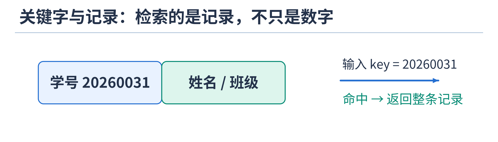

*图：关键字决定记录的定位，查找成功可返回位置或完整记录*

课件中的静态表 ADT 包括 `Create`、`Destroy`、`Search`、`Traverse`；动态表增加 `Init`、`Insert`、`Delete` 等。注意：**逻辑上的静态/动态是操作权限的区分，不等同于 C++ 中的 `static` 关键字。**

### 9.0.2 为什么查找方法取决于存储结构

同一批关键字，如果无序存放，通常逐项比较；如果按大小顺序排列，可利用折半；如果组织成搜索树，便可沿分支搜索；如果建立哈希映射，可先计算目标地址。不同查找结构交换的是**存储要求、修改成本、比较次数与空间开销**。

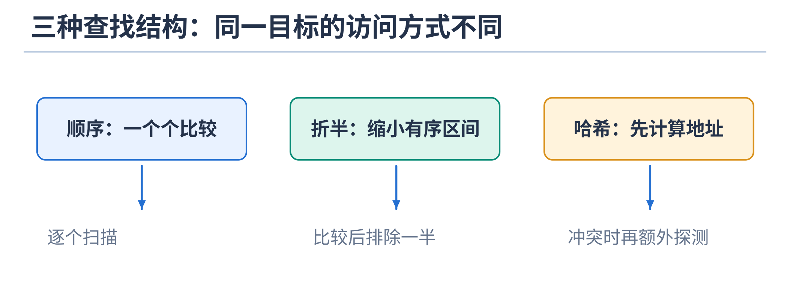

*图：静态查找与哈希查找的决策机制对比*

### 9.0.3 平均查找长度 ASL

**平均查找长度（Average Search Length, ASL）**是查找时与关键字进行比较的次数的期望值。设待查记录 $i$ 的概率为 $P_i$，查找所需比较次数为 $C_i$，则

$$
\operatorname{ASL}_{\mathrm{succ}}=\sum_{i=1}^{n}P_i C_i,
\qquad \sum_{i=1}^{n}P_i=1.
$$

在等概率查找时，$P_i=1/n$，因此

$$
\operatorname{ASL}_{\mathrm{succ}}=\frac{C_1+C_2+\cdots+C_n}{n}.
$$

> [!warning] 成功与失败必须分开计算
> 失败时通常按**查找失败的区间、失败的散列起始地址或其他失败情形**列举，并说明这些情形是否等概率。二分查找、哈希表不同算法对“比较次数”的计数口径也要统一。不能把成功 ASL 直接当作失败 ASL。

---

## 9.1 静态查找表

### 9.1.1 顺序查找（Sequential Search）

基本思想：从数组的一端开始，依次把目标 `key` 与当前位置的关键字比较，直到命中或扫描结束。**不要求关键字有序**；顺序存储与链式存储都可以采用这种策略。

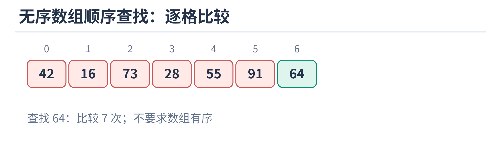

*图：顺序查找按元素逐个比较，无序数组也能使用*

如果从后向前查找，末尾元素命中时仅比较一次；越靠近数组开头比较次数越多。

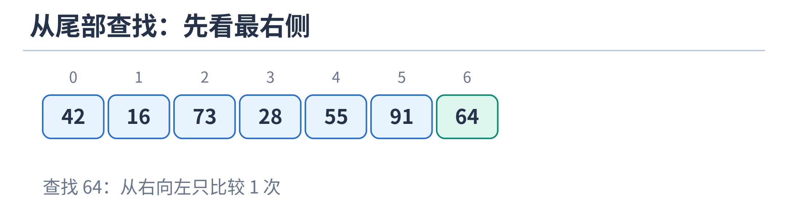

*图：顺序查找方向不同，单个元素的比较次数会改变*

#### 顺序查找的 C++ 实现

下面使用下标从 0 开始的 `std::vector<int>`。未找到返回 `-1`，而不是与合法下标冲突的 `0`。

```cpp
#include <vector>                                 // 使用顺序容器

int sequentialSearch(const std::vector<int>& a, int key) { // 逐个比较关键字
    for (int i = 0; i < static_cast<int>(a.size()); ++i) { // 从左到右扫描
        if (a[i] == key) return i;                // 命中则返回下标
    }
    return -1;                                   // 扫描结束仍未找到
}
```

查找时维护下标界限，故失败时进行了 $n$ 次关键字比较。若采用课件中的**哨兵写法**，先把目标关键字放入额外预留的 0 号位置，再从末端向前扫描，即使目标不存在也一定能在 0 号位置停止：

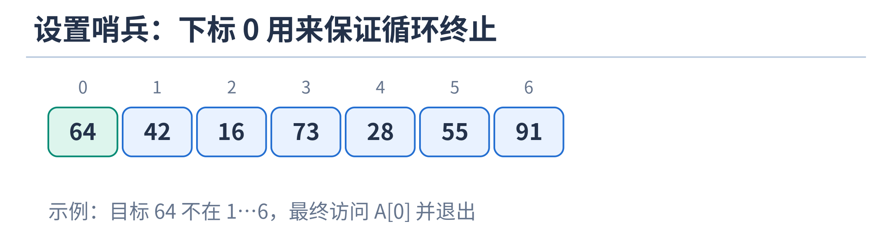

*图：0 号单元放置待查关键字，消除循环内的边界判断*

```cpp
#include <vector>                               // 使用整型数组

int sentinelSearch(std::vector<int>& a, int n, int key) { // 有效记录位于 a[1] 到 a[n]
    a[0] = key;                                 // 0 号位置充当哨兵
    int i = n;                                  // 从最后一个有效记录开始
    while (a[i] != key) --i;                   // 必然在 a[0] 或某有效位置终止
    return i;                                   // 0 表示失败，1..n 表示成功
}
```

使用前必须满足：`a` 至少有 `n+1` 个元素，且有效记录只放在 `a[1]` 至 `a[n]`。此实现会**改写 `a[0]`**，不适合对共享的只读表直接调用。

> [!note] “哨兵提高速度”的正确理解
> 哨兵减少循环中对边界条件的重复判断，但不会把顺序查找的时间复杂度由 $O(n)$ 变为 $O(1)$；具体加速比例取决于实现、编译器与机器环境，不能把课件给出的某个速度收益当作普遍定律。

#### 顺序查找的 ASL

课件从后往前访问 $A[n],A[n-1],\ldots,A[1]$，找到 $A[i]$ 需要 $n-i+1$ 次比较。在成功且等概率时：

$$
\begin{aligned}
\operatorname{ASL}_{\mathrm{succ}}
&=\frac{1}{n}\sum_{i=1}^{n}(n-i+1)\\
&=\frac{1+2+\cdots+n}{n}\\
&=\boxed{\frac{n+1}{2}}.
\end{aligned}
$$

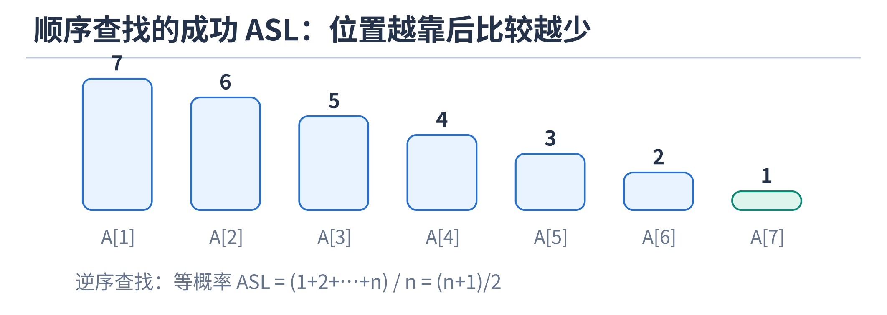

*图：逐位置展示逆序顺序查找的比较次数*

- **成功**：$\operatorname{ASL}=(n+1)/2$（等概率）。
- **失败**：无哨兵、仅统计有效记录的关键字比较时为 $n$；课件的哨兵版本会比较到 `A[0]`，按关键字比较次数计为 $n+1$。两者必须注明所用实现。
- **时间复杂度**：平均和最坏均为 $O(n)$；额外辅助空间 $O(1)$。

### 9.1.2 折半查找（二分查找，Binary Search）

**前提**：记录必须按关键字有序，而且能够通过下标高效访问中间位置；课程主要讨论**顺序存储的有序表**。普通单链表不适合直接套用课件的数组版本。

在闭区间 `[low, high]` 内，取

$$
mid=low+\left\lfloor\frac{high-low}{2}\right\rfloor.
$$

与 `a[mid]` 比较：等于则命中；目标更小则令 `high=mid-1`；目标更大则令 `low=mid+1`。当 `low>high` 时查找失败。

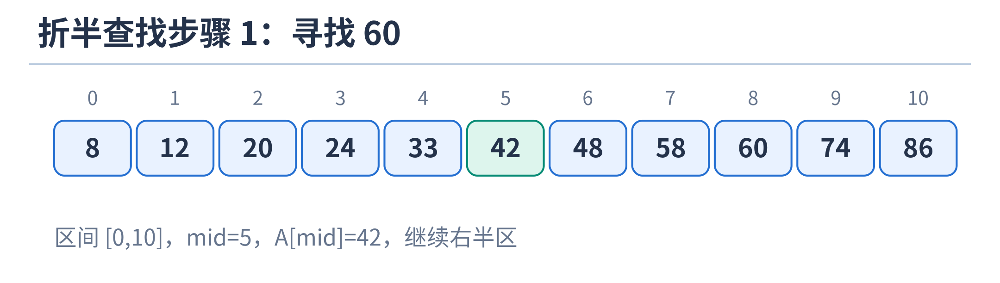

*图：查找区间动态缩小的第 1 步*

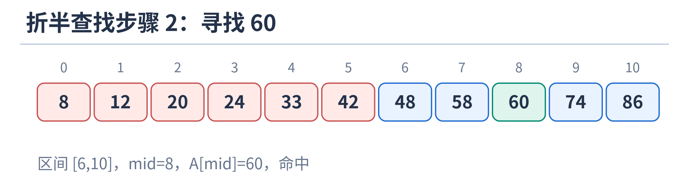

*图：查找区间动态缩小的第 2 步*

例如有序数组 `[8,12,20,24,33,42,48,58,60,74,86]`，查找 `60`：首先比较下标 5 的 `42`，然后在右半段比较下标 8 的 `60`，共比较两次。

#### 二分查找的 C++ 实现

```cpp
#include <vector>                                  // 顺序存储的有序数组

int binarySearch(const std::vector<int>& a, int key) { // 返回 key 的下标
    int low = 0;                                  // 左边界
    int high = static_cast<int>(a.size()) - 1;   // 右边界
    while (low <= high) {                        // 仍有待查区间
        int mid = low + (high - low) / 2;        // 防止 low + high 整数溢出
        if (a[mid] == key) return mid;          // 命中
        if (key < a[mid]) high = mid - 1;       // 只保留左半区间
        else low = mid + 1;                     // 只保留右半区间
    }
    return -1;                                   // 区间已空
}
```

> [!warning] 三个典型错误
> 1. 在**无序数组**上使用二分查找。
> 2. 对 `[low, high]` 闭区间更新时写成 `low=mid` 或 `high=mid`，使区间无法严格缩小。
> 3. 将“二分查找比较三路结果”误解为每一步一定执行三次关键字比较；分析 ASL 应明确算法口径，常以访问一个判定结点作为一次比较。

#### 二分查找判定树和 ASL

二分过程中每次所选的中间记录可当作**判定树的内部结点**；未找到时落入的空区间可以记为**失败结点**。查找成功时，比较次数等于目标所在内部结点的层数（根为第 1 层）。

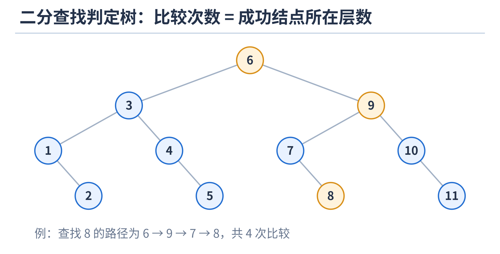

*图：11 个记录对应的二分判定树及目标 8 的访问路径*

图示 11 个关键字的判定树按层共有 $1,2,4,4$ 个结点，所以

$$
\operatorname{ASL}_{\mathrm{succ}}
=\frac{1\times1+2\times2+3\times4+4\times4}{11}
=\boxed{3}.
$$

失败时必须沿目标可能落入的区间逐步比较，直到区间为空。例如查找 `53`：

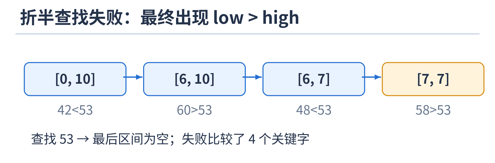

*图：二分查找失败时的区间演化过程*

相应比较次序为 `42 → 60 → 48 → 58`，比较 4 个实际关键字后失败。

满判定树特殊情形：若 $n=2^h-1$，各层从 1 到 $h$ 恰好完整，则

$$
\operatorname{ASL}_{\mathrm{succ}}
=\frac{\sum_{j=1}^{h}j2^{j-1}}{2^h-1}
=\frac{(h-1)2^h+1}{2^h-1}.
$$

**比较次数上界**：对于非空有序表，成功时至多 $\lfloor\log_2 n\rfloor+1$ 次关键字比较；失败时实际记录比较次数也不超过相同数量级。二分查找时间复杂度为 $O(\log n)$，迭代版本辅助空间 $O(1)$。

### 9.1.3 索引顺序查找（分块查找）

基本结构：把记录划分为若干块，使前一块所有关键字小于后一块所有关键字；==块内可以无序==。为每块建立索引，通常存储**本块最大关键字**与**起始位置**。

课件的 16 个关键字分成四块如下：

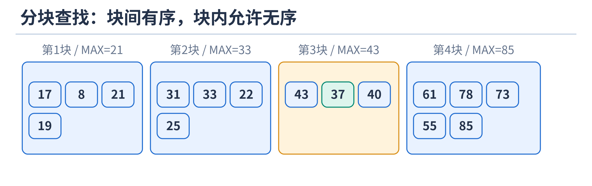

*图：课件示例分块数据：各块最大关键字依次为 21、33、43、85*

索引最大关键字依次为 $21,33,43,85$；要查 `37`，先确定可能属于最大关键字为 `43` 的块，再对该块的 `[43,37,40]` 进行顺序比较。

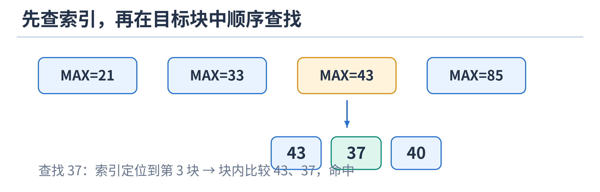

*图：按块最大关键字定位，再在目标块内顺序查找*

> [!important] 分块查找的两个阶段
> **先查索引 → 再查块内记录。** 这不是直接在原始无序数组上做二分查找；折半只能用于**有序的索引表**，而块内通常仍要顺序查找。

#### 索引顺序查找 ASL

设 $n$ 条记录等分成 $b$ 块、每块 $s$ 条，假设 $n=bs$，全部记录等概率，索引按顺序查找，块内也按顺序查找，则

$$
\begin{aligned}
\operatorname{ASL}
&=\operatorname{ASL}_{\mathrm{index}}+\operatorname{ASL}_{\mathrm{block}}\\
&=\frac{b+1}{2}+\frac{s+1}{2}\\
&=\boxed{\frac{n/s+s}{2}+1}.
\end{aligned}
$$

连续近似下，由 $s+n/s\ge 2\sqrt n$ 知：当 $s\approx\sqrt n$，$b\approx\sqrt n$ 时上述模型的 ASL 最小，约为 $\sqrt n+1$。实际块大小取整数，且不均匀分块、块访问概率不均等或索引采用二分查找时，公式都要重新调整。

---

## 9.2 动态查找表

动态表允许 `Search`、`Insert`、`Delete`，目标是：**修改后依然保持有利于后续查找的结构不变量**。课程重点为二叉排序树、平衡二叉树（AVL）和 B-树。

### 9.2.1 二叉排序树（BST）

#### 定义与性质

二叉排序树（Binary Search Tree，也称二叉查找树）是空树，或者满足：

1. 左子树所有键值**小于**根键值；
2. 右子树所有键值**大于**根键值；
3. 左右子树也各自是 BST。

课件采用严格的小于/大于关系，默认关键字不重复；若实际系统允许相同键值，必须事先规定如何处理重复。

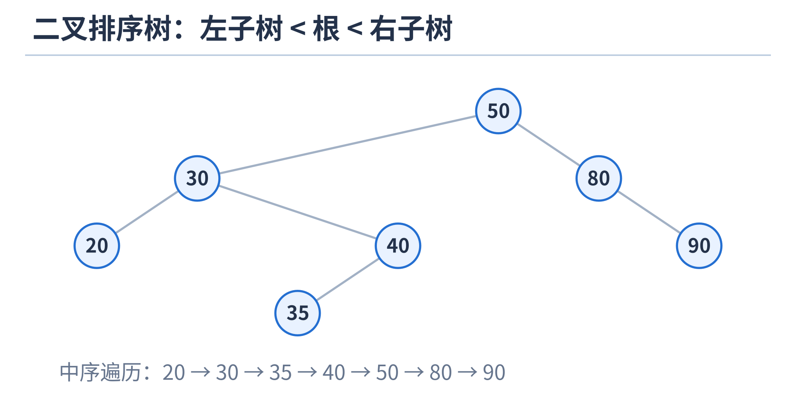

*图：二叉排序树的全局有序约束与中序遍历结果*

**中序遍历 BST，得到递增的关键字序列**（在关键字互异的前提下）。注意 BST 约束是针对**整个左/右子树**，不是只检查直接孩子：

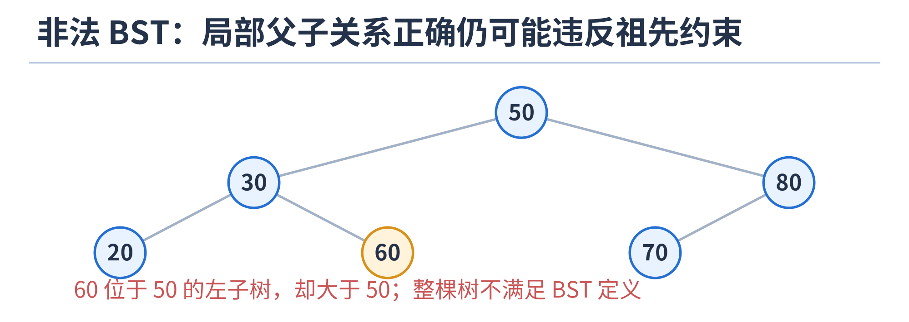

*图：局部 60 > 30 合法，但 60 处于根 50 的左子树因而不合法*

#### BST 的基本结点与查找代码

以下各例共用同一个结点结构，使用实际的 `int` 关键字，不使用 `typedef` 或不必要的抽象类型。

```cpp
struct Node {                                     // BST 结点
    int key;                                     // 关键字
    Node* left = nullptr;                       // 左孩子
    Node* right = nullptr;                      // 右孩子
};

Node* searchBST(Node* root, int key) {           // 沿一条分支查找
    Node* p = root;                              // 从根开始
    while (p != nullptr) {                      // 到达空指针即失败
        if (key == p->key) return p;             // 查找成功
        if (key < p->key) p = p->left;           // 去左子树
        else p = p->right;                       // 去右子树
    }
    return nullptr;                              // 查找失败
}
```

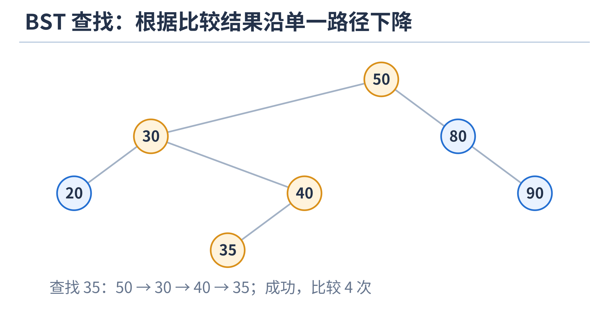

*图：查找 35 仅沿路径 50、30、40、35 前进*

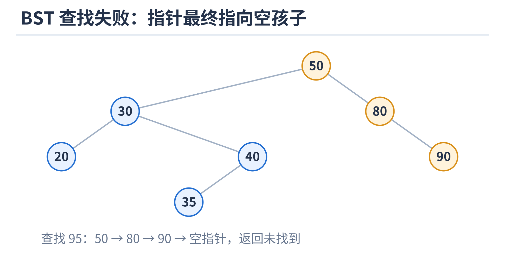

*图：BST 查找失败时走到空指针*

**查找操作只沿从根向下的一条路径前进**，所以比较次数与被访问结点的深度有关，而非必然等于关键字总数。

#### BST 的构造与插入

插入时先沿 BST 的比较路径查找；若关键字不存在，则在该路径的末端增加**一个叶子结点**。插入不要求挪动原有结点。

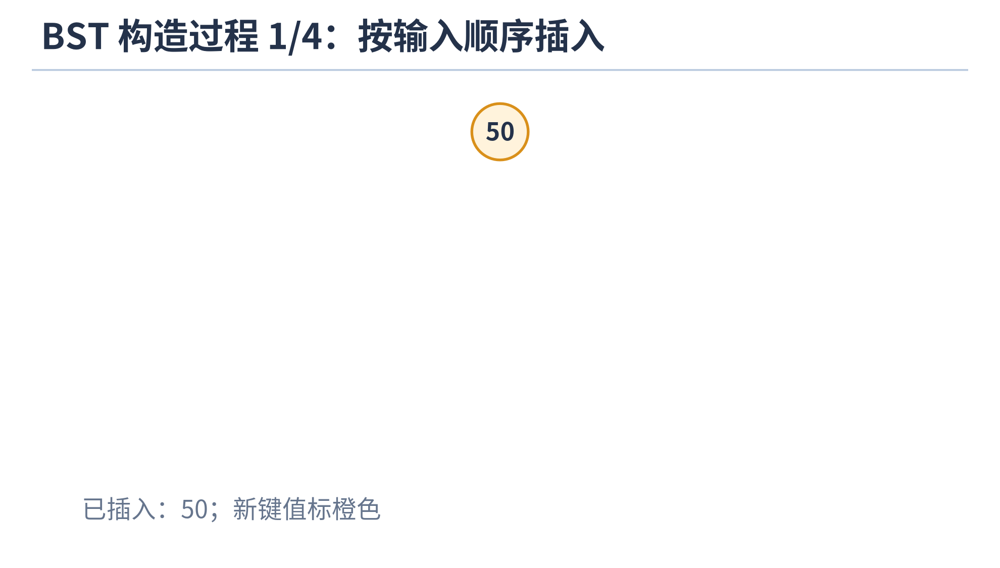

*图：构造 BST 的阶段 1：新结点沿查找失败路径成为叶子*

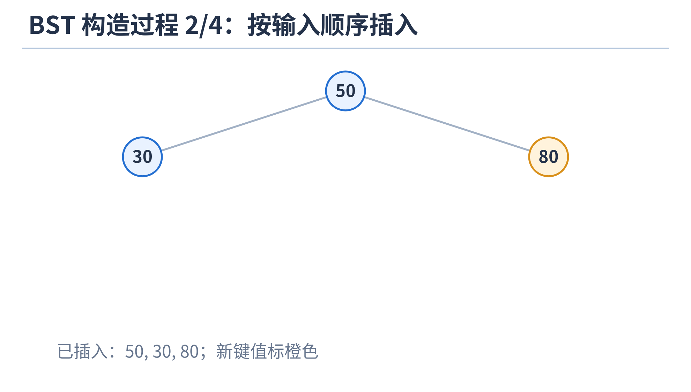

*图：构造 BST 的阶段 2：新结点沿查找失败路径成为叶子*

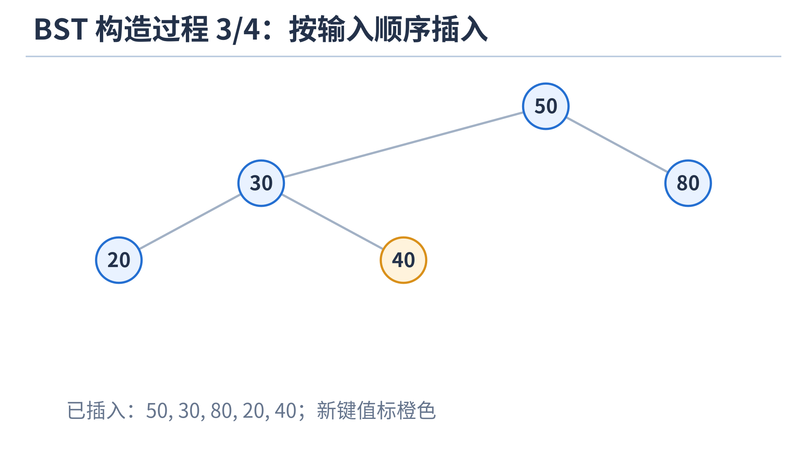

*图：构造 BST 的阶段 3：新结点沿查找失败路径成为叶子*

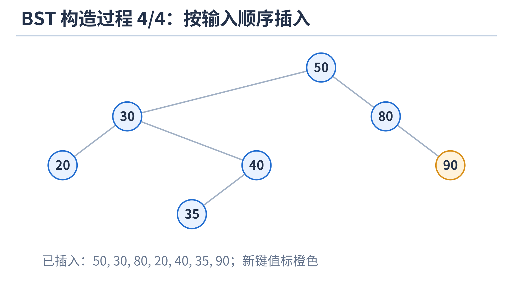

*图：构造 BST 的阶段 4：新结点沿查找失败路径成为叶子*

下面继续插入 `45`，它会挂在结点 `40` 的右侧：

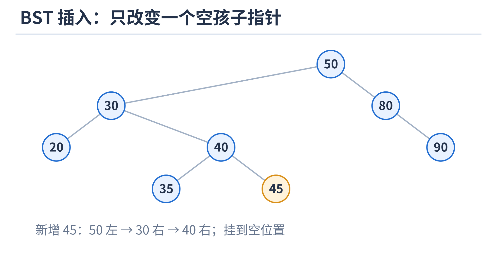

*图：插入新值 45 不移动既有结点，只在叶子位置链接新结点*

```cpp
Node* insertBST(Node* root, int key) {           // 递归插入并返回子树根
    if (root == nullptr) {                      // 找到空孩子位置
        return new Node{key, nullptr, nullptr}; // 创建新的叶子结点
    }
    if (key < root->key) {                      // 插入左子树
        root->left = insertBST(root->left, key); // 接回修改后的子树
    } else if (key > root->key) {               // 插入右子树
        root->right = insertBST(root->right, key);
    }
    return root;                                // 相等时不重复插入
}
```

根指针要通过 `root=insertBST(root,key)` 接收返回值，尤其当原树为空时不能丢掉新建的根结点。此示例采用 `new`，最终必须正确清理树的动态内存。

#### BST 删除的三种情况

删除必须在目标存在时进行，并保持整个 BST 的有序性质。

**情况一：删除叶子结点。** 直接把父结点对应孩子指针置空。

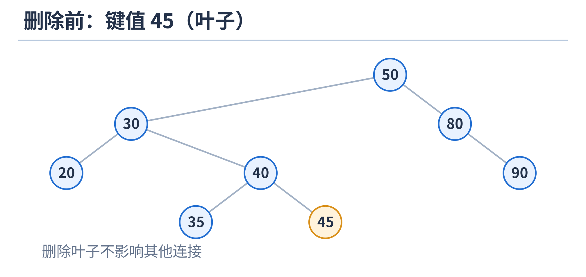

*图：BST 删除 45 的before状态*

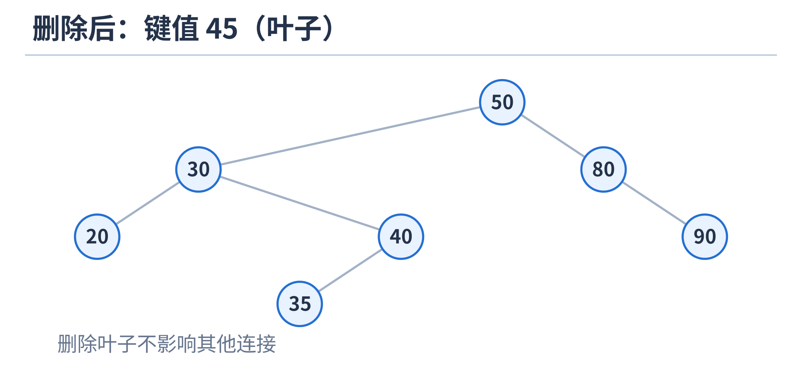

*图：BST 删除 45 的after状态*

**情况二：目标只有一棵非空子树。** 由这棵子树直接接替被删除结点的位置。示例删除 `80` 时，其右子树结点 `90` 上移。

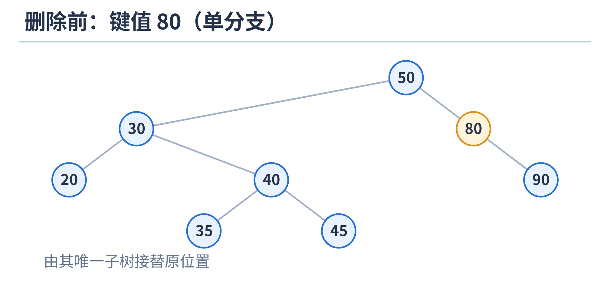

*图：BST 删除 80 的before状态*

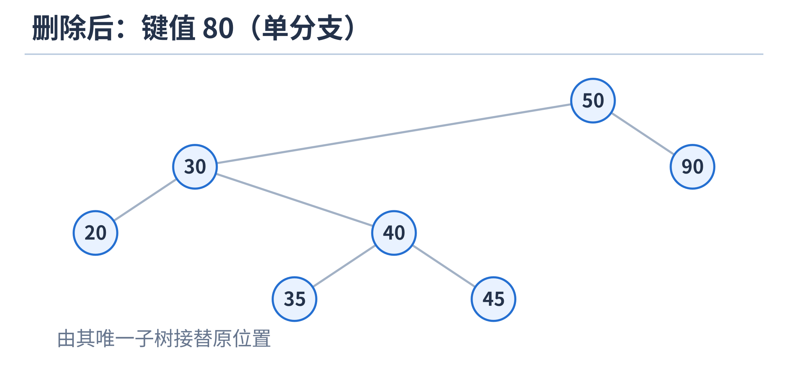

*图：BST 删除 80 的after状态*

**情况三：目标左右子树均非空。** 常用两种对称处理方式：

- 取**中序前驱**：目标左子树中的最大关键字；
- 取**中序后继**：目标右子树中的最小关键字。

以课件的前驱思路为例，若删除根 `50`，可使用左子树的最大值 `45` 替代，随后删除旧位置的 `45`；整个过程仍需正确重连旧前驱的左孩子（如果存在）。

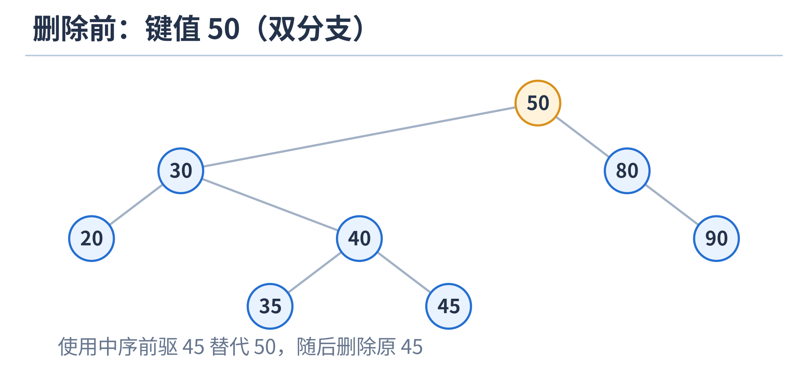

*图：BST 删除 50 的before状态*

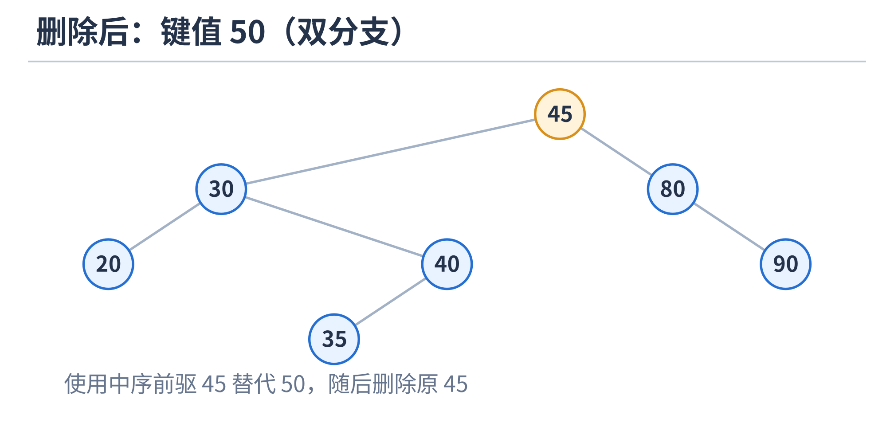

*图：BST 删除 50 的after状态*

#### BST 删除的 C++ 代码

以下代码完整覆盖上述三种情况，采用**中序后继**版本（与课件示例使用前驱对称，都是正确策略）。

```cpp
Node* deleteBST(Node* root, int key) {           // 删除后返回新的子树根
    if (root == nullptr) return nullptr;         // 没找到关键字
    if (key < root->key) {                       // 去左侧继续删除
        root->left = deleteBST(root->left, key);
    } else if (key > root->key) {                // 去右侧继续删除
        root->right = deleteBST(root->right, key);
    } else {                                    // 找到目标结点
        if (root->left == nullptr) {             // 没有左孩子
            Node* next = root->right;            // 右子树接替
            delete root;                         // 释放原结点
            return next;
        }
        if (root->right == nullptr) {            // 没有右孩子
            Node* next = root->left;             // 左子树接替
            delete root;
            return next;
        }
        Node* p = root->right;                    // 寻找中序后继
        while (p->left != nullptr) p = p->left;   // 右子树最小值
        root->key = p->key;                      // 用后继关键字覆盖
        root->right = deleteBST(root->right, p->key); // 删除旧后继
    }
    return root;                                 // 连接仍然有效
}
```

> [!warning] 删除函数的指针更新
> 只写 `delete root` 而不重新连接父子指针会造成悬空指针；根结点也可能被删除，因此调用端应使用 `root=deleteBST(root,key)` 保存新的根。

#### BST 的查找性能

一棵 BST 的 ASL 由形态决定：设结点 $i$ 的层数为 $d_i$，在等概率成功查找下

$$
\operatorname{ASL}_{\mathrm{succ}}=\frac{1}{n}\sum_{i=1}^{n}d_i.
$$

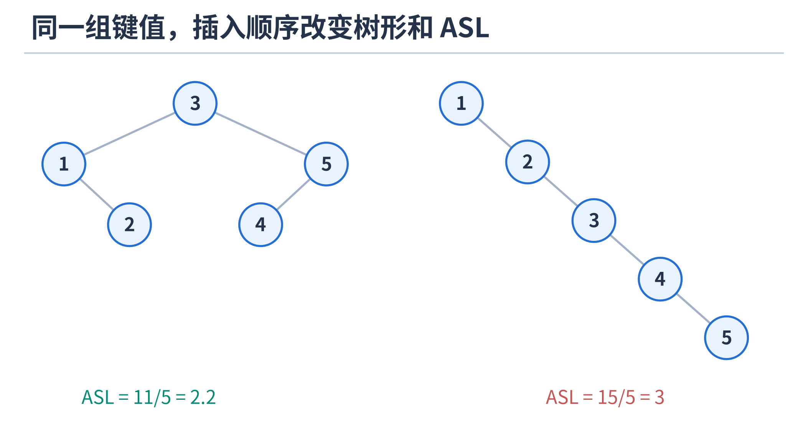

*图：不同插入顺序会形成平衡程度迥异的 BST，查找长度不同*

对于相同关键字 `{1,2,3,4,5}`：插入 `3,1,2,5,4` 得到 $\operatorname{ASL}=11/5=2.2$；插入严格递增序列 `1,2,3,4,5` 则退化为链，$\operatorname{ASL}=15/5=3$。

- 较平衡的 BST：高度及查找成本一般在 $O(\log n)$ 量级。
- 极端退化 BST：高度达到 $n$，查找、插入、删除最坏均为 $O(n)$。
- **注意：一般 BST 不自动保证高度为 $O(\log n)$。** 这正是引入 AVL 的动机。

### 9.2.2 平衡二叉树（AVL 树）

#### 平衡条件与平衡因子

AVL 是一种满足 BST 有序约束的自平衡二叉树：任一结点的左右子树高度之差绝对值不超过 1。

$$
\operatorname{BF}(v)=h(v.\mathrm{left})-h(v.\mathrm{right}),
\qquad |\operatorname{BF}(v)|\le 1.
$$

按空树高度 0、单结点高度 1 计，合法平衡因子为 `−1、0、1`。

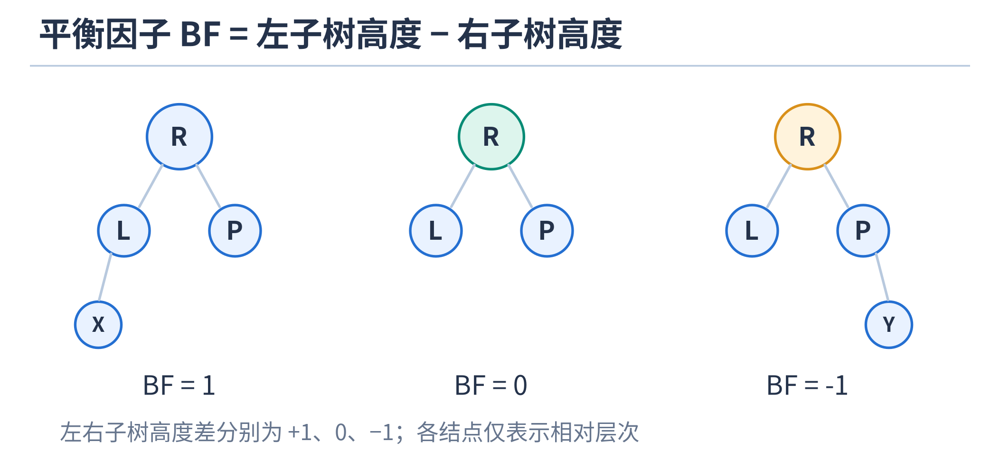

*图：AVL 的平衡因子只允许 −1、0、1，空树高度取零*

插入可能使某个祖先的 BF 变为 `+2` 或 `−2`。从新结点向根回溯，通常首先修复**离插入位置最近的失衡祖先**（最小失衡子树）。旋转既需恢复高度平衡，也必须保持 BST 的中序顺序不变。

#### 四种失衡与旋转

| 类型 | 新结点位于失衡根的哪条路径 | 纠正操作 |
|---|---|---|
| LL | 左子树的左子树 | 对失衡根**右旋** |
| RR | 右子树的右子树 | 对失衡根**左旋** |
| LR | 左子树的右子树 | **左旋左孩子，再右旋失衡根** |
| RL | 右子树的左子树 | **右旋右孩子，再左旋失衡根** |

**LL：左左型 → 单次右旋**

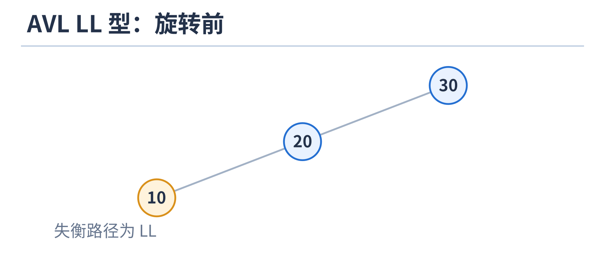

*图：AVL LL 型before：右旋*

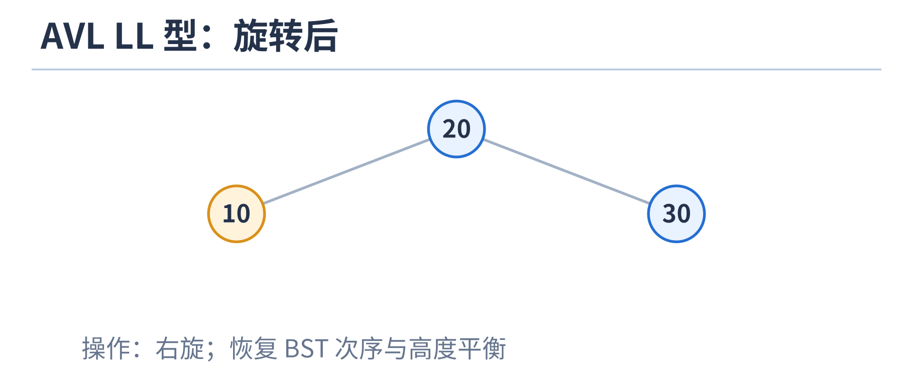

*图：AVL LL 型after：右旋*

**RR：右右型 → 单次左旋**

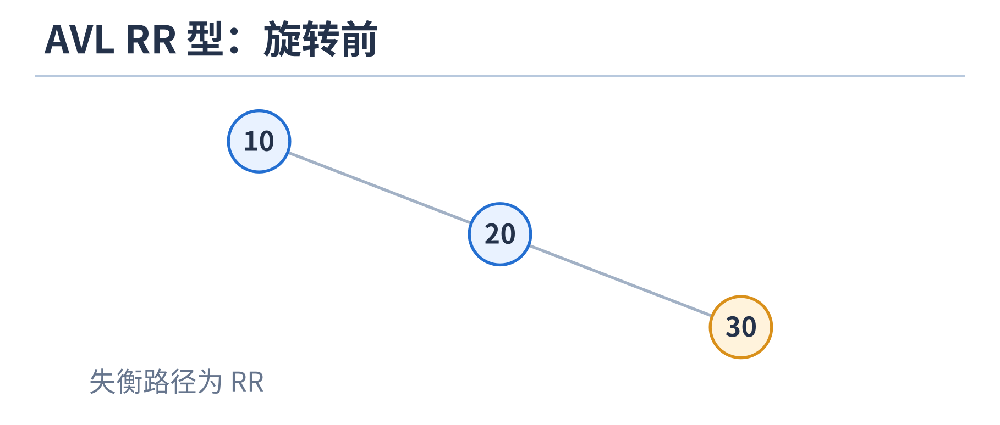

*图：AVL RR 型before：左旋*

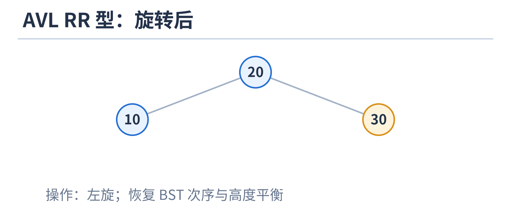

*图：AVL RR 型after：左旋*

**LR：左右型 → 双旋**。先对根 `30` 的左孩子 `10` 左旋，形成中间状态，再对 `30` 右旋。

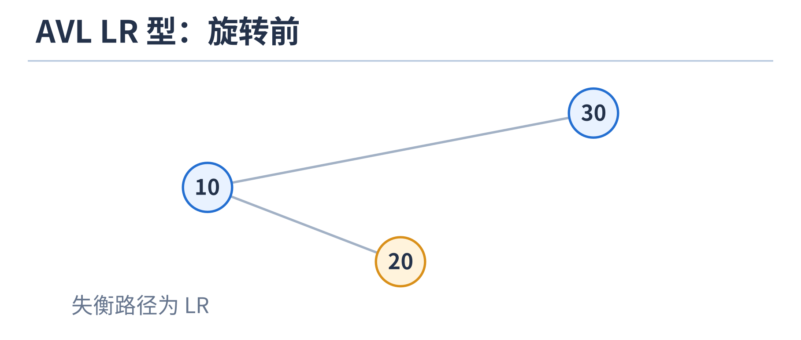

*图：AVL LR 型before：先左旋，再右旋*

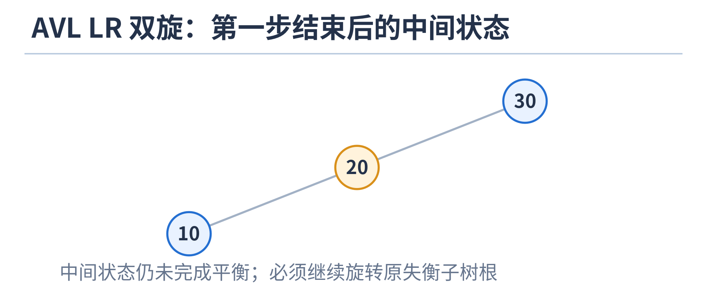

*图：AVL LR 型的第一步旋转中间状态*

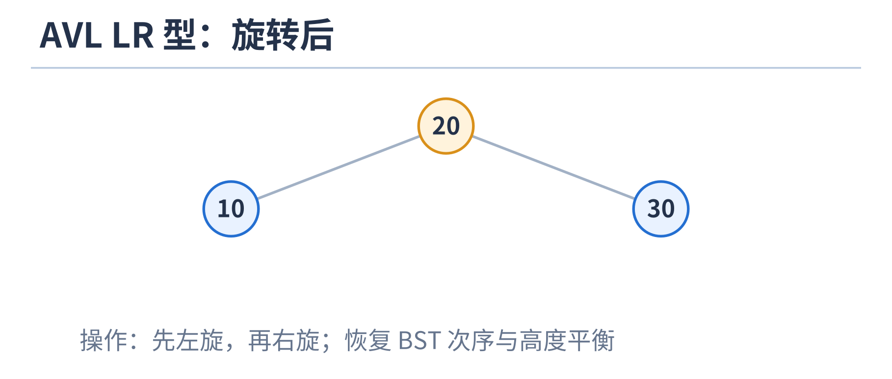

*图：AVL LR 型after：先左旋，再右旋*

**RL：右左型 → 双旋**。先对根 `10` 的右孩子 `30` 右旋，形成中间状态，再对 `10` 左旋。

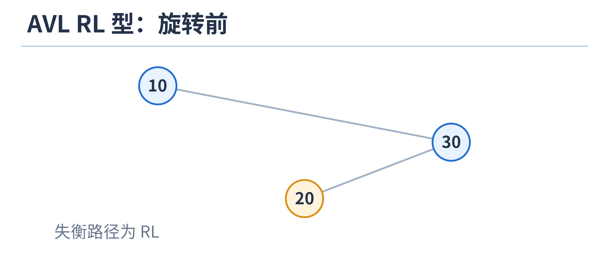

*图：AVL RL 型before：先右旋，再左旋*

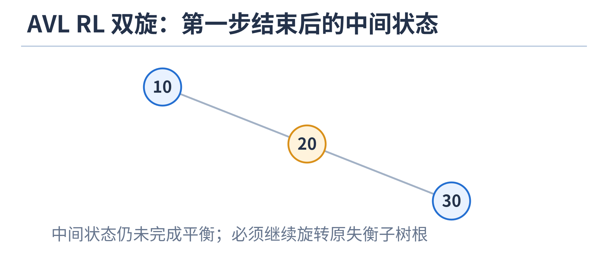

*图：AVL RL 型的第一步旋转中间状态*


*图：AVL RL 型after：先右旋，再左旋*

> [!tip] 识别旋转方法
> 先找**最近的失衡祖先**，再沿它到新插入结点的方向走两步，得到 `LL/RR/LR/RL`。两个方向相同做单旋，方向不同做双旋。**旋转名称不是新结点数值的大小关系，而是两条分支的方向组合。**

#### 旋转代码（C++）

AVL 旋转需要重新连接孩子指针并刷新受影响结点的高度。下面给出直接可用的两种基本旋转，它们可以组成 LR、RL 双旋。

```cpp
#include <algorithm>                               // std::max

struct AVLNode {                                    // AVL 结点
    int key;                                        // 关键字
    int height = 1;                                // 结点高度
    AVLNode* left = nullptr;                       // 左孩子
    AVLNode* right = nullptr;                      // 右孩子
};

int height(AVLNode* p) {                           // 获取结点高度
    return p == nullptr ? 0 : p->height;           // 空树高度为 0
}

void refresh(AVLNode* p) {                         // 更新当前结点高度
    p->height = std::max(height(p->left), height(p->right)) + 1;
}

AVLNode* rotateRight(AVLNode* a) {                 // 对 a 做右旋
    AVLNode* b = a->left;                          // b 成为新根
    a->left = b->right;                            // b 的右子树转为 a 的左子树
    b->right = a;                                  // 原根 a 成为 b 的右孩子
    refresh(a);                                    // 先更新较低结点
    refresh(b);                                    // 再更新新根
    return b;                                      // 返回旋转后的根
}

AVLNode* rotateLeft(AVLNode* a) {                  // 对 a 做左旋
    AVLNode* b = a->right;                         // b 成为新根
    a->right = b->left;                            // b 的左子树转为 a 的右子树
    b->left = a;                                   // 原根 a 成为 b 的左孩子
    refresh(a);                                    // 先更新较低结点
    refresh(b);                                    // 再更新新根
    return b;
}
```

调用旋转的前提是相关孩子非空，且必须将返回的新子树根**接回父结点或整棵树的根**。LR 型可用 `a->left=rotateLeft(a->left); a=rotateRight(a);`；RL 型对称。

#### 课件插入序列与高度分析

课件举例依次插入 `5,4,2,8,6,9`，需要经历单旋与双旋调整，最后得到的 AVL 结构如下：

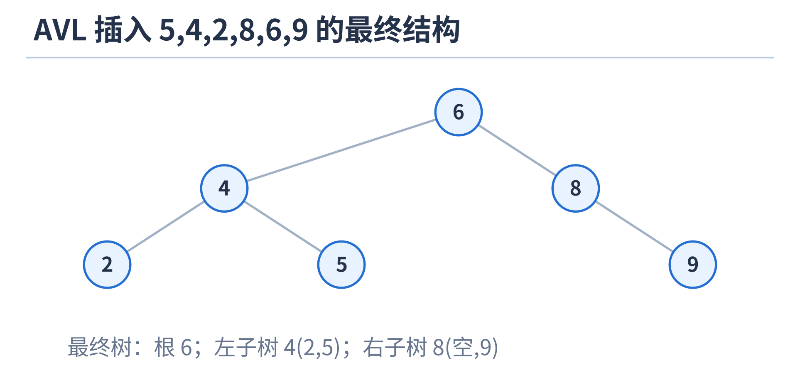

*图：按照课件序列插入并重平衡后的 AVL 树*

AVL 的高度上界源于最少结点数递推。令 $N_h$ 表示**高度恰好为 $h$ 的 AVL 树至少需要多少结点**。为了在高度为 $h$ 的同时尽量减少结点，两个子树高度应为 $h-1$ 和 $h-2$：

$$
N_0=0,\quad N_1=1,\quad
N_h=N_{h-1}+N_{h-2}+1\quad(h\ge2).
$$

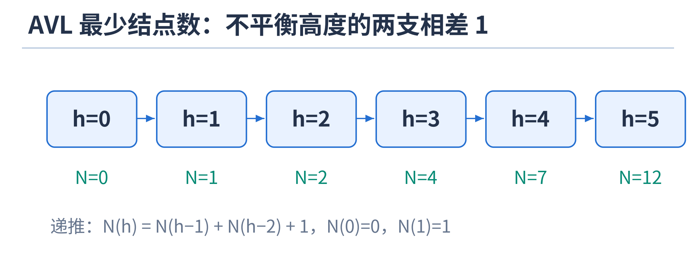

*图：AVL 最少结点数递推与对数高度上界的来源*

与斐波那契数列 $F_0=0,F_1=1$ 对应：

$$
N_h=F_{h+2}-1.
$$

由于 $F_h$ 按指数速度增长，反过来可知 AVL 高度 $h=O(\log n)$。因此 AVL 查找、插入和删除的**最坏时间复杂度**均为 $O(\log n)$（包含必要平衡维护）。

> [!warning] BST 与 AVL 的本质差异
> AVL **首先是 BST**，拥有同样的关键字有序性与查找路径；额外的高度约束通过旋转来保持最坏查找性能。不能把“任意二叉树左右高度接近”直接等同于 AVL，若它不满足 BST 有序条件，仍不是 AVL 搜索树。

### 9.2.3 B-树（B-tree，多路平衡查找树）

#### 为什么引入 B-树

BST/AVL 一次结点访问对应一个关键字，而磁盘/页式存储按**块**访问通常更划算。B-树在一个结点中保存多个关键字与多个子树指针，使树的分支度变大、层数降低，因而减少外存访问次数。

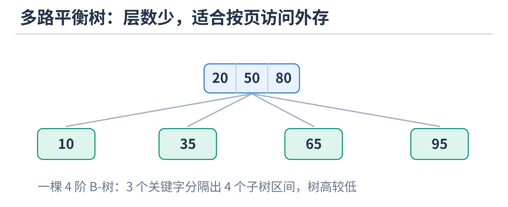

*图：B-树的高分支度减少查找路径长度*

#### $m$ 阶 B-树的定义与范围

依课件采用“**$m$ 阶 = 每个结点最多有 $m$ 棵子树**”的约定，树可以为空，否则：

1. 每个结点最多有 $m-1$ 个关键字、最多 $m$ 个孩子指针。
2. 非叶根结点至少有 1 个关键字、2 棵非空子树。
3. 非根的内部结点至少有 $\lceil m/2\rceil-1$ 个关键字、至少有 $\lceil m/2\rceil$ 棵子树。
4. 一个内部结点含 $k$ 个关键字时，关键字递增排列，分隔出 $k+1$ 个孩子范围。
5. **所有叶结点处于同一层次**，从而保持整树平衡。

为了与课件第 103～108 页相符，可以把不存关键字的外部空指针视为“查找失败叶结点”；在现代程序实现中，**带关键字的最底层结点通常就称为叶结点**。这两种用语的计层方式不同，但表示的查找结构一致。

例如 4 阶 B-树：非根内部结点至少 1 个关键字，至多 3 个；相应孩子数至少 2、至多 4。

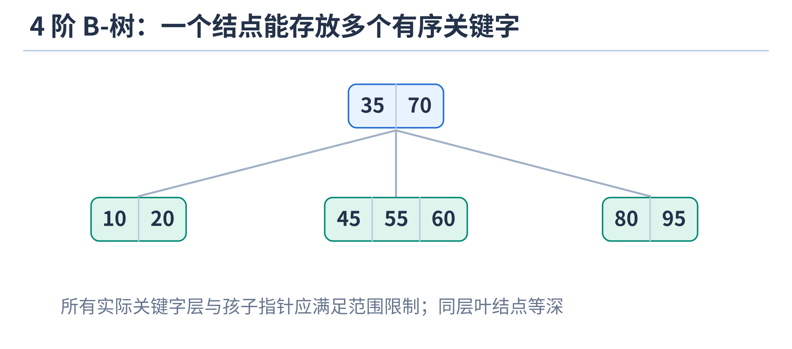

*图：4 阶 B-树的多关键字结点、3 路子树与相同叶深*

设结点内关键字满足

$$
K_1<K_2<\cdots<K_k,
$$

则孩子 `A0`、`A1`、…、`Ak` 对应的范围依次为：小于 $K_1$、介于相邻关键字之间、大于 $K_k$。

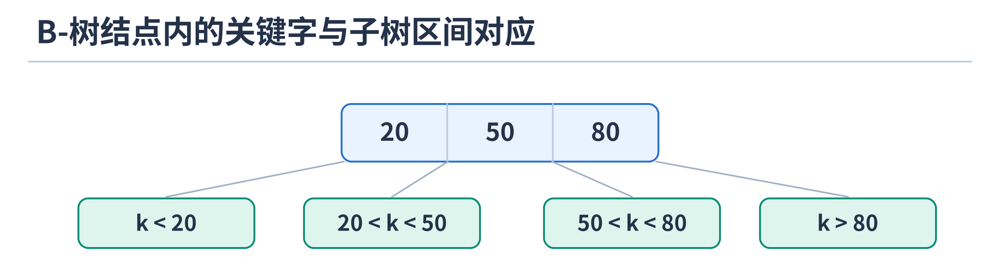

*图：多关键字结点的 n 个关键字将查询范围分成 n+1 个子区间*

#### B-树查找

每次进入结点：先在结点的有序关键字中顺序或折半定位；若找到则成功；否则按照目标所在范围沿对应孩子指针下降。若走到空孩子，则失败，并可返回适合插入的位置。


*图：B-树查找关键字 55 的跨结点路径*

例如图中查找 `55`，在 `[35,70]` 之间确定中间孩子，再从 `[45,55,60]` 中命中。

下面给出简化但真实有效的 C++ **查找核心**；它假定结点已构成合法 B-树，具体插入/分裂维护是另一个独立知识点。

```cpp
#include <vector>                                   // 动态键值序列
#include <algorithm>                                // std::lower_bound

struct BNode {                                       // 一个 B-树结点
    std::vector<int> keys;                          // 关键字从小到大排列
    std::vector<BNode*> child;                      // 内部结点含 keys.size()+1 个孩子
};

const BNode* searchBTree(const BNode* root, int key) { // 查找关键字所在结点
    const BNode* p = root;                           // 从根开始
    while (p != nullptr) {                          // 沿一条结点路径下降
        auto it = std::lower_bound(p->keys.begin(), p->keys.end(), key); // 结点内折半
        int i = static_cast<int>(it - p->keys.begin()); // 得到关键字/子树位置
        if (it != p->keys.end() && *it == key) return p; // 当前结点命中
        if (p->child.empty()) return nullptr;       // 底层结点没有子树
        p = p->child[i];                             // 沿对应区间下降
    }
    return nullptr;                                  // 不存在此关键字
}
```

#### B-树插入：定位 → 插入 → 必要时分裂

新关键字从根开始查找，未命中时一般插入在最底层的**实际存键结点**中。若插入后仍未超过最大关键字数，只要在本结点内保持有序即可。

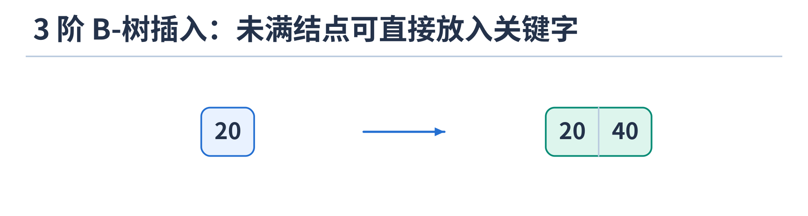

*图：3 阶 B-树单个结点从一个关键字增加至两个，未发生分裂*

当某个 $m$ 阶结点因插入暂时出现 $m$ 个关键字，就需要**分裂**：把中间关键字提升到父结点，左右两组较小/较大的关键字分别留在两个结点中。设分裂前键值排序为 $K_1,\ldots,K_m$，可按 $s=\lceil m/2\rceil$ 选择上升的 $K_s$（具体实现需妥善分配孩子指针）。

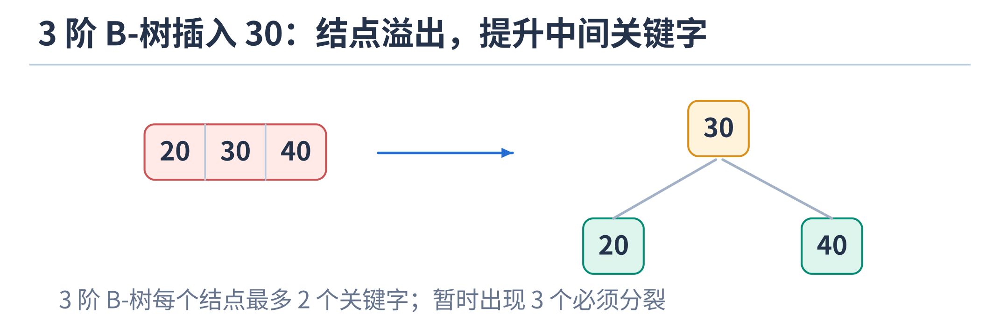

*图：结点溢出时中间键 30 上升，新建左右两个结点*

如果父结点接收上升关键字后也溢出，就继续向上分裂；如果**根结点也溢出**，提升后的关键字成为新根，树高加 1。

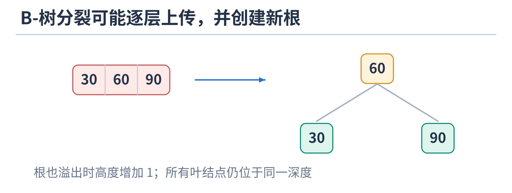

*图：B-树根结点溢出后的提升与树高增长*

> [!example] 3 阶 B-树分裂
> 一个结点原来有 `[20,40]`，插入 `30` 后暂得 `[20,30,40]`，超过每个结点最多 2 个关键字的限制。把 `30` 提到父结点（或新建根），左右保留 `[20]` 和 `[40]`。此时每个结点重新满足关键字数约束。

#### B-树删除：直接删除、借位、合并

删除首先定位目标。如果目标在内部结点，通常先用相邻子树中的前驱或后继替换，再转化为底层结点中的删除问题。删除后检查关键字数下界：

- **仍满足下界**：操作结束。
- **某个兄弟有富余**：通过父结点进行关键字旋转（借位），并同步调整可能存在的子树指针。
- **相邻兄弟均处于下界**：把目标结点、父结点分隔关键字和兄弟结点合并；必要时继续向上调整。

以 3 阶、根含一个键 `50`、孩子分别为 `[20]` 与 `[70,90]` 为例，删除 `20` 后可以从右兄弟借位：

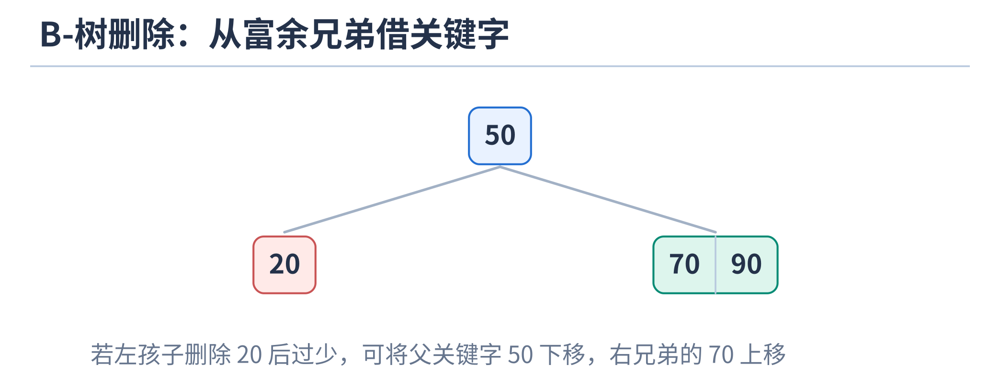

*图：B-树借位的初始条件：一个结点接近下界，兄弟有富余*

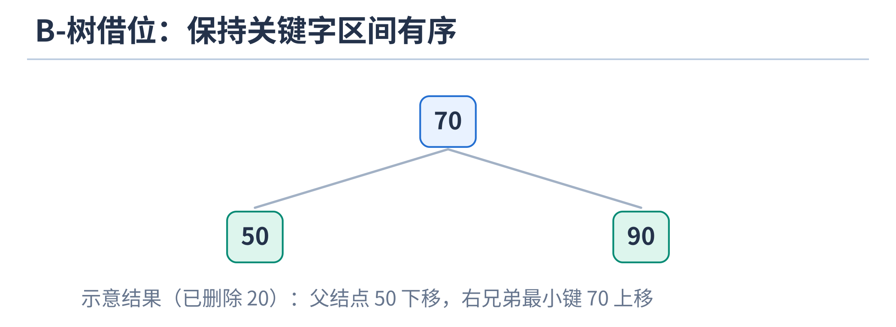

*图：借位后左右兄弟均满足 3 阶 B-树的关键字数下界*

当兄弟也只有允许的最少关键字时，无法借位，就进行合并：

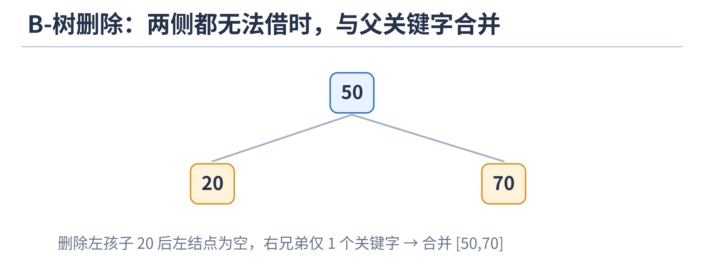

*图：B-树兄弟结点无法借位时的合并情形*

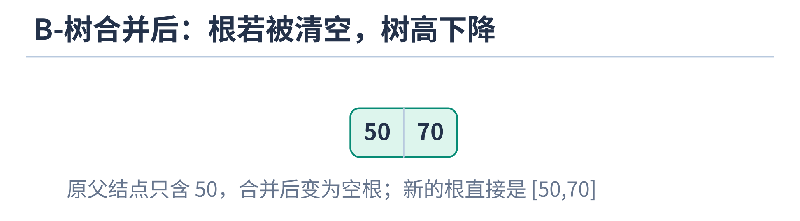

*图：3 阶 B-树合并并缩短树高的结果*

上图删除 `20` 后，左结点空、右结点 `[70]` 不能再借出关键字，于是把父关键字 `50` 与 `[70]` 合为 `[50,70]`，原根变空，合并结点成为新根；**树高减 1**。

#### B-树的高度与查找代价

令 $t=\lceil m/2\rceil$（非根内部结点的最小分支数）。如果 B-树有 $N$ 个关键字、实际存键层数为 $H$，由最稀疏合法 B-树的结点数可得：

$$
N\ge 2t^{H-1}-1,
\qquad H\le1+\log_t\frac{N+1}{2}.
$$

不同教材对空外部叶层是否计入“深度”采用不同约定，使用公式必须保持计层方式一致。**核心结论**：访问的结点数为 $O(\log_t N)$；结点内还需比较若干关键字，若一次结点访问对应一次磁盘页读取，树高便是主要 I/O 成本。

---

## 9.3 哈希表（Hash Table）

### 9.3.1 为什么哈希能够直接定位

前述方法均通过比较关键字逐渐缩小候选集合。**哈希表**（散列表）试图建立关键字与数组存储地址之间的函数关系：

$$
\operatorname{addr}=H(key).
$$

这样可以先按函数算出可能的存储位置，再检查该位置是否真的对应目标关键字。

> [!warning] “直接定位”不等于永远不用比较
> 课件第 127 页把 `ASL=0` 作为理想目标，强调不依次比较关键字的思想；但实际发生冲突时仍要比较或探测，**平均比较次数通常不是 0**，绝不应把哈希查找写成恒为零次比较。

#### 哈希冲突（Collision）

不同关键字可能得到同一个地址，即

$$
key_1\ne key_2,\qquad H(key_1)=H(key_2).
$$

例如取 $H(key)=key\bmod 11$，$19,30,41$ 都映射到地址 $8$，必须另行解决冲突。


*图：19、30、41 在对 11 取余时都映射到地址 8，引发冲突*

哈希函数设计的主要目标是在实际键值集合上尽可能**分布均匀**，但一般不能保证完全没有冲突。

### 9.3.2 哈希函数的构造方法

#### 1. 直接定址法

设 $H(key)=key$ 或 $H(key)=a\,key+b$。关键字取值范围小且已知时最直接，不会把**不同的原始键值**映射到同一地址（在映射未被截断且 $a\ne0$ 的前提下），但范围稀疏时浪费空间。


*图：直接定址法需要能够负担整个键值范围对应的存储空间*

#### 2. 数字分析法

先观察大批关键字每一数位出现的分布，抽取分布较均匀的若干位，或组合这些数位构成地址。适合长度相近、可分析其数位频度的键值。


*图：数字分析法选取分布较均匀的数字位作为散列依据*

#### 3. 平方取中法

先对数值关键字平方，再抽取平方结果中间若干位作为地址或地址的构造依据。此法希望让关键字各位变化影响选取的数字段。


*图：平方取中法对关键字平方后抽取中间若干位*

#### 4. 折叠法

长关键字按等长片段拆开、对齐后相加（移位叠加）；也可来回折叠相加（间界叠加），最后结合表长确定有效地址。


*图：移位叠加法先分段对齐，再相加得到散列依据*

#### 5. 除留余数法

$$
H(key)=key\bmod p,\qquad p\le m,
$$

其中 $m$ 为表长。常选择接近表长的合适素数作为 $p$，以减少键值规律与模数公共因子的影响；**素数是常见经验选择，并不是所有数据集上的绝对最优或唯一合法选择**。

课件例子 `12,39,18,24,33,21`：当 $p=9$ 时映射结果为 `3,3,0,6,6,3`，集中且冲突显著。


*图：p=9 时 6 个关键字的取余地址对比*

同一组键值若取 $p=11$，地址为 `1,6,7,2,0,10`，在这组样例中不产生冲突。


*图：p=11 时 6 个关键字的取余地址对比*

#### 6. 随机数法

使用以关键字为输入的确定性伪随机函数 $H(key)=\operatorname{Random}(key)$（最终还需约束地址范围）。**同一关键字应稳定地得到同一地址**，否则无法按相同规则查找。

> [!tip] 选择哈希函数时关注什么
> 键值范围、键值分布规律、表长、计算成本、冲突概率与稳定性。关键字如果是字符串，可先把字符序列转成整数特征或直接使用字符串哈希函数；不能把名字的首字母简单当作唯一标识。

### 9.3.3 冲突处理方法

#### 方法一：开放定址法（Open Addressing）

冲突后仍把记录放在同一个哈希数组内，通过一个**探测地址序列**寻找可用槽位：

$$
H_0=H(key),\qquad
H_i=(H(key)+d_i)\bmod m\quad(i\ge1).
$$

常见增量选择：

- **线性探测**：$d_i=i$（最典型），依次往后检查，容易产生**一次聚集**。
- **二次探测**：课程使用 $d_i=1^2,-1^2,2^2,-2^2,\ldots$，改变探测轨迹，通常可缓解聚集。
- **随机探测**：使用事先规定的伪随机增量序列。
- **双重散列**：使用第二个函数决定步长，例如 $H_i=(H_1(key)+iH_2(key))\bmod m$。

> [!warning] “探测完备性”不能随便保证
> 所有增量序列**不必然覆盖全表**。线性探测步长 1 必然可遍历所有槽；双重散列常通过让步长与表长互素来实现覆盖。课件提到平方探测对表长的限制，但仅有素数条件也不能保证从任意初始地址以任意二次增量形式遍历所有位置。插入应考虑探测耗尽或扩容。

#### 线性探测完整示例

课件给出的关键字按序为

$$
19,1,23,14,55,68,11,82,36,
$$

取表长 $m=11$，$H(key)=key\bmod11$，按此顺序用**线性探测**插入，得到：


*图：相同关键字在不同探测策略下形成不同位置分布*

其中 `68` 的初始地址为 2：位置 2 已有 `23`，位置 3 已有 `14`，于是放入位置 4。


*图：线性探测过程中冲突时依次检查下一个地址*

各关键字插入时的比较/探测次数（按课件的统计口径）依次为

$$
1,1,2,1,1,3,6,2,5.
$$

故查找成功且等概率时

$$
\boxed{\operatorname{ASL}_{\mathrm{linear,succ}}=\frac{22}{9}}.
$$

#### 二次探测示例

仍使用相同关键字和表长，但以 $0,+1,-1,+4,-4,+9,-9,\ldots$ 为探测偏移：


*图：相同关键字在不同探测策略下形成不同位置分布*

`68` 从地址 2 出发，探测轨迹为 `2 → 3 → 1 → 6`：


*图：二次探测地址序列与线性探测不同*

这组样例的成功比较/探测次数之和为 16，所以

$$
\boxed{\operatorname{ASL}_{\mathrm{quadratic,succ}}=\frac{16}{9}}.
$$

> [!important] 同一个哈希函数，查找长度也会不同
> 哈希表的实际布局不仅由 $H(key)$ 决定，还由**插入顺序、冲突处理策略、表长以及装填程度**决定。不能把两种探测法混成一种结果。

#### 方法二：链地址法（Separate Chaining）

哈希数组保存各桶的链表头；发生冲突时把新记录接入同一个桶的链表。优点是删除相对自然，避免开放定址中的墓碑；缺点是需要链指针/额外分配并影响局部性。

将相同关键字改用 $H(key)=key\bmod7$：


*图：H(key)=key mod 7 时的链地址法桶分布*

每个桶内按插入顺序扫描。9 个键值对应的成功比较次数分布为：6 个需要 1 次、2 个需要 2 次、1 个需要 3 次，所以

$$
\boxed{\operatorname{ASL}_{\mathrm{chain,succ}}=\frac{6\times1+2\times2+1\times3}{9}=\frac{13}{9}}.
$$

注意链地址示例的模数是 7，而开放定址两个示例的模数是 11；这是课件给出的**各自具体配置**，比较数字时不能误认为三者均在完全相同的表长下实验。

#### 方法三：再哈希法

预先设置多个不同哈希函数。发生冲突时尝试其他函数得到的地址，直至查到可用位置或达到终止条件。


*图：再哈希通过另一散列函数尝试新地址*

#### 方法四：公共溢出区

主数组按原哈希函数存储记录，冲突元素统一放在一个额外的溢出区域；查找时可能还需检查该区域。


*图：公共溢出区将冲突记录与主哈希表分开存储*

### 9.3.4 哈希表查找、插入与删除

#### 查找过程

对于开放定址哈希表，先算出 $H(key)$，再沿**与插入时完全相同的探测序列**检查：

1. 当前位置存的是目标关键字：成功。
2. 当前位置为**从未使用的空槽**：失败，可以停止。
3. 当前位置是其他有效关键字或删除墓碑：继续探测。
4. 已按既定策略检查全部允许位置：失败；不能无限循环。


*图：开放定址查找失败与墓碑槽位的区别*

#### 删除墓碑为何必要

线性探测后继记录可能因前面槽位发生冲突而被放在更远的地址。若删除中间记录就直接把槽标成“从未使用”，以后的查找会提前停止。通常使用**已删除（Tombstone）**状态保留探测链。


*图：开放定址删除时使用墓碑保留查找路径*

#### C++：线性探测的查找与插入

这里把槽位状态具体编码为：`0=从未使用`，`1=已占用`，`2=已删除`。示例不处理扩容，但对“表满”“重复键”和“墓碑复用”作了区分。

```cpp
#include <vector>                                      // 数组容器

struct HashTable {                                      // 开放定址哈希表
    std::vector<int> data;                            // 键值数组
    std::vector<int> state;                           // 0空，1占用，2删除
};

int findHash(const HashTable& t, int key) {            // 查找目标位置
    int m = static_cast<int>(t.data.size());          // 哈希表容量
    if (m == 0) return -1;                            // 空表无结果
    int h = (key % m + m) % m;                         // 兼容负整数关键字
    for (int j = 0; j < m; ++j) {                    // 最多探测 m 次
        int i = (h + j) % m;                          // 线性探测下一个槽
        if (t.state[i] == 0) return -1;               // 未使用槽，查找失败
        if (t.state[i] == 1 && t.data[i] == key) return i; // 找到目标
    }
    return -1;                                        // 已检查整个探测序列
}
```

```cpp
int insertHash(HashTable& t, int key) {                 // 1成功，0重复，-1已满
    int m = static_cast<int>(t.data.size());          // 获得表长
    if (m == 0) return -1;                            // 无空间可插入
    int h = (key % m + m) % m;                         // 计算初始地址
    int deleted = -1;                                 // 记录首个墓碑槽
    for (int j = 0; j < m; ++j) {                    // 按相同序列探测
        int i = (h + j) % m;                          // 当前地址
        if (t.state[i] == 1 && t.data[i] == key) return 0; // 禁止重复键
        if (t.state[i] == 2 && deleted == -1) deleted = i; // 可复用墓碑
        if (t.state[i] == 0) {                        // 遇到真正空槽
            int pos = (deleted != -1) ? deleted : i; // 优先复用墓碑
            t.data[pos] = key;                        // 写入关键字
            t.state[pos] = 1;                         // 标记为占用
            return 1;
        }
    }
    if (deleted == -1) return -1;                     // 没有可用位置
    t.data[deleted] = key;                            // 整表无空槽但有墓碑
    t.state[deleted] = 1;                             // 重新占用该槽
    return 1;
}
```

调用前应创建**长度一致**的 `data` 与 `state`，并将全部 `state` 初始化为 0。例如 `HashTable t{std::vector<int>(11), std::vector<int>(11,0)};`。删除时应将相应槽的 `state` 改为 2，而不是 0。

### 9.3.5 装填因子与性能

设哈希表包含 $n$ 条**有效记录**，表长 $m$，定义装填因子

$$
\boxed{\alpha=\frac{n}{m}}.
$$

开放定址法通常要求 $n\le m$；链地址法可使 $n>m$，因此 $\alpha$ 可以超过 1。


*图：装填因子增加时，哈希查找成本上升的示意性趋势*

- 装填因子越高，一般越容易冲突，开放定址探测次数往往显著增加。
- 较低装填因子可提高速度，但会占用更多空间。
- 哈希表的期望查找复杂度在散列分布合理、装填因子受控时常为 $O(1)$；**最坏情况仍可能退化到 $O(n)$**。
- 查找失败的 ASL 必须明确起始地址概率和终止规则；链地址法也需要说明是否把检查空桶算作关键字比较。

> [!warning] “ASL 仅与 $\alpha$ 有关”有适用条件
> 课件强调装填因子是哈希性能的核心变量，这适用于特定散列模型下的平均性能分析。实际性能还受到哈希函数、键值分布、探测方法、缓存/内存布局等影响，不能脱离模型说 ASL 完全只由 $\alpha$ 唯一决定。

---

## 9.4 各种查找方法的对照与 ASL 速查

| 方法 | 关键条件 | 成功 ASL（常见模型） | 最坏时间 | 修改特点 |
|---|---|---|---|---|
| 顺序查找 | 可无序 | $(n+1)/2$（等概率） | $O(n)$ | 插删简单，但查找慢 |
| 折半查找 | 顺序存储且有序 | 依判定树各层计数 | $O(\log n)$ | 维护有序数组的插删通常 $O(n)$ |
| 分块查找 | 块间有序，块内无序 | 顺序索引/等大块时 $(n/s+s)/2+1$ | 依实现而定 | 需维护块和索引 |
| 普通 BST | 整树满足 BST 性质 | 各结点层数平均值 | $O(n)$ | 不自动平衡 |
| AVL | BST 且任意结点 $|BF|\le1$ | $O(\log n)$ 量级 | $O(\log n)$ | 插删可能旋转 |
| B-树 | 结点有多个键，所有叶等深 | 按结点访问与结点内比较分析 | $O(\log N)$ | 分裂、借位、合并 |
| 哈希表 | 预定散列函数和冲突策略 | 依具体哈希表探测路径 | $O(n)$ | 可期望 $O(1)$，需控制冲突 |

> [!important] ASL 答题通法
> **第一步：确定算法与计数口径。第二步：画出查找路径/判定树/桶链。第三步：逐个标记比较次数。第四步：按题目给定概率求加权平均。** 不要只背公式，尤其不能对哈希表随意套用顺序查找 ASL。

## 9.5 课件典型题与方法提示

### 例题 1：等概率顺序查找

**题**：7 个关键字无序存放，从头逐个比较。求成功 ASL。

**解**：命中各位置的比较次数依次为 $1,2,3,4,5,6,7$，故

$$
\operatorname{ASL}=\frac{1+2+3+4+5+6+7}{7}=\boxed{4}.
$$

### 例题 2：二分查找判定树

**题**：11 个关键字构成前述判定树，各关键字等概率出现，求成功 ASL。

**解**：各层结点数为 $1,2,4,4$，因此

$$
\operatorname{ASL}=\frac{1+4+12+16}{11}=\boxed{3}.
$$

### 例题 3：分块查找最优块大小

**题**：有 $n=100$ 条记录，块间有序，所有块等长，索引与块内都采用顺序查找，记录等概率，选取近似最优的块大小。

**解**：$s\approx\sqrt{100}=10$，相应 $b=10$。代入：

$$
\operatorname{ASL}=\frac{10+1}{2}+\frac{10+1}{2}=\boxed{11}.
$$

### 课件作业定位（原题保留）

**9.9**　对月份序列 `(Jan, Feb, Mar, Apr, May, June, July, Aug, Sep, Oct, Nov, Dec)`：

1. 按给定次序插入普通 BST，画树并求等概率成功 ASL；
2. 按关键字顺序排序为有序表，再进行折半查找，求成功 ASL；
3. 按给定次序构造 AVL，求等概率成功 ASL。

**关键提示**：必须首先确定题目采用的**月份字符串比较顺序**（通常按字母字典序），不能把 Jan→Dec 的日历顺序默认等同于字符串字典序；三种结构应分别实际构造后按层求 ASL。

**9.21**　仍以相同月份序列为关键字，散列地址为 `0～16`，取每个英文月份首字母在字母表中的序号 $i$，按题设使用 $H(x)=\lfloor i/2\rfloor$（若采用整数除法的解释），分别构造线性探测表与链地址表，计算等概率成功/失败 ASL。

**关键提示**：`Jan`、`June` 等首字母相同，会产生冲突；失败查找需要清楚定义按哪些初始地址等概率，以及链地址法空桶是否记一次关键字比较。课件第 160 页写作 `i/2`，整数取整含义应按课堂约定；上述向下取整属于实现时必须明确的选择。

**9.32**　BST 中关键字范围为 $[-max,max]$，且 $-max<x<max$，要求寻找小于 $x$ 的最大关键字 $a$ 和大于 $x$ 的最小关键字 $b$。

**关键提示**：从根开始遍历一条搜索路径；遇到 `key<x` 就更新“前驱候选”并向右，遇到 `key>x` 就更新“后继候选”并向左。若恰好等于 $x$，需要分别检查它的左右子树以定位严格前驱与后继。若树中不存在符合条件的键，应有明确的失败处理。$\pm max$ 在题中是边界记号，不代表 C++ 语法中的一元 `max` 操作。

---

> [!summary] 最终复习要点
> **静态查找**：无序则顺序，有序数组可折半，块间有序可分块；ASL 的计算以实际比较路径为准。
>
> **动态查找**：BST 查找、插入、删除维护左右有序；AVL 在其基础上通过 `LL/RR/LR/RL` 保证高度平衡；B-树通过多关键字结点、分裂、借位和合并实现多路平衡。
>
> **哈希查找**：`H(key)` 给初始地址，冲突需要探测或链表；成功与失败 ASL 都依赖实际存储布局；装填因子 $\alpha$ 是重要而非唯一的性能变量。

#数据结构/查找 #数据结构/搜索树 #数据结构/哈希表
