# 第二章 线性表：从逻辑顺序到内存与指针的完整机制

> [!abstract] 学习主线
> **线性表的逻辑次序 → 抽象操作 → 顺序存储 → 单链表 → 各类扩展链表 → 有序表 → 稀疏多项式**。同一种逻辑操作，可能通过**移动数组元素**或**修改结点指针**实现。理解每个操作前后的实际状态，比只背函数声明重要。

## 一、线性表的逻辑结构与抽象数据类型

### 1. 线性表是什么

线性表是由 $n\;(n\ge0)$ 个具有相同性质的数据元素组成的**有限序列**：

$$
L=(a_1,a_2,\ldots,a_n).
$$

其中 $n$ 为**表长**；$n=0$ 时为空表；$i$ 是元素 $a_i$ 的**位序**（自 1 起），不是 C++ 数组下标（自 0 起）。一个元素既可以是整数，也可以是由姓名、学号等数据项构成的记录，同一线性表中元素应符合统一的数据类型约定。

非空线性表具有**唯一的首元素与尾元素**；首元素无直接前驱，尾元素无直接后继，其余每个元素各有唯一直接前驱和直接后继。相邻关系描述的是**逻辑次序**，不意味着对应数据必须在物理内存中相邻。

> [!warning] 边界与术语
> - $a_i$ 的直接前驱是 $a_{i-1}$（要求 $i>1$），直接后继是 $a_{i+1}$（要求 $i<n$）。
> - **逻辑相邻不等于物理相邻**：顺序表恰好借助物理地址相邻表示逻辑关系，单链表则借助 `next` 指针。
> - 头指针、头结点、首元结点是三个不同的概念，后面会逐一展示。

### 2. 抽象数据类型 ADT List

抽象数据类型只规定“做什么”及操作结果，并不规定“怎样实现”。以下是本章的基本操作，书写时保留课程使用的操作名称，而具体 C++ 示例会使用 `int` 作为元素类型和正常的函数声明。

| 操作 | 语义与重要条件 |
| --- | --- |
| `InitList` / `DestroyList` | 初始化空表 / 销毁表及其资源 |
| `ClearList` | 清除全部数据元素，表仍可继续使用 |
| `ListEmpty` / `ListLength` | 判空 / 返回元素个数 |
| `GetElem(L,i,e)` | 返回位序 $i$ 的元素，$1\le i\le n$ |
| `PutElem(L,i,e)` | 修改位序 $i$ 的元素 |
| `LocateElem` | 查找第一个满足比较条件的元素位序；没有则返回 0 |
| `PriorElem` / `NextElem` | 按元素值查询直接前驱或后继；不存在时失败 |
| `ListTraverse` | 按逻辑次序访问元素 |
| `ListInsert(L,i,e)` | 在原第 $i$ 个元素之前插入，$1\le i\le n+1$ |
| `ListDelete(L,i,e)` | 删除第 $i$ 个元素并返回其值，$1\le i\le n$ |

`DestroyList` 和 `ClearList` 不能机械等同：销毁处理资源与对象生命周期，清空只改变逻辑内容。具体实现中的初始化、内存管理方式需与所选存储结构匹配。

### 3. 利用基本操作构造更复杂运算

**集合并（保留首次出现顺序）**：先把集合 $A$ 表示为线性表 `La`，再逐一检查 `Lb` 的成员，未在 `La` 出现的元素才追加。若不借助哈希、有序性等额外条件，逐次线性查找的最坏复杂度可能达到 $O(|A||B|+|B|^2)$。这里讨论的是用线性表实现集合成员去重，并非将“允许重复”的普通序列直接当成数学集合。

**有序去重**：若 $B=(2,2,3,3,3,5,5,7)$ 已按值非递减排列，相等元素连续出现，因此每次只需把当前元素与结果的最后一个元素比较，就能得到 $(2,3,5,7)$，时间 $O(n)$。

**过程 1：第1项处理：输入值 2 与输出末项不同：追加**

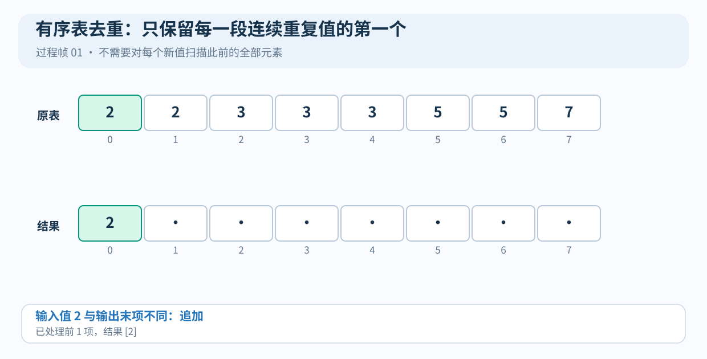

**过程 2：第2项处理：输入值 2 与输出末项相同：跳过**

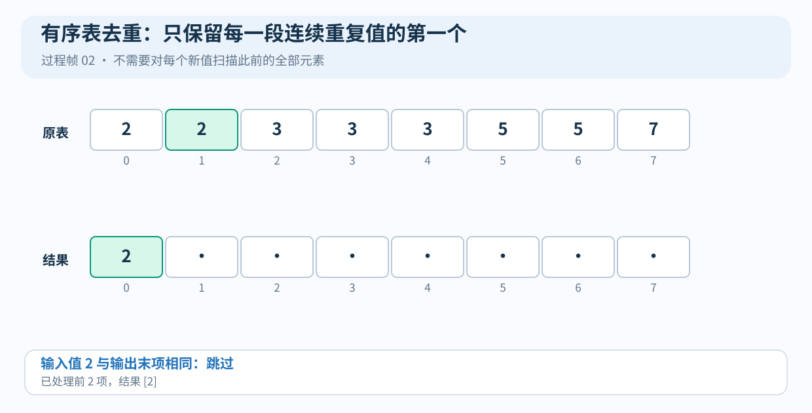

**过程 3：第3项处理：输入值 3 与输出末项不同：追加**

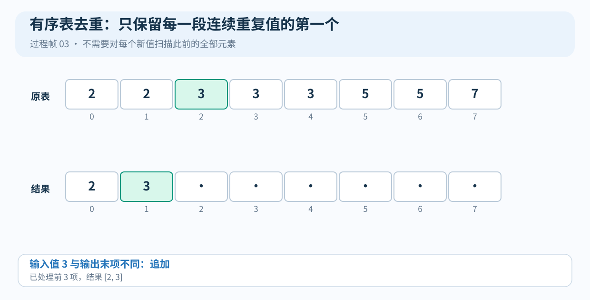

**过程 4：第4项处理：输入值 3 与输出末项相同：跳过**

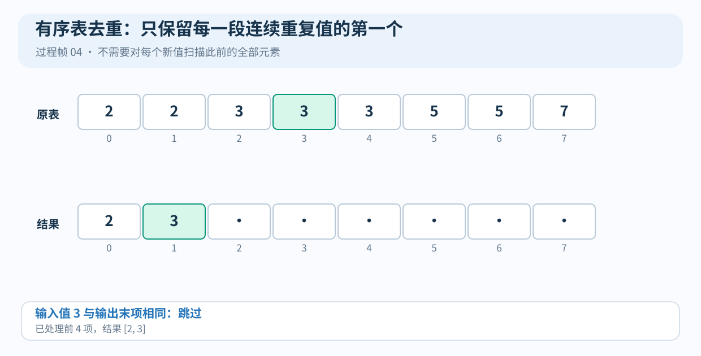

**过程 5：第5项处理：输入值 3 与输出末项相同：跳过**

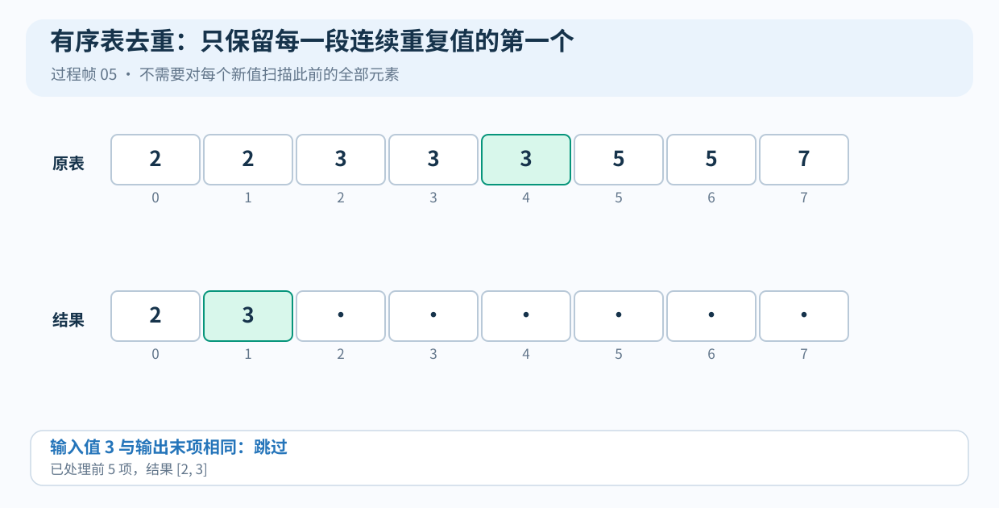

**过程 6：第6项处理：输入值 5 与输出末项不同：追加**

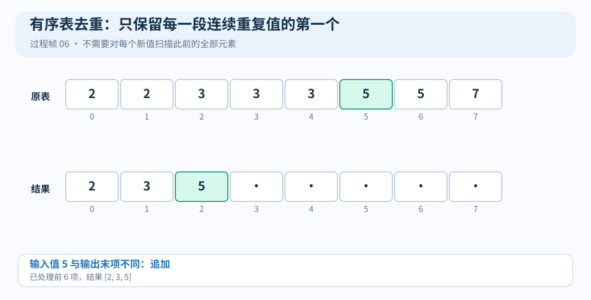

**过程 7：第7项处理：输入值 5 与输出末项相同：跳过**

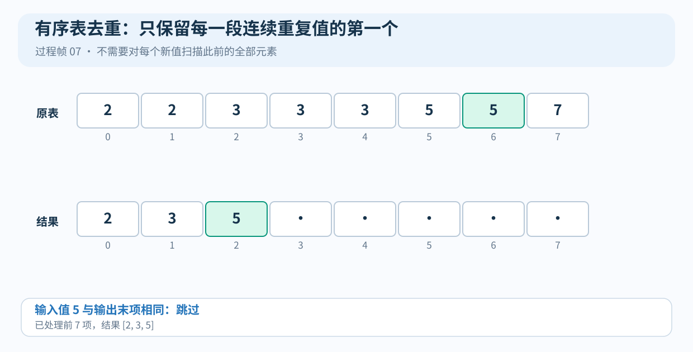

**过程 8：第8项处理：输入值 7 与输出末项不同：追加**

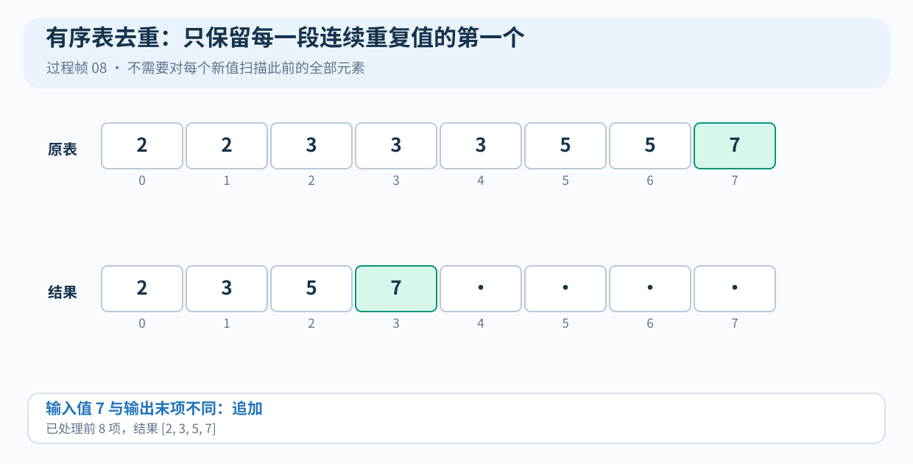


**两个有序表的交集**：分别让两个指针从表首出发；值较小的一方前进；值相等则记录该元素并同时前进。若按数学集合处理重复值，记录时还应避免重复输出。整个流程最多扫描 $m+n$ 个元素。

**过程 1：1 小于 2，移动 A 的指针**

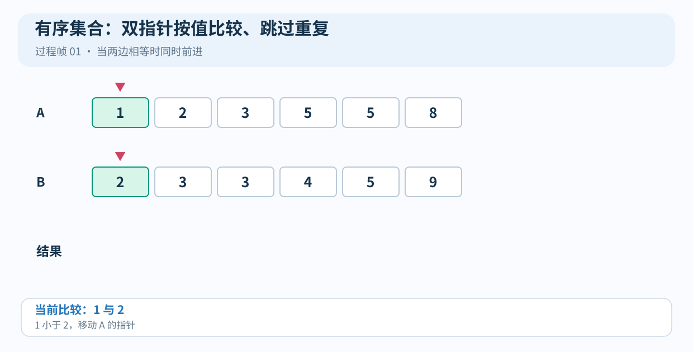

**过程 2：两个有序表求交集，时间 O(m+n)**

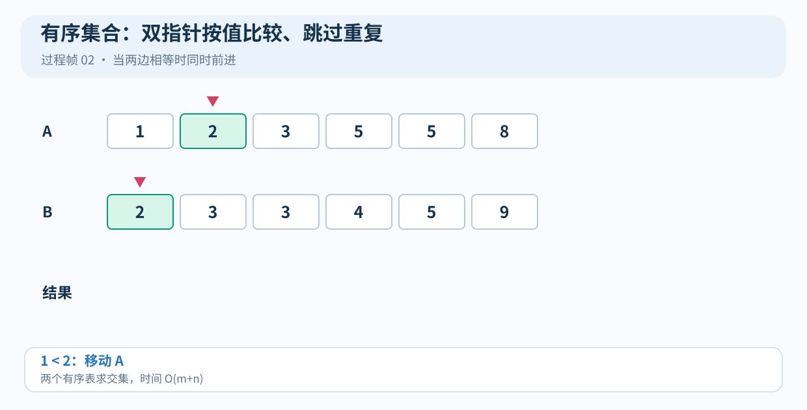

**过程 3：两个有序表求交集，时间 O(m+n)**

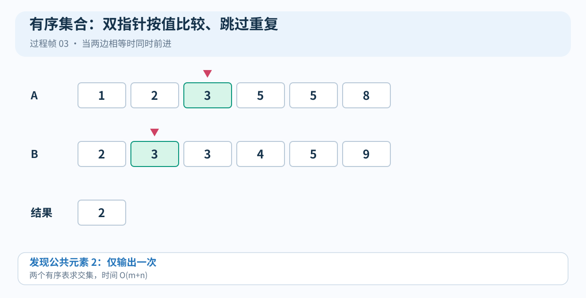

**过程 4：两个有序表求交集，时间 O(m+n)**

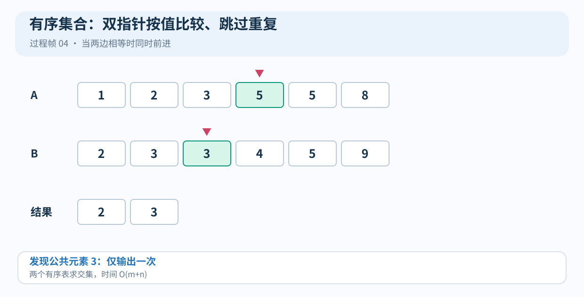

**过程 5：两个有序表求交集，时间 O(m+n)**

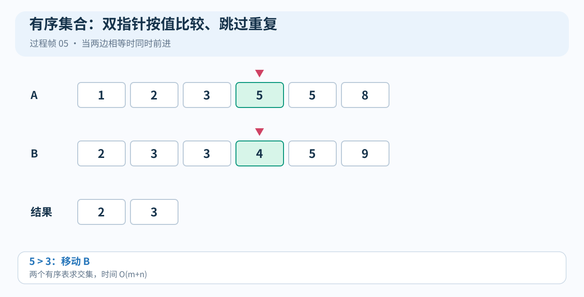

**过程 6：两个有序表求交集，时间 O(m+n)**

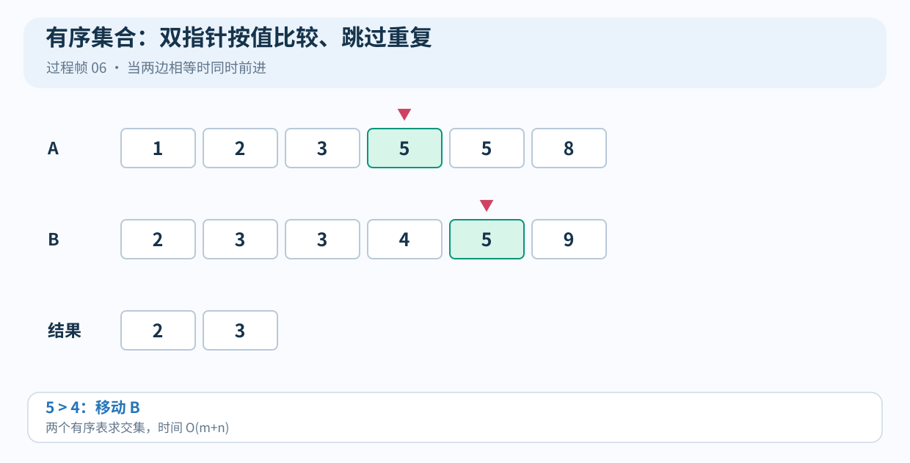

**过程 7：两个有序表求交集，时间 O(m+n)**

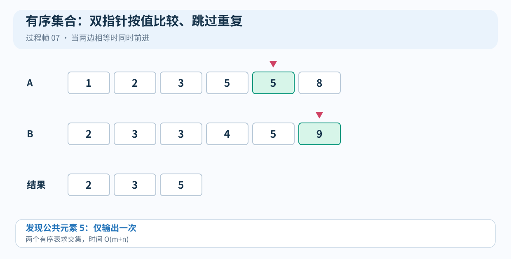

**过程 8：两个有序表求交集，时间 O(m+n)**

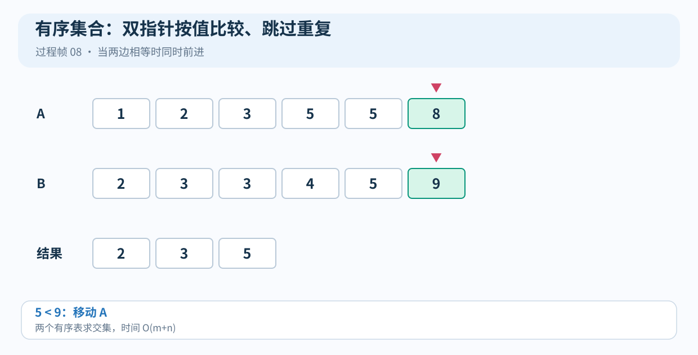

**过程 9：两个有序表求交集，时间 O(m+n)**

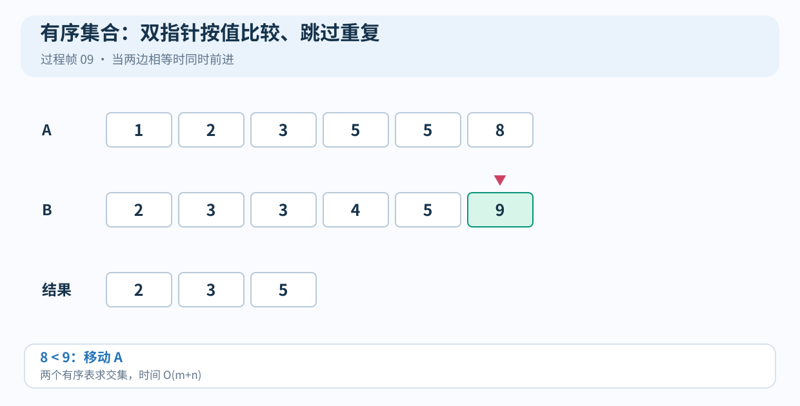


## 二、顺序表：为什么访问快而插入删除需要搬移

### 1. 存储映象与地址计算

顺序存储以一段**连续地址空间**依次存放 $a_1,a_2,\dots,a_n$，令每个元素占 $L$ 个存储单元，首元素基地址为 $LOC(a_1)$，则

$$
LOC(a_i)=LOC(a_1)+(i-1)L,\qquad 1\le i\le n.
$$

C++ `data[i-1]` 对应数学位序 $i$。只要基地址和定长元素大小已知，计算任意元素地址不依赖它前面有多少元素，因此**按位随机访问 $O(1)$**。但寻找某个未知值通常仍需依次比较，线性查找为 $O(n)$。

顺序表通常记录三个信息：`data`（基地址）、`length`（当前有效元素数）、`capacity`（已分配的单元数）。必须满足

$$0\le length\le capacity.$$

`capacity` 不是 `length`：扩容后新增空闲位置不应自动计入表长。

### 2. 初始化、查找与扩容

下面用可动态扩容的原始数组清晰展示底层行为。示例各函数可放在同一个 `.cpp` 中；不使用 `typedef` 或抽象 `Status` 类型。

```cpp
#include <algorithm>
#include <new>

struct SeqList {
    int* data = nullptr;    // 指向动态数组起始位置
    int length = 0;         // 当前有效元素个数
    int capacity = 0;       // 已分配空间容量
};

void InitList(SeqList& L, int capacity = 8) {
    L.data = new int[capacity];  // 申请连续存储单元
    L.length = 0;                // 初始化为空表
    L.capacity = capacity;       // 记录分配容量
}

void DestroyList(SeqList& L) {
    delete[] L.data;             // 与 new[] 配对释放
    L.data = nullptr;            // 置空，避免悬空指针
    L.length = 0;
    L.capacity = 0;
}

void ExtendList(SeqList& L) {
    int newCapacity = L.capacity == 0 ? 8 : L.capacity * 2;
    int* bigger = new int[newCapacity];     // 申请更大的连续空间
    std::copy(L.data, L.data + L.length, bigger); // 搬移原有有效元素
    delete[] L.data;                        // 释放旧存储区
    L.data = bigger;                         // 更新可能改变的基地址
    L.capacity = newCapacity;                // 修改容量，不改变表长
}

int LocateElem(const SeqList& L, int value) {
    for (int i = 0; i < L.length; ++i) {    // 自左向右逐项比较
        if (L.data[i] == value) return i + 1; // 返回从 1 开始的位序
    }
    return 0;                                // 未找到
}
```

> [!warning] 顺序表扩容不能按最坏 $O(1)$ 理解
> 新数组分配及原有 $n$ 个元素的复制，在一次发生搬迁的扩容中需要 $O(n)$ 时间。**容量按倍数增长**时，可证明大量连续尾插操作的平均摊还成本可为 $O(1)$ 每次，但不能把“偶尔的一次扩容”直接当成 $O(1)$ 最坏时间。原始指针版本需认真管理拷贝和销毁；实际工程中优先考虑 `std::vector<int>`。

**过程 1：第 1 次比较；随机访问单次 O(1)，线性查找总最坏 O(n)**

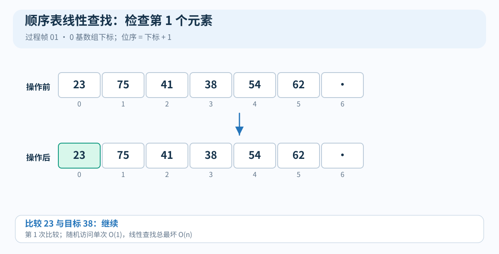

**过程 2：第 2 次比较；随机访问单次 O(1)，线性查找总最坏 O(n)**

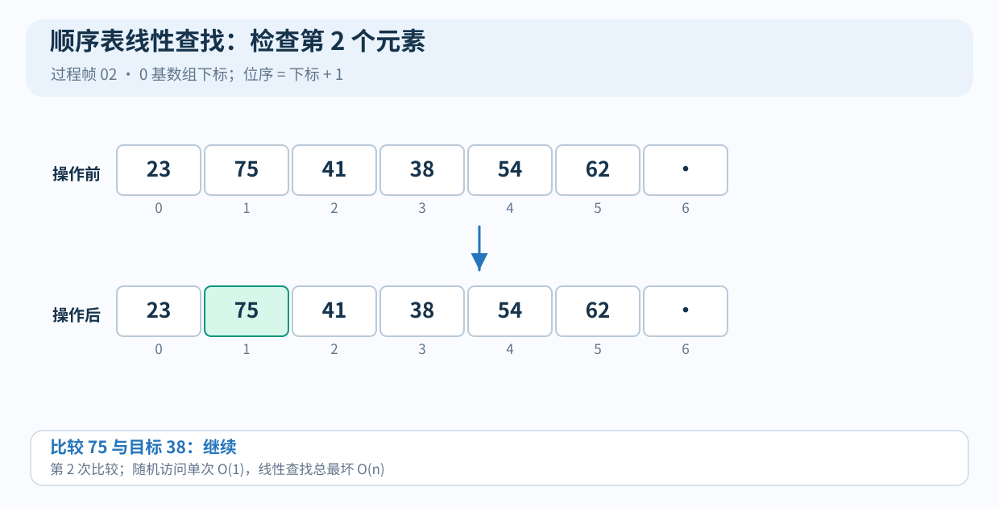

**过程 3：第 3 次比较；随机访问单次 O(1)，线性查找总最坏 O(n)**

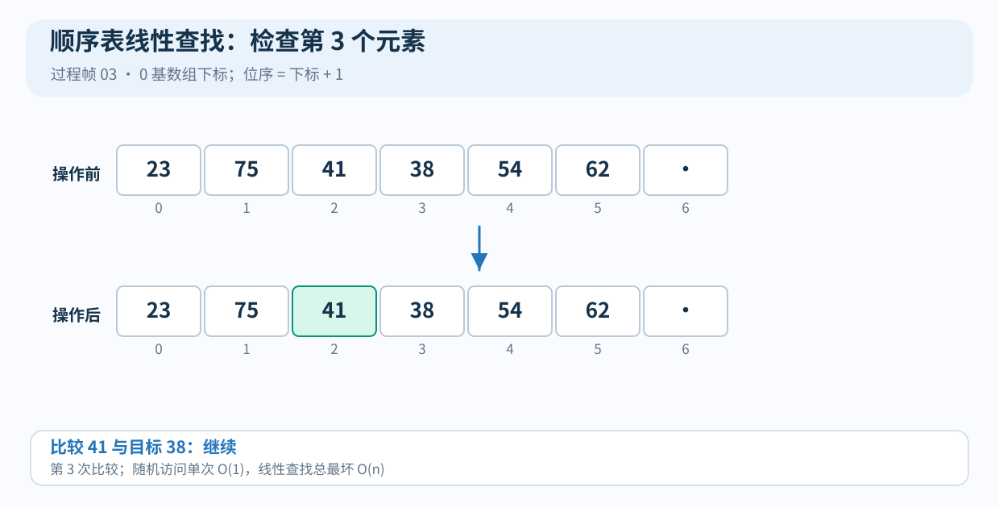

**过程 4：第 4 次比较；随机访问单次 O(1)，线性查找总最坏 O(n)**

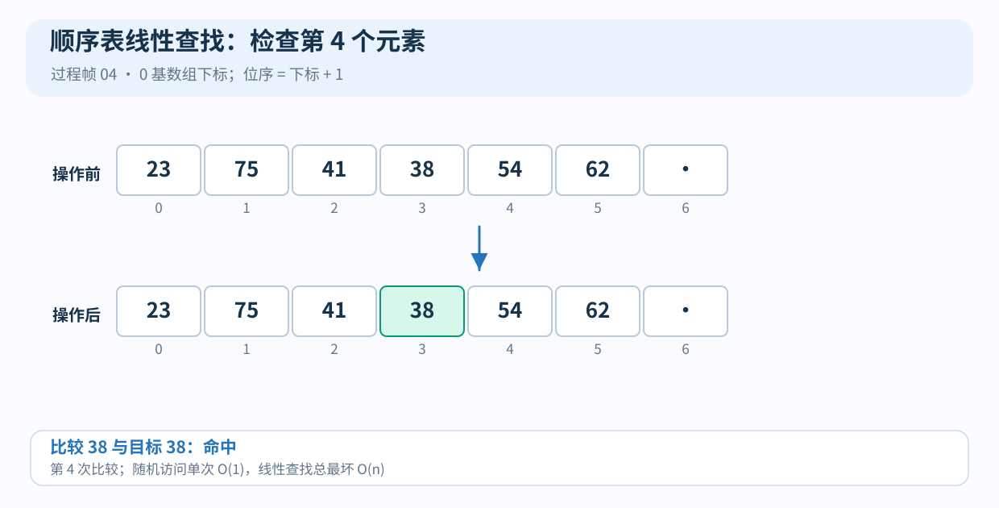


### 3. 在第 $i$ 个位置之前插入：必须逆向右移

原逻辑结构

$$(a_1,\dots,a_{i-1},a_i,\dots,a_n)$$

插入新值 $e$ 后变成

$$(a_1,\dots,a_{i-1},e,a_i,\dots,a_n).$$

当 $i\le n$ 时，必须先把原尾部元素放到新尾部位置，再往前逐项右移；若从插入位置开始顺向复制，会覆盖尚未读取的元素。插入后表长增加 1；插入到末尾 $i=n+1$ 时无须移动任何旧元素。

**过程 1：从尾部向前搬移，避免覆盖还未复制的数据**

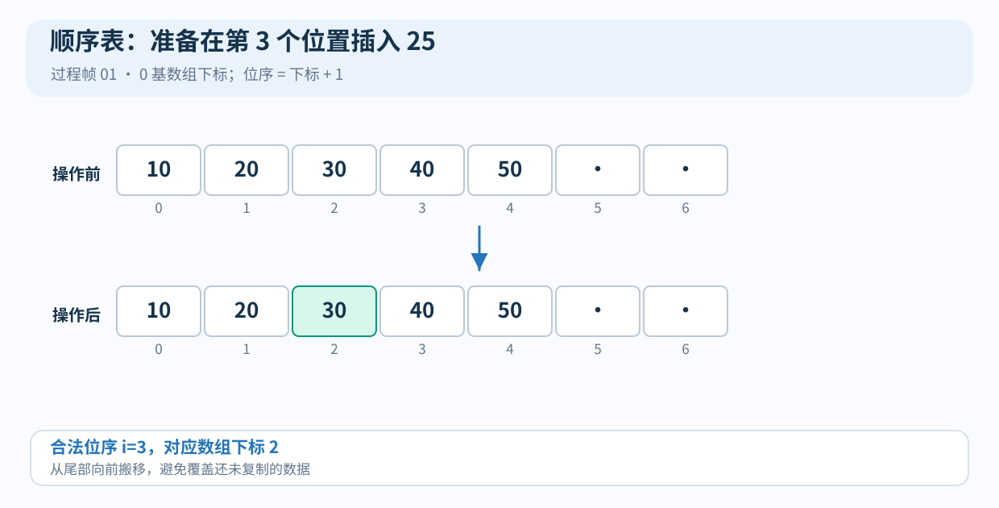

**过程 2：扩容可能更换基地址，但不改变元素的逻辑次序**

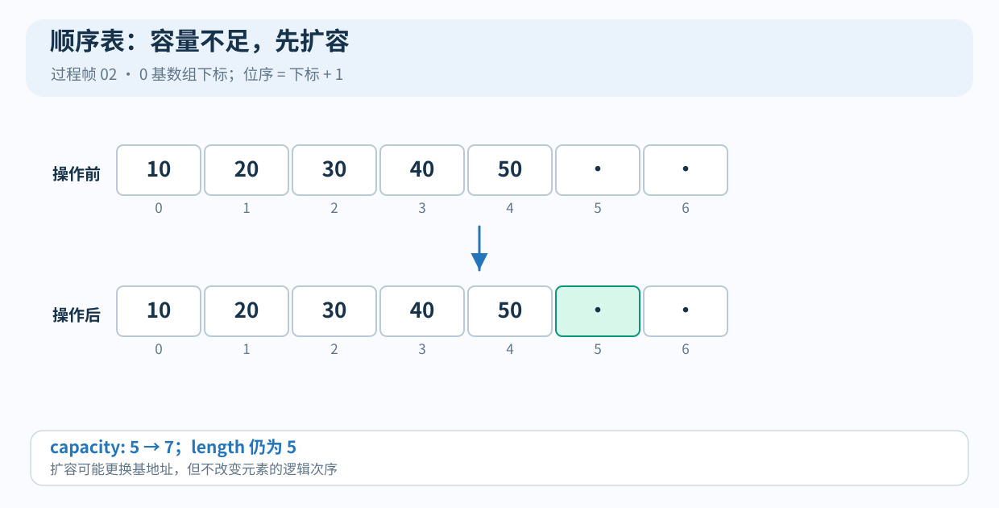

**过程 3：由右向左，直到原第 3 个位置腾空**

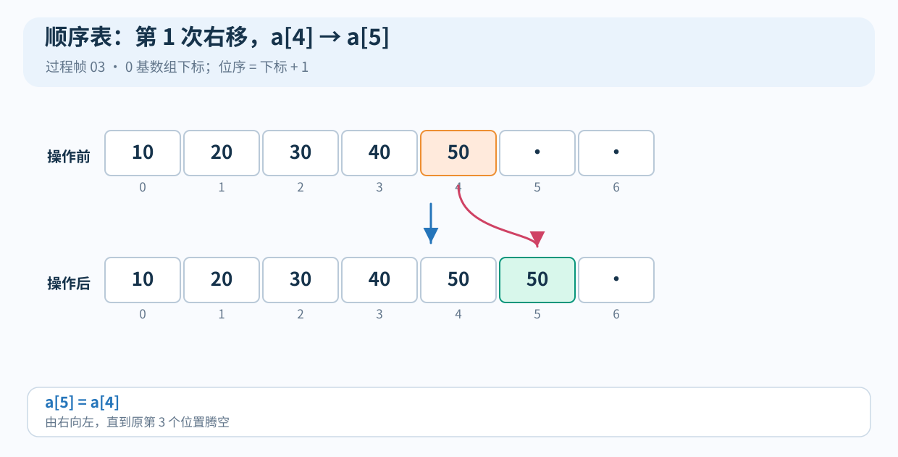

**过程 4：由右向左，直到原第 3 个位置腾空**

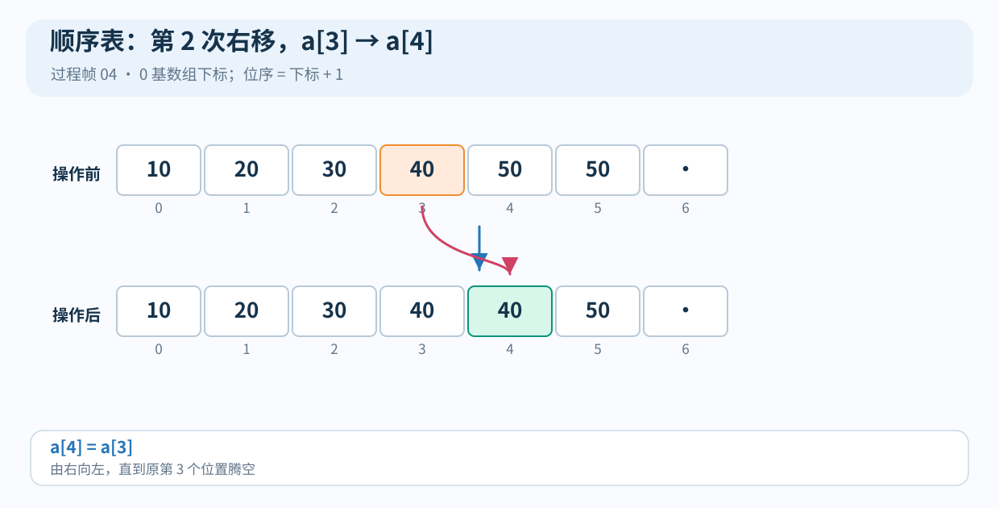

**过程 5：由右向左，直到原第 3 个位置腾空**

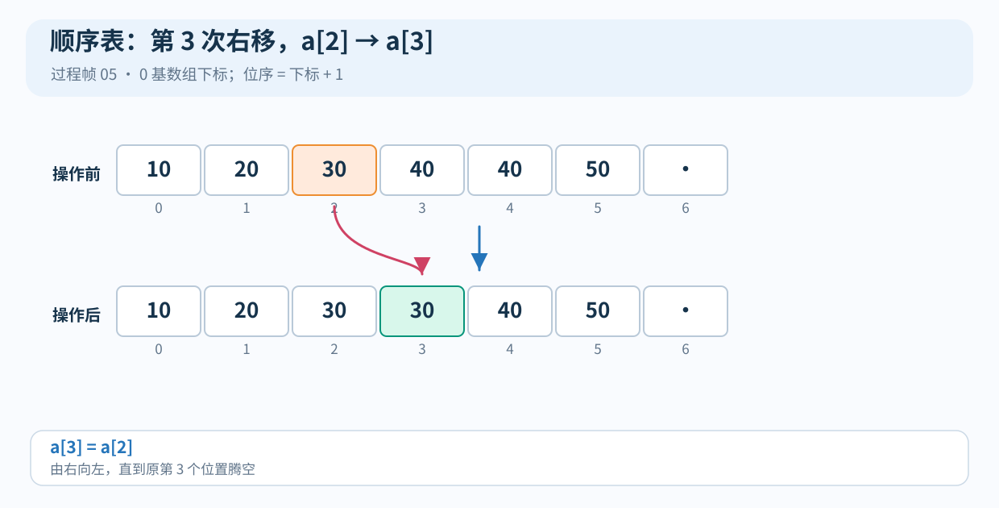

**过程 6：写入目标，不再需要右移其他元素**

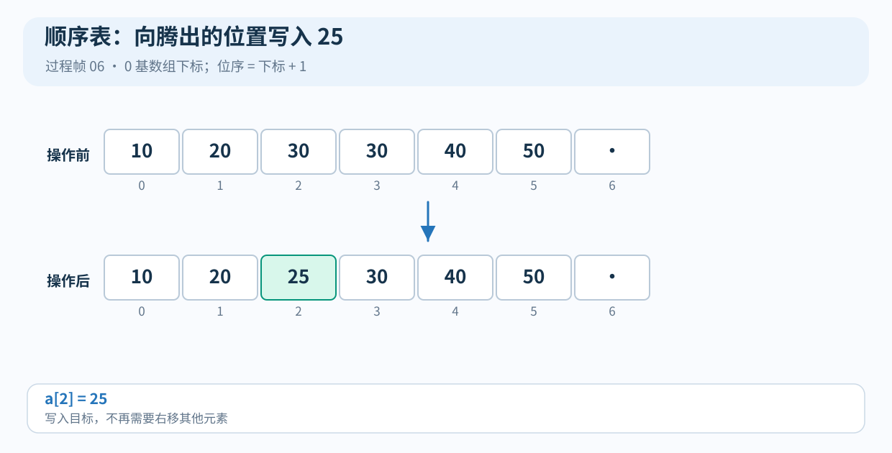

**过程 7：结果 [10, 20, 25, 30, 40, 50]；实际移动 3 次**

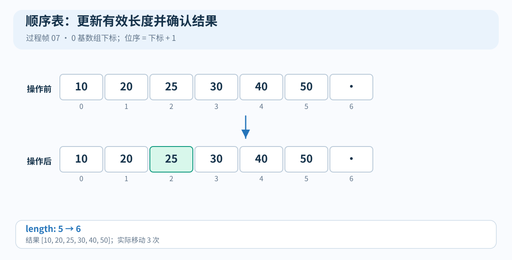


```cpp
int ListInsert(SeqList& L, int pos, int value) {
    if (pos < 1 || pos > L.length + 1) return 0;  // 检查 1 基位序
    if (L.length == L.capacity) ExtendList(L);    // 必要时扩容
    for (int j = L.length; j >= pos; --j) {      // 从右往左依次搬移
        L.data[j] = L.data[j - 1];                // 下标 j-1 → j
    }
    L.data[pos - 1] = value;                      // 空出的单元写入新值
    ++L.length;                                   // 更新表长
    return 1;
}
```

长度为 $n$ 的表在位序 $i$ 处插入，搬移元素数为 $n-i+1$。假定 $n+1$ 个合法插入位置等概率，则

$$
E_{insert}=\frac1{n+1}\sum_{i=1}^{n+1}(n-i+1)=\frac n2.
$$

最坏需移动 $n$ 个元素，所以按位插入的最坏时间为 $O(n)$，另可能发生扩容搬迁。

### 4. 删除第 $i$ 项：先保存，再顺向左移

从第 $i+1$ 项开始依次覆盖前一个位置，最后将表长减少 1。若先减少表长或没有保存被删除值，容易产生返回值错误和边界错误。

**过程 1：数组下标 1 被删除，后续元素逐个左移**

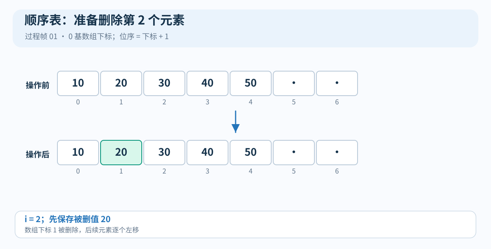

**过程 2：从删除位置起向右读取、向左写入**

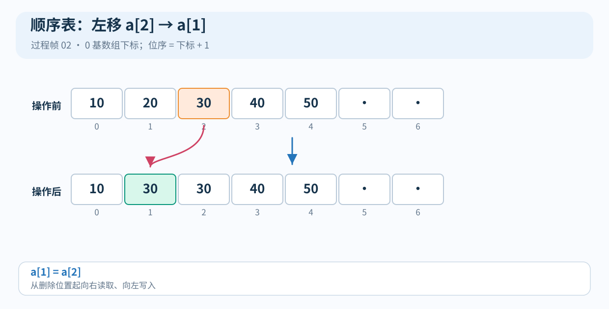

**过程 3：从删除位置起向右读取、向左写入**

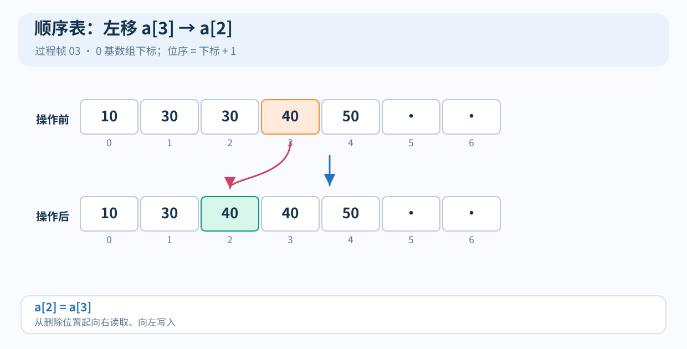

**过程 4：从删除位置起向右读取、向左写入**

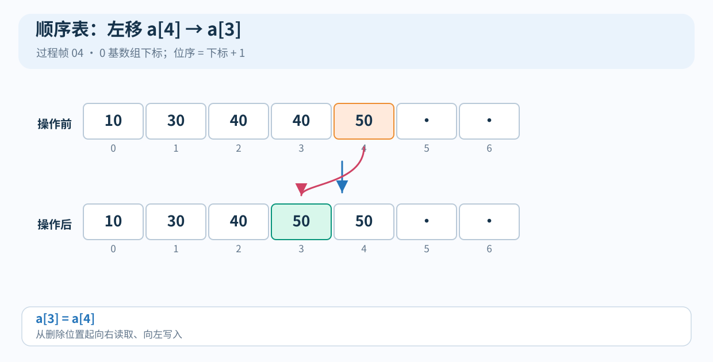

**过程 5：最后一个旧单元内容不再属于线性表；逻辑长度以 length 为准**

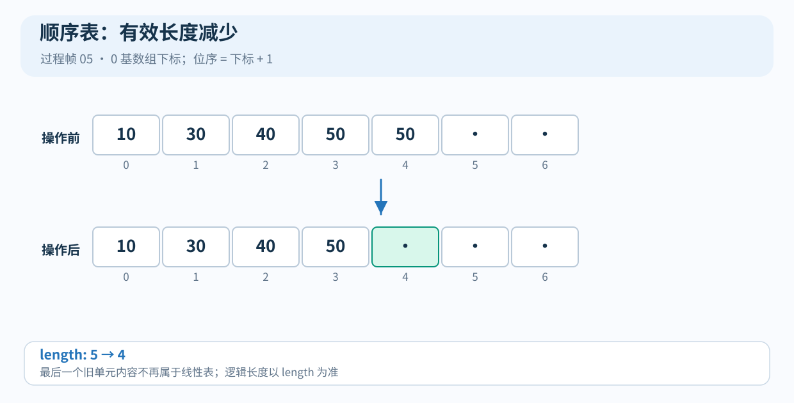

**过程 6：最终序列 [10, 30, 40, 50]；移动 3 次**

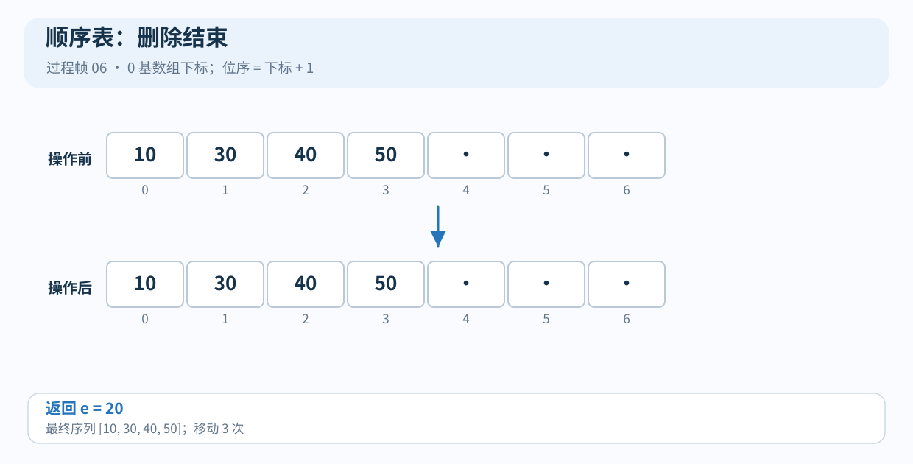


```cpp
int ListDelete(SeqList& L, int pos, int& removed) {
    if (pos < 1 || pos > L.length) return 0;  // 必须确实存在该元素
    removed = L.data[pos - 1];                // 先保存被删除的值
    for (int j = pos; j < L.length; ++j) {    // 由左到右覆盖空缺
        L.data[j - 1] = L.data[j];             // 下标 j → j-1
    }
    --L.length;                                // 逻辑上丢弃末尾单元
    return 1;
}
```

删除位置 $i$ 需移动 $n-i$ 个旧元素，若 $n$ 个合法删除位置等概率，则

$$
E_{delete}=\frac1n\sum_{i=1}^{n}(n-i)=\frac{n-1}{2}.
$$

首删最坏移动 $n-1$ 个元素，尾删无须移动，整体复杂度最坏 $O(n)$。

> [!tip] 方向速记
> **插入右移从右往左；删除左移从左往右。** 这不是任意约定，而是为了避免在复制源数据之前将它覆盖。

## 三、单链表：用指针表达“下一个元素在哪里”

### 1. 结点、头指针、头结点与首元结点

单链表的每个结点由**数据域**与**后继指针 `next`** 组成。物理内存中的结点可以不连续；依据 `next` 可以还原唯一的逻辑次序。末结点的 `next` 为 `nullptr`。单链表可以只用头指针指向首元结点，也可以额外设置不存放有效业务数据的**头结点**来统一边界处理。

- **头指针 `head`**：一个指针变量，表示链表入口。
- **头结点**：首元结点之前的附加结点，便于在首位插入和删除；不计入表长。
- **首元结点**：存放第一个有效数据元素的结点；带头结点时为 `head->next`。

带头结点的空表满足 `head != nullptr` 且 `head->next == nullptr`；不带头结点的空表才常以 `head == nullptr` 表示。

```cpp
struct Node {
    int data;                // 数据域
    Node* next;              // 指向直接后继结点
};

Node* InitList_L() {
    return new Node{0, nullptr};  // 申请不计入表长的头结点
}
```

### 2. 取第 $i$ 项：只能从头沿链寻找

按位取值不具备顺序表的直接地址公式。`p` 从首元结点开始，每执行一次 `p=p->next` 才能到达下一个逻辑元素。头结点虽在内存中，却不算第一个有效元素。

**过程 1：逐结点访问才能找到第 1 个元素**

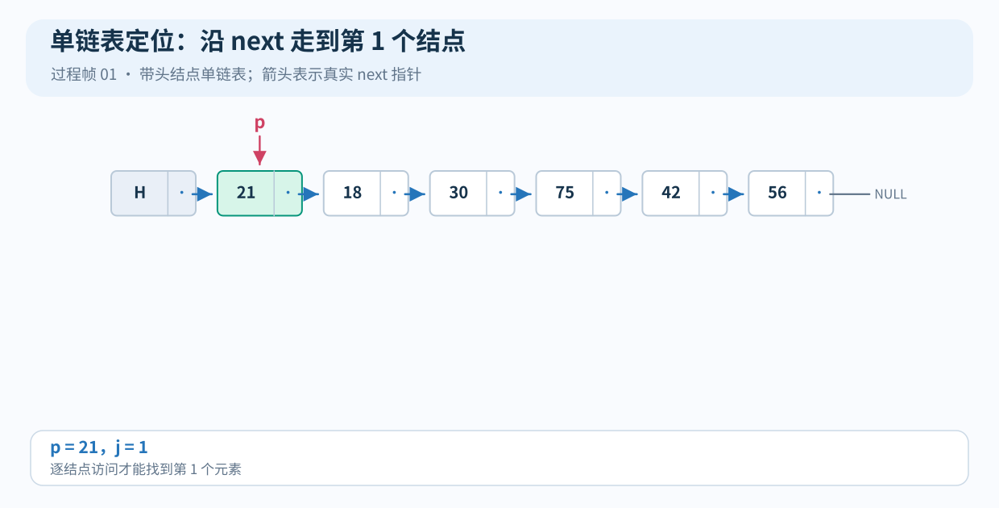

**过程 2：逐结点访问才能找到第 2 个元素**

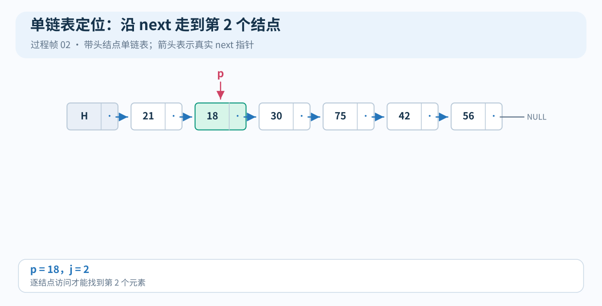

**过程 3：逐结点访问才能找到第 3 个元素**

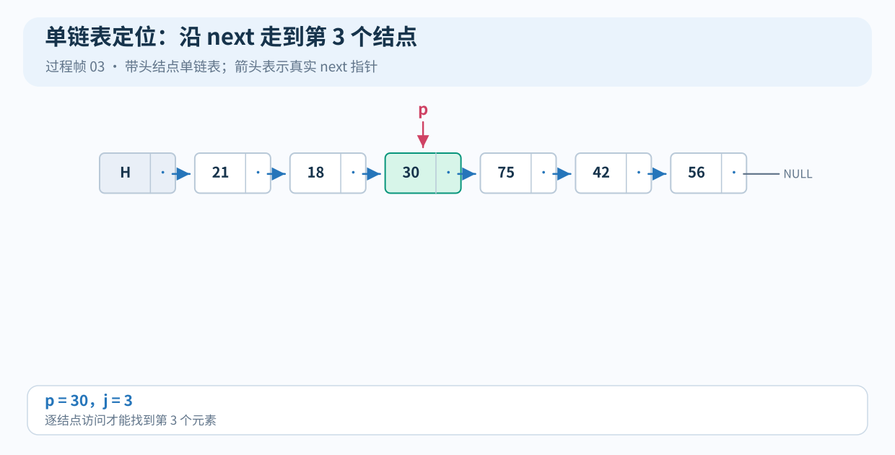

**过程 4：逐结点访问才能找到第 4 个元素**

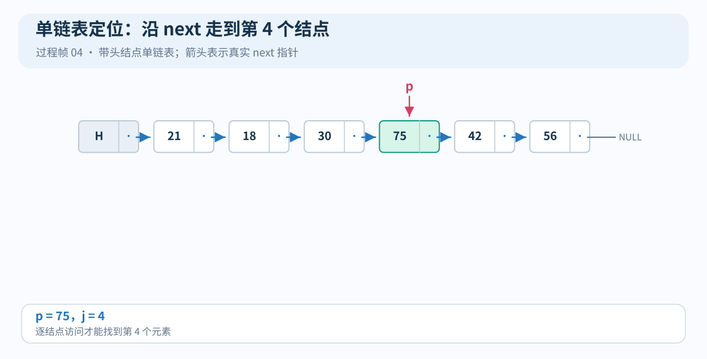


```cpp
int GetElem_L(const Node* head, int pos, int& value) {
    if (!head || pos < 1) return 0;    // 头指针及位序检查
    const Node* p = head->next;        // 从第 1 个有效结点出发
    int j = 1;                         // j 是 p 的逻辑位序
    while (p && j < pos) {            // 未走到目标，逐个后移
        p = p->next;
        ++j;
    }
    if (!p) return 0;                 // 已到链尾，位序无效
    value = p->data;                  // 读取对应元素
    return 1;
}
```

此操作最坏 $O(n)$。如果已经保存了指向该结点的可靠指针，读取其 `data` 可以是 $O(1)$，两种前提不能混为一谈。

### 3. 在指定位置前插入：先接后继，再改前驱

目标是把结点 `s` 插在原来的 `p` 与 `p->next` 之间。关键只有两条语句：

```cpp
s->next = p->next;   // 第一步：新结点先接住原后继
p->next = s;         // 第二步：前驱再改为指向新结点
```

若错误地先执行 `p->next=s`，随后再执行 `s->next=p->next`，`s` 就可能指向自己，原后继链丢失。必须区分**新结点已分配、指针已设置、旧链入口已切换**三个状态。

**过程 1：先定位前驱：否则无法修改前驱的 next**

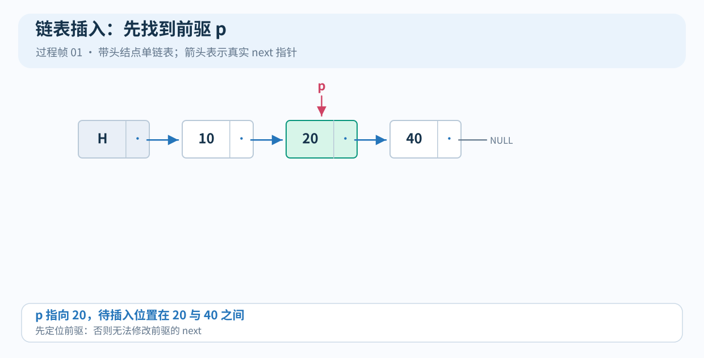

**过程 2：新结点未接入链表，绝不能提前改变 p->next**

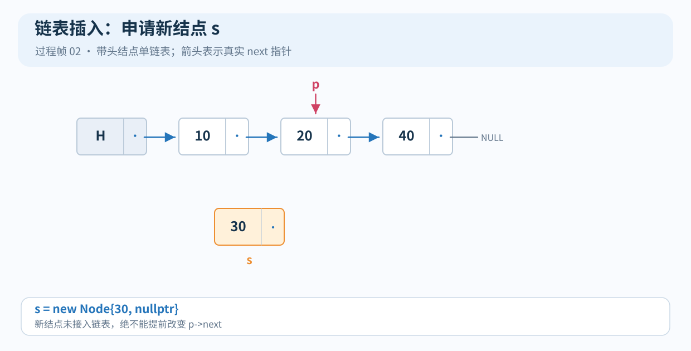

**过程 3：现在 s 指向旧结点 40，原链表尚未改动**

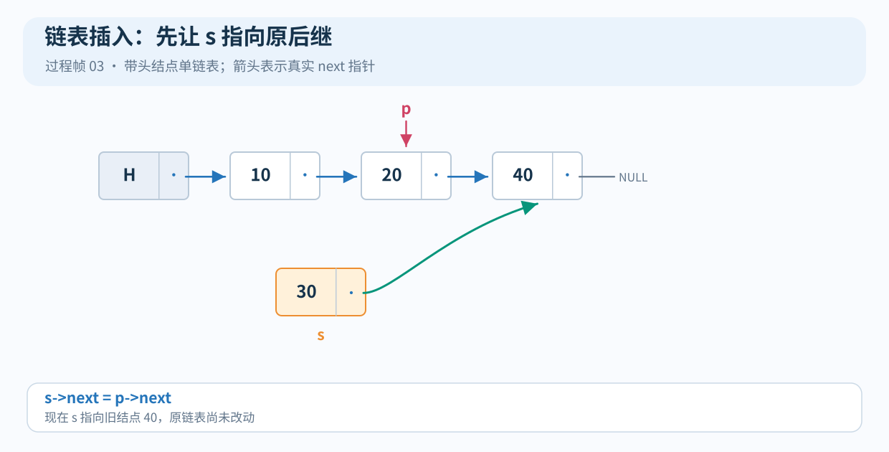

**过程 4：两条新指针同时成立后，链中增加一项**

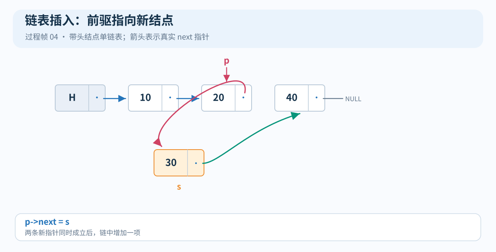

**过程 5：只改两条 next 指针；定位前驱仍可能 O(n)**

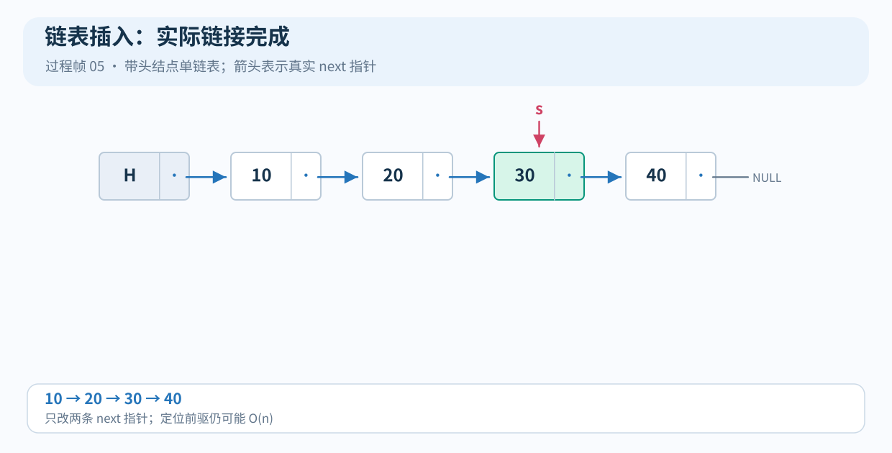

**过程 6：第二句会让 s.next 指向 s 自身，旧 40 从链表断开**

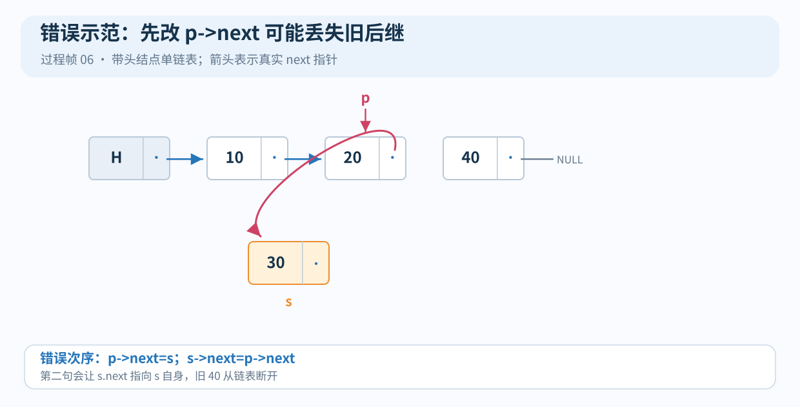


```cpp
int ListInsert_L(Node* head, int pos, int value) {
    if (!head || pos < 1) return 0;
    Node* p = head;                       // 从头结点起，逻辑位序视为 0
    int j = 0;
    while (p && j < pos - 1) {           // 找到第 pos-1 个结点
        p = p->next;
        ++j;
    }
    if (!p) return 0;                    // 插入位置越界
    Node* s = new Node{value, nullptr};  // 新建独立结点
    s->next = p->next;                    // 先连接原后继
    p->next = s;                          // 再改前驱的后继
    return 1;
}
```

**已知前驱结点**时指针修改本身为 $O(1)$；若题目要求“按位序插入”，查找前驱需要 $O(n)$，整体最坏仍是 $O(n)$。

### 4. 删除指定位置：绕过目标，然后释放内存

删除结点 `q` 时，若 `p` 是其前驱，需要保存 `q=p->next`，然后执行 `p->next=q->next`，再读取数据并 `delete q`。不能在释放 `q` 后再次访问 `q->data` 或 `q->next`。

**过程 1：找到前驱后才能方便地越过待删除结点**

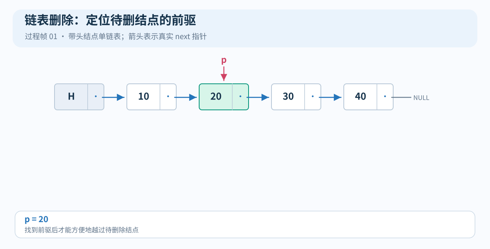

**过程 2：q 仍连接着旧后继 40**

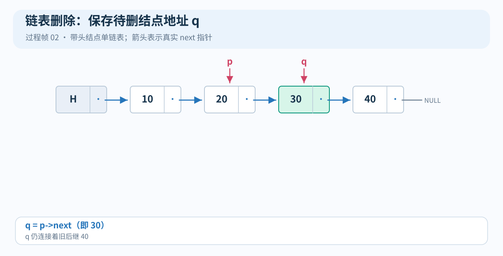

**过程 3：此时链表主路径改为 10→20→40，但 q 尚未释放**

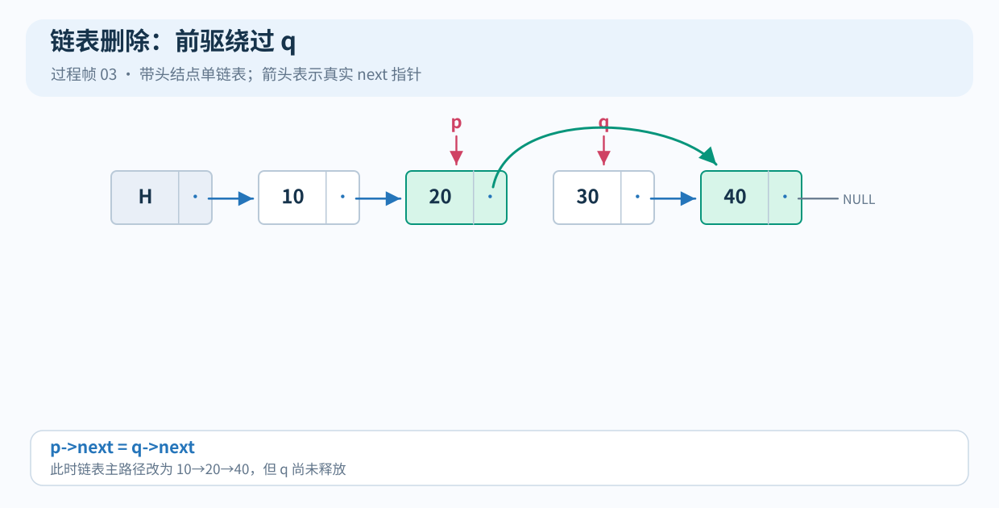

**过程 4：先保存 q 的 data，后释放 q；不能访问已释放结点**

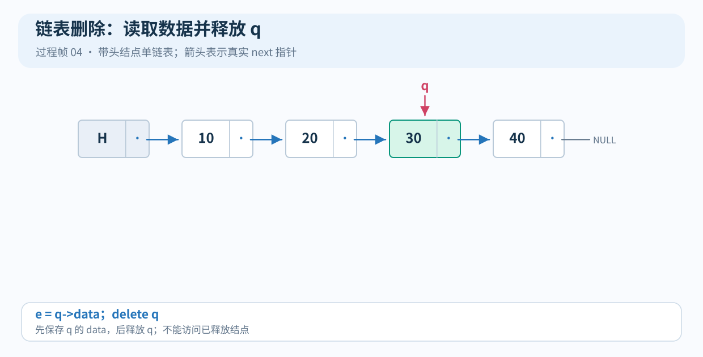

**过程 5：p 后继从 30 改为 40；释放一个结点**

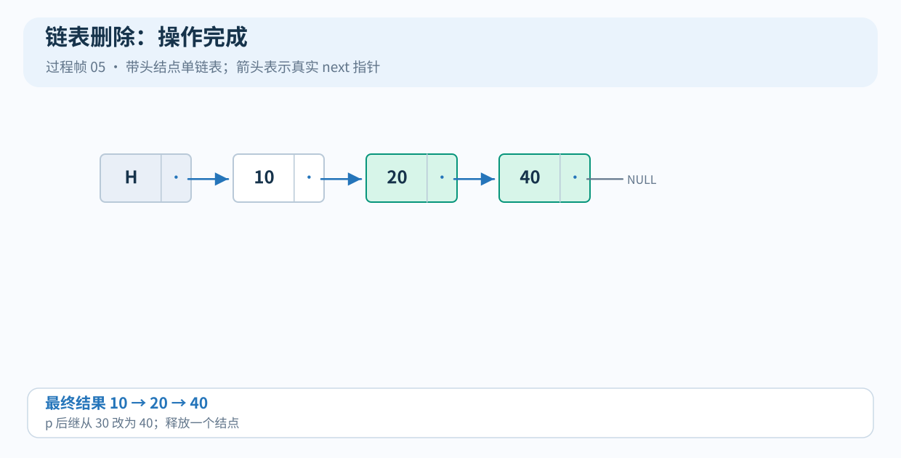


```cpp
int ListDelete_L(Node* head, int pos, int& removed) {
    if (!head || pos < 1) return 0;
    Node* p = head;                       // 找待删结点的前驱
    for (int j = 1; j < pos && p; ++j) {
        p = p->next;                      // 逐个后移
    }
    if (!p || !p->next) return 0;         // 待删结点不存在
    Node* q = p->next;                    // 保存目标结点地址
    p->next = q->next;                    // 前驱改指后继，跳过 q
    removed = q->data;                    // 释放前保存返回值
    delete q;                             // 回收结点内存
    return 1;
}
```

删除表首元素时前驱恰好是头结点，这正是带头结点可以减少边界分支的原因。若删除后还存在某个指针变量指向已释放的 `q`，该变量成为**悬空指针**，不得再解引用。

### 5. 创建链表：头插法与尾插法必须观察每次指针变化

**头插法**在每次输入新元素时，把它放在原首元结点之前。因此依次输入 `10,20,30`，建立的表是 `30→20→10`；若输入顺序本来就是 `a_n,...,a_1`，则头插后的逻辑顺序恢复为 `a_1,...,a_n`。

**过程 1：头结点不计入数据元素个数**

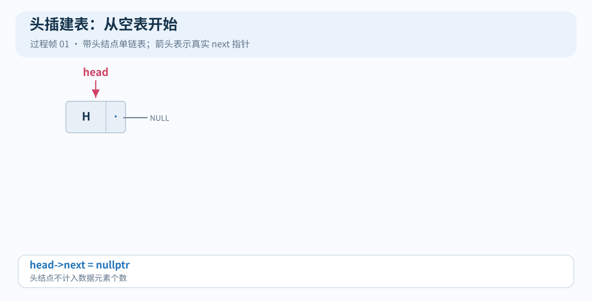

**过程 2：本帧 s 尚未接入链表**


**过程 3：无论原表是否为空，都先连接新结点的 next**


**过程 4：当前数据顺序：[10]；头插导致输入顺序反转**


**过程 5：本帧 s 尚未接入链表**


**过程 6：无论原表是否为空，都先连接新结点的 next**


**过程 7：当前数据顺序：[20, 10]；头插导致输入顺序反转**


**过程 8：本帧 s 尚未接入链表**


**过程 9：无论原表是否为空，都先连接新结点的 next**


**过程 10：当前数据顺序：[30, 20, 10]；头插导致输入顺序反转**


```cpp
#include <vector>

Node* CreateHeadList(const std::vector<int>& input) {
    Node* head = new Node{0, nullptr};      // 建立空的带头结点链表
    for (int x : input) {
        Node* s = new Node{x, nullptr};     // 为当前输入元素申请结点
        s->next = head->next;               // 新结点指向原首元结点
        head->next = s;                     // 头结点改指新首元结点
    }
    return head;                            // 返回链表入口
}
```

**尾插法**让 `tail` 始终指向最后一个有效结点；初始空表 `tail=head`。每次先 `tail->next=s`，再 `tail=s`，因此数据顺序与输入顺序一致。注意 `tail` 必须更新，否则下一次插入可能覆盖此前插入的结点。

**过程 1：空表下 tail 必须指向头结点，方便首次连接**


**过程 2：新结点 next 为空，尚未成为尾结点**


**过程 3：此时旧 tail 仍是旧结点，下一步必须更新尾指针**


**过程 4：尾插保留输入顺序，使用尾指针每次接入 O(1)**


**过程 5：新结点 next 为空，尚未成为尾结点**


**过程 6：此时旧 tail 仍是旧结点，下一步必须更新尾指针**


**过程 7：尾插保留输入顺序，使用尾指针每次接入 O(1)**


**过程 8：新结点 next 为空，尚未成为尾结点**


**过程 9：此时旧 tail 仍是旧结点，下一步必须更新尾指针**


**过程 10：尾插保留输入顺序，使用尾指针每次接入 O(1)**


```cpp
Node* CreateTailList(const std::vector<int>& input) {
    Node* head = new Node{0, nullptr};  // 带头结点的空链表
    Node* tail = head;                   // 初始尾指针是头结点
    for (int x : input) {
        Node* s = new Node{x, nullptr};  // 新结点后继初始化为空
        tail->next = s;                  // 旧尾结点指向新结点
        tail = s;                        // 更新真正的尾结点
    }
    return head;
}
```

> [!important] 清空与销毁必须实际释放每个结点
> `head->next=nullptr` **只是切断链表入口**，并没有释放此前动态申请的结点，会造成内存泄漏。需要先逐个保存待删地址、移动头结点的指针并释放结点。最后若连头结点也销毁，才 `delete head`。

```cpp
void ClearList_L(Node* head) {
    if (!head) return;
    while (head->next) {                // 表中还有有效结点
        Node* q = head->next;           // 暂存即将释放的结点
        head->next = q->next;           // 先更新头结点的后继
        delete q;                       // 释放旧首元结点
    }
}

void DestroyList_L(Node*& head) {
    ClearList_L(head);                  // 先清理所有有效结点
    delete head;                        // 再释放头结点
    head = nullptr;                     // 避免外部继续使用旧地址
}
```

### 6. 两个有序单链表归并：边比较边连接，避免重复扫描

假设 $L_A=(3,5,8,11)$，$L_B=(2,6,8,9,11,15,20)$，归并为非递减的 $L_C$。分别用 `pa`、`pb` 指向各自未处理的首结点；每次取较小者接入 `Lc` 尾部，再移动对应输入指针。值相等时可优先取 `pa`，这样会保留两个重复值，得到的是**有序表归并**，不是数学集合求并。

**过程 1：较小的 2 首先接入 C；相等时通常可先选 A**


**过程 2：输出前缀 [2]；仅移动指针即可连接结点**


**过程 3：输出前缀 [2, 3]；仅移动指针即可连接结点**


**过程 4：输出前缀 [2, 3, 5]；仅移动指针即可连接结点**


**过程 5：输出前缀 [2, 3, 5, 6]；仅移动指针即可连接结点**


**过程 6：输出前缀 [2, 3, 5, 6, 8]；仅移动指针即可连接结点**


**过程 7：输出前缀 [2, 3, 5, 6, 8, 8]；仅移动指针即可连接结点**


**过程 8：输出前缀 [2, 3, 5, 6, 8, 8, 9]；仅移动指针即可连接结点**


**过程 9：输出前缀 [2, 3, 5, 6, 8, 8, 9, 11]；仅移动指针即可连接结点**


**过程 10：结果保持非递减：[2, 3, 5, 6, 8, 8, 9, 11, 11]**


**过程 11：结果保持非递减：[2, 3, 5, 6, 8, 8, 9, 11, 11, 15]**


**过程 12：结果保持非递减：[2, 3, 5, 6, 8, 8, 9, 11, 11, 15, 20]**


```cpp
Node* MergeSortedCopy(const Node* A, const Node* B) {
    Node* C = new Node{0, nullptr};         // 结果表的头结点
    Node* tail = C;                         // 结果尾指针
    const Node* p = A ? A->next : nullptr;  // 输入 A 的首元
    const Node* q = B ? B->next : nullptr;  // 输入 B 的首元
    while (p && q) {
        if (p->data <= q->data) {           // 相等时先选 A
            tail->next = new Node{p->data, nullptr};
            p = p->next;                    // 仅 A 前进
        } else {
            tail->next = new Node{q->data, nullptr};
            q = q->next;                    // 仅 B 前进
        }
        tail = tail->next;                  // 结果尾结点跟随更新
    }
    while (p) {                            // 直接复制 A 的剩余结点
        tail->next = new Node{p->data, nullptr};
        tail = tail->next;
        p = p->next;
    }
    while (q) {                            // 直接复制 B 的剩余结点
        tail->next = new Node{q->data, nullptr};
        tail = tail->next;
        q = q->next;
    }
    return C;
}
```

这里采用**复制结点**的版本，输入 A、B 原样保留，C 拥有独立数据结点；其时间 $O(m+n)$，新增结点空间 $O(m+n)$。如果改成“摘下输入结点直接接入 C”，可以做到额外辅助结点空间 $O(1)$，但必须重新明确原链表的所有权，不能在没有解除所有权时重复释放结点。

## 四、链表的其他重要形式

### 1. 静态链表：用数组位置 `cur` 代替机器指针

静态链表使用预先分配的数组，每个数组分量保存 `data` 和整数 `cur`。`cur` 不是下一个线性数组元素的位置，而是下一个**逻辑结点所在的下标**。从头结点 `S[0]` 开始依次执行 `i=S[i].cur` 才能遍历真实的逻辑序列。空闲槽位也可以连成一条备用链，模拟动态分配与回收。

**过程 1：备用链：1→5→3→7→8；逻辑次序与物理顺序不同**


**过程 2：依次写入 S[1] 的 data=16 和 cur=6**


**过程 3：主链变为 2→1→6→4，未移动任何原数组数据**


**过程 4：待删槽恢复到备用链表，free 指回 1**


**过程 5：静态链表仍须预先分配容量，使用整数 cur 代替机器指针**


```cpp
struct StaticNode {
    int data;                     // 结点的数据内容
    int cur;                      // 下一个结点在数组中的下标
};

int LocateStatic(const StaticNode S[], int value) {
    int i = S[0].cur;             // 从头结点所指的首元素出发
    int position = 1;             // 记录逻辑位序
    while (i != 0) {              // 约定 0 为链尾标记
        if (S[i].data == value) return position;
        i = S[i].cur;              // 只通过 cur 后移
        ++position;
    }
    return 0;
}
```

静态链表的优点是插入删除通常不用移动全部表元素；缺点是容量固定，仍需维护备用链（空闲表），定位元素依旧是顺序查找。具体实现必须明确“0 号元既作表头，又作为空指针标记”的存储约定。

### 2. 循环单链表：从尾部回到头结点

循环单链表把末结点的 `next` 指向头结点，不再使用空指针作为正常的循环结束状态。带头结点的空循环表满足 `head->next==head`，判断遍历结束要检查 `p==head`，不能照搬普通单链表的 `p!=nullptr`。

**过程 1：head.next 指向 head 自己**


**过程 2：唯一数据结点的 next 指向 head**


**过程 3：新尾 20.next 指向 head，保留环**


**过程 4：此时尾结点并不指向 NULL**


**过程 5：前驱 10.next 改指 30，循环结构不断裂**


**过程 6：head.next 更新为 30；尾结点仍指向 head**


**过程 7：重新变为 head.next=head**


```cpp
struct CircularNode {
    int data;
    CircularNode* next;
};

CircularNode* InitCircular() {
    CircularNode* head = new CircularNode{0, nullptr};
    head->next = head;                  // 空表的自环
    return head;
}

int CountCircular(const CircularNode* head) {
    if (!head) return 0;
    int count = 0;
    const CircularNode* p = head->next;
    while (p != head) {                // 不能以 nullptr 判定环尾
        ++count;
        p = p->next;
    }
    return count;
}
```

### 3. 双向链表与双向循环链表：两个方向同时连接

双向链表结点分别用 `prior`、`next` 指向前驱和后继。除了前向关系 `p->next=q`，相应逆向关系也应是 `q->prior=p`。**插入前、删除后必须保证两个方向一致**，否则沿正向和反向遍历可能看到完全不同的结构。

例如在 `p` 之前插入新结点 `s`，一种可行的操作顺序是：先设置 `s->prior=p->prior`，再让旧前驱指向 `s`，接着设置 `s->next=p`，最后更新 `p->prior=s`。以下连续帧显示每一条指针的实际变化。

**过程 1：先取得 p 和 p.prior（即 20）**


**过程 2：新结点 s 的前驱先指向 20，主链未断开**


**过程 3：前驱 20 的 next 改为指向 s**


**过程 4：新结点 s 的后继指向 40**


**过程 5：四处指针修改完成，双向链路一致**


```cpp
struct DNode {
    int data;
    DNode* prior;                 // 双向链表前驱指针
    DNode* next;                  // 双向链表后继指针
};

void InsertBefore(DNode* p, int value) {
    if (!p || !p->prior) return;  // 此版要求 p 存在前驱结点
    DNode* s = new DNode{value, nullptr, nullptr};
    s->prior = p->prior;          // 让 s 记住原前驱
    p->prior->next = s;           // 原前驱的 next 指向 s
    s->next = p;                  // 新结点的后继是 p
    p->prior = s;                 // p 的 prior 更新为 s
}
```

删除结点 `p` 时，应在释放前让左右相邻结点重新互相连接。下面示例适合 **p 同时存在前驱和后继** 的双向链表场景，例如带头结点且其尾部有有效哨兵，或双向循环链表；普通非循环链表删除末结点应单独判断 `p->next == nullptr`。

**过程 1：先确认两侧前驱 20、后继 40**


**过程 2：20 直接指向 40，尚须修正 prior**


**过程 3：40 的前驱也改回 20，两方向连接一致**


**过程 4：移除孤立 30，最终结果 10↔20↔40**


```cpp
void DeleteMiddle(DNode* p) {
    if (!p || !p->prior || !p->next) return; // 限制为内部结点
    p->prior->next = p->next;       // 前驱跳过 p 指向后继
    p->next->prior = p->prior;      // 后继回指原前驱
    delete p;                      // 两端已衔接，再释放 p
}
```

双向**循环**链表若设置头结点，那么空表为 `head->next==head && head->prior==head`；非空时还满足 `head->prior` 指向尾结点，尾结点 `next` 指回头结点。环形的前后指针可避免许多边界分类，但插入删除仍必须同步维护双向关系。

### 4. 改进的链表类型：头、尾、当前指针与长度

有的链表在结构体中额外记录 `head`、`tail`、`current`、`length`，方便常见操作。若 `tail` 总指向最后一个有效结点，末尾追加只需常数次指针修改；`length` 可使求表长变为 $O(1)$；但每次删除最后一个结点、清空链表或修改当前位置时都必须同步维护这些成员。功能越方便，数据结构**不变量**越需要认真检查。

## 五、有序表与结构选择

有序表是元素按某个比较关系**非递减**（或非递增）排列的线性表。有序不意味着没有重复；例如 $(2,3,3,5)$ 仍是有序表。有序性使得合并、交集、去重和区间删除可以利用比较结果提前停止，而不必对每个元素从头扫描。

### 1. 有序链表的区间删除

若要求删除所有满足 $mink < x < maxk$ 的元素，先定位最后一个不大于 `mink` 的结点作为 `pre`，然后连续删除其后方所有小于 `maxk` 的结点。当遇到 `x≥maxk`，有序性保证后面都不需要删除，立即停止。

**过程 1：条件为 mink < x < maxk；3 和 12 均保留**


**过程 2：条件为 mink < x < maxk；3 和 12 均保留**


**过程 3：条件为 mink < x < maxk；3 和 12 均保留**


**过程 4：条件为 mink < x < maxk；3 和 12 均保留**


**过程 5：条件为 mink < x < maxk；3 和 12 均保留**


**过程 6：条件为 mink < x < maxk；3 和 12 均保留**


```cpp
void DeleteOpenInterval(Node* head, int mink, int maxk) {
    if (!head || mink >= maxk) return;
    Node* pre = head;                           // 起始为头结点
    while (pre->next && pre->next->data <= mink) {
        pre = pre->next;                        // 寻找区间左边界前驱
    }
    while (pre->next && pre->next->data < maxk) {
        Node* q = pre->next;                    // 目标在开区间内
        pre->next = q->next;                    // 绕过待删结点
        delete q;                              // 释放该结点
    }
}
```

这段算法时间 $O(n)$，额外空间 $O(1)$。如果 `mink`、`maxk` 恰等于表中元素，其相等结点应保留，因为约束是**严格大于、严格小于**。

### 2. 顺序表和链表怎么选择

**过程 1：基地址和元素大小确定，访问第 i 个元素不需要遍历**


**过程 2：每条 next 保存下一结点位置，随机访存无固定偏移公式**


**过程 3：搬移量随着表长度变化，最坏 O(n)**


**过程 4：已知前驱时接入新结点 O(1)，按位定位仍 O(n)**


| 需求与性质 | 顺序表 | 单链表 |
| --- | --- | --- |
| 按位序直接访问 | $O(1)$，通过地址公式 | $O(n)$，需逐结点扫描 |
| 按值线性查找 | 最坏 $O(n)$ | 最坏 $O(n)$ |
| 已知具体插入位置或前驱的局部修改 | 通常要移动，最坏 $O(n)$ | 指针修改本身 $O(1)$ |
| 内存组织 | 连续区域，扩容可能搬迁 | 结点可分散申请 |
| 附加空间 | 元素紧密存放，但可能预留容量 | 每个结点额外保存指针 |
| 缓存局部性 | 通常较好 | 可能较差 |

> [!important] 复杂度判断先写前提
> “链表插入是 $O(1)$”仅在**插入位置已经定位**，而且结点申请与简单指针操作按常数时间模型计算时成立。若给的是第 $i$ 个位置，则必须把寻找前驱的 $O(n)$ 算进去。类似地，顺序表能够 $O(1)$ 获取第 $i$ 个元素，不代表它能 $O(1)$ 查找某个未知值。

## 六、一元多项式的表示及相加

### 1. 稠密系数数组与稀疏项表

一元多项式

$$P_n(x)=p_0+p_1x+p_2x^2+\cdots+p_nx^n$$

可以由系数序列 $(p_0,p_1,\dots,p_n)$ 表示：下标天然表示指数。若 $P(x)=1+3x^{10000}-2x^{20000}$，用系数数组就需要包含大量零系数的位置，此时只存非零项更合理。

稀疏多项式表示为按指数严格递增排列的**（系数，指数）**对：

$$P(x)=\sum_{k=1}^{m}c_k x^{e_k},\qquad 0\le e_1<e_2<\cdots<e_m.$$

例如 $7x^3-2x^{12}-8x^{999}$ 对应 `[(7,3),(-2,12),(-8,999)]`。若只计算多项式值、无需频繁修改，连续数组存储项对很适合；若要频繁相加、合并、删去零系数项，可用链表表示。

### 2. 多项式相加就是“按指数归并”

用两个指针分别查看当前项 $p$ 与 $q$。若 `p.exp<q.exp`，先输出 $p$；若 `p.exp>q.exp`，先输出 $q$；若指数相等，则系数相加。**系数之和为零时不能输出该项**，应同时跳过两个原项。最后直接追加未结束的一方。

**过程 1：指数较小者直接加入结果，无需改变其系数**


**过程 2：当前结果项：['2']**


**过程 3：当前结果项：['2', '5x^1']**


**过程 4：当前结果项：['2', '5x^1']**


**过程 5：当前结果项：['2', '5x^1', '1x^4']**


**过程 6：当前结果项：['2', '5x^1', '1x^4', '4x^5']**


**过程 7：并非系数逐位置相加，而是按指数归并**


```cpp
struct Term {
    double coef;                     // 非零项系数
    int exp;                         // 非负整数指数
    Term* next;                      // 指向更大指数的下一项
};

Term* AddPolynomial(const Term* a, const Term* b) {
    Term* head = new Term{0.0, 0, nullptr}; // 结果头结点
    Term* tail = head;                      // 结果尾指针
    while (a || b) {
        double coef = 0.0;
        int exp = 0;
        if (!b || (a && a->exp < b->exp)) {
            coef = a->coef; exp = a->exp; a = a->next; // 选 A 项
        } else if (!a || b->exp < a->exp) {
            coef = b->coef; exp = b->exp; b = b->next; // 选 B 项
        } else {
            coef = a->coef + b->coef; exp = a->exp;    // 同指数相加
            a = a->next; b = b->next;                  // 两个指针同进
        }
        if (coef != 0.0) {                            // 不保留零系数
            tail->next = new Term{coef, exp, nullptr};
            tail = tail->next;                         // 移动尾指针
        }
    }
    return head;                                       // 返回带头结点的结果表
}
```

这是**新建结果表**版本：输入多项式不被销毁或修改。教材中“在 `Pa` 上完成 `Pa=Pa+Pb` 并销毁 `Pb`”属于另一种**破坏性原位归并**，需要明确被摘下结点的所有权，不能将两种函数的资源管理语义混用。

## 七、典型习题与完整解法

### 1. 原位逆置带头结点单链表

要求：不另辟存放结点的数组，将单链表 `1→2→3→4` 逆置为 `4→3→2→1`。核心原理是**头插已摘下的结点**，每次只修改指针。

```cpp
void ReverseList(Node* head) {
    if (!head) return;
    Node* p = head->next;                 // 保存原首元结点
    head->next = nullptr;                 // 逆序部分初始为空
    while (p) {
        Node* next = p->next;             // 提前保存尚未处理的部分
        p->next = head->next;             // 当前结点接到新表首
        head->next = p;                   // 更新新表首
        p = next;                         // 继续处理原表后续结点
    }
}
```

**过程 1：逆序链的入口 head.next 先置空**


**过程 2：执行指针改写前保留后续入口，避免断链**


**过程 3：p->next = head->next；head->next = p**


**过程 4：已逆序前缀变成 2→1，未处理剩余 3→4**


**过程 5：已逆序前缀变成 3→2→1，待处理剩下 4**


**过程 6：p 变为 NULL，终止循环**


**过程 7：不创建新数据结点，额外辅助空间 O(1)**


单次遍历完成，时间 $O(n)$、额外空间 $O(1)$。易错点是没有提前保存 `next`，改动 `p->next` 后失去原来的后续结点入口。

### 2. 有序表求交集（另辟结果空间）

考虑两个按值递增排列的整数序列。双指针方法如前所述，产生的新结果不应指向输入链表的旧结点；若使用集合语义，必须跳过连续重复元素。

```cpp
#include <vector>

std::vector<int> Intersection(const std::vector<int>& A,
                              const std::vector<int>& B) {
    std::vector<int> C;
    int i = 0, j = 0;                          // 两端指针从 0 开始
    while (i < static_cast<int>(A.size()) &&
           j < static_cast<int>(B.size())) {
        if (A[i] < B[j]) ++i;                   // A 较小：A 前进
        else if (A[i] > B[j]) ++j;              // B 较小：B 前进
        else {
            if (C.empty() || C.back() != A[i]) C.push_back(A[i]);
            ++i; ++j;                          // 相等时两侧都前进
        }
    }
    return C;                                  // 空间独立于输入
}
```

### 3. 双向链表保留奇数位序元素

设首元结点位序为 1，目标为保留原表第 1、3、5、… 项且保持顺序。遍历时维护一个位置计数器；遇到奇数位序时新建结点、用尾指针插入新的双向链表。原表不应受修改。该题的核心不是单纯“值为奇数”，而是**位序为奇数**。

### 4. 按访问频度调整双向循环链表

结点附加 `freq` 字段。每次 `locate(L,x)` 成功后，先把命中结点的 `freq` 加 1，再将它向前移动至仍能维持 `freq` 非递增排序的位置。调整可以通过解除原先的四条相邻连接、再在目标位置重新建立四条连接实现；必须同时维护 `prior`、`next`。若使用局部相邻交换，则重复交换直到前驱频度不小于当前频度为止。**同频时的稳定顺序**需要按题目或实现选定并保持一致；此题不应把 `freq` 当成数据元素本身。

## 八、复习清单：从“会背”到“能画出执行过程”

> [!summary] 本章最重要的八个检查点
> 1. 能解释表的逻辑位序从 1 开始而 C++ 数组下标从 0 开始。
> 2. 能手推顺序表插入时的逆向搬移、删除时的顺向搬移。
> 3. 能区分 `head`、头结点、首元结点和 `nullptr` 的不同作用。
> 4. 能画出链表插入 `s->next=p->next; p->next=s;` 的每一步。
> 5. 能说明删除结点时何时应保存地址、修改指针、释放内存。
> 6. 能用头插与尾插分别建立链表，预测结果次序。
> 7. 能说明静态链表游标、循环链表尾指针、双向链表双重指针的区别。
> 8. 能手推有序归并、区间删除及多项式同指数合并和零系数消除。

> [!question] 自测题
> 给定带头结点链表 `12→20→35→47`：如果要在 35 之前插入 30，请写出 `p`、`s` 的指向关系，以及两条指针语句的先后顺序。随后删除 20，指出哪条指针首先需要重新指向、哪一个结点最终释放，并分析若只给出“位序 2”时的整体时间复杂度。
>
> **参考答案**：找到前驱 `p` 指向 20，申请 `s` 保存 30；执行 `s->next=p->next`，再执行 `p->next=s`。删除 20 时应从头结点找到其前驱（12），保存指向 20 的结点 `q`，令前驱 `next=q->next`，保存数据再 `delete q`。按位序定位需要线性遍历，整体最坏 $O(n)$。
