# 第五章 数组与广义表：结构、压缩存储与递归算法

> [!abstract] 本章学习路线
> **多维数组如何存进线性内存 → 怎样只保存矩阵中的有效元素 → 如何对压缩数据做运算 → 元素本身也是表时怎样组织与递归处理。**
>
> 把握两条主线：其一是从二维/多维下标到一维地址的**映射**；其二是从广义表的递归定义到链式表示和递归算法的**结构分解**。前者考查公式推导、边界和复杂度，后者考查“最外层元素、表头、表尾、深度与指针域”的准确理解。


## 一、数组：从逻辑上的多维到物理上的一维

### 1.1 数组的定义、维数与维界

**数组（Array）**是由有限个具有相同类型的数据元素组成的结构，每个元素由一组合法下标唯一确定。若 $A$ 是一个 $n$ 维数组，第 $k$ 维的长度（维界）为 $b_k$，且各维下标从 $0$ 开始，则元素集合可以写为

$$
D=\{a_{j_1,j_2,\ldots,j_n}\mid 0\le j_k<b_k,\ k=1,2,\ldots,n\}.
$$

整个数组的元素个数是 $b_1b_2\cdots b_n$。一维数组可看成线性表，二维数组可以看成由若干个行向量构成的线性表，也可以视作由列向量构成的线性表；更高维的数组可递归视为“元素仍是数组”的结构。

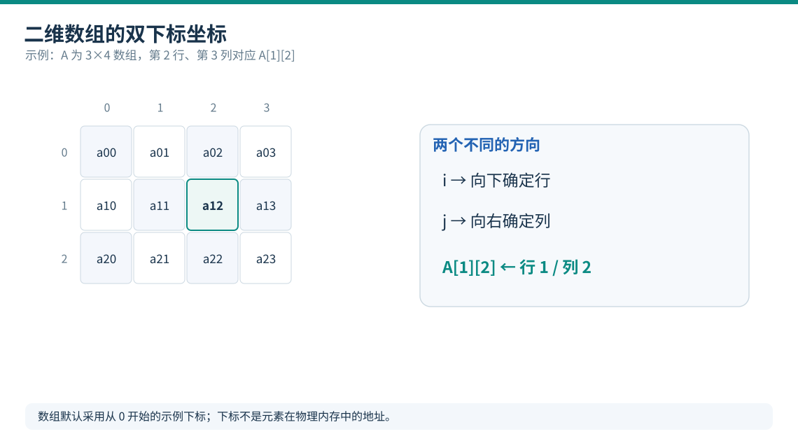

以 $3\times4$ 的矩阵为例，元素 $a_{2,1}$ 位于第 $3$ 行、第 $2$ 列；但如果使用 C++ 的 `A[2][1]`，同样也是采用 **0 基下标**。下标是逻辑坐标，并不意味着内存中存在真正的二维网格。

数组区别于一般线性表的一点是：在经典数组 ADT 中，**维数与各维大小在创建后固定**；常用操作主要是按下标读取、修改，不把中间插入与删除作为基本操作。C++ 中的 `std::vector` 可以动态调整元素个数，这是容器的扩展能力，不能与固定尺寸数组的 ADT 性质混淆。

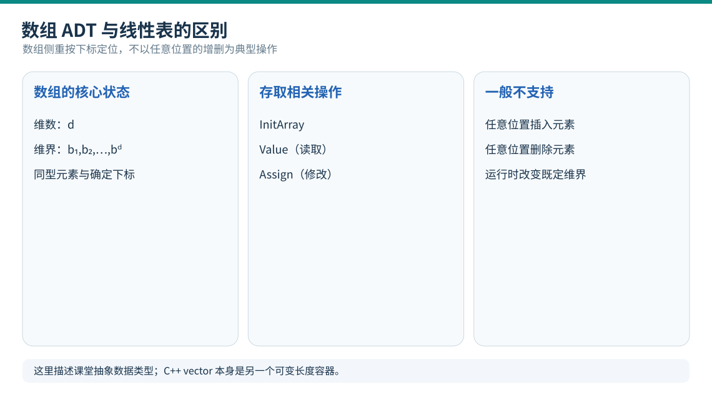

> [!note] 数组的抽象数据类型
> 可概括为 `InitArray`（按维界创建）、`DestroyArray`（销毁）、`Value`（读取指定下标处元素）、`Assign`（写入指定下标处元素）。实现这些操作必须先做**维数与下标合法性**检查。数组逻辑上的相邻关系按哪个下标变化来定义；改变行下标表示上下邻接，改变列下标表示左右邻接。

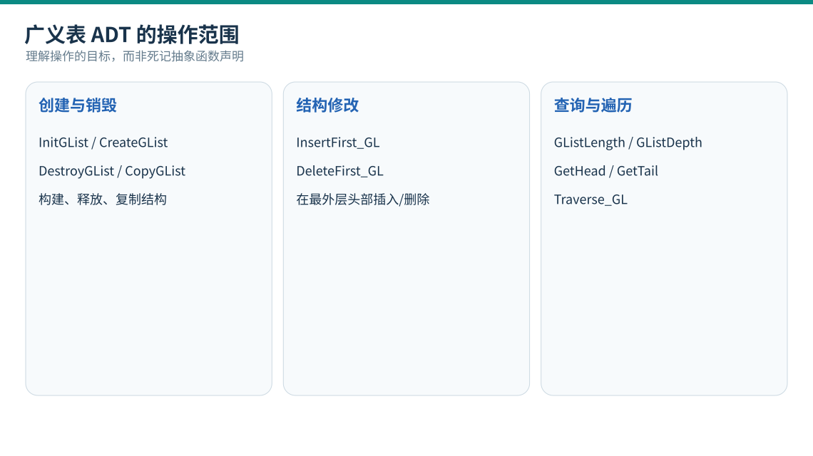

### 1.2 行优先与列优先存储

计算机内存由线性地址组成，多维数组必须按照约定次序依次存入连续单元。最常见两种约定是：

- **行优先（Row-major）**：先连续保存某一行，再保存下一行；C/C++ 内建二维数组通常按这种顺序存放。
- **列优先（Column-major）**：先连续保存某一列，再保存下一列；某些数值计算语言采用这种约定。

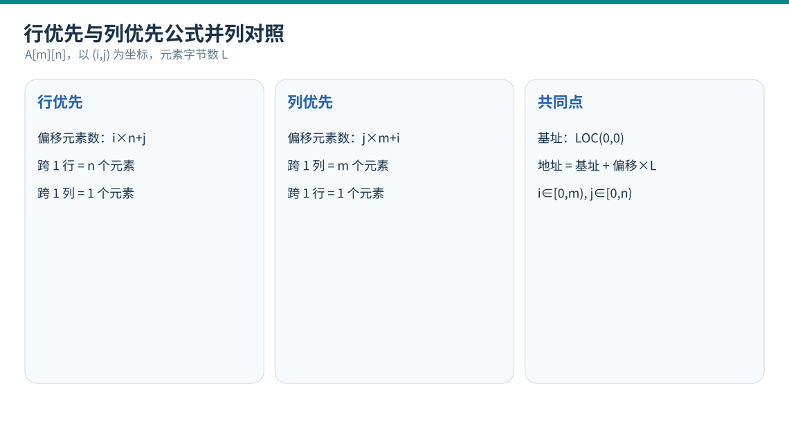
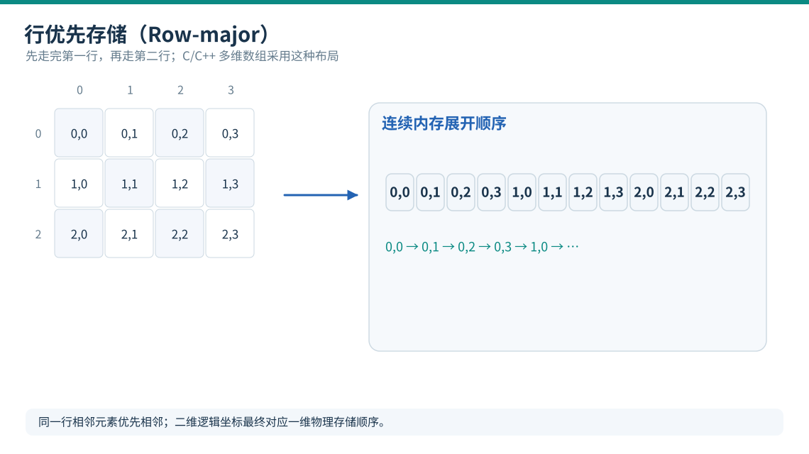
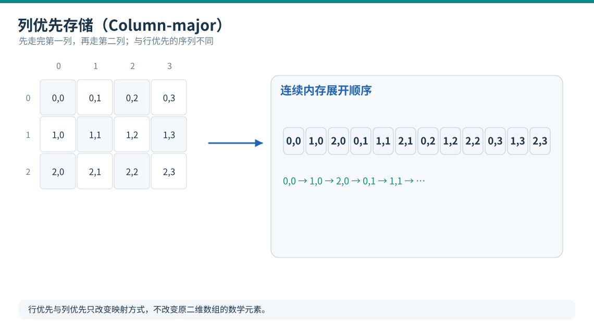

设 $A$ 为 $m\times n$ 的二维数组，单个元素占 $L$ 字节，数组首元素地址为 $B=\mathrm{LOC}(0,0)$。**行优先**时，在 $a_{i,j}$ 前面恰好有 $i$ 个完整行和当前行的 $j$ 个元素，因此

$$
\boxed{\mathrm{LOC}(i,j)=B+(in+j)L}\qquad(0\le i<m,\ 0\le j<n).
$$

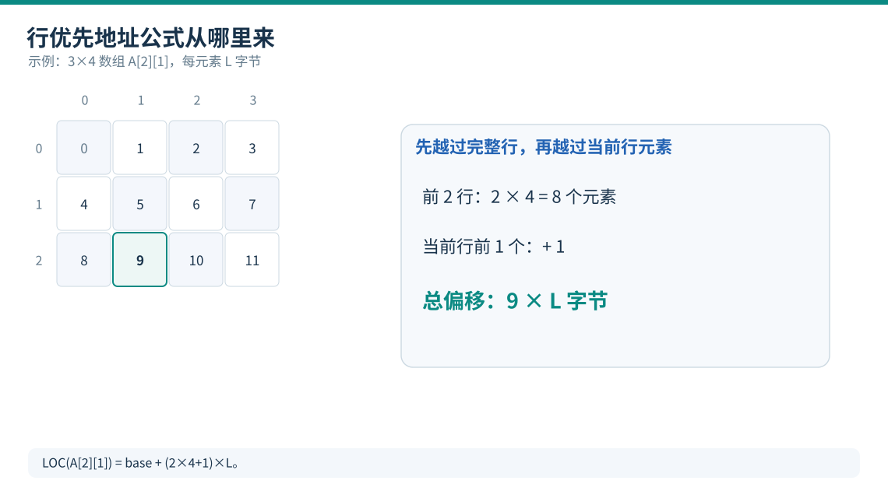

**列优先**时，此元素前面有 $j$ 个完整列和当前列的 $i$ 个元素，所以

$$
\boxed{\mathrm{LOC}(i,j)=B+(jm+i)L}.
$$


> [!example] 地址计算
> 一个 $3\times4$ 行优先整型数组，基地址为 $1000$，每个元素占 $4$ 字节。求 $A[2][1]$ 的地址：它前面有 $2\times4+1=9$ 个元素，故地址为 $1000+9\times4=1036$。如果误用列优先公式，会得到 $1000+(1\times3+2)\times4=1020$，结果不同。

> [!warning] 不要把“行优先”和“行指针数组”混为一谈
> `int a[3][4]` 的全部元素通常连续存放，按行优先规则映射。`int**` 指向的多行动态内存可能分散，并不自动满足上述连续地址公式。还需注意按行存储时用**列数 $n$** 乘行下标，而不是用行数 $m$。

### 1.3 多维数组行优先地址公式的推导

一个 $d$ 维数组的维界为 $b_1,b_2,\ldots,b_d$，下标为 $j_1,\ldots,j_d$。位于第 $k$ 维前面的一个完整单位，实际包含后面各维的 $b_{k+1}b_{k+2}\cdots b_d$ 个元素。因此对应的线性下标是

$$
\begin{aligned}
q&=j_1b_2b_3\cdots b_d+j_2b_3\cdots b_d+\cdots+j_{d-1}b_d+j_d,\\
\mathrm{LOC}(j_1,\ldots,j_d)&=B+qL.
\end{aligned}
$$

令 $c_d=L$，$c_{k-1}=b_kc_k$，亦可表示为 $\mathrm{LOC}=B+\sum_{k=1}^d c_kj_k$。**乘积代表“一个前层下标单位包含多少个后层元素”**，而不是盲记公式。

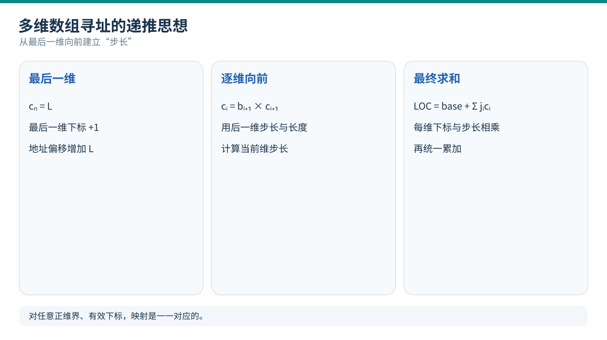

> [!tip] 从任意维界快速算地址：霍纳法
> 依次执行 $q\leftarrow0$、$q\leftarrow qb_k+j_k$（$k$ 从 $1$ 到 $d$），最后地址为 $B+qL$。例如维界 $(2,3,4)$，下标 $(1,2,3)$，则 $q=((1\times3+2)\times4+3)=23$。这比手写一大串乘积更容易实现。

下面是针对任意维数组行优先下标的合法 C++ 实现。`dims` 保存维界，`idx` 保存每维的 0 基下标；返回的是**元素偏移量**，并非字节地址。

```cpp
#include <vector>
#include <stdexcept>
#include <cstddef>

std::size_t rowMajorOffset(const std::vector<int>& dims,
                           const std::vector<int>& idx) {
    if (dims.empty() || dims.size() != idx.size()) { // 维界与下标维数必须对应
        throw std::invalid_argument("dimension mismatch");
    }
    std::size_t offset = 0;                         // 累积线性位置
    for (std::size_t k = 0; k < dims.size(); ++k) { // 从最外层维度开始
        if (dims[k] <= 0 || idx[k] < 0 || idx[k] >= dims[k]) { // 防止越界
            throw std::out_of_range("invalid index");
        }
        offset = offset * static_cast<std::size_t>(dims[k])
                 + static_cast<std::size_t>(idx[k]); // 霍纳法展开
    }
    return offset;                                  // 元素偏移，单位为“个”
}
```

> [!note] 复杂度与边界
> 若有 $d$ 维，计算偏移用 $O(d)$ 时间和 $O(1)$ 额外空间。大型数组还应检查偏移量乘法是否溢出；本例用于展示下标映射过程，未额外构建防溢出的大整数接口。

## 二、矩阵压缩存储：只保存必要的数据

### 2.1 为什么需要压缩？

一个 $m\times n$ 矩阵按普通二维数组保存，空间量级为 $O(mn)$。但是矩阵中可能有大量重复元素、结构上必为零的元素或只有极少数非零元素。**压缩存储**是将可以从规则推断出来的数据省去，而把独立的有效信息映射到更紧凑的空间。


可区分两类对象：**特殊矩阵**（如对称矩阵、三角矩阵、带状矩阵）具有可利用的固定分布规律；**稀疏矩阵**的非零位置数量很少，但分布可能没有规则，通常要同时存储坐标和值。


### 2.2 对称矩阵：只保存一个三角区

若 $n$ 阶矩阵满足 $a_{i,j}=a_{j,i}$，则对称位置的值相等，只需保存下三角（或上三角）中的一个副本，包括主对角线，元素数由 $n^2$ 减至

$$
1+2+\cdots+n=\boxed{\frac{n(n+1)}2}.
$$

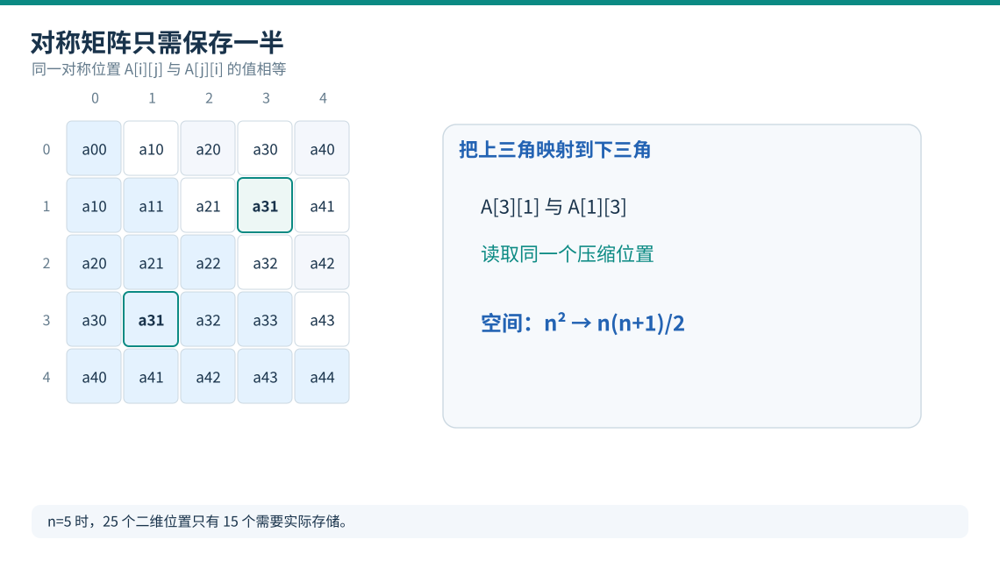

用 **0 基下标**逐行保存下三角：第 $0$ 行存 $1$ 项，第 $1$ 行存 $2$ 项，……，第 $i$ 行存 $i+1$ 项。若 $i\ge j$，之前有 $i(i+1)/2$ 项，行内偏移为 $j$：

$$
\boxed{k=\frac{i(i+1)}2+j}\quad (i\ge j).
$$

任意 $a_{i,j}$ 先将 $(i,j)$ 变换为 $(p,q)=(\max(i,j),\min(i,j))$，再令 $k=p(p+1)/2+q$。

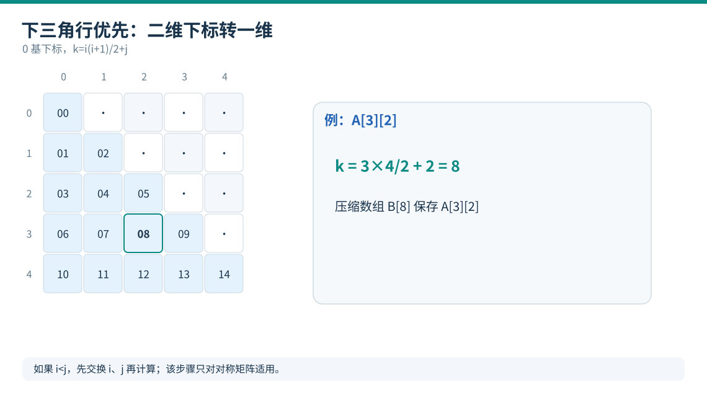

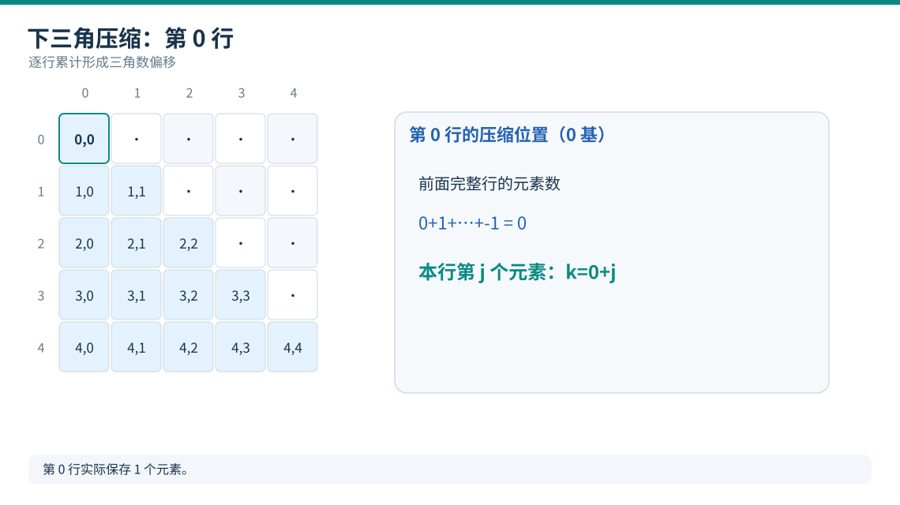
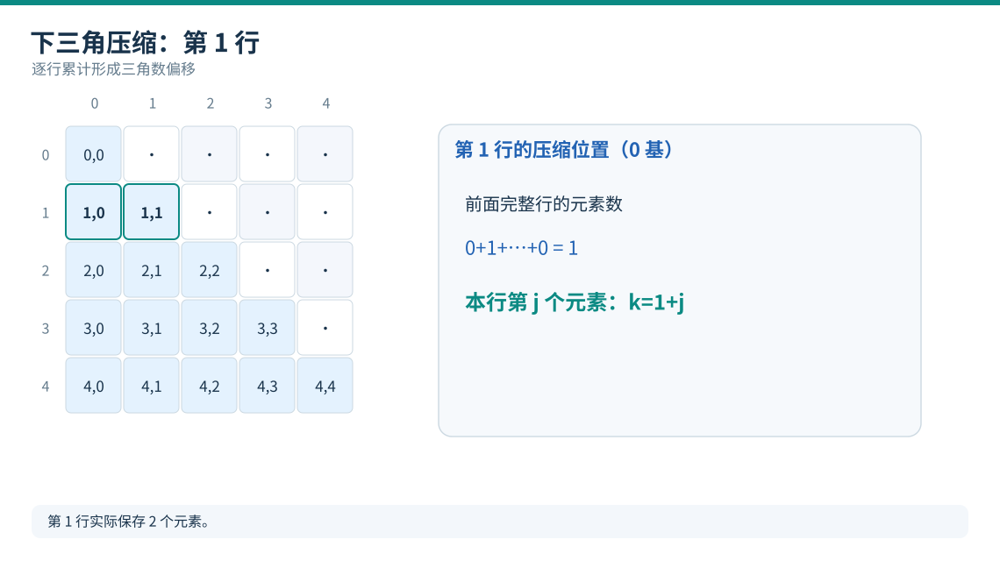
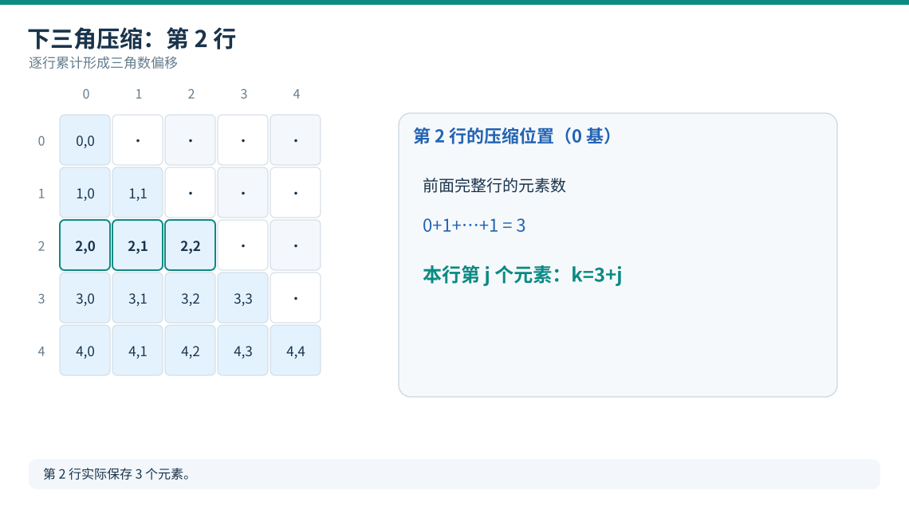
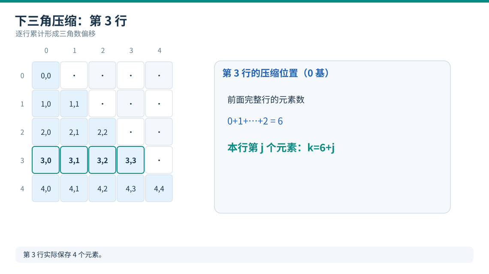
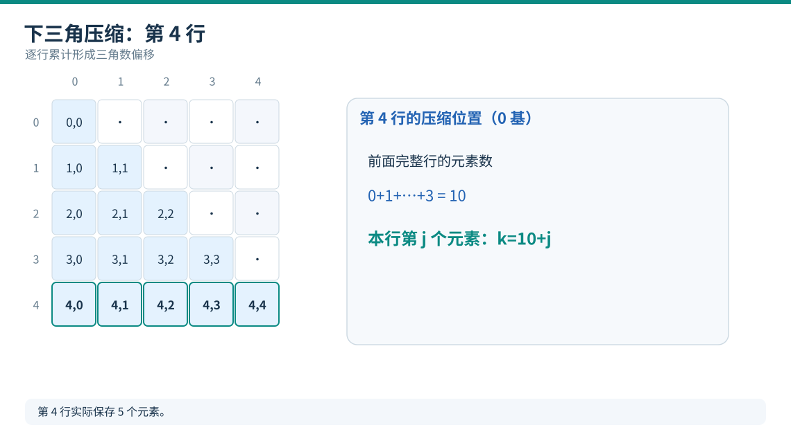

> [!example] 用一张小矩阵反复验证
> 对称矩阵阶数 $n=5$，$a_{3,1}$ 对应 $k=3\times4/2+1=7$；而 $a_{1,3}$ 先交换成下三角的 $(3,1)$，位置也为 $7$。检验第一行从 $k=0$ 开始、最后一行末端为 $k=n(n+1)/2-1$，可排查大量偏移一位的错误。

用 `std::vector<int>` 存储该下三角，**读取和修改上下对称位置实际上操作同一个元素**：

```cpp
#include <vector>
#include <stdexcept>
#include <algorithm>

struct SymmetricMatrix {
    int n;                          // 矩阵阶数
    std::vector<int> data;          // 下三角压缩数组
};

int symmetricGet(const SymmetricMatrix& a, int i, int j) {
    if (i < 0 || j < 0 || i >= a.n || j >= a.n) { // 下标边界检查
        throw std::out_of_range("matrix index");
    }
    int p = std::max(i, j);         // 选下三角对应行
    int q = std::min(i, j);         // 选下三角对应列
    return a.data[p * (p + 1) / 2 + q]; // 映射到唯一存储位置
}
```

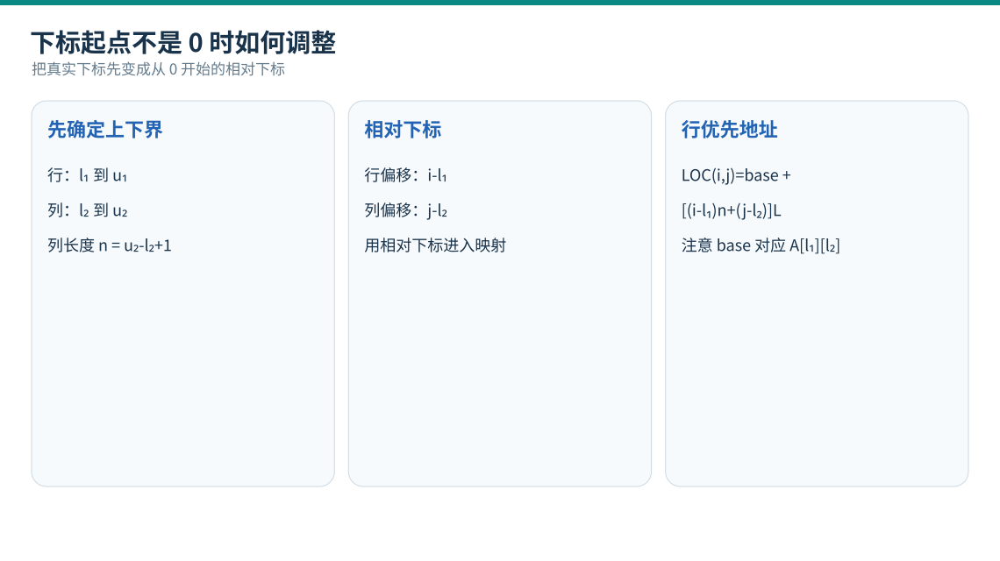

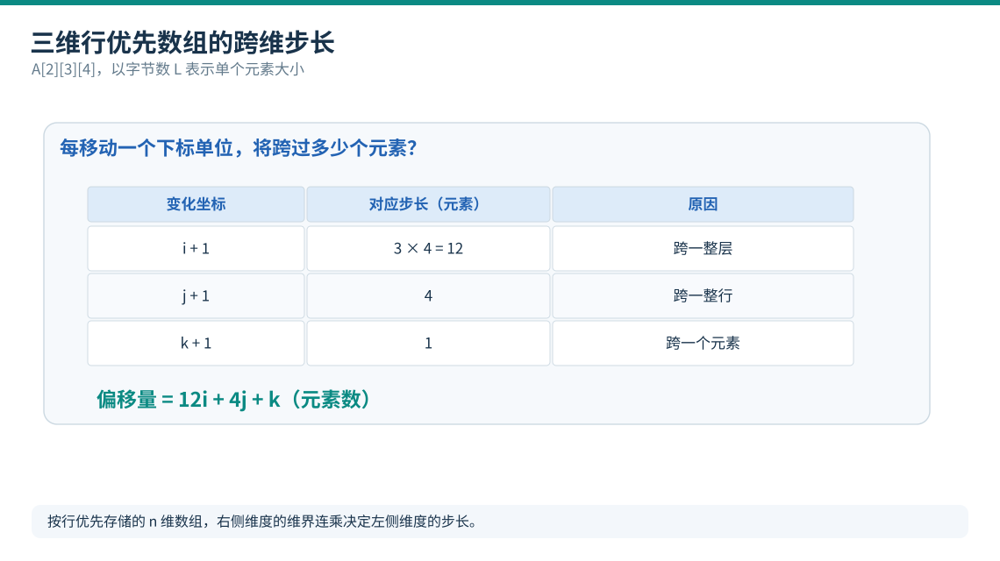

### 2.3 上三角矩阵的行优先映射

下三角矩阵主对角线上方的值都等于共同常数 $c$（特殊情况 $c=0$）；上三角矩阵则是主对角线下方都相等。规则区保留 $n(n+1)/2$ 项，若常数 $c$ 需要额外保存，还需 **1 个**单元。

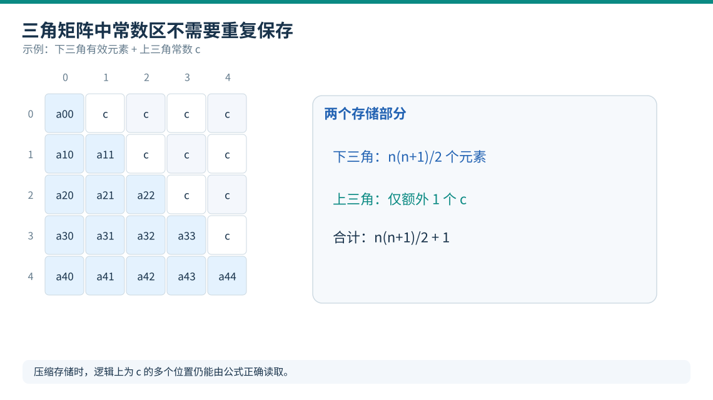

对于逐行保存**上三角**（包含主对角线）的 0 基下标 $0\le i\le j<n$：第 $0$ 行存 $n$ 项，第 $1$ 行存 $n-1$ 项，……，此前 $i$ 行总数为

$$
n+(n-1)+\cdots+(n-i+1)=\frac{i(2n-i+1)}2,
$$

当前行中 $a_{i,j}$ 的偏移为 $j-i$，故

$$
\boxed{k=\frac{i(2n-i+1)}2+(j-i)}\qquad(0\le i\le j<n).
$$

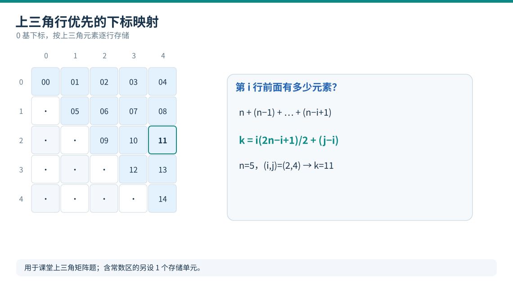

> [!warning] 三角矩阵与对称矩阵不同
> 对称矩阵的另一半由已存储的对应位置镜像恢复；三角矩阵的另一半**统一恢复为常数 $c$**，不可以交换 $(i,j)$ 后取镜像值。若非压缩区域全部为零，可以直接隐含该常数，无需专门分配一个存储元素。

### 2.4 三对角矩阵：按行只存三条对角线

**三对角矩阵**满足 $|i-j|>1$ 的位置全部为零，仅主对角线、紧邻的上下两条对角线可能非零。对于 $n\ge2$，三条对角线的元素数为 $n+(n-1)+(n-1)=\boxed{3n-2}$。

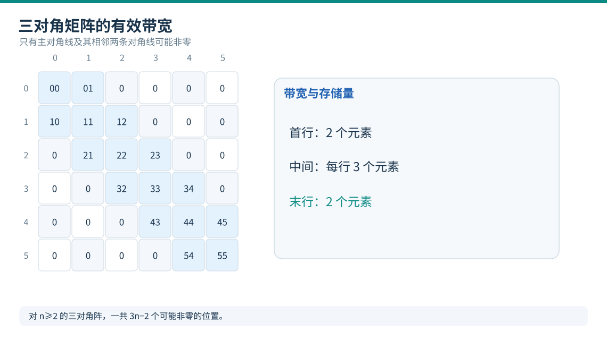

若将有效位置按行优先压缩，使用 0 基下标：第 $0$ 行存 $a_{0,0},a_{0,1}$；中间行依次存 $a_{i,i-1},a_{i,i},a_{i,i+1}$；最后一行存两项。由完整行之前的元素个数和当前行内偏移得到一个统一式：

$$
\boxed{k=2i+j}\qquad(0\le i,j<n,\ |i-j|\le1).
$$

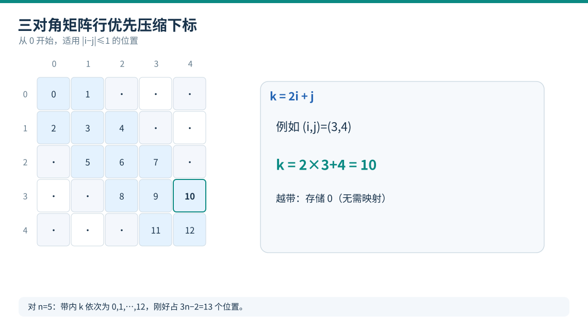

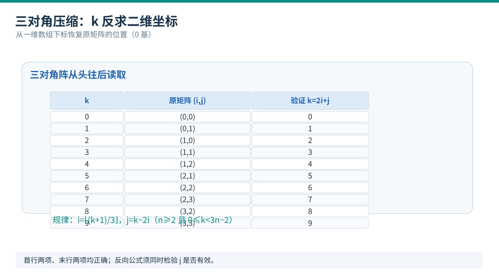

要反过来由 $k$ 找 $(i,j)$（$n\ge2$、$0\le k<3n-2$），可写成分段公式：

$$
(i,j)=\begin{cases}
(0,k), & 0\le k<2,\\
\left(1+\left\lfloor\frac{k-2}{3}\right\rfloor,\ k-2\left[1+\left\lfloor\frac{k-2}{3}\right\rfloor\right]\right),&2\le k<3n-2.
\end{cases}
$$

对 $k=0,1,2,3,4,5,\ldots$，位置依次是 $(0,0),(0,1),(1,0),(1,1),(1,2),(2,1),\ldots$。当 $n=1$，只有唯一元素 $(0,0)$，需单独看待。

> [!tip] 公式比死记更重要
> 牢记“**前面完整行存了多少个 + 当前行内排第几个**”。对 1 基坐标 $(i,j)$、0 基压缩数组 $B[k]$，相同关系变成 $\boxed{k=2i+j-3}$；如果 $B$ 自身也从 $1$ 编号，则改成 $k=2i+j-2$。明确下标起点才能保证答案无歧义。

### 2.5 分块准对角矩阵和带状矩阵

若主对角线上是连续 $m$ 个 $2\times2$ 小方块、块外全部为零，那么总阶数为 $2m$，一共只存 $4m$ 项。每个块内部按行优先放入 4 个值。使用 1 基矩阵下标 $(i,j)$，0 基存储数组下标 $k$，令 $q=\lfloor(i-1)/2\rfloor$（所在块序号），则只对 $\lfloor(i-1)/2\rfloor=\lfloor(j-1)/2\rfloor$ 的位置存储，且

$$
\boxed{k=4q+2((i-1)\bmod2)+((j-1)\bmod2)}.
$$

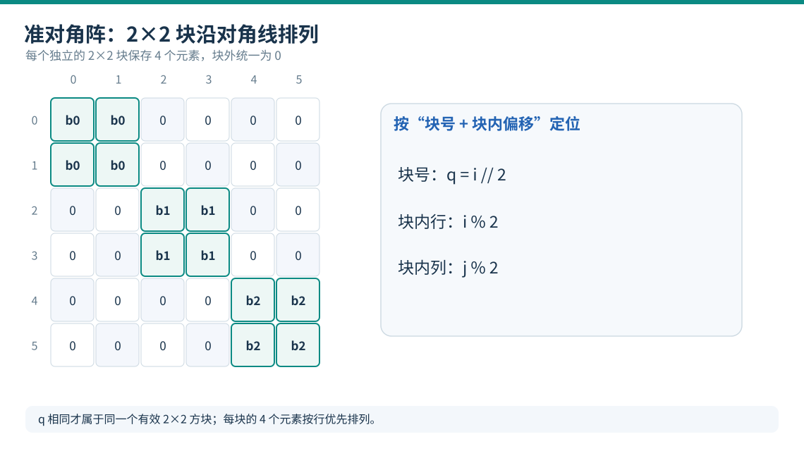
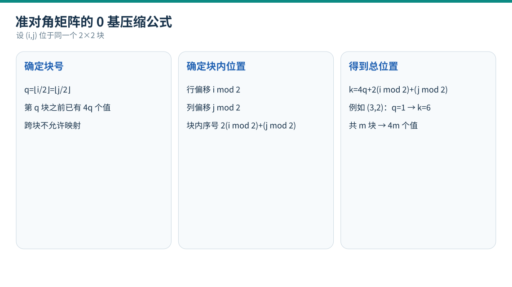

对于一般带状矩阵，压缩思路一样：先确定第 $i$ 行合法的列区间，再统计此前各行合法元素数，最后叠加该行内位移。**切忌把 $3n-2$ 的三对角公式直接推广到带宽任意的情况**：首尾行的实际元素数不同。

> [!example] 三对角与块矩阵的核验
> $n=5$ 的三对角矩阵应该有 $13$ 个压缩元素，下标 $0\sim12$。若 $2\times2$ 块矩阵有 $m=3$ 个块，那么 $a_{5,6}$ 在第 $3$ 块内，$q=2$，其压缩下标 $k=8+0+1=9$；而 $a_{4,5}$ 跨块，属于结构零元，不存储。

## 三、稀疏矩阵：用坐标和值代替大量零元素

### 3.1 稀疏因子和存储选择

一个 $m\times n$ 矩阵有 $t$ 个非零元素，其**稀疏因子**为

$$
\delta=\frac{t}{mn}.
$$

若 $t\ll mn$，把每个零都存起来会浪费大量内存。课程中给出 $\delta\le0.05$ 作为一种**常用经验判据**，实际工程中是否采用稀疏表示还与索引大小、数据类型、访问模式有关，并非固定的数学定义。


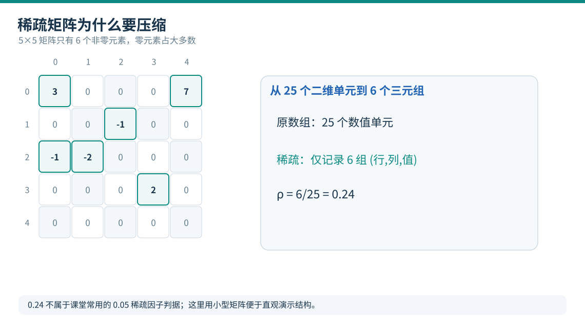

稀疏矩阵的常见基本操作包括创建、销毁、输出、复制、加减、乘法及转置。实现时不仅要保存有效值，还需要高效找到指定行、指定列的非零元素。压缩表示的主要取舍是：**存储更省，但随机访问可能变慢；不同操作适合不同索引结构。**


### 3.2 三元组顺序表

每个非零元记为 $(i,j,v)$，其中 $i$ 是行下标、$j$ 是列下标、$v$ 是对应值。三元组表通常按 **先行后列的字典序**排列：先比较行，下标相同再比较列。假设同一位置最多出现一个三元组，非零元素个数为 $t$，则仅计三元组字段约需 $3t$ 个存储单元，另有矩阵的行数、列数、非零元个数等元数据。

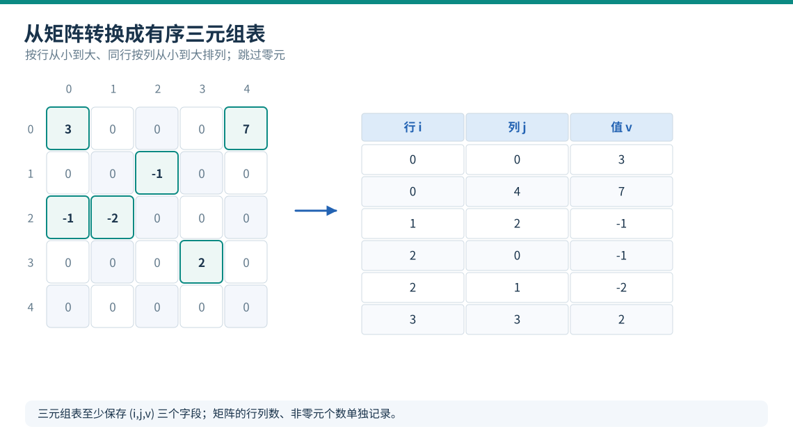
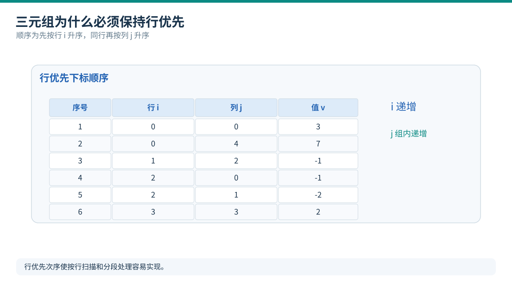

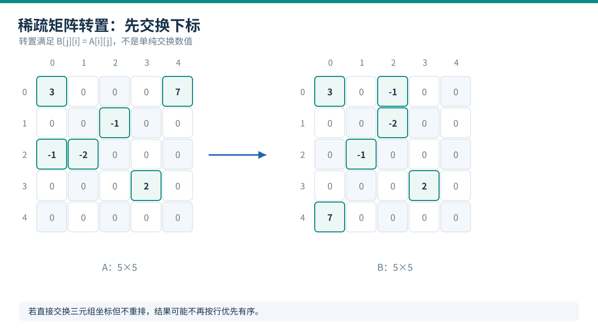

下面给出具体的 C++ 数据结构，不使用原课件中未定义的类型名。 `data` 永远只存非零元，输入须保证三元组顺序符合行优先规范：

```cpp
#include <vector>

struct Triple {
    int row;                    // 0 基行下标
    int col;                    // 0 基列下标
    int value;                  // 此处使用 int 非零值
};

struct SparseMatrix {
    int rows;                   // 矩阵行数
    int cols;                   // 矩阵列数
    std::vector<Triple> data;   // 按 (row, col) 升序排列
};
```

> [!warning] 三元组表与元数据不能写成互相覆盖的 `union`
> 三元组数组与 `rows/cols/非零元数` 必须**同时有效**。若将两者作为互斥的联合体成员，写入其中之一会覆盖另一个，无法正确构成稀疏矩阵。直接用结构体保存不同字段，更符合实际内存语义。

### 3.3 稀疏矩阵转置：正确性与有序性是两个问题

普通矩阵转置的规则是 $b_{j,i}=a_{i,j}$，矩阵从 $m\times n$ 变成 $n\times m$。对于每个三元组只需交换 `row`、`col`，但这样得到的序列**未必**符合转置后矩阵的行优先排序，所以还必须安排新的输出位置。

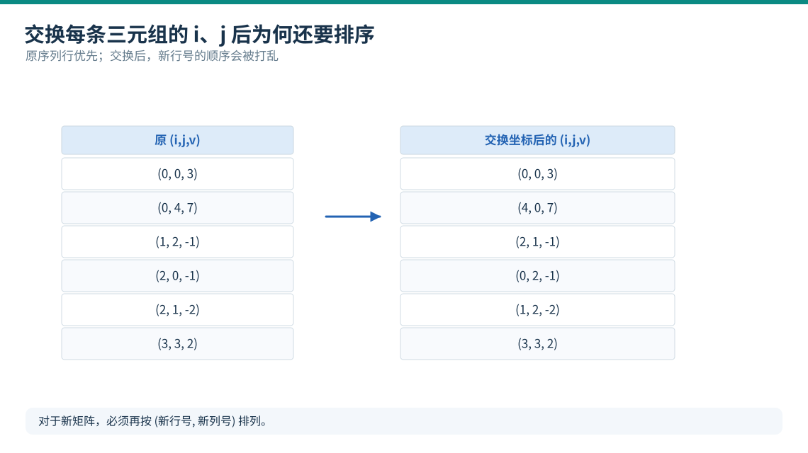

#### 方法一：按原矩阵的列反复扫描

从原矩阵第 $0$ 列开始，依次扫描全部 $t$ 个三元组；找到该列的元素就交换其坐标写入结果。每一列筛出的元素原本按行优先排列，因此生成的新行内部按列升序排列。

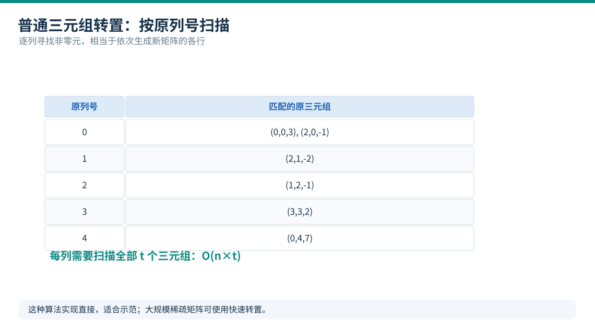

```cpp
SparseMatrix transposeByScanning(const SparseMatrix& a) {
    SparseMatrix b{a.cols, a.rows, {}};             // 转置后的行列数交换
    b.data.reserve(a.data.size());                  // 预留足够的非零元空间
    for (int col = 0; col < a.cols; ++col) {        // 按原矩阵的列扫描
        for (const Triple& x : a.data) {            // 每列都检查所有非零元
            if (x.col == col) {                     // 属于当前原列
                b.data.push_back({x.col, x.row, x.value}); // 交换坐标
            }
        }
    }
    return b;                                       // 结果仍是行优先有序
}
```

这种算法时间复杂度为 $O(nt)$（$n$ 是原矩阵列数，$t$ 是非零元数）；当 $n$ 较大时，重复检查三元组造成大量无用扫描。

#### 方法二：快速转置——统计、前缀和、安置

核心思想：**提前确定每一原列在结果中对应的新行从哪个位置开始**。用 `num[j]` 统计原矩阵第 $j$ 列有多少非零元；用 `cpot[j]` 表示转置结果中第 $j$ 行下一个可写位置。对 0 基编号：

$$
\mathrm{cpot}[0]=0,\qquad
\mathrm{cpot}[j]=\mathrm{cpot}[j-1]+\mathrm{num}[j-1]\ (j\ge1).
$$

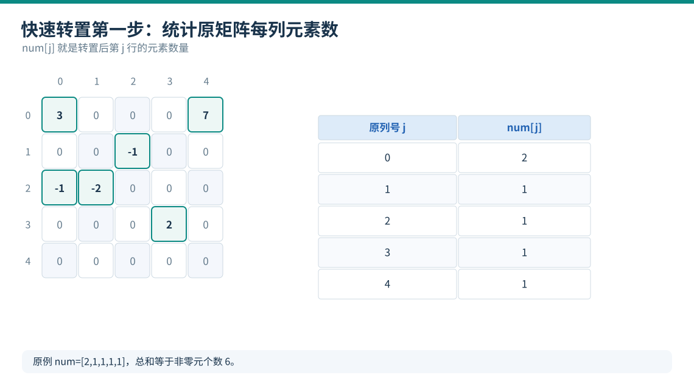
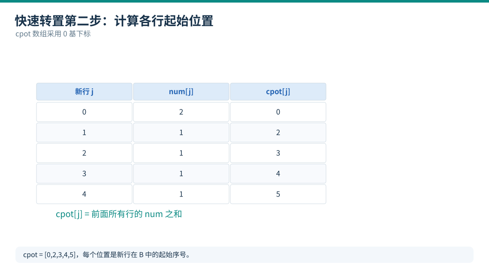
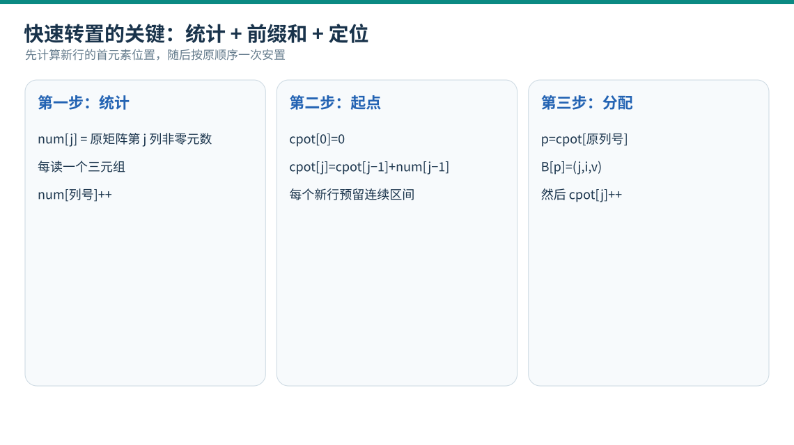

具体流程分四步：①统计每列出现次数；②累加前面各列的次数，得到行起点；③依次读取原三元组，将它写入 `b.data[cpot[x.col]]`；④写入后 `cpot[x.col]++`，为下一个同列三元组让出位置。

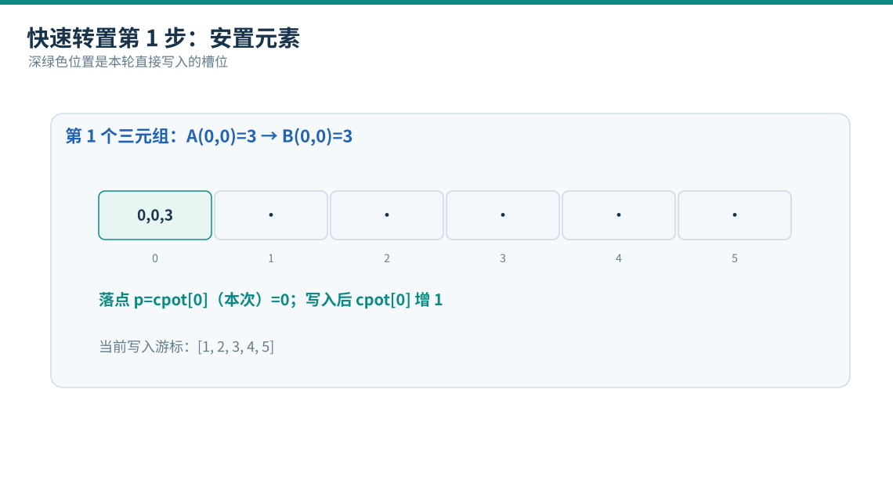
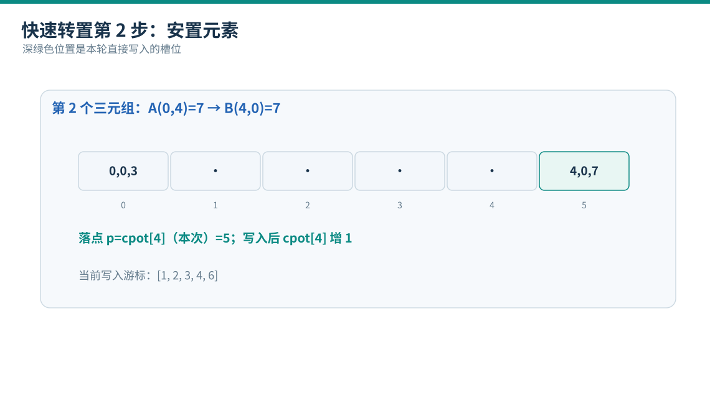
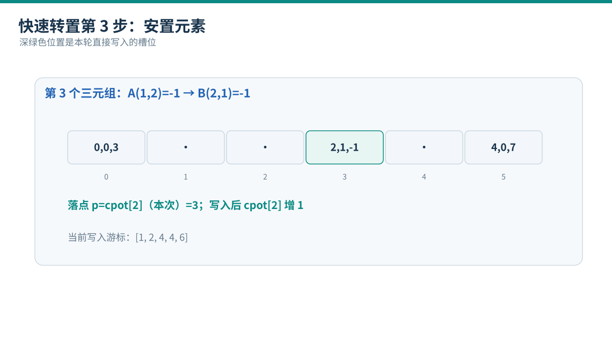
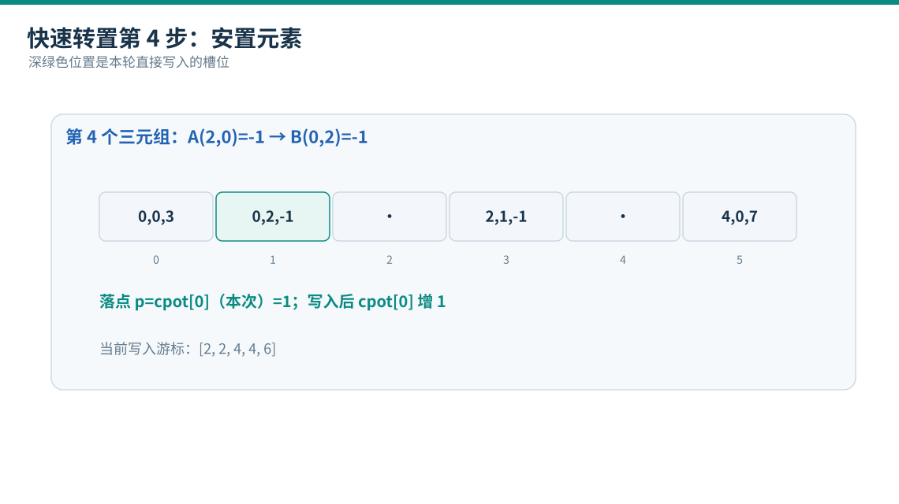
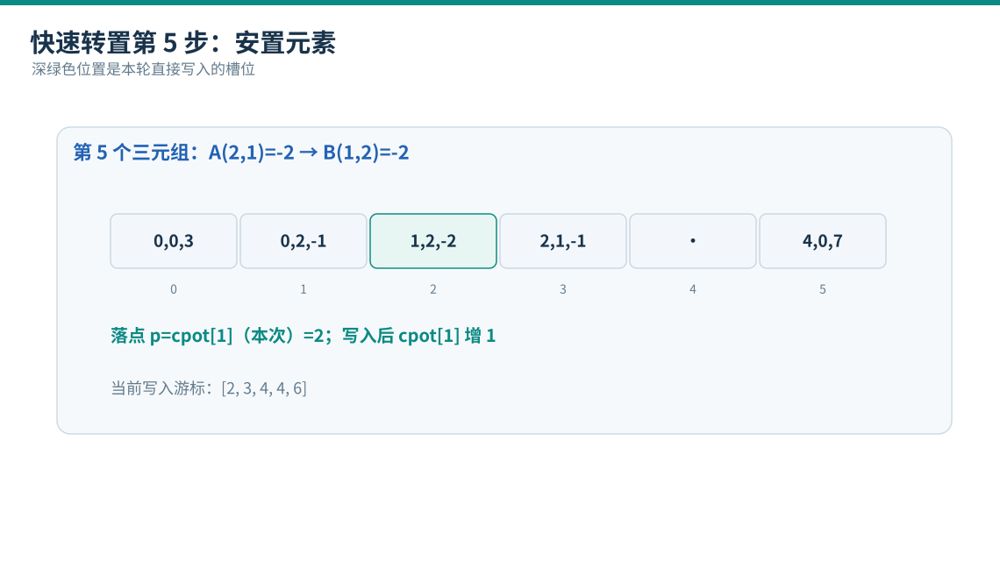
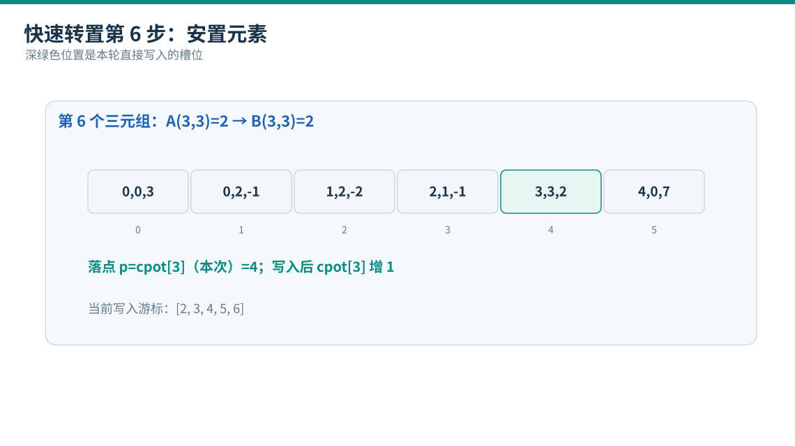
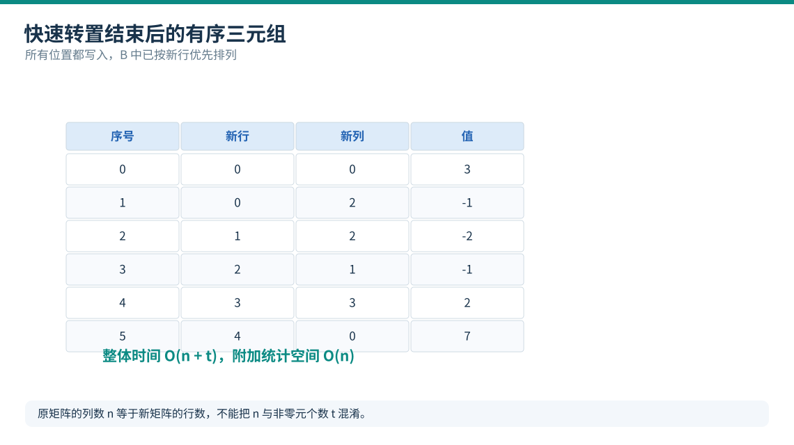

下面代码假定输入三元组按原矩阵行优先有序、坐标合法且无重复，结果维数和排序都保持正确：

```cpp
#include <vector>

SparseMatrix fastTranspose(const SparseMatrix& a) {
    SparseMatrix b{a.cols, a.rows, {}};               // 行列数交换
    b.data.resize(a.data.size());                     // 结果要随机定位写入
    std::vector<int> num(a.cols, 0);                  // num[j]：原第 j 列的非零元数
    for (const Triple& x : a.data) {                  // 第一遍：统计频次
        ++num[x.col];
    }
    std::vector<int> cpot(a.cols, 0);                 // cpot[j]：该新行的写入游标
    for (int j = 1; j < a.cols; ++j) {                // 前缀和：求每行起点
        cpot[j] = cpot[j - 1] + num[j - 1];
    }
    for (const Triple& x : a.data) {                  // 第二遍：逐元安置
        int p = cpot[x.col]++;                        // 取当前位置后向右移动一格
        b.data[p] = {x.col, x.row, x.value};          // 交换行列并写入
    }
    return b;                                         // O(n+t) 时间，O(n+t) 结果/辅助空间
}
```


> [!important] 快速转置的三个不变量
> 1. `b.rows == a.cols`、`b.cols == a.rows`、`b.data.size() == a.data.size()`。
> 2. 每个输入 $(i,j,v)$ 恰好写出一个 $(j,i,v)$，既无丢失也无重复。
> 3. 输入按行优先有序时，同一原列被扫描的原行号递增；因此放入转置后同一行的元素列号也递增，结果仍然有序。

> [!note] 算法的真实复杂度
> 对一个 $m\times n$、有 $t$ 个非零元的矩阵，快速转置时间为 $O(n+t)$；额外计数/位置向量空间为 $O(n)$，输出三元组本身占 $O(t)$。不要误写成 $O(mn)$，也不能把结果空间全部当作“额外辅助空间”。当 `a.cols==0` 时，计数向量为空，三个循环都不会进入，依然可以正确返回一个空维矩阵。

### 3.4 行逻辑链接顺序表：加上每行的起始位置

普通三元组表按行连续，但要直接定位第 $r$ 行仍须搜索。于是增加一个行位置向量 `rpos`：`rpos[r]` 表示第 $r$ 行非零元在三元组数组中的**首个位置**，再添加哨兵 `rpos[rows]=t`。那么第 $r$ 行的全部三元组恰好是半开区间

$$
\boxed{\mathrm{data}[\mathrm{rpos}[r],\;\mathrm{rpos}[r+1])}.
$$

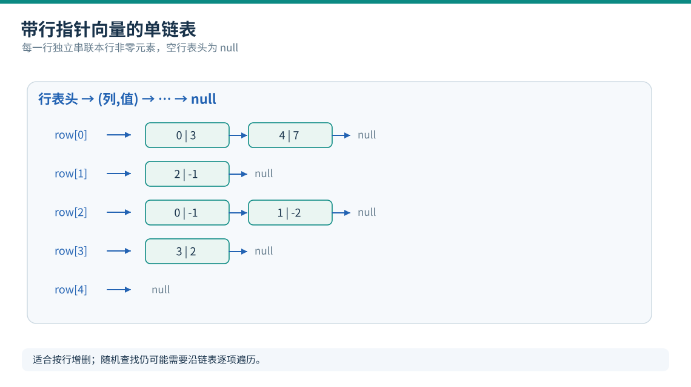
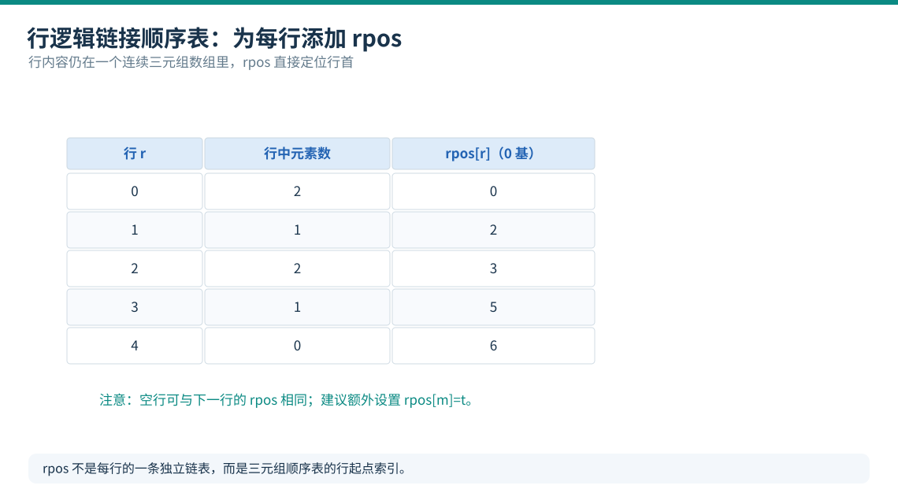

对于空行，`rpos[r]==rpos[r+1]`，完全不必插入虚假三元组。也可以建立 `rpos` 时先计数，再取前缀和；思想与快速转置的 `num/cpot` 同源。

```cpp
#include <vector>

std::vector<int> buildRowPos(const SparseMatrix& a) {
    std::vector<int> pos(a.rows + 1, 0);      // 多一个末尾哨兵
    for (const Triple& x : a.data) {          // 统计每行元素数
        ++pos[x.row + 1];                     // 先计到下一格
    }
    for (int r = 1; r <= a.rows; ++r) {      // 前缀和转为行起点
        pos[r] += pos[r - 1];
    }
    return pos;                               // 第 r 行范围 [pos[r], pos[r+1])
}
```

> [!tip] 类比
> 稀疏行位置向量就是“按行分桶后的偏移表”：数据仍然连续存放，但多了一张告诉你各行从哪里开始的索引。因此顺序扫描行和按行定位通常很方便，但在中间插入新非零元可能引起大量搬移。

### 3.5 行链表、十字链表与结构选择

除了连续三元组，稀疏矩阵还可使用**带行头指针的单链表**：每行各自链接本行非零元，每个结点至少需要“列下标、值、下一结点指针”。它适合按行增删、按行访问，但按列访问并不理想。


**十字链表（交叉链表）**为每个非零元同时建立横向和纵向链接。结点有五类信息：行下标、列下标、值、指向同行下一非零元的 `right`、指向同列下一非零元的 `down`；另有行头指针数组和列头指针数组。这样一份值既属于行链，也属于列链。


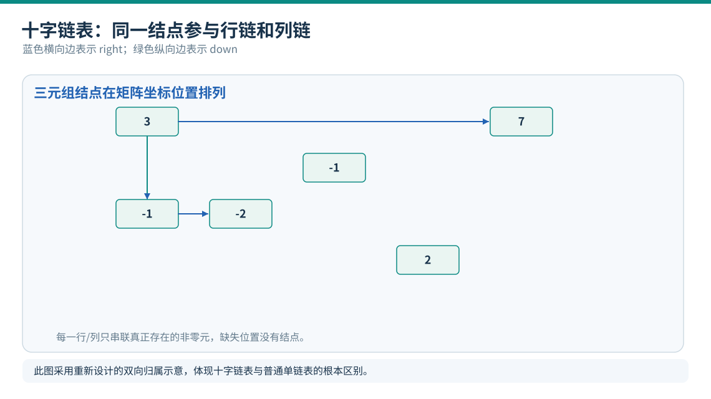

```cpp
struct CrossNode {
    int row;                        // 当前非零元的行
    int col;                        // 当前非零元的列
    int value;                      // 当前非零元的值
    CrossNode* right = nullptr;     // 同一行的下一个非零元
    CrossNode* down = nullptr;      // 同一列的下一个非零元
};
```

> [!warning] 内存估算是“字段计数”，不是精确字节数
> 教学中可把三元组表的字段量粗略写为 $3t$，行链表约为 $3t+m$，十字链表约为 $5t+m+n$；但实际 C++ 中指针宽度、结构体对齐、`vector` 容量等因素都会影响字节数。一个十字链表结点由两组链表**共用**，不能为行、列各自创建相互独立的副本再视作同一结点。


| 表示方式 | 核心结构 | 常见优势 | 主要代价 |
| --- | --- | --- | --- |
| 普通三元组表 | 连续有序 `(row,col,value)` | 体积紧凑、顺序扫描快 | 指定行/列定位及动态修改不一定方便 |
| 行逻辑链接顺序表 | 三元组 + `rpos` | 可快速定位一整行 | 插入可能挪动后续三元组 |
| 带行头指针单链表 | 每行一条非零元链 | 按行增删灵活 | 访问某列较慢 |
| 十字链表 | 行头、列头 + 双方向结点 | 行列双向遍历、动态修改方便 | 多指针、更复杂的维护逻辑 |

### 3.6 稀疏矩阵基本运算如何组织

如果两个稀疏矩阵维数相同且三元组都按 `(row,col)` 有序，那么**加法**可以像两个有序表归并那样进行：

1. 比较当前两个三元组的位置，较小位置的元素直接输出；
2. 若位置相同，输出两值之和（**若和为零则不保存**）；
3. 其中一方结束后，追加另一方剩余三元组。

减法可以在上述框架中将第二个矩阵的值取相反数。乘法则要关联左矩阵的列与右矩阵的行，不是直接让坐标相同的三元组相乘。


> [!example] 稀疏加法的典型边界
> 假设 $A$ 在 $(1,3)$ 的值为 $5$，$B$ 在该处值为 $-5$，则 $A+B$ 的这个位置为零，结果三元组应**删去**。若只机械合并两个序列而不删除零和，结果便不再满足“三元组只存非零值”的约定。

## 四、广义表：列表的元素可以继续是列表

### 4.1 广义表的递归定义与五种典型形式

**广义表（Generalized List）**是由有限个元素构成的有序序列，其中每个元素既可以是不可再分的**原子**，也可以是另一张**广义表（子表）**。记

$$
L=(\alpha_1,\alpha_2,\ldots,\alpha_n),\qquad
\alpha_i\in\text{AtomSet}\ \text{或}\ \alpha_i\in\text{GList}.
$$

递归定义的含义是：若某个元素本身又是列表，就对它使用同一套规则继续分析。因此，广义表既是**有序线性序列**，又允许在元素处向下进入多个**嵌套层次**。这一点有别于“普通线性表的每个元素都只是单值”的情形。

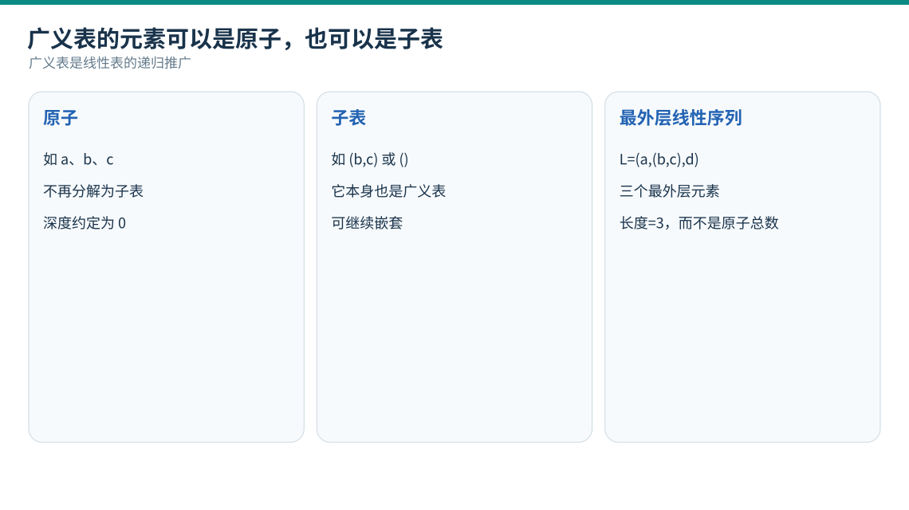
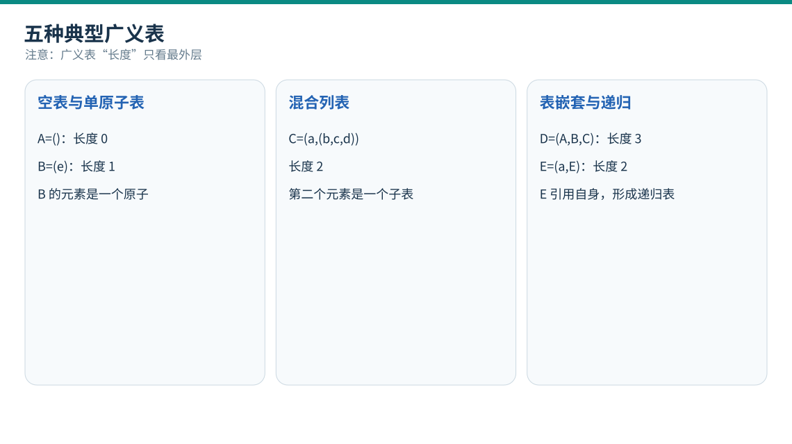

典型例子可写作：

| 广义表 | 最外层元素 | 长度 | 深度 |
| --- | --- | ---: | ---: |
| $A=()$ | 无 | 0 | 1 |
| $B=(e)$ | 原子 `e` | 1 | 1 |
| $C=(a,(b,c,d))$ | `a`、`(b,c,d)` | 2 | 2 |
| $D=(A,B,C)$ | 三个子表引用 | 3 | 依实际展开内容而定 |
| $E=(a,E)$ | `a`、对自身的引用 | 2 | $\infty$（循环展开） |

其中 $D$ 在 $A=()$、$B=(e)$、$C=(a,(b,c,d))$ 且都实际引用这三个子表时，可以展开为 $D=((),(e),(a,(b,c,d)))$，深度为 $3$；引用共享与复制展开是不同的存储策略，但从列表值的结构计算可得到相同深度。

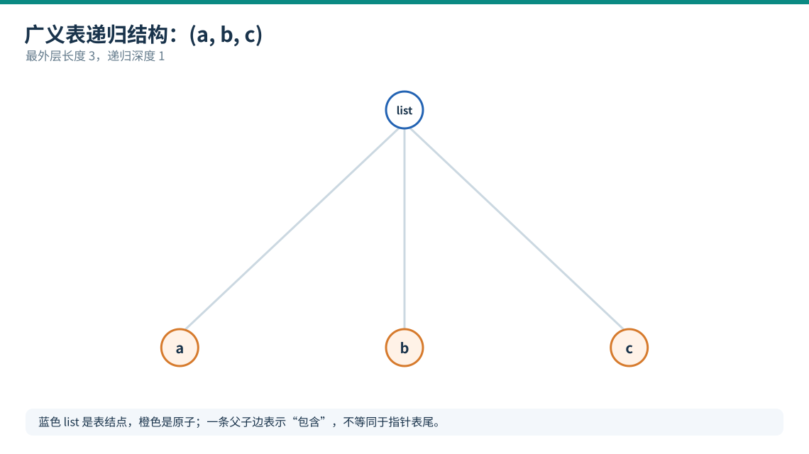
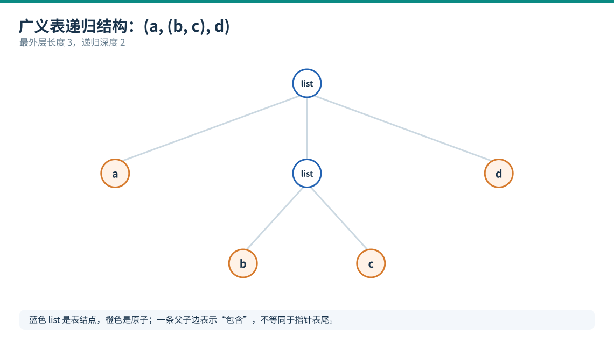
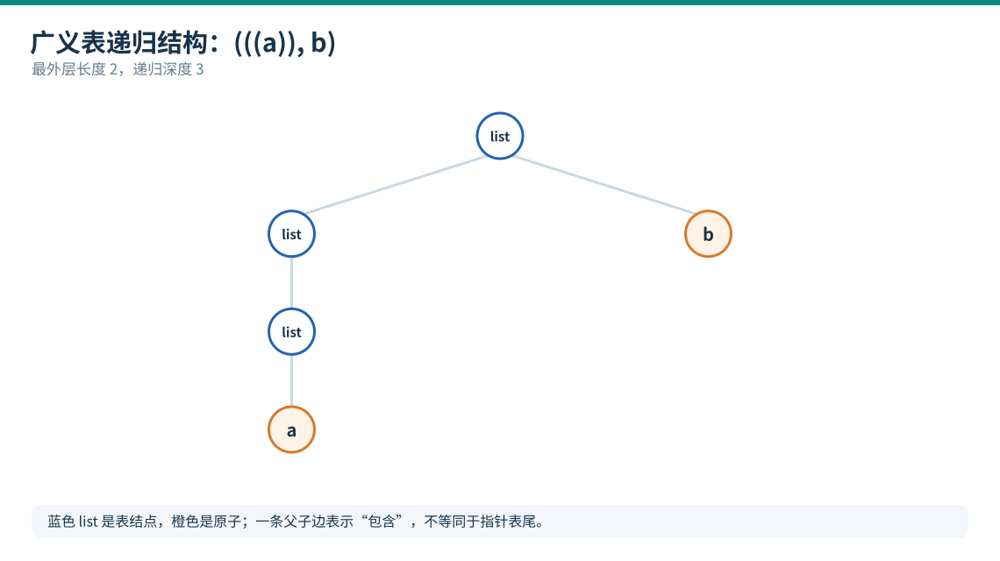
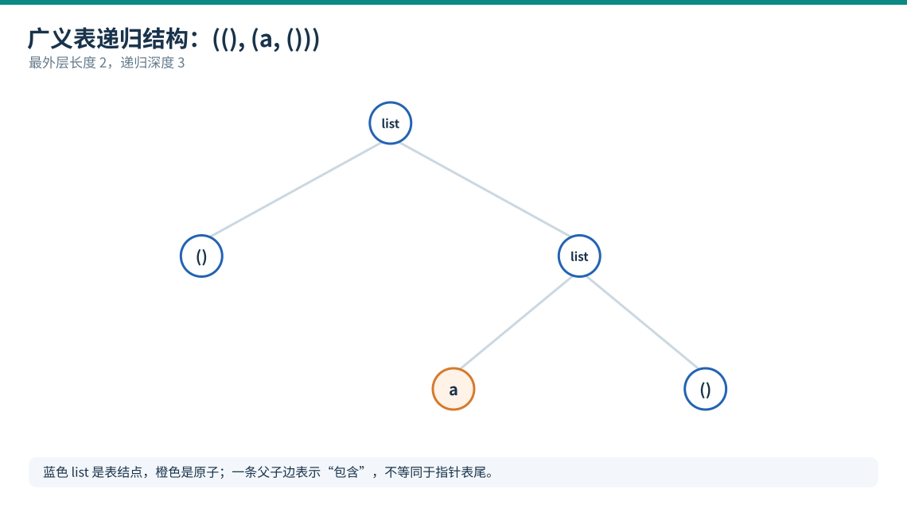

> [!warning] 递归表不是无限长的顶层序列
> $E=(a,E)$ 最外层只有两个元素，所以**长度为 2**；但第二个元素再展开仍然是 $E$，形成无限嵌套，故深度不再是有限数。仅适用于无环结构的普通递归深度算法若直接处理它，将陷入无限递归。

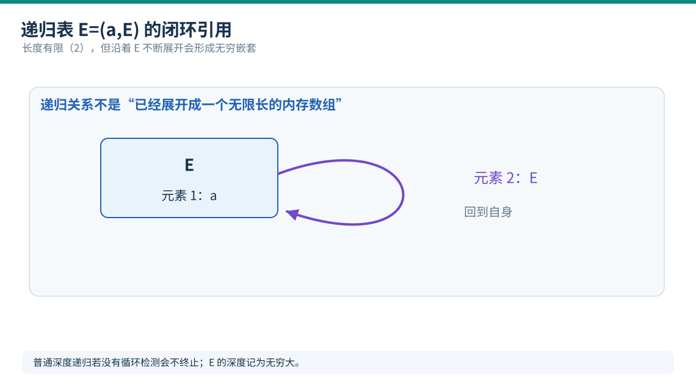


### 4.2 长度：只计算最外层元素个数

设 $L=(a,(b,c),d)$。最外层三个元素依次是原子 $a$、子表 $(b,c)$、原子 $d$，因此 $\operatorname{Length}(L)=3$，而不是把内外的四个原子全部数一遍。更复杂的 $L=((a,b),(),((c)),d)$ 也是长度 $4$。


> [!tip] 怎么数长度
> 找到该广义表**最外层的一对括号**，只数这对括号直接包含的元素。嵌套子表内部的逗号不分割外层元素；空表 `()` 没有元素，长度为 $0$。

### 4.3 深度：沿最深的嵌套路径计数

课程采用的约定为：**原子的深度为 $0$，空表的深度为 $1$**。对有限、无环的表，有

$$
\operatorname{Depth}(L)=
\begin{cases}
1,&L=(),\\
1+\displaystyle\max_{1\le i\le n}\operatorname{Depth}(\alpha_i),&L=(\alpha_1,\ldots,\alpha_n),\ n\ge1.
\end{cases}
$$

这里的 $\operatorname{Depth}(\alpha_i)$ 在 $\alpha_i$ 是原子时取 $0$。例如 $\operatorname{Depth}(a)=0$，$\operatorname{Depth}((a))=1$，$\operatorname{Depth}(((a)))=2$。**深度看最深一支，而不是把所有元素深度相加**。


> [!example] 同时辨别长度与深度
> $L=(a,((b,c)),(),d)$：外层元素分别是 `a`、`((b,c))`、`()`、`d`，长度是 $4$。最深的分支为 $L\to ((b,c))\to(b,c)$，所以深度是 $3$。特别注意：`()` 作为外层的一个元素，虽然它自己长度 $0$，却使外层长度增加 $1$。

### 4.4 表头与表尾：返回类型不同

对**非空**广义表 $L=(\alpha_1,\alpha_2,\ldots,\alpha_n)$，定义

$$
\boxed{\operatorname{Head}(L)=\alpha_1},\qquad
\boxed{\operatorname{Tail}(L)=(\alpha_2,\ldots,\alpha_n)}.
$$

**表头是第一个元素**，可能是原子，也可能是子表；**表尾是删去第一个元素后，剩余元素形成的一张表**，因而必为表，可能是空表。它们都不应被含糊地称为“第一个结点”或“最后一个结点”。


以 $L=(a,(b,c),d)$ 为例：

$$
\begin{aligned}
\operatorname{Head}(L)&=a,\\
\operatorname{Tail}(L)&=((b,c),d),\\
\operatorname{Head}(\operatorname{Tail}(L))&=(b,c),\\
\operatorname{Tail}(\operatorname{Tail}(L))&=(d),\\
\operatorname{Tail}((d))&=().
\end{aligned}
$$


> [!warning] `Head`/`Tail` 的适用前提
> 两种操作在这里都要求传入一个**非空的表**。`Head(a)` 和 `Tail(a)` 不是合法的广义表操作；`Head(())`、`Tail(())` 在本章定义下也没有结果。若遇嵌套运算，应先从最里面算，检查每一步的中间结果是否为非空表。

### 4.5 广义表的抽象操作

从逻辑上，广义表可支持：初始化与销毁、按结构创建与复制、在最前面插入或删除一个元素、判空、求长度和深度、获得表头和表尾、递归遍历等。这里最需要弄清的不是照抄抽象的函数名，而是每个操作的**输入条件和输出类型**。

例如：`GetHead(L)` 返回一个**元素**，`GetTail(L)` 返回一张**广义表**；`Length` 不深入子表，`Depth` 必须深入子表；`Traverse` 对每个原子实施访问时，可以按从左到右顺序递归进入各子表。


---

## 五、广义表的存储结构：把递归关系转成指针

### 5.1 为什么一般采用链式表示

数组适合“一组结构相同的元素以固定大小连续存储”的情况。广义表的元素则有两种形态：原子和子表；子表的元素个数与嵌套深度可能各不相同，甚至存在共享和自身引用。因此课程重点采用**带标志位的链式结点**。

- `tag=0`：原子结点，保存具体的原子值；
- `tag=1`：表结点，保存通向表头、子表或同层后续结点的指针；
- `hp`（head pointer）、`tp`（tail pointer）具体指向什么，取决于采用哪一种组织方法，不能跨方法直接套用。


### 5.2 表头—表尾分析法：每次把表分成 Head 与 Tail

在**表头—表尾分析法**中，一张非空表被拆为：第一个元素 `Head(L)`，以及余下元素组成的表 `Tail(L)`。一个表结点的 `hp` 指向**表头元素**，`tp` 指向**整个表尾**的首个表结点；空表可用 `nullptr` 表示。原子结点只存原子值。


例如 $L=(a,(b,c))$：最外层第一个表结点的 `hp` 指向原子 `a`，`tp` 指向表 `((b,c))`；接下来的表结点的 `hp` 指向子表 `(b,c)`，`tp` 指向空表。要注意，**子表 `(b,c)` 与余下表 `((b,c))` 是不同的对象**：前者有两个原子元素，后者只有一个子表元素。


> [!important] 如何沿指针计算长度
> 在头尾分析法中，不断沿着**最外层表结点的 `tp`** 前进，经过的非空表结点数就是最外层长度。不要沿着 `hp` 进入子表后把内部结点也计入外层长度。

这种形式与 `Head`、`Tail` 运算及尾递归拆解高度一致，概念直观；缺点是为了表示各个非空表尾，会增加较多表结点。

### 5.3 子表分析法：同一层元素相互串联

在**子表分析法**中，一层内的元素按线性顺序用 `tp` 相连；若某一元素是子表，则该元素的 `hp` 指向它内部的第一个元素。因此 `tp` 更接近**同层下一个兄弟元素**的链接，不再代表整张余下的表；即使是原子结点，也可能需要 `tp` 指针。


举例 $L=(a,(b,c),d)$：外层通过 `tp` 串起 `a → (b,c) → d → null`，其中代表 `(b,c)` 的子表结点通过 `hp` 进入内层，再通过内层的 `tp` 串起 `b → c → null`。

> [!warning] 两种表示法的 `tp` 含义不一样
> **头尾分析法**：`tp` 指向“剩余元素组成的表”；**子表分析法**：`tp` 指向“当前层的下一个元素”。如果把后一种的 `tp` 当作表尾结点去写递归函数，可能错过表元素的类型区分；反过来也一样。


### 5.4 用具体 C++ 类型表示头尾分析法

以下示例只关注**有限、无环**的广义表，使用整型原子。`tag` 标识结点类型；原子结点使用 `atom`，表结点使用 `hp` 和 `tp`。为了便于集中理解，将两个结点种类的成员放入同一个 `struct`，通过 `tag` 限定哪些字段有效。

```cpp
struct GLNode {
    int tag = 0;                      // 0 表示原子；1 表示表结点
    int atom = 0;                     // 原子结点保存的值
    GLNode* hp = nullptr;             // 表结点指向表头元素
    GLNode* tp = nullptr;             // 表结点指向剩余表的开头
};
```

假定 `GLNode* list` 是指向非空广义表的首个**表结点**，可以在这一表示法下写出基本操作：

```cpp
GLNode* getHead(GLNode* list) {
    if (list == nullptr || list->tag != 1) { // 只接受非空表
        return nullptr;                       // 无有效表头
    }
    return list->hp;                          // 返回第一个元素的结点
}

GLNode* getTail(GLNode* list) {
    if (list == nullptr || list->tag != 1) { // 只接受非空表
        return nullptr;                       // 无有效表尾
    }
    return list->tp;                          // 返回表示表尾的链
}
```

这里用 `nullptr` 既可以表示**空表指针**，也可以表示非法输入时的**无结果**，这只是简化示例的接口约定：实际程序如果需要严格区分二者，应改用异常或额外状态量。`getHead` 返回的指针可能指向原子，也可能指向子表；该指针**不是复制品**，不要错误地对共享结点重复释放。

求外层长度只需要沿 `tp` 走一遍：

```cpp
int glLength(const GLNode* list) {
    int count = 0;                               // 最外层元素数
    const GLNode* cur = list;                    // 首个表结点
    while (cur != nullptr) {                    // 尚有一个非空表尾
        ++count;                                // 当前表头算 1 个元素
        cur = cur->tp;                          // 继续处理整张表尾
    }
    return count;                                // 与内部原子数无关
}
```

> [!note] 代码的结构约定
> 上述 `glLength` 假定 `tp` 连接的是合法、无环的非空表结点；对自引用或带环表尾直接使用会无法终止。教学时先确定结点结构和不变量，再写函数，比记忆统一的 `GLNode` 模板更重要。

### 5.5 递归算法：基础情形、子问题、合并结果

**递归思想**来自广义表定义本身：遇原子便停止下探，遇空表返回基础结果，遇非空表就对其元素中的子表继续做同类运算，并将各部分结果合并。求深度采用“**每层加 1，内部取最大值**”；遍历采用“**按次序逐项处理，遇子表就进入**”。


对于头尾分析法，设计一个同时支持“原子结点”和“表结点”的**有限无环**深度函数如下。为了避免把表头原子错误地看作一张空表，先通过 `tag` 判断结点类别：

```cpp
#include <algorithm>

int glDepth(const GLNode* node) {
    if (node == nullptr) {                       // 空表的深度为 1
        return 1;
    }
    if (node->tag == 0) {                        // 原子不含括号
        return 0;
    }
    int maxChild = 0;                           // 本层最深的元素
    for (const GLNode* p = node; p != nullptr; p = p->tp) {
        maxChild = std::max(maxChild, glDepth(p->hp)); // 递归求各表头深度
    }
    return maxChild + 1;                         // 再加上当前外层括号
}
```

这段函数**不应**在 `tp` 表尾链有环、或 `hp` 指向自身形成环时调用，因为会无限循环/递归。注意：对 `hp` 指向 `nullptr` 的情况，该函数把空表当深度 $1$，符合课程约定；但在实际共享对象模型中，必须明确区分“空子表”和“未初始化指针”。只有数据表示不变量成立时，上述递归才有定义明确的结果。

下面用“访问全部整数原子”为例，展示从左到右的递归遍历：

```cpp
#include <iostream>

void traverseGL(const GLNode* node) {
    if (node == nullptr) {                       // 空表，没有原子可输出
        return;
    }
    if (node->tag == 0) {                        // 遇到原子结点
        std::cout << node->atom << ' ';          // 访问原子
        return;
    }
    for (const GLNode* p = node; p != nullptr; p = p->tp) {
        traverseGL(p->hp);                       // 先遍历当前表头
    }
}
```


> [!important] 为什么不能只写 `Depth(Head(L))+Depth(Tail(L))`
> 这是把“向下嵌套”与“在同一层向右移动”混淆了。深度是最大嵌套层数，应采用 `max`，而不是把左右两边深度相加。并且若使用头尾分析法，沿每一层的 `tp` 找到本层各个元素，不能把每个非空尾部再加一层括号，否则会夸大深度。

### 5.6 共享与环检测的边界

对于 $L=(A,A)$ 这种**共享子表**，两个表元素可能指向内存中的同一块子结构。如果只是“按出现位置访问”，每次出现都应递归访问；如果任务是“统计物理结点数”，则需要记录已访问地址，避免重复计数。这两种语义不同，不能用同一结论处理。

如果 $E=(a,E)$ 在内存中形成指向自身的循环，普通深度递归不会终止；需要在递归路径上维护**当前正在访问的结点集合**，再次遇到该路径中的结点即判定存在环。**共享不等于成环**：不在当前路径、只是之前已访问的结点可以再次参与计算。


---

## 六、综合例题与课堂题型

### 6.1 上三角矩阵的分离形式下标公式

设 $n$ 阶上三角元素逐行压缩保存，且以 **1 基矩阵下标** $(i,j)$、**0 基数组下标** $k$ 表示，满足 $1\le i\le j\le n$。前面 $i-1$ 行一共存

$$
\sum_{r=1}^{i-1}(n-r+1)
=\frac{(i-1)(2n-i+2)}2
$$

项，再加当前行偏移 $j-i$，因此

$$
\begin{aligned}
k&=\frac{(i-1)(2n-i+2)}2+j-i\\
&=\underbrace{\frac{-i^2+(2n+1)i}{2}}_{f_1(i)}
+\underbrace{j}_{f_2(j)}\underbrace{-(n+1)}_{c}.
\end{aligned}
$$

取 $i=1,j=1$，得 $k=0$；取 $i=n,j=n$，得 $k=n(n+1)/2-1$，两端均吻合。若题目把**矩阵下标也从 0 开始**，则变成 $k=\frac{-i^2+(2n-1)i}{2}+j$。因此写答案时必须先声明坐标起点。


### 6.2 三对角矩阵：从 $(i,j)$ 到 $k$，再从 $k$ 返回坐标

对于 $n\ge2$、0 基矩阵和压缩下标，合法位置满足 $|i-j|\le1$，正向公式为 $k=2i+j$。反向公式可分两段：

$$
(i,j)=\begin{cases}
(0,k),&k\in\{0,1\},\\
\left(1+\left\lfloor\frac{k-2}{3}\right\rfloor,\ k-2\left(1+\left\lfloor\frac{k-2}{3}\right\rfloor\right)\right),&2\le k\le3n-3.
\end{cases}
$$

例如 $n=5$，$k=9$：$i=1+\lfloor7/3\rfloor=3$，$j=9-2\times3=3$，对应 $(3,3)$。再代回 $2i+j=9$ 验证。


### 6.3 准对角矩阵：每个 $2\times2$ 小块按行压缩

设主对角线上有 $m$ 个 $2\times2$ 数据块，其他位置都为 0。对合法位置 $(i,j)$（矩阵下标为 **1 基**），块编号为

$$q=\left\lfloor\frac{i-1}{2}\right\rfloor=\left\lfloor\frac{j-1}{2}\right\rfloor.$$

压缩下标 $k$（0 基）为

$$k=4q+2\big((i-1)\bmod2\big)+\big((j-1)\bmod2\big).$$

若左右两式的块编号不相同，则该位置位于块外，属于结构零元，不存在对应的有效压缩下标。验证第一个块 $(1,1),(1,2),(2,1),(2,2)$ 依次映射到 $0,1,2,3$。


### 6.4 广义表的八个嵌套操作

设 $X=((a,b),(c,d))$。逐级从最里面向外求值，得到：

| 运算 | 结果 | 关键解释 |
| --- | --- | --- |
| $\operatorname{Head}((p,h,w))$ | $p$ | 第一个元素是原子 |
| $\operatorname{Tail}((b,k,p,h))$ | $(k,p,h)$ | 删去 `b`，剩余仍是表 |
| $\operatorname{Head}(X)$ | $(a,b)$ | 第一个元素本身是表 |
| $\operatorname{Tail}(X)$ | $((c,d))$ | 尾部是一张“含一个子表”的表 |
| $\operatorname{Head}(\operatorname{Tail}(X))$ | $(c,d)$ | 从尾部取第一个元素 |
| $\operatorname{Tail}(\operatorname{Head}(X))$ | $(b)$ | 在子表 `(a,b)` 内去掉 `a` |
| $\operatorname{Head}(\operatorname{Tail}(\operatorname{Head}(X)))$ | $b$ | 依次得 `(a,b)`、`(b)`、`b` |
| $\operatorname{Tail}(\operatorname{Head}(\operatorname{Tail}(X)))$ | $(d)$ | 依次得 `((c,d))`、`(c,d)`、`(d)` |


### 6.5 两个复杂广义表：先画层级，再数深度

下列两个例子特意同时包含空表、原子与多层嵌套。观察图时，**蓝色表示表、橙色表示原子**，从任意最外层的 `list` 结点沿最长向下路径数表结点层数：

$$L_1=((( )),a,((b,c),(),d),(((e)))),$$

它的外层长度为 $4$，最长路径深度为 $4$。


$$L_2=((((a),b)),(((),d),(e,f))),$$

它的最外层长度为 $2$，最大深度为 $4$。


> [!warning] 共享与递归引用不要直接当普通树来画
> 广义表层级图适合展现有限嵌套关系；但如果两个位置引用同一子表，正确的存储图可能存在**两条指针指向同一结点**；对 $E=(a,E)$ 还会出现环。绘图时区分“值展开树”和“实际指针图”，不可把二者混为一谈。

---

## 七、公式、算法复杂度与易错点速查


| 对象 | 下标约定 | 核心结果 |
| --- | --- | --- |
| 行优先二维数组 $m\times n$ | 0 基 | $q=in+j$ |
| 列优先二维数组 $m\times n$ | 0 基 | $q=jm+i$ |
| 对称矩阵下三角 | 0 基，先令 $p=\max(i,j),q=\min(i,j)$ | $k=p(p+1)/2+q$ |
| 上三角逐行压缩 | 0 基，$i\le j$ | $k=i(2n-i+1)/2+j-i$ |
| 三对角矩阵逐行压缩 | 0 基，$|i-j|\le1$ | $k=2i+j$ |
| $2\times2$ 块对角矩阵 | $i,j$ 为 1 基，$k$ 为 0 基 | $k=4q+2((i-1)\bmod2)+((j-1)\bmod2)$ |
| 普通三元组转置 | 原矩阵 $n$ 列、$t$ 非零元 | $O(nt)$ 时间 |
| 快速三元组转置 | 原矩阵 $n$ 列、$t$ 非零元 | $O(n+t)$ 时间；$O(n)$ 辅助数组 |
| 广义表长度 | 仅看最外层 | 外层元素个数 |
| 广义表深度 | 原子 0，空表 1 | $1+\max\{\text{各元素深度}\}$ |

> [!summary] 贯穿全章的三条解决问题的思路
> 1. **下标映射**：确定保留的数据范围，再做“此前有多少 + 当前行内第几个”，最后用端点核验。
> 2. **有序变换**：稀疏矩阵三元组不仅需要值正确，还需要次序正确；快速转置通过频次与前缀和直接确定位置。
> 3. **递归分解**：广义表分两种结点，对每一层先确定表示方法、空表和原子的终止条件，再对子表递归。

> [!tip] 学习检验
> 能够独立给定一个小矩阵手推压缩序列，解释 `num` 与 `cpot` 的每个变化；能够区分 `Tail((a,b))=(b)` 与 `Head((a,b))=a`；能够从两种链式表示图中准确指出 `hp`、`tp` 的含义，便基本掌握了本章核心能力。
