# 命题逻辑：推理的形式结构与自然推理系统 P

> [!abstract] 学习目标与主线
> 这份笔记把**联结词完备集、3.1 推理的形式结构、3.2 自然推理系统 P**作为相互连接的专题。最终要解决三个不同的问题：
> 1. 已知前提和结论，**推理是否有效**？
> 2. 怎样用真值表、反例赋值、等值演算或范式**检验有效性**？
> 3. 已知推理有效，怎样在形式系统 P 中给出**每一步均有依据的演绎证明**？
>
> 首先回顾范式与逻辑完备性，然后建立“前提—结论—有效性”的语义基础，最后由推理定律过渡到证明序列、附加前提和反证法。

## 0. 必要基础：范式与联结词完备集

### 0.1 简单合取式、简单析取式与主范式

**文字**（命题变项或其否定）构成简单合取式与简单析取式。例如 $p\land\neg q$ 是简单合取式，$p\lor\neg q$ 是简单析取式。析取范式是若干简单合取式的析取；合取范式是若干简单析取式的合取。普通析取、合取范式通常不唯一。

对给定的 $n$ 个命题变项 $p_1,\ldots,p_n$：

- **极小项** $m_i$：每个变项恰好以本身或否定出现一次，并使用 $\land$ 连接。恰好在一个二进制赋值下为真；该行编号为 $i$。
- **极大项** $M_i$：每个变项恰好以本身或否定出现一次，并使用 $\lor$ 连接。恰好在编号 $i$ 的赋值下为假。
- 下标相同的两者对应互补真值：$m_i\Leftrightarrow\neg M_i$，$\neg m_i\Leftrightarrow M_i$。

> [!warning] 极大项的编码与字面正负号看似“反过来”
> 例如 $p,q,r$ 取 $(0,0,1)$ 时，$m_1=\neg p\land\neg q\land r$ 为真，而 $M_1=p\lor q\lor\neg r$ 为假。编号来自被指定的**赋值行**，不是把公式内否定号直接当作二进制位。

**图 01｜主范式从真值表选取对应的编码项**

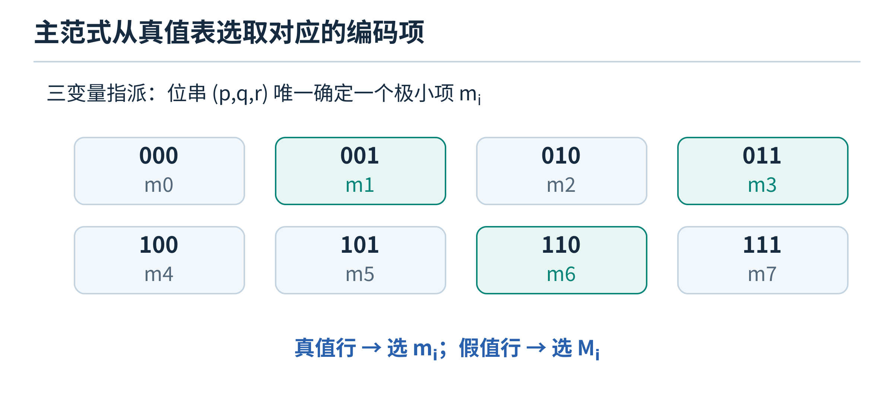

**主析取范式**是所有成真行对应的极小项之析取；**主合取范式**是所有成假行对应的极大项之合取。相对于固定变项集合和固定排列次序，每个命题公式的主范式都是唯一的（忽略交换顺序）。求法包括等值演算、真值表及两种主范式间的互相转换。

> [!example] 以 $F=p\lor q$ 为例
> 按 $(p,q)=(0,0),(0,1),(1,0),(1,1)$ 排序，真值为 $0,1,1,1$。因此
>
> $$F\Leftrightarrow m_1\lor m_2\lor m_3$$
>
> $$F\Leftrightarrow M_0$$
>
> 即 $\neg p\land q\lor p\land\neg q\lor p\land q$（实际书写须按约定括号）和 $p\lor q$ 分别是它的主析取、主合取范式。这里用三项展开展示主析取形式，不是要求日常计算都这样写。

**图 02｜用成真区域直接读出主析取与主合取范式**

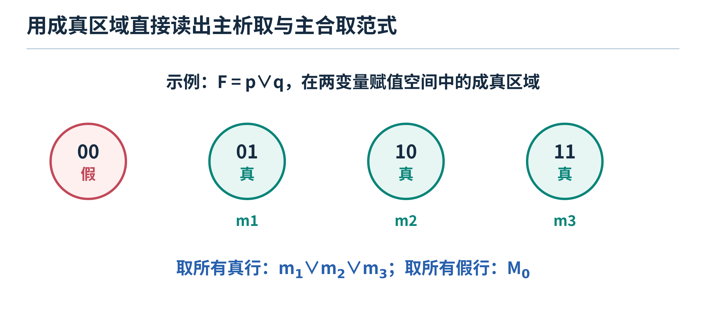

**主范式还能用来判断公式类型**：所有 $2^n$ 个极小项都进入主析取范式，说明它是重言式；没有极小项，说明它是矛盾式。反过来，主合取范式对所有取假行收集极大项，所以重言式没有极大项，矛盾式包含全部极大项。空析取对应假、空合取对应真，这是处理极端情况时使用的数学约定。

### 0.2 联结词完备集

设 $S$ 是联结词集合。如果任意命题公式都能写成一个仅用 $S$ 中联结词构成的等值公式，就称 $S$ 为一个**联结词完备集**（functionally complete set）。例如：

$$\{\neg,\land,\lor,\to,\leftrightarrow\},\quad
\{\neg,\land,\lor\},\quad
\{\neg,\lor\},\quad
\{\neg,\land\},\quad
\{\neg,\to\}$$

都是完备集。关键是能够表示所有布尔真值函数，并非联结词越多越好。例如 $A\to B\Leftrightarrow\neg A\lor B$，$A\leftrightarrow B\Leftrightarrow(A\to B)\land(B\to A)$，所以 $\{\neg,\land,\lor\}$ 已经足够。若完备集的任何真子集都不再完备，则称它为**极小完备集**；这里的“极小”指按集合包含关系不能再删，而不是唯一的全世界最少元素形式。

特别重要的是两个**单元完备集**：

$$A\uparrow B=\neg(A\land B)\qquad\text{（与非，NAND）}$$

$$A\downarrow B=\neg(A\lor B)\qquad\text{（或非，NOR）}$$

**图 03｜↑ 与 ↓ 的四行真值及功能完备性**

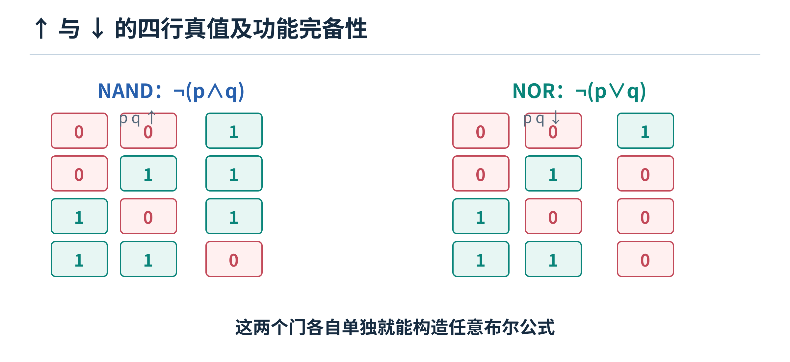

由与非联结词可以构造：

$$\neg A\Leftrightarrow A\uparrow A$$

$$A\land B\Leftrightarrow(A\uparrow B)\uparrow(A\uparrow B)$$

$$A\lor B\Leftrightarrow(A\uparrow A)\uparrow(B\uparrow B)$$

因此任何公式都能转换成只含 $\uparrow$ 的形式。$\downarrow$ 同样可以构造非、或、与：$\neg A=A\downarrow A$，$A\lor B=(A\downarrow B)\downarrow(A\downarrow B)$，$A\land B=(A\downarrow A)\downarrow(B\downarrow B)$。

**图 04｜用一个 NAND 运算逐层构造非、与、或**

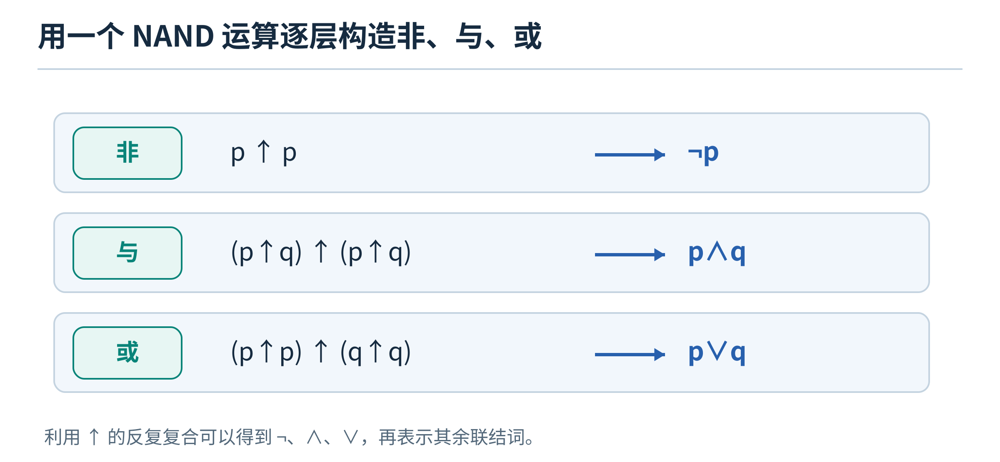

> [!tip] 完备性证明的实用套路
> 不需要逐一改写世界上所有公式。先从目标联结词集还原出一个已经知道完备的基础集（如 $\{\neg,\land,\lor\}$），即可证明其完备性。注意“可以实现所有运算”与“某一个运算对输入交换律成立”是两个完全不同的判断。

---

## 1. 3.1 推理的形式结构

### 1.1 推理、前提、结论

**推理**是从前提出发得到结论的思维过程；**前提**是已知命题公式的集合，**结论**是试图从前提推出的命题公式。设前提集合 $\Gamma=\{A_1,A_2,\ldots,A_n\}$，结论为 $B$，则推理问题写作：

$$A_1,A_2,\ldots,A_n\ \text{推出}\ B$$

例如“如果 $a$ 能被 $4$ 整除，那么 $a$ 能被 $2$ 整除；$a$ 能被 $4$ 整除；所以 $a$ 能被 $2$ 整除”，设 $p$ 表示“$a$ 能被 $4$ 整除”，$q$ 表示“$a$ 能被 $2$ 整除”，前提为 $p\to q,p$，结论为 $q$。

**这一步只是抽取形式，尚未证明它有效。** 为判断形式有效性，我们不依赖“4 的倍数自然是 2 的倍数”这个特殊数学事实，而考虑全部允许的 $p,q$ 赋值。

### 1.2 有效推理的严格定义

设 $A_1,\ldots,A_n,B$ 都是命题公式。若对于它们全部命题变项的每一种赋值，总有“某个前提为假”或“所有前提真时 $B$ 也真”，则称该推理**有效**。等价地说：

> [!important] 形式有效性的判定核心
> **不存在某一种赋值，使全部前提同时为真，而结论为假。**
>
> $$\not\exists v:\ v(A_1)=\cdots=v(A_n)=1,\quad v(B)=0.$$
>
> 若找到这样一组赋值，就得到一个**反例赋值**，推理无效。

**图 05｜有效推理的唯一禁区：前提全真、结论假**

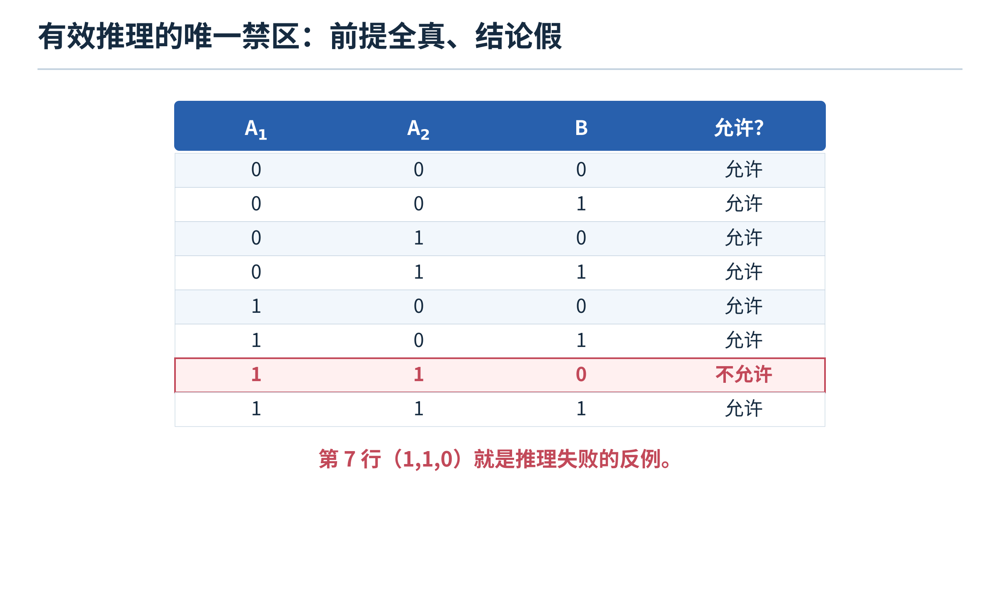

以上定义有两个特别需要理解的地方。

第一，**前提是假时，对有效性的检验不会失败**。推理有效检验的是“如果前提真的话，结论能否为假”，不是要求所有前提无条件真实。如果根本不可能所有前提都真，则按经典命题逻辑的语义定义，推理会“空真”地有效，但这不代表有意义的现实推断。

**图 06｜矛盾前提：有效性定义中的“空真”现象**

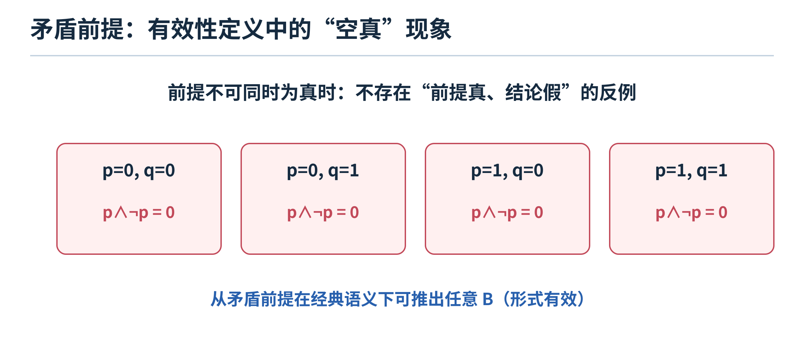

第二，**形式有效不保证结论在现实中已经成立**。只有在推理有效并且前提确实为真时，才保证结论为真。现实陈述是否真实，与推理形式是否保真，是两个层次的任务。

**图 07｜有效性保证“保真”，不保证前提已在现实中成立**


### 1.3 推理形式的符号与三种关系

教材将前提集合记为 $\Gamma$，把“从 $\Gamma$ 推出 $B$”写成 $\Gamma\vdash B$，并用 $A\Rightarrow B$ 描述**永真蕴含**。在严格形式逻辑语言中，需要区分：

| 记号 | 含义 | 关注点 |
| --- | --- | --- |
| $A\to B$ | 命题公式的对象语言联结词 | 某次赋值下真假如何？ |
| $A\Rightarrow B$ | $A\to B$ 为重言式的表达 | 对全部赋值是否保真？ |
| $\Gamma\models B$ | **语义蕴涵**：所有使 $\Gamma$ 真者均使 $B$ 真 | 是否存在反例赋值？ |
| $\Gamma\vdash B$ | **可证明性**：在规定的推理系统内有一份合法证明 | 是否可以逐行推导？ |

> [!note] 关于教材符号的说明
> 本笔记沿用课件中常用的 $\Gamma\vdash B$ 与 $A\Rightarrow B$。课件在描述“有效推理”时还把推导和语义结果紧密并列；为了防止混淆，这里专门用 $\models$ 表示语义有效，用 $\vdash$ 表示可在形式系统中证明。对可靠且完备的命题逻辑演绎系统，这两种关系一致，但**记号所表达的概念本身不同**。

**图 08｜可证明关系与语义有效关系的联系和差别**

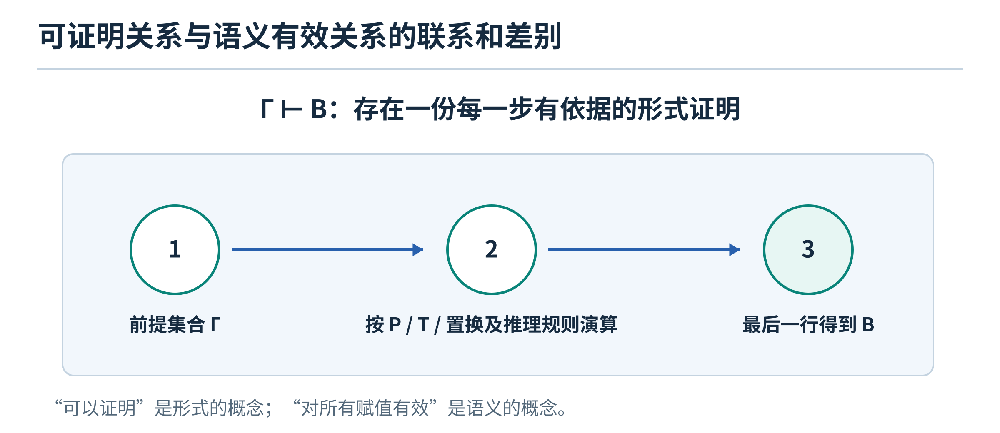

**前提是集合，不是序列**：例如 $\{p,p\to q\}\models q$ 和 $\{p\to q,p\}\models q$ 没有区别。不同的是，真正写下逐行证明时，为了能引用之前的行，证明序列确实有先后次序。

### 1.4 定理 3.1：有效推理等价于重言式

设 $\Gamma=\{A_1,A_2,\ldots,A_n\}$，则

$$\boxed{\Gamma\models B\quad\Longleftrightarrow\quad (A_1\land A_2\land\cdots\land A_n)\to B\text{ 是重言式}}$$

**理解推导**：$X\to B$ 仅在 $X=1,B=0$ 时为假。令 $X=A_1\land\cdots\land A_n$，这正是“所有前提真，结论假”的唯一禁区。所以整式永真当且仅当原推理有效。这是语义定义与公式类型判断的严格对应，不是巧合。

**图 09｜定理 3.1：推理有效性转换为重言式检验**

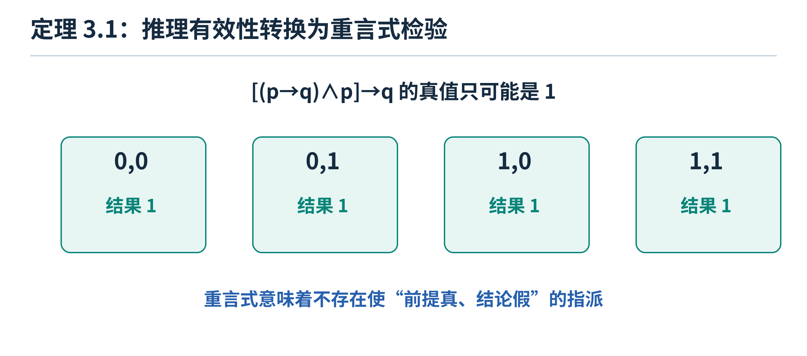

还可以把它写成：

$$\neg(A_1\land\cdots\land A_n)\lor B$$

若希望直接寻找反例，把“所有前提真而结论假”写作

$$A_1\land\cdots\land A_n\land\neg B.$$

其**不可满足**当且仅当原推理有效。以后做反证法时，这种转换非常有用。

**图 10｜前提合取后取蕴含，与反例不可满足等价**

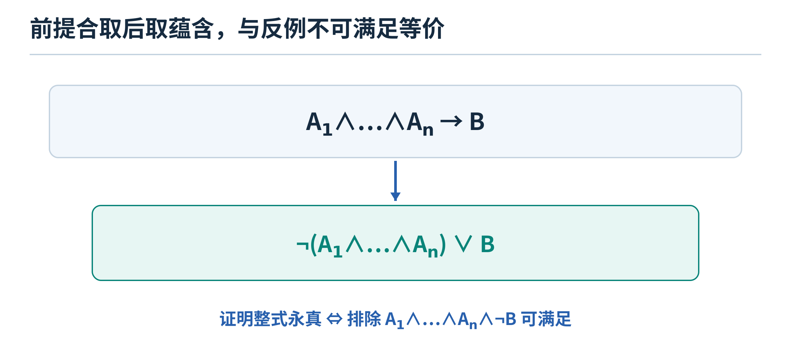

**图 11｜语义有效性：前提模型集合被结论集合包含**

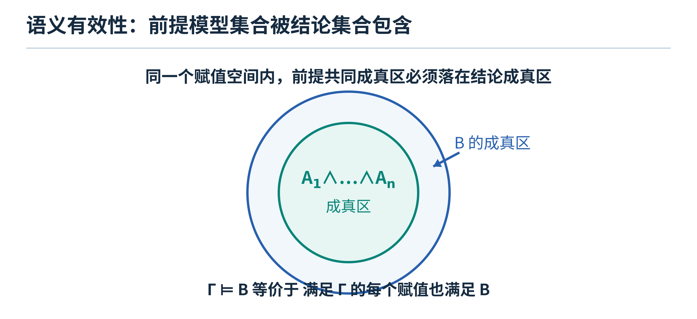

### 1.5 一套通用的解题程序

1. **命题符号化**：明确每个命题变项代表什么，不能偷换命题。
2. **拆前提和结论**：前提有几个，每个包含什么逻辑联结词；注意句子中的“仅当”“除非”“或”是否排斥。
3. **列出形式结构**：$\Gamma\vdash B$ 或检验 $(\bigwedge\Gamma)\to B$。
4. **检查有效性**：优先考虑“结论为假，能不能让全部前提同时为真”。简单题可直接用推理定律；复杂题可用真值表、等值演算或主范式。
5. **写结论**：如果无效，要给出具体赋值；如果有效，要说明为何不存在反例，或者给出永真式/证明。

**图 12｜反例搜索的通用解题机制**

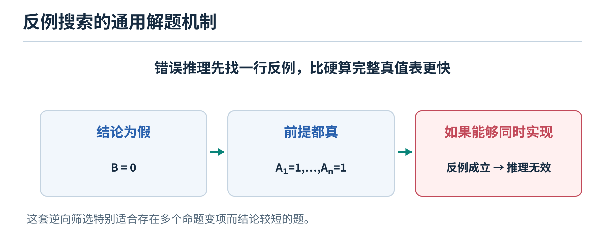

> [!warning] 不能用“结论看来是真的”来替代有效性判断
> 命题逻辑考查的是推理形式在**全部允许的赋值**下是否保真，而不是结论在某个熟悉的实际背景中是否偶然为真。

## 2. 推理是否有效：典型例题与反例构造

### 2.1 例：能被 4 整除一定能被 2 整除

前提：$p\to q$，$p$；结论：$q$。检验公式：

$$((p\to q)\land p)\to q.$$

如果前提都真，则 $p=1$，而 $p\to q=1$ 强制 $q=1$，结论不可能假；所以有效。这种形式称为**假言推理**（modus ponens，MP）。也可作等值演算：

$$\begin{aligned}
((p\to q)\land p)\to q
&\Leftrightarrow\neg((\neg p\lor q)\land p)\lor q\\
&\Leftrightarrow(p\land\neg q)\lor\neg p\lor q\\
&\Leftrightarrow1.
\end{aligned}$$

**图 13｜假言推理通过前提筛选只留下 q 真**

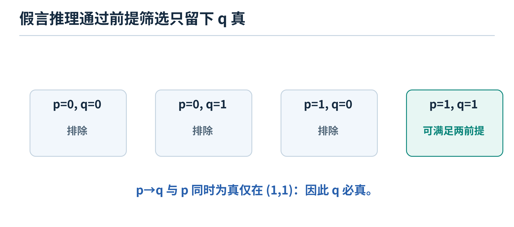


### 2.2 例：“不是星期日，所以明天不是星期一”的形式

前提：$p\to q,\neg p$；结论：$\neg q$，其中 $p$ 表示今天是星期日，$q$ 表示明天星期一。候选推理形式为：

$$(p\to q)\land\neg p\quad\text{推出}\quad\neg q.$$

取 $p=0,q=1$，则 $p\to q=1$、$\neg p=1$，然而 $\neg q=0$。故**形式无效**，称为**否定前件谬误**（denying the antecedent）。

**图 14｜否定前件式的反例：p→q，¬p 不能推出 ¬q**

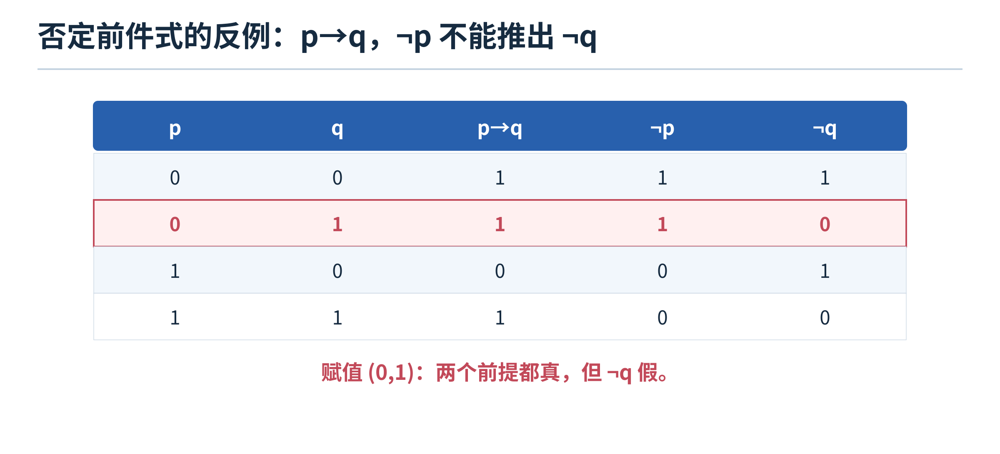

**图 15｜逆否方向有效，简单否定前件无效**

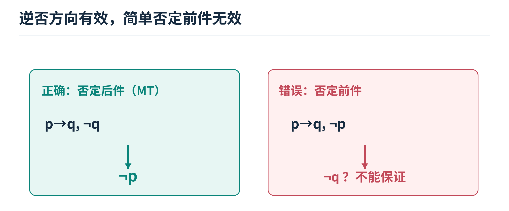

> [!note] 具体自然语言中的额外事实
> 根据真实日历，“今天不是星期日而明天是星期一”通常不能同时成立，但这是实际日历语义提供的**另一条约束**；如果只把 $p,q$ 当作两个抽象命题变项，形式 $p\to q,\neg p\Rightarrow\neg q$ 仍然无效。判断“形式有效”不能不加说明地把现实背景当作隐藏前提。

**图 16｜具体命题可能因额外事实成立，但错误的推理形式仍无效**

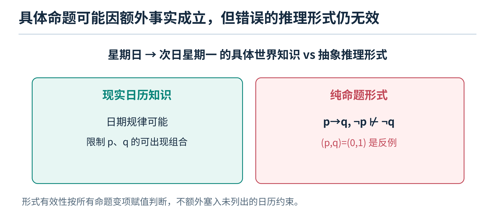

课件中“两边相等则所对角相等；两边不等所以所对角不等”的题，也具有 $p\to q,\neg p\therefore\neg q$ 的外形。只给出这一方向的蕴含仍**不能从形式上推出**结论。对于普通欧氏三角形，该结论还可利用等腰三角形有关的**逆定理**单独论证；“实际数学结论可能成立”和“原来这条单向推理规则是否有效”不可混为一谈。

### 2.3 例：电影或游泳，没看电影，所以去游泳

设 $p$ 为去看电影，$q$ 为去游泳。若“或”取**相容或** $p\lor q$，则 $p\lor q,\neg p\models q$；若自然语言中的“或……或……”明确取**排斥或** $p\oplus q$（课件采用排斥或的写法），那么 $p\oplus q,\neg p\models q$ 也成立。因为两种情况下同时知道 $\neg p$ 时，唯一可能满足“或”的是 $q$。

$$p\oplus q\ \Leftrightarrow\ (p\land\neg q)\lor(\neg p\land q)$$

**图 17｜排斥或的严格语义：恰有一个真**

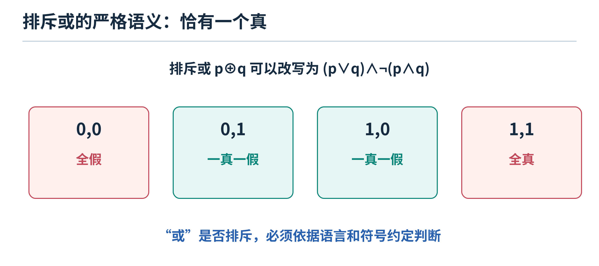

**图 18｜排斥或与相容或：已知 ¬p 时都能析取三段论**

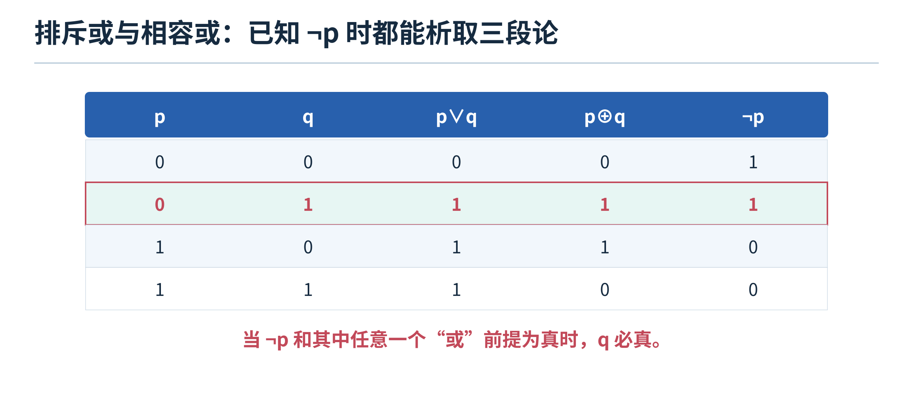

> [!tip] 为什么这道题在两种“或”的约定下都成立？
> 关键的前提是 $\neg p$ 已经把 $p$ 排除。排斥或比相容或多出的“不能同时发生”条件，不改变“必须有 $q$”这个结论。若题目是要推出 $\neg(p\land q)$，则两种“或”的区别非常重要。

### 2.4 例：四变量推理如何构造反例

给定：

$$\Gamma=\{\neg p_1\lor p_2,\ p_1\to(p_3\land p_4),\ p_4\to p_2,\ p_3\to p_4\}$$

目标结论：$B=p_2\lor p_4$。

先让结论为假，得到 $p_2=0,p_4=0$。前提 $\neg p_1\lor p_2$ 要真且 $p_2=0$，于是 $p_1=0$。再看 $p_3\to p_4$，因为 $p_4=0$，为了让该前提真，只能有 $p_3=0$。于是得到：

$$v=(p_1,p_2,p_3,p_4)=(0,0,0,0).$$

逐项检验全部前提：$\neg0\lor0=1$，$0\to(0\land0)=1$，$0\to0=1$，$0\to0=1$；但结论 $0\lor0=0$。所以无效。

**图 19｜四变量反例：从结论为假逆向限定取值**

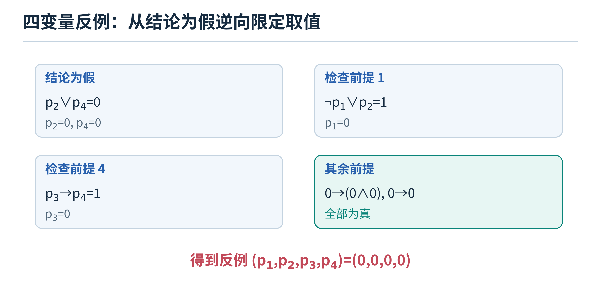

此例展示的是**逐个缩小候选反例范围**，比对四个命题变项列出完整 16 行真值表更简洁。一定要在最后核对没有漏掉任何前提。

### 2.5 例：含 $r$ 的复合前提仍然可以有反例

给定前提 $p\lor q,\neg q,(p\to q)\to r$，结论 $r$。取 $p=1,q=0,r=0$：

- $p\lor q=1$；$\neg q=1$。
- $p\to q=0$，因而 $(p\to q)\to r=0\to0=1$。
- 结论 $r=0$。

所有前提真、结论假，推理无效。注意这里不是直接从 $p\to q$ 推出 $r$，原前提是以 **$(p\to q)$ 整体作前件** 的条件命题。

**图 20｜复合前提的反例：p∨q，¬q，(p→q)→r ⊭ r**

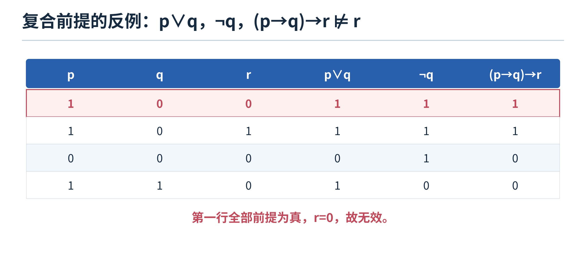

### 2.6 例：反例“构造不出来”也能证明有效

给定前提 $p_1\to(p_2\to p_3)$ 与 $p_2$，结论 $p_1\to p_3$。

为使结论为假，必须 $p_1=1,p_3=0$；又因第二前提真，必须 $p_2=1$。于是唯一候选赋值为 $(1,1,0)$。然而：

$$p_1\to(p_2\to p_3)=1\to(1\to0)=0.$$

不可能让第一个前提也真。因此没有反例，推理有效。

**图 21｜有效推理：尝试构造反例却发生冲突**

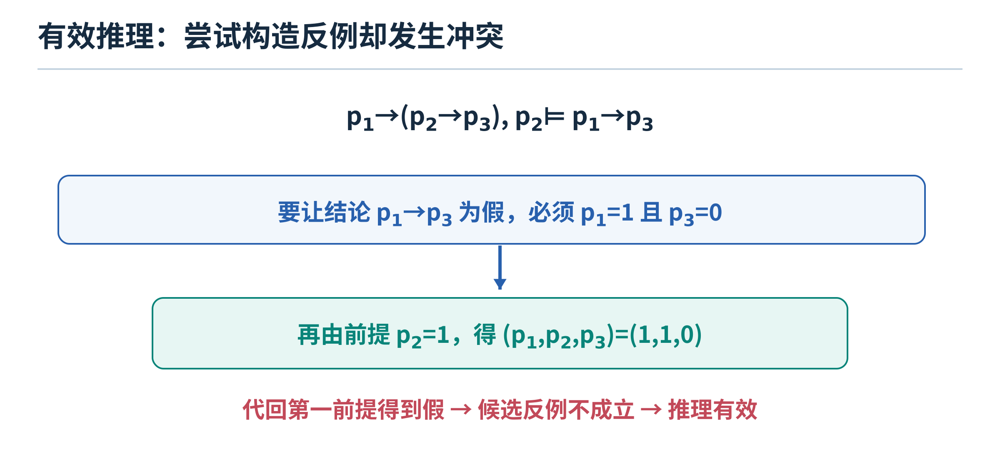

这一题还可用等值演算（建议熟悉）：

$$\begin{aligned}
&((p_1\to(p_2\to p_3))\land p_2)\to(p_1\to p_3)\\
\Leftrightarrow{}&((p_1\land p_2\land\neg p_3)\lor\neg p_2)\lor(\neg p_1\lor p_3)\\
\Leftrightarrow{}&(p_1\land p_2\land\neg p_3)\lor\neg(p_1\land p_2\land\neg p_3)\\
\Leftrightarrow{}&1.
\end{aligned}$$

此外，利用蕴含等值和交换律：

$$p_1\to(p_2\to p_3)\Leftrightarrow p_2\to(p_1\to p_3),$$

有前提 $p_2$，直接使用假言推理即可得到 $p_1\to p_3$。

**图 22｜蕴含嵌套转换：调整条件的结合次序**

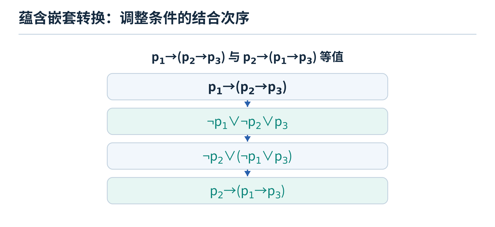

> [!warning] 嵌套蕴含要明确括号
> 以上使用的是 $p_1\to(p_2\to p_3)$。不能擅自当成 $(p_1\to p_2)\to p_3$。后者的真值规律不同，题目的推理结论也可能不同。

**图 23｜同样三个命题字母，蕴含结合方式可能不同**

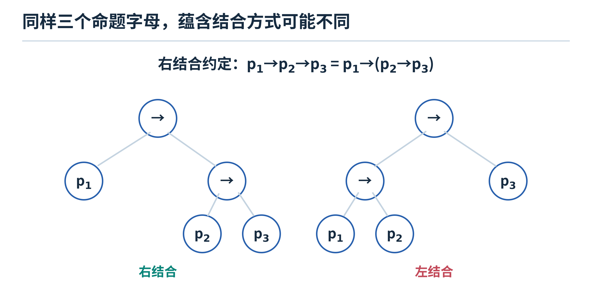


### 2.7 四种主要的有效性检验工具

| 方法 | 基本操作 | 优点 | 限制或提醒 |
| --- | --- | --- | --- |
| 反例赋值 | 令结论假、前提全真，寻找一致赋值 | 快速证明无效；常能快速证明有效 | 没找到反例不代表已经穷尽可能性 |
| 真值表法 | 列所有 $2^n$ 个赋值并核对前提 | 系统、直接、适合变项较少 | 变项较多会迅速膨胀 |
| 等值演算法 | 把 $(\bigwedge\Gamma)\to B$ 化简 | 可给出严格、简洁的普遍结论 | 复杂式容易漏括号、乱用等值式 |
| 主范式法 | 从所有成真/成假行判定类型 | 可以顺便得到赋值集合 | 需要先处理完整真值行为 |

**图 24｜三种方法回答相同问题，但产物不同**

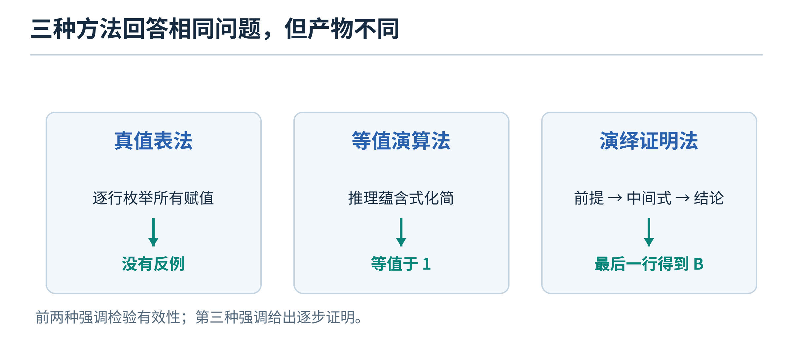

从“表达层级”看，推理含有**前提集合与结论**，而检验公式 $(A_1\land\dots\land A_n)\to B$ 是**一个命题公式**。不能把证明“这个公式是重言式”与“仅知道该公式某次赋值为真”混淆。

**图 25｜推理对应的复合蕴含式语法结构**

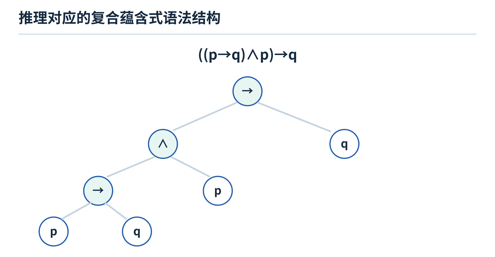

**图 26｜语义、公式与证明三重视角的互相对应**


### 2.8 练会“优先否定结论”：一步一步建造反例

理解定义以后，很多逻辑判断其实不需要完整的真值表。假设给出前提 $A_1,A_2,A_3$，要求判断是否能推出 $B$。普通思路是从前提出发，设法求出结论。**反例法的思路正好相反：先规定 $B=0$，看前提是否还有同时成立的可能。**

具体工作流程可以分成如下四段：

**第一段：从结论推约束。** 若 $B=p\lor q$，那么 $B=0$ 意味着 $p=0,q=0$；若 $B=p\to q$，那么 $B=0$ 意味着 $p=1,q=0$；若 $B=p\land q$，那么 $B=0$ 的情况不止一种，不能立即认定两个都假；若 $B=p\leftrightarrow q$，那么必须 $p,q$ 恰好相反。这样的真假分解在解题中非常高效。

**第二段：逐条检查前提。** 把已经得到的取值代回一个前提。例如 $r\to p$ 必须为真而 $p=0$，那么 $r$ 必须为 $0$；再如 $\neg s\lor q$ 必须真而 $q=0$，则 $s$ 必须为 $0$。继续代入下一条前提，尽量把剩余自由变量确定下来。

**第三段：寻找矛盾或构造成功。** 假如推导中既要求 $r=0$ 又要求 $r=1$，说明这条候选反例路线失败。但如果结论为假的分支有多个，就必须**逐个检查所有分支**。只有排除全部分支，才能正式判为有效。

**第四段：交付反例或证明。** 如果最终构造成功，写出一行完整赋值，并计算各前提的真值与结论真值；如果所有候选均失败，说明无法出现“前提真结论假”，再给出有效性结论。

> [!example] 实操：$p\lor q,\ p\to r,\ q\to r\models r$
> 反设结论 $r=0$。为了使 $p\to r$ 真，必须 $p=0$；为了使 $q\to r$ 真，必须 $q=0$。可是这样 $p\lor q=0$，与前提真冲突。故推理有效。整个推演不需要列出 $2^3=8$ 行真值表。

> [!warning] “无法立即想到反例”和“反例不存在”不同
> 找反例是一种求解策略，不是凭感觉判有效的理由。对 $p\land q$ 这样的结论，必须承认存在 $(0,0),(0,1),(1,0)$ 三类使其为假的赋值；只检验其中一个分支是不够的。

### 2.9 如何亲手完成一张验证推理的真值表

以 $p\to q,\ p\models q$ 为例，采用两变量的全部赋值：

| $p$ | $q$ | $p\to q$ | 前提 $(p\to q)\land p$ | 结论 $q$ | 整式 $((p\to q)\land p)\to q$ |
| ---: | ---: | ---: | ---: | ---: | ---: |
| 0 | 0 | 1 | 0 | 0 | 1 |
| 0 | 1 | 1 | 0 | 1 | 1 |
| 1 | 0 | 0 | 0 | 0 | 1 |
| 1 | 1 | 1 | 1 | 1 | 1 |

只在第四行全部前提同时为真，而这一行结论为真。最后一列全部为 $1$，所以推理形式有效。这张表同时体现了**两个等价的判法**：只查看前提全真的行，或者检查整条蕴含式是否为重言式。

换成“否定前件”的错误推理，真值表变为：

| $p$ | $q$ | $p\to q$ | $\neg p$ | $\neg q$ | 全部前提真且结论假？ |
| ---: | ---: | ---: | ---: | ---: | ---: |
| 0 | 0 | 1 | 1 | 1 | 否 |
| 0 | 1 | 1 | 1 | 0 | **是** |
| 1 | 0 | 0 | 0 | 1 | 否 |
| 1 | 1 | 1 | 0 | 0 | 否 |

第二行就是推理的失败位置。一个反例已足够否定“对所有赋值都有效”，不需要出现两个或更多反例。

> [!tip] 真值表先算什么？
> 先列变项值，再按括号层次计算最内部联结词，最后算整条前提合取式或最终蕴含式。复杂公式最好给关键子公式单独一列，例如先算 $p\to q$，再算 $(p\to q)\to r$，不要在一个单元格里跳过多个运算导致优先级错误。

### 2.10 “逆命题”和“逆否命题”在推理题中的不同作用

从 $p\to q$ 出发，常见的三种关联命题为：

- **原命题**：$p\to q$。
- **逆命题**：$q\to p$。
- **否命题**：$\neg p\to\neg q$。
- **逆否命题**：$\neg q\to\neg p$。

原命题与逆否命题等值：$p\to q\Leftrightarrow\neg q\to\neg p$。逆命题与否命题也彼此等值，但一般不与原命题等值。于是已知 $p\to q$ 可以无条件改写成 $\neg q\to\neg p$；却**不能**无条件改写成 $q\to p$ 或 $\neg p\to\neg q$。

例如已知“能被 $4$ 整除则能被 $2$ 整除”，可以逆否得“不能被 $2$ 整除则不能被 $4$ 整除”；但是不能据此断言“能被 $2$ 整除则能被 $4$ 整除”。一个具体反例是 $a=6$。区分这种形式关系，是理解拒取式为何可靠的关键。

### 2.11 由真值表到主范式的完整串联

取 $F=(p\to q)\land(q\to r)$，共有 $2^3=8$ 行。其真假也可由逻辑含义判断：要求 $p$ 为真时 $q$ 为真，同时 $q$ 为真时 $r$ 为真。整理可得其成假行分别为 $(0,1,0),(1,0,0),(1,0,1),(1,1,0)$，对应下标 $2,4,5,6$；成真行为 $0,1,3,7$。因此：

$$F\Leftrightarrow m_0\lor m_1\lor m_3\lor m_7$$

$$F\Leftrightarrow M_2\land M_4\land M_5\land M_6.$$

检验：当 $(p,q,r)=(0,0,0)$ 时两条蕴含式都为真，所以 $m_0$ 应出现；当 $(1,0,0)$ 时 $p\to q$ 为假，所以 $m_4$ 不应出现在主析取式中，而 $M_4$ 应出现在主合取式中。这使“主范式检验推理”与先前学过的编码法连成一条完整流程。

> [!note] 逻辑等值式和推理公式的使用差别
> $F\Leftrightarrow G$ 可以把 $F$ 在一个更大的公式中换成 $G$，保持整个公式的真值；$F\Rightarrow G$ 只保证在 $F$ 已真时可以推出 $G$，不能保证任意上下文中的双向替换正确。自然推理的“置换规则”必须使用前者。


---

## 3. 九种重要永真蕴含式与推理定律

### 3.1 基本原则

若 $A\Rightarrow B$，表示 $A\to B$ 是重言式，即每当 $A$ 为真时 $B$ 必真。**$\Rightarrow$ 不是命题联结词**，它表示语义上的有效推出。注意 $A\Rightarrow B$ 与 $B\Rightarrow A$ 不等价，只有双方均成立才有 $A\Leftrightarrow B$。

**图 27｜等值规则可以双向替换，推理规则不可任意逆用**

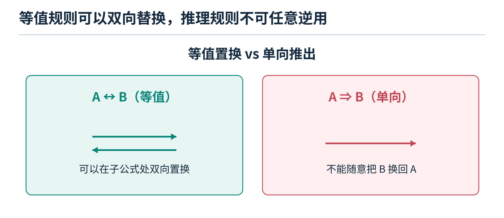

教材重点列出九类常用推理公式，可以直接作为演绎法中的推理依据。这里的 $A,B,C,D$ 都是**任意命题公式**，不仅仅代表单个原子命题。例如在假言推理中代入 $A=p\land q$、$B=r\lor s$，仍然可以使用同一规则。

### 3.2 附加律与化简律

**附加律**（addition）：

$$A\Rightarrow A\lor B.$$

只要 $A$ 为真，那么 $A\lor B$ 为真，无须知道 $B$ 的真值；它**不等于**“可以从 $A$ 推出 $B$”。

**图 28｜附加规则：引入一个可选分支**

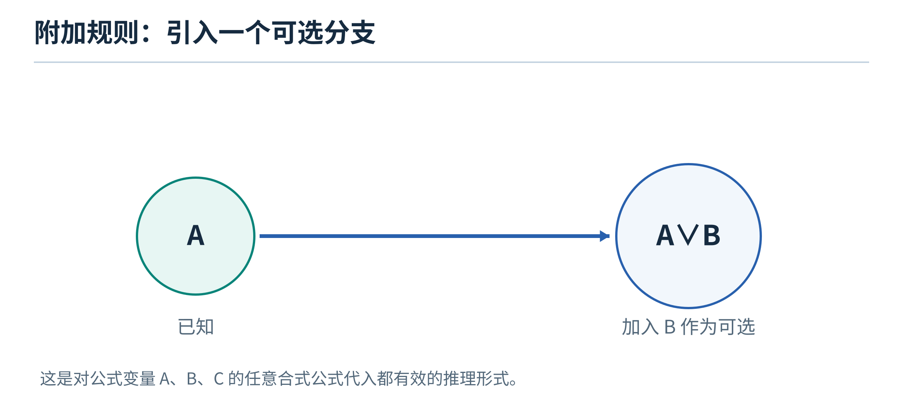

**化简律**（simplification）：

$$A\land B\Rightarrow A,\qquad A\land B\Rightarrow B.$$

若二者同时为真，取出任意一部分都为真。其反向 $A\Rightarrow A\land B$ 一般错误。

**图 29｜化简规则：从同时成立的两部分取一个**

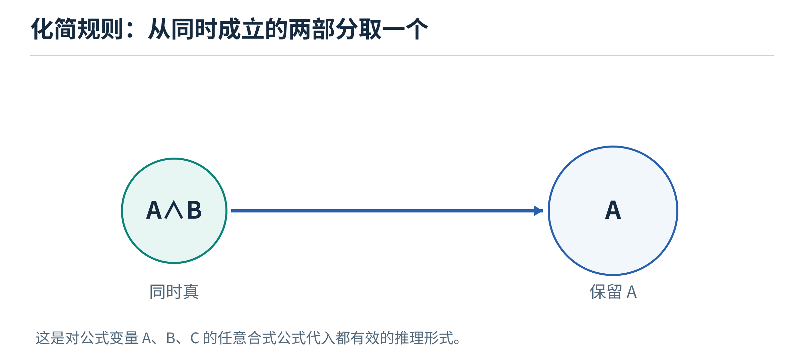

### 3.3 假言推理与拒取式

**假言推理**（MP）：

$$(A\to B)\land A\Rightarrow B.$$

从条件命题和其前件的肯定，推出后件。

**图 30｜假言推理：肯定条件，兑现结论**

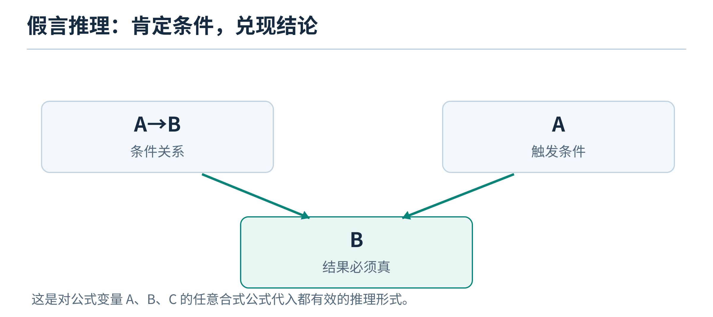

**拒取式**（modus tollens，MT）：

$$(A\to B)\land\neg B\Rightarrow\neg A.$$

从条件命题和后件的否定，推出前件的否定。利用逆否等值 $A\to B\Leftrightarrow\neg B\to\neg A$ 可直接理解。

**图 31｜拒取式：结果为假，排除其条件**

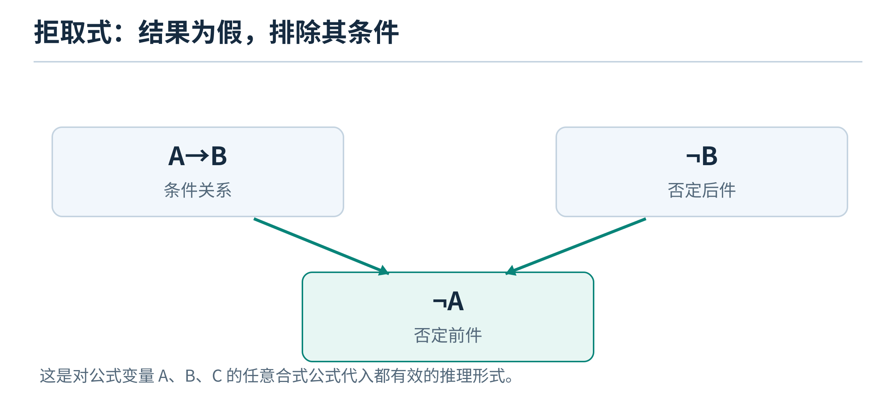

> [!warning] 三种相似形式必须严格区分
> - $A\to B,A\therefore B$：**有效**（肯定前件）。
> - $A\to B,\neg B\therefore\neg A$：**有效**（否定后件）。
> - $A\to B,\neg A\therefore\neg B$：**无效**（否定前件）。
> - $A\to B,B\therefore A$：**无效**（肯定后件）。
>
> 对后两种错误，都可以用 $A=0,B=1$ 的赋值构造反例。

**图 32｜肯定后件谬误：箭头并不能沿反方向任意走**

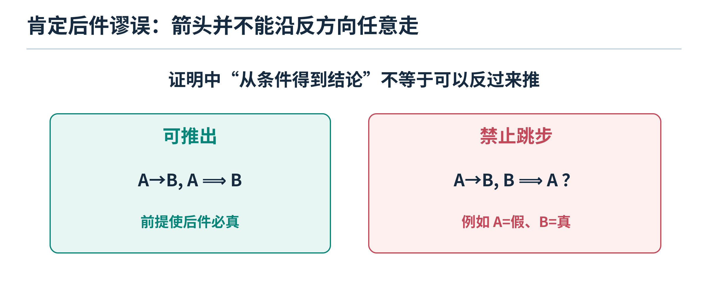

### 3.4 析取三段论

$$(A\lor B)\land\neg B\Rightarrow A.$$

一个析取式至少有一项为真；当 $B$ 已经被排除，$A$ 就必须真。对称地，$(A\lor B)\land\neg A\Rightarrow B$。前提中的析取是相容或也不影响结论。

**图 33｜析取三段论：排除一侧留下另一侧**

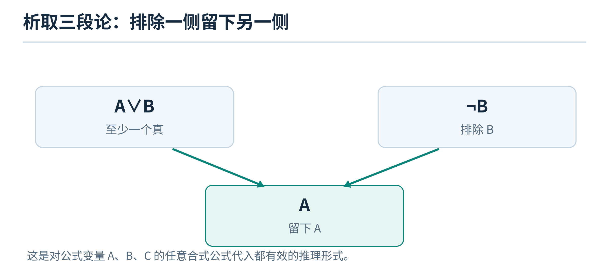

### 3.5 假言三段论与等价三段论

**假言三段论**（HS）：

$$(A\to B)\land(B\to C)\Rightarrow(A\to C).$$

由两段链式条件得到跨段条件。例如“有会员资格则能入场；能入场则能观看”可组成新条件，但不要把结论误写成“所以观看已经发生”。

**图 34｜假言三段论：条件链可直接跨接**

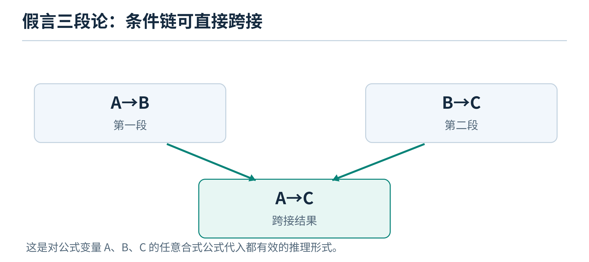

**等价三段论**：

$$(A\leftrightarrow B)\land(B\leftrightarrow C)\Rightarrow(A\leftrightarrow C).$$

两个等价关系连接后依旧等价，因为它们同时包含双向条件。

**图 35｜等价三段论：等价关系可传递**

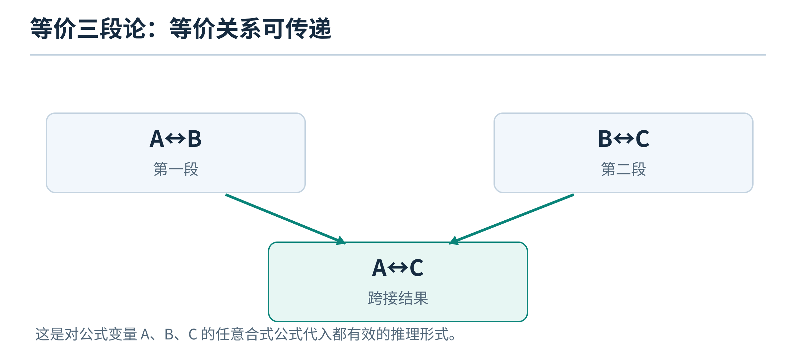

### 3.6 构造性两难与破坏性两难

**构造性两难**：

$$(A\to B)\land(C\to D)\land(A\lor C)\Rightarrow(B\lor D).$$

至少有一个起始条件成立；对应的后果必成立一个。它不是要求我们确切知道哪个起始分支被选中。

**图 36｜构造性两难的两分支传递机制**

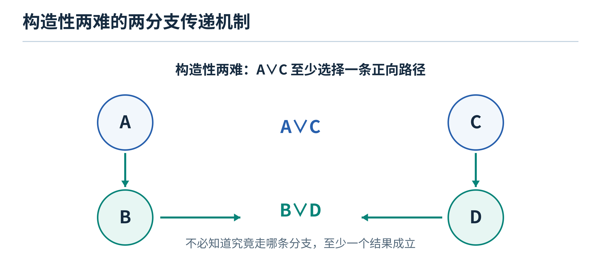

**破坏性两难**：

$$(A\to B)\land(C\to D)\land(\neg B\lor\neg D)\Rightarrow(\neg A\lor\neg C).$$

至少一个后件不成立；利用逆否关系，至少一个对应前件不成立。

**图 37｜破坏性两难由结果的否定追溯条件的否定**

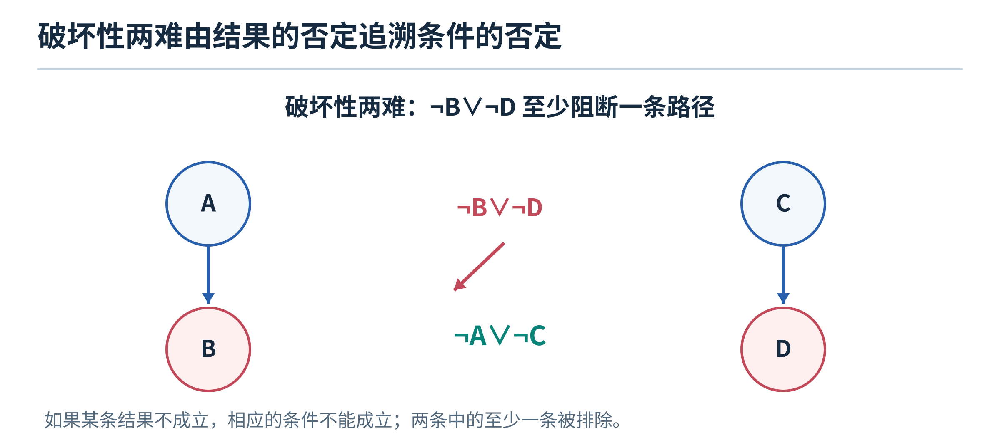

> [!tip] 两难律识别方法
> **构造性两难**看“前件的析取”推出“后件的析取”；**破坏性两难**看“后件的否定析取”推出“前件的否定析取”。不要在第二种情况下把方向直接反过来而忘记否定号。

### 3.7 合取引入：后续演绎法必备

$$A,B\Rightarrow A\land B.$$

这条规则在自然推理系统 P 的规则列表中单独列出。它与化简律方向相反：**化简**由 $A\land B$ 取得部分，**合取引入**由分别获得的 $A$ 和 $B$ 建立共同结论。

**图 38｜合取引入：必须分别证明两件事**

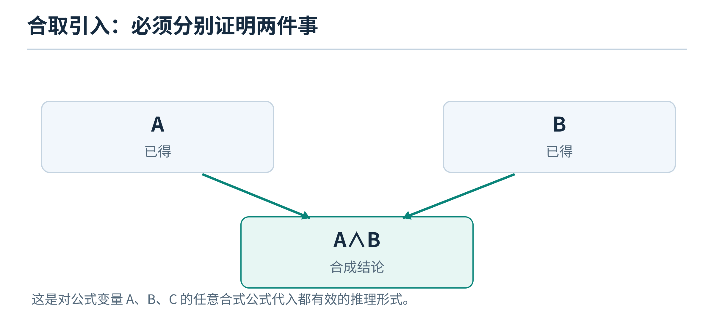

### 3.8 九类规则速查表

| 名称 | 前提条件 | 可推出的结论 |
| --- | --- | --- |
| 附加 | $A$ | $A\lor B$ |
| 化简 | $A\land B$ | $A$ 或 $B$ |
| 假言推理 | $A\to B,A$ | $B$ |
| 拒取式 | $A\to B,\neg B$ | $\neg A$ |
| 析取三段论 | $A\lor B,\neg B$ | $A$ |
| 假言三段论 | $A\to B,B\to C$ | $A\to C$ |
| 等价三段论 | $A\leftrightarrow B,B\leftrightarrow C$ | $A\leftrightarrow C$ |
| 构造性两难 | $A\to B,C\to D,A\lor C$ | $B\lor D$ |
| 破坏性两难 | $A\to B,C\to D,\neg B\lor\neg D$ | $\neg A\lor\neg C$ |

表中九类是课件所列的**常见永真蕴含形式**；此外自然推理还需要合取引入、前提引入与等值置换。不能认为世界上合法的推理只有这九种：任意等值式 $A\Leftrightarrow B$ 都可拆成两个永真蕴含关系 $A\Rightarrow B$ 和 $B\Rightarrow A$，不同规则也可以复合构成新规则。


### 3.9 为什么这些规则总是有效：用真值条件推一次

记忆公式不是终点，更重要的是能够解释它们为何绝无反例。下面针对几条规则从“前提真”出发给出简短论证。

**附加律**：设 $A=1$，无论 $B$ 是 $0$ 还是 $1$，$A\lor B=1$；因此 $A\to(A\lor B)$ 永真。这里最易错的是误认为“引入 $B$”表示 $B$ 本身已经被证明。实际上 $B$ 可以是假，析取结果仍真。

**化简律**：$A\land B=1$ 等价于 $A=B=1$，当然可以推出其中任意一项。反之如果 $A=1,B=0$，虽然 $A$ 真，但是 $A\land B=0$，所以不能把化简规则逆用。

**假言推理**：已知 $A\to B=1$ 且 $A=1$。条件命题在前件为真时只有后件真才能成立，故 $B=1$。假言推理因此是“保真转换”的典型原型。

**拒取式**：已知 $A\to B=1$ 且 $B=0$。如果 $A=1$，蕴含式就是 $1\to0=0$，与前提冲突，所以 $A$ 只能为 $0$。这也说明“否定后件”与“否定前件”的根本差异：前者排除蕴含为真的唯一错误组合，而后者没有能力限制后件的真假。

**析取三段论**：$A\lor B=1$、$B=0$，则 $A$ 必须为 $1$。如果写成 $A\land B,\neg B\therefore A$，其两个前提互相矛盾，形式虽然按“无反例”定义仍有效，却不再是这条规则的典型实际用法。

**假言三段论**：若 $A=0$，目标 $A\to C$ 本来就真；若 $A=1$，由 $A\to B$ 得 $B=1$，再由 $B\to C$ 得 $C=1$，目标仍真。两种情况已穷尽，故规则有效。这里的证明既可以从真值分类来理解，也可以在演绎证明中借助 CP 来完成。

**等价三段论**：$A\leftrightarrow B$ 成立意味着 $A,B$ 真值相同，$B\leftrightarrow C$ 成立意味着 $B,C$ 真值相同，因此 $A,C$ 真值相同。这个事实与数学上的等价关系传递性一致，但证明中必须确实取得两个双向条件。

**构造性两难**：已知 $A\lor C$，至少有一支为真。如果 $A=1$，由 $A\to B$ 得到 $B=1$；如果 $C=1$，由 $C\to D$ 得到 $D=1$。不管哪支为真，$B\lor D=1$。两支都真时，当然也没有问题。这里使用的是相容或，故不必排除双真情况。

**破坏性两难**：已知 $\neg B\lor\neg D$。如果 $\neg B=1$，结合 $A\to B$ 可由拒取式推出 $\neg A$；如果 $\neg D=1$，结合 $C\to D$ 可推出 $\neg C$。于是至少有一个 $\neg A,\neg C$ 成立，所得 $\neg A\lor\neg C$ 必真。

> [!important] 基本规则的共同本质
> 每条推理定律都可理解为“凡是让所有前提成立的赋值，都落在结论的成真赋值集合中”。**规则的可靠性不依赖具体命题是什么**，因此 $A,B$ 才可以代入任意复杂的合式公式，而不会失效。

### 3.10 用规则代入而不是只认字母外形

设已知 $(p\land q)\to(r\lor s)$ 和 $p\land q$。你看到的前提不是 $A\to B,A$ 的单字母样子，但可以整体令 $A=p\land q$，$B=r\lor s$，马上由假言推理推出 $r\lor s$。这里不需要先展开 $(p\land q)\to(r\lor s)$。

再如：

$$((p\to q)\land(r\to s))\land(p\lor r)\Rightarrow q\lor s.$$

这正是构造性两难。可代入 $A=p,B=q,C=r,D=s$，因此在 $p\lor r$ 为真时，无论其真值由哪一支贡献，都会有 $q\lor s$。

更复杂的形式，例如

$$\bigl((p\land q)\to(r\lor s)\bigr)\land\bigl((r\lor s)\to t\bigr)$$

可由假言三段论推出 $(p\land q)\to t$，因为此时 $A=p\land q$、$B=r\lor s$、$C=t$。识别整个子公式才是关键，不是数一数公式里有几个字母。

> [!warning] “代入”必须全程统一
> 同一条规则中的 $A$ 在不同位置必须替换为同一公式。同样，不能把第二次出现的 $B$ 随意改成另一命题。规则的任何一个实例都必须保留原规则的全部相同变量对应关系。

### 3.11 不同规则的组合路径示范

**路径 A：先化简，再 MP，再合取。**

前提 $p\land q,p\to r,q\to s$；目标 $r\land s$。

从 $p\land q$ 化简得 $p$ 与 $q$；$p$ 和 $p\to r$ 经假言推理得 $r$；$q$ 和 $q\to s$ 经假言推理得 $s$；最后由合取引入得到 $r\land s$。这里“合取引入”的出现使证明显式具有两个并行目标。

**路径 B：先改写，再 DS。**

前提 $p\to q,\neg p$，目标 $q$：直接使用 DS 是不可能的，因为 $p\to q\Leftrightarrow\neg p\lor q$，已有的另一个前提也是 $\neg p$ 而非 $p$。从 $\neg p\lor q$ 和 $\neg p$ 仍不能排除左分支，所以不能推出 $q$。这一例专门提醒：看到析取符号不代表马上能用 DS；必须有**某一支的否定**。

**路径 C：等值化后改变触发条件。**

前提 $(p\land q)\to r$ 与 $q$，目标 $p\to r$。利用蕴含等值把前提化成 $q\to(p\to r)$，再用 $q$ 做 MP，可得 $p\to r$。相比试图从 $q$ 直接猜出 $r$，这种方法明确保留了仍然需要的条件 $p$。

**路径 D：从结论拆目标。**

前提 $p\leftrightarrow q$，目标 $(p\to q)\land(q\to p)$，只需利用双条件定义等值置换；若从相反方向证明 $p\leftrightarrow q$，应先分别取得两条条件命题，再合取和置换。二者是同一个等值式的正反应用。


---

## 4. 3.2 自然推理系统 P：从判断有效到真正写出证明

### 4.1 为什么要建立形式系统

真值表、等值演算和主范式可以判断推理形式是否有效，但当题目越来越复杂时，它们未必直接展示**每一步如何从前提得到结论**。形式系统提供可机械检查的表达方式：明确有哪些符号、哪些符号串合法、哪些初始公式可用、何种转换可作为合法推导。

一个形式系统一般包括：

1. **字母表/符号库**：可以使用哪些符号。
2. **公式集合**：按语法规则形成哪些合法公式。
3. **公理集合**：在无需额外前提时允许直接接受哪些公式。
4. **规则集合**：已获得公式时，允许怎样产生下一行公式。

前两项属于**形式语言**；后两项属于**形式推理**。在这份课件使用的自然推理系统 P 中，**公理集合为空集**，并不意味着“没有逻辑规律”，而是合法推导依靠前提引入和演绎规则完成。

### 4.2 P 的符号库与公式

P 的符号库包括命题变元 $p,q,r,p_1,p_2,\ldots$、五个联结词 $\land,\lor,\neg,\to,\leftrightarrow$、辅助括号 $(,)$。

其合式公式定义：

1. 单个命题变元是公式。
2. 若 $\alpha$ 是公式，则 $(\neg\alpha)$ 是公式。
3. 若 $\alpha,\beta$ 是公式，则 $(\alpha\land\beta)$、$(\alpha\lor\beta)$、$(\alpha\to\beta)$、$(\alpha\leftrightarrow\beta)$ 都是公式。
4. **只有**经过有限次上述操作形成的符号串才是公式。

例如 $(p\to q)\land p$ 是公式，允许在不发生歧义时省略最外层括号；但是 $p\land\lor q$ 并不是合式公式，因为没有合法生成途径。

**图 39｜形式系统 P：合法公式逐层生长的语法树**

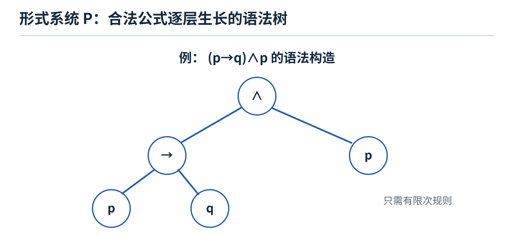

> [!note] 形式语法与真假是两道独立的检查
> “是公式”不等于“为重言式”，也不等于“能从任意前提证明”。例如 $p\land\neg p$ 完全是合式公式，但它是矛盾式。也不能在写证明时任意省略括号，以至于改变公式真实结构。

### 4.3 P 的三项基础推理规则

**前提引入规则（P 规则）**：在证明的步骤中可以引入题目已给出的前提；不等于可以引入任意想要的公式。若 $A\in\Gamma$，则可以写 $A$，并标注“P”。

**结论引入规则（T 规则）**：前面已经得到的公式，可以作为后继证明步骤的依据继续使用。它不是“随意宣称一个结论为真”，而是允许引用已经严格建立的中间结论。

**置换规则**：公式中的某个子公式可以用与它**逻辑等值**的子公式替换。例如 $\neg s\lor p\Leftrightarrow s\to p$；因此当先前已得到 $\neg s\lor p$ 时，可以再写 $s\to p$，注记为“置换”。


**图 40｜P 规则、T 规则和后续规则形成可追踪的证明序列**

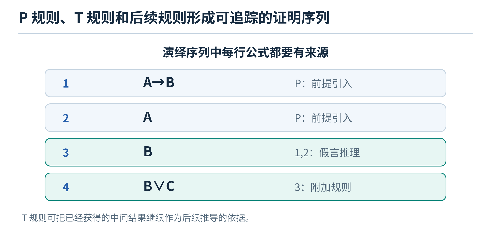

> [!warning] 置换的条件是双向等值，不是“某个方向可以推出”
> 从 $A$ 通过附加规则得到 $A\lor B$ 是合法的**单向推理**；若已经得到 $A\lor B$，通常不能只因“附加律”就把它置换回 $A$。置换要核对 $X\Leftrightarrow Y$，而不是只知道 $X\Rightarrow Y$。

### 4.4 系统 P 中的其余演绎规则

除 P、T、置换外，可调用前述常见推理模式：附加、化简、假言推理、拒取式、假言三段论、析取三段论、构造性两难、破坏性两难，以及合取引入。教材把“等价三段论”列在常见永真蕴含式中；证明时也可以将它视为有效推理模式，或把它拆为两个方向的蕴含来建立结果。

在证明中，一般采用以下布局：

```text
(1) A_1         P：前提引入
(2) A_2         P：前提引入
(3) C           (1)(2)：某条已知推理规则
(4) D           (3)：等值置换 / 附加等
  ⋮
(k) B           来自前面的若干行
```

最后一行是目标公式 $B$；每一个**不是前提**的中间公式，都必须标注它由哪些先前行、通过哪一条规则得到。


### 4.5 符号“证明”与“判断有效”的关系

- $\Gamma\models B$ 侧重所有赋值上的**语义保真**。
- $\Gamma\vdash B$ 侧重是否能在系统 P 的规则下写出**有限证明序列**。
- 一个系统若**可靠**，就不会把语义上无效的结论错误地证明出来；若**完备**，则所有语义有效的命题逻辑结论都可在系统内证明。课件采用的这套演绎规则用来构造命题逻辑的有效证明。


---

## 5. 直接证明：从前提逐行推出结论

### 5.1 最小实例：$p\lor q,\neg p\vdash q$

步骤如下：

| 行号 | 公式 | 理由 |
| --- | --- | --- |
| (1) | $p\lor q$ | P，前提引入 |
| (2) | $\neg p$ | P，前提引入 |
| (3) | $q$ | (1)(2)，析取三段论 |

此例的好处是清楚看到“前提”、“规则”和“结论”在一份**可验证证明**中的关系，逻辑并不需要另外解释为真值表。

**图 41｜p∨q，¬p 推出 q：最短的三行证明**

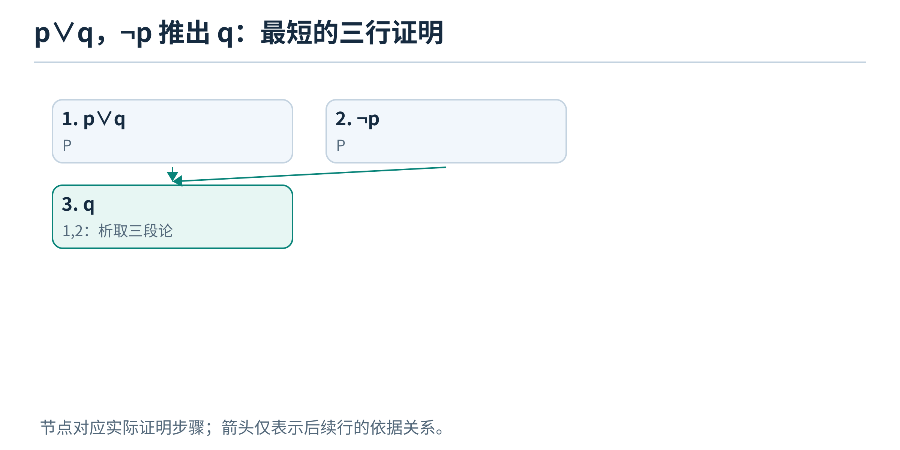

### 5.2 七步演绎：从 $(p\land q)\to r,\neg s\lor p,q$ 推出 $s\to r$

已知：

$$\Gamma=\{(p\land q)\to r,\ \neg s\lor p,\ q\}.$$

要证：$s\to r$。教材采用**直接证明配合等值置换**：把 $\neg s\lor p$ 改写成 $s\to p$；把 $(p\land q)\to r$ 改写成 $q\to(p\to r)$，先用 $q$ 推出 $p\to r$，再将两个条件链衔接起来。

| 行号 | 公式 | 理由 |
| --- | --- | --- |
| (1) | $\neg s\lor p$ | P |
| (2) | $s\to p$ | (1) 置换 |
| (3) | $(p\land q)\to r$ | P |
| (4) | $q\to(p\to r)$ | (3) 置换，蕴含等值 |
| (5) | $q$ | P |
| (6) | $p\to r$ | (4)(5) 假言推理 |
| (7) | $s\to r$ | (2)(6) 假言三段论 |

**图 42｜三前提推出 s→r 的七步演绎**

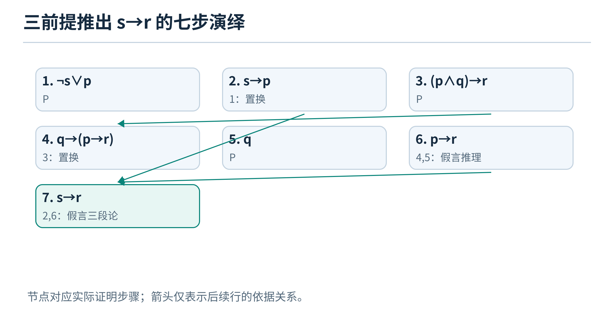

> [!tip] 拆长证的策略
> 如果目标是 $s\to r$，已有一个 $s\to p$，就寻找 $p\to r$。若另有 $(p\land q)\to r$ 且 $q$ 已真，可以通过蕴含等值先得到 $q\to(p\to r)$。这是一种从目标回望所需中间公式的思路，但最后书写仍按前提到结论排列。

### 5.3 八步演绎：实数、分数、有理数与无理数

题目：若数 $a$ 是实数，则它不是有理数就是无理数；若 $a$ 不能表示成分数，则它不是有理数；$a$ 是实数且不能表示成分数。因此 $a$ 是无理数。

设 $P$：$a$ 是实数；$Q$：$a$ 是有理数；$R$：$a$ 是无理数；$S$：$a$ 能表示成分数。按题意得到前提：

$$P\to(Q\lor R),\quad\neg S\to\neg Q,\quad P\land\neg S.$$

结论 $R$。证明：

| 行号 | 公式 | 理由 |
| --- | --- | --- |
| (1) | $P\land\neg S$ | P |
| (2) | $P$ | (1) 化简 |
| (3) | $\neg S$ | (1) 化简 |
| (4) | $P\to(Q\lor R)$ | P |
| (5) | $Q\lor R$ | (2)(4) 假言推理 |
| (6) | $\neg S\to\neg Q$ | P |
| (7) | $\neg Q$ | (3)(6) 假言推理 |
| (8) | $R$ | (5)(7) 析取三段论 |

**图 43｜实数—有理数—无理数：语义到证明的八步链**

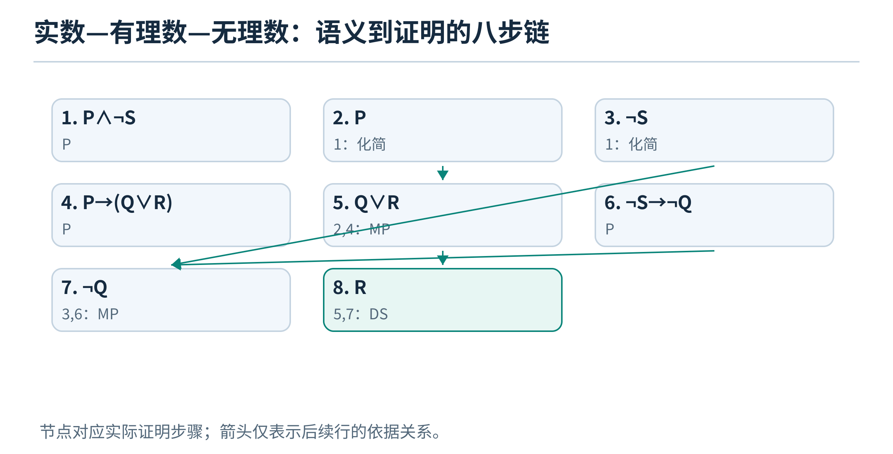

证明结构非常典型：**合取化简 → 连续假言推理 → 析取三段论**。它也说明复杂自然语言推理往往不需要复杂的单条规则，而是几条基本规则的连续使用。

> [!note] 关于语言中的“不是有理数就是无理数”
> 课件符号化为 $Q\lor R$，本例不需要额外假设“二者不能同时成立”才能得到结论，因为已知 $\neg Q$ 时，相容或足以推出 $R$。如果要表达二选一且不可同时发生，则需要进一步加上 $\neg(Q\land R)$。

### 5.4 双向条件的证明：由两个方向得到 $P\leftrightarrow Q$

给定前提：

$$\neg(P\to Q)\to\neg(R\lor S),\quad(Q\to P)\lor\neg R,\quad R.$$

目标 $P\leftrightarrow Q$。**关键不在直接创造双条件，而在证明 $P\to Q$ 与 $Q\to P$ 两个方向**。

| 行号 | 公式 | 理由 |
| --- | --- | --- |
| (1) | $(Q\to P)\lor\neg R$ | P |
| (2) | $R\to(Q\to P)$ | (1) 蕴含等值置换 |
| (3) | $R$ | P |
| (4) | $Q\to P$ | (2)(3) 假言推理 |
| (5) | $\neg(P\to Q)\to\neg(R\lor S)$ | P |
| (6) | $(R\lor S)\to(P\to Q)$ | (5) 逆否等值置换 |
| (7) | $R\lor S$ | (3) 附加 |
| (8) | $P\to Q$ | (6)(7) 假言推理 |
| (9) | $P\leftrightarrow Q$ | (4)(8)，双向蕴含与双条件等值 |

**图 44｜证明 P↔Q：先独立取得两个方向**

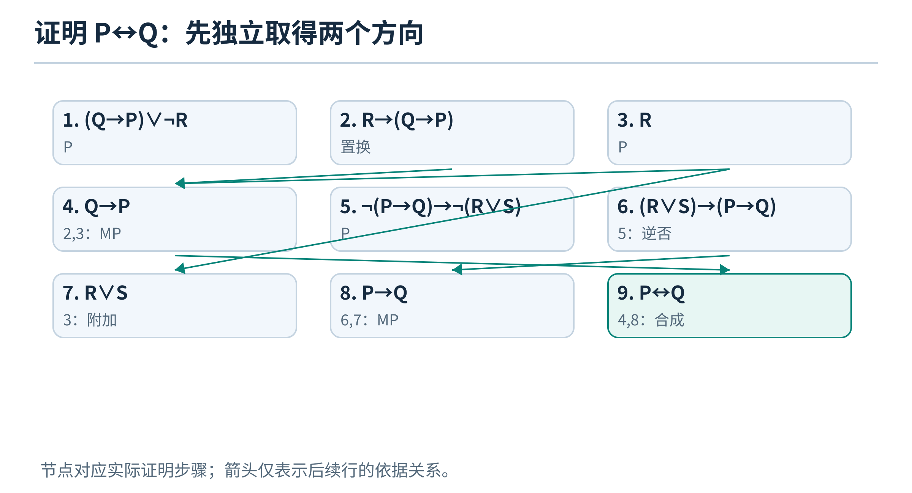

这里最后一步并不是把单个方向的蕴含逆转。它是先独立取得**两个方向**，再按 $P\leftrightarrow Q\Leftrightarrow(P\to Q)\land(Q\to P)$ 合取并置换。

### 5.5 从 $p\to(q\to r),\ p\land q$ 推出 $\neg r\to s$

这道题说明**适当地使用附加律和等值式可以比反证法更短**：

| 行号 | 公式 | 理由 |
| --- | --- | --- |
| (1) | $p\to(q\to r)$ | P |
| (2) | $(p\land q)\to r$ | (1) 置换 |
| (3) | $p\land q$ | P |
| (4) | $r$ | (2)(3) 假言推理 |
| (5) | $r\lor s$ | (4) 附加 |
| (6) | $\neg r\to s$ | (5) 置换，蕴含等值 |

注意最后一步：$\neg r\to s\Leftrightarrow\neg(\neg r)\lor s\Leftrightarrow r\lor s$，并不是从 $r$ 随机猜出 $s$ 真了。

**图 45｜目标反推：为了获得 ¬r→s，可先构造 r∨s**

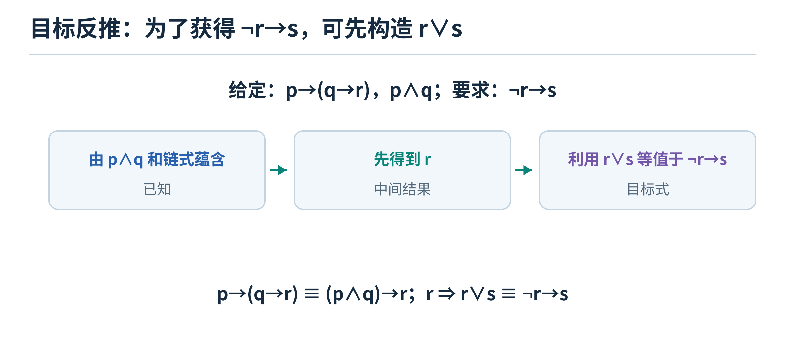


### 5.6 怎样安排证明的中间步骤

拿到题目时，先区分**已经掌握哪些公式**和**最后需要什么形式**。例如希望得到 $s\to r$，前提中可能只有 $s\to p$、$p\to r$；这时就能看到链式条件可用假言三段论完成任务。又如需要得到 $R$，前提中只有 $Q\lor R$，就应考虑如何先推出 $\neg Q$，最终再用析取三段论。

一种高效的方法是“**逆向拟定目标，正向书写证明**”。逆向拟定时，先问最后一步可能用什么规则：

- 要得到 $B$，已有 $A\to B$，便去寻找 $A$。
- 要得到 $\neg A$，已有 $A\to B$，便去寻找 $\neg B$。
- 要得到 $A\land B$，便把证明任务拆成 $A$ 与 $B$ 两个子目标。
- 要得到 $A\to B$，优先搜索能否直接构造条件链，或转而使用 CP。
- 要得到 $A\leftrightarrow B$，寻找两个方向的条件命题。

逆向只是规划，不属于额外推理规则。写正式证明时，仍需从题目允许的前提开始，一行行给出合法的逻辑式及依据。

**常见的证明拖延来自三个问题**。第一，把结论中出现的原子命题直接当成已知前提；第二，迟迟不对合取前提做化简，导致缺少触发 MP 的单独公式；第三，把整个复杂公式拆得过碎，却没有注意到可以把一个完整子式直接作为某条规则中的 $A$ 或 $B$。

### 5.7 从蕴含等值推出新的简洁证明

已知 $p\to(q\to r)$ 与 $p\land q$，可以沿两条路线证明 $r$。

**路线一（直接触发两次 MP）**：从 $p\land q$ 化简得 $p,q$；用 $p$ 和 $p\to(q\to r)$ 得到 $q\to r$；再用 $q$ 得到 $r$。每条规则都是课程已学的标准形式。

**路线二（等值置换再 MP）**：先把 $p\to(q\to r)$ 置换成 $(p\land q)\to r$；再结合已有的 $p\land q$，一次假言推理即可得到 $r$。

两种证明都正确，且共同依赖于蕴含关系：

$$p\to(q\to r)\Leftrightarrow(p\land q)\to r.$$

这个等值式可以通过联结词消去说明：

$$\begin{aligned}
p\to(q\to r)
&\Leftrightarrow\neg p\lor(\neg q\lor r)\\
&\Leftrightarrow\neg(p\land q)\lor r\\
&\Leftrightarrow(p\land q)\to r.
\end{aligned}$$

看懂这个过程后，就不必把它当作一个神秘的“高级定理”硬背。它本质上只用了蕴含等值、德摩根律与结合律。

### 5.8 从复杂的析取式提取有用的前件

考虑 $\neg s\lor p$。利用蕴含等值，它就是 $s\to p$，因此可以把“附加 $s$ 就能推出 $p$”理解为一条隐含的条件关系。类似地：

$$\neg p\lor\neg q\lor r\Leftrightarrow (p\land q)\to r.$$

所以在证明题中，遇到含许多否定的析取式，不妨先尝试将部分否定项聚成一个蕴含前件：

$$\neg(p\land q)\lor r\Leftrightarrow(p\land q)\to r.$$

这种改写经常能让一个“看似无规律的析取式”转化为可由 MP 直接使用的条件。但注意：**等值改写不会额外创造已知为真的前件**。只有获得 $p\land q$，才能通过这个条件命题得到 $r$。

### 5.9 两个不建议的证明习惯

第一，**不要长期依靠一行“显然可得”**。形式证明要求每一步都可以由先前公式通过已知规则检验。尤其涉及两条不同前提的步骤，应写明行号及规则。对已经取得的公式做等值置换，至少写出所用等值名称；对多段推理的结果，不要把多个没有标注的操作塞在一行里。

第二，**不要为每一道简题都强行使用反证法**。例如 $p\lor q,\neg p\vdash q$ 直接用一次析取三段论即可。反证法虽然可以得到同一结论，但会产生额外的临时假设、步骤和矛盾式，增加书写负担。课堂考核强调方法时应遵题意；普通求解应优先清晰、可检验和简短。


---

## 6. 间接证法之一：附加前提法（CP 规则）

### 6.1 思想与形式

当结论是蕴含式 $B\to C$，可以把目标转换为一个新的任务：**暂时把 $B$ 当作附加前提，在原前提 $\Gamma$ 下证明 $C$**。原理是

$$\boxed{\Gamma\models(B\to C)\quad\Longleftrightarrow\quad\Gamma\cup\{B\}\models C.}$$

如果把有限前提合取写作 $A$，则相应的永真蕴含写为：

$$A\Rightarrow(B\to C)\quad\Longleftrightarrow\quad A\land B\Rightarrow C.$$

这源于两式等值：

$$A\to(B\to C)\Leftrightarrow(A\land B)\to C.$$

**图 46｜CP 的逻辑根基：转移蕴含式的前件**

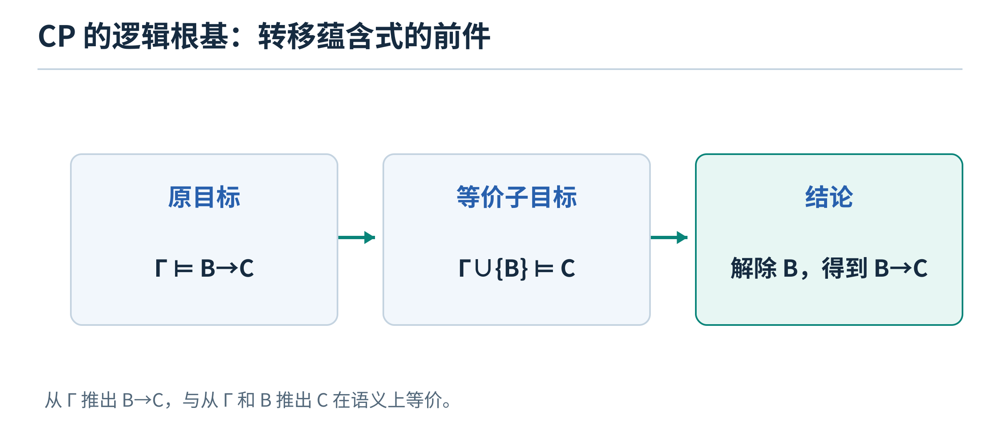

CP 的关键是“**打开一个临时假设的范围，建立结论，随后关闭范围**”。在临时范围内部可以使用 $B$，但完成证明后，能够无条件保留的是 $B\to C$，**不能把临时引入的 $B$ 当作真实、永久、无条件的前提**。

**图 47｜附加前提 CP：证明蕴含式时开启并解除临时假设**

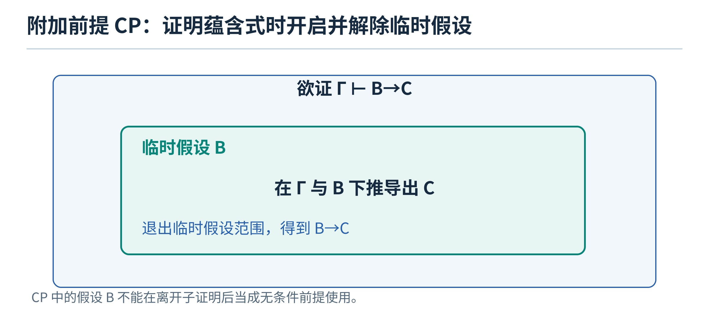

**图 48｜附加前提必须解除：不能把临时假设带出作用范围**

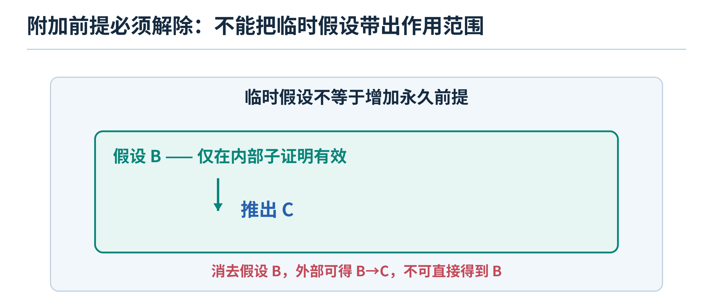

> [!warning] CP 与前提引入 P 不是同一个动作
> P 规则允许引入题目给出的永久前提。CP 是为证明条件结论而**临时附加**前件；做完子证明须解除这项假设。写完整形式系统证明时，最好明确写出“假设起点”和“解除假设后得到的蕴含式”。

### 6.2 CP 举例：$p\to(q\to r),\neg s\lor p,q\vdash s\to r$

这和前面的七步演绎是同一个目标，但采用另一条思路：临时假设 $s$，在此基础上由 $\neg s\lor p$ 推出 $p$，再由 $p\to(q\to r)$ 与 $q$ 推出 $r$，最后解除临时假设，获得 $s\to r$。

| 步骤 | 公式 | 理由 |
| --- | --- | --- |
| (1) | $\neg s\lor p$ | P |
| (2) | $s$ | CP，暂假设 |
| (3) | $\neg\neg s$ | (2) 双重否定等值 |
| (4) | $p$ | (1)(3) 析取三段论 |
| (5) | $p\to(q\to r)$ | P |
| (6) | $q\to r$ | (4)(5) 假言推理 |
| (7) | $q$ | P |
| (8) | $r$ | (6)(7) 假言推理 |
| (9) | $s\to r$ | 解除 (2) 的临时假设，CP |

**图 49｜CP 案例：把 s 暂作前提，先推出 r**

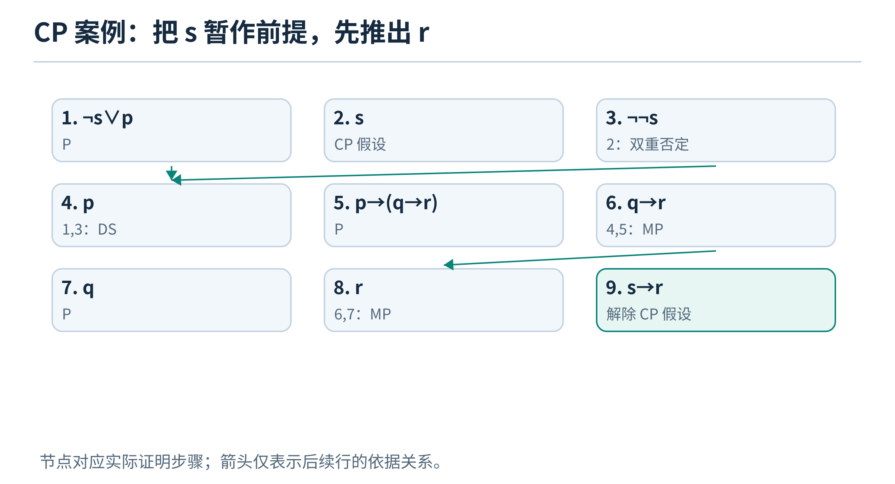

> [!tip] CP 什么时候更合适
> 结论外层是 $\to$，并且从其前件开始能够自然接上已有规则时，优先考虑 CP。课件也提示结论为析取式时可以考虑与蕴含式间的等值转换，例如 $A\lor B\Leftrightarrow\neg A\to B$，但应先确认转换方向和新的前件是什么。

---

## 7. 间接证法之二：反证法与归谬

### 7.1 相容、不相容与反证原理

若一组公式 $A_1,\ldots,A_k$ 的合取式是**可满足式**（存在一组赋值使它们全真），则称这些公式**相容**；否则**不相容**。例如 $\{p,\neg p\}$ 不相容，因为没有赋值能让 $p\land\neg p$ 为真。

要从 $\Gamma$ 证明 $B$，反证法可以**附加 $\neg B$**，然后推导出矛盾：

$$\boxed{\Gamma\models B\quad\Longleftrightarrow\quad\Gamma\cup\{\neg B\}\text{ 不可满足}.}$$

对应的命题等值式是：

$$\neg\bigl((A_1\land\cdots\land A_k)\land\neg B\bigr)
\Leftrightarrow (A_1\land\cdots\land A_k)\to B.$$

反证时可把目标视为**从 全部前提 $\Gamma$ 与 $\neg B$ 出发，推导出 $C\land\neg C$**；任何特定公式与其否定的合取都构成矛盾。

**图 50｜反证法把“可能的反例集合”压缩成空集**


> [!important] “否定前件”与“否定结论后求矛盾”不是一回事
> 错误推理 $A\to B,\neg A\therefore\neg B$ 是把**条件命题的前件**否定后直接跳结论。反证法则是**把整个目标结论 $B$ 否定**，再结合所有既有前提推导矛盾，依据的是另一条严格有效的定理。

### 7.2 反证实例：从 $p\to(\neg(r\land s)\to\neg q),p,\neg s$ 推出 $\neg q$

前提：

$$p\to(\neg(r\land s)\to\neg q),\quad p,\quad\neg s.$$

欲证 $\neg q$，先假设其否定 $\neg\neg q$。证明过程：

| 行号 | 公式 | 理由 |
| --- | --- | --- |
| (1) | $p\to(\neg(r\land s)\to\neg q)$ | P |
| (2) | $p$ | P |
| (3) | $\neg(r\land s)\to\neg q$ | (1)(2) 假言推理 |
| (4) | $\neg\neg q$ | 反证假设：否定结论 $\neg q$ |
| (5) | $\neg\neg(r\land s)$ | (3)(4) 拒取式 |
| (6) | $r\land s$ | (5) 双重否定等值 |
| (7) | $s$ | (6) 化简 |
| (8) | $\neg s$ | P |
| (9) | $s\land\neg s$ | (7)(8) 合取引入，矛盾 |

课件将第 (5) 步直接写为 $r\land s$，这里展开了中间的双重否定，避免误以为“拒取式可以不加说明直接消去双重否定”。反证假设不相容，故 $\neg q$ 确实由前提有效推出。

**图 51｜反证法实战：从 ¬¬q 导出 s 与 ¬s**


### 7.3 反证实例：$P\lor Q,P\to R,Q\to R\vdash R$

假设结论 $R$ 为假，即暂时有 $\neg R$。由前提 $P\to R$ 与 $\neg R$ 得 $\neg P$；由 $Q\to R$ 与 $\neg R$ 得 $\neg Q$；然而原前提 $P\lor Q$ 要求至少一个真，与 $\neg P\land\neg Q$ 矛盾。

| 行号 | 公式 | 理由 |
| --- | --- | --- |
| (1) | $\neg R$ | 反证假设 |
| (2) | $P\to R$ | P |
| (3) | $\neg P$ | (1)(2) 拒取式 |
| (4) | $Q\to R$ | P |
| (5) | $\neg Q$ | (1)(4) 拒取式 |
| (6) | $P\lor Q$ | P |
| (7) | $P$ | (5)(6) 析取三段论 |
| (8) | $P\land\neg P$ | (3)(7) 合取引入，矛盾 |

因此 $R$ 是逻辑结论。

**图 52｜两个分支都被排除，和原析取前提发生矛盾**

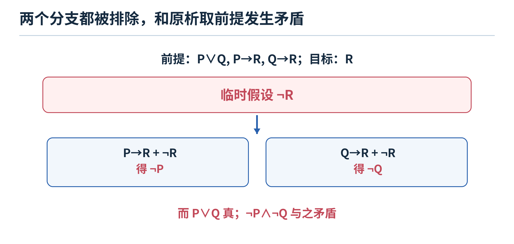

> [!note] 也可以不用反证法直接得到同一结论
> 从 $P\lor Q$、$P\to R$、$Q\to R$ 可用**构造性两难**推出 $R\lor R$，再根据幂等律 $R\lor R\Leftrightarrow R$ 得到 $R$。不同方法的证明长度与优点可以比较，但只要每一步合法，都成立。

### 7.4 如何选择直接证明、CP、反证法

| 观察到的形式 | 常见有效策略 | 关键检查 |
| --- | --- | --- |
| 结论为原子 $B$，前提含直接条件链 | 直接证明：MP、MT、DS、HS | 是否找到能直接触发的前件 |
| 结论为 $B\to C$ | CP，暂假设 $B$，证明 $C$ | 必须解除假设，不能带出范围 |
| 结论不易直接达到，但否定后容易造成冲突 | 反证法，暂假设 $\neg B$ | 是否确实推出 $C\land\neg C$ |
| 结论为 $B\leftrightarrow C$ | 分别证明 $B\to C$ 与 $C\to B$ | 两个方向缺一不可 |
| 结论是析取 | 附加、构造性两难，或合适的蕴含等值 | 不能“随便猜一个分支”为真 |

**图 53｜直接证明、CP、反证与双向证明如何选用**

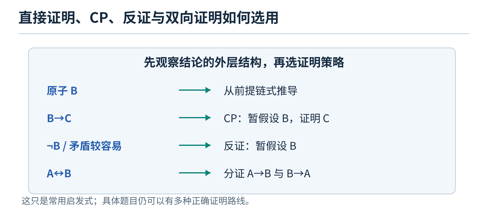


### 7.5 反证法为什么可以得到正面的结论

假设原前提合取为 $A$，需要推出 $B$。有效的反证法并不是从一个错误前提出发随意得到任何结论，而是对以下两个公式作严格比较：

$$A\to B$$

$$\neg(A\land\neg B).$$

由蕴含等值：

$$A\to B\Leftrightarrow\neg A\lor B$$

由德摩根律：

$$\neg(A\land\neg B)\Leftrightarrow\neg A\lor\neg\neg B\Leftrightarrow\neg A\lor B.$$

因此两个公式逻辑等值。只要从 $A,\neg B$ 出发能推导出矛盾，就说明不存在 $A\land\neg B$ 为真的赋值，于是 $A\to B$ 永真，从而前提能够推出 $B$。

**用一个三变量的小例子验证**：已知 $p\to q$、$q\to r$ 和 $p$，试证明 $r$。反证时假设 $\neg r$；由 $q\to r$ 和 $\neg r$ 得 $\neg q$；由 $p\to q$ 与 $\neg q$ 得 $\neg p$；但已有 $p$，所以矛盾。由于这个矛盾只在增加 $\neg r$ 后被强制产生，故原前提推出 $r$。

> [!warning] 反证并非直接从“结论的相反面是假”开始
> 证明时暂时假定 $\neg B$ 为真，是为了考察它与原前提能否共同成立。通过推导确定**不可能同时成立**后，才有资格解除假设并认定 $B$。如果只写“假设 $\neg B$，显然矛盾”，而没有展示从何处产生冲突，证明是不充分的。

### 7.6 反证法的标准写法与作用范围

更规范的排列方式是：先写出全部需要的原前提，随后明确进入一个**临时的反证假设区域**，注明加入 $\neg B$；在此区域内反复使用 P 规则、T 规则、等值置换、MP、MT、DS 等已有规则，直到找到某个 $C$ 与 $\neg C$。最后写“因原前提与 $\neg B$ 不相容，原前提推出 $B$”，并解除临时假设。

这时要注意：**直接证明的目标通常就是最后一行 $B$；反证法的内部目标则是矛盾**。不同的内部目标会显著改变求解策略。例如课件中 $P\lor Q,P\to R,Q\to R\models R$ 的例题，直接证明可以通过构造性两难；如果反证，就引入 $\neg R$，用 MT 同时排除 $P$ 和 $Q$，最后与 $P\lor Q$ 相冲突。

### 7.7 三种方式证明同一条简单结论

设前提 $p\to q,p$，结论 $q$。

**直接证**：列出 $p\to q$ 与 $p$，假言推理得到 $q$。

**重言式判定**：计算 $((p\to q)\land p)\to q$，等值演算或真值表可得恒为 $1$。

**反证法**：暂时假设 $\neg q$，由 $p\to q$ 与 $\neg q$ 推出 $\neg p$；这与前提 $p$ 冲突，于是 $q$ 必须成立。

这三种做法的共同依据都是**不存在前提全真而结论假的赋值**。不同的是，第一种展示原子规则怎么串，第二种把推理压缩成一个公式判断，第三种通过否定结论显式暴露出不可能的反例。

### 7.8 何时不要因为反证成功而以为前提相容

举例：前提 $p\land\neg p$，想推出任意 $q$。按照经典语义，没有任何赋值使前提为真，因此该推理形式有效。这是逻辑上的“爆炸原理”所反映的现象。但是从现实应用看，**前提系统出现矛盾本身就是严重问题**；不能把这一结果简单理解为“随便断言的东西都有现实证据”。

在具体数学证明中，若本来假定的公理和已知事实被认为相容，那么反证法发现的矛盾才具有“否定新增加的反证假设”的意义。若原前提自身已经不相容，则“可推出 $B$”的语义理由可能并不反映你想要验证的事实关系。这一点帮助我们理解为什么“有效性”与“前提的真实性、相容性”必须分开处理。


---

## 8. 易错点与底层理解

### 8.1 有效推理不同于某一次赋值下整个蕴含式为真

若 $((A_1\land\dots\land A_n)\to B)$ 在**某次赋值**下真，只能说明该次没有出现反例；“重言式”要求**全部赋值**下真。验证推理有效时，要么真的列完整真值表，要么给出足以排除所有反例的推导或等值式。

### 8.2 单个命题的真假、公式的类型、推理有效是不同层次

- $p$ 在给定赋值下是“真/假”。
- $p\lor\neg p$ 在所有赋值下真，是“重言式”。
- $p\land\neg p$ 在所有赋值下假，是“矛盾式”。
- $\{p,p\to q\}\models q$ 是“推理形式有效”。
- $\{p,p\to q\}\vdash q$ 是“可以写出形式证明”。


### 8.3 证明中能做什么，不能做什么

- **可以**把已有前提和已有公式按规则复合、等值置换。
- **不可以**把 $A\Rightarrow B$ 当成 $A\Leftrightarrow B$。
- **不可以**从 $A\lor B$ 直接得到 $A$；从 $A\to B$ 直接得到 $B$；从 $A\to B, B$ 直接得到 $A$。
- **不可以**把 CP 与反证法引入的临时假设当成全局永久前提。
- **可以**通过足够多的合法行组合得到新的规则模式，前提是没有暗中增加未经证明的条件。


### 8.4 例题“明天星期一”的形式陷阱

在抽象形式层面，$p\to q,\neg p\not\models\neg q$。但**不能因此机械断言实际日历上“今天不是周日，明天是周一”可以发生**。课堂用这个例子，是在展示一个仅凭 $p\to q$ 不能否定后件的形式限制。形式逻辑和包含具体背景规律的数学/自然语言推理应该明确区分。

### 8.5 从推理定律到演绎证明的层次

课件先给九个典型永真蕴含公式，再把它们变成证明时可调用的规则；另外补充 P、T、置换、合取引入以及 CP、归谬。因此学习时不要只背规则名称，要掌握：

1. **规则怎样保证保真**（反例不存在）。
2. **规则怎样代入复合命题公式**（$A$ 可以代表完整子公式）。
3. **规则怎样串成多行证明**（每行写依据）。
4. **临时假设怎样开、怎样关**（CP/反证）。


### 8.6 条件推理中的“已知”究竟是什么

在命题逻辑里，公式 $p\to q$ 是一个完整的命题；其中出现的前件 $p$ 和后件 $q$ **不会因为它被写出来就各自变成已知真命题**。例如“若下雨则路湿”并没有声称现在正在下雨，也没有声称现在路已经湿了。只有随后得到前件 $p$，才能结合条件使用假言推理得到 $q$。

同样，已知 $p\lor q$ 只表示至少有一支为真，不能直接断言 $p$ 或 $q$ 中某一个具体为真。若还能得到 $\neg p$，才可用析取三段论推出 $q$。有时候一个前提看起来包含多个子公式，但我们只拥有它们的**整体关系**，没有理由把内部符号拆开独立使用。这一点对自然推理系统尤其重要：一条证明行是一个完整的公式，而不是一串可以随意剪取的真命题。

考虑三个例子：

| 已知的完整前提 | 想直接得到 | 是否允许 | 原因 |
| --- | --- | --- | --- |
| $p\to q$ | $q$ | 否 | 尚不知道 $p$ 为真 |
| $p\lor q$ | $p$ | 否 | $q$ 可能单独为真 |
| $p\land q$ | $p$ | 是 | 合取真保证每一分量真 |
| $p\leftrightarrow q$ | $p\to q$ | 是 | 双条件等价于两个方向的条件合取 |
| $p\to(q\to r)$ | $q\to r$ | 需额外条件 | 需要先得到 $p$ |

> [!tip] 解题时把“题目给出的整条前提”先整体抄下
> 若要拆出里面某一部分，一定要指出所用规则：例如合取化简、双条件等值、蕴含等值置换，而不是认为“里面包含着，所以就可以直接拿来用”。

### 8.7 正确使用合取与析取的交换律、结合律

交换律与结合律经常出现在复杂推理的中间步骤中，但它们并不是任意打乱符号的许可。下面两组等值式是可以成立的：

$$A\land B\Leftrightarrow B\land A,\qquad A\lor B\Leftrightarrow B\lor A.$$

$$A\land(B\land C)\Leftrightarrow(A\land B)\land C,$$

$$A\lor(B\lor C)\Leftrightarrow(A\lor B)\lor C.$$

因此 $A\lor B\lor C$ 在没有歧义时可以省略结合括号，并允许改写为 $C\lor A\lor B$。但是对于蕴含联结词，一般**不存在简单的交换律、结合律**：$A\to B$ 通常不等值于 $B\to A$；$(A\to B)\to C$ 通常也不等值于 $A\to(B\to C)$。

当我们使用 $p_1\to(p_2\to p_3)\Leftrightarrow p_2\to(p_1\to p_3)$ 时，并不是直接宣称“蕴含可以交换”。真正的依据是先消除蕴含：

$$p_1\to(p_2\to p_3)\Leftrightarrow\neg p_1\lor\neg p_2\lor p_3,$$

再利用**析取的交换与结合律**把 $\neg p_1$ 与 $\neg p_2$ 调换位置，最后重新写回条件形式。把每一个合法变化的理由说清楚，可以避免把合取、析取的规律错误迁移到蕴含式上。

### 8.8 反证题里“发生矛盾”可以有不同形式

在讲解反证法时，最直观的末行是 $p\land\neg p$，但有时证明不会直接得到同一个原子命题的正反两面，而是出现复杂公式间的冲突。例如一边获得 $p\lor q$，另一边获得 $\neg p\land\neg q$，它们同样不可能同时为真，因为由德摩根律可将后者改写为 $\neg(p\lor q)$。

另一个例子是已经得到 $p\leftrightarrow q$，却又获得 $p\land\neg q$。前者意味着两者真值必须相同，后者要求 $p=1,q=0$，因此该前提集合不相容。若希望写成标准的明确矛盾式，可以先从 $p\land\neg q$ 化简得 $p$ 与 $\neg q$，再把 $p\leftrightarrow q$ 改写为 $p\to q$ 并借助 MP 得 $q$，最后形成 $q\land\neg q$。

所以，**证明里“矛盾”是逻辑状态，不限于某一排版形状**；不过在考试中最好把冲突显式写成 $C\land\neg C$ 或说明两个公式为何不可同时为真，尽量不让阅卷者猜测你所引用的等值关系。

### 8.9 何时能够把结论拆成几个子目标

如果所求结论是合取式 $B\land C$，由于合取只在两边都真时为真，可以分别寻找 $B$ 和 $C$，再合取引入；如果结论是析取式 $B\lor C$，只需得到其中一个分量即可使用附加律，但并不要求你证明两项都真。

如果结论为双条件 $B\leftrightarrow C$，需要取得 $B\to C$ 和 $C\to B$ 两个方向；如果结论为条件命题 $B\to C$，则可以考虑 CP：暂假设 $B$，再寻找如何推得 $C$。这些方法都来自联结词本身的语义，并非单纯的记忆窍门。

再看 $\neg(B\land C)$。这个目标不是“证明 $\neg B$ 并且证明 $\neg C$”，而是等价于 $\neg B\lor\neg C$；若能证明 $\neg B$，就能通过附加得到 $\neg B\lor\neg C$，再用德摩根律改写。因此**拆解目标时要认真区分合取、析取与否定的范围**，否则会给自己制造比原题更强而不必要的证明任务。

> [!example] 证明目标 $\neg(p\land q)$ 的两种思路
> 若已经取得 $\neg p$，则可以用附加律得 $\neg p\lor\neg q$，再用德摩根律得 $\neg(p\land q)$。另一条路线是临时假设 $p\land q$，再用化简取得 $p$；这与 $\neg p$ 发生冲突，于是通过反证推得 $\neg(p\land q)$。二者都正确，第一种更短。

### 8.10 为什么有些间接证明显得“绕路”

自然推理并不要求每道题只能采用一种方法，而是要求每条使用的证明规则合法。假设已有 $p\to q,p$，目标 $q$：直接证仅需一次 MP；CP 方法不适合直接套在原子目标 $q$ 上，必须先人为做逻辑等值转换；反证则需暂假设 $\neg q$，先得到 $\neg p$ 再与 $p$ 冲突。这说明**方法的普适性不等于在每一道题上都高效**。

反过来，目标 $p\to r$，而前提中有 $p\to q,q\to r$ 时，假言三段论可以一步完成；如果目标是 $\neg(p\land q)$，前提直接含 $\neg p$，德摩根律配合附加最简；如果目标为某个抽象命题 $r$，前提中存在大量否定关系，暂假设 $\neg r$ 可能更快取得冲突。这是**依据目标形状选择证明路径**的核心思想。

### 8.11 用四个问题检查自己的完整证明

在完成一份包含多行的自然推理证明后，依次核对：

1. **前提是否真的是题目允许的前提？** 包括每个命题变量的含义、析取是否排斥、每个条件命题的方向；不可因为语言习惯就在前提中悄悄添加新结论。
2. **每条推导是否引用了先前已经建立的公式？** 尤其留意不能引用未来的行，也不能无理由使用尚未得到的前件。
3. **等值置换是否确实双向成立？** 要区别把 $(p\land q)\to r$ 化成 $p\to(q\to r)$ 这种真等值，与把 $p\to q$ 反过来写成 $q\to p$ 的错误操作。
4. **最后一行是不是完整的目标？** 证明了 $q\to p$ 并不等于已经证明 $p\leftrightarrow q$；CP 或反证内部得到 $r$、矛盾，也不意味着可以省略“解除假设”的步骤。

这四个问题能够覆盖大多数结构性的证明错误。特别是在长题中，**最后一行与题目目标必须在形式上完全对应**，不能留下一个仍需未经说明的等值变形或推理步骤。


---

## 9. 典型练习：按方法而非死记规则巩固

> [!question] 练习 1：只判断有效性
> 判断以下推理是否有效；若无效，必须给一个具体赋值。
>
> 1. $p\to q,\ q\to r,\ p\therefore r$。
> 2. $p\to q,\ q\therefore p$。
> 3. $p\lor q,\neg q\therefore p$。
> 4. $p\to q,\neg p\therefore\neg q$。
> 5. $p\land\neg p\therefore r$。

> [!question] 练习 2：用主范式与完备集
> 1. 求 $p\to q$ 的主析取、主合取范式。
> 2. 只用 $\uparrow$ 写出 $p\to q$。
> 3. 解释为什么 $\{\land,\lor\}$ 不是完备集。

> [!question] 练习 3：写成自然推理证明
> 1. 前提 $p\land q,\ p\to r$；结论 $r\land q$。
> 2. 前提 $p\to q,\ q\to r$；结论 $p\to r$。要求用假言三段论与 CP 各给出一种证明。
> 3. 前提 $p\lor q,\ p\to r,\ q\to s$；结论 $r\lor s$。
> 4. 前提 $p\to q,\neg q\lor r,\neg r$；结论 $\neg p$。

> [!question] 练习 4：CP 与反证
> 1. 由 $p\to(q\to r)$、$p$ 证明 $q\to r$，要求显示 CP 临时假设范围。
> 2. 前提 $p\lor q,\neg p$；结论 $q$，要求写出反证法证明。
> 3. 前提 $p\to r,q\to r,p\lor q$；结论 $r$，尝试先写直接证明，再写反证证明。

### 9.1 练习 1 参考答案

> [!example]- 展开：有效性与反例
> 1. 有效。由 $p\to q$ 和 $p$ 得 $q$；再与 $q\to r$ 得 $r$。
> 2. 无效。取 $p=0,q=1$，则 $p\to q=1,q=1$，结论 $p=0$。
> 3. 有效，析取三段论。
> 4. 无效。取 $p=0,q=1$，前提都真，结论 $\neg q=0$。
> 5. 有效（经典逻辑语义），因为没有赋值能满足矛盾前提 $p\land\neg p$。这一题不意味着已经找到了某个现实事实来支持 $r$。

### 9.2 练习 2 参考答案

> [!example]- 展开：主范式与与非改写
> 1. $p\to q$ 的真值行是 $00,01,11$，故主析取范式为 $m_0\lor m_1\lor m_3$，即 $(\neg p\land\neg q)\lor(\neg p\land q)\lor(p\land q)$；唯一假值行是 $10$，故主合取范式为 $M_2=\neg p\lor q$。
> 2. $p\to q\Leftrightarrow\neg p\lor q$。由于 $q\uparrow q=\neg q$，故正确写法是 **$p\uparrow(q\uparrow q)$**：$\neg(p\land\neg q)=\neg p\lor q$。本题建议检验全部四行真值，避免把门的输出方向混淆。
> 3. 在 $p=q=0$ 时，任何只使用 $\land,\lor$ 且不额外引入逻辑常量的公式仍为 $0$，不可能表示 $\neg p$ 的真值 $1$。故无法表示所有布尔函数，也就不完备。

### 9.3 练习 3 参考答案

> [!example]- 展开：逐行演绎
> **题 1：**
>
> (1) $p\land q$，P；(2) $p$，(1) 化简；(3) $q$，(1) 化简；(4) $p\to r$，P；(5) $r$，(2)(4) 假言推理；(6) $r\land q$，(5)(3) 合取引入。
>
> **题 2：**
>
> - 假言三段论：由 $p\to q$、$q\to r$，直接得到 $p\to r$。
> - CP：在上述两个前提下暂假设 $p$，由 $p\to q$ 推得 $q$，由 $q\to r$ 推得 $r$，解除假设 $p$ 后得 $p\to r$。
>
> **题 3：** 由 $p\to r$、$q\to s$ 与 $p\lor q$，直接使用构造性两难，得 $r\lor s$。
>
> **题 4：** (1) $p\to q$，P；(2) $\neg q\lor r$，P；(3) $\neg r$，P；(4) $\neg q$，(2)(3) 析取三段论；(5) $\neg p$，(1)(4) 拒取式。

### 9.4 练习 4 参考答案

> [!example]- 展开：CP 与反证
> **题 1：CP。** (1) $p\to(q\to r)$，P；(2) $p$，P；(3) 暂假设 $q$，CP；(4) $q\to r$，(1)(2) 假言推理；(5) $r$，(3)(4) 假言推理；解除假设 $q$，得到 $q\to r$。其实在 (4) 已直接得到目标，因此 CP 在本例是**可以用但不必要**的证明策略。
>
> **题 2：反证。** 暂假设 $\neg q$，由 $p\lor q$ 和 $\neg q$ 得 $p$，而另有前提 $\neg p$，于是出现 $p\land\neg p$；否定结论不可与前提相容，故 $q$ 成立。
>
> **题 3：直接。** 从 $p\to r$、$q\to r$、$p\lor q$ 得 $r\lor r$（构造性两难），经幂等律得 $r$。**反证。** 暂假设 $\neg r$，由拒取式分别得 $\neg p,\neg q$，由 $p\lor q$ 和 $\neg q$ 得 $p$，与 $\neg p$ 矛盾，故 $r$ 成立。

---

## 10. 复习速查：看到题目怎样下手

> [!summary] 高效复习路径
> **第一关：符号化** —— 把前提、结论和命题变项列清楚。
>
> **第二关：检查反例** —— 先令结论假、前提真；找得到反例就无效。
>
> **第三关：通用判定** —— 不能快速构造反例时，判断 $(A_1\land\cdots\land A_n)\to B$ 是否为重言式，使用真值表、等值演算或范式。
>
> **第四关：逐行证明** —— 试用假言推理、拒取式、析取三段论、化简、附加、两难律、合取引入与等值置换。
>
> **第五关：根据结论改用间接法** —— 目标是 $B\to C$ 可考虑 CP；目标的否定易导致冲突可考虑反证法；目标 $B\leftrightarrow C$ 应分别证明两个方向。

### 10.1 一分钟速记

- **判断有效**：是否存在“全部前提真、结论假”。
- **公式转化**：$\Gamma\models B\Leftrightarrow(\bigwedge\Gamma)\to B$ 永真。
- **反例法**：发现一组反例，就可以立即判无效。
- **直接证明**：每行写公式、依据和所引用的先前行。
- **CP**：为证明 $B\to C$，暂假设 $B$，推出 $C$ 后解除假设。
- **反证法**：暂假设 $\neg B$，结合前提推出矛盾，再得 $B$。
- **切忌**：否定前件、肯定后件、把单向蕴含当双向等值、把临时假设带出证明范围。


> [!info] 笔记范围与严谨性
> 本文完整围绕命题逻辑推理的形式结构与系统 P 展开，包含相关的范式、完备联结词回顾。由于题材范围是命题逻辑，不将一阶量词推理规则混入系统 P。示例中的某些直接证明和改写采用必要的细化步骤或补充说明，目的是清晰展示推理依据，而非更改已给命题或推理目标。
