# 一阶逻辑：命题符号化、公式及其解释

> [!info] 资料范围与使用说明
> 本笔记依据《第5.1讲 一阶逻辑》（54 页）及《第5.2讲 一阶逻辑公式及解释》（45 页）整理，合并重复内容，主要覆盖课件的 **4.1 一阶逻辑命题符号化** 与 **4.2 一阶逻辑公式及其解释**。为便于独立学习，补充了必要的推导、反例与规范化书写方法。正文用“课件校订”标示发现的概念性或公式性问题；不要把补充内容误认为课件原文。两份课件目录虽然列有“一阶逻辑等值式、推理规则”，但本次上传页内未系统展开这些后续章节，因此不擅自将其整理成已经讲授的完整章节。
>
> 默认采用 **非空论域** $D$；记 $\forall$ 为全称量词、$\exists$ 为存在量词、$\neg$ 为否定、$\land$ 为合取、$\lor$ 为析取、$\to$ 为蕴含、$\leftrightarrow$ 为等值。符号 $\Rightarrow$ 只在需要表示逻辑推出时使用，不与联结词 $\to$ 混淆。

## 一、一阶逻辑为什么必要

### 1.1 命题逻辑的表达限制

在命题逻辑中，通常将一个完整陈述当作不可进一步分析的命题变项。例如：

- $p$：苏格拉底是人。
- $q$：苏格拉底会死。

这种记法可以讨论 $p\to q$ 等命题联结，却不能清楚表达“**所有人**都具有某种性质”“某个人是人”以及“同一对象身上具有多个性质”之间的结构联系。

一阶逻辑（First-Order Logic，FOL，又称**谓词逻辑**）把陈述进一步分成：**对象、对象的性质、对象之间的关系，以及量化对象的量词**。它在命题逻辑的联结词基础上增加个体变元、谓词、函数和量词。

*图：整句命题不能展示对象内部结构，而谓词可以。*

### 1.2 从苏格拉底三段论理解新结构

设论域为所有对象，定义：

- $M(x)$：$x$ 是人；
- $D(x)$：$x$ 会死；
- $a$：苏格拉底。

推理的前提与结论是：

$$
\begin{aligned}
&\forall x\bigl(M(x)\to D(x)\bigr),\\
&M(a),\\
&\therefore D(a).
\end{aligned}
$$

为什么能推出结论？第一条前提对论域中的**每个**对象成立，特别也对 $a$ 成立，因此得到 $M(a)\to D(a)$；第二条前提给出 $M(a)$，再用假言推理得到 $D(a)$。

> [!warning] 课件校订：不能省略全称量词
> 第 5.1 讲第 5 页曾用 $F(x)\to G(x)$ 表述“凡人都会死”。若 $x$ 是自由变元，该式本身并未声称对**所有**人成立。作为完整前提，通常应写为 $\forall x(F(x)\to G(x))$。第 28 页采用了正确的全称量化结构。

### 1.3 一阶逻辑与命题逻辑的关系

| 对比维度 | 命题逻辑 | 一阶逻辑 |
| --- | --- | --- |
| 基本分析对象 | 整个命题 $p,q$ | 个体、性质、关系 |
| 常见原子表达 | $p$ | $F(a)$、$R(x,y)$ |
| 表达“所有”“存在” | 不能直接量化个体 | $\forall x$、$\exists x$ |
| 主要联结词 | $\neg,\land,\lor,\to,\leftrightarrow$ | 完全保留这些联结词 |
| 真值判定 | 给命题变项赋真值 | 需要论域、符号解释及必要的变元赋值 |

命题逻辑可以看作没有使用对象内部结构与个体量化的较简单情形。一阶逻辑不是把原有命题联结词推翻，而是增强表达能力。

## 二、一阶逻辑的基本组成

### 2.1 个体词、个体常项、个体变项与论域

**个体（object）**是讨论中的一个对象，可以是人、数、几何图形，甚至抽象对象。用于指称个体的表达叫个体词。

1. **个体常项**：指向某个指定对象，通常用 $a,b,c,\dots$ 表示。例如 $a$ 指苏格拉底。
2. **个体变项**：可以在论域中取不同对象，通常用 $x,y,z,\dots$ 表示。
3. **论域（个体域）**：全部允许被量化或赋给变项的对象所组成的非空集合，记作 $D$。

同一句话，采用不同论域时符号化方式可能变化。

例如“有些人会死”：

- 若 $D$ 是所有讨论对象：$\exists x\bigl(M(x)\land D(x)\bigr)$。
- 若 $D$ 已限制为全体人：$\exists x\,D(x)$ 即可；此处无需再写“$x$ 是人”。

> [!important] 论域决定了量词的搜索范围
> $\forall x$ 的意思不是无条件的“世界上的一切”，而是“**论域中的每一个对象**”；$\exists x$ 的意思是“**论域中至少一个对象**”。同样的公式放在不同论域下，真值可能不同。自然数是否包含 $0$，也应根据题目或课程约定确定。

### 2.2 谓词：表达性质和关系

**谓词（predicate）**在给定所需对象后，表达可以为真或假的性质、关系。通常使用大写英文字母 $F,G,H,P,Q,R,\dots$ 记谓词符号。

- **一元谓词** $M(x)$：$x$ 是人；描述一个对象的性质。
- **二元谓词** $L(x,y)$：$x<y$；描述两个对象的关系。
- **三元谓词** $S(x,y,z)$：$x+y=z$；描述三个对象间的关系。

谓词的**元数（arity）**是需要的**自变量位置数**，并不等于式中**不同字母的个数**。例如 $R(x,x)$ 仍然使用的是一个二元谓词符号 $R$，只是两个位置恰好填了同一个变元。

二元及更高元谓词的**参数顺序不能随意颠倒**：$L(x,y)$ 与 $L(y,x)$ 一般表达不同的关系。例如 $3<5$ 为真，$5<3$ 为假。

课件还区分“谓词常项”（含义已固定的谓词）与“谓词变项”（作为讨论模式占位的谓词字母）。在本章一阶公式中，$F,G$ 等主要当作**谓词符号**使用；一阶量词 $\forall x,\exists x$ 量化的是**个体变项**，不是量化谓词本身。

### 2.3 函数符号与谓词符号有什么不同

**函数符号** $f,g,h,\dots$ 输入一个或多个对象，返回论域中的一个对象；**谓词符号**输入对象后，返回真值。

以整数为论域：

$$
\begin{aligned}
f(x,y)&=x+y,\\
L(x,y)&:\ x<y.
\end{aligned}
$$

于是 $f(2,3)$ 的结果是整数 $5$，而 $L(2,3)$ 的结果是“真”。表达 $2+3=5$ 可以使用等式 $f(2,3)=5$，也可以定义一个三元谓词 $S(2,3,5)$ 来表示该关系。两种方法的结构不同，但可以表达相同数学事实。

*图：函数值属于论域；谓词的取值是真值。*

> [!warning] 课件校订：函数不是“一种典型的谓词”
> 第 5.1 讲第 12 页将函数写作“一种典型的谓词”，这与第 17 页“函数值在个体域中、关系值只有真和假”的区分不一致。规范的一阶逻辑中，**函数产生项（对象）**，谓词产生**原子公式（真假陈述）**，二者必须区分。

### 2.4 关于“零元谓词”和封闭原子公式

课件第 14 页把 $F(a)$、$G(a,b)$ 一类“不含个体变项”的表达归入“0 元谓词”。学习时需要分清两个不同说法：

- $F(a)$ 是用**一元谓词 $F$** 作用于常项 $a$ 得到的**封闭原子公式**，不是把 $F$ 的元数改成零。
- 严格说，**零元谓词符号**本身没有参数位置，可直接对应一个命题符号 $p$。

判断谓词是几元，应看 **$F$ 需要几个参数位置**，而不是看参数是否都是常项。$F(a)$、$F(x)$ 都来自一元谓词 $F$。

## 三、量词与命题符号化的基本方法

### 3.1 全称量词 $\forall$ 与存在量词 $\exists$

在给定论域 $D$ 下：

$$
\forall x\,P(x)
$$

表示所有 $x\in D$ 均满足 $P(x)$；它**为假**只需找到一个反例。

$$
\exists x\,P(x)
$$

表示至少有一个 $x\in D$ 满足 $P(x)$；它**为真**只需找到一个见证对象。

| 公式 | 何时为真 | 何时为假 |
| --- | --- | --- |
| $\forall xP(x)$ | 对所有 $x$，$P(x)$ 真 | 存在 $x$ 使 $P(x)$ 假 |
| $\exists xP(x)$ | 存在 $x$ 使 $P(x)$ 真 | 对所有 $x$，$P(x)$ 假 |

请把“全称找反例、存在找见证”与命题真值直接联系起来，而不要只记住汉字含义。

### 3.2 全总论域下为什么“全称用蕴含、存在用合取”

设 $M(x)$ 表示“$x$ 是人”，$G(x)$ 表示“$x$ 会死”。

“**所有人都会死**”是：

$$
\boxed{\forall x\bigl(M(x)\to G(x)\bigr)}
$$

其中 $M(x)$ 是**限定对象范围的特性谓词**。如果 $x$ 根本不是人，则 $M(x)$ 为假，条件句 $M(x)\to G(x)$ 自动为真，不会成为“所有人都会死”的反例。只有“是人但不会死”的对象才能推翻全称陈述。

“**有些人会死**”是：

$$
\boxed{\exists x\bigl(M(x)\land G(x)\bigr)}
$$

这里要求找到的同一个 $x$ **既是人又会死**。如果错误地写成 $\exists x(M(x)\to G(x))$，只要找到一个不是人的对象，整个存在句就可能为真，完全没有保证存在会死的人。

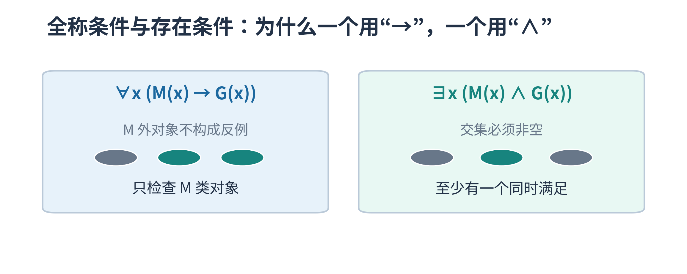

*图：全称量化用条件限定对象；存在量化要求两种性质同时成立。*

> [!tip] 快速识别句型
> - “所有 $M$ 都是 $G$”：$\forall x(M(x)\to G(x))$。
> - “有些 $M$ 是 $G$”：$\exists x(M(x)\land G(x))$。
> - “没有 $M$ 是 $G$”：$\neg\exists x(M(x)\land G(x))$，等价于 $\forall x(M(x)\to\neg G(x))$。
> - “并非所有 $M$ 都是 $G$”：$\exists x(M(x)\land\neg G(x))$。
>
> 这些模式适用于含特性谓词、论域未预先限制为 $M$ 类对象的写法；更复杂语句还需依照语义分析。

### 3.3 量词顺序：$\forall x\exists y$ 与 $\exists y\forall x$

**当多个不同量词同时出现时，次序一般不可交换。**

$$
\forall x\exists y\,R(x,y)
$$

读作“对**每个** $x$，都能为它**找到某个** $y$”。这里的 $y$ 可以随不同的 $x$ 而改变。

$$
\exists y\forall x\,R(x,y)
$$

读作“**先存在一个固定的** $y$，它对所有 $x$ 都能使关系成立”。这个 $y$ 不能随着 $x$ 改变。

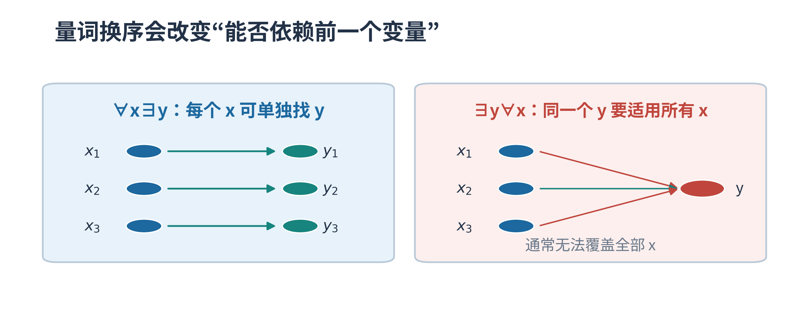

*图：∀x∃y 允许 y 随 x 改变；∃y∀x 必须选定一个共同 y。*

以实数域 $D=\mathbb R$ 和 $R(x,y):x+y=0$ 为例：

$$
\forall x\exists y(x+y=0)
$$

为真：给定任意 $x$，取 $y=-x$ 即可。相反，

$$
\exists y\forall x(x+y=0)
$$

为假：固定任何 $y$，都不可能同时与所有实数 $x$ 相加得 $0$。

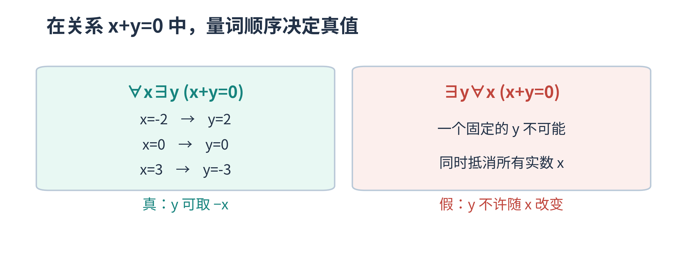

*图：实数域中 ∀x∃y(x+y=0) 为真，∃y∀x(x+y=0) 为假。*

**能够交换的特殊情况**：两个相邻的同类量词通常可以换序，即 $\forall x\forall yA\leftrightarrow\forall y\forall xA$、$\exists x\exists yA\leftrightarrow\exists y\exists xA$，前提是正确理解量词辖域与变元作用。不同类量词不应随意交换；某些具体公式因特殊关系恰好等价，并不构成普遍换序规则。

### 3.4 常见数量表达式速查

| 自然语言 | 推荐的逻辑结构 |
| --- | --- |
| 所有 $M$ 都有性质 $P$ | $\forall x(M(x)\to P(x))$ |
| 至少有一个 $M$ 有性质 $P$ | $\exists x(M(x)\land P(x))$ |
| 没有 $M$ 有性质 $P$ | $\forall x(M(x)\to\neg P(x))$ |
| 不是所有 $M$ 都有性质 $P$ | $\exists x(M(x)\land\neg P(x))$ |
| 至少两个不同对象满足 $P$ | $\exists x\exists y(P(x)\land P(y)\land x\ne y)$ |
| 至多一个对象满足 $P$ | $\forall x\forall y((P(x)\land P(y))\to x=y)$ |
| 恰有一个对象满足 $P$ | $\exists x(P(x)\land\forall y(P(y)\to y=x))$ |
| 每个 $x$ 至少有一个对应 $y$ | $\forall x\exists yR(x,y)$ |

“有些”和“至少一个”一般是存在量词；“恰有一个”不能只有 $\exists$，还必须添加唯一性条件。

### 3.5 自然语言符号化的五步法

1. **确定论域**：是全体实数、自然数、人，还是“所有对象”？
2. **找对象及性质/关系**：性质通常用一元谓词，比较和关系用二元或多元谓词。
3. **找量化词**：“所有”“存在”“对任意……总能找到……”分别对应什么量词？
4. **确定逻辑结构**：全称限制一般是“条件 $\to$”，存在见证一般是“条件 $\land$”；先后依赖通过量词顺序表达。
5. **检验真假情景**：尝试构造一个符合原中文却不符合公式的情景，或反过来构造反例。如果找得到，就说明形式化可能写错。

> [!important] 参数顺序与括号是语义的一部分
> $R(x,y)$ 与 $R(y,x)$ 不必等价；$\forall x(P(x)\to Q(x))$ 与 $(\forall xP(x))\to Q(x)$ 的辖域也不同。正式作业建议保留明确括号，宁可多写两个括号，也不要让量词只管到错误的位置。

## 四、课件典型符号化例题：保留关键过程

### 4.1 “世界上有黑天鹅”与“所有天鹅都是黑的”

设 $S(x)$ 表示“$x$ 是天鹅”，$B(x)$ 表示“$x$ 是黑色的”，论域为所有讨论对象。

“存在黑天鹅”：

$$
\exists x(S(x)\land B(x)).
$$

“所有天鹅都是黑色的”：

$$
\forall x(S(x)\to B(x)).
$$

两者不能混淆：存在一只黑天鹅，并不能推出所有天鹅都是黑的；所有天鹅都是黑的，在可能存在空的天鹅类别的广义模型中，也不单凭该公式保证天鹅存在。若题目明确论域里已有天鹅，则另当别论。

### 4.2 “存在最小的自然数”

设 $N(x)$ 表示 $x$ 是自然数，$L(x,y)$ 表示 $x\le y$，论域可取实数。

**第一步：存在一个候选对象 $x$，且它必须是自然数。**

$$
\exists x\bigl(N(x)\land\cdots\bigr).
$$

**第二步：对每一个自然数 $y$，该候选对象都不能大于 $y$。**

$$
\forall y\bigl(N(y)\to L(x,y)\bigr).
$$

**第三步：将条件合并。**

$$
\boxed{\exists x\bigl(N(x)\land\forall y(N(y)\to L(x,y))\bigr)}
$$

若论域直接取 $\mathbb N$，可以写为：

$$
\exists x\forall y(x\le y).
$$

也可以用“严格小于”描述：存在 $x$，对任意与它**不同**的自然数 $y$，都有 $x<y$：

$$
\exists x\Bigl(N(x)\land\forall y\bigl((N(y)\land y\ne x)\to x<y\bigr)\Bigr).
$$

这说明同一句话可以有不同、但在预期论域上等价的表示方法。

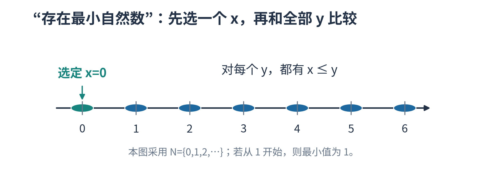

*图：最小值的逻辑结构：存在 x，且任意 y 都不小于 x。*

### 4.3 “不存在最大的自然数”

设论域 $D=\mathbb N$。先写“存在最大自然数”：

$$
\exists x\forall y(y\le x).
$$

对此整体否定：

$$
\boxed{\neg\exists x\forall y(y\le x)}
$$

随后逐层把否定移入：

$$
\begin{aligned}
\neg\exists x\forall y(y\le x)
&\leftrightarrow\forall x\neg\forall y(y\le x)\\
&\leftrightarrow\forall x\exists y\neg(y\le x)\\
&\leftrightarrow\forall x\exists y(y>x).
\end{aligned}
$$

得到等价表述：“任取一个自然数 $x$，总能找到更大的自然数 $y$”。如果论域不局限于自然数，则还要分别补充 $N(x),N(y)$ 的特性谓词。此题是**量词否定与量词次序**的综合示例。

### 4.4 “任意两个整数之间存在一个无理数”

设 $Z(x)$ 为“$x$ 是整数”，$I(t)$ 为“$t$ 是无理数”，论域为实数。要想“在两个整数之间”有对象，这两个整数必须**不同**：

$$
\boxed{\begin{aligned}
\forall x\forall y\bigl((&Z(x)\land Z(y)\land x\ne y)\to\\
&\exists t\bigl(I(t)\land ((x<t\land t<y)\lor(y<t\land t<x))\bigr)\bigr).
\end{aligned}}
$$

阅读方法：先选任意不同的整数 $x,y$；不论哪一个较小，都能找到无理数 $t$ 严格位于两者之间。如果额外规定 $x<y$，形式还可简化为：

$$
\forall x\forall y\bigl((Z(x)\land Z(y)\land x<y)\to\exists t(I(t)\land x<t\land t<y)\bigr).
$$

> [!warning] 课件校订：注意 $x\ne y$
> 第 5.1 讲第 26 页的原式未排除 $x=y$，因此要求“同一个整数与自己之间也存在无理数”，显然不成立。这里加入 $x\ne y$，使公式准确匹配一般所说的“两个不同整数之间”。

### 4.5 “过任意不同两点恰有一条直线”

这是符号化中较复杂而且非常典型的“**存在唯一性**”题。设：

- $P(x)$：$x$ 是点；
- $L(z)$：$z$ 是直线；
- $R(z,x,y)$：直线 $z$ 同时经过点 $x,y$。

先写：任意不同的点 $x,y$；**存在**一条符合条件的直线 $z$：

$$
\forall x\forall y\Bigl((P(x)\land P(y)\land x\ne y)\to\exists z\bigl(L(z)\land R(z,x,y)\land\cdots\bigr)\Bigr).
$$

再添加“**所有**同样经过两点的直线 $w$ 都和 $z$ 相同”：

$$
\boxed{\begin{aligned}
\forall x\forall y\bigl((&P(x)\land P(y)\land x\ne y)\to\\
\exists z\bigl(&L(z)\land R(z,x,y)\land\\
&\forall w((L(w)\land R(w,x,y))\to w=z)\bigr)\bigr).
\end{aligned}}
$$

可以按“**任选两点 → 存在一条直线 → 其他符合条件的直线只能是它**”三层阅读。

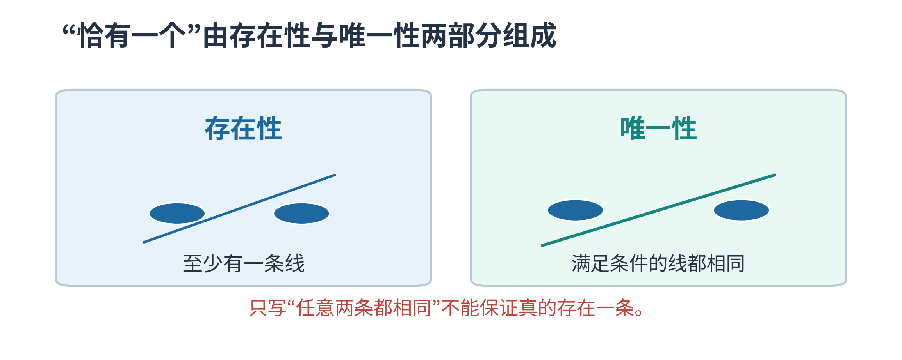

*图：唯一性条件不能代替存在性条件。*

> [!warning] 课件校订：两种写法并不完全等价
> 第 5.1 讲第 32 页（亦见第 5.2 讲第 7 页）的形式包含存在性和唯一性，基本正确。第 5.1 讲第 33 页（亦见第 5.2 讲第 8 页）仅写“任何两条同时经过该两点的直线都相同”，只能保证**至多一条**，不能单独保证**至少一条**。若该题要求“恰有一条”，应使用同时包含两部分的第一类写法。

### 4.6 “每个不小于 6 的偶数都是两个奇素数之和”

设论域为整数，$E(n)$ 表示 $n$ 为偶数，$Q(n)$ 表示 $n$ 为奇素数。依照中文句意：

$$
\boxed{\forall n\Bigl((E(n)\land n\ge6)\to\exists p\exists q(Q(p)\land Q(q)\land p+q=n)\Bigr)}
$$

此处的关键结构是：

- 对满足“偶数且不小于 6”的每个 $n$ 进行全称量化；
- 为**这个 $n$** 寻找某两个奇素数 $p,q$；
- 要求两数之和恰好是 $n$。

> [!note] 逻辑符号化与数学定理的真实性是两回事
> 此句属于强哥德巴赫猜想的常见表述形式。课程练习的要求是把语言**准确翻译成公式**，并不意味着它在课件中已被证明。课件第 34 页还复用了 $E$ 表示一元谓词和三元谓词；重新写时最好用不同符号，以免读者混淆。

### 4.7 “相等的两个角未必都是对顶角”

这句话的核心是“**存在两个大小相等、却不是对顶角的角**”，不是说任意两个这样的角都不是对顶角。

设 $A(x)$ 表示 $x$ 是角，$M(x,y)$ 表示 $x,y$ 的**角度大小相等**，$V(x,y)$ 表示二者构成对顶角关系，则：

$$
\boxed{\exists x\exists y\bigl(A(x)\land A(y)\land x\ne y\land M(x,y)\land\neg V(x,y)\bigr)}
$$

它还等价于对一个全称蕴含公式的否定。**角度相等**与**对象完全相同**不同：$M(x,y)$ 不应简单地一律改为 $x=y$。如果两只角确实是不同几何对象，$x\ne y$ 也应保留。

### 4.8 课件中的四道简短练习

设论域为适当的数字或对象集合。

**（1）凡正数都大于零。** 设 $P(x)$：“$x$ 是正数”，$G(x)$：“$x>0$”。

$$
\forall x(P(x)\to G(x)).
$$

这是概念定义所保证的真命题。

**（2）存在小于 2 的素数。** 设 $S(x)$：“$x$ 是素数”。

$$
\exists x(S(x)\land x<2).
$$

按通常整数素数定义，此命题为假，因为最小素数是 $2$。

**（3）没有不能表示成分数的有理数。** 设 $Q(x)$：“$x$ 是有理数”，$F(x)$：“$x$ 可以表示为两个整数之比（分母非零）”。

$$
\neg\exists x(Q(x)\land\neg F(x))
\quad\leftrightarrow\quad
\forall x(Q(x)\to F(x)).
$$

两个形式等价，均为真。

**（4）并不是所有参加考试的人都能取得好成绩。** 设 $M(x)$：“$x$ 是人”，$T(x)$：“$x$ 参加考试”，$G(x)$：“$x$ 取得好成绩”。

$$
\neg\forall x((M(x)\land T(x))\to G(x))
$$

等价于：

$$
\exists x(M(x)\land T(x)\land\neg G(x)).
$$

它说的是“至少存在一名参加考试但未取得好成绩的人”。其真值依赖具体考试和成绩事实，不能仅靠公式形式决定。

## 五、一阶语言：从符号构造合式公式

第 5.1 讲后半部分（第 39–54 页）和第 5.2 讲第 11–26 页进入 **4.2 一阶逻辑公式及其解释**。这个部分的核心问题是：**怎样判断一个符号串是否符合语法，以及公式中的变元究竟受哪个量词控制？**

### 5.1 一阶语言 $\mathcal L$ 的字母表

一阶语言是一套可以被解释的形式符号系统。课件列出的主要符号如下。

| 符号类别 | 常用记号 | 基本作用 |
| --- | --- | --- |
| 个体常元 | $a,b,c,a_1,\ldots$ | 指称固定对象 |
| 个体变元 | $x,y,z,x_1,\ldots$ | 指称可变化的对象 |
| 函数符号 | $f,g,h,\ldots$ | 依据输入的对象产生另一个对象 |
| 谓词符号 | $F,G,H,P,R,\ldots$ | 表达对象的性质或关系 |
| 量词 | $\forall,\exists$ | 分别表示“所有”和“存在” |
| 联结词 | $\neg,\land,\lor,\to,\leftrightarrow$ | 组合或否定逻辑公式 |
| 辅助符号 | $(,),\text{逗号}$ | 标明结构和参数边界 |

在标准一阶语言中，等号 $=$ 常被当作具有固定解释的**逻辑符号**使用；具体课堂也可能把等号关系记为 $E(x,y)$。这两种记法的意思要按题目规定，但不要混用“相等的对象”和“数值相等的性质”。

**逻辑符号**不依赖具体描述的对象类别；**非逻辑符号**（如某个具体 $f$ 或 $P$）须通过解释确定其具体含义。例如，$f$ 可以被解释为加法，也可以解释为减法。

### 5.2 项（term）：表示对象的合法表达式

**项是能够指称论域中某个对象的表达式**，其定义是递归的：

1. 个体常项、个体变项本身都是项。
2. 若 $t_1,\ldots,t_n$ 都是项，$f$ 是 $n$ 元函数符号，则 $f(t_1,\ldots,t_n)$ 也是项。
3. 只有按前两条规则**有限次构造**出的表达式才是项。

例如：

$$
\begin{gathered}
a,\quad x,\quad f(a),\quad g(a,x),\\
g(x,f(a)),\quad f(g(a,x),b).
\end{gathered}
$$

如何判断 $g(x,f(a))$ 是项？可以逆向拆解：$x$ 是项，$a$ 是项；由一元函数规则，$f(a)$ 是项；再由二元函数规则，$g(x,f(a))$ 是项。

> [!warning] “项”与“公式”不是同一种语法对象
> $f(a)$ 可以是一个数、一个人或其他论域对象，**本身不具有真假值**。因此不能因为 $f(a)$ 看起来像一个函数调用，就把它当作命题。要能判定真假，必须进一步把项交给谓词或形成等式，例如 $F(f(a))$ 或 $f(a)=b$。

### 5.3 原子公式（atomic formula）

若 $P$ 是 $n$ 元谓词符号，$t_1,\ldots,t_n$ 都是项，则：

$$
P(t_1,t_2,\ldots,t_n)
$$

是**原子公式**。例如：

$$
F(a),\quad G(a,y),\quad F(f(a)),\quad G(x,g(a,y)).
$$

原子公式是可以在一个解释和必要的赋值之下判断真假的**最小逻辑单位**之一。在通常含等号的一阶语言里，$t_1=t_2$ 也是原子公式。

请区分这两种情况：

- $f(a)$：是**项**，结果为一个对象。
- $F(f(a))$：是**原子公式**，判断这个对象是否满足性质 $F$。

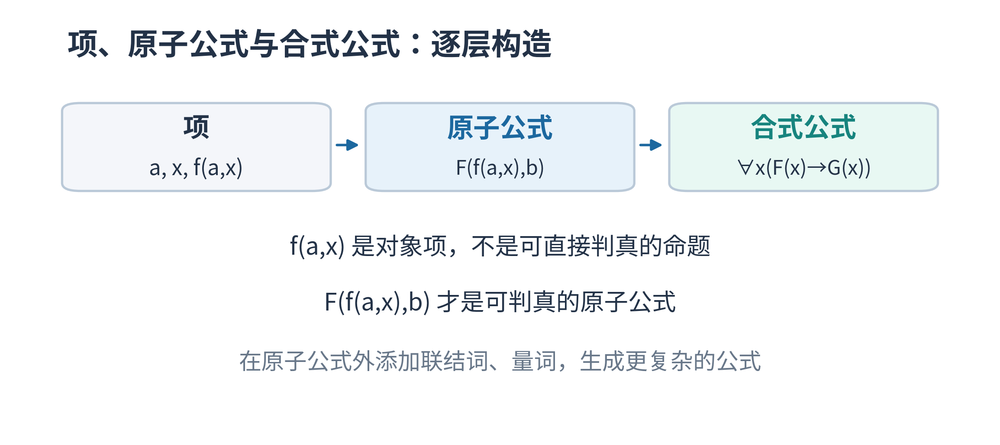

*图：项表示对象，原子公式表示性质或关系，合式公式可由联结词和量词递归构造。*

### 5.4 合式公式（well-formed formula，WFF）的递归定义

课件给出的构造规则可以规范地表述为：

1. 每一个原子公式都是合式公式。
2. 如果 $A$ 是合式公式，那么 $\neg A$ 也是合式公式。
3. 如果 $A,B$ 都是合式公式，那么

$$
(A\land B),\quad(A\lor B),\quad(A\to B),\quad(A\leftrightarrow B)
$$

也都是合式公式。

4. 如果 $A$ 是合式公式，$x$ 是个体变元，则 $\forall xA$ 和 $\exists xA$ 都是合式公式。
5. 没有经过这些规则**有限次**构造的符号串，不属于本语言的合式公式。

**判定例题**：为什么

$$
\exists x\bigl(F(x)\land\forall y(G(y)\to H(x,y))\bigr)
$$

是合式公式？

- $F(x)$、$G(y)$、$H(x,y)$ 都是原子公式。
- 由联结词规则，$G(y)\to H(x,y)$ 是合式公式。
- 加入量词得到 $\forall y(G(y)\to H(x,y))$。
- 和 $F(x)$ 合取得到 $F(x)\land\forall y(G(y)\to H(x,y))$。
- 最后由存在量词规则得到整个合式公式。

这是一种**自底向上**构造的证明方法，遇到较复杂的公式时也适用。

### 5.5 括号、优先级与省略规则

课件第 5.2 讲第 21 页给出了“量词、否定、合取析取、蕴含等值”的书写优先级。可把它作为理解常见省略写法的参考，但实际运用时**不要依赖没有明确约定的运算结合方向**。

较安全的阅读顺序是：

1. **先读最内层括号**。
2. 区分量词后面直接控制哪个公式；涉及多个联结词时，优先用括号把量词辖域明确写出。
3. 通常否定 $\neg$ 比 $\land,\lor$ 结合得更紧，后者又比 $\to,\leftrightarrow$ 更紧；但 $\land$ 与 $\lor$ 是否同级、同级联结词怎样结合，可能依教材约定不同。
4. 对学习阶段的正式符号化题，**所有重要的量词辖域和蕴含范围都写括号**，无需为少写符号冒语义错误的风险。

例如：

$$
\forall x\bigl(P(x)\to Q(x)\bigr)
$$

意思是“所有满足 $P$ 的对象也满足 $Q$”。

而

$$
(\forall xP(x))\to Q(y)
$$

完全不同：前件声称所有对象都有性质 $P$；后件只涉及 $y$。若 $y$ 在这里没有被量化，它还是自由变元。

> [!tip] 看不懂括号时，先找“最外层运算”
> 例如 $\exists x(F(x)\land\forall y(G(y)\to H(x,y)))$：最外层是 $\exists x$，它控制整个括号；括号内部最外层是 $\land$；右侧子式最外层是 $\forall y$；最里面是 $G(y)\to H(x,y)$。这种逐层分解比死记优先级更稳定。

## 六、量词辖域、指导变元、自由出现与约束出现

这一部分是第 5.2 讲第 23–26 页的重点，也是后续换名、代入、公式解释的基础。

### 6.1 量词辖域与指导变元

在公式 $\forall xA$ 或 $\exists xA$ 中：

- **指导变元（指导变项）**：紧跟量词后的 $x$。
- **量词辖域（scope）**：量词所作用的公式 $A$。

例如：

$$
\exists x\bigl(F(x)\land\forall y(G(y)\to H(x,y))\bigr).
$$

外层的 $\exists x$ 控制整个括号；内层的 $\forall y$ 仅控制 $G(y)\to H(x,y)$。其中 $\forall y$ 的辖域里有 $x$，并不意味着它也把 $x$ 约束起来；**一个量词只负责与其指导变元同名、且处于其辖域中的适当出现位置**。

### 6.2 自由出现与约束出现：按“位置”判断

同一个变元字母在同一公式内可能有多个出现位置，**每个位置**分别判断：

- **约束出现（bound occurrence）**：某个变元出现在以同名变元为指导变元的量词辖域中，并受到该量词控制。
- **自由出现（free occurrence）**：不受任何相应量词控制的变元出现。

例如课件中的：

$$
H(x,y)\lor\exists xF(x)\lor\forall y(G(y)\to H(x,y)).
$$

分成三段判断：

| 子公式 | $x$ 的出现 | $y$ 的出现 |
| --- | --- | --- |
| $H(x,y)$ | 自由 | 自由 |
| $\exists xF(x)$ | 受 $\exists x$ 约束 | 不出现 |
| $\forall y(G(y)\to H(x,y))$ | 自由 | 受 $\forall y$ 约束 |

因此整个公式里，$x$、$y$ **都存在自由出现，也都存在约束出现**。它们并非完全“自由”或完全“约束”，而是**不同位置的发生方式不同**。

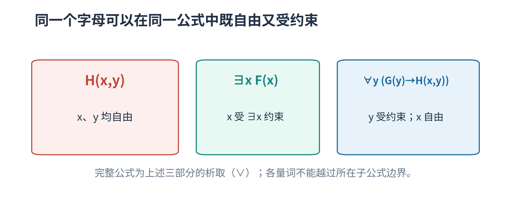

*图：自由和约束针对每一次变量出现，而不是简单针对字母。*

> [!warning] 典型错误
> 看到一个公式中出现 $\exists x$，就把后面所有字母 $x$ 都判为约束，是错误的。正确做法是先划定**该量词辖域**，再逐个检查出现位置；超出辖域的同名变元依然可能是自由的。

### 6.3 闭式（closed formula）与开式

如果一个合式公式**不存在任何自由出现的个体变元**，它叫**闭式**，又称句子（sentence）；含有自由变元的公式称为开式。

| 公式 | 是否闭式 | 原因 |
| --- | --- | --- |
| $F(a)$ | 是 | 只含常项，无自由变元 |
| $\exists xF(x)$ | 是 | $x$ 被量词约束 |
| $\forall x(F(x)\to G(x))$ | 是 | 所有 $x$ 都受约束 |
| $F(x)$ | 否 | $x$ 自由 |
| $\forall y(G(y)\to H(x,y))$ | 否 | $x$ 自由，虽然 $y$ 受约束 |

**为什么这一区别重要？** 在一个固定解释下，闭式的真值不依赖“自由变元应赋成什么对象”，因为它没有自由变元；开式则可能因自由变元取值不同而改变真假。

### 6.4 换名规则：允许改名字，不允许改含义

在不会改变变量绑定关系的前提下，量词控制的变元可以**一致地重命名**，称为**约束变元的换名（$\alpha$-换名）**。

例如：

$$
\forall xF(x)\quad\leftrightarrow\quad\forall zF(z).
$$

两个式子都表示“论域内所有对象具有性质 $F$”；把量词指导变元从 $x$ 改为 $z$，同时把它控制的出现位置也改为 $z$，没有改变意义。

但不能只改量词而不改内部：

$$
\forall xF(x)\quad\not\leftrightarrow\quad\forall zF(x)
$$

一般不等价，因为右式的 $x$ 已成为自由变元，语义结构不同。

换名时要避开原来已有的自由变元，以及可能产生混乱的其他约束变元。通常选一个全新的字母最安全。

### 6.5 代入规则与变量捕获（必要补充）

**代入**是把公式中某个变元的**自由出现**替换成一个项。不能任意替换，否则原本自由的变量可能意外落入某个量词的控制范围，这叫**变量捕获**。

考虑：

$$
\forall y\,R(x,y).
$$

原式中 $x$ 是自由的，$y$ 受 $\forall y$ 约束。假设想把自由的 $x$ 用 $y$ 替换，**直接代入**会得到：

$$
\forall y\,R(y,y).
$$

在新式中，两个 $y$ 都被 $\forall y$ 控制，原本自由的参数消失了。正确做法是**先换名，再代入**：

$$
\begin{aligned}
\forall y\,R(x,y)&\quad\text{先换名为}\quad\forall z\,R(x,z),\\
&\quad\text{再代入得到}\quad\forall z\,R(y,z).
\end{aligned}
$$

最终的 $y$ 仍然自由，$z$ 仍然受量词约束，恰好保留了原来要表达的结构。

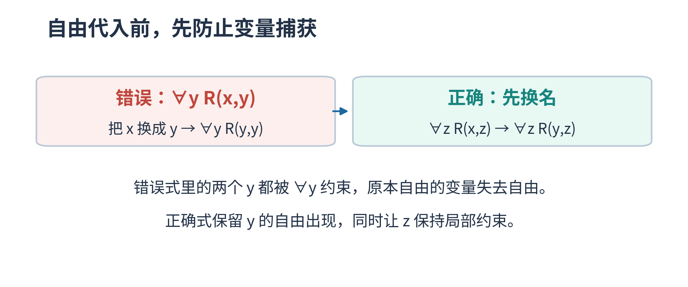

*图：代入规则必须避免自由变量被量词意外捕获。*

> [!important] 最关键的两句话
> **换名**：只能在量词及其相应绑定位置上保持一致，并且不能造成新的捕获。
>
> **代入**：只替换指定变元的自由出现，且代入的项必须能够安全进入这些位置，不能让项里的自由变元被额外量词捕获。

## 七、一阶逻辑公式的解释与真值

### 7.1 为什么只有语法还不能决定真假

公式 $F(f(a,a),b)$ 是一个合式公式，但它是否为真取决于：

- $a$、$b$ 分别指哪个对象；
- $f$ 被解释成哪个具体函数；
- $F$ 被解释成什么关系；
- 使用什么论域。

仅看到字母形式不能决定真值。这正是第 5.2 讲第 28–37 页介绍“解释”的目的。

### 7.2 一个解释包含哪四部分

课件将一阶公式的**解释（interpretation）**归纳为四个部分：

1. 指定一个**非空论域** $D$。
2. 指定各**个体常项**在 $D$ 中所代表的对象。
3. 指定每个 $n$ 元**函数符号**在 $D$ 上的具体函数 $D^n\to D$。
4. 指定每个 $n$ 元**谓词符号**在 $D$ 上的具体关系（即 $D^n$ 的某个子集）。

此外，对于**含自由变元的公式**，还必须给自由变元一个具体**赋值（assignment）**，以便确定真值。注意：解释和自由变元赋值不是同一项；这也是课件第 34 页将“解释”与“赋值”分开说明的原因。

> [!note] “解释”与“赋值”的直观分工
> **解释**决定了 $a$、$f$、$F$ 等非逻辑符号的含义；**赋值**决定了公式中没有受到量词约束的 $x,y$ 此时表示哪些对象。二者共同确定开式的真值。

### 7.3 同一公式在两个解释中真值不同

考虑课件第 35 页的公式：

$$
F(f(a,a),b).
$$

**解释一**：论域为自然数，$a=2,b=4$，$f(x,y)=x+y$，$F(u,v)$ 表示 $u=v$。先算函数项：

$$
f(a,a)=2+2=4.
$$

原子公式化为 $F(4,4)$，即 $4=4$，所以**为真**。

**解释二**：论域为实数，$a=3,b=5$，$f(x,y)=x-y$，$F(u,v)$ 表示 $u>v$。先算函数项：

$$
f(a,a)=3-3=0.
$$

原子公式化为 $F(0,5)$，即 $0>5$，所以**为假**。

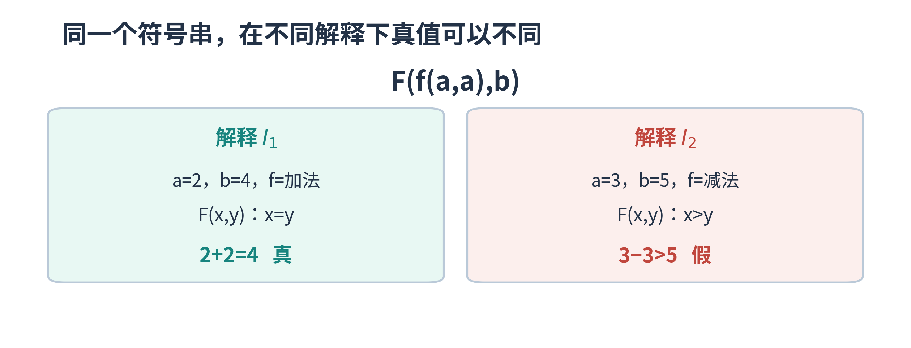

*图：真值依赖论域以及常项、函数、谓词的解释。*

**操作顺序**：先确定论域及各符号的解释 → 对自由变元赋值（若存在） → 自内向外计算函数项 → 判断原子公式 → 使用联结词和量词计算复合公式的真假。

### 7.4 有限论域上量词怎样化为合取与析取

若论域恰好为有限集合 $D=\{a_1,a_2,\dots,a_n\}$，则：

$$
\boxed{\forall xP(x)\ \leftrightarrow\ P(a_1)\land P(a_2)\land\cdots\land P(a_n)}
$$

$$
\boxed{\exists xP(x)\ \leftrightarrow\ P(a_1)\lor P(a_2)\lor\cdots\lor P(a_n)}
$$

这使有限论域的一阶逻辑真值计算能够转化为已经学过的命题逻辑运算。

例如 $D=\{1,2,3,4\}$、$P(x)$ 为 $x^2<10$：

$$
P(1)=1,\ P(2)=1,\ P(3)=1,\ P(4)=0.
$$

因此：

$$
\forall xP(x)=1\land1\land1\land0=0.
$$

同理若 $Q(x)$ 为 $x^2>10$：

$$
Q(1)=0,\ Q(2)=0,\ Q(3)=0,\ Q(4)=1,
$$

于是：

$$
\exists xQ(x)=0\lor0\lor0\lor1=1.
$$

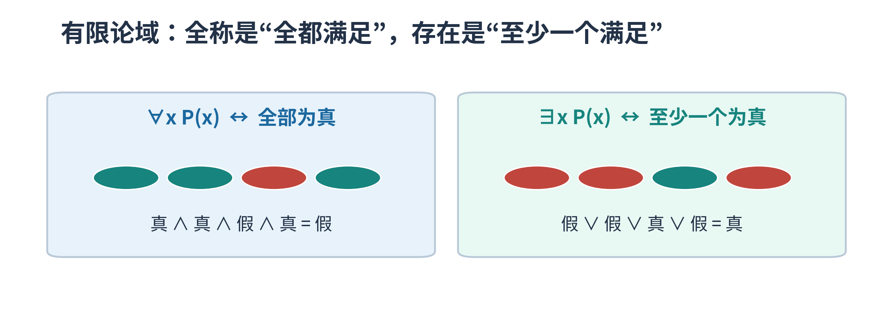

*图：有限论域上，全称量词等价于有限合取，存在量词等价于有限析取。*

> [!warning] 有限枚举的适用条件
> 只有在**论域明确且有限**时，才能按这种方式完整列出所有对象并直接计算。若论域是全体自然数或实数，不能仅抽查几个数就把全称断言判为真；但要判其为假，找到**一个反例**就够了。

### 7.5 两个量词的真值条件：逐个区分

设 $P(x,y)$ 是二元谓词。课件第 31 页的量词比较可整理为：

| 公式 | 为真的条件 | 为假的条件 |
| --- | --- | --- |
| $\forall x\forall yP(x,y)$ | 任意一对 $x,y$ 都满足 $P$ | 至少有一对不满足 |
| $\forall x\exists yP(x,y)$ | 每个 $x$ 至少有一个相应 $y$ | 至少有一个 $x$，无论选哪个 $y$ 都失败 |
| $\exists x\forall yP(x,y)$ | 存在一个固定的 $x$ 对所有 $y$ 成立 | 每个 $x$ 都至少对应一个失败的 $y$ |
| $\exists x\exists yP(x,y)$ | 至少存在一对 $x,y$ 满足 $P$ | 所有成对取值都不满足 $P$ |

其中，两个连续全称量词以及两个连续存在量词可以换序。但上述一行与另一行的混合量词，不能直接互换。

例如 $D=\mathbb R$，$P(x,y)$ 为 $x+y=0$：

$$
\begin{aligned}
\forall x\exists yP(x,y)&\text{ 为真，见证为 }y=-x;\\
\exists y\forall xP(x,y)&\text{ 为假，没有统一的 }y.
\end{aligned}
$$

题目若问“分别判断真假”，应先**翻译成自然语言**，再找满足或否定条件的对象，避免仅凭两式表面相似做判断。

### 7.6 课件第 36 页的解释题

课件该页的可视内容是：

$$
\forall x\bigl(P(x)\lor Q(x)\bigr),\qquad P(x):x=1,\quad Q(x):x=2.
$$

**论域一** $D_1=\{1,2\}$：$x=1$ 时 $P(1)$ 真；$x=2$ 时 $Q(2)$ 真。所以每个对象都满足 $P\lor Q$，结果为 **真**。

**论域二** $D_2=\{0,1,2\}$：取 $x=0$ 时，$P(0)$ 与 $Q(0)$ 都假，得到一个全称反例，结果为 **假**。

这是论域变化导致同一个符号形式真值不同的最典型例子之一；不要把 $\forall x(P(x)\lor Q(x))$ 误读为 $\forall xP(x)\lor\forall xQ(x)$，后者在 $D_1$ 中也是假。

## 八、量词否定、重要等值式与判断反例

本节不是把未上传的“完整等值式章节”补写成课件内容，而是汇总**当前两份课件已经直接用到或为理解本章不可缺少**的等值关系。其核心是量词否定和不同量词与联结词的结合。

### 8.1 两条量词否定律

$$
\boxed{\neg\forall xA(x)\ \leftrightarrow\ \exists x\neg A(x)}
$$

$$
\boxed{\neg\exists xA(x)\ \leftrightarrow\ \forall x\neg A(x)}
$$

第一式：**不是所有对象都满足** $A$，等价于**至少有一个对象不满足** $A$。

第二式：**不存在任何对象满足** $A$，等价于**所有对象都不满足** $A$。

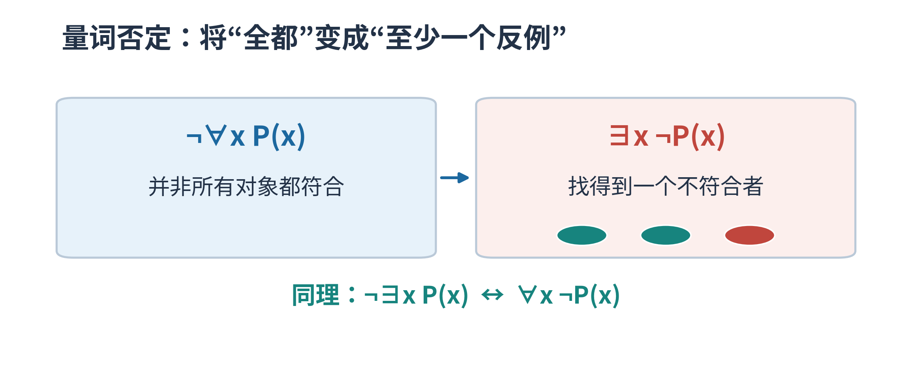

*图：量词的否定会交换 ∀ 和 ∃，并否定内部谓词。*

推导“并不是所有学生都及格”时要小心：

$$
\begin{aligned}
&\neg\forall x(S(x)\to P(x))\\
\leftrightarrow\;&\exists x\neg(S(x)\to P(x))\\
\leftrightarrow\;&\exists x\neg(\neg S(x)\lor P(x))\\
\leftrightarrow\;&\exists x(S(x)\land\neg P(x)).
\end{aligned}
$$

每一步都有依据：量词否定 → 蕴含等值式 → 德摩根律与双重否定。结论**不是**“所有学生都不及格”，而是“至少一个学生不及格”。

### 8.2 对多个量词逐层否定

例如：

$$
\neg\forall x\exists yR(x,y)
$$

先否定最外层：

$$
\leftrightarrow\exists x\neg\exists yR(x,y)
$$

再否定内层：

$$
\boxed{\leftrightarrow\exists x\forall y\neg R(x,y)}
$$

读作：原句是“每个 $x$ 都找得到一个 $y$”；其否定是“**存在一个 $x$，对所有 $y$ 都失败**”。尤其要留意 $\forall\exists$ 否定后的形式，不是简单在整句话末尾加 $\neg$ 并保留原量词不变。

### 8.3 同类量词与联结词的分配

以下等值式普遍成立：

$$
\begin{aligned}
\forall x(A(x)\land B(x))&\leftrightarrow(\forall xA(x))\land(\forall xB(x)),\\
\exists x(A(x)\lor B(x))&\leftrightarrow(\exists xA(x))\lor(\exists xB(x)).
\end{aligned}
$$

理由分别是：“所有对象都同时满足两项”等价于“两项分别都对所有对象成立”；“至少有对象满足某一个条件”等价于“至少一项存在见证”。

**但交叉搭配不能照搬：**

$$
\forall x(A(x)\lor B(x))
\quad\not\leftrightarrow\quad
(\forall xA(x))\lor(\forall xB(x)).
$$

例如 $D=\{1,2\}$、$A(x):x=1$、$B(x):x=2$：左边真，右边假。

同样，

$$
\exists x(A(x)\land B(x))
\quad\not\leftrightarrow\quad
(\exists xA(x))\land(\exists xB(x)).
$$

反例仍取 $D=\{1,2\}$、$A(x):x=1$、$B(x):x=2$。右边真（分别存在），左边假（没有同一个对象同时等于 $1$ 和 $2$）。

### 8.4 与不含该自由变元的子公式合并

如果 $x$ 在 $C$ 中**没有自由出现**，且论域非空，则可使用：

$$
\begin{aligned}
\forall x(A(x)\lor C)&\leftrightarrow(\forall xA(x))\lor C,\\
\exists x(A(x)\land C)&\leftrightarrow(\exists xA(x))\land C.
\end{aligned}
$$

例如“所有学生都通过考试，或者今天下雨”：是否下雨与学生 $x$ 无关，因此可以从全称量词辖域内取出这部分条件。

> [!warning] 适用条件不能省
> 这里必须确认 $x$ 在 $C$ 中**不自由出现**。如果 $C$ 是 $B(x)$，就不能机械提取量词；否则会将“每个人单独判断”的条件错误变成“整个论域只判断一次”的命题。

### 8.5 非空论域的一个常见蕴含

只要 $D\ne\varnothing$，便有：

$$
\forall xP(x)\ \Rightarrow\ \exists xP(x).
$$

解释：如果所有对象都满足 $P$，那么随便取论域中的一个对象便可作为存在见证。**非空论域是必要条件**。逆命题 $\exists xP(x)\Rightarrow\forall xP(x)$ 一般不成立。

## 九、永真式、矛盾式、可满足式与代换实例

第 5.2 讲第 39–42 页开始讨论一阶公式的分类。这里不仅要给定义，还必须分清“一个解释下为真”和“在所有解释下都为真”。

### 9.1 三类公式的规范定义

设 $A$ 是一阶逻辑公式，考虑允许的所有解释；如存在自由变元，再考虑它们的全部赋值。

- **永真式 / 逻辑有效式（valid）**：在**每种**解释及相应赋值下，$A$ 都为真。记作 $\models A$。
- **矛盾式 / 永假式（unsatisfiable）**：在**所有**解释及赋值下，$A$ 都为假；即不存在使其为真的模型与赋值。
- **可满足式（satisfiable）**：**至少存在一个**解释及相应赋值使 $A$ 为真。可满足式包括永真式，也包括有时真有时假的公式。

因此公式的关系是：

$$
\text{永真式}\subseteq\text{可满足式},
$$

$$
\text{矛盾式}\cap\text{可满足式}=\varnothing.
$$

还应注意：**“不是永真式”不等于“矛盾式”**。不是永真的公式可能只是可满足但并非在所有解释下为真。

*图：永真要求全部解释为真；矛盾式全为假；可满足只需存在一个真。*

### 9.2 用三个最简单的例子区分

**永真式：**

$$
P(a)\lor\neg P(a).
$$

无论 $P(a)$ 真或假，整个析取式总真。

**矛盾式：**

$$
P(a)\land\neg P(a).
$$

任何解释下都不可能同时为真。

**可满足但非永真：**

$$
P(a).
$$

可以选择使 $P(a)$ 为真的解释，也可以选择使其为假的解释，所以它是可满足的，却不是逻辑有效的。

### 9.3 命题重言式的代换实例

在命题公式 $A(p_1,\ldots,p_n)$ 中，分别用一阶逻辑公式 $B_1,\ldots,B_n$ 替换命题变项，就得到它的**代换实例**。

例如命题重言式：

$$
p\to(q\to p).
$$

用 $p:=\forall xF(x)$、$q:=G(y)$ 替换，得：

$$
\forall xF(x)\to\bigl(G(y)\to\forall xF(x)\bigr).
$$

由于原来的命题公式是重言式，无论两部分如何真假组合，整式都真。故对应的一阶公式也是逻辑有效式。

> [!important] 一条重要定理
> **命题逻辑重言式的任意合规一阶公式代换实例仍是逻辑有效式；命题矛盾式的代换实例仍是矛盾式。** 但一阶逻辑还存在不能仅靠命题重言式解释的有效式，例如量词否定律 $\neg\forall xF(x)\leftrightarrow\exists x\neg F(x)$，其有效性依赖量词语义。

### 9.4 第 5.2 讲第 42 页的四类例题详解

课件给出四个公式，适合按“结构分析 → 逻辑分类 → 说明理由”练习。

**公式一**

$$
\forall xF(x)\to\bigl(G(y)\to\forall xF(x)\bigr).
$$

将 $\forall xF(x)$ 暂记为命题 $p$，$G(y)$ 暂记为 $q$，结构就是 $p\to(q\to p)$。这是命题重言式，故原公式**永真**。

**公式二**

$$
\exists xF(x)\to\forall yG(y).
$$

设 $D=\{1\}$。

- 让 $F(1)$ 真、$G(1)$ 假：前件真、后件假，整个蕴含式假。
- 让 $F(1)$ 假、$G(1)$ 假：前件假、后件假，整个蕴含式真。

所以它**可满足，但非永真**；既不是永真式，也不是矛盾式。

**公式三**

$$
\neg\bigl(\forall xF(x)\to\exists yG(y)\bigr)\land\exists yG(y).
$$

设 $A:=\forall xF(x)$、$B:=\exists yG(y)$，按命题等值演算逐步化简：

$$
\begin{aligned}
\neg(A\to B)\land B
&\leftrightarrow\neg(\neg A\lor B)\land B\\
&\leftrightarrow(A\land\neg B)\land B\\
&\leftrightarrow A\land(\neg B\land B)\\
&\leftrightarrow\bot.
\end{aligned}
$$

因为它同时要求 $B$ 与 $\neg B$，不可能为真，故是**矛盾式**。

**公式四**

$$
\neg\forall xF(x)\leftrightarrow\exists x\neg F(x).
$$

这就是第一条量词否定律：“并非所有人都有性质 $F$”与“有人没有性质 $F$”等价，因此该**等值式整体永真**。

> [!tip] 公式分类的实际解题顺序
> 先找是否属于明显的命题重言式结构；再检查有没有必然矛盾的子式或量词否定等值式。若看不出永真，可以尝试构造一个使其**为假**的解释；若看不出矛盾，可以尝试构造一个使其**为真**的解释。两个方向各找到一个实例，就能直接判定“可满足但非永真”。

### 9.5 语法、解释、公式类型三者不能混为一谈

- **语法问题**：$\forall x(F(x)\to G(x))$ 是否是合式公式？——是。
- **特定真值问题**：在给定论域及谓词解释下，该式真假如何？——要代入判断。
- **有效性问题**：它是否在所有解释下一直为真？——一般不是；需要分析所有可能情况或找反模型。

**反模型（countermodel）**是使某公式为假的一个解释。证明公式“并非永真”，找出一个反模型即可；证明公式“永真”，仅列举几个真例不能代替一般论证。

## 十、其他高频语句与容易混淆的表达

### 10.1 “只有……才……”与必要条件

自然语言“**只有 $q$，才 $p$**”表示 $q$ 是 $p$ 的必要条件，因此是：

$$
p\to q.
$$

例如“只有 $2$ 是素数，$4$ 才是素数”，设 $F(n)$ 为“$n$ 是素数”，公式是：

$$
F(4)\to F(2).
$$

这个蕴含式的真假是 $0\to1$，为**真**；并不意味着“$4$ 是素数”。

**判断方向的小办法**：先把原句改写成“如果 $p$，那么必然 $q$”，再写 $p\to q$。不能因为“只有 $q$”先说出口，就把 $q$ 放在蕴含号左侧。

“除非 $q$，否则 $\neg p$”也可表达为 $p\to q$；这类句型最好先进行自然语言等价改写，再进入一阶谓词的符号化。

### 10.2 “存在奇数，也存在偶数”与“存在既奇又偶的数”

设 $O(x)$ 表示 $x$ 是奇数，$E(x)$ 表示 $x$ 是偶数。比较：

$$
\underbrace{(\exists xO(x))\land(\exists yE(y))}_{\text{分别存在：两个见证可以不同}}
$$

与

$$
\underbrace{\exists x(O(x)\land E(x))}_{\text{同一个对象需同时满足两种性质}}.
$$

**前者为真，后者为假**（在通常整数含义下）。这正是课件第 5.1 讲第 22 页的对比：中文中的“既有 A 又有 B”通常是“各自存在”；“存在一个既 A 又 B 的对象”才要求同一个见证。字母用 $x$ 还是 $y$ 不是关键，**量词作用范围是否把两个条件绑定到同一个对象**才是关键。

### 10.3 “所有对象都与某个对象有关”与“存在一个对象与所有对象有关”

$$
\forall x\exists yR(x,y)
$$

并不一般地等价于：

$$
\exists y\forall xR(x,y).
$$

后者更强，要求有一个通用见证；在非空论域下，它**能推出**前者，但前者不能一般推出后者。

用实数 $x+y=0$ 就能构造反例。另一种容易观察的关系是“$x\le y$，论域为自然数”：每个自然数都有不小于它的自然数（取 $y=x$ 即可），但不存在一个自然数比所有自然数都大或相等。

### 10.4 逻辑推出与公式蕴含号

本章讲苏格拉底推理时有两种不同层次的写法。

**公式中的蕴含联结词**：

$$
M(a)\to D(a).
$$

这是一个新公式，其真值根据 $M(a),D(a)$ 决定。

**形式推导的关系**：

$$
\{\forall x(M(x)\to D(x)),\ M(a)\}\vdash D(a).
$$

表示在指定的形式推理系统中，可以由这些前提证明结论；在语义上也可讨论这些前提是否蕴涵结论。使用课堂符号时，不应把 $\vdash$、$\Rightarrow$ 与 $\to$ 当成完全相同的符号。此处仅作为与前面命题推理章节的必要衔接，不扩充为完整的谓词演算证明系统。

## 十一、分层巩固题：先做题，后看完整解答

以下题目围绕两份课件的实质范围设计，分别检查对象与谓词、量词结构、量词顺序、闭式、解释、公式分类。除特别说明，论域均非空。

### 11.1 题目

**题 1｜概念辨析**

设 $a$ 是个体常项，$x$ 是个体变元，$f$ 是一元函数符号，$F$ 是一元谓词符号。分别判断 $a$、$f(x)$、$F(a)$、$F(f(x))$ 属于“项”还是“公式”；指出谓词 $F$ 的元数。

**题 2｜两个存在句**

设 $S(x)$ 为“$x$ 是学生”，$P(x)$ 为“$x$ 会编程”，论域为所有讨论对象。符号化：（a）有学生会编程；（b）所有学生都会编程；（c）不是所有学生都会编程。

**题 3｜见证是否相同**

设 $R(x)$ 为“$x$ 喜欢阅读”，$W(x)$ 为“$x$ 喜欢写作”，论域为某班全体学生。分别写出“有人喜欢阅读，也有人喜欢写作”和“有人既喜欢阅读又喜欢写作”，说明是否必然等价。

**题 4｜量词顺序**

实数域上，设 $R(x,y)$ 为 $x<y$。判断 $\forall x\exists yR(x,y)$ 与 $\exists y\forall xR(x,y)$ 的真假，并解释原因。

**题 5｜反例及否定**

把 $\neg\forall x(P(x)\to Q(x))$ 化为只在谓词前出现否定的等价公式，逐步写出依据。

**题 6｜闭式及自由变元**

分析

$$
F(x,y)\land\forall x\bigl(G(x)\to\exists yH(x,y)\bigr).
$$

指出各处 $x,y$ 是自由还是约束出现，并判断整个公式是否闭式。

**题 7｜换名与代入**

从 $\exists yR(x,y)$ 出发，把自由的 $x$ 替换为 $y$。给出错误的直接写法，并给出避免变量捕获的正确结果。

**题 8｜唯一性**

论域为整数，$P(x)$ 表示“$x$ 是偶数”。分别写出“至少有一个偶数”“至多有一个偶数”“恰有一个偶数”的逻辑形式。重点是符号化，不需讨论是否为真。

**题 9｜有限论域真值**

令 $D=\{0,1,2\}$，$P(x)$ 为 $x>0$，$Q(x)$ 为 $x<2$。判断 $\forall x(P(x)\lor Q(x))$ 和 $(\forall xP(x))\lor(\forall xQ(x))$ 是否具有相同真值。

**题 10｜解释与赋值**

论域 $D=\{1,2,3\}$，令 $a=2$、$f(x)=x$、$F(x,y)$ 表示 $x<y$。求 $F(a,f(x))$ 在 $x=1$ 和 $x=3$ 时的真值，并判断这个公式是否闭式。

**题 11｜公式分类**

分类以下三个公式：

$$
\begin{aligned}
A&=F(a)\lor\neg F(a),\\
B&=\forall xF(x)\to\exists xF(x),\\
C&=(\exists xF(x))\land\neg\exists xF(x).
\end{aligned}
$$

分别说明是否为永真式、矛盾式、可满足式。

**题 12｜综合表达**

论域为实数，设 $Z(x)$ 表示“$x$ 是整数”，用 $<$ 与 $=$ 作为关系符号，写出“对任意整数 $x$，都存在比它大的整数 $y$”。再判断“所有整数都大于某个固定整数”与该句是否表达同一意思。

### 11.2 参考答案与过程

**题 1**

- $a$ 是项；$f(x)$ 是项，因为函数作用于项产生项。
- $F(a)$ 是原子公式，$F(f(x))$ 也是原子公式，因为谓词作用于项构成原子公式。
- $F$ 始终是一元谓词；参数内部是否含有函数，不改变 $F$ 的元数。

**题 2**

$$
\begin{aligned}
\text{(a)}\quad&\exists x(S(x)\land P(x)),\\
\text{(b)}\quad&\forall x(S(x)\to P(x)),\\
\text{(c)}\quad&\exists x(S(x)\land\neg P(x)).
\end{aligned}
$$

(c) 也可以写成 $\neg\forall x(S(x)\to P(x))$。尤其注意 (a) 和 (b) 不能把 $\land$、$\to$ 用反。

**题 3**

$$
\begin{aligned}
\text{分别存在：}&\quad(\exists xR(x))\land(\exists yW(y));\\
\text{同时满足：}&\quad\exists x(R(x)\land W(x)).
\end{aligned}
$$

不必然等价。举例：甲只喜欢阅读、乙只喜欢写作，分别存在成立，但不存在同一个学生既喜欢阅读又喜欢写作。

**题 4**

$$
\forall x\exists y(x<y)
$$

为真；任取实数 $x$，令 $y=x+1$，便找到见证。

$$
\exists y\forall x(x<y)
$$

为假；不论先选多大的 $y$，都能取 $x=y+1$，使 $x<y$ 不成立。前者 $y$ 可随 $x$ 选择，后者必须固定一个 $y$。

**题 5**

$$
\begin{aligned}
\neg\forall x(P(x)\to Q(x))
&\leftrightarrow\exists x\neg(P(x)\to Q(x))\\
&\leftrightarrow\exists x\neg(\neg P(x)\lor Q(x))\\
&\leftrightarrow\exists x(P(x)\land\neg Q(x)).
\end{aligned}
$$

依据依次为量词否定律、蕴含等值式、德摩根律及双重否定。最后的意思是“找到一个满足 $P$ 而不满足 $Q$ 的反例”。

**题 6**

$$
\underbrace{F(x,y)}_{x,y\text{均自由}}\land\forall x\bigl(G(x)\to\exists yH(x,y)\bigr).
$$

在左侧 $F(x,y)$ 中，$x,y$ 都自由。右侧的 $\forall x$ 约束 $G(x)$ 里的 $x$，也约束 $H(x,y)$ 里的 $x$；$\exists y$ 约束 $H(x,y)$ 里的 $y$。**整个公式并非闭式**，因为左侧仍有自由出现的 $x,y$。

**题 7**

错误直接代入：

$$
\exists yR(y,y).
$$

它使新代入的 $y$ 也受 $\exists y$ 控制。正确做法是先将约束的 $y$ 换成新的 $z$：

$$
\exists yR(x,y)\ \leftrightarrow\ \exists zR(x,z),
$$

再把自由 $x$ 替换为 $y$，得到：

$$
\boxed{\exists zR(y,z)}.
$$

最终 $y$ 仍自由，$z$ 为约束变元。

**题 8**

$$
\begin{aligned}
\text{至少一个：}&\quad\exists xP(x),\\
\text{至多一个：}&\quad\forall x\forall y((P(x)\land P(y))\to x=y),\\
\text{恰有一个：}&\quad\exists x(P(x)\land\forall y(P(y)\to y=x)).
\end{aligned}
$$

“至多一个”允许**一个都没有**；“恰有一个”同时保证存在与唯一。虽然在通常整数域上只有一个偶数这一陈述是假，但其符号化形式没有问题。

**题 9**

对每个 $x\in\{0,1,2\}$：

| $x$ | $P(x):x>0$ | $Q(x):x<2$ | $P(x)\lor Q(x)$ |
| --- | --- | --- | --- |
| 0 | 假 | 真 | 真 |
| 1 | 真 | 真 | 真 |
| 2 | 真 | 假 | 真 |

所以 $\forall x(P(x)\lor Q(x))$ 是**真**。但 $\forall xP(x)$ 因 $x=0$ 失败；$\forall xQ(x)$ 因 $x=2$ 失败，故后者两个全称式的析取为**假**。两者不等价。

**题 10**

- 当 $x=1$：$F(a,f(x))$ 化为 $F(2,1)$，即 $2<1$，为**假**。
- 当 $x=3$：化为 $F(2,3)$，即 $2<3$，为**真**。

该式中的 $x$ 自由出现，没有量词约束，所以不是闭式。变元赋值改变后，真值也相应改变。

**题 11**

- $A=F(a)\lor\neg F(a)$：排中律，**永真且可满足**。
- $B=\forall xF(x)\to\exists xF(x)$：论域非空时，前件全真则一定存在见证，**永真且可满足**。
- $C=(\exists xF(x))\land\neg\exists xF(x)$：同一命题及其否定相合取，**矛盾，不可满足**。

注意“永真”是“可满足”的一种情形，不能把这两种类别设置成互斥选项。

**题 12**

$$
\forall x\bigl(Z(x)\to\exists y(Z(y)\land x<y)\bigr).
$$

其意思是“每个整数总能找到一个更大的整数”。

“所有整数都大于某个固定整数”更接近：

$$
\exists y\bigl(Z(y)\land\forall x(Z(x)\to y<x)\bigr),
$$

它声称存在一个严格小于**所有整数（包含自身）**的整数，因此为假。两句不相同。若写成“对所有**其他**整数 $x\ne y$ 都更小”，仍然会声称整数有最小元素，也是假；可见无论哪种自然的严格最小值解释，都不能与原来“无最大整数”的陈述混淆。

## 十二、课件内容校订与识读提醒

为了避免把原课件中的疑点带入长期笔记，这里列出与主要结论直接相关的核查结果。**只修订有充分依据的问题，不把课件所有不够严密的简写都当成错误。**

| 位置 | 原课件内容或隐含问题 | 本笔记的处理 |
| --- | --- | --- |
| 第 5.1 讲第 5 页 | “凡人都会死”示例中使用未量化的 $F(x)\to G(x)$ | 采用 $\forall x(F(x)\to G(x))$ |
| 第 5.1 讲第 12、17 页 | 将函数归入谓词，但又区分函数值与关系真值 | 严格区分**函数项**与**谓词公式** |
| 第 5.1 讲第 14 页 | 把 $F(a)$ 直接称为“0 元谓词” | 区分**零元谓词符号**与**无自由变元的原子公式** |
| 第 5.1 讲第 26 页 | “两整数之间”未排除两数相同 | 加 $x\ne y$ 或预设 $x<y$ |
| 第 5.1 讲第 32–33 页及第 5.2 讲第 7–8 页 | “恰有一条”第二种形式只有唯一性 | 同时写出**存在性**与**唯一性** |
| 第 5.1 讲第 34 页及第 5.2 讲第 44 页 | $E$ 被同时用于不同元数的谓词 | 改用互不混淆的 $E(n)$、$Q(n)$ 和等式 $p+q=n$ |
| 第 5.1 讲第 35 页及第 5.2 讲第 45 页 | “角相等”用 $x=y$ 描述，容易混淆对象同一与大小相等 | 改为 $M(x,y)$：两个角大小相等 |
| 第 5.2 讲第 36 页 | PDF 文本提取显示乱码，但原始页面视觉内容可辨 | 按可视公式 $\forall x(P(x)\lor Q(x))$、$P(x):x=1$、$Q(x):x=2$ 复核，并给出两种论域下真假 |

关于“每个不小于 $6$ 的偶数都是两个奇素数之和”，课件是**符号化练习题**。本笔记不把这句话称作已经完成证明的定理。

## 十三、知识结构与考前速查

### 13.1 章节主线

**表达对象（个体、谓词、函数） → 量化对象（$\forall,\exists$） → 把自然语言转成公式 → 用语法规则判断合式性 → 区分自由与约束出现 → 指定解释和赋值 → 判断真值与公式类别。**

这些内容之间存在依赖：没有“项”就无法正确构成原子公式；不理解辖域就无法判断自由/约束；不知道解释和赋值就无法判断含自由变元的公式真值。

### 13.2 最重要的公式速查表

| 主题 | 应掌握的形式 |
| --- | --- |
| 全称限定 | $\forall x(M(x)\to P(x))$ |
| 存在见证 | $\exists x(M(x)\land P(x))$ |
| 恰有一个 | $\exists x(P(x)\land\forall y(P(y)\to y=x))$ |
| 否定全称 | $\neg\forall xP(x)\leftrightarrow\exists x\neg P(x)$ |
| 否定存在 | $\neg\exists xP(x)\leftrightarrow\forall x\neg P(x)$ |
| 全称分配到合取 | $\forall x(A\land B)\leftrightarrow(\forall xA)\land(\forall xB)$ |
| 存在分配到析取 | $\exists x(A\lor B)\leftrightarrow(\exists xA)\lor(\exists xB)$ |
| 同类量词换序 | $\forall x\forall yA\leftrightarrow\forall y\forall xA$；$\exists x\exists yA\leftrightarrow\exists y\exists xA$ |
| 非空域的基本推出 | $\forall xP(x)\Rightarrow\exists xP(x)$ |
| 有限域全称 | $\forall xP(x)\leftrightarrow\bigwedge_{a\in D}P(a)$（有限 $D$） |
| 有限域存在 | $\exists xP(x)\leftrightarrow\bigvee_{a\in D}P(a)$（有限 $D$） |

### 13.3 重要区分一次记清

- **项 / 原子公式**：前者指对象，后者表示可以判真的关系。
- **谓词元数 / 变元出现次数**：元数由参数位置数决定。
- **论域 / 特性谓词**：论域预先限定对象范围；特性谓词在较大论域中限定目标类别。
- **全称 / 存在**：全称寻找反例，存在寻找见证。
- **$\forall x\exists y$ / $\exists y\forall x$**：前者允许选择依赖 $x$ 的 $y$；后者先固定同一个 $y$。
- **自由 / 约束**：按出现位置判断，而不是按同名字母整体判断。
- **换名 / 代入**：换名保持绑定关系；代入不能导致变量捕获。
- **解释 / 赋值**：前者规定非逻辑符号含义；后者给自由变元选取对象。
- **永真 / 可满足 / 矛盾**：永真意味着每种解释都真；可满足只需一种为真；矛盾没有任何真例。

> [!summary] 最终检查思路
> 面对符号化题，**先定论域，后定谓词，再定量词与先后依赖，最后核对括号及反例**。面对真值题，**先读清量词辖域，确认解释与赋值，最后寻找见证或反例**。面对公式分类题，**区分“某一次解释为真”与“所有解释都真”**，必要时构造反模型。

---

*整理范围：第 5.1 讲及第 5.2 讲；本资料附有独立重新绘制的教学插图（高清 PNG 和可编辑 SVG），未直接截取课件图像。公式以 Obsidian 兼容的 `$...$`、`$$...$$` 格式书写。*
