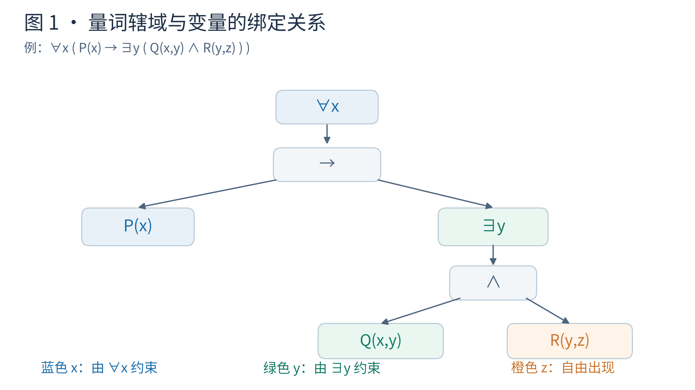
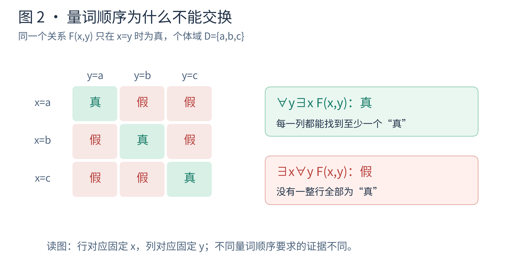
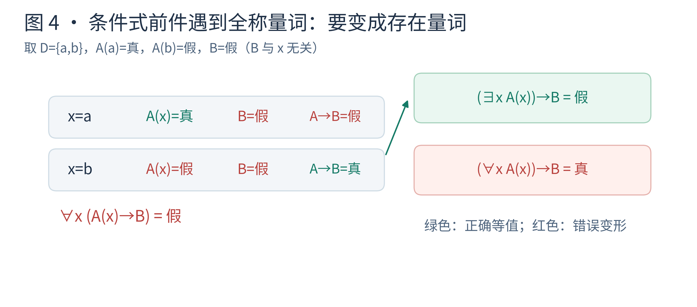
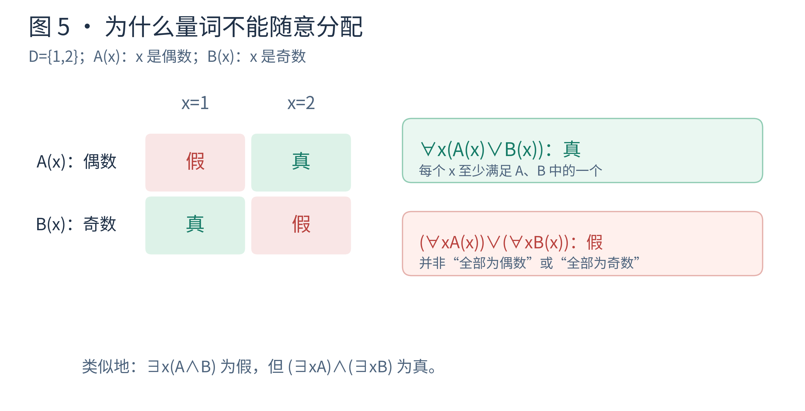
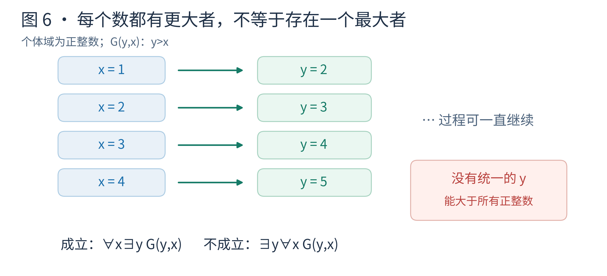
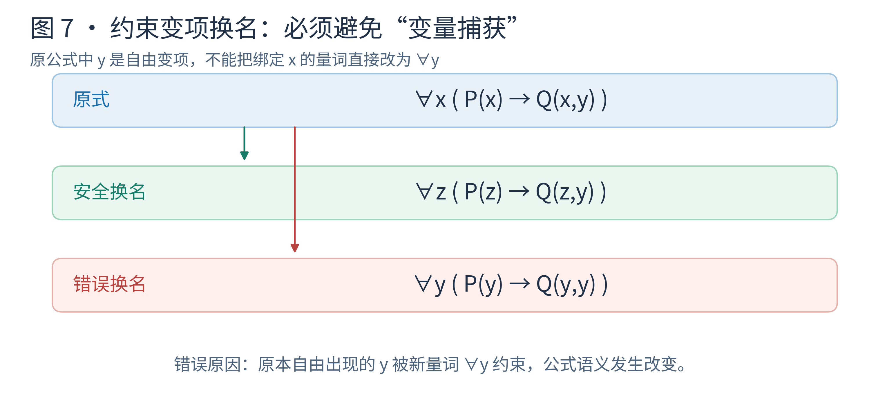

# 第6讲 一阶逻辑等值式与置换规则

> [!info] 资料与范围
> 以《第6讲 一阶逻辑等值式》41页课件为依据。第2—8页是前置的公式知识，第10—40页是本讲核心，第41页仅给出教材作业编号。笔记在尊重课件定义与术语的基础上，补充必要推导、反例、变量绑定条件及自测题；自行补充部分不冒充课件原文。

## 一、基础知识：理解等值式之前必须明确的概念

### 一.1 一阶语言的组成

| 符号类别 | 作用 | 示例 |
| --- | --- | --- |
| 个体常元 | 指定个体域中的一个对象 | $a,b,c$ |
| 个体变元 | 可以代表个体域中不同对象 | $x,y,z$ |
| 函数符号 | 根据输入个体得到一个个体 | $f(x),g(a,y)$ |
| 谓词符号 | 描述个体的性质或个体间的关系，具有真假值 | $P(x),F(x,y)$ |
| 量词 | 描述“所有”或“至少一个” | $\forall x,\exists x$ |
| 联结词 | 构成复合公式 | $\neg,\land,\lor,\to,\leftrightarrow$ |

**项**是表示个体的表达式。个体常元与变元都是项；若 $t_1,\dots,t_n$ 为项，$f$ 为 $n$ 元函数符号，则 $f(t_1,\dots,t_n)$ 也是项，例如 $g(x,f(a))$。

**原子公式**是谓词应用于若干项得到的公式，例如 $P(a)$、$F(x,g(a,y))$。原子公式再经有限次联结词和量词运算，可形成**合式公式**。

> [!warning] 项与公式不能混为一谈
> $f(x)$ 是项，表示对象；$P(f(x))$ 是公式，表达判断。函数符号本身不是真假判断。

### 一.2 辖域、指导变项与自由出现

在 $\forall xA$ 或 $\exists xA$ 中，$A$ 称为量词的**辖域**，紧跟量词后的 $x$ 是**指导变项**。在辖域中受其管辖的同名变项是**约束出现**；不受相应量词管辖的变项是**自由出现**。

例如：

$$
\forall x\bigl(P(x)\to\exists y(Q(x,y)\land R(y,z))\bigr)
$$

- $\forall x$ 约束 $P(x)$ 和 $Q(x,y)$ 中的 $x$。
- $\exists y$ 约束 $Q(x,y)$、$R(y,z)$ 中的 $y$。
- $z$ 不被量词约束，在 $R(y,z)$ 中自由出现。

**图1：量词辖域的语法树。** 根据层级和连接关系可以判断约束范围，不能只看是否出现相同字母。

同一变量名甚至可以既有约束出现又有自由出现：

$$
(\forall xP(x))\land Q(x)
$$

前一个 $x$ 受量词约束，$Q(x)$ 中的 $x$ 不受该量词约束。

### 一.3 解释与公式类型

课件第7页给出解释的四部分：**非空个体域 $D$、常元所指的个体、函数的具体含义、谓词的具体含义**。若公式含有自由变项，还需要**变元赋值**才能判断其真假。

- **永真式／逻辑有效式：** 在所有允许的解释及自由变项赋值下都为真。
- **矛盾式／永假式：** 在所有允许的解释及赋值下都为假。
- **可满足式：** 至少有一组解释及赋值使它为真。

这三种定义的关键区别是“**所有**”与“**至少一组**”。

## 二、一阶逻辑等值式的定义与来源

### 二.1 等值式与双条件公式

课件第10页使用记号：

$$
\boxed{A\Leftrightarrow B}
$$

表示在任何允许的解释和自由变项赋值下，$A$ 与 $B$ 的真假都相同。其判定标准：

$$
\boxed{A\Leftrightarrow B\quad\Longleftrightarrow\quad A\leftrightarrow B\text{ 是逻辑有效式}}
$$

这里 **$\leftrightarrow$ 是公式内部的双条件联结词，而 $\Leftrightarrow$ 是公式之间的等值关系**。类似地，$A\Rightarrow B$ 表示 $A\to B$ 是逻辑有效式；只表示单向推出，不能随意逆推。

### 二.2 命题逻辑等值式的代换实例

命题逻辑中的等值式在将命题变元**一致地**换为一阶公式后，仍是等值式。例如：

**双重否定：**

$$
A\Leftrightarrow\neg\neg A
$$

代入 $A=\forall xF(x)$，得到：

$$
\forall xF(x)\Leftrightarrow\neg\neg\forall xF(x).
$$

**消去蕴含：**

$$
A\to B\Leftrightarrow\neg A\lor B
$$

分别代入 $A=P(x),B=Q(y)$：

$$
P(x)\to Q(y)\Leftrightarrow\neg P(x)\lor Q(y).
$$

经常使用的还有德摩根律：

$$
\neg(A\land B)\Leftrightarrow\neg A\lor\neg B,
\quad
\neg(A\lor B)\Leftrightarrow\neg A\land\neg B.
$$

> [!tip] 解题提醒
> 一阶逻辑等值演算往往是“**命题等值式 + 量词等值式**”的交替应用。不要只背量词公式而忘记把 $\to$ 化成 $\neg A\lor B$。

## 三、有限个体域的量词消去

### 三.1 消去规则

设 $D=\{a_1,a_2,\dots,a_n\}$ 为非空有限个体域，则：

$$
\boxed{\forall xA(x)\Leftrightarrow A(a_1)\land A(a_2)\land\cdots\land A(a_n)}
$$

$$
\boxed{\exists xA(x)\Leftrightarrow A(a_1)\lor A(a_2)\lor\cdots\lor A(a_n)}
$$

全称量词要求**每个对象**满足 $A$，因此展开为合取；存在量词要求**至少一个对象**满足 $A$，因此展开为析取。这个公式适用于**有限域**，不代表对无限域也能写成有限个命题的联结。

### 三.2 多重量词：消去时必须按辖域逐层展开

课件第16页例题：$D=\{a,b,c\}$，求 $\exists x\forall yF(x,y)$ 的无量词形式。

先消去外层 $\exists x$：

$$
\begin{aligned}
\exists x\forall yF(x,y)
\Leftrightarrow{}&\forall yF(a,y)\\
&\lor\forall yF(b,y)\\
&\lor\forall yF(c,y).
\end{aligned}
$$

再消去每个分支的 $\forall y$：

$$
\begin{aligned}
\Leftrightarrow{}&[F(a,a)\land F(a,b)\land F(a,c)]\\
&\lor[F(b,a)\land F(b,b)\land F(b,c)]\\
&\lor[F(c,a)\land F(c,b)\land F(c,c)].
\end{aligned}
$$

**含义：** 要存在**某个固定的 $x$**，使每个 $y$ 均满足 $F(x,y)$；在关系矩阵中，就是至少有一整行全为真。

课件第17页例题：$\forall y\exists xF(x,y)$。

$$
\begin{aligned}
\forall y\exists xF(x,y)
\Leftrightarrow{}&\exists xF(x,a)\\
&\land\exists xF(x,b)\\
&\land\exists xF(x,c)\\
\Leftrightarrow{}&[F(a,a)\lor F(b,a)\lor F(c,a)]\\
&\land[F(a,b)\lor F(b,b)\lor F(c,b)]\\
&\land[F(a,c)\lor F(b,c)\lor F(c,c)].
\end{aligned}
$$

**含义：** 对每个 $y$，允许找到**不同的 $x$**；关系矩阵中每一列至少有一个真值即可。

**图2：量词顺序的关系矩阵。** 图中 $F(x,y)$ 当且仅当 $x=y$ 为真。此时 $\forall y\exists xF(x,y)$ 为真，$\exists x\forall yF(x,y)$ 为假，说明不同量词不能直接交换。

### 三.3 课件第25页两道量词消去练习

**练习1：** $D=\{a,b\}$，消去

$$
\forall x\exists y(F(x)\to G(y)).
$$

第一步消去 $\forall x$：

$$
\begin{aligned}
&\forall x\exists y(F(x)\to G(y))\\
\Leftrightarrow{}&\exists y(F(a)\to G(y))\\
&\land\exists y(F(b)\to G(y)).
\end{aligned}
$$

第二步消去各处 $\exists y$：

$$
\boxed{\begin{aligned}
&[(F(a)\to G(a))\lor(F(a)\to G(b))]\\
&\land[(F(b)\to G(a))\lor(F(b)\to G(b))].
\end{aligned}}
$$

**练习2：** $D=\{a,b\}$，消去

$$
\forall x\exists y(F(x,y)\to G(x,y)).
$$

$$
\begin{aligned}
&\forall x\exists y(F(x,y)\to G(x,y))\\
\Leftrightarrow{}&\exists y(F(a,y)\to G(a,y))\\
&\land\exists y(F(b,y)\to G(b,y))\\
\Leftrightarrow{}&[(F(a,a)\to G(a,a))\lor(F(a,b)\to G(a,b))]\\
&\land[(F(b,a)\to G(b,a))\lor(F(b,b)\to G(b,b))].
\end{aligned}
$$

> [!warning] 多重量词展开的关键
> 一次只消去一个量词，只替换由它约束的变项。不要遗漏谓词参数，不要把原有的 $\lor$、$\land$ 方向写反，也不要省略有歧义的括号。

## 四、量词否定等值式

### 四.1 两条基本公式

$$
\boxed{\neg\forall xA(x)\Leftrightarrow\exists x\neg A(x)}
$$

$$
\boxed{\neg\exists xA(x)\Leftrightarrow\forall x\neg A(x)}
$$

- “并非所有对象都有性质 $A$”等价于“存在至少一个不满足 $A$ 的对象”。
- “不存在满足 $A$ 的对象”等价于“所有对象都不满足 $A$”。

课件第18页中，令 $D$ 为某班学生，$F(x)$ 表示“$x$ 是优等生”，则：

$$
\neg\forall xF(x)\Leftrightarrow\exists x\neg F(x).
$$

**图3：量词否定的反例见证。** 只要有一名学生不是优等生，就足以说明“不是所有学生都是优等生”。

### 四.2 用德摩根律逐步推导

对于非空有限域 $D=\{a_1,\ldots,a_n\}$，可通过量词消去得到：

$$
\begin{aligned}
\neg\forall xA(x)
&\Leftrightarrow\neg[A(a_1)\land\cdots\land A(a_n)]\\
&\Leftrightarrow\neg A(a_1)\lor\cdots\lor\neg A(a_n)\\
&\Leftrightarrow\exists x\neg A(x).
\end{aligned}
$$

同理：

$$
\begin{aligned}
\neg\exists xA(x)
&\Leftrightarrow\neg[A(a_1)\lor\cdots\lor A(a_n)]\\
&\Leftrightarrow\neg A(a_1)\land\cdots\land\neg A(a_n)\\
&\Leftrightarrow\forall x\neg A(x).
\end{aligned}
$$

**注意：** 上述有限域展开用于帮助理解，量词否定公式本身对于一般非空域也成立。

### 四.3 多重量词与联结词同时出现

否定从外向内穿过每个量词，$\forall$ 与 $\exists$ 互换，最后再否定量词辖域里的公式。例如：

$$
\begin{aligned}
\neg\forall x\exists yF(x,y)
&\Leftrightarrow\exists x\neg\exists yF(x,y)\\
&\Leftrightarrow\exists x\forall y\neg F(x,y).
\end{aligned}
$$

更复杂的例子：

$$
\begin{aligned}
&\neg\exists x\forall y(P(x)\to Q(y))\\
\Leftrightarrow{}&\forall x\exists y\neg(P(x)\to Q(y))\\
\Leftrightarrow{}&\forall x\exists y\neg(\neg P(x)\lor Q(y))\\
\Leftrightarrow{}&\forall x\exists y(P(x)\land\neg Q(y)).
\end{aligned}
$$

> [!warning] 常见错误
> $\neg\forall xP(x)$ 绝不能误写成 $\exists xP(x)$；正确形式是 $\exists x\neg P(x)$。**换量词的同时，内部公式也必须被否定。**

## 五、量词辖域收缩与扩张

### 五.1 收缩的前提条件

讨论 $\forall x(A(x)\land B)$ 时，若 $B$ 的真假不依赖 $x$，就可把 $B$ 移到 $\forall x$ 的辖域外。

课件第21—24页使用条件“**$B$ 中不含 $x$ 的出现**”；这是一个充分条件。更一般地，只要求 **$x$ 在 $B$ 中不自由出现**，同时保证个体域非空、移动过程中不发生变量捕获。

### 五.2 全称量词 $\forall$ 的四组公式

在上述条件下：

| 原式 | 等值的收缩形式 | 量词是否改变 |
| --- | --- | --- |
| $\forall x(A(x)\land B)$ | $(\forall xA(x))\land B$ | 不变 |
| $\forall x(A(x)\lor B)$ | $(\forall xA(x))\lor B$ | 不变 |
| $\forall x(A(x)\to B)$ | $(\exists xA(x))\to B$ | **前件：全称变存在** |
| $\forall x(B\to A(x))$ | $B\to(\forall xA(x))$ | 后件：不变 |

为什么条件式前件的量词会翻转？不能直接硬记，必须能推出：

$$
\begin{aligned}
\forall x(A(x)\to B)
&\Leftrightarrow\forall x(\neg A(x)\lor B)\\
&\Leftrightarrow(\forall x\neg A(x))\lor B\\
&\Leftrightarrow\neg\exists xA(x)\lor B\\
&\Leftrightarrow(\exists xA(x))\to B.
\end{aligned}
$$

而在后件时：

$$
\begin{aligned}
\forall x(B\to A(x))
&\Leftrightarrow\forall x(\neg B\lor A(x))\\
&\Leftrightarrow\neg B\lor\forall xA(x)\\
&\Leftrightarrow B\to\forall xA(x).
\end{aligned}
$$

### 五.3 存在量词 $\exists$ 的四组公式

| 原式 | 等值的收缩形式 | 量词是否改变 |
| --- | --- | --- |
| $\exists x(A(x)\land B)$ | $(\exists xA(x))\land B$ | 不变 |
| $\exists x(A(x)\lor B)$ | $(\exists xA(x))\lor B$ | 不变 |
| $\exists x(A(x)\to B)$ | $(\forall xA(x))\to B$ | **前件：存在变全称** |
| $\exists x(B\to A(x))$ | $B\to(\exists xA(x))$ | 后件：不变 |

证明存在量词在条件式前件的情况：

$$
\begin{aligned}
\exists x(A(x)\to B)
&\Leftrightarrow\exists x(\neg A(x)\lor B)\\
&\Leftrightarrow(\exists x\neg A(x))\lor B\\
&\Leftrightarrow\neg\forall xA(x)\lor B\\
&\Leftrightarrow(\forall xA(x))\to B.
\end{aligned}
$$

证明存在量词在条件式后件的情况：

$$
\begin{aligned}
\exists x(B\to A(x))
&\Leftrightarrow\exists x(\neg B\lor A(x))\\
&\Leftrightarrow\neg B\lor\exists xA(x)\\
&\Leftrightarrow B\to\exists xA(x).
\end{aligned}
$$

### 五.4 用具体赋值排除错误的前件变形

取 $D=\{a,b\}$，且 $A(a)=1$、$A(b)=0$、$B=0$。那么：

$$
\forall x(A(x)\to B)=0,
$$

$$
(\exists xA(x))\to B=1\to0=0,
$$

但

$$
(\forall xA(x))\to B=0\to0=1.
$$

**图4：量词辖域收缩中的错误变形。** 全称量词从条件式**前件**移出时需要改为存在量词，图中直接给出能识别错误方向的真值反例。

> [!tip] 有条件的记忆方法
> 当 $B$ 不含自由的 $x$ 时，$Qx(A(x)\to B)$ 从前件收缩会把 $Q$ 变为对偶量词；$Qx(B\to A(x))$ 从后件收缩则保留量词。**这是在非空域内有条件成立的规则，不是可以随意移动量词。**

## 六、量词分配：只有两种等值分配律

### 六.1 全称量词对合取的分配律

$$
\boxed{\forall x(A(x)\land B(x))\Leftrightarrow(\forall xA(x))\land(\forall xB(x))}
$$

“每一个对象同时满足 $A$ 和 $B$”，与“每一个对象满足 $A$，且每一个对象满足 $B$”完全一致。

### 六.2 存在量词对析取的分配律

$$
\boxed{\exists x(A(x)\lor B(x))\Leftrightarrow(\exists xA(x))\lor(\exists xB(x))}
$$

若至少有一个对象满足 $A$ 或 $B$，必定至少存在满足 $A$ 的对象，或者存在满足 $B$ 的对象。反过来，只要其中一个存在命题成立，就能找到满足“$A$ 或 $B$”的对象。

### 六.3 为什么另外两种“分配”不等值

**错误的等值式一：**

$$
\forall x(A(x)\lor B(x))\Leftrightarrow(\forall xA(x))\lor(\forall xB(x)).
$$

**错误的等值式二：**

$$
\exists x(A(x)\land B(x))\Leftrightarrow(\exists xA(x))\land(\exists xB(x)).
$$

用课件第27页的奇偶性思路构造最小反例：取 $D=\{1,2\}$，$A(x)$ 是“$x$ 为偶数”，$B(x)$ 是“$x$ 为奇数”。

| $x$ | $A(x)$：偶数 | $B(x)$：奇数 | $A(x)\lor B(x)$ | $A(x)\land B(x)$ |
| --- | --- | --- | --- | --- |
| $1$ | 假 | 真 | 真 | 假 |
| $2$ | 真 | 假 | 真 | 假 |

第一组左边真、右边假：

$$
\forall x(A(x)\lor B(x))=1,
\qquad
(\forall xA(x))\lor(\forall xB(x))=0.
$$

第二组左边假、右边真：

$$
\exists x(A(x)\land B(x))=0,
\qquad
(\exists xA(x))\land(\exists xB(x))=1.
$$

**图5：不成立的分配律的反例。** “每个对象至少属于 $A,B$ 中的一个”不意味着“所有对象统一属于其中一个”；“分别有满足 $A,B$ 的对象”也不意味着存在共同满足二者的同一个对象。

### 六.4 错误的双向等值，仍可保留正确的单向推出

$$
\boxed{(\forall xA(x))\lor(\forall xB(x))\Rightarrow\forall x(A(x)\lor B(x))}
$$

理由：若所有对象都满足 $A$，或所有对象都满足 $B$，那么每个对象当然都满足 $A\lor B$。反方向不成立，因为每个对象可能选择不同的性质。

$$
\boxed{\exists x(A(x)\land B(x))\Rightarrow(\exists xA(x))\land(\exists xB(x))}
$$

理由：若同一个对象同时具有 $A$ 和 $B$，它分别是两条存在命题的见证。反方向不成立，因为两个见证可以不是同一个对象。

> [!important] 一定区分等值与有效推出
> 全称量词对 $\land$、存在量词对 $\lor$ 是双向等值；全称量词对 $\lor$、存在量词对 $\land$ 只能使用前述单向蕴含，不得在等值演算中写成 $\Leftrightarrow$。

## 七、量词交换：相同量词与不同量词是两回事

### 七.1 相同量词可以交换

$$
\boxed{\forall x\forall yF(x,y)\Leftrightarrow\forall y\forall xF(x,y)}
$$

$$
\boxed{\exists x\exists yF(x,y)\Leftrightarrow\exists y\exists xF(x,y)}
$$

第一式均检查个体域中所有有序对 $(x,y)$；第二式均只要求至少存在一个使 $F(x,y)$ 成立的有序对。交换检查、选择次序不会改变真假条件。

### 七.2 不同量词的正确推出方向

课件第28—29页的重要结论：

$$
\boxed{\exists y\forall xF(x,y)\Rightarrow\forall x\exists yF(x,y)}
$$

**为什么这一方向成立？**

1. $\exists y\forall xF(x,y)$ 表示存在一个固定的 $y_0$，使任何 $x$ 都满足 $F(x,y_0)$。
2. 对于任意给定的 $x$，仍可选同一个 $y_0$ 作为 $\exists y$ 的见证。
3. 因而 $\forall x\exists yF(x,y)$ 必然成立。

**为什么不能逆推？**

- $\forall x\exists yF(x,y)$ 中，$y$ 可以依赖于 $x$，每个 $x$ 分别使用不同见证。
- $\exists y\forall xF(x,y)$ 必须找出一个**固定**的 $y$，同时适用于所有 $x$。

前者要求弱，后者要求强。因此只有“**固定见证满足全部对象 $\Rightarrow$ 每个对象有见证**”这一方向普遍有效。

### 七.3 正整数例题：不存在统一的最大者

设个体域为全体正整数，$G(y,x)$ 表示 $y>x$。

$$
\forall x\exists yG(y,x)
$$

为真：给定任何正整数 $x$，令 $y=x+1$ 即可。但

$$
\exists y\forall xG(y,x)
$$

为假：不存在一个固定的正整数 $y$ 比所有正整数还大。

**图6：逐个选择与统一选择的区别。** 图中 $1\to2$、$2\to3$ 等只表示针对各个 $x$ 可单独找到更大的 $y$；不能由此推出某个 $y$ 大于所有正整数。

### 七.4 课件第28—32页的典型蕴含链

当个体域**非空**时：

$$
\boxed{\begin{aligned}
\forall x\forall yF(x,y)
&\Rightarrow\exists y\forall xF(x,y)\\
&\Rightarrow\forall x\exists yF(x,y)\\
&\Rightarrow\exists x\exists yF(x,y)
\end{aligned}}
$$

- **第一步：** 所有 $x,y$ 都满足 $F$，自然可以从非空域中挑一个 $y$，使所有 $x$ 满足 $F(x,y)$。
- **第二步：** 选定的统一 $y$ 可以供每一个 $x$ 使用。
- **第三步：** 至少可以选取某个 $x$ 及对应的 $y$，获得一组使 $F$ 成立的有序对。

将 $x,y$ 对调同样可得到相应的蕴含链。**这些箭头都不是等值箭头。**

> [!warning] 课件第30页“被划掉的推出箭头”
> 第30页原图在 $\forall x\exists yG(x,y)\Rightarrow\exists y\forall xG(x,y)$ 的箭头上画了红色斜杠，表示这种逆推**不成立**。纯文本抽取会丢失这条斜杠，不能据此误认其为成立的推出式。

## 八、换名规则、代替规则与置换规则

### 八.1 换名规则：改的是约束变项

**换名规则**（第34—35页）将某个量词的指导变项，以及它在辖域内所约束的全部出现位置，统一改成一个安全的新名字，其他部分不变。

正确例子：

$$
\forall x(P(x)\to Q(x,y))
\Leftrightarrow
\forall z(P(z)\to Q(z,y)).
$$

这里的 $z$ 是新鲜变项，原来自由的 $y$ 仍然自由。约束变项换名不改变公式的真假条件，因此这是**真正的等值式**。

**不正确的换名：**

$$
\forall x(P(x)\to Q(x,y))
\qquad\text{与}\qquad
\forall y(P(y)\to Q(y,y))
$$

一般不成立。原因是原本自由出现的 $y$ 被新量词 $\forall y$ 捕获，改变了变量的绑定结构。

**图7：变量捕获的产生过程。** 安全换名为 $z$ 时，原先自由的 $y$ 不变；错误换名为 $y$ 时，同名量词将自由变量捕获。

课件第34页练习中的完整公式是：

$$
[\forall x(P(x)\to Q(x,y))]\land R(x,y).
$$

只对第一个量词进行换名，结果应为：

$$
[\forall z(P(z)\to Q(z,y))]\land R(x,y).
$$

**注意 $R(x,y)$ 中的 $x$ 不受前面 $\forall x$ 约束，它是自由变量，不能顺手修改。** 也不能只改 $P(x)$ 中的 $x$ 而漏掉 $Q(x,y)$ 中由同一量词约束的 $x$。

两个量词独立辖域的情况：

$$
(\forall xA(x))\land(\forall xB(x))
\Leftrightarrow
(\forall yA(y))\land(\forall zB(z)).
$$

由于两部分量词的辖域各自独立，可以分别改名。

### 八.2 代替规则：对自由变项改名须格外小心

课件第36—37页把**代替规则**描述为：把某个自由变项的所有自由出现统一改成一个新的个体变项。例如：

$$
P(x)\land Q(x)
\qquad\text{与}\qquad
P(y)\land Q(y).
$$

但这里存在一个必须说明的语义问题：

> [!danger] 课件第36—37页的等值箭头不可以无条件照搬
> 课件第10页把 $A\Leftrightarrow B$ 定义为二者在各种解释和赋值下始终同真同假。按这个定义，**自由变项改名后的公式，在相同变元赋值下通常不等值**。换名后若同时将赋值按变量对应关系重标记，可以维持相应的真值，但这不等于 $P(x)\Leftrightarrow P(y)$ 是逻辑有效的等值关系。课件在这一处需要增加条件或修正“等值”的表述。

**严格反例：** 取 $D=\{1,2\}$，$P(t)$ 表示“$t=1$”；在同一赋值 $x=1,y=2$ 下：

$$
P(x)=1,\qquad P(y)=0.
$$

所以一般不能写成 $P(x)\Leftrightarrow P(y)$。更复杂的 $P(x)\land Q(x)$ 与 $P(y)\land Q(y)$ 同样不能无条件称为等值。

**区分原因：** 约束变项通过量词遍历个体域，其名字一般不影响语义；自由变项则取决于外部赋值，改变变量名称就可能改变取值。若进行标准的项代换 $A[t/x]$，还要保证代入项里的变量不会被量词**意外捕获**；代换本身不是自动的等值证明。

### 八.3 置换规则：把真正等值的子公式替换掉

课件第38页的**置换规则**为：若 $A\Leftrightarrow B$，则可以在更大的一阶逻辑公式中，用等值的 $B$ 代替子公式 $A$，所获公式仍等值。必须保留正确的括号、辖域与绑定关系。

例如德摩根律提供：

$$
\neg(P(x)\land Q(x))\Leftrightarrow\neg P(x)\lor\neg Q(x).
$$

因此：

$$
\forall x\neg(P(x)\land Q(x))
\Leftrightarrow
\forall x(\neg P(x)\lor\neg Q(x)).
$$

这属于替换真正等值的子公式，和直接重命名自由变量是**不同操作**。

### 八.4 三类容易混淆的操作

| 类型 | 修改对象 | 是否自动保持逻辑等值 | 关键条件 |
| --- | --- | --- | --- |
| 命题等值式代换实例 | 命题公式占位 $A,B$ | 是 | 同一占位一致代换 |
| 约束变项换名 | 指导变项及对应的约束出现 | 是 | 避免捕获；不碰辖域外自由出现 |
| 自由变项改名／代替 | 自由出现的变量 | **一般不是** | 若研究重标记的公式，需要同步比较相应赋值 |
| 等值式置换 | 更大公式中的子公式 | 是 | 已有真正的子公式等值关系；保持绑定结构 |

## 九、课件第39—40页等值式的完整证明

### 九.1 第一式：不存在同时满足两个条件的对象

需要证明：

$$
\neg\exists x(M(x)\land F(x))
\Leftrightarrow
\forall x(M(x)\to\neg F(x)).
$$

$$
\begin{aligned}
&\neg\exists x(M(x)\land F(x))\\
\Leftrightarrow{}&\forall x\neg(M(x)\land F(x))\\
&\hspace{2em}\text{量词否定}\\
\Leftrightarrow{}&\forall x(\neg M(x)\lor\neg F(x))\\
&\hspace{2em}\text{德摩根律}\\
\Leftrightarrow{}&\forall x(M(x)\to\neg F(x))\\
&\hspace{2em}\text{消去／恢复蕴含}.
\end{aligned}
$$

语义：没有任何对象同时满足 $M,F$，等价于每个满足 $M$ 的对象都不满足 $F$。

### 九.2 第二式：全称条件式不成立时存在反例

$$
\neg\forall x(M(x)\to F(x))
\Leftrightarrow
\exists x(M(x)\land\neg F(x)).
$$

证明：

$$
\begin{aligned}
&\neg\forall x(M(x)\to F(x))\\
\Leftrightarrow{}&\exists x\neg(M(x)\to F(x))\\
&\hspace{2em}\text{量词否定}\\
\Leftrightarrow{}&\exists x\neg(\neg M(x)\lor F(x))\\
&\hspace{2em}\text{消去蕴含}\\
\Leftrightarrow{}&\exists x(\neg\neg M(x)\land\neg F(x))\\
&\hspace{2em}\text{德摩根律}\\
\Leftrightarrow{}&\exists x(M(x)\land\neg F(x))\\
&\hspace{2em}\text{双重否定}.
\end{aligned}
$$

关键是“并非所有满足 $M$ 的对象都满足 $F$”表示**存在满足 $M$ 却不满足 $F$ 的对象**，而不是“不存在满足 $M$ 的对象”。

### 九.3 第三式：课件第40页例题

要证明：

$$
\boxed{\exists x(P(x)\to Q(x))\Leftrightarrow(\forall xP(x))\to(\exists xQ(x))}
$$

步骤如下：

$$
\begin{aligned}
&\exists x(P(x)\to Q(x))\\
\Leftrightarrow{}&\exists x(\neg P(x)\lor Q(x))\\
&\hspace{2em}\text{消去条件联结词}\\
\Leftrightarrow{}&(\exists x\neg P(x))\lor(\exists xQ(x))\\
&\hspace{2em}\text{存在量词对析取分配}\\
\Leftrightarrow{}&\neg\forall xP(x)\lor\exists xQ(x)\\
&\hspace{2em}\text{量词否定}\\
\Leftrightarrow{}&(\forall xP(x))\to(\exists xQ(x))\\
&\hspace{2em}\text{恢复蕴含}.
\end{aligned}
$$

> [!important] 这一题的真正关键
> 不是“存在量词能任意分配到条件式上”，而是**先用 $A\to B\Leftrightarrow\neg A\lor B$ 消去蕴含，再用存在量词对析取的正确分配律**。千万不要跳过这一步的理由。

## 十、实际做题的方法与常见错误

### 十.1 等值演算的一般流程

1. **确认辖域：** 先看清自由变量、约束变量、量词管辖范围，尤其注意括号。
2. **化解蕴含：** 量词与条件式同在时，优先使用 $A\to B\Leftrightarrow\neg A\lor B$。
3. **处理否定：** 结合德摩根律、双重否定与量词否定，逐步推进 $\neg$。
4. **处理量词：** 按适用条件执行消去、辖域收缩、分配、相同量词交换。
5. **核对关系：** 只有真正的等值步骤才写 $\Leftrightarrow$；只能单向推出时写 $\Rightarrow$。
6. **逐步说明依据：** 每一步给出对应定律，出现长公式时明确括号和变项身份。

### 十.2 高频易错点表

| 错误写法 | 错在哪里 | 应当怎样处理 |
| --- | --- | --- |
| $\neg\forall xP(x)\Leftrightarrow\exists xP(x)$ | 忘记否定内部公式 | 应写 $\exists x\neg P(x)$ |
| $\forall x(A\lor B)\Leftrightarrow\forall xA\lor\forall xB$ | 把单向推出当等值 | 仅右侧有效推出左侧 |
| $\exists x(A\land B)\Leftrightarrow\exists xA\land\exists xB$ | 不同见证被误认为同一个 | 仅左侧有效推出右侧 |
| $\forall x\exists yF\Leftrightarrow\exists y\forall xF$ | 不同量词强行换序 | 一般只有后式推出前式 |
| $\forall x(A(x)\to B)\Leftrightarrow(\forall xA(x))\to B$ | 条件式前件的量词没翻转 | 应为 $(\exists xA(x))\to B$ |
| 把被约束的 $x$ 换成已经自由出现的 $y$ | 变量捕获 | 选取不冲突的新鲜变项 $z$ |
| $P(x)\Leftrightarrow P(y)$ | 把自由变量重标记当成等值 | 必须考虑同一变元赋值下的真假 |
| 消去量词时删掉／改动原有括号 | 操作改变辖域 | 每次只替换被当前量词绑定的变量 |

## 十一、自测题与解答（补充）

### 十一.1 题目

1. 将 $\neg\exists x\forall y(P(x,y)\to Q(y))$ 中的否定彻底内移。
2. 设 $D=\{a,b\}$，消去 $\exists x\forall yR(x,y)$ 中的全部量词。
3. 判断 $\forall x(A(x)\lor B(x))\Rightarrow(\forall xA(x))\lor(\forall xB(x))$ 是否有效，若不成立给出二元素反例。
4. 把 $\forall x(P(x)\to R)$ 中的量词收缩至 $P(x)$，已知 $R$ 中没有自由的 $x$。
5. 将 $\exists x(P(x,z)\land\forall yQ(x,y,z))$ 中的**约束变项** $x,y$ 安全换名，要求保留自由 $z$。
6. 判断 $\exists y\forall xF(x,y)\Rightarrow\forall x\exists yF(x,y)$ 的有效性，并说明逆方向为什么不成立。

### 十一.2 解答

> [!example]- 第1题：否定内移
> $$
> \begin{aligned}
> &\neg\exists x\forall y(P(x,y)\to Q(y))\\
> \Leftrightarrow{}&\forall x\neg\forall y(P(x,y)\to Q(y))\\
> \Leftrightarrow{}&\forall x\exists y\neg(P(x,y)\to Q(y))\\
> \Leftrightarrow{}&\forall x\exists y\neg(\neg P(x,y)\lor Q(y))\\
> \Leftrightarrow{}&\forall x\exists y(P(x,y)\land\neg Q(y)).
> \end{aligned}
> $$

> [!example]- 第2题：有限域展开
> $$
> \begin{aligned}
> \exists x\forall yR(x,y)
> &\Leftrightarrow\forall yR(a,y)\lor\forall yR(b,y)\\
> &\Leftrightarrow[R(a,a)\land R(a,b)]\lor[R(b,a)\land R(b,b)].
> \end{aligned}
> $$

> [!example]- 第3题：反例
> 不有效。设 $D=\{a,b\}$，使 $A(a)$、$B(b)$ 真，$A(b)$、$B(a)$ 假。每个对象都满足 $A\lor B$，故左式真；既不是所有对象满足 $A$，也不是所有对象满足 $B$，故右式假。

> [!example]- 第4题：量词辖域收缩
> $$
> \begin{aligned}
> \forall x(P(x)\to R)
> &\Leftrightarrow\forall x(\neg P(x)\lor R)\\
> &\Leftrightarrow(\forall x\neg P(x))\lor R\\
> &\Leftrightarrow\neg\exists xP(x)\lor R\\
> &\Leftrightarrow(\exists xP(x))\to R.
> \end{aligned}
> $$

> [!example]- 第5题：安全换名
> 例如 $\exists u(P(u,z)\land\forall vQ(u,v,z))$。外层 $x$ 改为 $u$，内层 $y$ 改为 $v$；自由 $z$ 保持不变，也不引入新的变量捕获。

> [!example]- 第6题：量词顺序
> 原方向有效，因为左式的固定见证 $y_0$ 对所有 $x$ 都有效，可以被每个 $x$ 重复使用。逆方向无效：正整数域中取 $F(x,y)$ 表示 $y>x$，则 $\forall x\exists yF(x,y)$ 真，但 $\exists y\forall xF(x,y)$ 假。

## 十二、考前公式速查

> [!summary] 核心结论
> **等值 $\Leftrightarrow$ 与有效推出 $\Rightarrow$ 必须区分。** 有限域：$\forall$ 展开为合取、$\exists$ 展开为析取；否定量词时交换 $\forall/\exists$ 且否定内部；量词分配只有 $\forall$ 对 $\land$、$\exists$ 对 $\lor$ 是双向等值；混合量词一般不能交换；约束换名要避免变量捕获。

| 类别 | 必须掌握的公式（默认个体域非空） |
| --- | --- |
| 全称消去 | $\forall xA(x)\Leftrightarrow\bigwedge_{a\in D}A(a)$，$D$ 有限 |
| 存在消去 | $\exists xA(x)\Leftrightarrow\bigvee_{a\in D}A(a)$，$D$ 有限 |
| 否定全称 | $\neg\forall xA(x)\Leftrightarrow\exists x\neg A(x)$ |
| 否定存在 | $\neg\exists xA(x)\Leftrightarrow\forall x\neg A(x)$ |
| 全称对合取分配 | $\forall x(A\land B)\Leftrightarrow\forall xA\land\forall xB$ |
| 存在对析取分配 | $\exists x(A\lor B)\Leftrightarrow\exists xA\lor\exists xB$ |
| 全称对析取的单向关系 | $\forall xA\lor\forall xB\Rightarrow\forall x(A\lor B)$ |
| 存在对合取的单向关系 | $\exists x(A\land B)\Rightarrow\exists xA\land\exists xB$ |
| 相同全称量词交换 | $\forall x\forall yF\Leftrightarrow\forall y\forall xF$ |
| 相同存在量词交换 | $\exists x\exists yF\Leftrightarrow\exists y\exists xF$ |
| 混合量词的有效方向 | $\exists y\forall xF(x,y)\Rightarrow\forall x\exists yF(x,y)$ |
| 条件前件辖域收缩 | $\forall x(A(x)\to B)\Leftrightarrow(\exists xA(x))\to B$；$\exists x(A(x)\to B)\Leftrightarrow(\forall xA(x))\to B$ |
| 条件后件辖域收缩 | $\forall x(B\to A(x))\Leftrightarrow B\to\forall xA(x)$；$\exists x(B\to A(x))\Leftrightarrow B\to\exists xA(x)$ |
| $\land,\lor$ 的辖域收缩 | 若 $x$ 不在 $B$ 中自由出现，$Qx(A(x)\circ B)\Leftrightarrow(QxA(x))\circ B$，$Q\in\{\forall,\exists\}$，$\circ\in\{\land,\lor\}$ |
| 约束变项安全换名 | $\forall xP(x)\Leftrightarrow\forall zP(z)$，前提是避免捕获 |
| 等值式置换 | 在大公式中可以替换真正等值的子公式 |

**课件索引：** 第2—8页为前置概念；第10—13页为等值定义与代换实例；第15—17页和第25页为量词消去；第18—20页为量词否定；第21—24页为辖域变换；第26—27页为量词分配；第28—32页为量词交换及蕴含关系；第34—38页为换名、代替、置换；第39—40页为等值演算证明；第41页仅列教材P84的2(1,3)和8(1)，**未给完整教材题面，因此未虚构其答案**。
