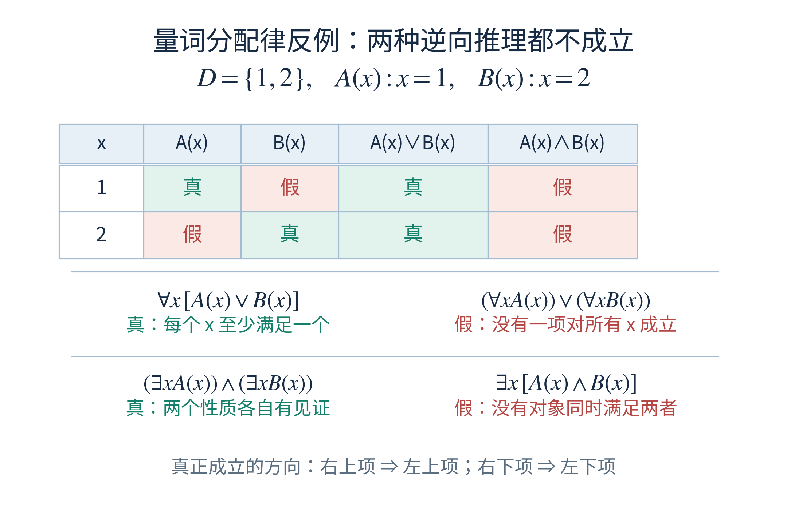
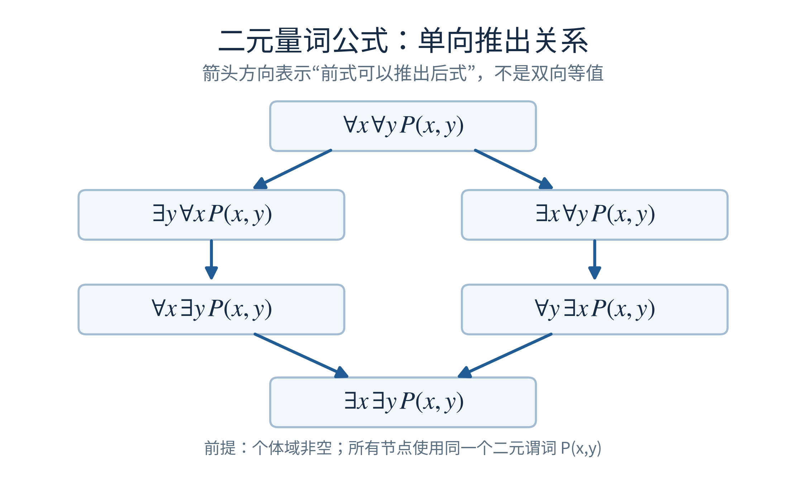
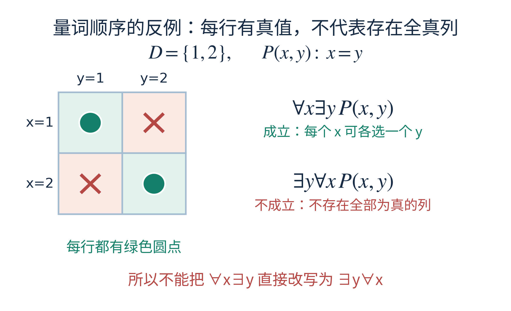
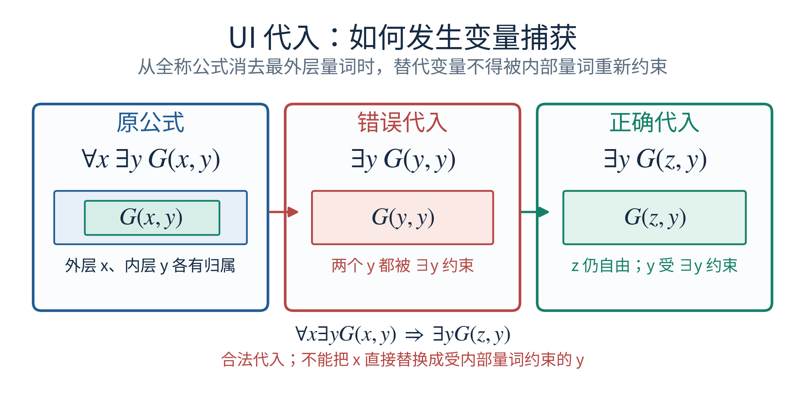
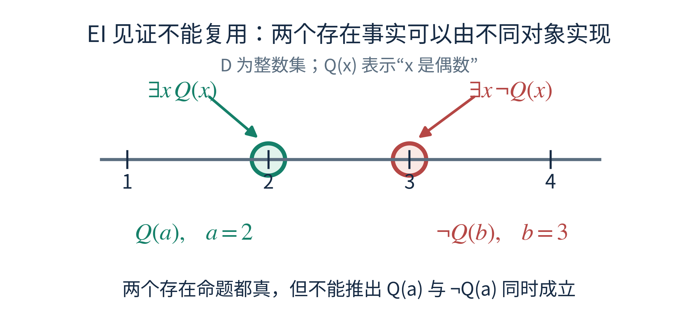
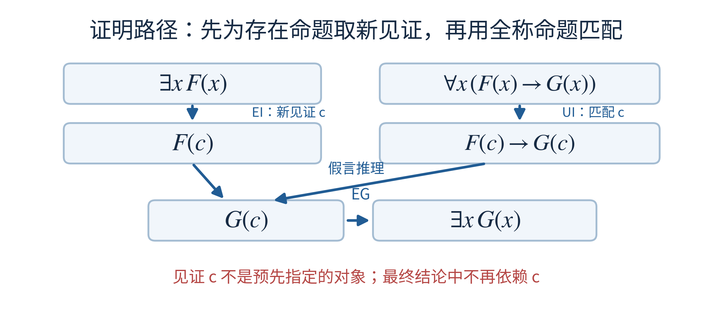

# 第7讲：一阶（谓词）逻辑等值式、前束范式与推理理论

**课件依据**：《第7讲+谓词逻辑推理.pdf》，共62页。课件内容与为辅助理解补充的说明、反例及参考证明已在相关位置区分。笔记按课件 **5.1 一阶逻辑等值式与置换规则、5.2 一阶逻辑前束范式、5.3 一阶逻辑的推理理论** 依次整理。

> [!NOTE] 符号约定
> 本笔记沿用课件的两种关系符号：$A\Leftrightarrow B$ 表示**等值**，$A\Rightarrow B$ 表示**推出**。$A\to B$ 是写在公式内部的**条件联结词**。默认一阶逻辑的个体域 $D$ **非空**；换名、代入、量词消去与引入都必须避免**变量捕获**。原课件个别缩写、笔误和形式上易引起误解的表述，在文末单列辨析。

> [!info] 插图归档说明
> 本笔记采用 Obsidian Wiki 附件链接：图片统一存放在 Vault 根目录的 `Assets/` 中。将 ZIP 内的唯一资源文件夹整体复制到 `Assets/`，再把本 Markdown 放到任意笔记目录即可。普通 Markdown/HTML 工具需要额外处理 Wiki 链接。

---

## 一、全章结构与最核心的区别

### 1.1 三个部分如何联系

1. **等值式（5.1，课件第2—15页）**：在不改变公式真值的前提下变形。常用于化简、移动量词、展开条件式。
2. **前束范式（5.2，课件第16—21页）**：把所有量词移到公式最前面，得到适于分析和推理的标准形式。
3. **推理理论（5.3，课件第23—59页）**：从前提逐步导出结论，重点是四条量词规则：UI、UG、EI、EG，以及与命题逻辑规则结合的证明。

### 1.2 等值、推出与条件式

| 记号 | 意义 | 判断标准 | 是否可反向使用 |
|:---:|---|---|---|
| $A\Leftrightarrow B$ | 两个公式等值 | $A\leftrightarrow B$ 为永真式 | 可以，两个方向都成立 |
| $A\Rightarrow B$ | 从 $A$ 可以推出 $B$ | $A\to B$ 为永真式 | 不一定，必须另证 |
| $A\to B$ | 复合公式中的条件联结词 | 具体解释或赋值下可真可假 | 不能擅自倒置 |

例如，在非空个体域中：

$$
\forall x\,P(x)\Rightarrow\exists x\,P(x)
$$

但一般**不能**倒过来。因为“每个人都满足 $P$”当然能说明“至少有人满足 $P$”；反过来，“至少有人满足”并不能说明“所有人都满足”。

### 1.3 推理证明是什么

课件第28页把证明定义为一个**公式序列**：每一行是前提，或者由前面的某些行根据已允许的规则推得；最后一行是目标结论。

写题时建议始终使用三栏：**序号 / 公式 / 依据**。例如：

| 序号 | 公式 | 依据 |
|---:|---|---|
| (1) | $A\to B$ | 前提引入 |
| (2) | $A$ | 前提引入 |
| (3) | $B$ | (1)(2)，假言推理 |

注意：只写一串式子而不注明使用了哪个规则，通常不能算完整的**形式证明**。

---

## 二、5.1 一阶逻辑等值式与置换规则

### 2.1 命题逻辑等值式的代换实例

**课件第3页**：命题逻辑中的等值式，把其中的命题变元换成一阶逻辑公式后，仍可以得到一阶逻辑等值式。比如命题逻辑中的幂等律：

$$
A\Leftrightarrow A\land A
$$

令 $A$ 是公式 $\forall x\,F(x)$，则得到：

$$
\forall x\,F(x)\Leftrightarrow
\bigl(\forall x\,F(x)\bigr)\land
\bigl(\forall x\,F(x)\bigr)
$$

因此，德摩根律、蕴含等值式、双条件等值式、吸收律、分配律等命题逻辑规则仍然可以使用。**区别只在于：公式内多了量词和变量，所以必须检查其辖域和自由、约束出现。**

### 2.2 有限个体域上的量词消去

**课件第5页**。若 $D=\{a_1,a_2,\ldots,a_n\}$ 为非空有限集：

$$
\begin{aligned}
\forall x\,A(x)&\Leftrightarrow A(a_1)\land A(a_2)\land\cdots\land A(a_n),\\
\exists x\,A(x)&\Leftrightarrow A(a_1)\lor A(a_2)\lor\cdots\lor A(a_n).
\end{aligned}
$$

即：全称量词对应**所有个体条件的合取**，存在量词对应**至少一个个体条件的析取**。

**例：** $D=\{1,2,3\}$，$P(x)$ 表示“$x$ 是偶数”。

$$
\forall xP(x)\Leftrightarrow P(1)\land P(2)\land P(3)=\mathrm{F},
$$

$$
\exists xP(x)\Leftrightarrow P(1)\lor P(2)\lor P(3)=\mathrm{T}.
$$

有限域展开特别适合用来**构造反例**。

### 2.3 量词否定等值式

**课件第6页**：

$$
\boxed{\neg\forall x\,A(x)\Leftrightarrow\exists x\,\neg A(x)}
$$

$$
\boxed{\neg\exists x\,A(x)\Leftrightarrow\forall x\,\neg A(x)}
$$

直观解释：

- “不是所有对象都有性质 $A$”即“**至少一个**对象不具有性质 $A$”。
- “不存在对象具有性质 $A$”即“**所有**对象都不具有性质 $A$”。

**连续两个量词的否定：**

$$
\begin{aligned}
\neg\forall x\exists y\,P(x,y)
&\Leftrightarrow\exists x\neg\exists y\,P(x,y)\\
&\Leftrightarrow\exists x\forall y\,\neg P(x,y).
\end{aligned}
$$

这里不仅量词 $\forall/\exists$ 要互换，否定号还要一路推进到谓词之前。中间不能跳过量词。

### 2.4 量词辖域的收缩与扩张

**课件第7—8页**。以下公式都要求：**$B$ 中没有 $x$ 的自由出现**（课件写作“$B$ 中不含 $x$ 的出现”，是更强但足够的条件）。

**全称量词：**

$$
\begin{aligned}
\forall x(A(x)\lor B)&\Leftrightarrow(\forall xA(x))\lor B,\\
\forall x(A(x)\land B)&\Leftrightarrow(\forall xA(x))\land B,\\
\forall x(A(x)\to B)&\Leftrightarrow(\exists xA(x))\to B,\\
\forall x(B\to A(x))&\Leftrightarrow B\to(\forall xA(x)).
\end{aligned}
$$

**存在量词：**

$$
\begin{aligned}
\exists x(A(x)\lor B)&\Leftrightarrow(\exists xA(x))\lor B,\\
\exists x(A(x)\land B)&\Leftrightarrow(\exists xA(x))\land B,\\
\exists x(A(x)\to B)&\Leftrightarrow(\forall xA(x))\to B,\\
\exists x(B\to A(x))&\Leftrightarrow B\to(\exists xA(x)).
\end{aligned}
$$

**为什么条件式中量词有时会改变？** 以第一组第三式为例：

$$
\begin{aligned}
\forall x(A(x)\to B)
&\Leftrightarrow\forall x(\neg A(x)\lor B)\\
&\Leftrightarrow(\forall x\neg A(x))\lor B\\
&\Leftrightarrow\neg\exists xA(x)\lor B\\
&\Leftrightarrow(\exists xA(x))\to B.
\end{aligned}
$$

也就是说，**不是随意把 $\forall$ 改成 $\exists$**；变化来自 $A\to B\Leftrightarrow\neg A\lor B$ 和量词否定式。

若 $B$ 也含有自由的 $x$，一般不能机械移动量词。特别是准备把量词扩张到更大的公式时，务必先检查它会不会把原先自由的 $x$ 变成约束的 $x$。

### 2.5 量词分配律：哪些是等值，哪些仅是推出

> [!important] 分配律的成立范围
> 只有 **全称量词对合取** 和 **存在量词对析取** 是无条件双向分配。另两种组合只能在一个方向上推出。

**课件第9—10页**，务必分清两种情况：

$$
\boxed{\forall x(A(x)\land B(x))\Leftrightarrow
(\forall xA(x))\land(\forall xB(x))}
$$

$$
\boxed{\exists x(A(x)\lor B(x))\Leftrightarrow
(\exists xA(x))\lor(\exists xB(x))}
$$

但是，$\forall$ **不能对 $\lor$ 做双向分配**，$\exists$ **不能对 $\land$ 做双向分配**。只有下面的单向推出总是有效：

$$
(\forall xA(x))\lor(\forall xB(x))
\Rightarrow\forall x(A(x)\lor B(x)),
$$

$$
\exists x(A(x)\land B(x))
\Rightarrow(\exists xA(x))\land(\exists xB(x)).
$$

> [!example] 分配律不成立的同一反例
> 设 $D=\{1,2\}$，$A(x)$ 表示 $x=1$，$B(x)$ 表示 $x=2$。则：
>
> - 对每个 $x$，$A(x)\lor B(x)$ 都真，所以 $\forall x(A(x)\lor B(x))$ 真；但 $\forall xA(x)$ 和 $\forall xB(x)$ 均假，故它们的析取假。
> - $\exists xA(x)$ 和 $\exists xB(x)$ 都真，所以两者合取真；然而没有一个 $x$ 同时满足 $x=1$ 和 $x=2$，故 $\exists x(A(x)\land B(x))$ 假。

由此可见：**公式左、右两边只是有时同真，并不构成等值式。**

*图：两对象分别满足不同性质，直接展示错误的逆向分配。*

### 2.6 相同量词的交换，以及不同量词的次序

同一种量词允许交换次序：

$$
\forall x\forall y\,P(x,y)\Leftrightarrow\forall y\forall x\,P(x,y),
$$

$$
\exists x\exists y\,P(x,y)\Leftrightarrow\exists y\exists x\,P(x,y).
$$

但混合量词一般**不可直接交换**：

$$
\exists y\forall x\,P(x,y)\Rightarrow\forall x\exists y\,P(x,y),
$$

其逆向一般不成立。因为前者要求“**同一个 $y$** 对所有 $x$ 都行”，后者只要求“**每个 $x$ 都能另找一个 $y$**”。

*说明：依据课件第11、33页的双变量量词关系重新绘制。每一条箭头都经过单向推出关系检查；不同分支上的公式不要擅自视作等值。*

*说明：取 $D=\{1,2\}$、$P(x,y):x=y$。两行各有一个真值，但不存在一列全真。因此 $\forall x\exists yP(x,y)$ 真，$\exists y\forall xP(x,y)$ 假。*

同理，课件给出的以下关系（非空域）都成立：

$$
\begin{aligned}
\forall x\forall yP(x,y)&\Rightarrow\exists x\forall yP(x,y),\\
\exists x\forall yP(x,y)&\Rightarrow\forall y\exists xP(x,y),\\
\forall x\exists yP(x,y)&\Rightarrow\exists x\exists yP(x,y).
\end{aligned}
$$

### 2.7 换名规则、代替规则与置换规则

**课件第13—14页**将两类变量改名区分如下：

| 规则 | 对象 | 如何处理 | 最关键的限制 |
|---|---|---|---|
| 换名规则 | 量词指导变项和相应的约束出现 | 同时更改量词处的变量名及其对应约束出现 | 新名字不得造成捕获或混淆 |
| 代替规则（课件术语） | 自由出现的变项 | 对指定自由变量的全部自由出现统一改名 | 不得把自由变项变成约束变项；严格等值须注意赋值语义 |
| 置换规则 | 一个子公式 | 用等值的子公式替换 | 必须确实有 $A\Leftrightarrow B$ |

**正确的约束变量换名：**

$$
\forall x(P(x)\to Q(x))\Leftrightarrow
\forall z(P(z)\to Q(z)).
$$

这里的两个 $x$ 都受前面的 $\forall x$ 约束，因此应**一起**改成 $z$。

**错误的捕获式“换名”：**

$$
\forall x\exists y\,R(x,y)
\quad\text{不能直接写成}\quad
\forall y\exists y\,R(y,y).
$$

新引入的 $\forall y$ 与原有的 $\exists y$ 冲突，导致原变量的含义发生改变。

**严格语义补充：** 自由变量的重命名比约束变量的换名更需要谨慎。例如 $P(x)$ 与 $P(y)$ 在“同一固定赋值”下未必具有相同真值。课件所称代替规则，应结合“统一更改自由变量的名称及其对应的赋值/参数”的约定理解，不能把它等同于任意公式的无条件逻辑等值。

**置换示例（课件第15页）：**

$$
\begin{aligned}
\exists x(P(x)\to Q(x))
&\Leftrightarrow\exists x(\neg P(x)\lor Q(x))\\
&\Leftrightarrow(\exists x\neg P(x))\lor(\exists xQ(x))\\
&\Leftrightarrow\neg\forall xP(x)\lor\exists xQ(x)\\
&\Leftrightarrow(\forall xP(x))\to(\exists xQ(x)).
\end{aligned}
$$

这道等值证明综合使用了：**蕴含等值式 → 存在量词对析取的分配律 → 量词否定 → 蕴含等值式**。

---

## 三、5.2 一阶逻辑前束范式

### 3.1 定义与基本性质

> [!note] 前束范式与等值变形
> 要得到前束范式，必须保持等值；量词不能仅凭“把它挪到最前面”就完成变换。

**课件第17—20页**：如果一个公式等值地写成

$$
Q_1x_1\,Q_2x_2\cdots Q_nx_n\,M,
\qquad Q_i\in\{\forall,\exists\},
$$

其中 $M$ **不含量词**，则称它为**前束范式**。最前面的量词串叫作**量词前缀**，$M$ 叫作**母式**或无量词部分。

本章强调两个结论：

1. 任意一阶逻辑公式都存在**等值的前束范式**。
2. 该前束范式通常**不唯一**；不同合法变换得到的量词顺序可能不同，但所得公式必须与原式等值。

**检查标准：** 所有量词集中在最前面，量词之后不再有量词；不是只把量词写在“比较靠左”的位置就算完成。

### 3.2 求前束范式的操作顺序

**步骤1：消去条件联结词。** 必要时先用 $A\to B\Leftrightarrow\neg A\lor B$ 等公式，让量词移动更直观。

**步骤2：把否定向内推进。** 用德摩根律和量词否定等值式，使 $\neg$ 尽量只作用于原子公式。

**步骤3：先换名、再扩张辖域。** 如果不同子式用了相同的指导变项，或者准备移出的量词会捕获其他自由变量，先把约束变量换成新的名字。

**步骤4：逐层外提量词。** 依据第2.4节的辖域等值式，一次只外提一个量词，并检查外提前后的自由变量条件。

**步骤5：最终检查。** 量词前缀是否完整？母式是否完全不含量词？是否引入变量捕获？所得式是否确实等值于原式？

### 3.3 课件第21页例题：同名指导变项先换名

原式：

$$
\forall xA(x)\lor\forall xB(x).
$$

**第1步：** 把第一个 $\forall x$ 改名成 $\forall y$：

$$
\forall xA(x)\lor\forall xB(x)
\Leftrightarrow\forall yA(y)\lor\forall xB(x).
$$

**第2步：** 因为 $\forall xB(x)$ 不含自由的 $y$，把第一个 $\forall y$ 的辖域扩张到整个析取式：

$$
\forall yA(y)\lor\forall xB(x)
\Leftrightarrow\forall y\bigl(A(y)\lor\forall xB(x)\bigr).
$$

**第3步：** 因为 $A(y)$ 不含自由的 $x$，把第二个 $\forall x$ 外提：

$$
\forall y\bigl(A(y)\lor\forall xB(x)\bigr)
\Leftrightarrow\forall y\forall x\bigl(A(y)\lor B(x)\bigr).
$$

因此得到一个前束范式：

$$
\boxed{\forall y\forall x\bigl(A(y)\lor B(x)\bigr)}.
$$

**易错点：** 不能直接把原式误变成 $\forall x(A(x)\lor B(x))$，因为这相当于把“两个全称条件二选一”误换成“每个个体至少满足其中一个条件”，一般并不等值（参见2.5节反例）。

### 3.4 综合例题：否定、量词交换与前束化

求下式的一个前束范式：

$$
\neg\forall x(P(x)\to\exists yQ(x,y)).
$$

逐步变换：

$$
\begin{aligned}
&\neg\forall x(P(x)\to\exists yQ(x,y))\\
\Leftrightarrow{}&\exists x\neg(P(x)\to\exists yQ(x,y))
&&\text{量词否定}\\
\Leftrightarrow{}&\exists x\neg(\neg P(x)\lor\exists yQ(x,y))
&&\text{消去条件式}\\
\Leftrightarrow{}&\exists x\bigl(P(x)\land\neg\exists yQ(x,y)\bigr)
&&\text{德摩根律、双重否定}\\
\Leftrightarrow{}&\exists x\bigl(P(x)\land\forall y\neg Q(x,y)\bigr)
&&\text{量词否定}\\
\Leftrightarrow{}&\exists x\forall y\bigl(P(x)\land\neg Q(x,y)\bigr)
&&\text{辖域扩张（$y$ 不自由出现在 $P(x)$）}.
\end{aligned}
$$

最终量词前缀是 $\exists x\forall y$，母式是 $P(x)\land\neg Q(x,y)$，**不再含量词**。这一题体现了前束范式变换最重要的逻辑：先制造能够外提量词的条件，再扩张量词辖域。

---

## 四、5.3 一阶逻辑自然推理系统 NL

### 4.1 系统的组成

课件第25—29页将 NL 的构成分为**字母表、公式、公理、推理规则**：

- **字母表：** 个体常元 $a,b,c,\ldots$；函数符号 $f,g,h,\ldots$；谓词符号 $F,G,H,\ldots$；个体变元 $x,y,z,\ldots$；量词 $\forall,\exists$；联结词 $\neg,\land,\lor,\to,\leftrightarrow$；括号、逗号。
- **公式：** 由项、原子公式及合法的联结词和量词组合形成合式公式。
- **公理：** 课件在 NL 中列为**空集**。
- **推理规则：** 包括前提引入、命题逻辑推理规则的代换实例、等值式带来的双向推理，以及一阶逻辑独有的 UI、UG、EI、EG。

### 4.2 命题逻辑规则可以继续使用

课件第29—31页列举了假言推理、附加、化简、拒取式、假言三段论、析取三段论、构造性两难、合取引入等。常用形式：

| 规则 | 形式 | 思路 |
|---|---|---|
| 假言推理 MP | $A\to B,\ A\Rightarrow B$ | 肯定前件 |
| 拒取式 MT | $A\to B,\ \neg B\Rightarrow\neg A$ | 否定后件 |
| 假言三段论 HS | $A\to B,\ B\to C\Rightarrow A\to C$ | 串接蕴含链 |
| 析取三段论 DS | $A\lor B,\ \neg A\Rightarrow B$ | 排除一个选项 |
| 附加律 | $A\Rightarrow A\lor B$ | 从一项推出析取式 |
| 化简律 | $A\land B\Rightarrow A$ | 从合取式提取一项 |
| 合取引入 | $A,B\Rightarrow A\land B$ | 组合两项 |

一阶逻辑公式可以整体代替这里的 $A,B,C$，例如：

$$
F(a)\to G(a),\quad F(a)\Rightarrow G(a).
$$

等值式 $A\Leftrightarrow B$ 可以拆成 $A\Rightarrow B$ 与 $B\Rightarrow A$ 两个方向，但**单向推理公式不能反过来用**。

### 4.3 四条新的量词推理规则总览

**课件第34页及第60页**：

| 缩写 | 英文名称 | 中文名称 | 方向 | 核心限制 |
|---|---|---|---|---|
| **UI** | Universal Instantiation | 全称量词消去 / 指定 | $\forall\to$ 某个合法实例 | 代入时避免变量捕获 |
| **UG** | Universal Generalization | 全称量词引入 | 任意个体 $\to\forall$ | 个体必须真正任意，不依赖特殊假设 |
| **EI** | Existential Instantiation | 存在量词消去 / 指定 | $\exists\to$ 引入见证 | 新常量、局部见证、不得错误复用 |
| **EG** | Existential Generalization | 存在量词引入 | 一个实例 $\to\exists$ | 把对象替换为绑定变量须合法 |

### 4.4 UI：全称量词消去（课件第35—37页）

**规则：** 如果所有对象都满足 $P$，则对论域中的**任何合法指定对象**也成立。

$$
\frac{\forall x\,P(x)}{P(a)}\ \mathrm{UI}
$$

也可以用允许的自由变项 $z$ 代入：

$$
\forall x\,P(x)\Rightarrow P(z).
$$

**代入要求：**

1. $a$ 是论域内某个允许的个体，$z$ 是可合法自由代入的变项。
2. 需要代入的自由位置必须**统一替换**，而不是只改其中一处。
3. 代入之后不能把原来自由的变量意外变为别的量词所约束，即**不允许变量捕获**。

**正确示例：**

$$
\forall x(F(x)\to G(x))\Rightarrow F(a)\to G(a).
$$

**课件第36页错误示例：**

$$
\forall x\exists y\,G(x,y)
\quad\not\Rightarrow\quad
\exists y\,G(y,y).
$$

原因：原来的 $y$ 已经被内部的 $\exists y$ 约束，若用它替换外部的 $x$，替换后的 $y$ 被内部量词捕获。合法做法是使用新的自由变量 $z$：

$$
\forall x\exists y\,G(x,y)
\Rightarrow\exists y\,G(z,y).
$$

对于课件中的 $G(x,y):x>y$、$D=\mathbb Z$，原式是真的，而 $\exists y(y>y)$ 是假的，因此错误十分直观。

*图：外层全称量词消去后，不能让代入的变量成为内部存在量词的约束变量。*

### 4.5 UG：全称量词引入（课件第38—40页）

**规则思想：** 若对一个**任意选取**的个体 $u$ 都已证明 $P(u)$，并且证明不借助于该个体的任何特殊信息，就可以推出：

$$
\forall x\,P(x).
$$

这里的“任意”是**逻辑条件**，不是简单地选了一个对象。

**使用限制：**

1. 证明过程中不能把 $u$ 当成某个具有特殊性质的固定个体使用。
2. 在需要一般化的对象上，不能依赖仍未解除的、只针对 $u$ 的临时假设。
3. 改名与绑定过程不得引起变量捕获。

**正确的证明思路：** 选取任意 $u\in D$，不额外假定它有什么特性；证明 $F(u)\to G(u)$；最后得到 $\forall x(F(x)\to G(x))$。

**错误示例一：** $P(a)$ 表示“苏格拉底是哲学家”，不能只凭苏格拉底满足性质 $P$，就推出所有人都满足 $P$。

**课件第39页错误示例二：**

$$
\exists xG(x,y)
\quad\not\Rightarrow\quad
\forall x\exists xG(x,x).
$$

课件指出，把原来的自由 $y$ 改成已被 $\exists x$ 约束的 $x$ 会导致捕获。即使前提对任意 $y$ 都成立，也不能因此把量词结构改成这个公式。

### 4.6 EI：存在量词消去（课件第41—45页）

> [!warning] EI 的形式限制
> 从存在命题获得的是一个**新的、未知的见证**，绝不是证明了某个预先指定对象满足它。若含额外自由参数，必须防止见证依赖该参数而错误地全称概括。

**规则思想：** 若 $\exists xP(x)$，我们知道**至少有一个对象**满足 $P$，但通常不知道该对象是谁。可以在合法证明范围内给这个**未知见证**取一个**新名字** $c$，临时使用 $P(c)$ 继续推理。

课件记作：

$$
\exists xP(x)\quad\xrightarrow{\mathrm{EI}}\quad P(c).
$$

**一定不要理解为**“任意给定 $c$，$\exists xP(x)\Rightarrow P(c)$”。后者在通常语义下是错误的。更严谨地说，EI 是**受条件约束的见证引入步骤**；结束证明时，结论不能非法依赖这个新见证。

**课件要求：**

1. $c$ 在相关推导中是**新出现**的个体常项；不得碰巧是原来已经表示某个指定个体的常元。
2. 它不是“任意对象”，而是**能让所讨论谓词为真的某个对象**。
3. 不得把同一个新见证随意用于**不同的存在量词前提**。
4. 课件采取的简化 EI 写法还要求：被消去量词的辖域中**不存在其他自由出现的个体变项**，以免错误地把依赖于自由参数的见证当成一个固定常量。

**正确的最简示例：**

$$
\exists x(F(x)\land G(x))
\quad\leadsto\quad F(c)\land G(c),
$$

其中 $c$ 是**针对这一个存在前提**新引入的见证。

**错误示例一（课件第42页）：**

$$
\exists xQ(x),\quad\exists x\neg Q(x).
$$

第一个存在前提可给见证 $a$，第二个应给另一个新的见证 $b$：

$$
Q(a),\qquad\neg Q(b).
$$

**不能**给两个前提都用同一个新见证 $a$，否则会捏造出 $Q(a)\land\neg Q(a)$ 的矛盾。比如“存在偶数”和“存在非偶数”都真，并不意味着有同一个整数既是偶数又不是偶数。

*图：第一个存在前提由 2 作见证，第二个由 3 作见证。*

**错误示例二（课件第43—44页）：**

$$
\forall x\exists yG(x,y)
\quad\not\Rightarrow\quad
\exists y\forall xG(x,y).
$$

如果对于每个 $x$ 都能找到一个相应的 $y$，那所找的 $y$ **可能随着 $x$ 改变**，不能把它统一命名成一个不随 $x$ 变化的常量 $c$，再凭 UG 推出 $\forall xG(x,c)$。这正是前面的“量词换序有限域反例”所揭示的错误根源。

### 4.7 EG：存在量词引入（课件第46—48页）

**规则：** 如果已知某一个合法对象 $a$ 满足 $P$，当然可以推出“至少有对象满足 $P$”：

$$
\frac{P(a)}{\exists x\,P(x)}\ \mathrm{EG}
$$

例如：

$$
F(c)\land G(c)\Rightarrow\exists x(F(x)\land G(x)).
$$

**重点：** 替换对象与绑定量词必须对应，且不允许把其他自由变项误绑定。

**课件第47页错误示例：**

$$
\exists xF(x,y)
\quad\not\Rightarrow\quad
\exists xF(x,x).
$$

因为右式不是单纯“引入存在量词”，而是把原来自由的 $y$ 改成已受量词约束的 $x$，从而改变了公式含义。若 $F(x,y):x>y$，原式对某些或全部参数 $y$ 可能成立，但 $\exists x(x>x)$ 恒假。

### 4.8 四条规则最容易混淆的地方

| 规则 | 能否选一个预先指定的具体对象？ | 新对象是否必须任意？ | 是否可能产生非法依赖？ |
|---|---|---|---|
| UI | 可以，前提是合法代入 | 不要求 | 主要风险是变量捕获 |
| UG | 不可以只凭特殊对象一般化 | **必须任意** | 会，若依赖特殊假设 |
| EI | **不可以**把预先指定者硬当见证 | 不是任意，而是存在见证 | **极易发生**，尤其是复用见证和自由变量依赖 |
| EG | 可以，从已经知道满足谓词的对象出发 | 不要求 | 主要风险是错误绑定或捕获 |

课件第56页的“**先 EI，后 UI**”是本章构造常见证明时的**实用顺序提示**，不是可以忽略所有侧条件的万能公式。最重要的事情仍是：**EI 用新见证，UI 用相应合法实例；UG 用真正任意的个体，EG 用已获得的实例。**

---

## 五、怎样构造一阶逻辑证明

### 5.1 课件给出的基本路线

**课件第49、56、59页**：

1. 先把自然语言前提与结论形式化，确定谓词与量词各自代表什么。
2. 查看结论的最外层量词或联结词，预判最后一步需要 EG、UG、合取引入、条件引入等哪条规则。
3. 在前提里合法消去量词，让两个前提出现**同一个可配对的常量或自由参数**。
4. 在无量词的部分使用假言推理、拒取式、假言三段论、析取三段论、等值变形等。
5. 最后合法引入所需量词，并检查新见证是否已经被消去、任意参数是否仍有特殊依赖。

**经验判断：** 结论是 $\exists xR(x)$，常常先尝试得到某个 $R(c)$，最后用 EG。结论是 $\forall xR(x)$，常常先引入一个任意参数 $u$，证明 $R(u)$，最后用 UG。

*说明：对应课件第50—51页的重要题型。引入 EI 见证 $c$ 后，UI 使用同一个 $c$，最后 EG 得到不含 $c$ 的结论。*

### 5.2 例1：课件第50—51页，EI 与 UI 配合

**前提：**

$$
\forall x(F(x)\to G(x)),\quad\exists xF(x).
$$

**结论：** $\exists xG(x)$。

| 序号 | 公式 | 依据 |
|---:|---|---|
| (1) | $\exists xF(x)$ | 前提引入 |
| (2) | $F(c)$ | (1) EI；$c$ 为新见证 |
| (3) | $\forall x(F(x)\to G(x))$ | 前提引入 |
| (4) | $F(c)\to G(c)$ | (3) UI，代入同一个 $c$ |
| (5) | $G(c)$ | (2)(4) 假言推理 |
| (6) | $\exists xG(x)$ | (5) EG |

**为什么先 EI 再 UI 比较稳妥？** 从 $\exists xF(x)$ 得到一个**尚不知是谁**的见证 $c$；而全称命题对所有对象都成立，当然能对这一个见证 $c$ 指定。相反，先随手从全称命题取某个 $c$，再把这个旧 $c$ 当成 EI 新见证，可能违反 EI 的新鲜性要求。课件第50页就是用这一错误过程作警示。

### 5.3 例2：课件第52页，苏格拉底式三段论

**前提：** $\forall x(F(x)\to G(x))$，$F(a)$。

**结论：** $G(a)$。

| 序号 | 公式 | 依据 |
|---:|---|---|
| (1) | $F(a)$ | 前提引入 |
| (2) | $\forall x(F(x)\to G(x))$ | 前提引入 |
| (3) | $F(a)\to G(a)$ | (2) UI |
| (4) | $G(a)$ | (1)(3) 假言推理 |

本题不需要 EI 或 EG。最直接的做法是：**先把全称条件式指定给 $a$，再用假言推理。**

### 5.4 例3：课件第53页，混合量词的单向推出

**证明：**

$$
\exists y\forall xA(x,y)\Rightarrow\forall x\exists yA(x,y).
$$

| 序号 | 公式 | 依据 |
|---:|---|---|
| (1) | $\exists y\forall xA(x,y)$ | 前提引入 |
| (2) | $\forall xA(x,c)$ | (1) EI，取新见证 $c$ |
| (3) | $A(u,c)$ | (2) UI，$u$ 为任意个体 |
| (4) | $\exists yA(u,y)$ | (3) EG，以 $c$ 为实例 |
| (5) | $\forall x\exists yA(x,y)$ | (4) UG；$u$ 任意 |

**逻辑含义：** 既然存在一个固定的 $c$，能满足所有 $x$ 的关系，那么对任意 $x$ 都至少可以选择 $y=c$。注意逆命题无效，已在“量词换序有限域反例”中说明。

### 5.5 例4：课件第54页，条件式前提推全称条件式

**前提：**

$$
(\exists xP(x))\to(\forall xQ(x)).
$$

**结论：** $\forall x(P(x)\to Q(x))$。

这里用**附加前提法**写一个更易检查的证明。$u$ 是完全任意的对象：

| 序号 | 公式 | 依据 |
|---:|---|---|
| (1) | $(\exists xP(x))\to(\forall xQ(x))$ | 前提引入 |
| (2) | $P(u)$ | 临时假设，供条件引入 |
| (3) | $\exists xP(x)$ | (2) EG |
| (4) | $\forall xQ(x)$ | (1)(3) 假言推理 |
| (5) | $Q(u)$ | (4) UI |
| (6) | $P(u)\to Q(u)$ | (2)—(5) 条件引入，解除(2) |
| (7) | $\forall x(P(x)\to Q(x))$ | (6) UG；$u$ 不依赖特殊的未解除假设 |

这道题也可按课件第54页的方法先等值改写为 $\forall x\forall y(P(x)\to Q(y))$ 后逐层 UI、UG。两种方法本质一致，表格方法更能直接看出为何允许最后进行全称概括。

### 5.6 例5：课件第55页，从否定存在式推出排斥关系

**前提：**

$$
\neg\exists x(F(x)\land H(x)),\qquad
\forall x(G(x)\to H(x)).
$$

**结论：** $\forall x(G(x)\to\neg F(x))$。

| 序号 | 公式 | 依据 |
|---:|---|---|
| (1) | $\neg\exists x(F(x)\land H(x))$ | 前提引入 |
| (2) | $\forall x\neg(F(x)\land H(x))$ | (1) 量词否定 |
| (3) | $\forall x(\neg F(x)\lor\neg H(x))$ | (2) 德摩根律 |
| (4) | $\forall x(H(x)\to\neg F(x))$ | (3) 蕴含等值式 |
| (5) | $H(u)\to\neg F(u)$ | (4) UI，$u$ 任意 |
| (6) | $\forall x(G(x)\to H(x))$ | 前提引入 |
| (7) | $G(u)\to H(u)$ | (6) UI |
| (8) | $G(u)\to\neg F(u)$ | (5)(7) 假言三段论 |
| (9) | $\forall x(G(x)\to\neg F(x))$ | (8) UG |

**解题关键：** 先将“没有对象同时满足 $F$ 与 $H$”改写成“每个对象若满足 $H$ 就不满足 $F$”，再与 $G\to H$ 连接成条件链。

---

## 六、课件第57—58页习题：逐题构造证明

以下四题在课件中作为练习提出；本节按原题给出完整参考证明，不把它们说成课件自带的答案。

### 6.1 习题一：含存在前提、全称条件式与析取

**前提：**

$$
\begin{gathered}
(\exists xF(x))\to\forall y((F(y)\lor G(y))\to R(y)),\\
\exists xF(x).
\end{gathered}
$$

**结论：** $\exists xR(x)$。

| 序号 | 公式 | 依据 |
|---:|---|---|
| (1) | $\exists xF(x)$ | 前提引入 |
| (2) | $F(c)$ | (1) EI，$c$ 是新见证 |
| (3) | $(\exists xF(x))\to\forall y((F(y)\lor G(y))\to R(y))$ | 前提引入 |
| (4) | $\forall y((F(y)\lor G(y))\to R(y))$ | (1)(3) 假言推理 |
| (5) | $(F(c)\lor G(c))\to R(c)$ | (4) UI |
| (6) | $F(c)\lor G(c)$ | (2) 附加律 |
| (7) | $R(c)$ | (5)(6) 假言推理 |
| (8) | $\exists xR(x)$ | (7) EG |

**注意：** 第(6)步不是凭空添加事实“$G(c)$ 也成立”，而是根据附加律：已知 $F(c)$ 时，$F(c)\lor G(c)$ 必定成立。

### 6.2 习题二：用归谬法证明 $\forall x(\neg H(x)\to G(x))$

**前提：**

$$
\forall x(F(x)\lor G(x)),\qquad\forall x(F(x)\to H(x)).
$$

**结论：** $\forall x(\neg H(x)\to G(x))$。

选任意对象 $u$。为证明条件式，临时假设 $\neg H(u)$；进一步假设 $\neg G(u)$，由此构造矛盾：

| 序号 | 公式 | 依据 |
|---:|---|---|
| (1) | $\forall x(F(x)\lor G(x))$ | 前提引入 |
| (2) | $\forall x(F(x)\to H(x))$ | 前提引入 |
| (3) | $F(u)\lor G(u)$ | (1) UI |
| (4) | $F(u)\to H(u)$ | (2) UI |
| (5) | $\neg H(u)$ | 临时假设甲 |
| (6) | $\neg G(u)$ | 临时假设乙，准备归谬 |
| (7) | $F(u)$ | (3)(6) 析取三段论 |
| (8) | $H(u)$ | (4)(7) 假言推理 |
| (9) | $H(u)\land\neg H(u)$ | (5)(8) 合取引入，产生矛盾 |
| (10) | $G(u)$ | (6)—(9) 归谬，解除假设乙 |
| (11) | $\neg H(u)\to G(u)$ | (5)—(10) 条件引入，解除假设甲 |
| (12) | $\forall x(\neg H(x)\to G(x))$ | (11) UG |

此题的核心逻辑：若 $H$ 不真，同时 $G$ 也不真，则由 $F\lor G$ 可迫使 $F$ 成立，再由 $F\to H$ 得出 $H$，与 $\neg H$ 矛盾；所以在 $\neg H$ 的条件下 $G$ 必须成立。

### 6.3 习题三：用附加前提法证明 $\forall xF(x)\to\forall xH(x)$

**前提：**

$$
\forall x(F(x)\to G(x)),\qquad\forall x(G(x)\to H(x)).
$$

**结论：** $\forall xF(x)\to\forall xH(x)$。

| 序号 | 公式 | 依据 |
|---:|---|---|
| (1) | $\forall x(F(x)\to G(x))$ | 前提引入 |
| (2) | $\forall x(G(x)\to H(x))$ | 前提引入 |
| (3) | $\forall xF(x)$ | 附加前提（临时假设） |
| (4) | $F(u)\to G(u)$ | (1) UI，$u$ 任意 |
| (5) | $G(u)\to H(u)$ | (2) UI |
| (6) | $F(u)$ | (3) UI |
| (7) | $G(u)$ | (4)(6) 假言推理 |
| (8) | $H(u)$ | (5)(7) 假言推理 |
| (9) | $\forall xH(x)$ | (8) UG，$u$ 任意 |
| (10) | $\forall xF(x)\to\forall xH(x)$ | (3)—(9) 条件引入，解除(3) |

**重点：** 目标是一个条件式，因此先**暂时假定其前件**，在该前提下证明后件，再解除临时假设。

### 6.4 习题四：证明全称条件式的传递

**前提：**

$$
\forall x(F(x)\to G(x)),\qquad\forall x(G(x)\to H(x)).
$$

**结论：** $\forall x(F(x)\to H(x))$。

| 序号 | 公式 | 依据 |
|---:|---|---|
| (1) | $\forall x(F(x)\to G(x))$ | 前提引入 |
| (2) | $\forall x(G(x)\to H(x))$ | 前提引入 |
| (3) | $F(u)\to G(u)$ | (1) UI；$u$ 任意 |
| (4) | $G(u)\to H(u)$ | (2) UI |
| (5) | $F(u)\to H(u)$ | (3)(4) 假言三段论 |
| (6) | $\forall x(F(x)\to H(x))$ | (5) UG |

与上一题相比，**本题结论的量词位于整个条件式之外**；而上一题的量词分别位于条件式前件与后件之内。两题不要混同：

$$
\forall x(F(x)\to H(x))
\qquad\text{与}\qquad
(\forall xF(x))\to(\forall xH(x))
$$

一般不是同一公式，尽管在特定前提下两个不同结论都可以被证明。

---

## 七、经常出错的规则：错误原因与自检方法

### 7.1 六种常见误用

| 误用 | 错误写法或行为 | 为什么错 | 正确检查 |
|---|---|---|---|
| UI 变量捕获 | $\forall x\exists yG(x,y)$ 被指定成 $\exists yG(y,y)$ | 代入的 $y$ 被内部 $\exists y$ 捕获 | 用未受内部约束的 $z$：$\exists yG(z,y)$ |
| UG 以偏概全 | 由某个特殊 $P(a)$ 推出 $\forall xP(x)$ | $a$ 并非任意 | 证明过程必须对任意 $u$ 成立 |
| EI 复用见证 | 从 $\exists xP(x)$ 与 $\exists x\neg P(x)$ 都推出同一个 $a$ | 不同存在事实可以由不同对象见证 | 使用互不冲突的新见证 $a,b$ |
| EI 忽略参数依赖 | 由 $\forall x\exists yP(x,y)$ 假造固定 $c$ 使 $\forall xP(x,c)$ | 每个 $x$ 对应的见证可能不同 | 必须区分 $c_x$ 与全局固定 $c$ |
| EG 错误绑定 | 把自由的 $y$ 改成已被 $\exists x$ 约束的 $x$ | 改变变量间的对应关系 | 新量词只绑定指定合法位置 |
| 混合量词乱交换 | $\forall x\exists yP\Rightarrow\exists y\forall xP$ | “每个 $x$ 另找 $y$”不是“统一的 $y$” | 使用上文“量词换序有限域反例”验证 |

### 7.2 四问自检法

对于每一个量词步骤，按顺序检查：

1. **它管哪里？** 量词的辖域是否是需要消去或引入的**完整子公式**？
2. **它约束谁？** 本行中哪些出现是自由出现，哪些是约束出现？
3. **对象从何而来？** UI 的实例是否可合法代入？UG 的对象是否真正任意？EI 的见证是否新鲜且仅在合法范围内使用？
4. **最后留下什么？** 推出的结论是否还偷偷依赖某个只为存在前提引入的见证或临时假设？

### 7.3 课件中值得订正或特别辨别的细节

- **第10页**用的是单向推出关系，不应把两个箭头误记为双向分配律；第11、33页的箭头图亦是**推出关系图**，不是任意两个结点之间的等值关系。
- **第13页**的“自由变量代替后与原公式等值”须结合变量统一改名的赋值约定理解；在完全相同的固定赋值下，$P(x)$ 与 $P(y)$ 并非无条件等值。
- **第35—36、39、47页**的错误例题本质涉及**自由变量、约束变量与捕获**，不能仅凭量词的外观机械变形。
- **第41—45页**用 $\exists xP(x)\Rightarrow P(c)$ 的简写教学 EI；严格说，不能将其看作对一个预先给定的 $c$ 无条件成立的语义推出。它是带有**新见证与证明作用域限制**的规则。
- **第45页**英文段落标题是 EI，但正文第一句误写 **EG**；应按整页上下文理解为 EI。
- **第50页**示范的错误证明在 UI 步骤引入了 $c$，又在 EI 步骤把同一 $c$ 当作“新见证”；错误不在于 UI 本身，而在于之后的 EI 无法使用一个已被占用的见证符号。
- **第56页**出现的 **US、ES** 与其他页面的 UI、EI 不统一；复习时以课件明确列出的 **UI、UG、EI、EG** 四个缩写为准。该页“消去按从左到右、引入按从右到左”应理解为多重量词公式的**操作提示**，仍须遵守侧条件。

---

## 八、期末复习速查表

### 8.1 一阶逻辑最重要的五类等值式

| 类型 | 必记公式 |
|---|---|
| 有限域量词消去 | $\forall xA=\bigwedge_iA(a_i)$；$\exists xA=\bigvee_iA(a_i)$ |
| 量词否定 | $\neg\forall xA\Leftrightarrow\exists x\neg A$；$\neg\exists xA\Leftrightarrow\forall x\neg A$ |
| 辖域收缩与扩张 | 当 $x$ 不自由出现在 $B$：$\forall x(A\lor B)\Leftrightarrow\forall xA\lor B$ 等；条件式还需注意量词变换 |
| 量词分配 | $\forall x(A\land B)\Leftrightarrow\forall xA\land\forall xB$；$\exists x(A\lor B)\Leftrightarrow\exists xA\lor\exists xB$ |
| 相同量词交换 | $\forall x\forall yP\Leftrightarrow\forall y\forall xP$；$\exists x\exists yP\Leftrightarrow\exists y\exists xP$ |

### 8.2 四条量词规则一句话记忆

| 规则 | 一句话记忆 | 最危险的错误 |
|---|---|---|
| **UI** | “所有都成立，指定这个也成立” | 变量捕获 |
| **UG** | “任取一个都能证，才可推广所有” | 把特殊个体当任意个体 |
| **EI** | “既然存在，就给未知见证取一个新名字” | 复用见证、忽略依赖、越界使用 |
| **EG** | “有一个成立，所以至少存在一个” | 错误绑定变量 |

### 8.3 做证明时的最短行动路线

先看结论 → 选择最后的量词引入规则 → 消去前提中的相关量词 → 对齐相同对象 → 以命题逻辑规则完成推导 → 合法引入结论量词 → 逐项核查自由变量、见证及临时假设。

**课件末页作业范围：** 教材 P85：12(3,5)、15(2,3)、16、17（课件第62页）。课件只列出题号，没有提供这些课本题目的完整题干，因此此处不自行编造题目或答案。

---

**整理说明：** 本笔记保留课件 5.1—5.3 的主体结构，补充必要推导和四道课堂练习的参考证明。6 张插图分别解释双变量推出、量词分配的有限域反例、量词换序的有限域反例、UI 变量捕获、EI 见证复用以及 EI—UI—EG 证明流程；每张图对应具体概念、反例或操作机制。
