# 集合的基本概念｜系统知识笔记

> [!info] 资料范围与说明
> 本笔记依据上传的《第 1.1 讲 集合的基本概念》（PDF 共 31 页）整理，内容范围为课件中 **6.1 集合的基本概念**。末页仅提及教材 P104 第 3、8 题，未提供题面，因此不编造作业题目。笔记保留课件的主要术语和定义，对必要概念增加图解、逐步论证和例题；主动补充的解释与例子会在文字中说明。
>
> **本讲符号约定**：采用课件中的 $\mathbb N=\{0,1,2,\ldots\}$，用 $A\subseteq B$ 表示子集，用 $A\subset B$ 表示真子集。某些书籍对 $\subset$ 有不同约定，判断时以本课程定义为准。

## 1. 集合与元素：先弄清讨论的对象

### 1.1 什么是集合

**集合（set）**可以直观理解为若干确定对象组成的整体，这些对象叫作**元素（element）**或成员（member）。课件将集合论分为朴素集合论与公理集合论，并介绍了集合论奠基人康托（Georg Cantor，1845—1918）。本讲采用朴素集合论的直观描述；在更严格的公理集合论中，集合由公理体系刻画，不要求用日常语言给出循环定义。

通常用大写字母 $A,B,C$ 表示集合，小写字母 $a,b,c$ 表示元素。基本关系是：

$$
a\in A\quad\text{表示 }a\text{ 是 }A\text{ 的元素};\qquad a\notin A\quad\text{表示 }a\text{ 不是 }A\text{ 的元素}.
$$

**属于关系**表达的是“某个对象是不是一个集合的成员”，而不是空间意义上“被包住”这样一个必须画成几何图形的性质；文氏图只是帮助理解。

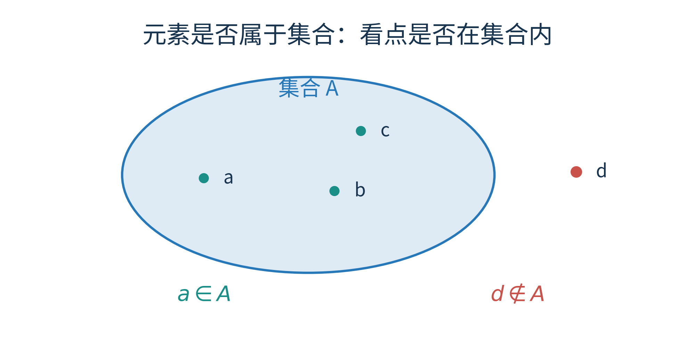

*图 1：集合内部的点表示成员，集合外的点不是成员。*

### 1.2 为什么要明确讨论范围

- “全体自然数”构成集合：$\mathbb N=\{0,1,2,\ldots\}$。
- $x^2-2x+1=0$ 的根组成 $\{1\}$，因为 $(x-1)^2=0$ 只有一个**不同**的根。
- $x^2+x+1=0$ 在**实数**范围内的解集是 $\varnothing$；在**复数**范围内的解集是 $\left\{\frac{-1+i\sqrt3}{2},\frac{-1-i\sqrt3}{2}\right\}$。

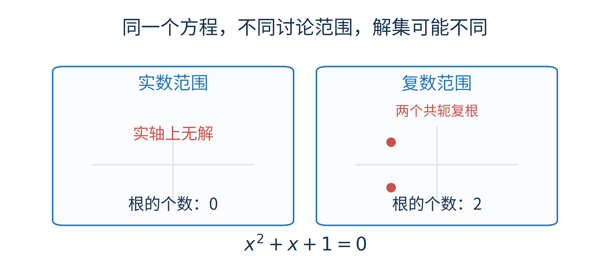

*图 2：同一方程在实数和复数范围下，解集的元素个数不同；两复根关于实轴对称。*

> [!important] 集合的第一条判断原则
> 判断 $x\in A$ 之前，必须明确 **$x$ 是什么对象**、**$A$ 收录什么对象**，以及**讨论范围是什么**。不能只凭符号外形推断。

## 2. 集合的性质与表示方法

### 2.1 元素的无序性与互异性

集合中的元素有两个重要性质。

1. **无序性**：$\{1,2,3\}=\{3,1,2\}$，排列顺序不影响集合。
2. **互异性**：$\{1,1,2,2\}=\{1,2\}$，重复列出相同元素不会增加元素个数。

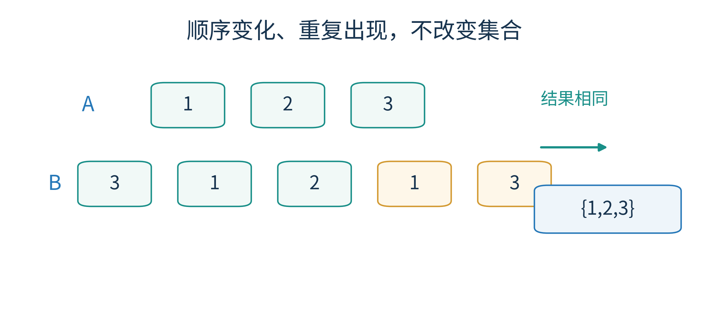

*图 3：两行列举顺序和重复次数不同，但代表完全相同的集合。*

> [!warning] 元素不重复，不等于“所有出现过的花括号都能去掉”
> $\{\{1,2\},3\}$ 的元素是 $\{1,2\}$ 和 $3$；$\{1,2,3\}$ 的元素则是 $1,2,3$。这是两个不同的集合。多层花括号表示不同对象层级，后文专门比较。

### 2.2 列举法（roster）

把集合中的元素用逗号隔开，并写在花括号中，例如：

$$
A=\{a,b,c\},\qquad B=\{0,1,2,3,\ldots\}.
$$

列举法是一种**外延表示法**：可以直接看到具体元素，适合元素较少或排列规律明显的情况；对于元素很多或不能简单列出的集合，不够方便。课件还指出，若把海量元素全部显式存储在计算机中，也会占用较多内存。省略号只应在规律清楚时使用。

### 2.3 描述法（defining predicate）

使用明确的判断条件 $P(x)$ 说明哪些对象可以被选入集合：

$$
A=\{x\in U\mid P(x)\}.
$$

其中 $U$ 是事先确定的讨论范围，竖线 $\mid$ 读作“满足”，$P(x)$ 是关于 $x$ 的性质。描述法是一种**内涵表示法**，重点在成员需满足的条件。比如正偶数集可以写成

$$
E=\{2,4,6,8,\ldots\}
=\{x\in\mathbb N\mid x>0\land 2\mid x\}
=\{2(k+1)\mid k\in\mathbb N\}.
$$

式中 $2\mid x$ 表示 $2$ 整除 $x$。也可写作 $\{x\in\mathbb N\mid \exists k\in\mathbb N,\ x=2(k+1)\}$。两种描述法和列举法给出的元素完全一致。

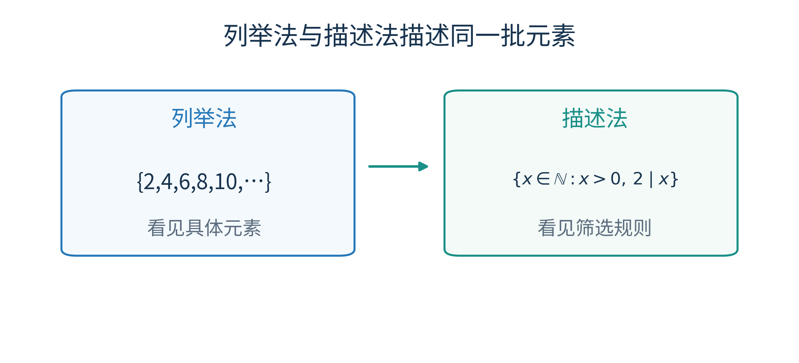

*图 4：列举法关注“有哪些元素”，描述法关注“如何判定元素”。*

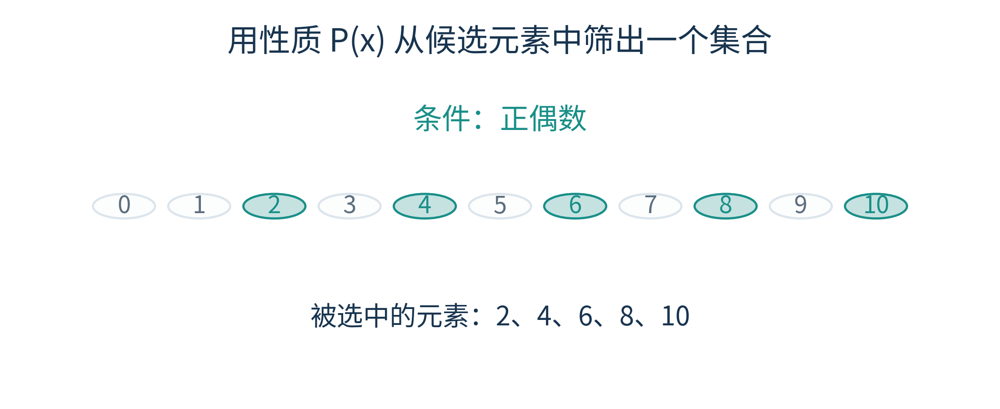

*图 5：在自然数候选对象中逐个检查“正偶数”条件，只保留符合条件的元素。*

> [!example] 例：把描述法化为列举法
> 对 $A=\{x\in\mathbb Z\mid -2\le x<3\}$，整数 $x$ 依次为 $-2,-1,0,1,2$，所以 $A=\{-2,-1,0,1,2\}$。注意：讨论范围是整数，不能把 $1.5$ 放入集合。

> [!note] 关于课件的小细节
> 课件在介绍小写英文字母集合时，谓词的口头描述出现“英文字母”与“小写英文字母”范围不完全一致的表述。整理时明确使用 $L=\{x\mid x\text{ 是小写英文字母}\}$，避免包含大写字母的歧义。

### 2.4 文氏图（Venn diagram）

文氏图用平面区域表示集合，用点表示元素。通常用矩形表示某个讨论范围 $E$，用闭合曲线围出子集 $A$。

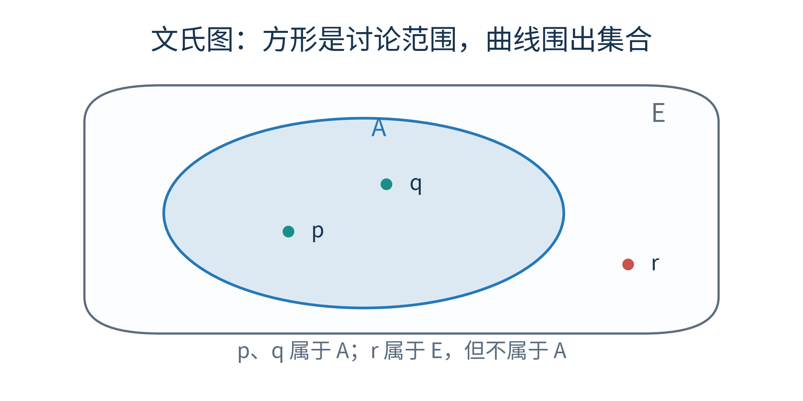

*图 6：矩形表示讨论范围，曲线围出集合；矩形内但曲线外的元素不属于 A。*

文氏图是**辅助理解的示意模型**，不是集合的定义；在抽象集合（尤其元素本身也是集合）中，必须回到符号和定义判断。

## 3. 常见数集

本课件使用以下记号：

| 记号 | 集合名称 | 典型元素或说明 |
|---|---|---|
| $\mathbb N$ | 自然数集 | $\{0,1,2,3,\ldots\}$（本讲包含 $0$） |
| $\mathbb Z$ | 整数集 | $\{\ldots,-2,-1,0,1,2,\ldots\}$ |
| $\mathbb Q$ | 有理数集 | 可写为 $p/q$ 的数，其中 $p,q\in\mathbb Z,q\ne0$ |
| $\mathbb R$ | 实数集 | 有理数与无理数 |
| $\mathbb C$ | 复数集 | $a+bi$，其中 $a,b\in\mathbb R$ |

它们之间存在逐层包含关系：

$$
\mathbb N\subseteq\mathbb Z\subseteq\mathbb Q\subseteq\mathbb R\subseteq\mathbb C.
$$

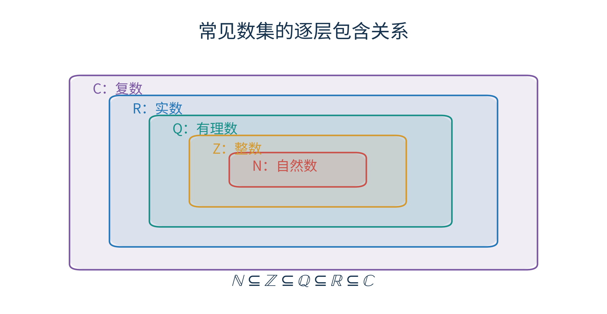

*图 7：每一层都完整包含内层数集；图形仅表达包含关系，不代表数的大小或数量。*

> [!tip] 辨析“数属于数集”和“数集包含数集”
> $2\in\mathbb N$、$\mathbb N\subseteq\mathbb Z$ 成立。$2\subseteq\mathbb N$ 通常不成立为本课所讨论的集合包含陈述，因为这里 $2$ 被视为数（元素），而不是数的集合。

## 4. 集合相等、子集与包含关系

### 4.1 集合相等（外延性原理）

**两个集合相等，当且仅当它们包含完全相同的元素**：

$$
A=B\iff\forall x\,(x\in A\leftrightarrow x\in B).
$$

因此 $\{1,2,4\}=\{4,2,1\}$，也有 $\{1,1,2\}=\{1,2\}$。

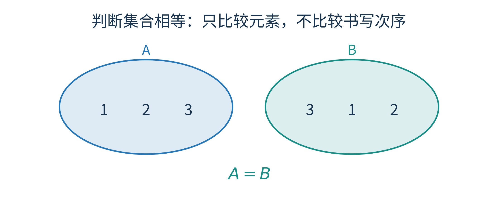

*图 8：相等仅取决于成员，不取决于画法、顺序或重复书写。*

但是，

$$
\underbrace{\{\{1,2\},3\}}_{\text{元素有 }\{1,2\}\text{ 与 }3}\ne
\underbrace{\{1,2,3\}}_{\text{元素有 }1,2,3}.
$$

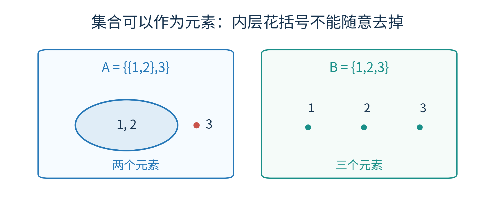

*图 9：左边把 {1,2} 当成一个完整元素；右边把 1 和 2 分别当成元素。*

> [!example] 嵌套集判断
> 令 $A=\{\{1,2\},3\}$。则 $\{1,2\}\in A$ 为真、$1\in A$ 为假；$\{\{1,2\}\}\subseteq A$ 为真，而 $\{1,2\}\subseteq A$ 为假。原因是 $\in$ 检查“一个对象”，$\subseteq$ 检查“集合的全部元素”。

### 4.2 子集（subset）的定义

**$A$ 是 $B$ 的子集**，指 $A$ 的每个元素都属于 $B$，记为 $A\subseteq B$：

$$
A\subseteq B\iff\forall x\,(x\in A\rightarrow x\in B).
$$

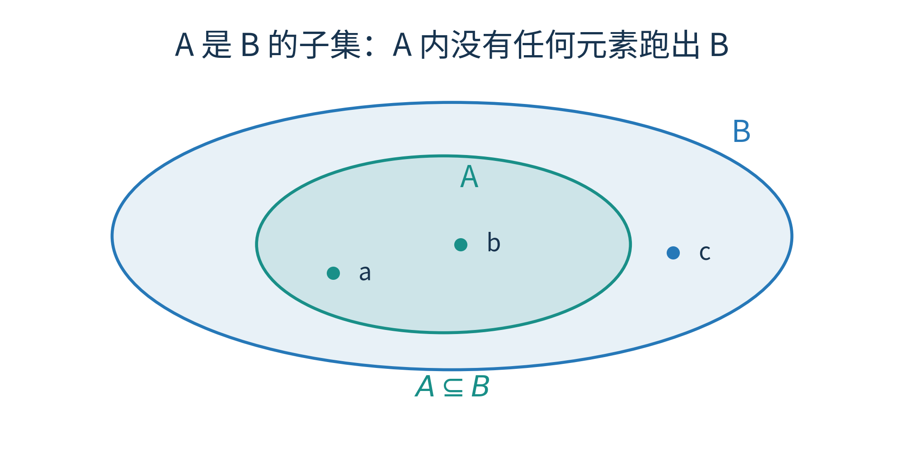

*图 10：A 完全位于 B 内部，说明 A 的每一个元素都能在 B 中找到。*

子集不成立，只需找出**至少一个**反例元素：

$$
\begin{aligned}
A\nsubseteq B
&\iff\neg\forall x\,(x\in A\to x\in B)\\
&\iff\exists x\,\neg(x\in A\to x\in B)\\
&\iff\exists x\,(x\in A\land x\notin B).
\end{aligned}
$$

第二步使用量词否定，第三步利用 $\neg(p\to q)\iff p\land\neg q$。

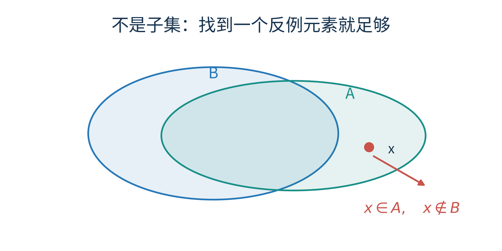

*图 11：红色点在 A 内、B 外，它就是 A 不是 B 子集的直接证据。*

> [!example] 课件的子集例子
> $A=\{a,b,c\}$，$B=\{a,b,c,d\}$，$C=\{a,b\}$，则 $A\subseteq B$、$C\subseteq A$、$C\subseteq B$ 均成立。用元素出现矩阵核对最直接。

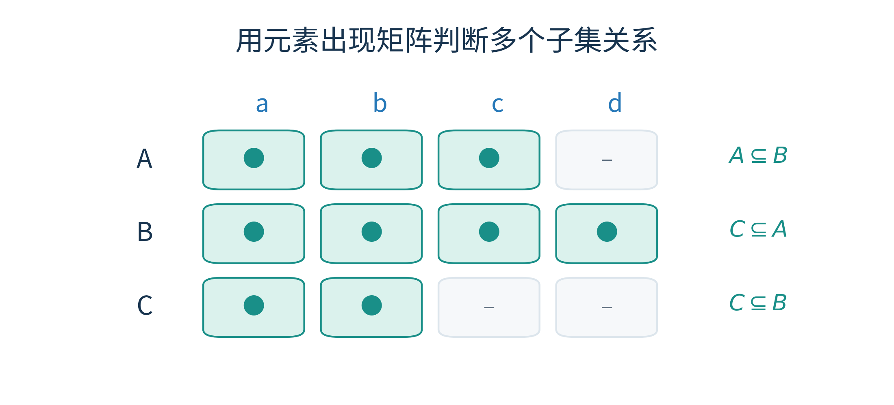

*图 12：如果一行中每个实心格在另一行中也实心，就可得到对应子集关系。*

### 4.3 用互相包含证明集合相等

**核心定理：**

$$
\boxed{A=B\iff (A\subseteq B)\land(B\subseteq A)}.
$$

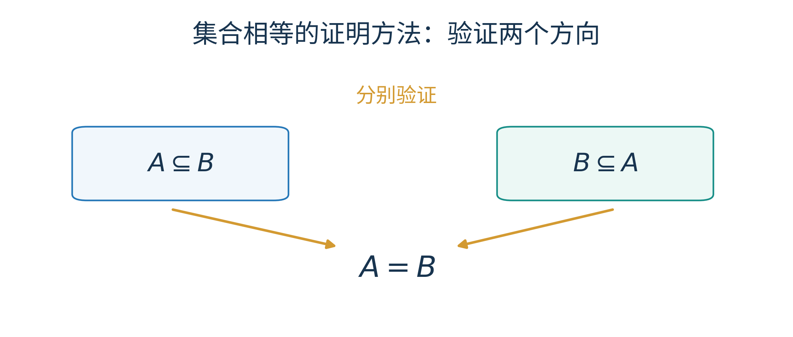

*图 13：分别检查两个方向，并共同推出集合相等，不能只检查其中一向。*

证明过程：

$$
\begin{aligned}
&(A\subseteq B)\land(B\subseteq A)\\
\iff{}&\forall x\,(x\in A\to x\in B)\land\forall x\,(x\in B\to x\in A)\\
\iff{}&\forall x\,\big[(x\in A\to x\in B)\land(x\in B\to x\in A)\big]\\
\iff{}&\forall x\,(x\in A\leftrightarrow x\in B)\\
\iff{}&A=B.
\end{aligned}
$$

第二行到第三行可合并两个相同范围、相同变元的全称量词；后两步依次使用双条件等值式和外延性原理。

### 4.4 子集关系的三个基本性质

**自反性：**任意集合 $A$ 都有 $A\subseteq A$。因为每个命题 $x\in A\to x\in A$ 为真。

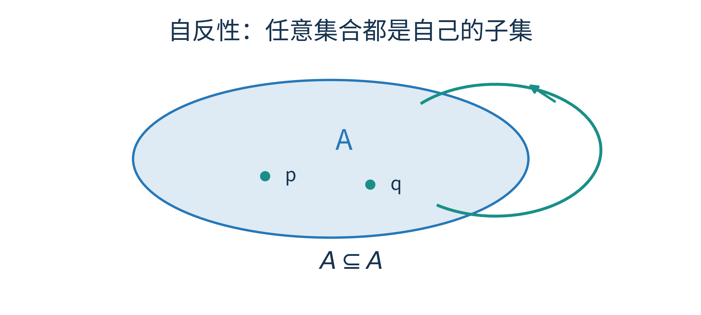

*图 14：集合的全部成员当然也都是自己的成员。*

**反对称性：**若 $A\subseteq B$ 且 $B\subseteq A$，则 $A=B$。这正是上面的互相包含定理。

**传递性：**若 $A\subseteq B$ 且 $B\subseteq C$，则 $A\subseteq C$。

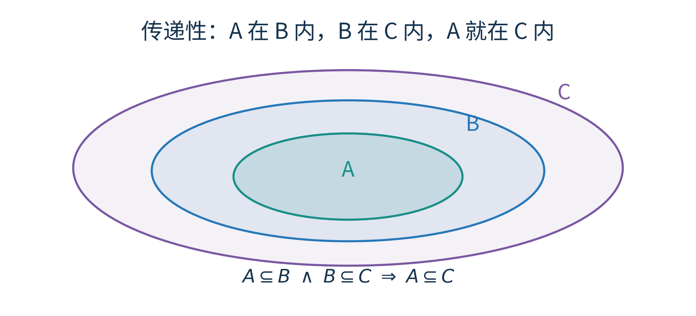

*图 15：A 在 B 内，B 又在 C 内，因此 A 一定在 C 内。*

传递性的逐元素证明：任取 $x\in A$，由 $A\subseteq B$ 得 $x\in B$；再由 $B\subseteq C$ 得 $x\in C$。因此对任意 $x$，$x\in A\to x\in C$，故 $A\subseteq C$。

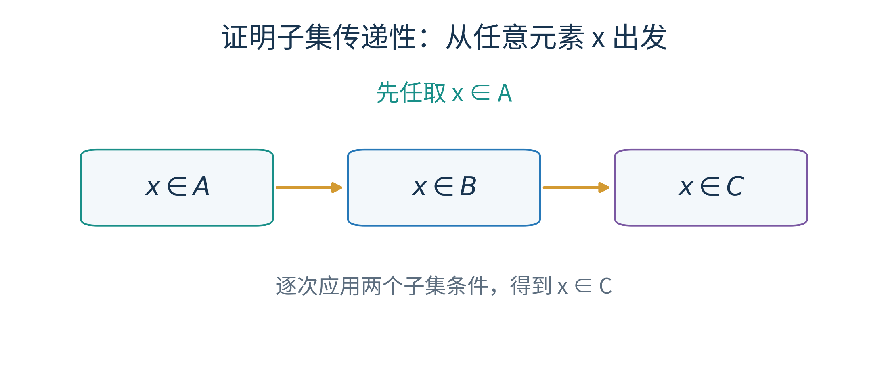

*图 16：用任意元素 x 沿着 A、B、C 三个集合逐步推理。*

> [!important] 子集关系是偏序关系
> 由于 $\subseteq$ 满足自反性、反对称性、传递性，因此在集合族上是一个**偏序关系**（理解性补充）。但它并不保证任意两个集合都可比较，例如 $\{1\}$ 与 $\{2\}$ 互不包含。

## 5. 真子集与“不是子集”的区别

### 5.1 真子集（proper subset）

课件用 $A\subset B$ 表示 **$A$ 是 $B$ 的真子集**，需同时满足：

$$
\boxed{A\subset B\iff A\subseteq B\land A\ne B}.
$$

也可等价写成：

$$
A\subset B\iff A\subseteq B\land\exists x\,(x\in B\land x\notin A).
$$

后一式强调 $B$ 必须至少有一个 $A$ 没有的元素。

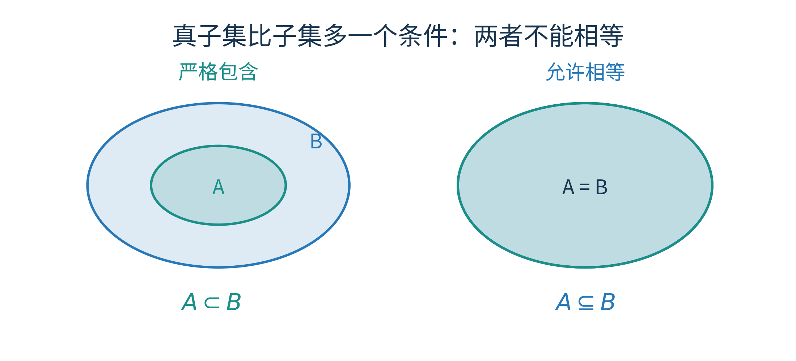

*图 17：子集允许两集合完全相等；真子集不允许相等。*

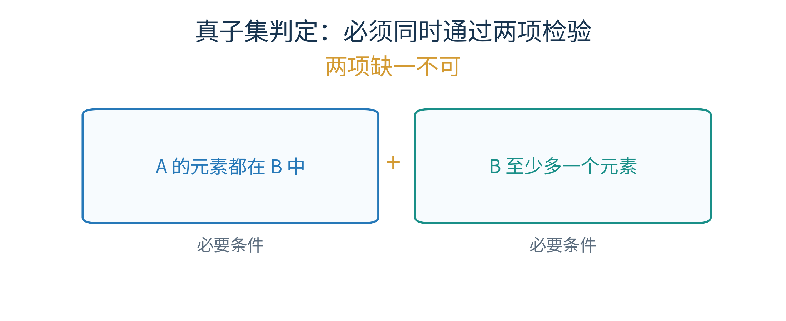

*图 18：判断真子集必须独立检查“所有元素包含”和“严格多出元素”两个条件。*

### 5.2 真子集的传递性

若 $A\subset B$，$B\subset C$，则 $A\subset C$。

**证明：**由真子集定义，$A\subseteq B$ 且 $B\subseteq C$，所以 $A\subseteq C$。如果 $A=C$，则从 $B\subseteq C=A$ 与 $A\subseteq B$ 可推出 $A=B$，与 $A\subset B$ 矛盾。因此 $A\ne C$，故 $A\subset C$。

### 5.3 “不是真子集”有两种可能

对 $A\not\subset B$（此处明确表示“不是 $B$ 的真子集”，不要与 $A\nsubseteq B$ 混淆）：

$$
\begin{aligned}
\neg(A\subset B)
&\iff\neg(A\subseteq B\land A\ne B)\\
&\iff(A\nsubseteq B)\lor(A=B).
\end{aligned}
$$

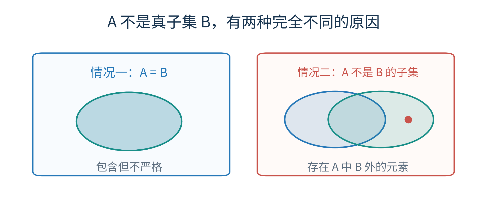

*图 19：不是真子集可能因为二者相等，也可能根本没有包含关系。*

> [!warning] 三个概念要分开
> - $A\subseteq B$：A 的全部成员都属于 B，允许 $A=B$。
> - $A\subset B$：A 的全部成员都属于 B，并且 $A\ne B$。
> - $A\nsubseteq B$：至少存在 $A$ 中的某个元素不属于 B。
>
> 课件中的 $\subset$ 特指真子集；其他教材可能对该符号使用不同约定，可用 $\subsetneq$ 来明确表示严格包含。

## 6. 特殊集合、基数与讨论范围

### 6.1 空集

**空集（empty set）**没有任何元素，记为 $\varnothing$，因此 $|\varnothing|=0$。例如在实数范围下：

$$
\{x\in\mathbb R\mid x^2+1=0\}=\varnothing.
$$

**空集与含空集的集合完全不同：**

$$
\underbrace{\varnothing}_{0\text{ 个元素}}\ne\underbrace{\{\varnothing\}}_{1\text{ 个元素}}.
$$

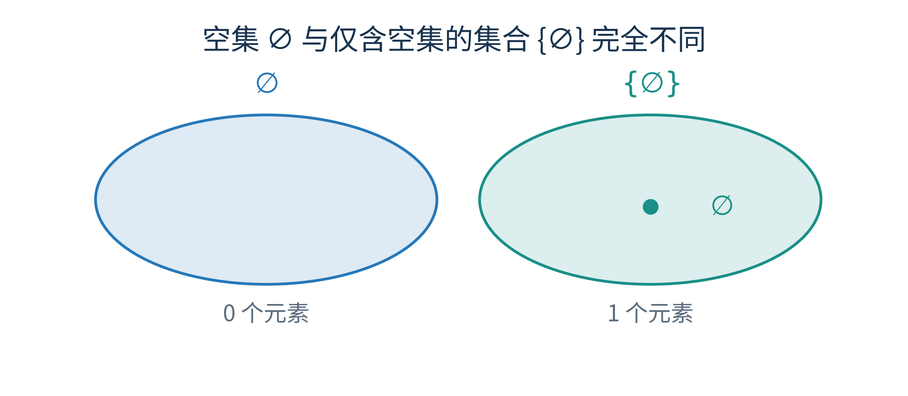

*图 20：一个区域中什么都没有，与区域中放入“空集”这个对象不同。*

**定理：空集是任意集合的子集。**

$$
\forall A,\qquad\varnothing\subseteq A.
$$

这是因为 $\varnothing$ 中不存在可以构成反例的元素；逻辑上，$\forall x(x\in\varnothing\to x\in A)$ 为真，并不需要从空集中挑出某个实际元素。

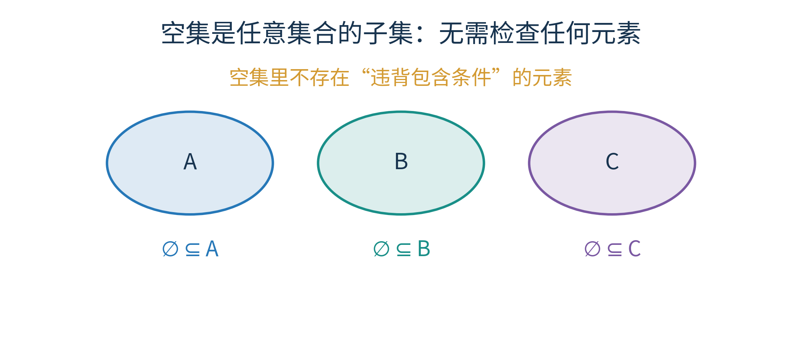

*图 21：对任意 A、B、C，空集都是它们的子集。*

**空集唯一性的证明：**若 $E_1,E_2$ 都是空集，则由“空集是任意集合的子集”得到 $E_1\subseteq E_2$ 与 $E_2\subseteq E_1$；由互相包含定理，$E_1=E_2$。

> [!important] 三个永远正确的式子
> $\varnothing\subseteq A$；$\varnothing\subseteq\varnothing$；若 $A\ne\varnothing$，则 $\varnothing\subset A$。但是 $\varnothing\in A$ **不一定成立**，是否属于要看 $A$ 是否明确收录了空集这个元素。

### 6.2 全集

**全集（universal set）**是某次讨论中用来限定所有研究对象的集合，课件记作 $E$。若所讨论的集合都包含在 $E$ 中，则它们都是 $E$ 的子集。在文氏图中常用矩形表示全集。

全集**相对于当前讨论确定**，不必是数学意义上“包含一切集合”的对象。例如研究整数问题可取 $E=\mathbb Z$；研究区间 $(a,b)$ 中的实数可取 $E=(a,b)$。

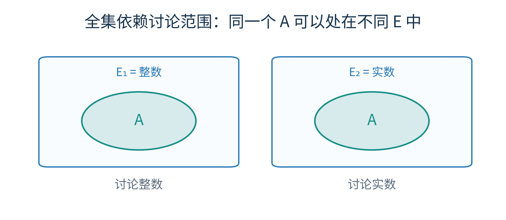

*图 22：同一个集合 A 可以在不同的全集中被研究，全集不是唯一固定的。*

### 6.3 基数、n 元集与有限集

**基数** $|A|$ 表示集合元素的个数；若 $|A|=n$，则称 $A$ 为 $n$ 元集。其中零元集恰好是空集，单元集恰有一个元素。

$$
|\varnothing|=0,\qquad|\{a\}|=1,\qquad|\{a,b,c\}|=3.
$$

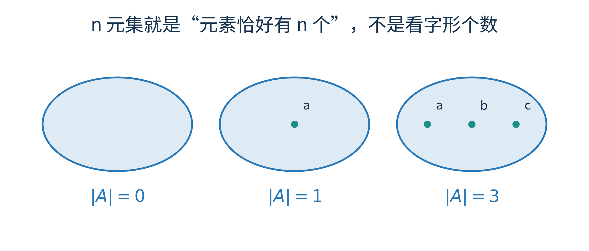

*图 23：基数统计的是不同的顶层元素，而不是字符数量。*

**有限集（有穷集）**具有有限个元素。$\{1,2,3,4\}$ 是有限集，而 $\mathbb N$ 是无限集。

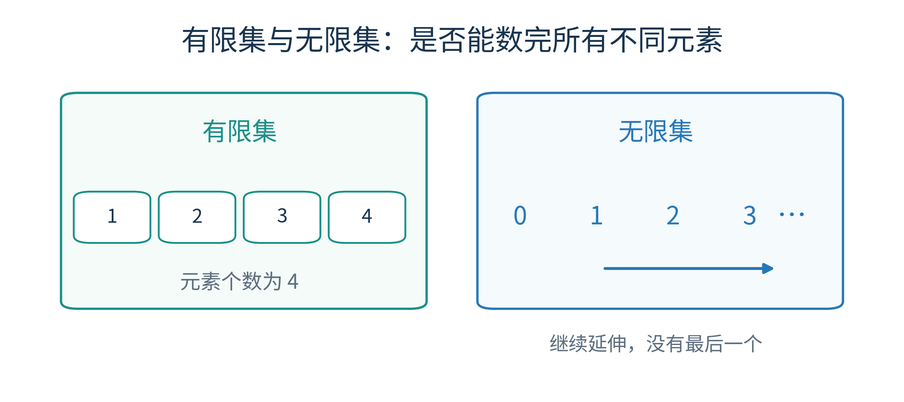

*图 24：有限集合数得完不同元素，自然数集可以无限继续。*

### 6.4 单元集与嵌套空集

$$
\varnothing,\qquad\{\varnothing\},\qquad\{\{\varnothing\}\}
$$

是**三个不同对象**。前者没有成员；后两者都恰有一个顶层元素，但其唯一元素分别是 $\varnothing$ 与 $\{\varnothing\}$。因此

$$
|\varnothing|=0,\qquad |\{\varnothing\}|=1,\qquad|\{\{\varnothing\}\}|=1.
$$

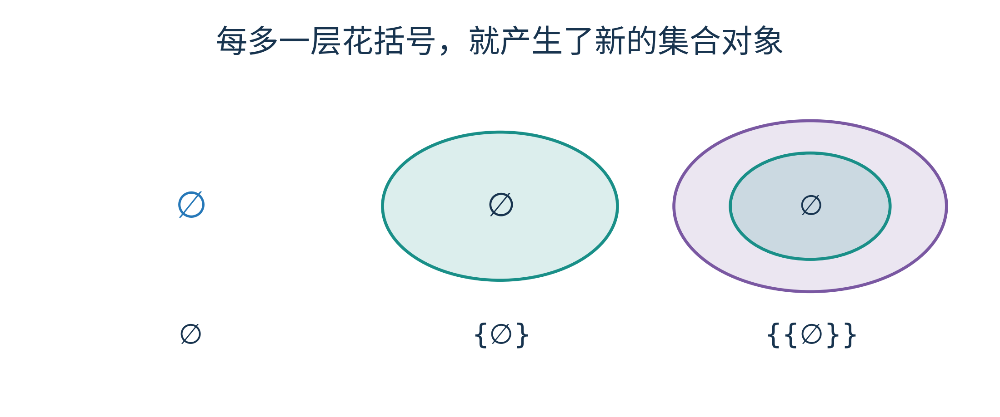

*图 25：逐层添加花括号产生不同对象；注意最后两者的基数都为 1。*

> [!warning] 常见错误
> $\{\varnothing\}$ 的基数是 1，不是 0；$\{a,a\}$ 的基数是 1，不是 2；$\{\{a,b\}\}$ 的基数是 1，不是 2。判断基数必须**只数最外层的不同元素**。

## 7. 幂集：从一个集合生成“所有子集的集合”

### 7.1 幂集定义

给定集合 $A$，它的**全体子集组成的新集合**称为 $A$ 的**幂集（power set）**，记作 $P(A)$ 或 $\mathcal P(A)$；课件也使用 $2^A$ 作为另一种记号。

$$
\boxed{P(A)=\{X\mid X\subseteq A\}}.
$$

所以，**幂集的元素本身是集合**：

$$
\boxed{X\in P(A)\iff X\subseteq A}.
$$

例如 $A=\{a,b\}$：

$$
P(A)=\{\varnothing,\{a\},\{b\},\{a,b\}\}.
$$

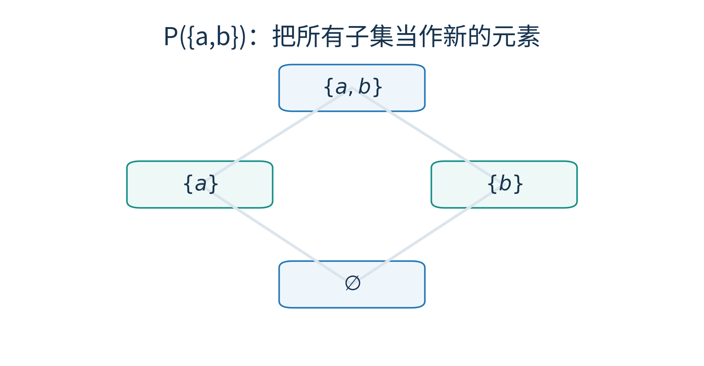

*图 26：用包含关系组成的层次图展示 {a,b} 的全部四个子集。*

> [!tip] 幂集常用辨析
> 对 $A=\{a,b\}$，$a\in A$ 成立，但 $a\in P(A)$ 不成立（这里的 a 是普通元素）；$\{a\}\in P(A)$ 和 $\{a\}\subseteq A$ 则同时成立。

### 7.2 为什么 n 元集有 $2^n$ 个子集

对 $n$ 元集 $A=\{a_1,a_2,\ldots,a_n\}$，构造任一子集时，每个元素都有且只有两种选择：**选入**或**不选入**。这些选择彼此独立，因此总数为

$$
\boxed{|A|=n\implies |P(A)|=2^n}.
$$

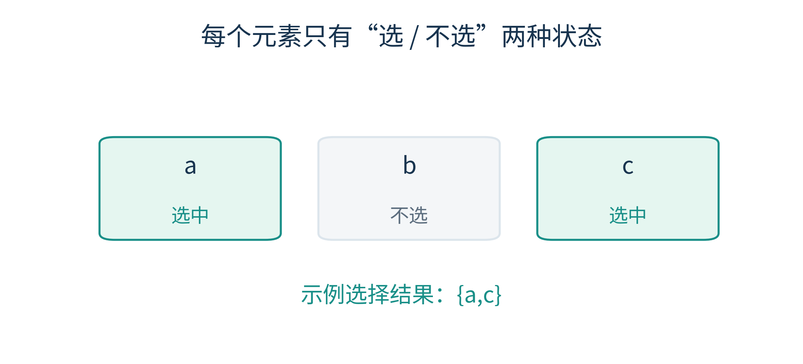

*图 27：构造一个子集时，依次为每个元素做“选或不选”的决定。*

把 $A=\{a,b,c\}$ 作为例子，对三个元素逐步做两种选择，可以得到 8 个不同子集：

$$
\begin{aligned}
P(A)=\{&\varnothing,\{a\},\{b\},\{c\},\\
&\{a,b\},\{a,c\},\{b,c\},\{a,b,c\}\}.
\end{aligned}
$$

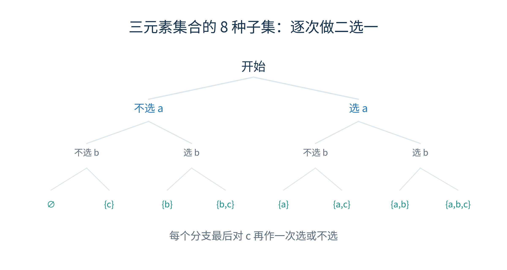

*图 28：三次二选一形成八条分支，每条分支对应且仅对应一个子集。*

### 7.3 用包含层次检验是否漏列子集

把幂集的所有元素按包含的元素数从少到多排成层次：最下方是空集，最高处是全集合 $A$，相邻层之间的连线对应增加一个元素。

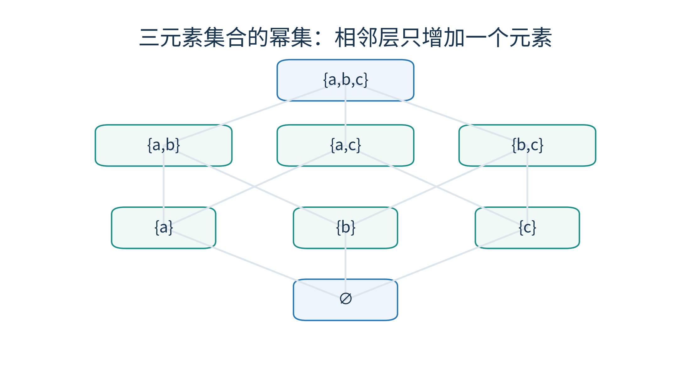

*图 29：P({a,b,c}) 的 8 个结点与包含关系；相连结点只差一个元素。*

### 7.4 m 元子集与组合数

对 $n$ 元集 $A$，恰有 $m$ 个元素的子集个数是组合数：

$$
\binom nm=\frac{n!}{m!(n-m)!},\qquad0\le m\le n.
$$

把所有可能的子集大小 $m=0,1,\ldots,n$ 相加：

$$
|P(A)|=\sum_{m=0}^{n}\binom nm=(1+1)^n=2^n.
$$

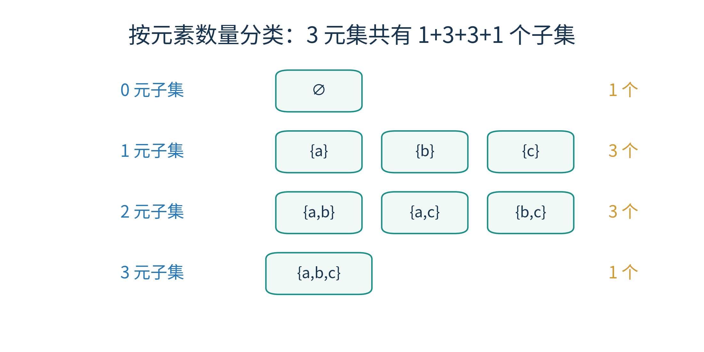

*图 30：三元集按子集大小分层：0、1、2、3 元子集分别有 1、3、3、1 个。*

> [!example] 例：从四元集中取二元子集
> $A=\{a,b,c,d\}$。恰好包含两个元素的子集有 $\binom42=6$ 个；逐个列出可验证：$\{a,b\},\{a,c\},\{a,d\},\{b,c\},\{b,d\},\{c,d\}$。

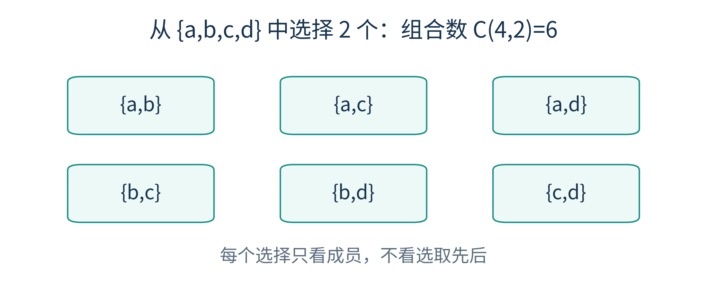

*图 31：枚举四元集中所有不同的二元子集，顺序不同不算新的选择。*

### 7.5 连续求空集的幂集

$$
\begin{aligned}
P(\varnothing)&=\{\varnothing\},\\
P(P(\varnothing))&=P(\{\varnothing\})=\{\varnothing,\{\varnothing\}\}.
\end{aligned}
$$

两个式子的基数分别为 $1$ 和 $2$。原因是 $\varnothing$ 有 $0$ 个元素，所以有 $2^0=1$ 个子集；$\{\varnothing\}$ 有 $1$ 个元素，所以有 $2^1=2$ 个子集。

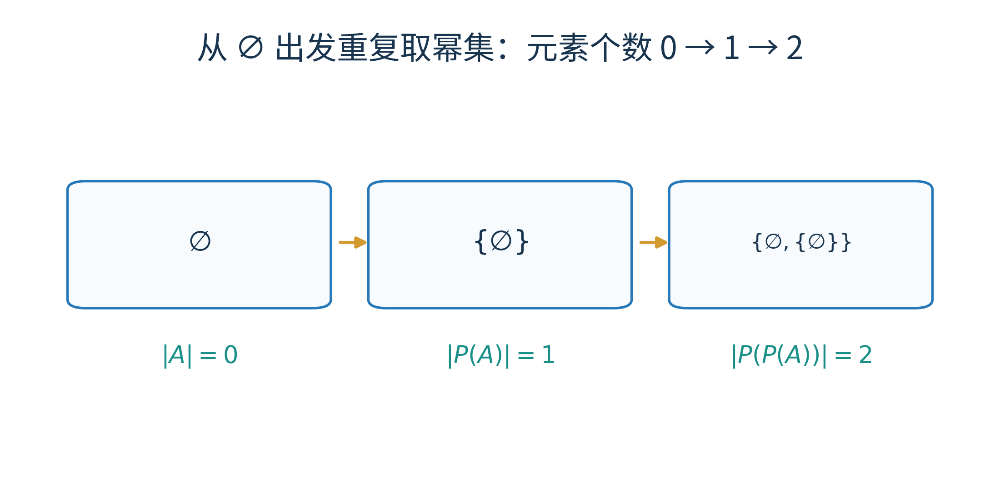

*图 32：空集、空集的幂集、再取一次幂集，三者的元素层级和基数逐次变化。*

## 8. 判断题的固定解题方法

本讲最容易在练习中出错的是**“属于”与“子集”的对象层级**。

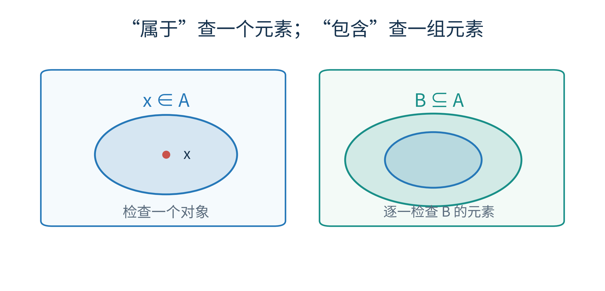

*图 33：属于关系是查单个对象，子集关系是逐个核对左侧集合的全部元素。*

遇到集合表达式，推荐按以下顺序检查。

1. 看运算关系：$x\in A$ 还是 $X\subseteq A$。
2. 如果是 $\in$，**只看右边集合的最外层元素**，是否存在一个与左边完全相同的对象。
3. 如果是 $\subseteq$，逐个取左侧集合的顶层元素，检查是否都在右侧；若左侧是空集，结论直接为真。
4. 如果是 $\subset$，先判子集，再排除相等。
5. 遇到 $\varnothing$、$\{\varnothing\}$、$\{\{\varnothing\}\}$，完整保留花括号层数后再对照。

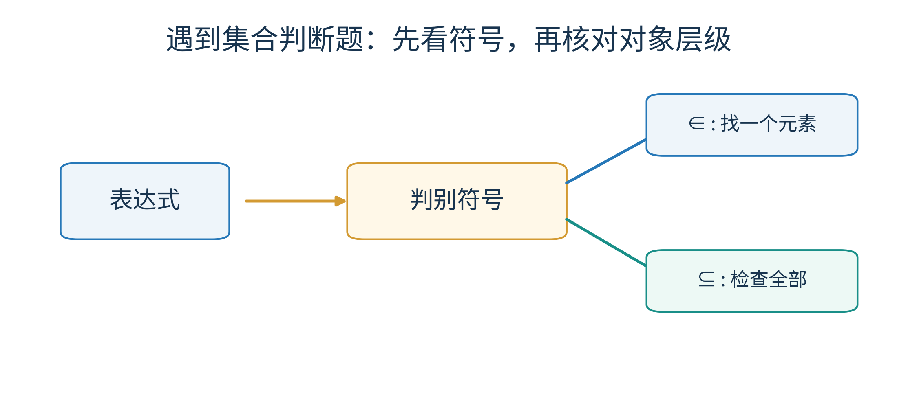

*图 34：解题时先分辨关系符号，避免把两个完全不同的检查过程混用。*

### 8.1 课件判断练习（一）：嵌套空集

令

$$
X=\big\{\{\varnothing\},\ \{\varnothing,\{\varnothing\}\}\big\}.
$$

**关键：$X$ 只有两个顶层元素**：$u=\{\varnothing\}$ 和 $v=\{\varnothing,\{\varnothing\}\}$。虽然 $v$ 里包含空集，但这并不意味着空集本身直接属于 $X$。

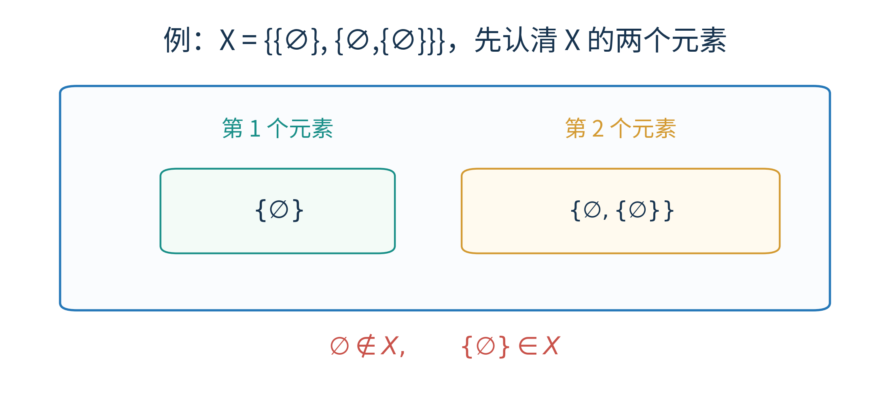

*图 35：先把 X 的两个顶层成员区分开，之后每条判断都只需对照这两个对象。*

逐项检验：

| 题号 | 命题 | 结论 | 原因 |
|---|---|---|---|
| 1 | $\varnothing\subseteq\varnothing$ | **真** | 空集是任意集合的子集，包含自身 |
| 2 | $\varnothing\in\varnothing$ | **假** | 空集没有任何元素 |
| 3 | $\varnothing\subseteq\{\varnothing\}$ | **真** | 空集是任意集合的子集 |
| 4 | $\varnothing\in\{\varnothing\}$ | **真** | 右侧集合的唯一元素就是空集 |
| 5 | $\{\varnothing\}\subseteq X$ | **假** | 左侧唯一元素 $\varnothing$ 并非 $X$ 的顶层元素 |
| 6 | $\{\varnothing\}\in X$ | **真** | $X$ 的第一个顶层元素就是 $\{\varnothing\}$ |
| 7 | $\{\{\varnothing\}\}\subseteq X$ | **真** | 左侧唯一元素 $\{\varnothing\}$ 属于 $X$ |
| 8 | $\{\{\varnothing\}\}\in X$ | **假** | $X$ 的两个顶层元素都不是 $\{\{\varnothing\}\}$ |

**经逐项核对的答案：** 真、假、真、真、假、真、真、假。

> [!warning] 第 5 与第 7 题为什么一个假、一个真？
> 第 5 题的左侧元素是 $\varnothing$；第 7 题的左侧元素是 $\{\varnothing\}$。它们不同，恰好说明**多一层花括号就有可能改变整个命题的真值**。

### 8.2 课件判断练习（二）：$S$ 与 $R$

已知

$$
S=\{2,a,\{3\},4\},\qquad R=\{\{a\},3,4,1\}.
$$

先明确两个集合各自的四个顶层元素：

- $S$ 的元素：$2$、$a$、$\{3\}$、$4$。
- $R$ 的元素：$\{a\}$、$3$、$4$、$1$。

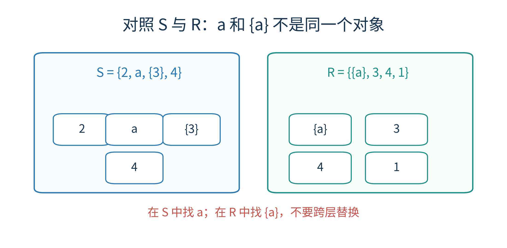

*图 36：把 S 与 R 中的元素逐一摆开，重点区分 a 与 {a}、3 与 {3}。*

| 题号 | 命题 | 结论 | 关键理由 |
|---|---|---|---|
| (1) | $\{a\}\in S$ | **假** | $S$ 有 $a$，但没有 $\{a\}$ 这个元素 |
| (2) | $\{a\}\in R$ | **真** | $\{a\}$ 是 $R$ 的顶层元素 |
| (3) | $\{a,4,\{3\}\}\subseteq S$ | **真** | $a$、$4$、$\{3\}$ 都在 $S$ 中 |
| (4) | $\{\{a\},1,3,4\}\subseteq R$ | **真** | 左侧集合恰好等于 $R$ |
| (5) | $R=S$ | **假** | 两个集合的元素不相同 |
| (6) | $\{a\}\subseteq S$ | **真** | 左侧唯一元素 $a$ 属于 $S$ |
| (7) | $\{a\}\subseteq R$ | **假** | $a\notin R$，不能把 $a$ 换成 $\{a\}$ |
| (8) | $\varnothing\subset R$ | **真** | $R$ 非空，故空集是其真子集 |
| (9) | $\varnothing\subseteq\{\{a\}\}\subseteq R$ | **真** | 两段包含关系分别为真 |
| (10) | $\{\varnothing\}\subseteq S$ | **假** | $\varnothing\notin S$ |
| (11) | $\varnothing\in R$ | **假** | $R$ 并未把空集作为顶层元素 |
| (12) | $\varnothing\subseteq\{\{3\},4\}$ | **真** | 空集是任意集合的子集 |

**经逐项核对的答案：** 假、真、真、真、假、真、假、真、真、假、假、真。

> [!tip] 这两组题的实用技巧
> 对每个集合只做一次“顶层元素清单”，然后所有 $\in$ 都从清单里找对象，所有 $\subseteq$ 都对左侧元素逐项核查。这样可以避免在 12 道题里重复拆花括号。

## 9. 全章知识速查

| 知识点 | 判断条件或核心公式 | 最容易犯的错误 |
|---|---|---|
| 元素属于集合 | $x\in A$ | 把 $x$ 当成 $\{x\}$ |
| 集合相等 | $A=B\iff\forall x(x\in A\leftrightarrow x\in B)$ | 比较排列顺序 |
| 子集 | $A\subseteq B\iff\forall x(x\in A\to x\in B)$ | 误以为 A 必须比 B 小 |
| 不是子集 | $A\nsubseteq B\iff\exists x(x\in A\land x\notin B)$ | 没有找到具体反例 |
| 真子集 | $A\subset B\iff A\subseteq B\land A\ne B$ | 忘记排除相等 |
| 空集 | $\lvert\varnothing\rvert=0$；$\varnothing\subseteq A$ | 混同 $\varnothing$ 与 $\{\varnothing\}$ |
| 幂集 | $P(A)=\{X\mid X\subseteq A\}$ | 忘记幂集成员本身是子集 |
| 幂集个数 | $\lvert A\rvert=n\Rightarrow \lvert P(A)\rvert=2^n$ | 忽略空集和 A 本身 |
| m 元子集个数 | $\binom nm$ | 把选取顺序算作区别 |
| 证明相等 | $A\subseteq B$ 且 $B\subseteq A$ | 只证明一个方向 |

> [!summary] 一句话理解本讲
> **“属于”判断一个对象是否是成员；“包含”判断一个集合的全部成员是否被另一集合收录；“幂集”则把所有可能的子集重新收集成一个集合。** 绝大多数易错题都可以通过这三个层次加上花括号核对解决。

### 资料覆盖与校订说明

本笔记覆盖课件中：集合背景与定义、示例、列举法、描述法、文氏图、常用数集、外延性原理、子集及其性质、真子集及其传递性、空集及唯一性、全集、基数和有限集、幂集定义、幂集计数及两组末尾练习。课件后续目录提到的“集合运算”“有穷集计数（独立章节）”“集合恒等式”“二元关系”“函数”**不属于此次讲义的实际展开内容**，因此本笔记没有越界补写那些章节。

教材 P104 第 3、8 题在 PDF 末页仅列题号，**未附题目内容**。如需整理该作业，应以教材实际题面为准。
