# 第 1.2 讲｜集合运算与有穷集计数

> [!info] 整理范围与阅读说明
> - **主要依据**：上传的《第1.2讲 集合运算》课件，共 51 页；前 8 页为集合基本概念回顾，第 10～36 页讲 **6.2 集合的运算**，第 38～51 页讲 **6.3 有穷集的计数**。
> - 课件目录还列有“6.4 集合恒等式”，但**本份课件未讲授完整 6.4**；本文只在相关运算旁补充少量便于理解的直接推论，不把它们冒充成该章原文。
> - 图中采用自己绘制的文氏图、数轴、元素表和计数图。阴影表示运算结果；同一图的 SVG 用于后续编辑，PNG 用于稳定阅读。
> - 课件中个别明显的排版、下标与文字问题已在文末列出校核说明。除这些标明的校订外，知识范围以课件为主。

## 一、集合运算前必须掌握的基础

### 1.1 集合、元素与集合相等

**集合（set）**由一些确定对象组成，这些对象称为集合的**元素（element）**或成员。记号 $a\in A$ 表示 $a$ 属于集合 $A$；$a\notin A$ 表示 $a$ 不属于 $A$。集合的基本表示包括**列举法、描述法、文氏图**，运算表达式也可用于描述一个新集合。

集合相等遵循**外延性原理**：两个集合所含元素完全一致，当且仅当它们相等。

$$
A=B\iff\forall x\,(x\in A\leftrightarrow x\in B).
$$

因此，证明 $A=B$ 最常用的方法是**双向包含**：

$$
A=B\iff (A\subseteq B)\land(B\subseteq A).
$$

子集关系与真子集关系分别是：

$$
A\subseteq B\iff\forall x\,(x\in A\to x\in B),
\qquad
A\subsetneq B\iff A\subseteq B\land A\ne B.
$$

> [!warning] 两种符号不要混用
> $a\in A$ 比较的是**一个对象与一个集合**；$A\subseteq B$ 比较的是**两个集合**。例如，$1\in\{1,2\}$ 成立，而 $\{1\}\subseteq\{1,2\}$ 也成立，但二者不是同一个断言。

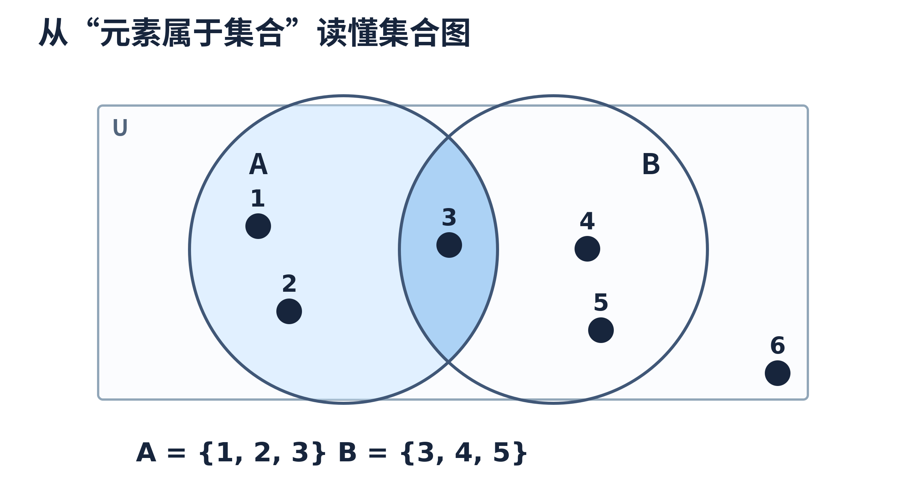

*图：元素属于集合与两集合区域的对应关系。*

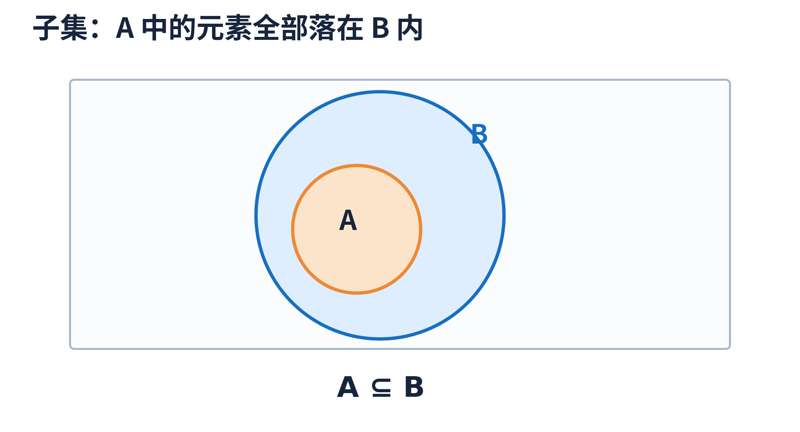

*图：子集的集合包含关系。*

### 1.2 空集、全集、基数和幂集

- **空集** $\varnothing$ 不含任何元素，且对所有集合 $A$，$\varnothing\subseteq A$。
- **全集** $E$（文氏图中也常写成 $U$）是本次讨论限定的对象范围。**补集必须相对于某个全集理解**。
- **基数** $|A|$ 是有限集合 $A$ 的元素个数；$|A|=n$ 时称 $A$ 为 $n$ 元集。
- **幂集** $\mathcal P(A)$ 是 $A$ 的全体子集构成的集合：

$$
\mathcal P(A)=\{X\mid X\subseteq A\}.
$$

例如 $A=\{a,b\}$ 时，$\mathcal P(A)=\{\varnothing,\{a\},\{b\},\{a,b\}\}$，所以 $|\mathcal P(A)|=4=2^2$。一般地，对有限的 $n$ 元集，$|\mathcal P(A)|=2^n$；原因是每个元素分别有“选入子集 / 不选入子集”两种选择。

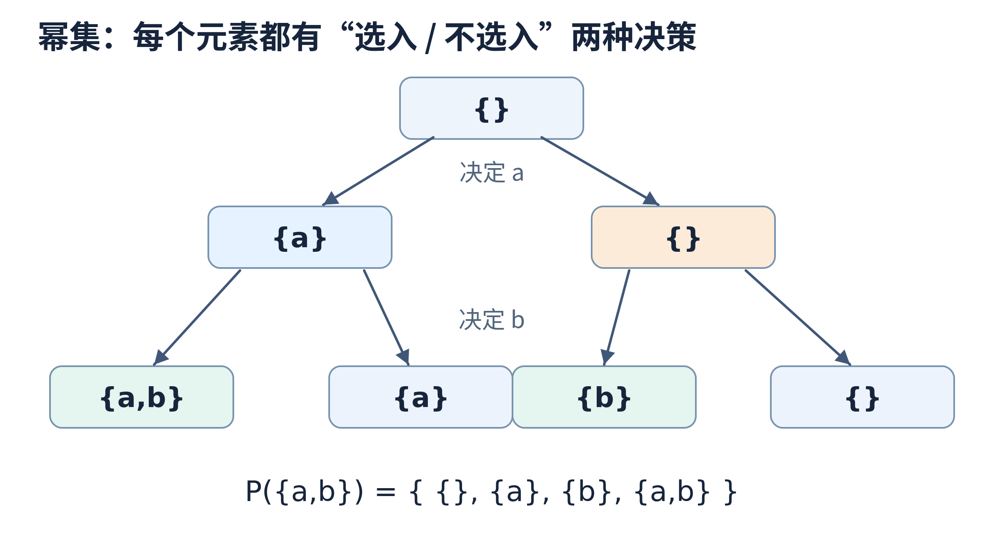

*图：幂集按每个元素选与不选产生四个子集。*

> [!important] 分清 $\varnothing$、$\{\varnothing\}$ 和 $\{\{\varnothing\}\}$
> $|\varnothing|=0$，$|\{\varnothing\}|=1$，$|\{\{\varnothing\}\}|=1$。元素可以本身也是一个集合；**空集作为某个集合的元素**，不会因此失去其“元素”的地位。

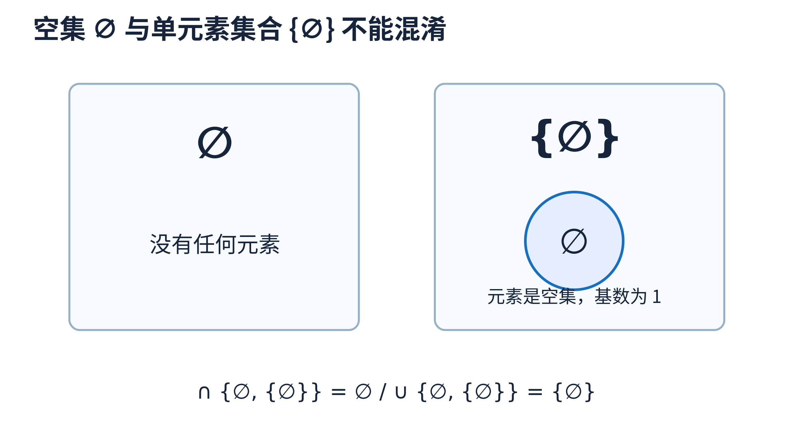

*图：空集与含空集的集合及广义运算的区别。*

---

## 二、6.2 集合的运算

### 2.1 文氏图与“先判断元素，后构造集合”的思想

集合运算的实质：从已有集合构造出新集合，**规则决定一个元素能否进入结果**。对两个集合 $A,B$，任意对象 $x$ 只有四种成员关系：

1. $x\notin A$ 且 $x\notin B$；
2. $x\in A$ 且 $x\notin B$；
3. $x\notin A$ 且 $x\in B$；
4. $x\in A$ 且 $x\in B$。

文氏图把全集画成矩形、集合画成圆（或其他闭合区域）；**图上真正应被填充的区域**，就是满足运算条件的那部分对象。不要把“在两个圆之间”的几何直观误当成定义：真正的定义永远来自元素的属于关系。

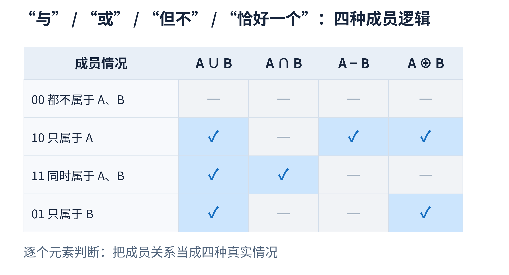

*图：集合并交差对称差在四种成员关系下的判定。*

### 2.2 交集（intersection）：同时属于

**交集**包含 $A$ 与 $B$ 的全部公共元素：

$$
A\cap B=\{x\mid x\in A\land x\in B\},
$$

$$
x\in A\cap B\iff (x\in A)\land(x\in B).
$$

> [!tip] 关键词
> “**且**”“**同时满足**”“**共同具有**”通常对应交运算 $\cap$，逻辑符号对应 $\land$。

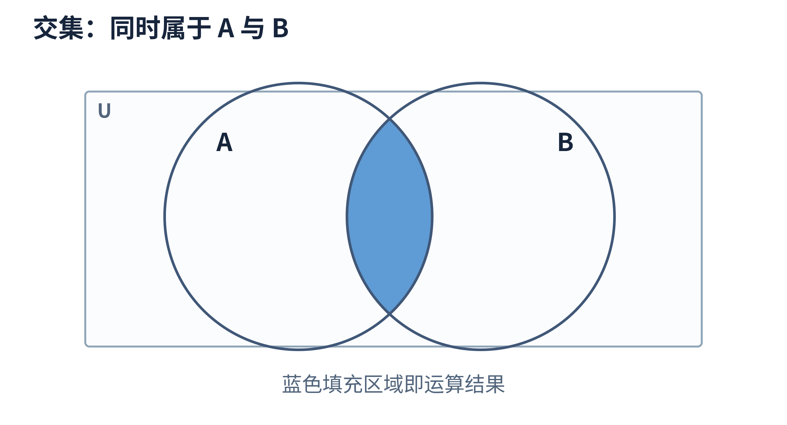

*图：仅公共区域被保留。*

**课件列出的交集性质：**

$$
A\cap B\subseteq A,\quad A\cap B\subseteq B.
$$

若 $A\subseteq B$，则交集对另一集合 $C$ 保持包含关系：

$$
A\cap C\subseteq B\cap C.
$$

证明：任取 $x\in A\cap C$，则 $x\in A$ 且 $x\in C$；由 $A\subseteq B$ 得 $x\in B$，于是 $x\in B\cap C$。

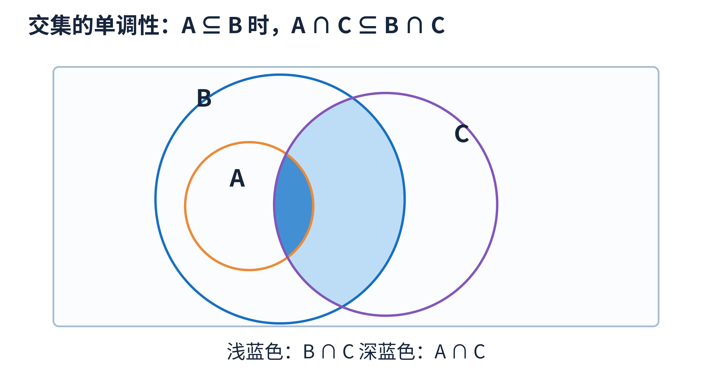

*图：从套叠文氏图直接看出交集单调性。*

#### 2.2.1 不相交与互不相交

两个集合**不相交（disjoint）**当且仅当交集为空：

$$
A\cap B=\varnothing
\iff \neg\exists x\,(x\in A\land x\in B).
$$

集合族 $A_1,A_2,\ldots,A_n$ **互不相交（两两不相交）**，要求对任意不同下标 $i\ne j$ 都有 $A_i\cap A_j=\varnothing$。这比仅知道 $A_1\cap\cdots\cap A_n=\varnothing$ 更强：后三个集合可能两两有公共区域，却没有三者共同的元素。

课件例子：对 $n=1,2,\ldots,10$，$A_n=(n-1,n)$。这些开区间互不相交。

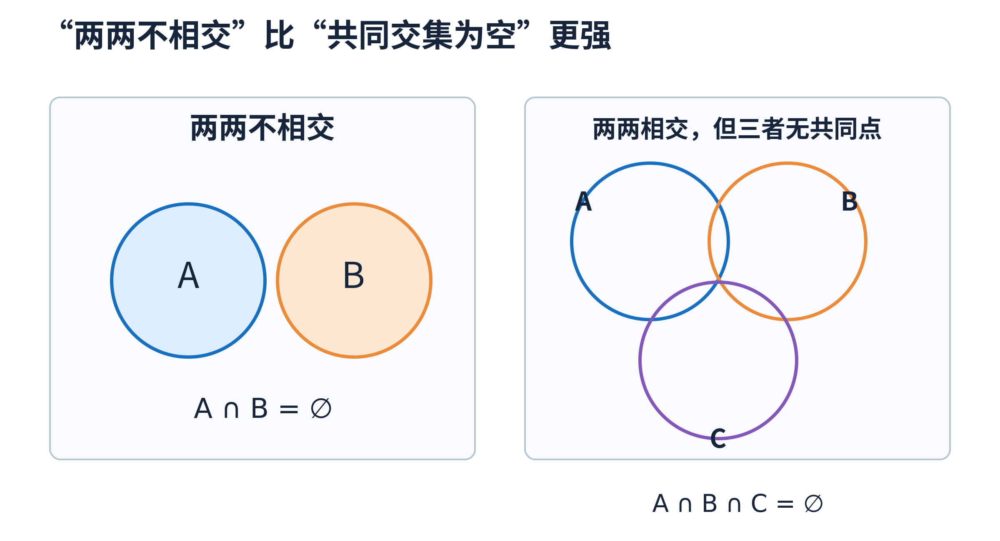

*图：比较两两不相交与三个集合交集为空的不同。*

### 2.3 多个集合的交集与无限交集

对有限集合族，

$$
\bigcap_{i=1}^{n}A_i
=A_1\cap A_2\cap\cdots\cap A_n
=\{x\mid\forall i\,(1\le i\le n\to x\in A_i)\}.
$$

对无限集合族，$x\in\bigcap_{n=1}^{\infty}A_n$ 的要求仍是**对每一个** $n$，都满足 $x\in A_n$；不是“对足够大的若干个 $n$”就够。

> [!example] 课件第 18 页：相邻的十个闭区间
> 令 $A_n=[n-1,n]$，$n=1,2,\ldots,10$。尽管相邻区间有端点重合，如 $A_1\cap A_2=\{1\}$，**不可能有一个数同时处于 $[0,1]$ 和 $[2,3]$**。因此
> 
> $$\bigcap_{n=1}^{10} A_n=\varnothing.$$

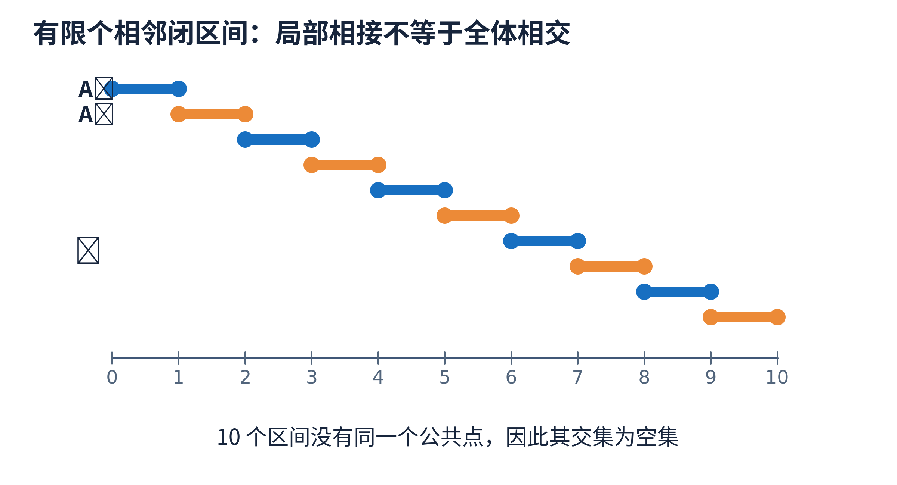

*图：相邻闭区间的十个集合整体交集为空的数轴过程。*

> [!example] 课件第 19 页：无限收缩的闭区间
> 令 $A_n=[0,1/n]$，$n\ge1$。数 $0$ 始终属于每个集合；而对任何 $x>0$，总可取正整数 $n>1/x$，使得 $1/n<x$，故 $x\notin A_n$。于是
> 
> $$\bigcap_{n=1}^{\infty}[0,1/n]=\{0\}.$$

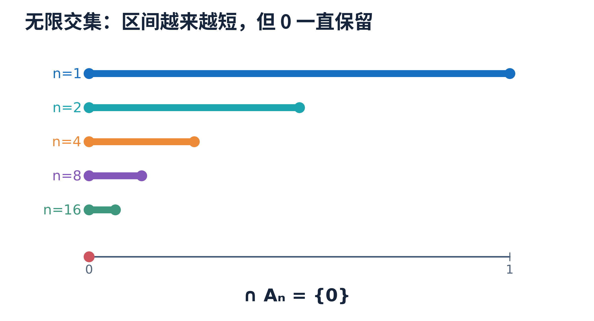

*图：无穷多个闭区间零点保留的嵌套过程。*

> [!warning] 无限交集的易错点
> “区间长度趋于零”不意味着交集必为空。关键看是否存在**永远保留的共同元素**；本题保留的是 $0$。

### 2.4 并集（union）：至少属于一个

**并集**包括属于 $A$ 或属于 $B$ 的全部元素，其中“或”是**可兼或**，既属于 $A$ 又属于 $B$ 的元素当然也算：

$$
A\cup B=\{x\mid x\in A\lor x\in B\},
$$

$$
x\in A\cup B\iff(x\in A)\lor(x\in B).
$$

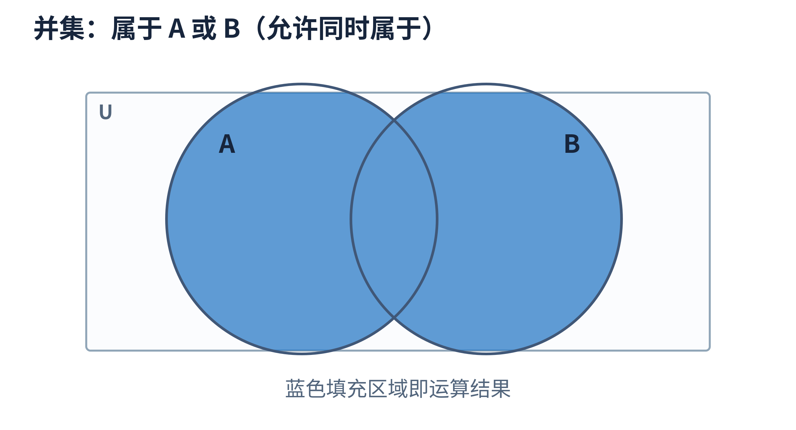

*图：两圆覆盖的全部区域。*

**课件列出的并集性质：**

$$
A\subseteq A\cup B,\qquad B\subseteq A\cup B.
$$

如果 $A\subseteq B$，则

$$
A\cup C\subseteq B\cup C.
$$

证明可按“元素属于并集意味着至少属于一个操作数”分两种情况论证。

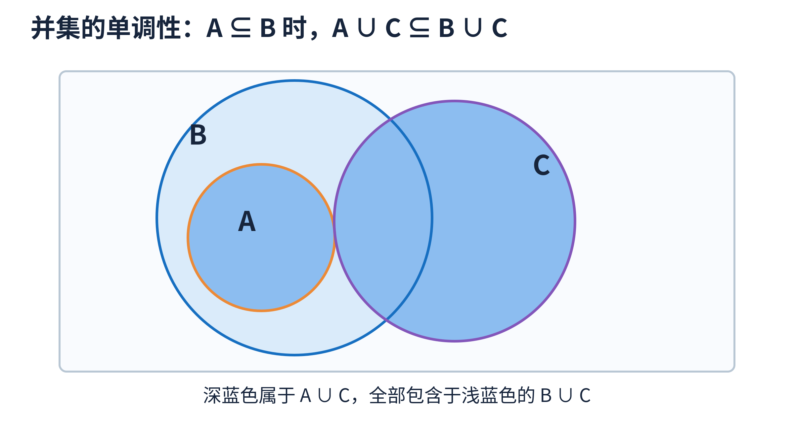

*图：从套叠文氏图直观理解并集单调性。*

### 2.5 多个集合的并集与无限并集

$$
\bigcup_{i=1}^{n}A_i
=\{x\mid\exists i\,(1\le i\le n\land x\in A_i)\}.
$$

这里的量词是 $\exists$：**只要至少在某个集合中出现一次就算**。无限并集 $\bigcup_{n=1}^{\infty}A_n$ 也是同样原则。

> [!example] 课件第 23 页：十个相邻闭区间
> $A_n=[n-1,n]$，$n=1,\dots,10$，十个区间首尾衔接，所以
> 
> $$\bigcup_{n=1}^{10}A_n=[0,10].$$

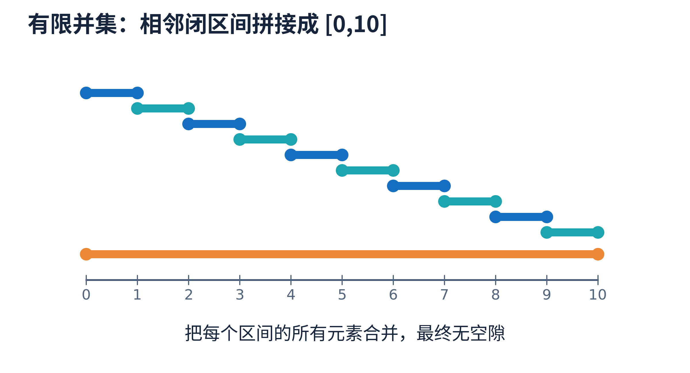

*图：十个相邻闭区间合并得到整个零到十区间。*

> [!example] 课件第 24 页：无限递减的闭区间
> $A_n=[0,1/n]$，$n\ge1$。因每个 $A_n$ 都包含于 $A_1=[0,1]$，而 $A_1$ 本身又已在并集中，故
> 
> $$\bigcup_{n=1}^{\infty}A_n=[0,1].$$

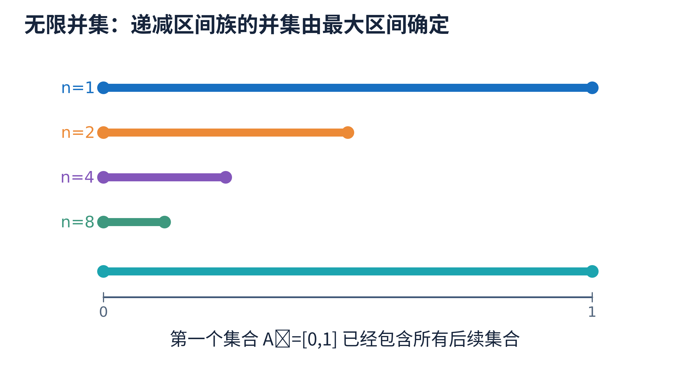

*图：递减闭区间族的并集为第一个区间。*

用同一组区间对比：

| 集合族 | 广义交（全都满足） | 广义并（至少一次满足） |
|---|---|---|
| $A_n=[0,1/n]$，$n\ge1$ | $\{0\}$ | $[0,1]$ |
| $A_n=[n-1,n]$，$1\le n\le10$ | $\varnothing$ | $[0,10]$ |

### 2.6 相对补集（set difference）：保留前者，排除后者

课件记作 $A-B$，也可写作 $A\setminus B$：

$$
A-B=\{x\mid x\in A\land x\notin B\}.
$$

它表示**属于 $A$ 而不属于 $B$**的元素。因此 $A-B$ 与 $B-A$ 一般不同，差运算不满足交换律。

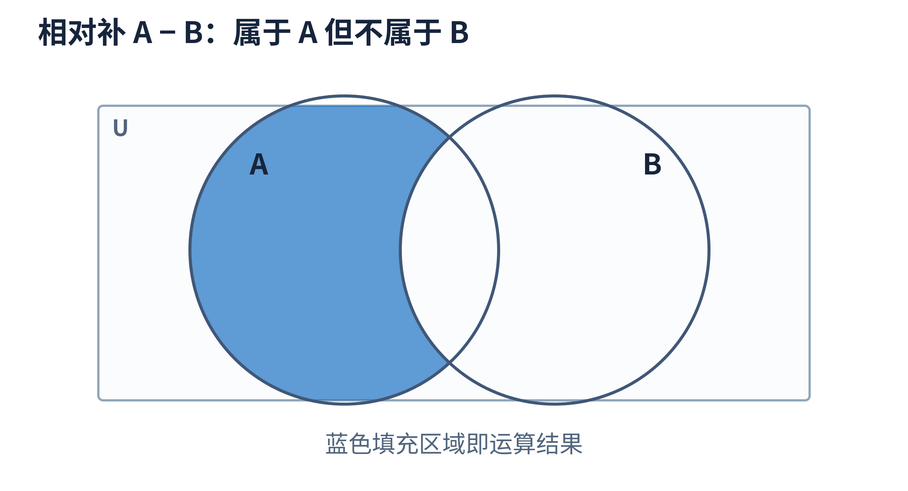

*图：只保留 A 的非重叠部分。*

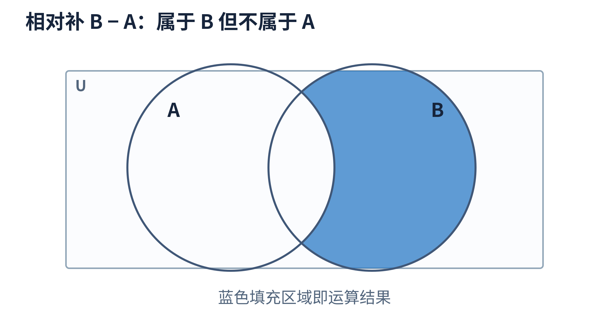

*图：只保留 B 的非重叠部分。*

> [!example] 课件第 27 页
> $A=\{0,2\}$，$B=\{1,2,3\}$。从 $A$ 排除 $B$ 中出现的 $2$，得到 $A-B=\{0\}$；反过来从 $B$ 排除 $A$ 中出现的 $2$，得到 $B-A=\{1,3\}$。

课件给出的关键性质：

$$
A-B\subseteq A,
$$

$$
A-B=\varnothing\iff A\subseteq B
\iff A\cup B=B
\iff A\cap B=A.
$$

证明第二式前半段：$A-B=\varnothing$ 表示不存在 $x\in A$ 且 $x\notin B$，即 $\forall x(x\in A\to x\in B)$，等价于 $A\subseteq B$。

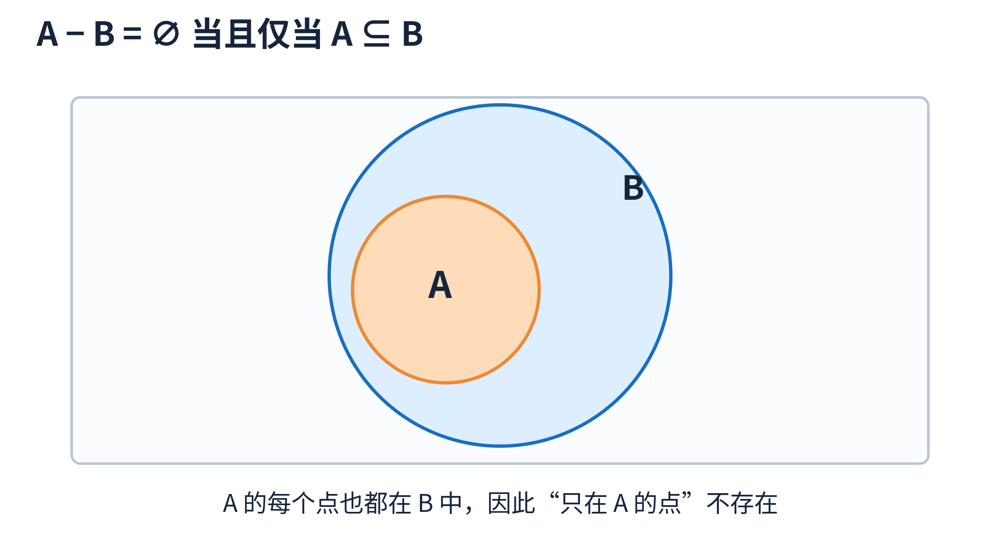

*图：包含关系与空差集的几何等价。*

### 2.7 绝对补集（complement）：相对全集取反

设本题全集为 $E$，且 $A\subseteq E$。课件使用 $\sim A$ 表示绝对补：

$$
\sim A=E-A=\{x\in E\mid x\notin A\}.
$$

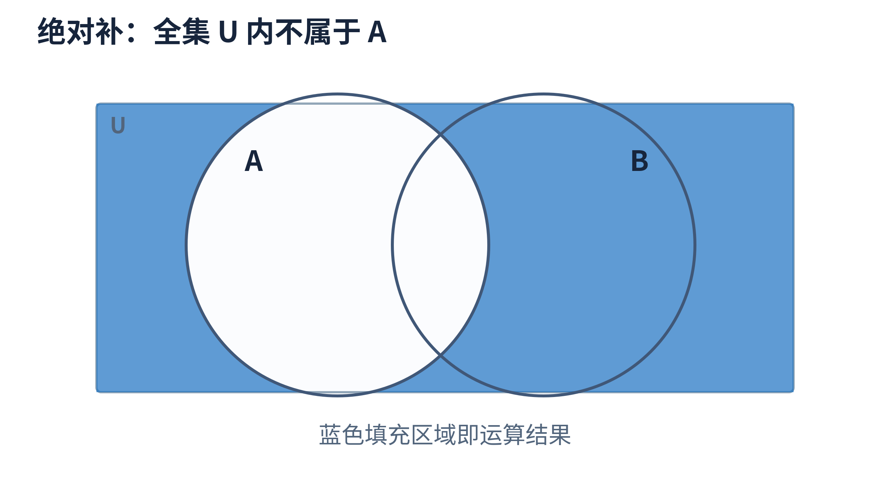

*图：全集中 A 以外的所有区域。*

> [!warning] 全集不同，补集就可能不同
> 例如 $A=\{1,2\}$，若全集是 $E=\{1,2,3\}$，则 $\sim A=\{3\}$；若改成 $E=\{1,2,3,4\}$，则 $\sim A=\{3,4\}$。没有指明全集时，不可随意给出绝对补的具体元素。

### 2.8 对称差（symmetric difference）：恰好属于一个

课件记 $A\oplus B$。一个元素出现在 $A,B$ **恰好一个**集合中，才属于对称差：

$$
A\oplus B
=\{x\mid (x\in A\land x\notin B)\lor(x\notin A\land x\in B)\}.
$$

两种等价表达：

$$
\boxed{A\oplus B=(A-B)\cup(B-A)}
$$

$$
\boxed{A\oplus B=(A\cup B)-(A\cap B)}.
$$

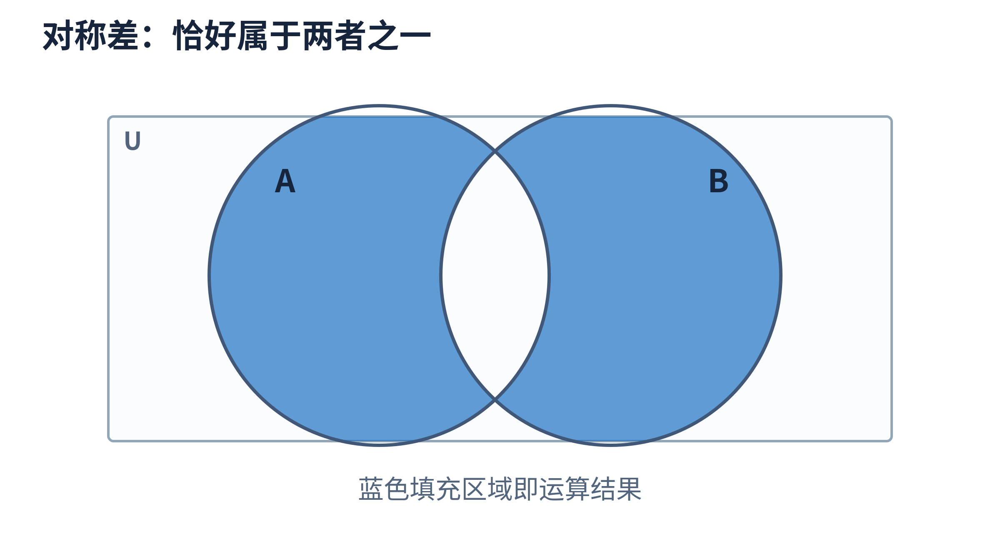

*图：去掉公共部分，留下两侧。*

> [!example] 课件第 30 页：区间的对称差
> 设 $A=[0,2)$，$B=[1,3)$。重叠部分为 $[1,2)$，把它排除后得到：
> 
> $$A-B=[0,1),\qquad B-A=[2,3),$$
> 
> $$\boxed{A\oplus B=[0,1)\cup[2,3).}$$
> 
> 特别留意 $1$ 被两个集合包含所以要去掉；$2$ 不属于 $A$、属于 $B$，因此要保留。

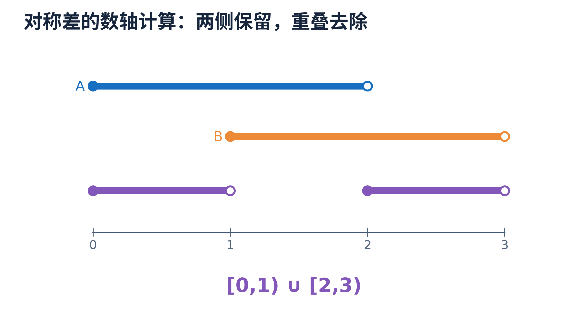

*图：区间对称差取不重合的两段并保留端点开闭。*

### 2.9 广义并与广义交：对集合族做一元运算

这里参与运算的对象是一个**由若干集合构成的集合**，可记为 $\mathcal A$。例如 $\mathcal A=\{\{1,2\},\{2,3\},\{2,4\}\}$。它的元素不是数字 $1,2,3,4$，而是三个小集合。

**广义并**把集合族中所有成员集合的元素收集起来：

$$
\bigcup\mathcal A
=\{x\mid\exists Z\,(Z\in\mathcal A\land x\in Z)\}.
$$

**广义交**要求集合族非空，找出每个成员集合都包含的共同元素：

$$
\bigcap\mathcal A
=\{x\mid\forall Z\,(Z\in\mathcal A\to x\in Z)\},\qquad\mathcal A\ne\varnothing.
$$

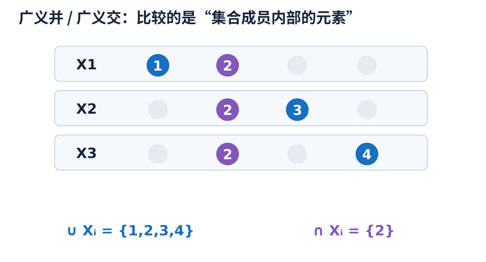

*图：三组集合逐列寻找至少一次与每次出现的元素。*

> [!important] 两类运算不要混淆
> $A\cup B$、$A\cap B$ 是针对两个集合的**二元运算**；$\bigcup\mathcal A$、$\bigcap\mathcal A$ 是针对一个集合族 $\mathcal A$ 的**一元运算**。当 $\mathcal A=\{A,B\}$ 时结果自然相同。

课件第 31～33 页的四个特殊例子：

| 集合族 | 运算 | 结果 | 理由 |
|---|---|---|---|
| $\{\varnothing,\{\varnothing\}\}$ | 广义并 | $\{\varnothing\}$ | 第二个成员集合含有一个元素 $\varnothing$ |
| $\{\varnothing,\{\varnothing\}\}$ | 广义交 | $\varnothing$ | 有一个成员集合是空集 |
| $\{\varnothing,A\}$ | 广义并 | $A$ | 空集不贡献新元素 |
| $\{\varnothing,A\}$ | 广义交 | $\varnothing$ | 空集里没有共同元素 |

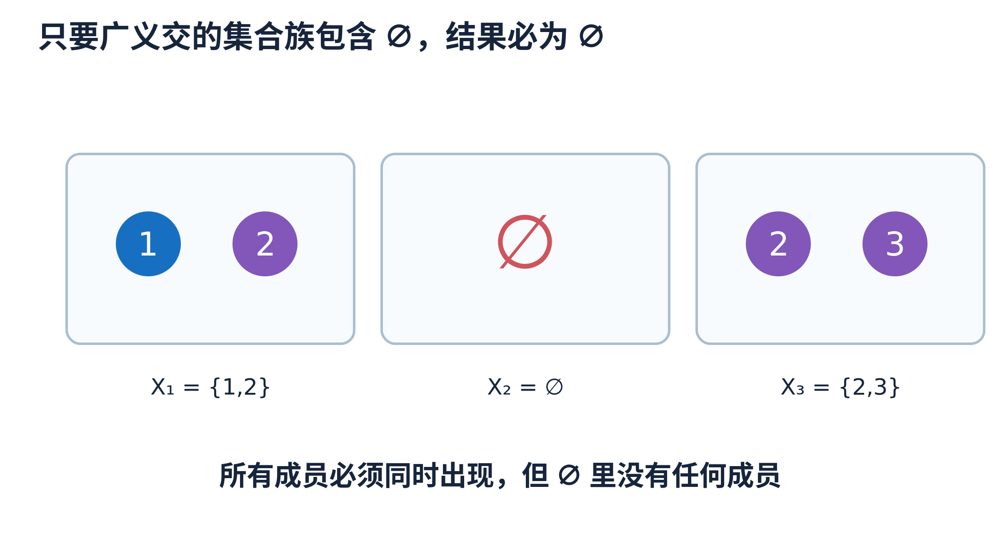

*图：广义交中出现空集立即使总交集为空。*

> [!warning] 空集合族与含空集的集合族不是同一对象
> 本课件规定 $\bigcup\varnothing=\varnothing$，而 $\bigcap\varnothing$ **不定义**。这与 $\bigcap\{\varnothing,A\}=\varnothing$ 完全不同：后者集合族**非空**，其中一个成员才是空集。某些其他数学体系会在固定全集下约定空族交集为全集，但**不是本课件采用的规定**。

### 2.10 运算优先级与括号

课件第 34～35 页区分四层：

1. 集合一元运算 $\sim A,\ \mathcal P(A),\ \bigcup\mathcal A,\ \bigcap\mathcal A$；
2. 集合二元运算 $-,\ \cap,\ \cup,\ \oplus$；
3. 集合关系符号 $=,\subseteq,\subsetneq,\in$；
4. 命题逻辑的一元联结词 $\neg$、二元联结词 $\land,\lor,\to,\leftrightarrow$，以及更外层的逻辑关系符号 $\Rightarrow,\Leftrightarrow$。

**课件约定**同一层括号中相同优先级从左到右处理；实际解题建议**主动加括号**，不要把其他教材的优先级约定直接套用到本课件，特别是混合使用 $\cap,\cup,-$ 的场合。

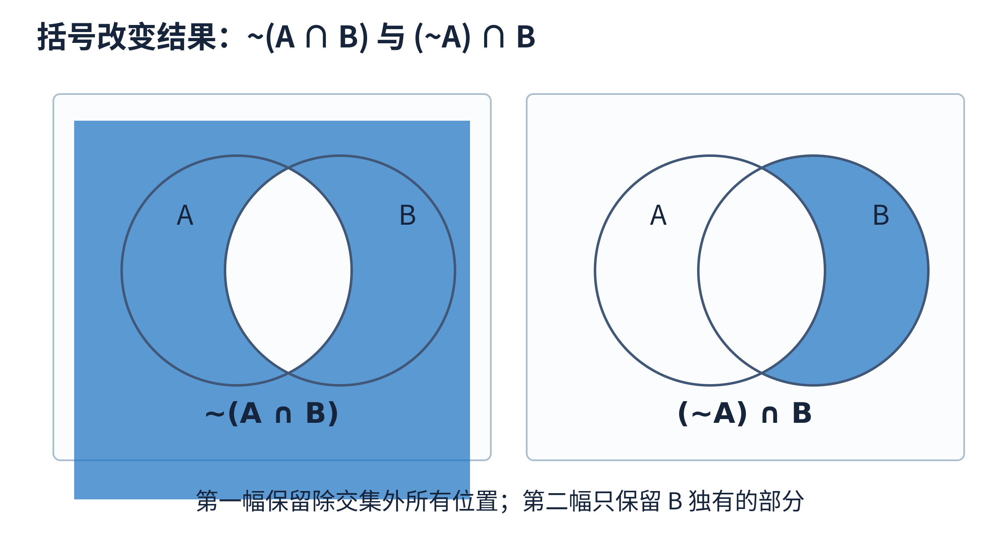

*图：一元补运算与括号的优先级导致不同区域。*

#### 2.10.1 集合运算与命题逻辑之间的对应

“某元素 $x$ 属于结果集合”可以转换成命题条件：

| 集合式 | 元素条件 | 对应逻辑 |
|---|---|---|
| $x\in A\cap B$ | $x\in A$ 且 $x\in B$ | $p\land q$ |
| $x\in A\cup B$ | $x\in A$ 或 $x\in B$ | $p\lor q$ |
| $x\in A-B$ | $x\in A$ 且 $x\notin B$ | $p\land\neg q$ |
| $x\in\sim A$ | $x\in E$ 且 $x\notin A$ | $\neg p$（限定于 $E$） |
| $x\in A\oplus B$ | 恰好一个条件为真 | 异或 |

作为理解性补充，利用德摩根律可直接推出：

$$
\sim(A\cup B)=(\sim A)\cap(\sim B),
\qquad
\sim(A\cap B)=(\sim A)\cup(\sim B).
$$

第一式的图形对应关系如下；这只是理解集合运算的直接联系，不是在本文件中展开课件未给出的“6.4 集合恒等式”整章。

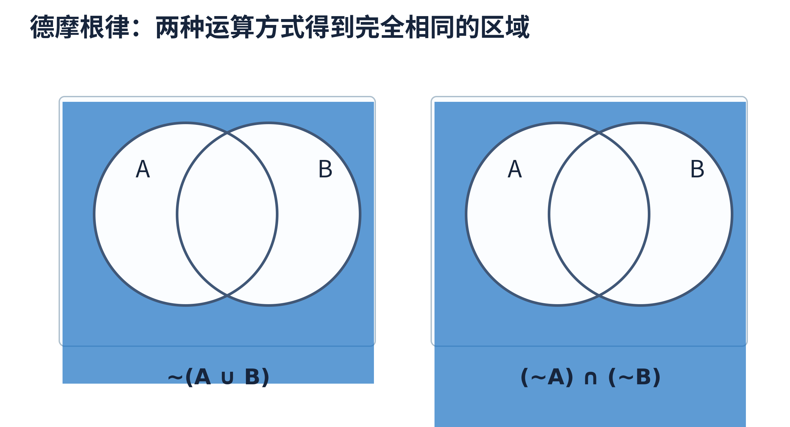

*图：通过区域重合直观证明并集补等于补集的交。*

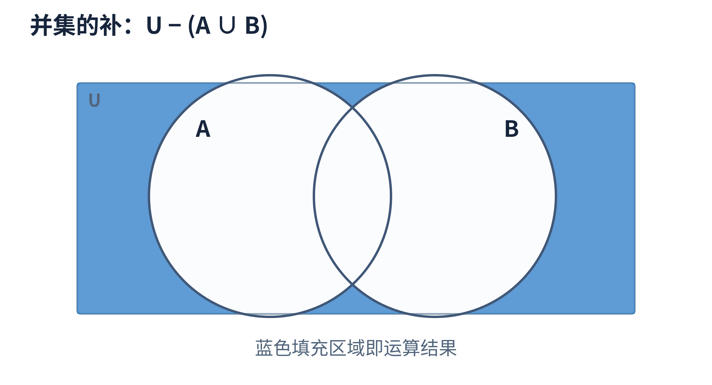

*图：仅两圆之外的区域被保留。*

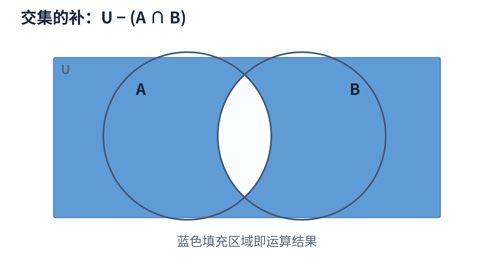

*图：所有区域中只有交叠部分不保留。*

---

## 三、6.3 有穷集的计数与容斥原理

### 3.1 为什么要用容斥原理

对有限全集 $S$ 和性质 $P_1,\ldots,P_m$，记 $A_i$ 为具有性质 $P_i$ 的对象集合。常见问题有两类：

- “**至少具有一个性质**”：求 $|A_1\cup\cdots\cup A_m|$；
- “**一个性质都没有**”：求 $|S|-|A_1\cup\cdots\cup A_m|$。

难点是**重叠区域会被重复计算**。例如直接把 $|A|$ 与 $|B|$ 相加，共同元素被计算两次，所以必须减掉 $|A\cap B|$ 一次。

$$
\boxed{|A\cup B|=|A|+|B|-|A\cap B|}.
$$

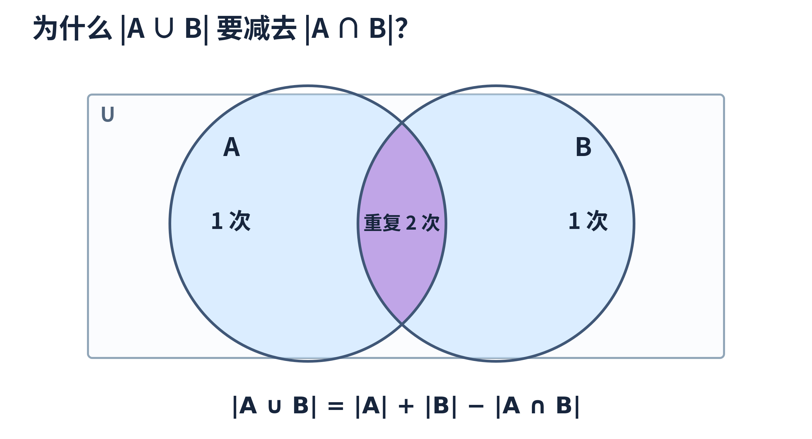

*图：两个集合中公共元素被加了两次所以减一次。*

### 3.2 三个集合的容斥公式

对 $A,B,C\subseteq S$，

$$
\boxed{\begin{aligned}
|A\cup B\cup C|={}&|A|+|B|+|C|\\
&-|A\cap B|-|A\cap C|-|B\cap C|\\
&+|A\cap B\cap C|.
\end{aligned}}
$$

把三个圆划分为互不重叠的七块区域。只在一个圆里的对象算一次；属于两圆的对象在“加单集、减交集”后算一次；三者都有的对象先被加 $3$ 次，再被减 $3$ 次，最后再加 $1$ 次，才恢复为计数 $1$ 次。

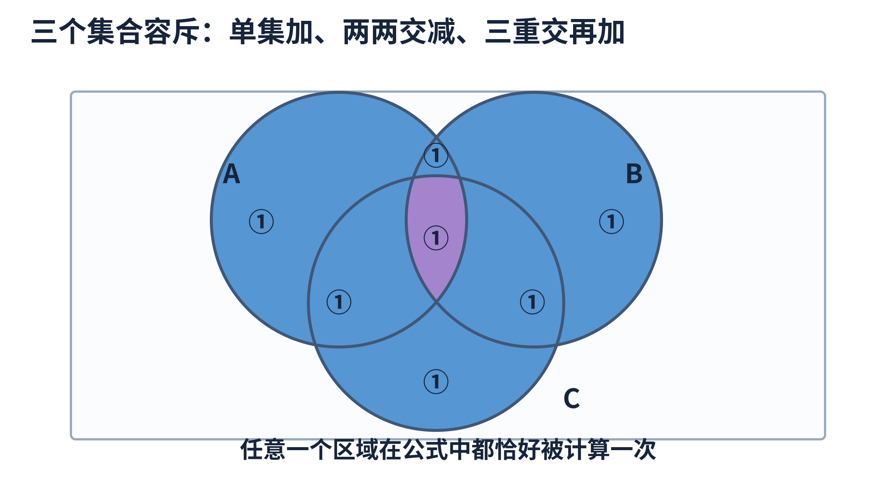

*图：三集合容斥的七个互斥区域。*

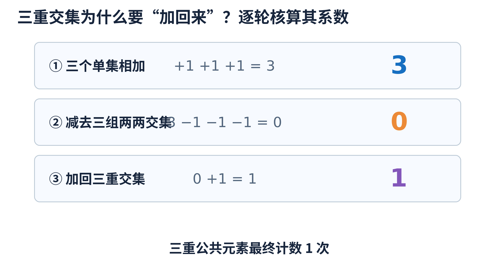

*图：三重交集从计数三次到零次再恢复一次的过程。*

#### 3.2.1 按课件第 42 页的推导过程

先把 $A\cup B$ 当作一个集合，应用二集合公式：

$$
\begin{aligned}
|A\cup B\cup C|
&=|(A\cup B)\cup C|\\
&=|A\cup B|+|C|-|(A\cup B)\cap C|.
\end{aligned}
$$

使用分配关系 $(A\cup B)\cap C=(A\cap C)\cup(B\cap C)$，对右端两个并集分别应用二集合公式：

$$
\begin{aligned}
|A\cup B\cup C|
={}&|A|+|B|-|A\cap B|+|C|\\
&-\big[|A\cap C|+|B\cap C|\\
&\quad-|A\cap B\cap C|\big].
\end{aligned}
$$

展开括号便得到三集合容斥公式。这个推导比机械背诵正负号更有利于解复杂题。

### 3.3 多个集合的一般容斥原理

对 $m$ 个集合，按交集所涉及的集合个数，符号依次是“**加单项，减两项交，加三项交，……**”。公式写为：

$$
\left|\bigcup_{i=1}^{m}A_i\right|
=\sum_{\varnothing\ne I\subseteq\{1,\ldots,m\}}
(-1)^{|I|+1}\left|\bigcap_{i\in I}A_i\right|.
$$

于是一个性质也不具备的人数（对象数）为：

$$
\boxed{\left|S\setminus\bigcup_{i=1}^{m}A_i\right|
=|S|-\left|\bigcup_{i=1}^{m}A_i\right|.}
$$

这正是课件第 40～41 页的定理 6.2 与其推论的核心意义。

> [!tip] 容斥解题顺序
> **先选全集 → 根据性质定义集合 → 分别算单集、两两交集、三重交集 → 套容斥 → 判断题目求“至少一个”还是“一个也没有” → 核对结果不超过全集。**

### 3.4 课件例 2：1～1000 中不被 5、6、8 任一个整除的整数

令 $S=\{1,2,\ldots,1000\}$；$A,B,C$ 分别是其中能被 $5,6,8$ 整除的整数集合。

**第一步：单个集合的基数**。$1$ 到 $N$ 中能被 $d$ 整除的正整数个数为 $\lfloor N/d\rfloor$。

$$
|A|=\left\lfloor\frac{1000}{5}\right\rfloor=200,
\quad |B|=\left\lfloor\frac{1000}{6}\right\rfloor=166,
\quad |C|=\left\lfloor\frac{1000}{8}\right\rfloor=125.
$$

**第二步：交集意味着同时整除，即被最小公倍数整除。**

$$
\begin{aligned}
|A\cap B|&=\left\lfloor\frac{1000}{\operatorname{lcm}(5,6)}\right\rfloor
=\left\lfloor\frac{1000}{30}\right\rfloor=33,\\
|A\cap C|&=\left\lfloor\frac{1000}{40}\right\rfloor=25,\\
|B\cap C|&=\left\lfloor\frac{1000}{24}\right\rfloor=41,\\
|A\cap B\cap C|&=\left\lfloor\frac{1000}{120}\right\rfloor=8.
\end{aligned}
$$

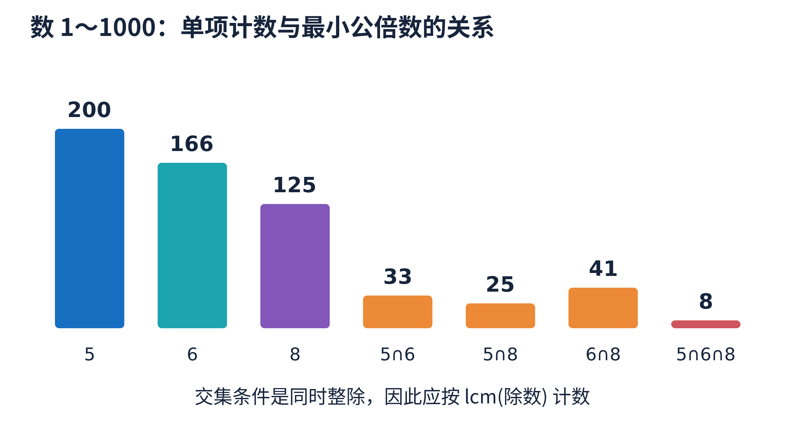

*图：单个倍数与成对成组三重倍数计数直方图。*

**第三步：计算至少能被一项整除的个数。**

$$
\begin{aligned}
|A\cup B\cup C|
&=200+166+125-33-25-41+8\\
&=400.
\end{aligned}
$$

**第四步：求三个条件全部不满足的个数。**

$$
\boxed{1000-400=600.}
$$

若想验证每个阴影小区域的人数，可先求三重交 $8$，再求仅双重交：

$$
\begin{aligned}
|A\cap B\setminus C|&=33-8=25,\\
|A\cap C\setminus B|&=25-8=17,\\
|B\cap C\setminus A|&=41-8=33.
\end{aligned}
$$

再算只满足一个条件：$A$ 独有 $150$，$B$ 独有 $100$，$C$ 独有 $67$。七个互斥区域合计

$$
150+100+67+25+17+33+8=400.
$$

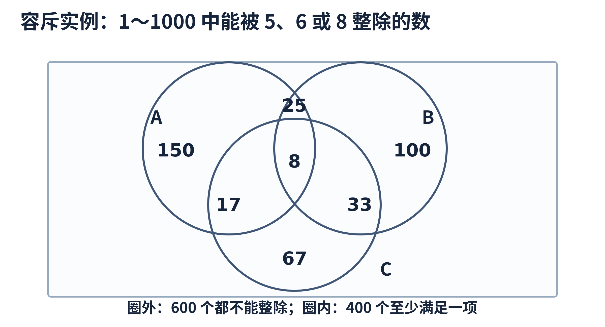

*图：被五六八整除的人数七个互斥区值及圈外六百。*

> [!warning] 两种“交集人数”不能混淆
> $|A\cap B|=33$ **包含**三重交的 $8$ 个；图中“只属于 $A$ 与 $B$，不属于 $C$”的区域则为 $33-8=25$。画图时必须明确“交集总人数”还是“仅该区域人数”。

### 3.5 课件例 3：1～10000 中既非完全平方数，也非完全立方数

设 $E=\{1,\ldots,10000\}$；$A$ 为完全平方数集合，$B$ 为完全立方数集合。

- 因 $100^2=10000$，有 $|A|=100$。
- 因 $21^3=9261\le10000<22^3$，有 $|B|=21$。
- 同时是平方又是立方的正整数，恰好是**六次方数**。满足 $k^6\le10000$ 的正整数 $k$ 为 $1,2,3,4$，故 $|A\cap B|=4$。

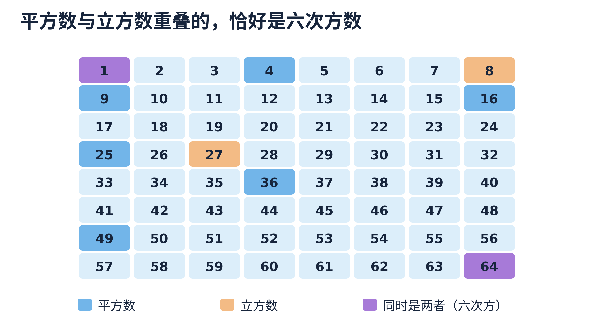

*图：一至六十四数字格的平方数立方数与六次方交叠。*

应用容斥：

$$
\begin{aligned}
|E\setminus(A\cup B)|
&=10000-(100+21-4)\\
&=\boxed{9883}.
\end{aligned}
$$

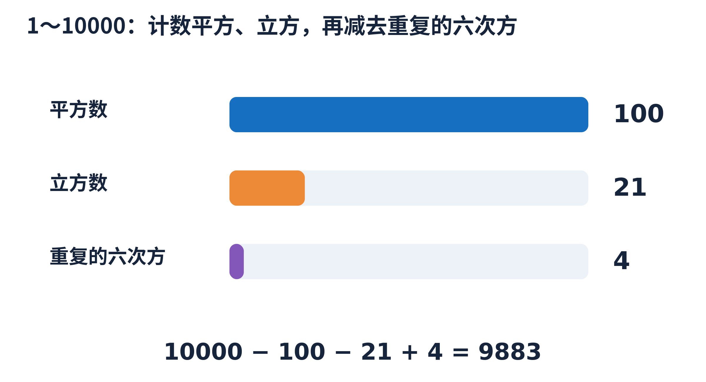

*图：平方数立方数六次方数数量对比及最终容斥。*

> [!tip] 识别两个幂的共同元素
> 同时为 $k$ 次方与 $\ell$ 次方的正整数，其指数与 $\operatorname{lcm}(k,\ell)$ 相关。本题 $\operatorname{lcm}(2,3)=6$，所以重复部分是六次方数。

### 3.6 课件例 1：24 名科技人员的四种外语调查

**根据课件第 38、46～47 页，重新统一符号。**设 $A$、$J$、$G$、$F$ 分别表示掌握英语、日语、德语、法语的人。已知：

$$
|A|=13,\quad |J|=5,\quad |G|=10,\quad |F|=9,
$$

$$
|A\cap J|=2,
\quad |A\cap G|=|A\cap F|=|G\cap F|=4,
$$

而 $J\cap G=J\cap F=\varnothing$，共调查 24 名会所述外语的科技人员。

**第一步：只会日语。**由于日语与德语、法语不重叠，且其中 $2$ 人会英语：

$$
|J\setminus A|=5-2=3.
$$

**第二步：把只会日语的 $3$ 人暂时排除，再对英、德、法做三集合容斥。**设 $x=|A\cap G\cap F|$，则

$$
24-3=13+10+9-4-4-4+x,
$$

$$
21=20+x\implies\boxed{x=1}.
$$

**第三步：计算只会各一种语言的人数。**三个英德、英法、德法的“仅两种”区域各为 $4-1=3$；另外英日交有 $2$ 人。

$$
\begin{aligned}
\text{只会英语}&=13-2-3-3-1=\boxed{4},\\
\text{只会德语}&=10-3-3-1=\boxed{3},\\
\text{只会法语}&=9-3-3-1=\boxed{2},\\
\text{只会日语}&=5-2=\boxed{3}.
\end{aligned}
$$

只会一种语言总计 $4+3+2+3=\boxed{12}$ 人，同时会英、德、法三种语言为 $\boxed{1}$ 人。

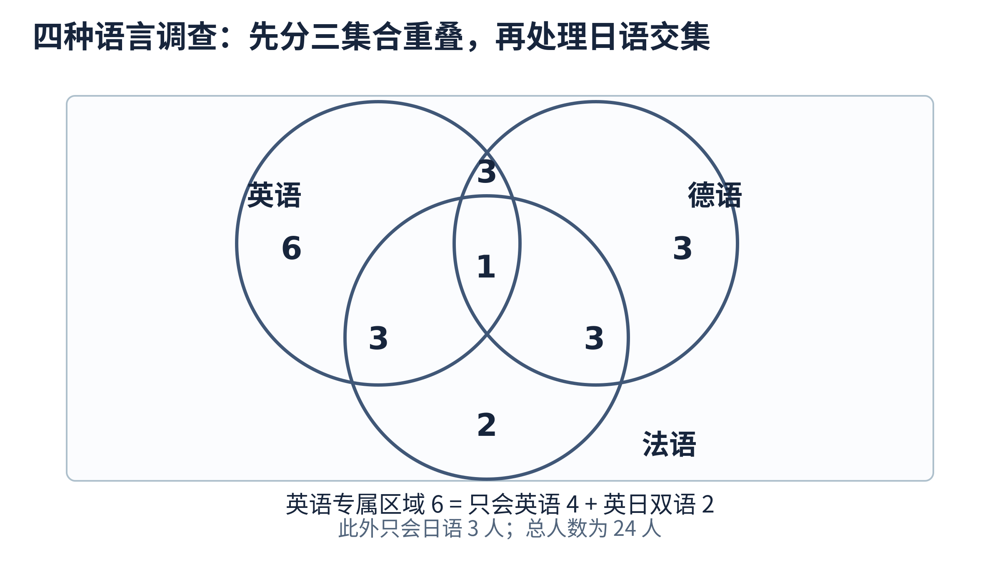

*图：英语德语法语的七个互斥人数与额外的日语人数。*

**复核总人数：**只会一种 $12$ 人；恰好会两种为英日 $2$ 人加上三组英德法双语各 $3$ 人，共 $11$ 人；恰好会三种 $1$ 人。$12+11+1=24$，与题设吻合。

### 3.7 课件例 4：欧拉函数 $\varphi(n)$

对正整数 $n$，欧拉函数 $\varphi(n)$ 表示 $1,2,\ldots,n$ 中与 $n$ **互素**的正整数个数；对 $n>1$，这等同于“小于 $n$ 且与 $n$ 互素”的正整数个数。

设 $n$ 的不同素因子为 $p_1,p_2,\ldots,p_k$：

$$
n=p_1^{\alpha_1}p_2^{\alpha_2}\cdots p_k^{\alpha_k}.
$$

**第一步：确定全集与需要排除的集合。**取 $S=\{1,2,\ldots,n\}$，对每个 $p_i$ 定义

$$
A_i=\{x\in S\mid p_i\mid x\}.
$$

一个正整数与 $n$ 不互素，当且仅当它被 $n$ 的某个素因子整除。因此 $\varphi(n)=|S\setminus\bigcup_{i=1}^k A_i|$。

**第二步：计数倍数集合及其交集。**因为各 $p_i$ 是互不相同的素数，

$$
|A_i|=\frac{n}{p_i},\qquad
|A_i\cap A_j|=\frac{n}{p_i p_j},\qquad
\left|\bigcap_{i\in I}A_i\right|=\frac{n}{\prod_{i\in I}p_i}.
$$

**第三步：利用容斥整理为乘积公式。**

$$
\boxed{\varphi(n)=n\prod_{i=1}^{k}\left(1-\frac1{p_i}\right).}
$$

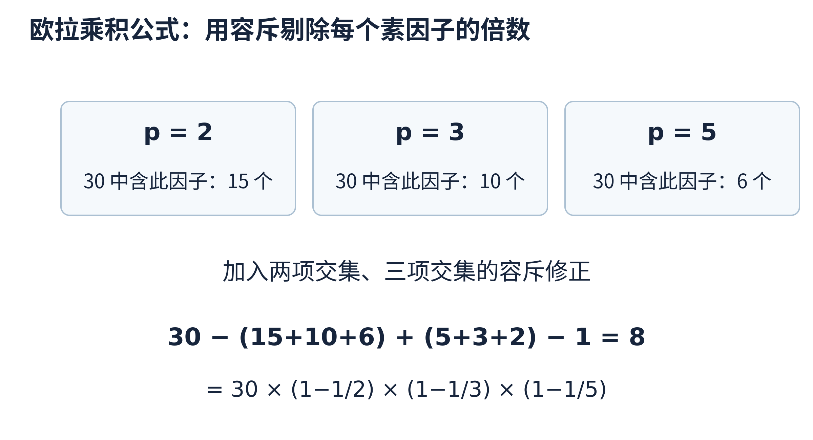

*图：欧拉函数求值中的每个素因子倍数和交集计数。*

> [!example] 以 $n=30$ 为例
> $30=2\cdot3\cdot5$，筛掉 $2$、$3$ 或 $5$ 的倍数，剩下与 $30$ 互素的整数是 $\{1,7,11,13,17,19,23,29\}$。
> 
> $$\varphi(30)=30\left(1-\frac12\right)\left(1-\frac13\right)\left(1-\frac15\right)=\boxed{8}.$$

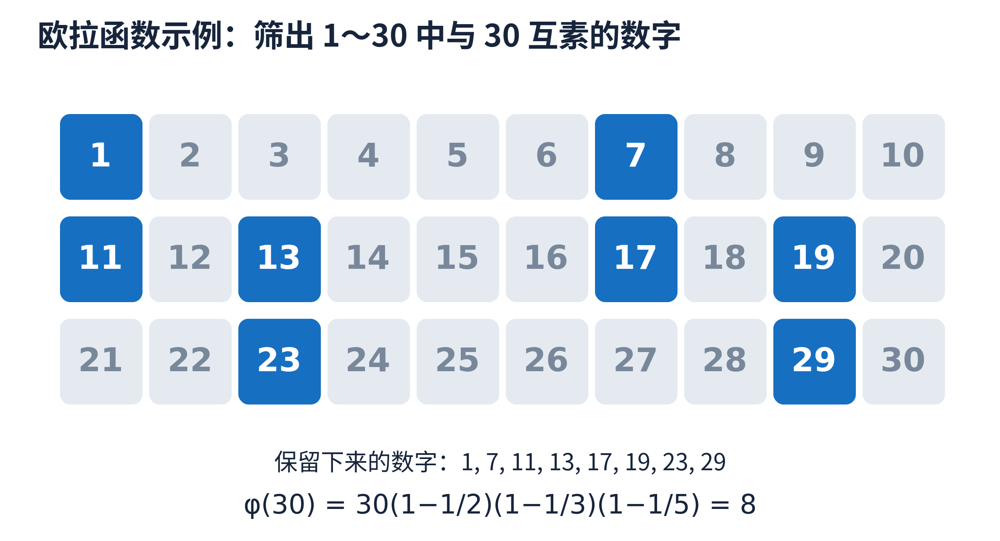

*图：在一到三十的格子中筛去含二三五因子的数。*

> [!warning] 课件第 48 页集合区间的印刷问题
> 原页把 $A_i$ 的范围排成了 $0\le x<n-1$，但后续却使用 $|A_i|=n/p_i$ 和 $\varphi(n)$ 的标准乘积公式。若真的按 $0\le x<n-1$ 计数，一般不能得到那些等式。因此这里**明确校订为** $S=\{1,\ldots,n\}$；这能与后续计数严格一致。

### 3.8 课件例 6.7：错排问题

有 $n$ 个人与编号为 $1,\ldots,n$ 的帽子，每人最后得到恰好一顶帽子。所有领取方式对应 $n$ 个元素的全排列，共 $n!$ 种。若**没有任何人拿到自己的帽子**，称为一个**错排（derangement）**，错排总数记为 $D_n$。

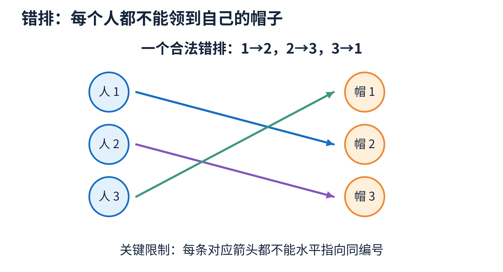

*图：三人对应三顶不同编号帽子的有效错排映射。*

取全集 $S$ 为全部 $n!$ 个排列；记 $A_i$ 为“**第 $i$ 位恰好放了原来的第 $i$ 个元素**”的排列集合。求错排数就是求 $S$ 中**不属于任何 $A_i$**的元素个数。

固定第 $i$ 位，其他 $n-1$ 位可任意排列：

$$
|A_i|=(n-1)!.
$$

同时固定任意 $k$ 个指定位置，其余 $n-k$ 个位置自由排列：

$$
\left|A_{i_1}\cap\cdots\cap A_{i_k}\right|=(n-k)!.
$$

而从 $n$ 个位置选择哪些 $k$ 个固定，共有 $\binom nk$ 种选择。用容斥：

$$
\begin{aligned}
D_n
&=\sum_{k=0}^{n}(-1)^k\binom nk(n-k)!\\
&=n!\sum_{k=0}^{n}\frac{(-1)^k}{k!}.
\end{aligned}
$$

得到课件的最终公式：

$$
\boxed{D_n=n!\left(1-\frac1{1!}+\frac1{2!}-\frac1{3!}+\cdots+\frac{(-1)^n}{n!}\right).}
$$

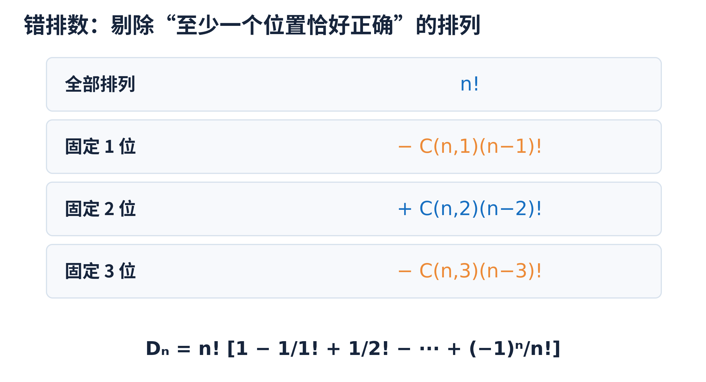

*图：错排数按固定位置的容斥计算形成阶乘交替和。*

> [!example] 验证 $n=3$
> 总共有 $3!=6$ 个排列，真正没有固定点的只有 $(2,3,1)$ 和 $(3,1,2)$，因此 $D_3=2$。代入公式：$D_3=6(1-1+1/2-1/6)=2$，一致。

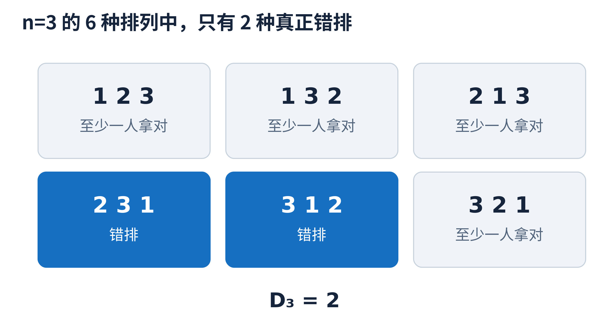

*图：枚举三元素的六个排列并标出两种错排。*

较小的错排数依次为：

| $n$ | 1 | 2 | 3 | 4 | 5 | 6 |
|---|---:|---:|---:|---:|---:|---:|
| $D_n$ | 0 | 1 | 2 | 9 | 44 | 265 |

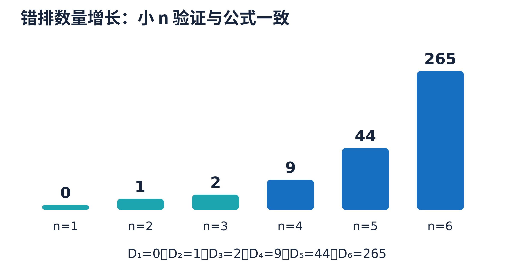

*图：一到六元错排数量的增长及小规模核查。*

### 3.9 课件布置的作业

课件第 49 页只给出题号：**P96 第 9、12、18 题**。本次未附教材第 96 页原题，因此不凭题号推测内容或编造题面。

---

## 四、方法整合：看到题目该怎么处理

### 4.1 按关键词选择运算

| 题目语义 | 选择 | 最关键的元素判据 |
|---|---|---|
| 同时属于、共同满足 | $A\cap B$ | $p\land q$ |
| 至少属于其中一个 | $A\cup B$ | $p\lor q$ |
| 在 $A$ 中但不在 $B$ 中 | $A-B$ | $p\land\neg q$ |
| 在全集中但不在 $A$ 中 | $\sim A$ | $\neg p$ |
| 恰好属于 $A,B$ 中一个 | $A\oplus B$ | $(p\land\neg q)\lor(\neg p\land q)$ |
| 所有集合里都存在 | $\bigcap\mathcal A$ | $\forall Z\in\mathcal A$ |
| 在某一个集合里出现 | $\bigcup\mathcal A$ | $\exists Z\in\mathcal A$ |
| 至少具备一项性质的个数 | 容斥计算并集 | 加单集、减双交、加三交… |
| 所有性质都没有的个数 | 全集减并集 | $|S|-|\bigcup A_i|$ |

### 4.2 一步步证明两个集合相等

以对称差的等价表达为例：任取 $x$，有

$$
\begin{aligned}
x\in (A-B)\cup(B-A)
&\iff (x\in A\land x\notin B)\\
&\qquad\lor(x\in B\land x\notin A)\\
&\iff x\in A\oplus B.
\end{aligned}
$$

对任意 $x$ 都成立，于是两集合相等。这种方法称为**元素法**或成员等价法。对于复杂集合式，优先将 $x\in\text{结果}$ 写成逻辑条件，再逐步化简。

### 4.3 计算问题先检查是否存在重叠

- **互不相交**时：$|A\cup B|=|A|+|B|$。
- **有重叠**时：必须避免把相同元素重复计数，选用容斥。
- **整除类**：交集依赖最小公倍数 $\operatorname{lcm}$。
- **完全幂类**：先识别重复部分的指数，如平方与立方的交是六次方。
- **性质筛选类**：先找出“违反条件”的集合，求“都不违反”就是全集减并集。
- **排列限制类**：把“位置 $i$ 固定”看成一个坏事件，再用容斥去掉所有坏事件。

### 4.4 四组高频易错辨析

> [!warning] 易错辨析
> **① “或”不是“恰好一个”。** $A\cup B$ 包含共同部分，$A\oplus B$ 则明确排除共同部分。
>
> **② 空交集不意味着两两不相交。** 三个集合公共部分可能为空，但其中任意两个仍然有交集。
>
> **③ 广义交中的空集不等于空集合族。** $\bigcap\{A,\varnothing\}=\varnothing$，而 $\bigcap\varnothing$ 在本课件中不定义。
>
> **④ $|A\cap B|$ 不等于文氏图中“仅 A、B 重叠且不在 C 中”的小区域。** 前者还包含三重交集。

## 五、快速自测（答案放在题后）

1. 设 $A=\{1,2,3\}$、$B=\{3,4\}$。求 $A\cap B$、$A\cup B$、$A-B$、$A\oplus B$。
2. 若 $A\subseteq B$，则 $A-B$ 为何？反过来是否成立？
3. 设 $\mathcal A=\{\{1,2\},\{2,3\},\varnothing\}$，求 $\bigcup\mathcal A$ 与 $\bigcap\mathcal A$。
4. 设 $A_n=[0,1/n]$，$n\ge1$，分别求 $\bigcap_{n=1}^{\infty}A_n$ 和 $\bigcup_{n=1}^{\infty}A_n$。
5. 一个班 50 人，会英语的 32 人，会法语的 23 人，两种都会的 12 人。问至少会一种、两种都不会的人数。
6. 1～200 中能被 4 或 6 整除的整数有多少个？都不能被它们整除的有多少个？

> [!example]- 自测题解答
> **1.** $A\cap B=\{3\}$；$A\cup B=\{1,2,3,4\}$；$A-B=\{1,2\}$；$A\oplus B=\{1,2,4\}$。
>
> **2.** $A-B=\varnothing$；反过来成立。因为不存在属于 $A$ 却不属于 $B$ 的元素，等价于 $A\subseteq B$。
>
> **3.** $\bigcup\mathcal A=\{1,2,3\}$；$\bigcap\mathcal A=\varnothing$，因为成员中含空集。
>
> **4.** 广义交为 $\{0\}$，广义并为 $[0,1]$。
>
> **5.** 至少会一种 $=32+23-12=43$ 人；两种都不会 $=50-43=7$ 人。
>
> **6.** $\lfloor200/4\rfloor=50$、$\lfloor200/6\rfloor=33$、$\lfloor200/\operatorname{lcm}(4,6)\rfloor=\lfloor200/12\rfloor=16$；至少被一种整除 $=50+33-16=67$，都不能整除 $=200-67=133$。

## 六、来源校核与修订说明

以下均根据**上传课件相应页的上下文**校核，不作为无来源的原文替换。

| 课件位置 | 观察到的问题 | 本笔记处理 |
|---|---|---|
| 第 16 页 | “互不相交”的式子出现下标 $A_i\cap B_j$；本段前文讨论 $A_1,\ldots,A_n$ | 按上下文统一写作 $A_i\cap A_j=\varnothing$（$i\ne j$） |
| 第 31 页 | 广义交的形式表达中结尾括号不完整 | 将括号补齐，保留原来的全称量词定义 |
| 第 38 页 | 四语言例题方程中出现 $y_1+y_2+y_2$ 等排版笔误 | 使用一致的变量和独立的计数步骤重新推导，并给出 $24$ 人总量复核 |
| 第 39 页 | 容斥例题展示了七块区域的结果，却先用了不直观的差集汇总式 | 同时列出标准容斥与互斥区域累加，结果均为 $600$ |
| 第 46 页 | 四语言例题的一句“有 2 人会说英语”不完整；与第 38、47 页不符 | 根据上下文明确为“有 2 人同时会英语和日语”，并标明校订依据 |
| 第 48 页 | 欧拉函数推导中 $0\le x<n-1$ 的取值范围不支持后续的 $n/p_i$ 计数 | 统一改用 $\{1,\ldots,n\}$，从而与课件最后的标准乘积公式一致 |
| 第 50～51 页 | 错排公式因 PDF 公式抽取而换行错乱 | 按课件计数思路重新完整排版并以 $n=3$ 的全部排列核验 |

> [!summary] 本讲最简知识主线
> **集合运算：**把成员资格写成逻辑条件；“所有”用交，“至少一个”用并，“不在”用补，“恰好一个”用对称差。
>
> **有穷计数：**把满足性质的对象建成集合；有重叠则用容斥；求全不满足则用全集减并集。整除题、完全幂题、外语人数题、欧拉函数与错排问题，都是同一个计数原则的不同应用。

#离散数学/集合论 #离散数学/容斥原理
