# 第 1.3 讲｜集合恒等式

> [!abstract] 本讲学习路线
> **先看区域 → 识别恒等式 → 掌握元素法与集合演算 → 理解对称差 → 解决计数与综合题。**
>
> 本笔记以《第 1.3 讲 集合恒等式》（46 页讲义）为主要依据，覆盖讲义的回顾、容斥原理、集合恒等式、证明方法、对称差与课堂练习。部分图示、例子、证明细节为辅助理解而补充。**文氏图的着色只负责直观解释，严格证明仍以定义和推导为准。**

## 1. 读图与前置知识

### 1.1 集合运算的基本语义

在指定全集 $E$ 中讨论 $A,B,C\subseteq E$。对任意 $x\in E$，各集合运算都可以翻译为关于“$x$ 是否属于某集合”的真假判断。

| 运算 | 写法 | 判定一个元素 $x$ 是否属于结果 | 逻辑形式 |
|---|---|---|---|
| 交集 | $A\cap B$ | 同时属于 $A,B$ | $p\land q$ |
| 并集 | $A\cup B$ | 至少属于 $A,B$ 之一 | $p\lor q$ |
| 相对补 | $A-B$ | 属于 $A$，但不属于 $B$ | $p\land\neg q$ |
| 绝对补 | $\sim A=E-A$ | 在 $E$ 中但不属于 $A$ | $\neg p$ |
| 对称差 | $A\oplus B$ | 恰好属于两者之一 | $p\oplus q$ |

这里 $p$ 表示“$x\in A$”，$q$ 表示“$x\in B$”。课件用 $\sim A$ 表示补集，本笔记沿用该记号。也可以用 $A^c$ 表示（需约定全集）。

**图 1｜交与并：元素所属条件不同**

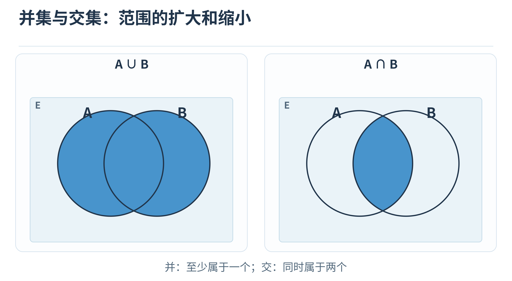

**图 2｜相对补与对称差：一个有方向，一个无方向**

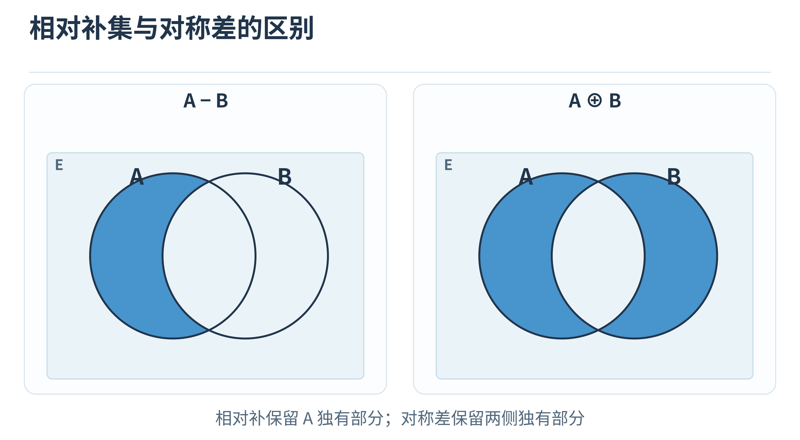

**图 3｜补集依赖全集 E；阴影区域表示结果集合**

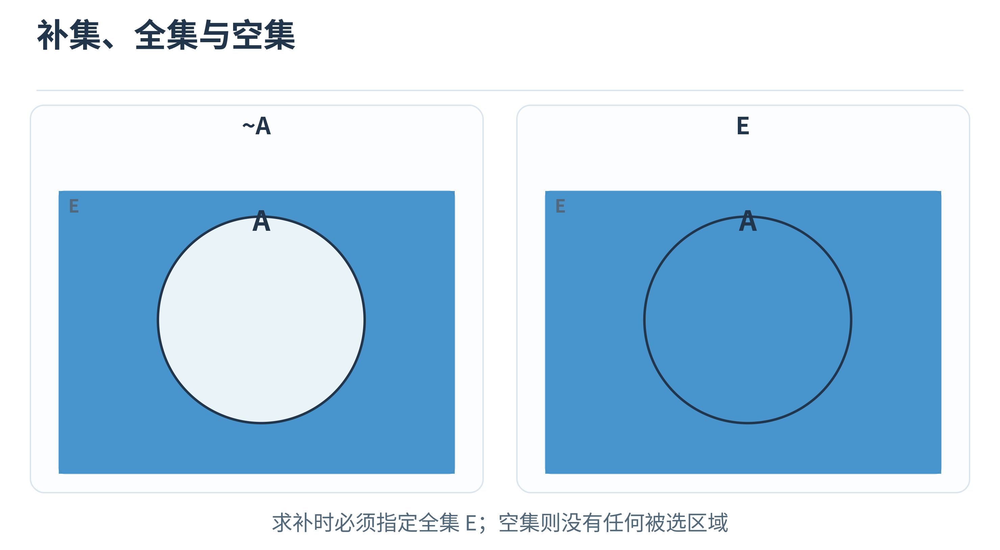

> [!warning] 两个常见误读
> - $A\cup B$ 中的“或”是**相容或**：同时属于 $A,B$ 的元素也在并集中。
> - $A-B$ 与 $B-A$ 通常不同，不能交换；但 $A\oplus B=B\oplus A$。

### 1.2 文氏图为何能辅助证明恒等式？

对于三个集合，每个元素对 $A,B,C$ 都有“属于／不属于”两种选择，所以恰好有 $2^3=8$ 种成员状态，构成互不相交的八个基本区域。任一集合表达式，都等于这些基本区域中的若干块之并。

证明两个集合表达式相等，可以比较它们**在每一种成员状态下是否同时包含该元素**。若八块区域逐块一致，表达式就相等；若有一块不同，就能用该状态构造反例。

**图 4｜三集合的八种成员状态；编号按 A、B、C 的二进制权值编排**

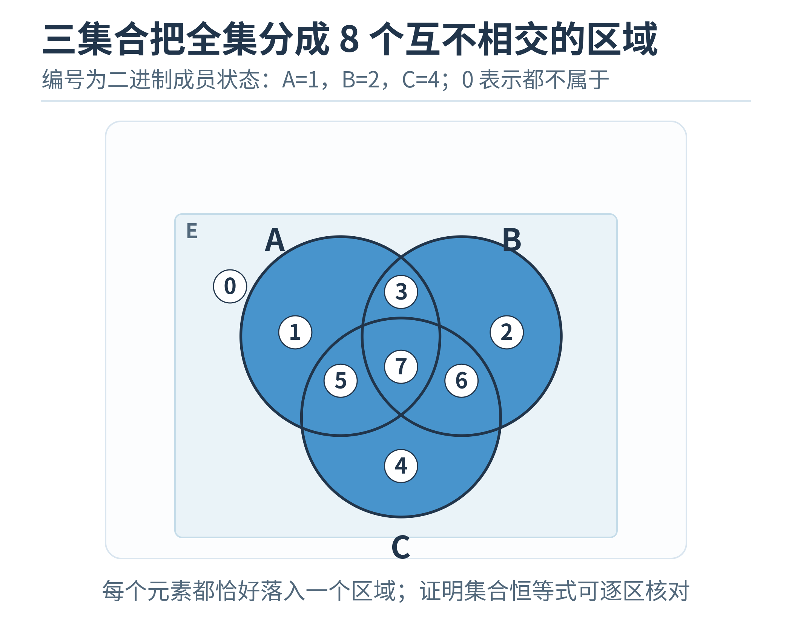

例如图中编号 $5=1+4$ 的区域表示 $x\in A,\ x\notin B,\ x\in C$，即 $A\cap\sim B\cap C$；编号 $7$ 表示 $A\cap B\cap C$；编号 $0$ 表示三个集合都不属于。

### 1.3 相关的包含关系与广义运算

基本性质为：

$$
A\cap B\subseteq A,\quad A\cap B\subseteq B,\quad A\subseteq A\cup B,\quad B\subseteq A\cup B.
$$

若 $A\subseteq B$，则对任意 $C$，有 $A\cap C\subseteq B\cap C$、$A\cup C\subseteq B\cup C$（交与并对包含关系均有单调性）。并且 $A-B\subseteq A$。

设 $\mathcal F$ 是**集合构成的集合**，则广义并与广义交分别为

$$
\bigcup\mathcal F=\{x:\exists X\in\mathcal F,\ x\in X\},\qquad
\bigcap\mathcal F=\{x:\forall X\in\mathcal F,\ x\in X\}.
$$

按本讲的约定，$\bigcup\varnothing=\varnothing$；$\bigcap\varnothing$ **不定义**（如引入固定全集，有的教材另约定它等于全集，不应混为同一约定）。

**图 5｜有限集合族的广义并与广义交：存在 / 全称的区别**

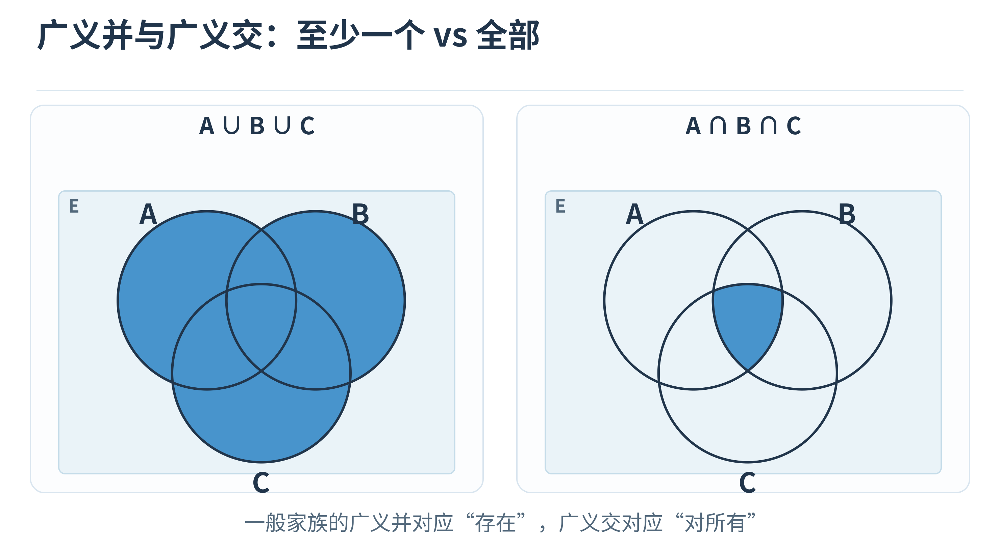

> [!tip] 运算优先级
> 课件列出“一元集合运算 → 二元集合运算 → 集合关系 → 逻辑联结词 → 逻辑关系”的层级。遇到混合表达式，最稳妥的做法是**补足括号**，不要依赖读者对 $-$、$\cap$、$\cup$、$\oplus$ 的不同约定。

---

## 2. 集合恒等式的核心体系

集合恒等式是指对所有满足基本前提的集合都成立的等式，不是某组特殊集合恰巧相等。两集合恒等式也可看作布尔逻辑等值式的集合版本。

### 2.1 等幂律、交换律、结合律

**等幂律**（重复一个集合，不改变结果）：

$$
A\cup A=A,\qquad A\cap A=A.
$$

**交换律**（调换次序）：

$$
A\cup B=B\cup A,\qquad A\cap B=B\cap A.
$$

**结合律**（调换括号）：

$$
(A\cup B)\cup C=A\cup(B\cup C),\qquad
(A\cap B)\cap C=A\cap(B\cap C).
$$

它们允许我们在多个同类集合运算中去掉多余括号、调整位置、合并重复项。==注意：结合律只在连续使用同一类并运算或同一类交运算时直接适用==；并、交混合时不能随便去括号。

### 2.2 分配律（重点）

与初等代数只熟悉乘法对加法分配不同，集合中的**交和并可以相互分配**：

$$
\boxed{A\cup(B\cap C)=(A\cup B)\cap(A\cup C)}
$$

$$
\boxed{A\cap(B\cup C)=(A\cap B)\cup(A\cap C)}
$$

理解第一个等式：元素只要属于 $A$ 就一定保留；若不属于 $A$，则必须同时属于 $B$ 与 $C$。右边的两个条件恰好表达同一件事。

**图 6｜并对交分配：左右两图的着色区域相同**

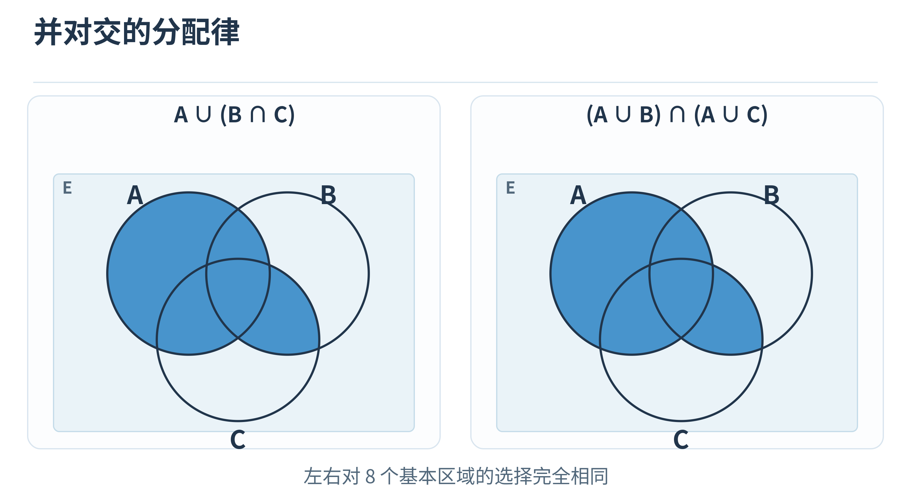

**图 7｜交对并分配：只保留 A 中与 B 或 C 重合的区域**

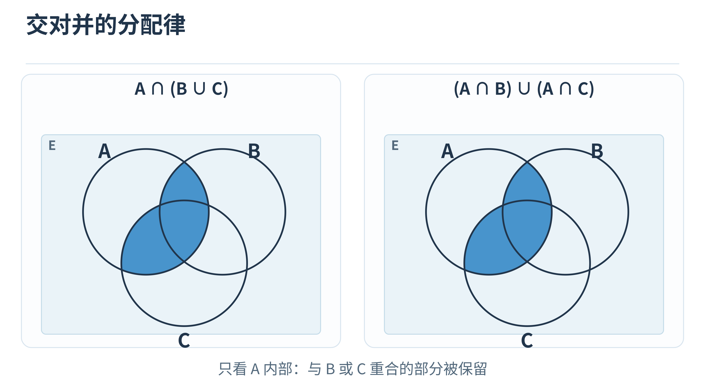

> [!example] 逻辑推导并对交的分配律（讲义 PDF 第 24 页）
> 对任意 $x\in E$：
>
> $$
> \begin{aligned}
> x\in A\cup(B\cap C)
> &\iff (x\in A)\lor((x\in B)\land(x\in C))\\
> &\iff ((x\in A)\lor(x\in B))\land((x\in A)\lor(x\in C))\\
> &\iff x\in(A\cup B)\cap(A\cup C).
> \end{aligned}
> $$
>
> 由于任意元素对两边的归属完全相同，两集合相等。

**图 8｜用八组成员真假值核验分配律；最后两列逐行一致**

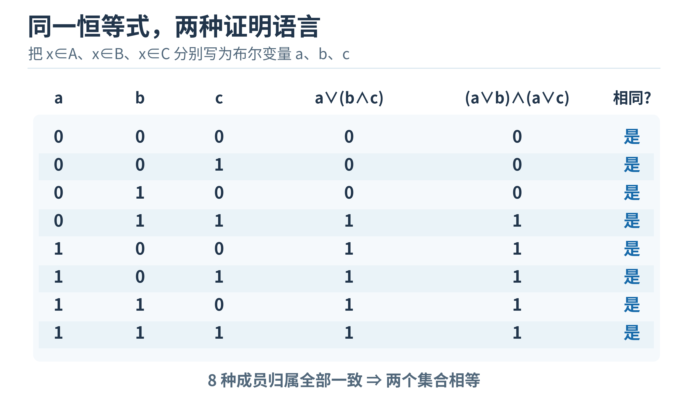

### 2.3 吸收律（重点）

$$
\boxed{A\cup(A\cap B)=A},\qquad
\boxed{A\cap(A\cup B)=A}.
$$

关键在于包含关系：$A\cap B\subseteq A\subseteq A\cup B$。因此“$A$ 再并上自己的一部分”不会扩大；“$A$ 再与包含自己的集合求交”不会缩小。

**图 9｜吸收律一：小区域并入包含它的大区域**

**图 10｜吸收律二：大区域与其内部集合取交**

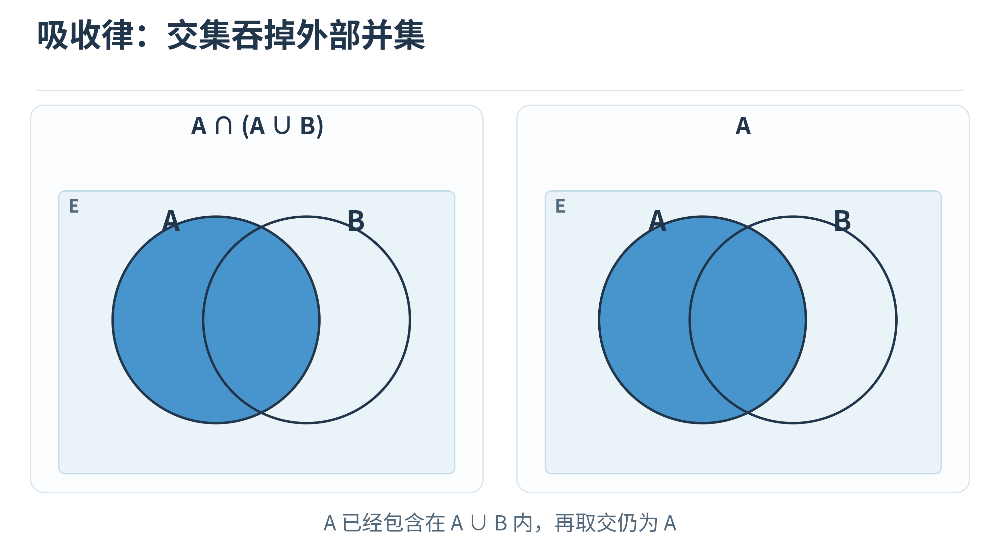

> [!tip] 高频等价变形
> $$
> A\cup(\sim A\cap B)=(A\cup\sim A)\cap(A\cup B)=A\cup B.
> $$
> 这个式子常在复杂化简中出现；它并非直接套用吸收律，而是先用分配律，再用排中律和同一律。

### 2.4 补集与德·摩根律（重点）

**双重否定律**：

$$\sim(\sim A)=A.$$

**德·摩根律**：

$$
\boxed{\sim(A\cup B)=(\sim A)\cap(\sim B)},\qquad
\boxed{\sim(A\cap B)=(\sim A)\cup(\sim B)}.
$$

其语言解释比记符号更可靠：
- “不属于 $A$ 或 $B$ 的并集”意味着**既不属于 $A$，也不属于 $B$**。
- “不属于 $A$ 与 $B$ 的交集”意味着**至少不属于 $A,B$ 之一**。

**图 11｜对并集取补：两个集合外部的共同区域**

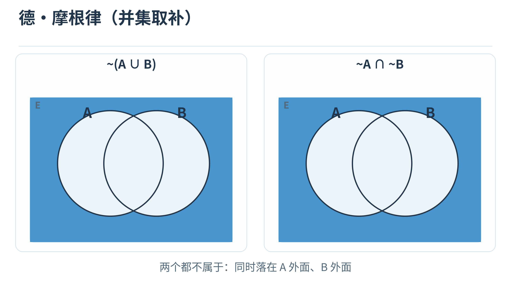

**图 12｜对交集取补：除了中心重叠区域以外的全部区域**

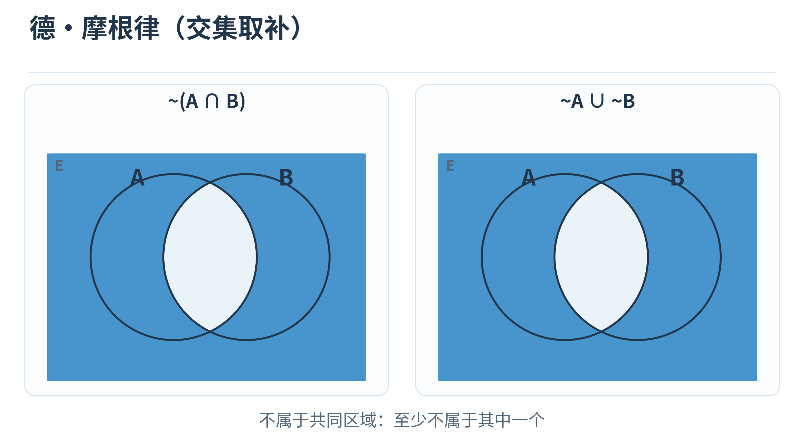

> [!warning] 不能只把运算符改掉
> 例如 $\sim(A\cup B)$ 的正确形式是 $(\sim A)\cap(\sim B)$，必须**同时对每个操作数取补**；不能写成 $A\cap B$。

### 2.5 与全集、空集有关的律

| 名称 | 恒等式 | 直观理解 |
|---|---|---|
| 零律 | $A\cup E=E$；$A\cap\varnothing=\varnothing$ | 并上全部变全部；交上空变空 |
| 同一律 | $A\cup\varnothing=A$；$A\cap E=A$ | 并空、交全集不变 |
| 排中律 | $A\cup\sim A=E$ | 属于或不属于 $A$，覆盖全集 |
| 矛盾律 | $A\cap\sim A=\varnothing$ | 不可能既属于又不属于 |
| 全补律 | $\sim\varnothing=E$；$\sim E=\varnothing$ | 空与全集互为补集 |

**图 13｜同一律：空集作为并集的中性元，全集作为交集的中性元**

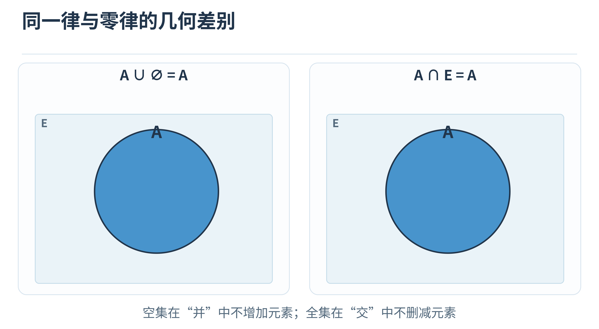

**图 14｜排中律与矛盾律：补集恰好填补原集合的外部**

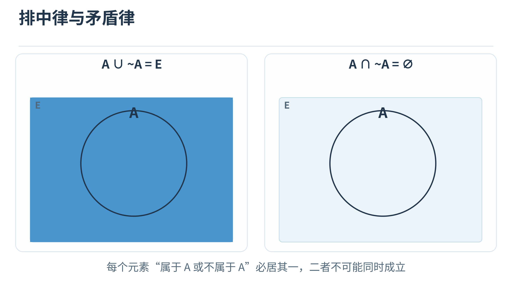

### 2.6 相对补集统一改写成交与补

讲义的**补交转换律**：

$$\boxed{A-B=A\cap\sim B}.$$

推导从元素定义出发：

$$
\begin{aligned}
x\in A-B
&\iff (x\in A)\land(x\notin B)\\
&\iff (x\in A)\land(x\in\sim B)\\
&\iff x\in A\cap\sim B.
\end{aligned}
$$

**图 15｜补交转换律：在 A 内删掉 B**

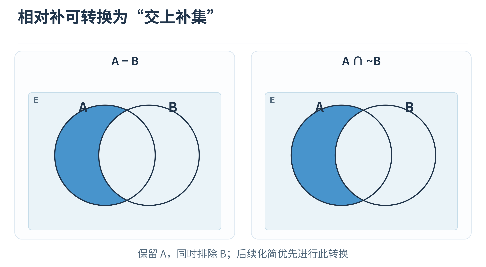

由补交转换、德·摩根和分配律，可推导**相对形式的德·摩根律**：

$$
\boxed{A-(B\cup C)=(A-B)\cap(A-C)}
$$

$$
\boxed{A-(B\cap C)=(A-B)\cup(A-C)}.
$$

第一个等式逐步化简：

$$
\begin{aligned}
A-(B\cup C)
&=A\cap\sim(B\cup C) &&\text{补交转换}\\
&=A\cap(\sim B\cap\sim C) &&\text{德·摩根}\\
&=(A\cap\sim B)\cap(A\cap\sim C) &&\text{等幂、交换、结合}\\
&=(A-B)\cap(A-C) &&\text{补交转换}.
\end{aligned}
$$

第二个等式把“并、交”交换，按同样过程即可证明。==注意“减去并集”意味着同时排除两集合，因此结果要取交；“减去交集”只需排除共同部分，因此结果取并。==

**图 16｜减去 B∪C：必须既不在 B 中，也不在 C 中**

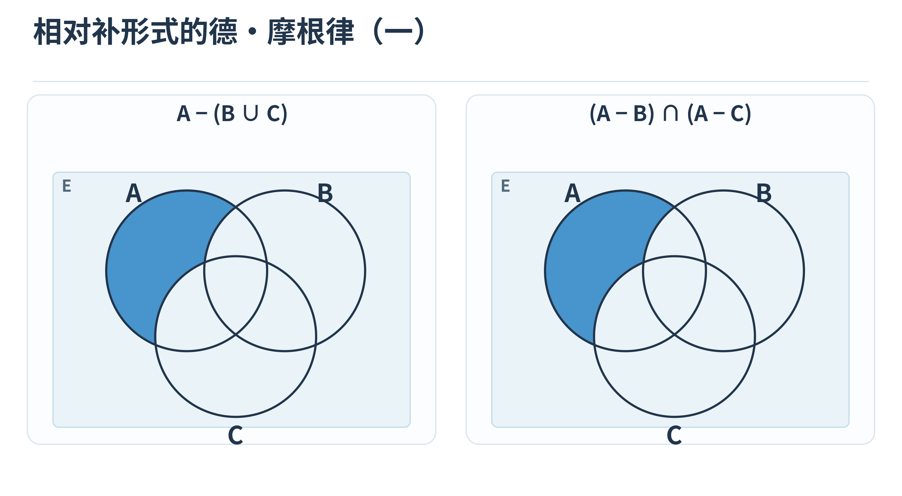

**图 17｜减去 B∩C：只需不在 B 或不在 C 至少一个中**

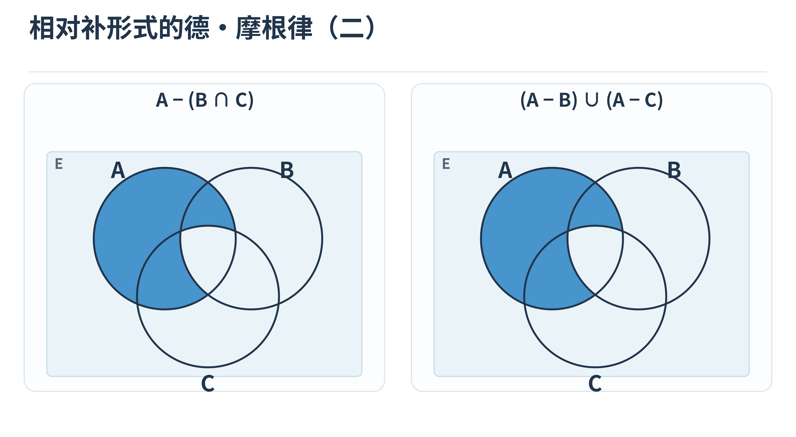

### 2.7 推广到多个集合

设指标集 $I$ **非空**，$\{A_\alpha\}_{\alpha\in I}$ 是 $E$ 的子集族，$B\subseteq E$。讲义给出：

$$
B\cup\left(\bigcap_{\alpha\in I}A_\alpha\right)
=\bigcap_{\alpha\in I}(B\cup A_\alpha),
$$

$$
B\cap\left(\bigcup_{\alpha\in I}A_\alpha\right)
=\bigcup_{\alpha\in I}(B\cap A_\alpha),
$$

$$
\sim\left(\bigcup_{\alpha\in I}A_\alpha\right)
=\bigcap_{\alpha\in I}(\sim A_\alpha),
\quad
\sim\left(\bigcap_{\alpha\in I}A_\alpha\right)
=\bigcup_{\alpha\in I}(\sim A_\alpha),
$$

$$
B-\left(\bigcup_{\alpha\in I}A_\alpha\right)
=\bigcap_{\alpha\in I}(B-A_\alpha),
\quad
B-\left(\bigcap_{\alpha\in I}A_\alpha\right)
=\bigcup_{\alpha\in I}(B-A_\alpha).
$$

例如，$x$ 不属于 $A_1\cup A_2\cup A_3$，当且仅当它**三个都不属于**；这正是广义德·摩根律。这里的“非空指标集”与课件对空广义交不定义的约定保持一致。

---

## 3. 证明集合关系：两套语言、四种常用技巧

### 3.1 逻辑演算法（元素法）

**证明 $X=Y$：**任取 $x$，从 $x\in X$ 出发，通过双向等价变形推出 $x\in Y$：

$$\forall x\in E,\quad x\in X\iff\cdots\iff x\in Y.$$

**证明 $X\subseteq Y$：**任取 $x\in X$，依照定义和蕴含式推出 $x\in Y$：

$$\forall x\in E,\quad x\in X\implies\cdots\implies x\in Y.$$

这里的 $\iff$ 与 $\implies$ 不能随意互换：==相等需要两边同真假；包含只需“左边真时右边真”==。

> [!example] 讲义示例：$A\cap B\subseteq A$
> 任取 $x\in A\cap B$，则 $x\in A\land x\in B$。由合取式可得 $x\in A$。故 $A\cap B\subseteq A$。
>
> 证明过程中无须假设 $A\subseteq B$，因为 $A\cap B$ 的每个元素原本就属于 $A$。

**图 18｜文氏图看包含关系：交集的每个元素都在 A 中**

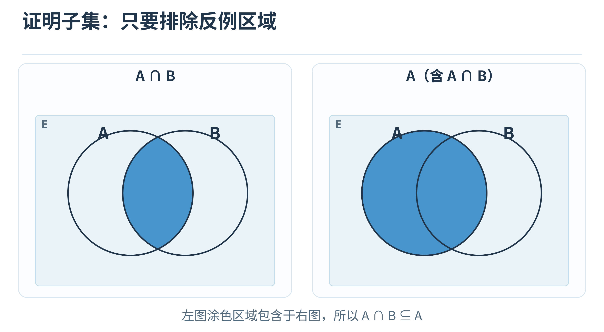

### 3.2 集合演算法（恒等变形）

证明 $X=Y$，可只从一边出发，连续应用已知恒等式变形成另一边：

$$X=X_1=X_2=\cdots=Y.$$

每一步应能说清使用的定律，不要把未证明的目标等式当作化简依据。

> [!example] 讲义第 28 页：相对补形式德·摩根律
> $A-(B\cup C)=A\cap\sim(B\cup C)=A\cap(\sim B\cap\sim C)=(A-B)\cap(A-C)$。
>
> 这是把相对补写成“交补”后直接套用德·摩根律的典型方法。

### 3.3 双向包含法

要证明 $X=Y$，可分别证明：

$$X\subseteq Y\qquad\text{和}\qquad Y\subseteq X.$$

例如 $A\cap\varnothing=\varnothing$：

1. $A\cap\varnothing\subseteq\varnothing$（交集包含于任一操作数）。
2. $\varnothing\subseteq A\cap\varnothing$（空集是任意集合的子集）。
3. 双向包含，故相等。

### 3.4 把包含关系转成等式（重点）

$$
\boxed{A\subseteq B\iff A\cap B=A\iff A\cup B=B}.
$$

**证明左侧等价关系**：

- 若 $A\subseteq B$，则 $A$ 中元素均在 $B$ 中，故 $A\cap B=A$。
- 若 $A\cap B=A$，任取 $x\in A$，便有 $x\in A\cap B$，所以 $x\in B$，故 $A\subseteq B$。

并集对应的等价式可类似证明。

> [!warning] 注意图示与条件
> 两个任意相交的圆**不自动满足** $A\cap B=A$。这三个表达式是当 $A\subseteq B$ 时才等价的判定方法，不是在任意图形下直接写成同一个集合。

### 3.5 三种方法怎么选？

| 目标类型 | 优先方法 | 典型情形 |
|---|---|---|
| 表达式相等 | 集合演算法 | 公式以并、交、补混合出现 |
| 等式包含复杂逻辑条件 | 元素法 | 需要展开“属于/不属于”的定义 |
| 集合相等且左右结构很不同 | 双向包含法 | 一边难以直接化到另一边 |
| 单纯包含 | $A\cap B=A$ 等价法 | 可利用代数恒等式迅速化简 |
| 怀疑式子不成立 | 找单个元素反例 | 八个成员状态有一种使左右不同 |

---

## 4. 对称差：把它理解成“异或”

### 4.1 定义和基本公式

$$
A\oplus B=(A-B)\cup(B-A)=(A\cup B)-(A\cap B).
$$

也可写成

$$
A\oplus B=(A\cap\sim B)\cup(\sim A\cap B).
$$

若 $p$ 是“$x\in A$”，$q$ 是“$x\in B$”，那么

$$x\in A\oplus B\iff (p\land\neg q)\lor(\neg p\land q).$$

这就是异或：==成员状态不同才为真；两个都属于或两个都不属于均为假==。

### 4.2 交换律、结合律与三个集合的奇偶规律

$$
A\oplus B=B\oplus A,
\qquad (A\oplus B)\oplus C=A\oplus(B\oplus C).
$$

对于任意一个元素，每参与一次对称差，就相当于将它是否属于结果的状态翻转一次。因此 $A\oplus B\oplus C$ 包含**恰好属于一个集合**或**同时属于三个集合**的元素，恰好属于两个集合的元素被抵消。

**图 19｜三个集合的异或：保留出现 1 次或 3 次的元素**

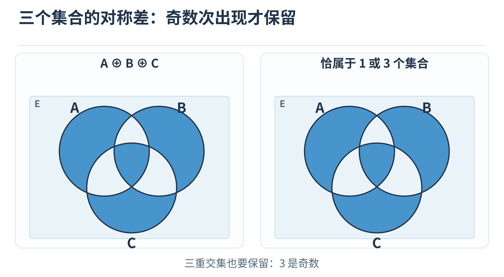

**图 20｜不论先计算哪两个集合，最终“奇偶归属”相同**

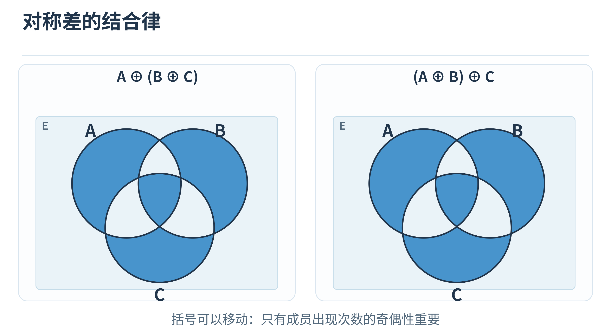

> [!example] 结合律的“基本区域”证明
> 对任意 $x$，用 $a,b,c\in\{0,1\}$ 表示是否属于 $A,B,C$。则
>
> $$
> a\oplus(b\oplus c)\equiv(a+b+c)\bmod 2
> \equiv(a\oplus b)\oplus c.
> $$
>
> 因为左、右对任一元素的成员状态都由同一个奇偶数决定，所以对应的集合相等。此法比把德·摩根律连续展开成大量交并项更简洁，但原理与讲义中的八区域展开法一致。

### 4.3 对称差的同一元、消去律与补集

$$
\begin{gathered}
A\oplus\varnothing=A,\qquad A\oplus E=\sim A,\\
A\oplus A=\varnothing,\qquad A\oplus\sim A=E.
\end{gathered}
$$

从 $A\oplus A=\varnothing$ 可以导出**消去律**：

$$
A\oplus B=A\oplus C\iff B=C.
$$

因为对两边再做一次 $\oplus A$，由结合律得 $(A\oplus A)\oplus B=(A\oplus A)\oplus C$，故 $B=C$。

同理，当 $A=B\oplus C$ 时，也有 $B=A\oplus C$、$C=A\oplus B$。这里的“移项”本质上是再次对称差同一个集合。

补集与对称差的关系为：

$$
\boxed{\sim(A\oplus B)=(\sim A)\oplus B=A\oplus(\sim B)},
$$

$$
\boxed{(\sim A)\oplus(\sim B)=A\oplus B}.
$$

**图 21｜补一个集合会翻转异或结果；补两个集合不会**

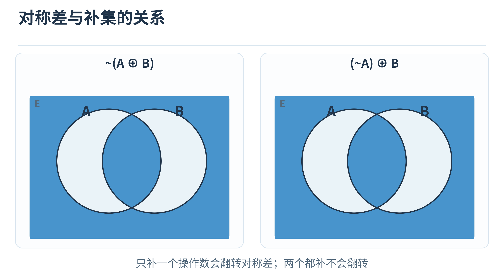

> [!warning] 讲义讨论：三个操作数同时取补不相等
> $A\oplus B\oplus C$ **一般不等于** $(\sim A)\oplus(\sim B)\oplus(\sim C)$。因为取补三个操作数相当于再异或三次 $E$，最终为原式的补集。一般地，对于有限个操作数，取补偶数个不改变结果，取补奇数个翻转结果。

### 4.4 分配律：只有交对对称差的分配普遍成立

**正确的恒等式**：

$$
\boxed{A\cap(B\oplus C)=(A\cap B)\oplus(A\cap C)}.
$$

证明：

$$
\begin{aligned}
A\cap(B\oplus C)
&=A\cap[(B\cap\sim C)\cup(\sim B\cap C)]\\
&=(A\cap B\cap\sim C)\cup(A\cap\sim B\cap C),
\end{aligned}
$$

而右边 $(A\cap B)\oplus(A\cap C)$ 恰好在 $A$ 内挑出“属于 $B,C$ 恰好一个”的区域，两边相同。

**图 22｜交对对称差分配：仅 A 内的异或部分留下**

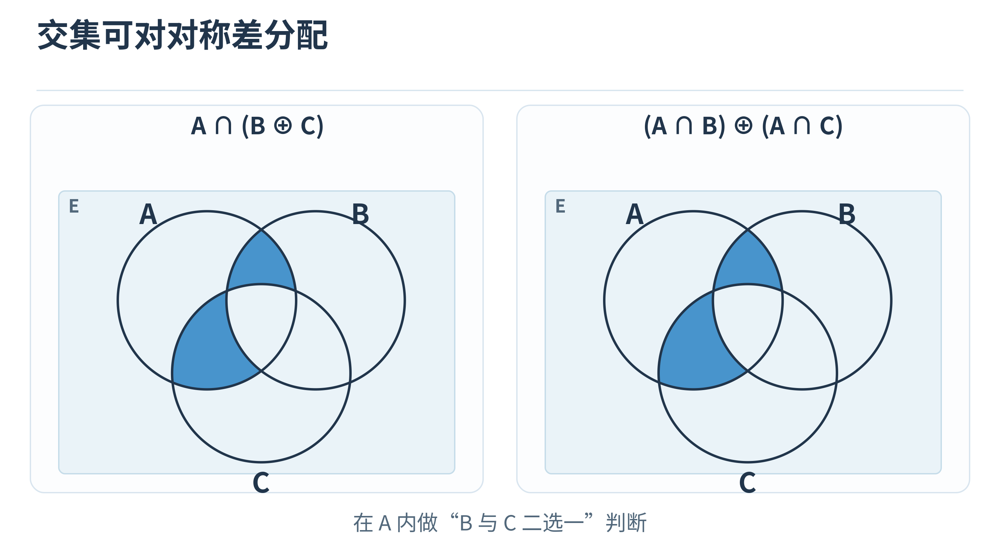

但下列三条**不是普遍恒等式**：

$$
\begin{aligned}
A\cup(B\oplus C)&\ne (A\cup B)\oplus(A\cup C),\\
A\oplus(B\cap C)&\ne (A\oplus B)\cap(A\oplus C),\\
A\oplus(B\cup C)&\ne (A\oplus B)\cup(A\oplus C).
\end{aligned}
$$

这里的 $\ne$ 表示“两侧并非对任意集合都相等”，并不排除某些特殊集合使它们恰好相等。

**图 23｜并集不对对称差普遍分配**

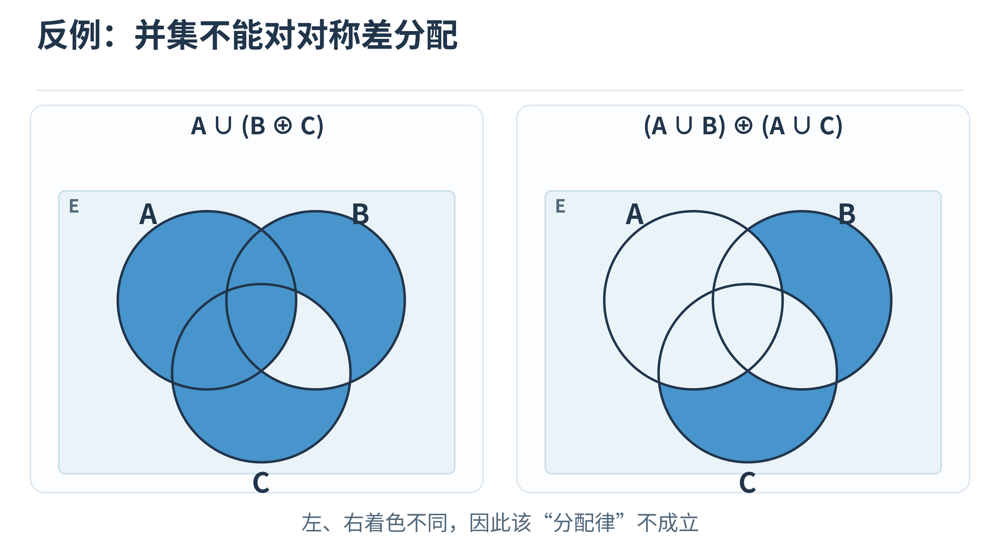

**图 24｜对称差不对交集普遍分配**

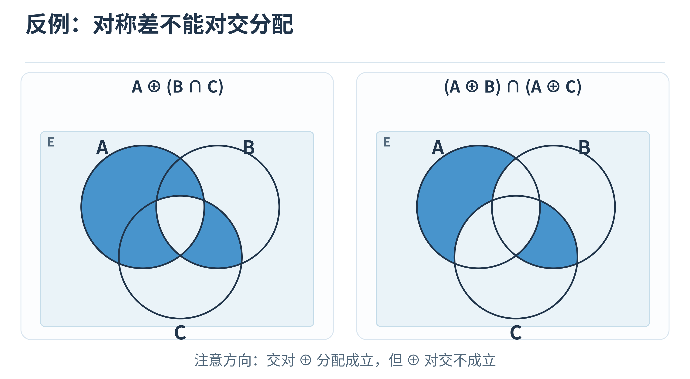

**图 25｜对称差不对并集普遍分配**

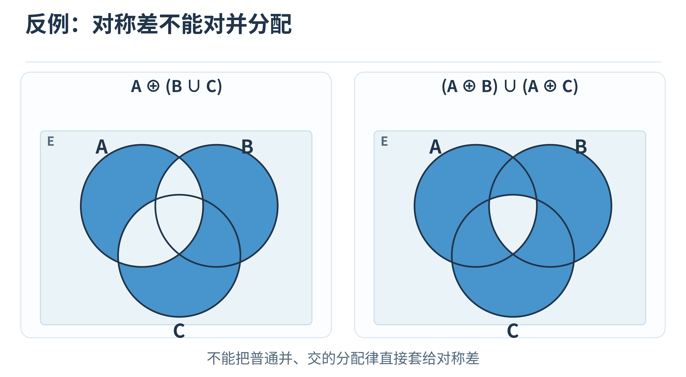

> [!example] 只用一个元素否定第一条伪恒等式
> 令 $E=\{x\}$、$A=\{x\}$、$B=C=\varnothing$，则
> $$A\cup(B\oplus C)=\{x\},$$
> 但
> $$(A\cup B)\oplus(A\cup C)=\{x\}\oplus\{x\}=\varnothing.$$
> 左右不同，所以不成立。这比反复猜分配律更可靠。

---

## 5. 有限集合的计数：容斥原理

讲义在引入集合恒等式前先回顾“6.3 有穷集的计数”（PDF 第 11—12 页），其核心是**先加进来，再减去重复计算的部分**。它与文氏图的区域划分有直接联系。

### 5.1 两个集合的容斥

$$
\boxed{|A\cup B|=|A|+|B|-|A\cap B|}.
$$

原因：$|A|+|B|$ 把交集内的元素计算了两次，最后减去一次交集就恰好每个元素只算一次。

**图 26｜二集合容斥示例：交集 6 个元素会被重复计数一次**

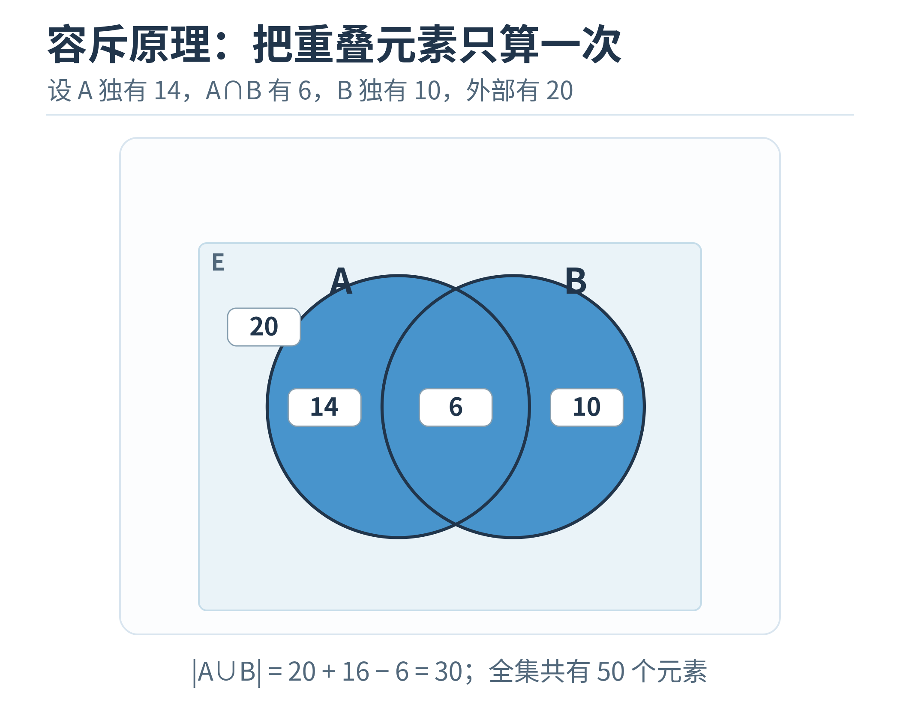

> [!example] 直接计算
> 若 $|A|=20, |B|=16, |A\cap B|=6$，则
> $$|A\cup B|=20+16-6=30.$$
> 若全集 $|E|=50$，则两者都不属于的元素个数为 $50-30=20$。

### 5.2 三个集合的容斥

$$
\boxed{\begin{aligned}
|A\cup B\cup C|={}&|A|+|B|+|C|\\
&-|A\cap B|-|A\cap C|-|B\cap C|\\
&+|A\cap B\cap C|.
\end{aligned}}
$$

先加三个集合，重复部分被多算；减去三个两两交集后，三重交集从原先被算三次、减去三次变成零次，所以要再加回一次。

**图 27｜三集合容斥：八个互斥区域分别标出元素数量**

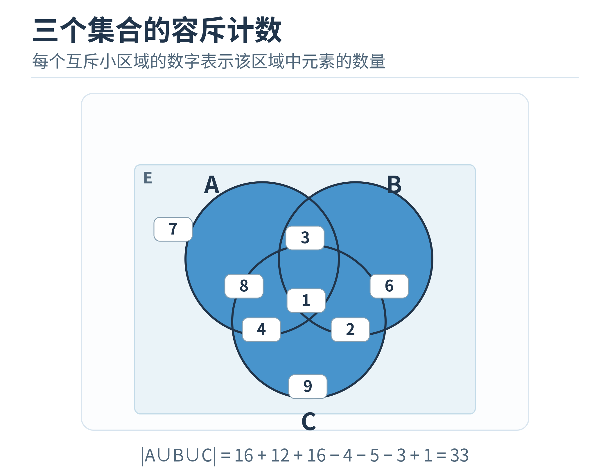

图中 $|A|=8+3+4+1=16$、$|B|=6+3+2+1=12$、$|C|=9+4+2+1=16$，两两交集分别为 $4,5,3$，三重交集为 $1$，所以

$$|A\cup B\cup C|=16+12+16-4-5-3+1=33.$$

### 5.3 $m$ 个性质的通式

设 $S$ 是有限集合，$A_i$ 是具有性质 $P_i$ 的元素集合（$1\le i\le m$）。至少有一种性质的元素数为

$$
\begin{aligned}
\left|\bigcup_{i=1}^{m}A_i\right|
={}&\sum_{i=1}^{m}|A_i|
-\sum_{1\le i<j\le m}|A_i\cap A_j|\\
&+\sum_{1\le i<j<k\le m}|A_i\cap A_j\cap A_k|
-\cdots\\
&+(-1)^{m-1}\left|\bigcap_{i=1}^{m}A_i\right|.
\end{aligned}
$$

**一个性质也不具有**的元素数为

$$
\left|S-\bigcup_{i=1}^{m}A_i\right|
=|S|-\left|\bigcup_{i=1}^{m}A_i\right|.
$$

因此将上面的容斥通式整体从 $|S|$ 中减去，就得到课件所列的“无任何性质”的计算公式：

$$
\begin{aligned}
\left|\bigcap_{i=1}^{m}(S-A_i)\right|
={}&|S|-\sum_i|A_i|+\sum_{i<j}|A_i\cap A_j|\\
&-\sum_{i<j<k}|A_i\cap A_j\cap A_k|+\cdots\\
&+(-1)^m\left|\bigcap_{i=1}^{m}A_i\right|.
\end{aligned}
$$

> [!tip] 判别公式正负号
> “至少一项”从单集合开始依次是 **$+,-,+,-,\dots$**；“一项也没有”则先写 $|S|$，后面是 **$-,+,-,+,\dots$**。交集的阶数每增加一级，就翻转一次符号。

---

## 6. 讲义典型练习：逐步求解

### 6.1 练习 1：集合恒等式化简（讲义 PDF 第 41 页）

化简：

$$
X=(A\cap B\cap C)\cup(A\cap\sim B\cap C)\cup(\sim A\cap B\cap C).
$$

先交换、结合，提出公共的 $A\cap C$：

$$
\begin{aligned}
X
&=[(A\cap C)\cap B]\cup[(A\cap C)\cap\sim B]\cup(\sim A\cap B\cap C)\\
&=(A\cap C)\cap(B\cup\sim B)\cup(\sim A\cap B\cap C)\\
&=(A\cap C)\cup(\sim A\cap B\cap C).
\end{aligned}
$$

再次提出公共的 $C$：

$$
\begin{aligned}
X
&=[A\cup(\sim A\cap B)]\cap C\\
&=[(A\cup\sim A)\cap(A\cup B)]\cap C\\
&=\boxed{(A\cup B)\cap C}.
\end{aligned}
$$

**图 28｜练习 1：左边三个小区域合并为 C 内的 A∪B**

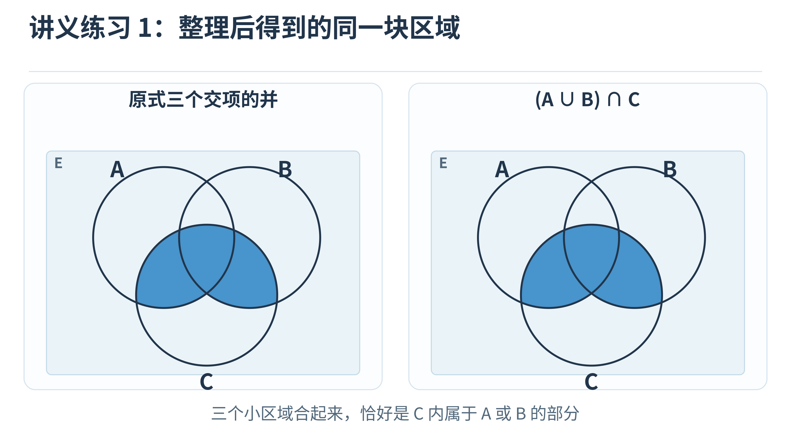

### 6.2 练习 2：判断真假（讲义 PDF 第 42 页）

**(1)** $A-B=A\iff A\cap B=\varnothing$。**正确。**

由 $A-B=A\cap\sim B$，若 $A-B=A$，表示 $A$ 中没有元素落入 $B$，所以交集为空；反之交集为空时从 $A$ 删掉 $B$ 不会删掉任何元素。

**(2)** $P\subseteq Q\iff P-Q\subseteq\sim P$。**正确（补集相对于共同全集）。**

$P-Q\subseteq P$ 始终成立；若又有 $P-Q\subseteq\sim P$，则 $P-Q\subseteq P\cap\sim P=\varnothing$，即 $P-Q=\varnothing$，所以 $P\subseteq Q$。反向若 $P\subseteq Q$，则 $P-Q=\varnothing$，当然包含于 $\sim P$。

**(3)** $A-(B\cup C)=(A-B)\cup C$。**错误。**

左边是 $A\cap\sim B\cap\sim C$，右边却把 $C$ 的所有元素并入，通常扩大结果。

**图 29｜练习 2 第（3）题：左右阴影区域不相同，构成反例**

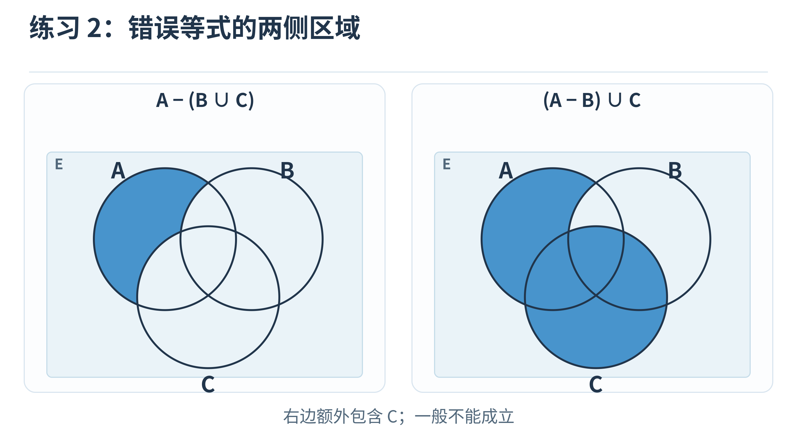

### 6.3 练习 3：求成立的充分必要条件（讲义 PDF 第 43 页）

**(1)** 求

$$(A-C)\cup B=(A\cup B)-C$$

成立条件。

右侧可展开为

$$
(A\cup B)-C=(A\cap\sim C)\cup(B\cap\sim C).
$$

左侧为 $(A\cap\sim C)\cup B$。两边的差别仅在左边可能多出的 $B\cap C$：左边包含全部 $B$，而右边剔除了 $C$ 中的部分。因此

$$
\boxed{(A-C)\cup B=(A\cup B)-C\iff B\cap C=\varnothing}.
$$

**图 30｜练习 3 第（1）题：若 B 与 C 不相交，两图才能一致**

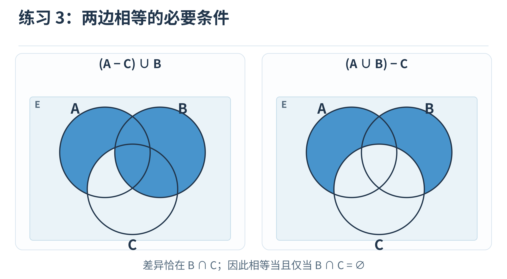

**(2)** 求 $A\cap B=A\cup B$ 成立条件。

始终有 $A\cap B\subseteq A\subseteq A\cup B$。若交与并相等，则中间的 $A$ 必须与它们相等；于是 $A\subseteq B$ 且 $B\subseteq A$，从而 $A=B$。反之若 $A=B$，显然交、并都等于 $A$。故

$$\boxed{A\cap B=A\cup B\iff A=B}.$$

### 6.4 练习 4：集合相等与幂集（讲义 PDF 第 44 页）

**(1) 原讲义存在疑似漏写/笔误，不能照字面直接证明。** 其条件写为

$$(A\cup B=A\cup C)\land(A\cap B=A\cap B)\implies B=C.$$

第二个条件只是重言的集合等式，没有提供任何新约束，**原命题不成立**。例如取 $A=E$、$B=\varnothing$、$C=E$，则 $A\cup B=A\cup C=E$，但 $B\ne C$。

**图 31｜讲义原题第（1）小题：按原文字面的一个明确反例**

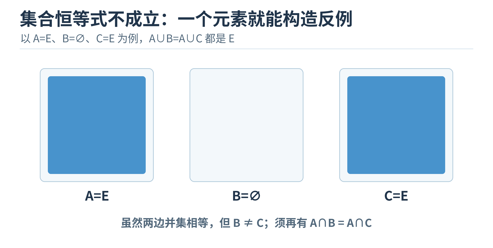

最可能的原意是

$$
\boxed{(A\cup B=A\cup C)\land(A\cap B=A\cap C)\implies B=C}.
$$

这个**修订后的命题确实成立**。证明时取任意 $x$，按是否属于 $A$ 分两类：

- 若 $x\in A$，由于 $A\cap B=A\cap C$，有 $x\in B\iff x\in C$。
- 若 $x\notin A$，由于 $A\cup B=A\cup C$，有 $x\in B\iff x\in C$。

两类覆盖全集，故 $B=C$。此处是**依据常见定理作出的修订推断**，并非声称原讲义已经正确写出了该条件。

**(2)** 证明 $\mathcal P(A)\cup\mathcal P(B)\subseteq\mathcal P(A\cup B)$。

任取 $X\in\mathcal P(A)\cup\mathcal P(B)$，则 $X\subseteq A$ 或 $X\subseteq B$。无论哪一种，都可推出 $X\subseteq A\cup B$，所以 $X\in\mathcal P(A\cup B)$，原包含关系成立。

> [!warning] 不要误认为一定相等
> $A=\{1,2\}$、$B=\{2,3\}$ 时，$\{1,3\}\subseteq A\cup B$，所以 $\{1,3\}\in\mathcal P(A\cup B)$；但 $\{1,3\}$ 既不属于 $\mathcal P(A)$ 也不属于 $\mathcal P(B)$。因此通常是严格包含。只有当 $A\subseteq B$ 或 $B\subseteq A$ 时，这里才取等号。

**图 32｜幂集是“以集合为元素的集合”，不要混淆层次**

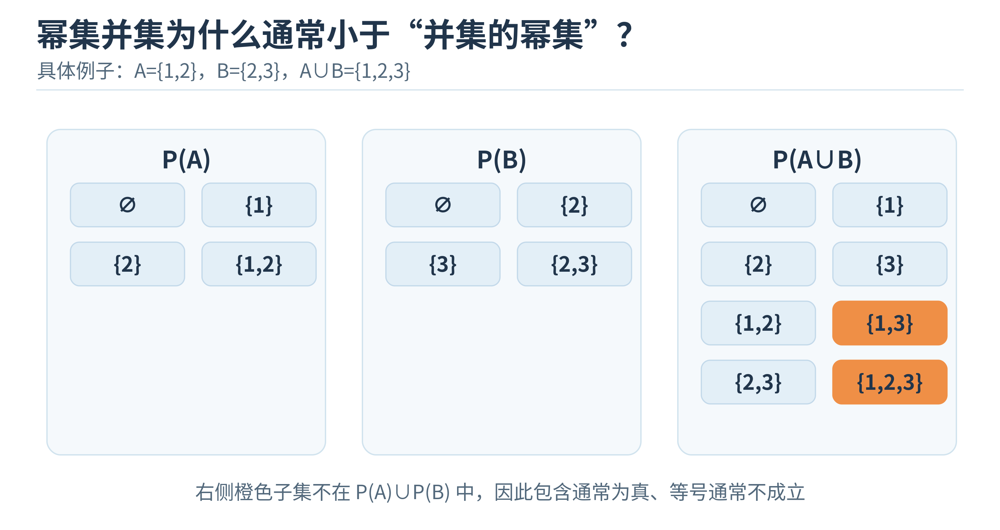

---

## 7. 本讲速查：规律与方法

### 7.1 核心恒等式总表

| 类别 | 必须记住的形式 |
|---|---|
| 等幂 | $A\cup A=A$，$A\cap A=A$ |
| 交换 | $A\cup B=B\cup A$，$A\cap B=B\cap A$ |
| 结合 | $(A\cup B)\cup C=A\cup(B\cup C)$，交同理 |
| 分配 | $A\cup(B\cap C)=(A\cup B)\cap(A\cup C)$；交并互换亦成立 |
| 吸收 | $A\cup(A\cap B)=A$；$A\cap(A\cup B)=A$ |
| 德·摩根 | $\sim(A\cup B)=\sim A\cap\sim B$；$\sim(A\cap B)=\sim A\cup\sim B$ |
| 补集 | $\sim\sim A=A$；$A\cup\sim A=E$；$A\cap\sim A=\varnothing$ |
| 空与全集 | $A\cup\varnothing=A$，$A\cap E=A$，$A\cup E=E$，$A\cap\varnothing=\varnothing$ |
| 相对补 | $A-B=A\cap\sim B$；$A-(B\cup C)=(A-B)\cap(A-C)$ |
| 对称差 | $A\oplus B=(A-B)\cup(B-A)$；$A\oplus A=\varnothing$ |
| 分配特例 | $A\cap(B\oplus C)=(A\cap B)\oplus(A\cap C)$ |
| 子集判定 | $A\subseteq B\iff A\cap B=A\iff A\cup B=B$ |
| 两集合计数 | $|A\cup B|=|A|+|B|-|A\cap B|$ |

### 7.2 解题的优先顺序

1. **判断目标**：求恒等式、证明包含、证明相等、求成立条件，还是判断真假。
2. **化简**：出现 $-$ 先考虑 $A-B=A\cap\sim B$；出现补集套德·摩根；出现共同项套分配律。
3. **证明**：等式可用逻辑等值或集合演算；包含可用元素法、包含传递性或等价式。
4. **反例**：遇到看似“分配律”的陌生式子，先用元素所属状态检查，找到一组不同就立刻否定。
5. **计数**：先确定“至少一个”还是“一个也没有”，再套容斥并检查重叠的重复次数。

> [!summary] 三个最关键的理解支点
> 1. **集合运算与逻辑联结词对应**：并是“或”，交是“与”，补是“非”，对称差是“异或”。
> 2. **恒等式就是任一元素的成员状态永远一致**：元素法是严格表达，文氏图是几何直观。
> 3. **对称差遵循奇偶性**：结合律、消去律、补集关系、可成立和不可成立的分配律都可以据此判断。

### 7.3 自检练习（先做再看答案）

**题 1.** 化简 $A\cap(B\cup\sim A)$。

**题 2.** 判断：$A\oplus B=\varnothing\iff A=B$。

**题 3.** 判断：$A-(B\cap C)=(A-B)\cap(A-C)$。

**题 4.** 已知 $|A|=25, |B|=19, |A\cap B|=7$，求 $|A\cup B|$。

**题 5.** 若 $A\cup B=A$，能否推出 $B\subseteq A$？

> [!example]- 参考答案与关键依据
> 1. $A\cap(B\cup\sim A)=(A\cap B)\cup(A\cap\sim A)=A\cap B$。
> 2. 正确。异或结果为空等价于每个元素在 $A,B$ 的成员状态相同。
> 3. 错误。正确的是 $A-(B\cap C)=(A-B)\cup(A-C)$。
> 4. $25+19-7=37$。
> 5. 可以。这与 $B\subseteq A\iff A\cup B=A$ 等价。

---

## 附：来源与校订说明

- **主要来源**：用户提供的《第 1.3 讲 集合恒等式.pdf》，共 46 页。第 3—9 页为运算回顾；第 11—12 页为容斥原理；第 14—21 页为恒等式；第 22—32 页为证明方法及例子；第 33—40 页为对称差；第 41—45 页为练习与总结。
- **讲义需留意处**：第 44 页练习 4 第一小题把 $A\cap B=A\cap B$ 写作条件，照字面不足以推出结论，正文已指出反例，并将一种合理修订与原题区分；第 7 页广义交的公式存在排版缺括号，正文采用规范记法。
- **辅助补充**：八区域编号、可视化真值表、具体容斥数字例子、幂集反例、对称差的奇偶论证及自测题，目的是帮助理解原讲义，不冒充原题或原文。
- **插图说明**：全部插图依据集合定义重新绘制，并非截取或裁切讲义。每张图均附高清 PNG 阅读版与 SVG 可编辑源文件。所有插图默认以全集 $E$ 为背景，蓝色区域表示表达式所代表的集合。
