---
tags:
  - 离散数学/命题逻辑
  - 离散数学/命题与联结词
aliases:
  - 命题逻辑第一讲
  - 命题与联结词及命题公式
---

# 命题逻辑：命题、联结词、符号化、命题公式与真值表

日常语言中的“不是”“并且”“或者”“如果”“当且仅当”，看起来只是连接语句的词，进入数理逻辑后却具有**严格确定的真值规则**。本章从“什么样的句子能够判定真假”出发，逐步形成一套可计算、可验证、可用于推理的命题表达系统。

知识主线：**命题与真假 → 原子命题和复合命题 → 五种基本联结词 → 相容或与排斥或 → 自然语言符号化 → 命题公式的递归结构与层次 → 真值指派 → 真值表 → 公式分类。**

## 1. 数理逻辑研究什么

### 1.1 形式推理与数理逻辑

**逻辑学**研究有效推理所遵循的原则。推理是否有效，关键不在于结论“看上去合理”，而在于：**给定前提与推理形式，能否保证不出现前提全真、结论却假的情况**。

经典例子：

- 所有人都会死亡；
- 苏格拉底是人；
- 因此，苏格拉底会死亡。

这个例子呈现了从一般规则与具体事实得到结论的演绎推理。它的完整形式需要后续的一阶逻辑处理；本章先研究更基础的**命题逻辑**，即把各个可以判断真假的陈述当作整体，并研究它们之间由联结词形成的真值关系。

**数理逻辑**又称**符号逻辑**，尝试用数学符号、严格的定义以及形式规则来分析命题和推理。其基础理论与数学证明、计算机程序条件、数字逻辑电路、人工智能中的规则推理都有联系。

简要发展脉络：亚里士多德系统研究演绎推理；莱布尼茨提出把推理过程符号化、计算化的设想；布尔发展代数化逻辑；弗雷格进一步发展量化表达。现代课程通常从命题逻辑走向一阶逻辑。

> [!note] 研究内容的边界
> 命题逻辑关心的是“整个命题是真是假、如何由联结词组合”，不深入研究“人、圆、某个人是另一个人的朋友”这类命题内部的对象与关系。对象、关系和量词将由一阶逻辑处理。

### 1.2 本章的学习任务

学习完这一章，应能独立完成：

1. 判断一句话是否构成命题，并区分原子命题与复合命题；
2. 根据严格的真值表理解五种联结词，而不是单凭汉语习惯猜测；
3. 将“只要”“只有”“除非”等条件句正确符号化；
4. 判断一个符号串是否为合式公式，确定子公式及公式层次；
5. 列出真值指派与真值表，求成真、成假赋值并判断公式类别。

## 2. 命题：必须具有确定的真假值

### 2.1 命题的定义

**命题（proposition）**是**真假值唯一确定的陈述句**。逻辑上通常只考虑两个值：

$$
1=\text{真（True）},\qquad 0=\text{假（False）}.
$$

这句话包含两个要点：必须是能够陈述某件事的语句；其真假在给定语境下具有确定答案。**“我现在不知道真假”不等于“它没有确定真假”。**

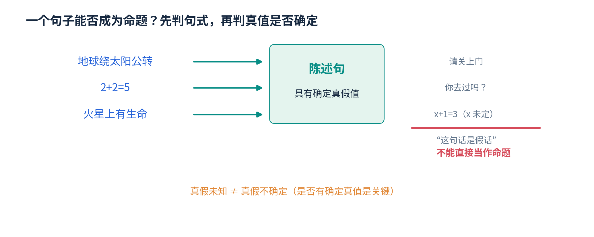

*图：区分真假未知的命题、开放语句与悖论等非命题。*

| 语句 | 是否为命题 | 理由 |
|---|---|---|
| 地球围绕太阳公转。 | 是 | 陈述句，具有确定真值（真） |
| $2+2=5$。 | 是 | 虽然为假，但仍有确定真值 |
| 火星上存在生命。 | 是 | 当前未必能确定答案，但该断言仍有客观真假 |
| 请关上门！ | 否 | 祈使句，不直接断定真假 |
| 你今天跑步了吗？ | 否 | 疑问句，不是一个真假断言 |
| $x+1=3$。 | 通常否 | $x$ 未给定时属于开放语句，真值不唯一 |
| “这句话是假的。” | 经典悖论 | 自指产生真假矛盾，不能直接作普通二值命题 |

> [!warning] 两种常见误判
> **错误一**：“我不知道火星有没有生命，所以不是命题。”——真假未知不妨碍它具有确定真值。
>
> **错误二**：“$2+2=5$ 是假的，所以不是命题。”——为假恰好说明它可以判断真假，仍然是命题。

当给定条件如 $x=2$ 后，$x+1=3$ 可以成为一个真命题。一般而言，含自由变量的等式或不等式，必须通过赋值、限定语境或引入量词后，才能得到确定的真假断言。

### 2.2 原子命题与复合命题

**原子命题（简单命题）**：在当前命题逻辑的分析层次下，不再拆分成由逻辑联结词组成的更小命题。

**复合命题**：由简单命题和逻辑联结词构成。其真值由组成部分的真值和联结词的规则决定。

例如：

- $p$：他走路；
- $q$：他唱歌；
- “他一边走路一边唱歌”表达为 $p\land q$。

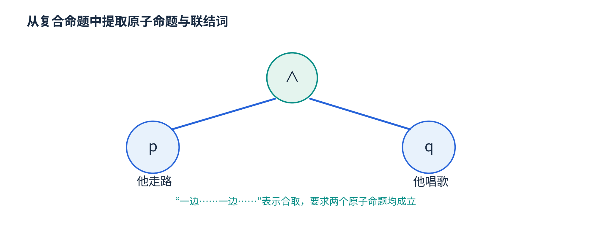

*图：把“一边走路一边唱歌”拆成原子命题与合取连接。*

需要注意，**“原子”是相对于命题逻辑中所选择的分析单位而言的**。例如“俞伯牙与钟子期是好朋友”在命题逻辑中可以整体作为原子命题 $p$；不能只因为中文包含“与”字，就拆成两个独立命题。两人之间的“好朋友”是二元关系，日后可以写为 $Friend(俞伯牙,钟子期)$，但那属于谓词逻辑的表达。

> [!tip] 识别原子命题的实用方法
> 先问：能否把原句拆成**若干个能够分别判定真假的完整陈述**，并且原句真值由“不、且、或、如果、当且仅当”的规则决定？若不能，整句可能就应该作为一个原子命题。

## 3. 五种基本逻辑联结词

用 $p,q$ 表示命题，其真假可为 $0$ 或 $1$。逻辑联结词是作用于命题真值的运算，而不是纯粹的自然语言词汇。

### 3.1 否定：$\neg p$

设 $p$ 为命题，**否定式**“非 $p$”记为 $\neg p$，读作“并非 $p$”“$p$ 不成立”。它的真值与 $p$ 相反：

| $p$ | $\neg p$ |
|---:|---:|
| 0 | 1 |
| 1 | 0 |

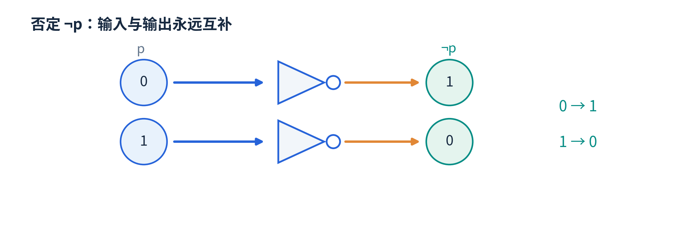

*图：逻辑非门两组输入及输出，直观理解真假取反。*

例如，令 $p$：“13 是偶数”，则 $\neg p$：“13 不是偶数”。因为 $p=0$，所以 $\neg p=1$。

> [!warning] 否定范围很重要
> 对“不是 $p$ 和 $q$ 都成立”，应先判断否定作用于整个合取：$\neg(p\land q)$。不能直接写成 $\neg p\land\neg q$，因为后者要求二者都不成立，含义更强。两者的关系会在等值律中进一步学习。

### 3.2 合取：$p\land q$

**合取（conjunction）**表示“$p$ 且 $q$”，也可对应“并且”“而且”“同时”“既……又……”。

$$
p\land q=1\quad\Longleftrightarrow\quad p=1\ \text{且}\ q=1.
$$

| $p$ | $q$ | $p\land q$ |
|---:|---:|---:|
| 0 | 0 | 0 |
| 0 | 1 | 0 |
| 1 | 0 | 0 |
| 1 | 1 | **1** |

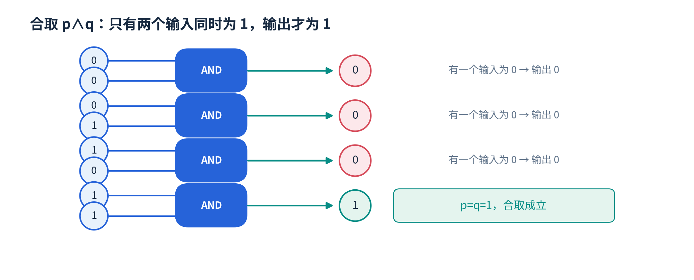

*图：用四组真实输入模拟 AND 门，展示合取的真值规则。*

例：令 $p$：“13 是偶数”、$q$：“13 是奇数”，则“13 是偶数也是奇数”记为 $p\land q$，真值为 $0$。

对于“他一边走路一边唱歌”，两个动作同时成立，仍写成 $p\land q$。“尽管外面冷，但是屋里暖和”中，“尽管……但是……”表达的是语气上的转折，而作为真假关系，要求两个陈述同时为真，也可以写为 $p\land q$。

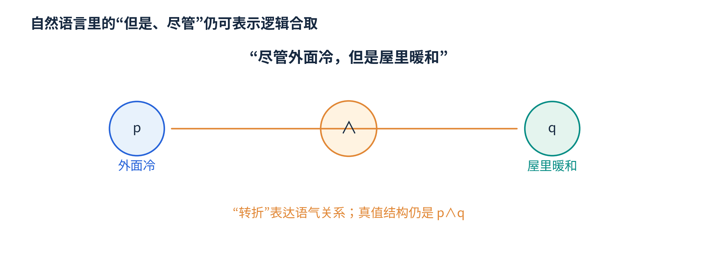

*图：把转折语义与合取真值条件区分开来。*

### 3.3 析取：$p\lor q$

**析取（disjunction）**表示“$p$ 或 $q$”，本课程中基本联结词 $\lor$ 默认是**相容或**：至少有一个为真，**允许两个都为真**。

$$
p\lor q=0\quad\Longleftrightarrow\quad p=q=0.
$$

| $p$ | $q$ | $p\lor q$ |
|---:|---:|---:|
| 0 | 0 | **0** |
| 0 | 1 | 1 |
| 1 | 0 | 1 |
| 1 | 1 | **1** |

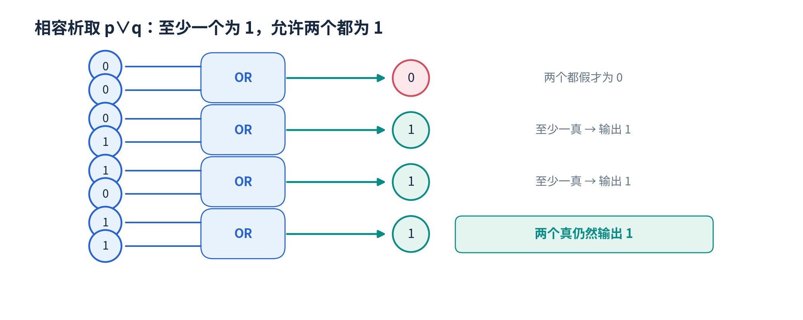

*图：相容或在两个条件同时为真时仍成立。*

例如“小明数学成绩好，或英语成绩好”若没有明确排除“两门都好”，应写为 $p\lor q$。这里 $p=q=1$ 时句子仍为真。

### 3.4 相容或与排斥或：不能见“或”就写 $\lor$

自然语言的“或”存在两种常见理解：

- **相容或**：至少一种情况成立，两种同时成立也可以，记为 $p\lor q$。
- **排斥或 / 异或**：恰好一种情况成立，不允许两种同时成立，记为 $p\oplus q$，也可以完全用基本联结词表示。

$$
p\oplus q\;\Leftrightarrow\;(p\land\neg q)\lor(\neg p\land q).
$$

| $p$ | $q$ | 相容或 $p\lor q$ | 异或 $p\oplus q$ |
|---:|---:|---:|---:|
| 0 | 0 | 0 | 0 |
| 0 | 1 | 1 | 1 |
| 1 | 0 | 1 | 1 |
| 1 | 1 | **1** | **0** |

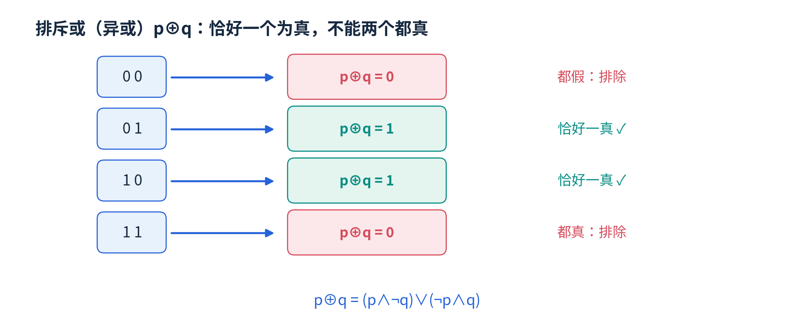

*图：四组赋值对比异或与相容或的差异。*

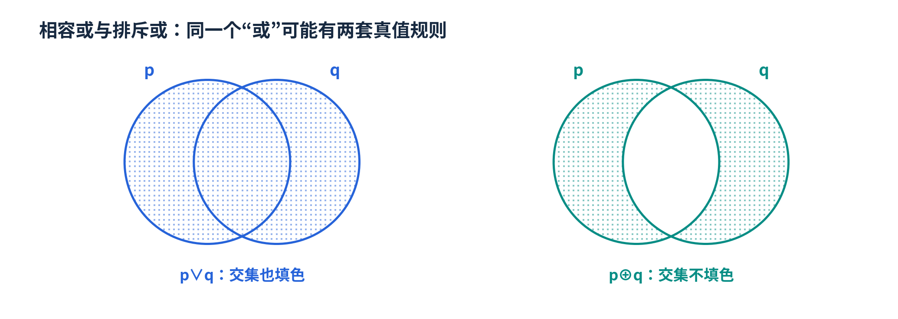

*图：用重叠区域说明相容或包含交集，异或排除交集。*

> [!example] 房间选择
> “小明只能挑选 203 或者 204 房间”在“只能选其中一个，不能同时选”的解释下，令 $p$：“选 203”、$q$：“选 204”，应为
>
> $$
> (p\land\neg q)\lor(\neg p\land q).
> $$
>
> 不能只写 $p\lor q$，否则会允许同时选择两间房。

同样，“张晓静是江西人或湖南人”若题目要求**恰好一地**（并把“江西人”“湖南人”理解为互斥身份），可采用异或表达；若语境没有排除双重籍贯、成长背景等情况，不能机械认定“或”一定是异或。

### 3.5 蕴涵：$p\to q$

设 $p,q$ 为命题，复合命题“如果 $p$，那么 $q$”称为**蕴涵式**：

$$
p\to q.
$$

其中 $p$ 称为**前件**，$q$ 称为**后件**。其最重要的规则是：

$$
p\to q=0\quad\Longleftrightarrow\quad p=1,\ q=0.
$$

| $p$ | $q$ | $p\to q$ |
|---:|---:|---:|
| 0 | 0 | 1 |
| 0 | 1 | 1 |
| 1 | 0 | **0** |
| 1 | 1 | 1 |

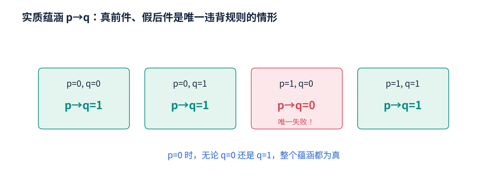

*图：蕴涵唯一假值情况 p=1、q=0 与其余三种比较。*

**为什么前件为假时仍算真？** 实质蕴涵用来约束“只要发生 $p$，就不能没有 $q$”。当 $p=0$ 时，并未出现违背这种约束的情况，故蕴涵取真；它不表示生活中真的发生过某个因果事件。

例如令 $p$：“你努力学习”，$q$：“你得到奖学金”，那么 $p\to q$ 仅当你努力学习而没有得到奖学金时为假。若 $p=0$，不论有没有奖学金，作为实质蕴涵都为真。

> [!important] 实质蕴涵与因果关系不同
> 逻辑里的 $p\to q$ **只规定真值关系**，不自动表达时间先后、因果影响、必然发生或现实中的政策承诺。因此，即使 $p$ 与 $q$ 的内容毫无关联，只要真值满足表格，逻辑结果仍然由表格决定。

例如“如果 $2+2=5$，那么美国位于非洲”，前件是假，无论后件真值如何，整个蕴涵在二值命题逻辑中都为真。

#### 3.5.1 充分条件与必要条件

$p\to q$ 可以读作：

- $p$ 是 $q$ 的**充分条件**：发生 $p$ 足以保证 $q$；
- $q$ 是 $p$ 的**必要条件**：要有 $p$ 就必须有 $q$。

同一个箭头不能反向任意替换。最容易混淆的两种汉语结构是：

| 自然语言 | 符号化 | 方向 |
|---|---|---|
| 只要 $p$，就 $q$ | $p\to q$ | 前件是 $p$ |
| 如果 $p$，那么 $q$ | $p\to q$ | 前件是 $p$ |
| 只有 $p$，才 $q$ | $q\to p$ | 后件是 $p$ |
| 仅当 $p$，才 $q$ | $q\to p$ | 后件是 $p$ |
| $p$ 是 $q$ 的充分条件 | $p\to q$ | $p$ 推 $q$ |
| $p$ 是 $q$ 的必要条件 | $q\to p$ | $q$ 推 $p$ |

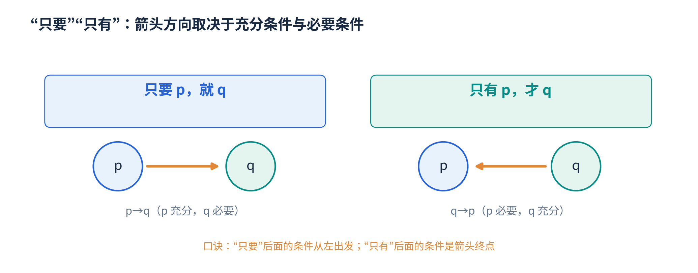

*图：以箭头方向对比充分条件与必要条件，防止“只有”写反。*

> [!warning] 不是每个带“只有”的语句都可以顺序抄写
> “只有 $p$，才 $q$”表示“如果 $q$ 发生，$p$ 必须成立”，因此应为 $q\to p$。**必要条件位于蕴涵箭头指向的一侧**。把它写成 $p\to q$，就将“必要条件”误解成了“充分条件”。

#### 3.5.2 同一个生活情境的对比

令 $p$：“下雨”，$q$：“我骑车上班”。

1. “只要不下雨，我就骑车上班”：$\neg p\to q$。
2. “只有不下雨，我才骑车上班”：$q\to\neg p$。

*图：通过骑车情景比较¬p→q与q→¬p，强调必要条件不等于充分条件。*

第二句只说**骑车不能发生在下雨时**，并不保证只要不下雨就必定骑车；可能因为修车、请假而没有骑车。这是充分条件和必要条件的根本差别。

### 3.6 等价联结词：$p\leftrightarrow q$

**等价联结词（biconditional）**表示“$p$ 当且仅当 $q$”，记为 $p\leftrightarrow q$。它在两侧**真值相同**时为真：

| $p$ | $q$ | $p\leftrightarrow q$ |
|---:|---:|---:|
| 0 | 0 | **1** |
| 0 | 1 | 0 |
| 1 | 0 | 0 |
| 1 | 1 | **1** |

它要求两个方向的条件关系都成立：

$$
p\leftrightarrow q\;\Leftrightarrow\;(p\to q)\land(q\to p).
$$

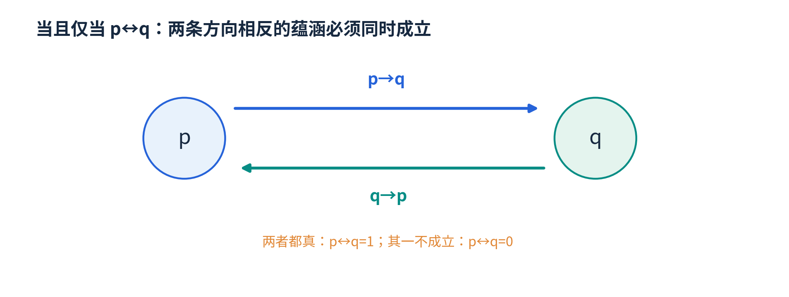

*图：等价联结词由两个方向的条件蕴涵同时构成。*

因此，$p\leftrightarrow q$ 表示 **$p$ 是 $q$ 的充分必要条件**，即二者相互蕴涵。

> [!example] 圆面积与半径
> 令 $p$：“两个圆的面积相等”，$q$：“两个圆的半径相等”。在通常的欧氏平面圆、半径非负的前提下，$S=\pi r^2$ 使得 $p\leftrightarrow q$ 成立：同半径必同面积，同面积也必同半径。

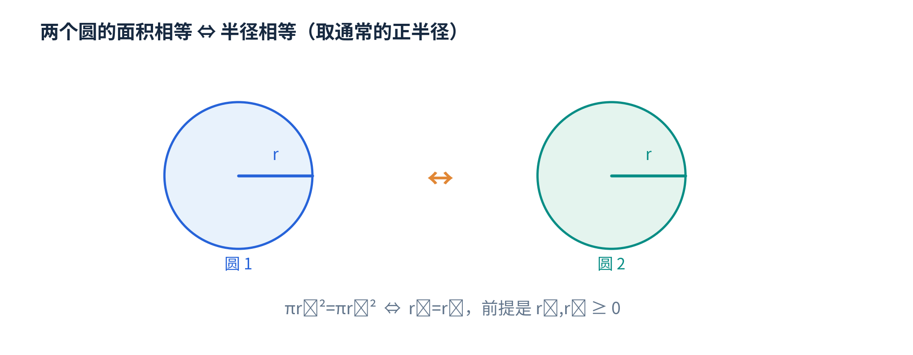

*图：借助两圆的半径比较解释几何中当且仅当的双向条件。*

### 3.7 五种联结词统一对照

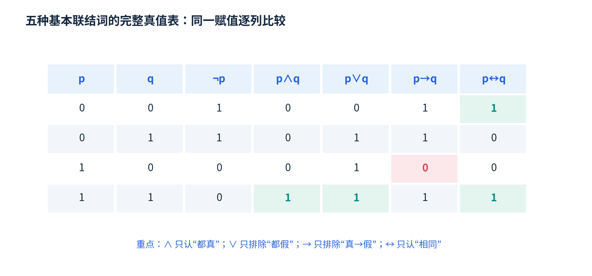

*图：五种基本联结词的真假全表与关键单元格高亮。*

| 联结词 | 含义 | **何时为假** |
|---|---|---|
| $\neg p$ | 对 $p$ 取反 | $p=1$ |
| $p\land q$ | 两者都真 | 至少一个假 |
| $p\lor q$ | 至少一个真 | 两者都假 |
| $p\to q$ | 真前件不能推出假后件 | $p=1,q=0$ |
| $p\leftrightarrow q$ | 两者真值相同 | 两者真值不同 |

> [!tip] 一眼记忆真值表
> 合取只有右下角为 $1$；相容析取只有左上角为 $0$；蕴涵只有 $1\to0$ 为 $0$；双条件是“相同取 $1$”。熟悉这几条后，做复杂真值表不需要死记大量数字。

## 4. 从自然语言到命题公式：完整操作方法

### 4.1 标准步骤

符号化不是把中文词语逐个替换成符号，而是**先确定可以独立判真的原子命题，再分析句子的逻辑约束**。

1. **划分原子命题**：每个原子命题必须是一句能够判断真假的完整陈述；
2. **明确字母含义**：例如 $p$：“今天是星期一”、$q$：“明天是星期二”；
3. **确定逻辑关系**：分析是“且”“至少一个”“恰好一个”“充分条件”还是“必要条件”；
4. **保留否定作用域与括号**：尤其注意“不是……都……”“除非……否则……”；
5. **反向翻译验证**：将写出的公式用中文读回去，看是否仍表达原句。

> [!warning] 禁止“看见某个字就机械对应某个符号”
> “和”可能连接对象而不是命题；“但是”也可能表达合取；“或”有相容与排斥两种；“只有”常常改变箭头方向。逻辑结构必须以完整语句的意思为准。

### 4.2 综合例题：本科生与专业

“小李是一名本科生，他的专业是数学或计算机。”设

- $p$：小李是一名本科生；
- $q$：小李的专业是数学；
- $r$：小李的专业是计算机。

“是本科生”与后半句共同成立，外层为合取；“数学或计算机”按通常相容析取理解，得到：

$$
\boxed{p\land(q\lor r)}.
$$

这里括号不能随便删除，因为它表示先判断专业，再把专业条件与本科生身份一起合取。

### 4.3 综合例题：只要、只有与仅当

令 $p$：“今天是星期一”、$q$：“明天是星期二”。

| 原句 | 表达式 |
|---|---|
| 若今天是星期一，则明天是星期二 | $p\to q$ |
| 只有今天是星期一，明天才是星期二 | $q\to p$ |
| 今天是星期一，当且仅当明天是星期二 | $p\leftrightarrow q$ |

在通常的连续日历日期下，星期一后一天为星期二，星期二的前一天为星期一，因此这些具体语句都为真；但**三个逻辑公式不因此变为同一个公式**。把 $p,q$ 看作独立变项时，它们的真值表不同。若“明天是星期三”记为 $r$，那么 $p\to r$ 的真值取决于具体日期；若今天为星期一，则它为假。

### 4.4 “除非”的作用域

“只要别人有困难，老王就帮助别人，除非困难解决了。”设

- $p$：别人有困难；
- $q$：老王帮助别人；
- $r$：困难解决了。

将“除非困难解决了”视作**例外条件**：只在困难未解决时，才要求有困难就提供帮助。可写成：

$$
\neg r\to(p\to q).
$$

它也可以直观写成：

$$
(p\land\neg r)\to q.
$$

这两种写法在真值逻辑中等价；前者强调外部例外条件，后者强调“需要帮助”与“问题未解决”要共同成立才形成要求。

*图：除非的例外条件与蕴涵嵌套关系可视化。*

再看“仅当天气好，我才去锻炼”。令 $p$：“天气好”、$q$：“我去锻炼”，它是 $q\to p$。

“除非天气好，否则我不去锻炼”可写为 $\neg p\to\neg q$，与 $q\to p$ 在真值上相同；而“当天气好我就去锻炼”是 $p\to q$，不等于前两个句子的单向要求。

### 4.5 带关系的陈述：不要错误拆分对象

“俞伯牙和钟子期是好朋友”说的是一个**关于两个人的关系**，并不是“俞伯牙是好朋友”与“钟子期是好朋友”这两个语句的合取。命题逻辑中可暂以命题变项 $p$ 表示整句话。日后使用谓词逻辑时，可通过 $Friend(俞伯牙,钟子期)$ 表示其二元关系。

> [!note] 这里不是鼓励提前学习谓词逻辑
> 只需认识到命题逻辑的分析粒度有边界：**一句话内部有多个对象，并不等于有多个可以用 $\land$ 联结的命题**。

### 4.6 程序分支的命题表达

把“`IF P THEN Q ELSE R`”理解为：当 $P$ 为真时要求 $Q$，当 $P$ 为假时要求 $R$，可写成：

$$
(P\to Q)\land(\neg P\to R).
$$

也可以写成等值表达式：

$$
(P\land Q)\lor(\neg P\land R).
$$

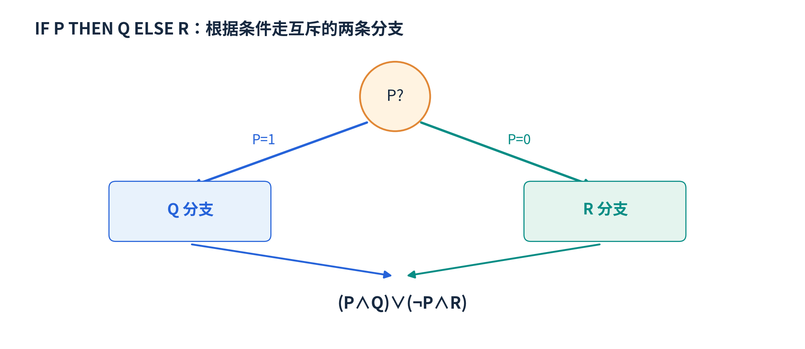

*图：条件分支流程图对应(P∧Q)∨(¬P∧R)的符号化。*

> [!warning] 逻辑描述与实际程序执行的区别
> 这里 $P,Q,R$ 都被**抽象为命题真值**，表示分支规范或分段选取。真实编程中的 `THEN` 与 `ELSE` 可以包含赋值、输入输出和状态改变，不能不加限定地把全部程序行为等同于一个命题公式。此处只学习其选择结构的逻辑抽象。

### 4.7 作用域陷阱：出差问题

设 $p$：“老王去出差”、$q$：“老李去出差”。

“老王和老李中**恰好一个人**去出差”对应异或：

$$
X=(p\land\neg q)\lor(\neg p\land q).
$$

“他们**不是都去**”为 $\neg(p\land q)$；这个表达只排除两个人都去，却**允许都不去**，故不能直接作为 $X$ 的替换。

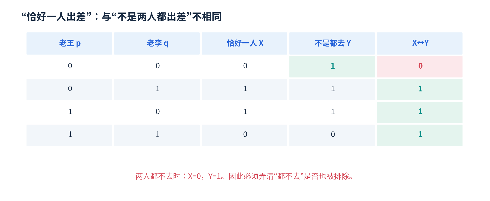

*图：四组出差情景检验两种自然语言表达的真假差别。*

如果原句是“**不是（他们都去或者都不去）**”，需要把“都去或都不去”作为整体否定：

$$
Y=\neg\big[(p\land q)\lor(\neg p\land\neg q)\big].
$$

这样的 $Y$ 恰好等价于 $X$；所以“恰好一个人出差，当且仅当不是（两人都去或两人都不去）”为重言形式。

> [!important] 真正要检查的是括号所确定的否定范围
> $\neg[(p\land q)\lor(\neg p\land\neg q)]$ 与 $\neg(p\land q)\lor(\neg p\land\neg q)$ **不是同一个公式**。前者否定“两个极端情况”这个整体，后者仅否定其中一项。汉语存在歧义时，应明确所采用的断句和括号范围，不能因文字相似就判为等价。

## 5. 命题变项、命题公式与递归构造

### 5.1 命题常项与命题变项

**命题常项（命题常元）**通常指具体而具有确定真值的命题，例如“今天是星期一”。它的真假可能随语境中的日期而变化，但在一个确定语境内有固定真假。

**命题变项（命题变元）**是在公式中表示任意真值的形式符号，通常写成 $p,q,r,p_1,p_2,\ldots$。未给定赋值的命题变项，尚不能认定为某个确定真假的具体命题。

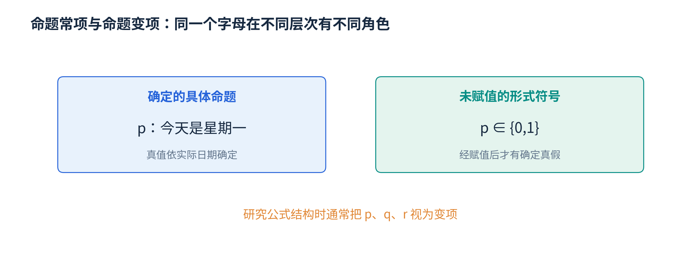

*图：区分实际命题常项与逻辑推演中的命题变项。*

> [!note] 同一字母为什么有时表示具体事实、有时表示变项？
> 在自然语言符号化的例题中，常先约定 $p$ 代表某个具体命题；在公式分析中，又把 $p$ 当成能够取 $0$ 或 $1$ 的变项。两种用法在课程中经常出现，阅读时应根据是否正在“给具体句子命名”或“研究抽象公式的所有赋值”区分。

### 5.2 命题公式（合式公式）的递归定义

命题逻辑公式又叫**合式公式（well-formed formula, wff）**。严格地说，合法公式不是任意字符排列，而要经过有限次数的合法构造：

1. **基础情况**：单个命题变项 $p,q,r,\ldots$ 是命题公式；
2. **否定步骤**：若 $A$ 是公式，则 $(\neg A)$ 也是公式；
3. **二元联结步骤**：若 $A,B$ 是公式，则 $(A\land B)$、$(A\lor B)$、$(A\to B)$、$(A\leftrightarrow B)$ 都是公式；
4. **封闭要求**：只有有限次按照以上规则生成的符号串，才是命题公式。

例如，$p$ 是公式；由 $p,q$ 可形成 $(p\land q)$；再结合 $r$ 可形成 $((p\land q)\to r)$。形式结构可以用语法树表达：

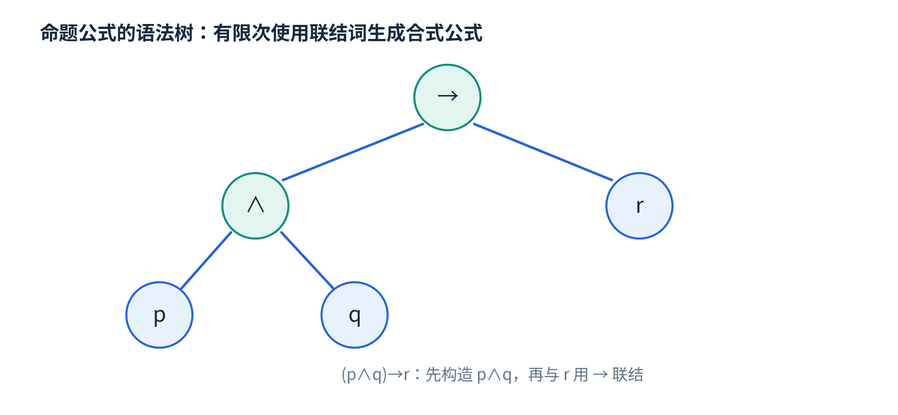

*图：复合公式(p∧q)→r的语法树及递归构造次序。*

**语法树的叶子**是命题变项；**内部结点**是联结词；从叶子向根逐级组合，根结点对应整个公式。该结构比仅盯着一长串括号更容易识别最外层运算。

> [!warning] “公式”与“命题”是两个层次
> 一个未赋值的公式如 $p\to q$ 没有唯一固定的真值；但当 $p,q$ 被确定的命题替代，或给出一个真值指派后，它就会得到确定的真值。不能把“公式本身未确定真假”误解为“公式没有语义、不能计算”。

### 5.3 判断符号串是否合式

要判断一个符号串，通常检查：

- 每个二元联结词两侧都必须是公式；
- 每个否定联结词后面必须接一个公式；
- 括号的数量、层次和结合位置必须合法；
- 不得将两个命题变项直接并排，省略它们之间的联结词；
- 在省略括号时，应能够恢复出确定的完整结构。

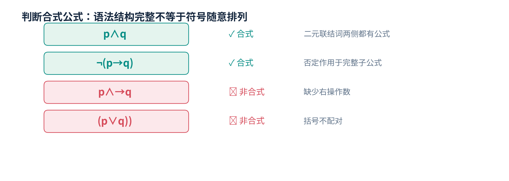

*图：对比合法公式和缺失操作数、括号不匹配等非法符号串。*

| 符号串 | 是否合式 | 原因 |
|---|---|---|
| $p$ | 是 | 单个变项 |
| $\neg\neg p$ | 是 | 两次合法否定 |
| $\neg(p\land q)$ | 是 | 否定作用于合式子公式 |
| $(p\to q)\land r$ | 是 | 两个合式子公式经 $\land$ 联结 |
| $p\land\to q$ | 否 | $\land$ 缺少完整右操作数 |
| $(p\lor q))$ | 否 | 括号不匹配 |
| $pq\lor r$ | 否 | $p$、$q$ 之间缺少联结词 |

### 5.4 子公式与公式层次

**子公式**是构造一条合式公式过程中出现的较小合式部分。命题公式可以定义其“层次”，反映递归构造的深度：

- 若 $A$ 是单个命题变项，则层数为 $0$；
- 若 $A=\neg B$，则 $A$ 的层数为 $B$ 的层数加 $1$；
- 若 $A$ 是 $B\land C$、$B\lor C$、$B\to C$ 或 $B\leftrightarrow C$，则层数为

$$
\operatorname{depth}(A)=1+\max\{\operatorname{depth}(B),\operatorname{depth}(C)\}.
$$

这也解释了为什么不是简单地统计公式里有几个联结词：公式层次取决于**从语法树根部到最深叶子的构造深度**。

> [!example] 分层计算
> 计算
>
> $$
> A=\neg(p\to\neg q)\land\big[(p\lor q)\leftrightarrow\neg r\big]
> $$
>
> 的层数。$p,q,r$ 层数均为 $0$；$\neg q$、$\neg r$、$p\lor q$ 都是 $1$ 层；$p\to\neg q$ 和 $(p\lor q)\leftrightarrow\neg r$ 都是 $2$ 层；$\neg(p\to\neg q)$ 为 $3$ 层；最外部再合取一次，故 **$A$ 为 $4$ 层公式**。

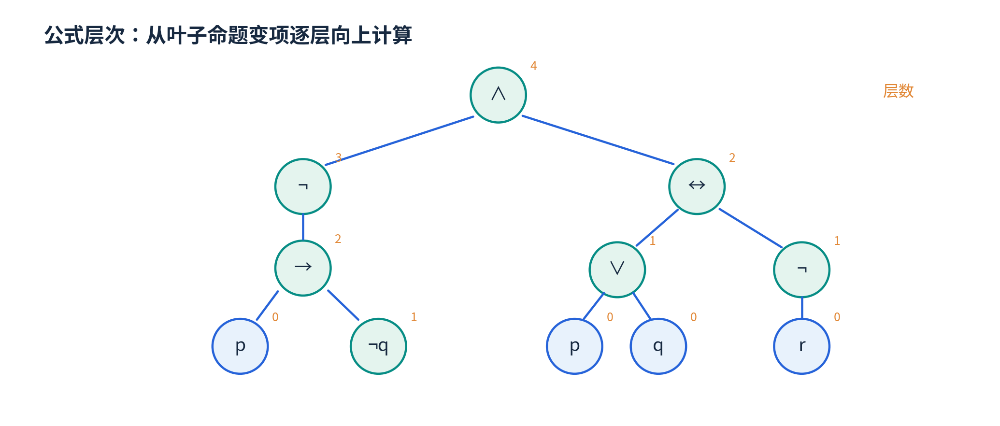

*图：通过带层数标注的语法树计算复合公式的层次。*

### 5.5 联结词优先级与括号

课内采用的简化约定可概括为：

$$
\neg\quad\text{优先于}\quad (\land,\lor)\quad\text{优先于}\quad(\to,\leftrightarrow).
$$

其中 $\land,\lor$ 在这种概括里属于同一组，$\to,\leftrightarrow$ 属于同一组；**一组内部若出现多个不同联结词，且没有特别约定结合规则，就应加括号**。通常还可以省略否定式本身以及整个公式外部的括号。

例如：

- $\neg p\land q$ 按常用约定解释为 $(\neg p)\land q$；
- $p\to(q\land r)$ 与 $(p\to q)\land r$ 不能混写；
- $p\to q\to r$ 若没有明确结合方向，不建议省去括号。

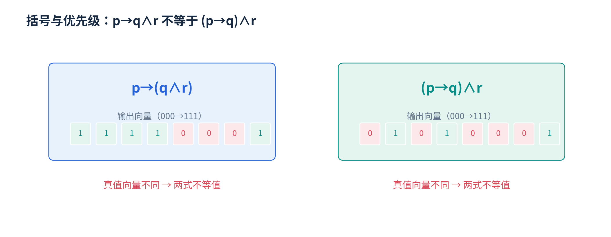

*图：比较两种括号组合下的八行真值向量，解释优先级与括号重要性。*

> [!tip] 书写复杂公式的习惯
> 只在明显且无歧义时省略括号。遇到两个条件句嵌套、多个不同二元联结词混合、否定需要作用于整个子式时，**保留括号比追求短公式更重要**。

## 6. 真值指派：由抽象公式得到具体真假

### 6.1 真值指派、成真赋值与成假赋值

设命题公式 $A$ 含有 $n$ 个**不同的**命题变项 $p_1,p_2,\ldots,p_n$。把每个变项分别指定为 $0$ 或 $1$，称为 $A$ 的一个**真值指派**（truth assignment），又称赋值。

如果变项顺序已明确，可以把赋值写成 $n$ 位二进制串。例如 $(p,q,r)=(1,0,1)$，简记为 $101$。

- **成真赋值**：使公式 $A$ 的结果为 $1$ 的赋值；
- **成假赋值**：使公式 $A$ 的结果为 $0$ 的赋值。

$n$ 个变项各有 $2$ 个可选真值，因此一共有：

$$
\boxed{2^n\text{ 个不同的真值指派}}.
$$

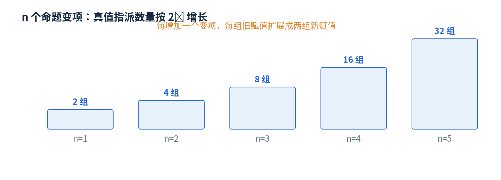

*图：柱形数量关系展示2、4、8、16、32组真值指派的指数增长。*

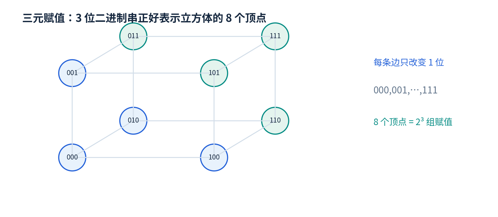

*图：三个命题变项形成立方体的八种真值指派。*

需要特别强调：**同一个命题变项在公式中无论出现多少次，在同一行赋值中都必须保持同一个真值**。例如 $p\land\neg p$ 中两个 $p$ 不能分别独立选取 $0$ 和 $1$。

### 6.2 不列全表的快速判定：找蕴涵的成假赋值

> [!example] 典型三元例题
> 求公式
>
> $$
> A=(p\land q)\to\neg(q\lor r)
> $$
>
> 的所有成真、成假赋值。

外层是蕴涵，故 $A$ 为假的充要条件是

$$
\begin{cases}
p\land q=1,\\
\neg(q\lor r)=0.
\end{cases}
$$

第一个条件要求 $p=q=1$，此时 $q\lor r=1$ 必然成立，与 $r$ 的取值无关。因此，成假赋值只有：

$$
\boxed{(p,q,r)=(1,1,0),(1,1,1)}.
$$

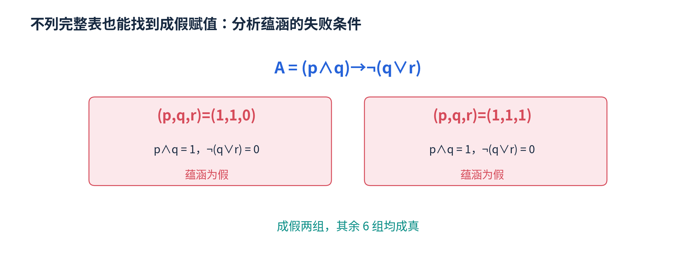

*图：公式(p∧q)→¬(q∨r)的两组成假赋值条件示意。*

按照 $000,001,010,011,100,101,110,111$ 的标准顺序，剩余六个成真赋值是：

$$
\boxed{000,001,010,011,100,101}.
$$

> [!tip] 方法的关键不是省略验证
> 先抓住**最外层联结词**的成假条件，再把内层公式转换为对变项的约束。对很多蕴涵、合取、析取类型的题，比写完 $2^n$ 行更有效率；最后仍要确保所有可能取值均已覆盖。

## 7. 公式的类型：重言式、矛盾式和可满足式

### 7.1 三个基本定义

设 $A$ 为包含 $n$ 个命题变项的公式。

**重言式（永真式，tautology）**：任意赋值下公式都为真，即全部 $2^n$ 行输出均为 $1$。

**矛盾式（永假式，contradiction）**：任意赋值下公式都为假，即全部 $2^n$ 行输出均为 $0$。

**可满足式（satisfiable formula）**：至少存在一个赋值使公式为真，也就是输出列**至少出现一次 $1$**。

特别要分清：**重言式属于可满足式**；“可满足式”不是重言式的反义词。

*图：用集合包含关系区分重言式、一般可满足式与矛盾式。*

### 7.2 公式类别的关系

| 类型 | 输出列特征 | 示例 |
|---|---|---|
| 重言式 | 全部是 $1$ | $p\lor\neg p$、$p\to p$ |
| 矛盾式 | 全部是 $0$ | $p\land\neg p$ |
| 可满足且非重言 | 同时存在 $0$ 和 $1$ | $p\land q$、$p\to q$ |

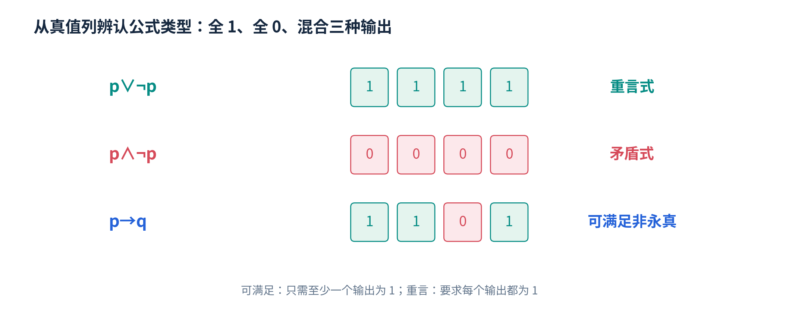

*图：将三种常见真值向量与重言、矛盾、一般可满足分类对照。*

对于任意公式 $A$：

$$
A\text{ 是重言式}\Longleftrightarrow\neg A\text{ 是矛盾式}.
$$

$$
A\text{ 可满足}\Longleftrightarrow\neg A\text{ 不是重言式}.
$$

重言式与矛盾式两类互斥；全部公式可以按“永真／永假／有真有假”三类划分。

### 7.3 重言式的常用性质

若 $A$、$B$ 都是重言式，则 $A\land B$ 和 $A\lor B$ 也都是重言式，因为两式在任意赋值下都为真。

此外，如果 $A$ 与 $A\to B$ **都**是重言式，那么 $B$ 也是重言式：因为在每个赋值下 $A=1$，为了让 $A\to B=1$，只能有 $B=1$。

> [!warning] 不可忽略“两个公式都是重言式”这一条件
> 只知道 $A\to B$ 是重言式，不足以推出 $B$ 是重言式。例如令 $A=p\land\neg p$，它恒为假，那么对任意 $B$，$A\to B$ 都恒为真，但 $B$ 未必永真。

**对应的矛盾式性质**：两个矛盾式的合取与析取仍然都是矛盾式；不过不能把重言式的第二条性质机械替换为矛盾式版本，因为蕴涵在前件为假时为真。

## 8. 真值表：从输入组合到公式分类

### 8.1 真值表是什么

**真值表（truth table）**按固定顺序列出命题变项的所有真值指派，并逐行计算复合公式的结果。

对含有 $n$ 个不同变项的公式，原则上有 $2^n$ 行组合；前 $n$ 列通常是命题变项的输入列，后面按必要顺序计算子公式，最右边为整个公式的结果。

真值表不仅用于计算真假，还用于回答：

1. 哪些赋值是成真赋值，哪些是成假赋值？
2. 公式是重言式、矛盾式还是一般可满足式？
3. 两个公式在全部赋值上的输出是否相同？（这一点将在等值演算中详细研究。）

### 8.2 真值表的规范制作流程

对公式 $A=(p\to q)\land r$：

1. 确认出现 **3 个不同变项** $p,q,r$，需要 $2^3=8$ 行；
2. 固定变项顺序为 $p,q,r$，依次列出 $000,001,010,011,100,101,110,111$；
3. 先计算子公式 $p\to q$；
4. 最后计算 $(p\to q)\land r$，不要跳步；
5. 从最右列读取成真、成假赋值和公式类别。

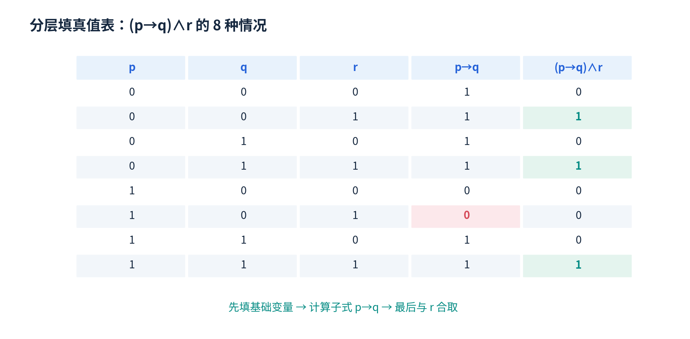

*图：构造(p→q)∧r的八行分层真值表，高亮中间列与成真行。*

对应完整结果：

| $p$ | $q$ | $r$ | $p\to q$ | $(p\to q)\land r$ |
|---:|---:|---:|---:|---:|
| 0 | 0 | 0 | 1 | 0 |
| 0 | 0 | 1 | 1 | **1** |
| 0 | 1 | 0 | 1 | 0 |
| 0 | 1 | 1 | 1 | **1** |
| 1 | 0 | 0 | 0 | 0 |
| 1 | 0 | 1 | 0 | 0 |
| 1 | 1 | 0 | 1 | 0 |
| 1 | 1 | 1 | 1 | **1** |

成真赋值为 $001,011,111$；其余五行成假。所以这是一条**可满足但非重言式**的命题公式。

### 8.3 真值表例题：逆否命题的外层蕴涵

> [!example] 判断类型并求真假指派
> $$
> A=(p\to q)\to(\neg q\to\neg p).
> $$

先计算 $p\to q$ 与 $\neg q\to\neg p$。两者在四组赋值下均为 $1,1,0,1$；尤其注意在 $p=1,q=0$ 时**两者都为假**，外层“假 $\to$ 假”仍然为真。

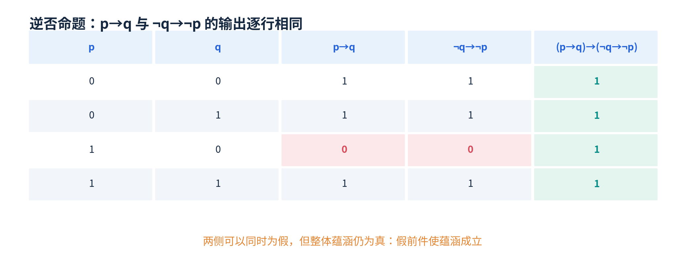

*图：逆否命题真值表逐行一致，使外层蕴涵成为重言式。*

因此整个公式的输出列为 $1,1,1,1$：

$$
\boxed{A\text{ 是重言式；成真赋值为 }00,01,10,11；\text{没有成假赋值。}}
$$

### 8.4 真值表例题：矛盾式

> [!example] 判断类型并求真假指派
> $$
> B=\neg(p\to q)\land q.
> $$

要使 $B=1$，必须同时有 $\neg(p\to q)=1$ 和 $q=1$。第一个条件要求 $p=1,q=0$，与第二个条件 $q=1$ 冲突。因此 **$B$ 永远不可能为真**。

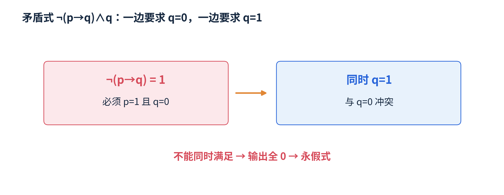

*图：用互相冲突的取值条件解释¬(p→q)∧q恒假。*

真值表输出全为 $0$，所以 $B$ 是矛盾式：成真赋值为空集；成假赋值为 $00,01,10,11$。

> [!tip] 逻辑条件比盲目列表更快
> 矛盾式不一定要靠完整真值表才能判断。只要能证明“想让公式为真，就必须同时要求某个变项既为 $0$ 又为 $1$”，就能直接判定该公式不可满足。

### 8.5 真值表常见失误

1. **漏行**：三个变项只有四行，忘记 $2^3=8$；
2. **赋值顺序混乱**：一会儿按 $p,q,r$，一会儿按 $r,q,p$，造成错误对照；
3. **同一变项同一行不一致**：一个 $p$ 出现多次时不能分别取不同真假；
4. **先算最外层**：未计算子公式就直接填结果，尤其容易误判嵌套蕴涵；
5. **误读蕴涵**：把 $0\to0$ 误判为 $0$；
6. **误读可满足性**：把“至少一个 $1$”误当成“必须有 $0$ 也有 $1$”；
7. **忽略括号**：把 $\neg(p\to q)$ 当成 $\neg p\to q$。

## 9. 例题巩固与方法速查

### 9.1 快速辨析：不同句型

| 语句 | 分析结果 |
|---|---|
| “13 不是偶数” | 令 $p$：“13 是偶数”，则为 $\neg p$ |
| “13 是偶数也是奇数” | $p\land q$ |
| “他一边走路一边唱歌” | $p\land q$ |
| “数学或英语成绩好” | 通常 $p\lor q$，允许都好 |
| “只能选 203 或 204 之一” | $p\oplus q$，恰好一真 |
| “如果努力学习，就得奖学金” | $p\to q$ |
| “只要不下雨，就骑车” | $\neg p\to q$，$p$ 表示下雨 |
| “只有不下雨，才骑车” | $q\to\neg p$ |
| “面积相等当且仅当半径相等” | $p\leftrightarrow q$，在圆与非负半径前提下成立 |

### 9.2 分层练习（先做题，再看答案）

**题 1｜判断命题。** 判断“明天下雨”“现在去开窗！”“$5<3$”“$x^2=1$（未规定 $x$）”“地球有两个月亮”是否为命题，并说明理由。

**题 2｜真值训练。** 令 $p=0,q=1$，求 $\neg p$、$p\land q$、$p\lor q$、$p\to q$、$p\leftrightarrow q$、$p\oplus q$ 的真值。

**题 3｜条件句符号化。** 令 $p$：“完成作业”、$q$：“可以参加活动”。分别表示“只要完成作业就可参加活动”与“只有完成作业才可参加活动”。

**题 4｜例外条件。** 令 $p$：“设备故障”、$q$：“报警”、$r$：“设备处于维护模式”。用命题公式表示“设备故障就报警，除非处于维护模式”。

**题 5｜异或与否定作用域。** 令 $p$：“甲参加”、$q$：“乙参加”。分别写出“至少一人参加”“恰好一人参加”“不是两人都参加”“两人都不参加”。

**题 6｜公式层次。** 求 $\neg(p\lor q)\to(r\land\neg p)$ 的层数。

**题 7｜成假指派。** 不借助完整真值表，找出 $(p\land\neg q)\to r$ 的所有成假赋值。

**题 8｜公式类型。** 判断 $\neg(p\to q)\land p$ 的类型，并给出全部成真赋值。

> [!example]- 练习答案与关键步骤
> **题 1：** “明天下雨”“$5<3$”“地球有两个月亮”都是具有确定真值的陈述句；“现在去开窗！”是祈使句，不是命题；未规定 $x$ 的 $x^2=1$ 是开放语句，通常不算命题。
>
> **题 2：** 按所列顺序依次为 $1,0,1,1,0,1$。
>
> **题 3：** 两句分别为 $p\to q$、$q\to p$，注意箭头方向相反。
>
> **题 4：** $\neg r\to(p\to q)$，或者 $(p\land\neg r)\to q$。
>
> **题 5：** 依次为 $p\lor q$；$(p\land\neg q)\lor(\neg p\land q)$；$\neg(p\land q)$；$\neg p\land\neg q$。
>
> **题 6：** $\neg(p\lor q)$ 为 $2$ 层；$r\land\neg p$ 为 $2$ 层；最外层的 $\to$ 使整个公式成为 **$3$ 层**。
>
> **题 7：** 外层蕴涵为假要求 $p=1,q=0,r=0$，所以只有 **$100$** 一组。
>
> **题 8：** $\neg(p\to q)$ 为真等价于 $p=1,q=0$，此时 $p=1$ 自动成立，故成真赋值只有 **$10$**，其他赋值成假；这是**可满足但非重言式**。

### 9.3 考前速查

> [!summary] 一章知识的最短复习链
> - **命题**：具有确定真值的陈述句；真假未知与真假不确定不是一回事。
> - **五个联结词**：$\neg$ 反转，$\land$ 都真，$\lor$ 至少一真，$\to$ 只有 $1\to0$ 为假，$\leftrightarrow$ 两侧相同为真。
> - **符号化**：只要 $p$ 就 $q$ 是 $p\to q$；只有 $p$ 才 $q$ 是 $q\to p$；“或”先辨相容还是排斥；“除非”先确定例外范围。
> - **合式公式**：由变项通过有限次合法联结生成；公式层数由语法树最大深度决定。
> - **真值指派**：$n$ 个不同变项对应 $2^n$ 组；让公式真叫成真赋值，让公式假叫成假赋值。
> - **类型**：全 $1$ 是重言式，全 $0$ 是矛盾式，至少一个 $1$ 是可满足式。
> - **做题顺序**：找最外层联结词 → 分析子公式 → 固定变项顺序 → 列真值或直接约束推导 → 检查漏行与括号。
