---
tags:
  - 离散数学/命题逻辑
  - 离散数学/等值演算
  - 离散数学/联结词完备集
aliases:
  - 命题逻辑等值式与联结词完备集
---

# 命题逻辑：逻辑等值式、等值演算与联结词完备集

逻辑学习中，**公式的外表可能完全不同，但其在每一种赋值下的真值可以完全相同**。这种不依赖自然语言含义、只依赖真值结构的关系，就是逻辑等值。掌握等值式后，可以将复杂公式逐步化简，还能回答更深一层的问题：**究竟需要保留哪些联结词，才能表达全部命题逻辑的真值关系？**

本章主线：

**命题公式与真值指派 → 判断等值 → 常用等值律 → 代入、置换与等值演算 → 典型推理应用 → 真值函数 → 联结词完备集及其证明 → 公式改写与逻辑线路。**

## 1. 基础衔接：命题公式、真值指派与真值表

### 1.1 命题变项与五种基本联结词

命题是能够确定真假的陈述句。一般用 $p,q,r$ 等表示命题变项，规定 $1$ 为真、$0$ 为假。对命题进行组合时，主要使用以下联结词：

| 联结词 | 名称 | 读法和真值条件 |
|---|---|---|
| $\neg p$ | 否定 | 与 $p$ 的真值相反 |
| $p\land q$ | 合取 | 两者都真才为真 |
| $p\lor q$ | 析取 | 至少一个真就为真，允许同时真 |
| $p\to q$ | 蕴涵 | **只有前件真、后件假才为假** |
| $p\leftrightarrow q$ | 等价联结词 | 两者真值相同才为真 |

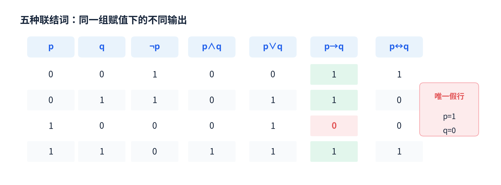

*图：五种联结词真值表与蕴涵唯一为假的赋值。*

> [!warning] 对蕴涵的常见误解
> 不能将 $p\to q$ 理解为“先发生 $p$，然后发生 $q$”，也不能要求两个命题在现实内容上存在因果联系。在**实质蕴涵**中，只检查真值。只要 $p=0$，$p\to q$ 就为真，不论 $q$ 是真是假。

自然语言中特别注意：

- “只要 $p$，就 $q$”：$p\to q$。
- “只有 $p$，才 $q$”：$q\to p$，因为 $p$ 是 $q$ 的必要条件。
- “$p$ 当且仅当 $q$”：$p\leftrightarrow q$。
- “除非 $r$，否则若 $p$ 则 $q$”：$\neg r\to(p\to q)$，也等值于 $(p\land\neg r)\to q$。

例如，令 $p$：“今天是星期一”，$q$：“明天是星期二”，$r$：“明天是星期三”。“只有今天是星期一，明天才是星期二”写成 $q\to p$，不是 $p\to q$。

### 1.2 合式公式的递归定义

**命题公式**（well-formed formula, wff），又称**合式公式**，由以下有限步骤形成：

1. 单个命题变项是公式；
2. 若 $A$ 是公式，则 $\neg A$ 是公式；
3. 若 $A,B$ 是公式，则 $(A\land B)$、$(A\lor B)$、$(A\to B)$、$(A\leftrightarrow B)$ 也是公式；
4. 只有通过上述规则**有限次**形成的符号串才是公式。

例如 $((p\land q)\to r)$ 的最外层联结词是 $\to$，其左子公式是 $p\land q$，右子公式是 $r$。这可以看成一棵由子公式逐级构造的语法树：

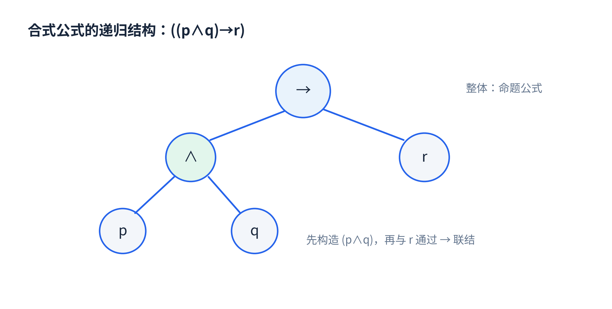

*图：合式公式语法树：原子命题如何递归组成更大公式。*

书写时通常可以根据约定的联结词优先级省略部分括号，但做等值演算时，**复杂公式宜保留必要括号**，避免误读。

### 1.3 真值指派、成真赋值和成假赋值

设 $A$ 中有 $n$ 个不同命题变项 $p_1,p_2,\ldots,p_n$。对它们分别指定 $0$ 或 $1$ 的组合，称为一个**真值指派**（或赋值）。当变项顺序确定后，可以用一个 $n$ 位二进制串表示。

- 使 $A=1$ 的赋值叫**成真赋值**；
- 使 $A=0$ 的赋值叫**成假赋值**。

$n$ 个变项各有两种取值，所以不同赋值总数是

$$
2^n.
$$

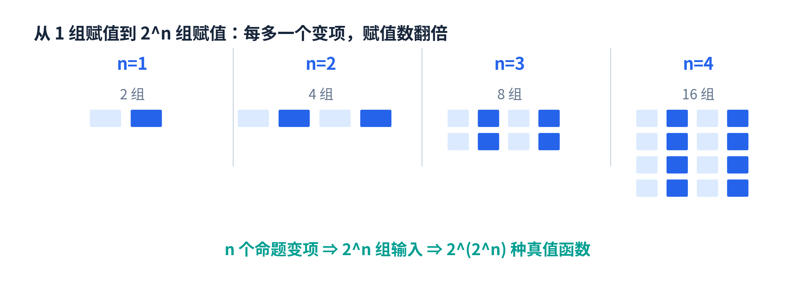

*图：变项数量增加时赋值组合与真值函数数量的双指数关系。*

> [!example] 不必列完整真值表，也能找成假赋值
> 求 $A=(p\land q)\to\neg(q\lor r)$ 的成假赋值。
>
> 蕴涵为假，必须同时有 $p\land q=1$ 与 $\neg(q\lor r)=0$。前一个条件要求 $p=q=1$，此时 $q\lor r=1$ 自动成立，不限制 $r$。
>
> 因此仅有 $(p,q,r)=(1,1,0)$、$(1,1,1)$ 两组成假赋值，其余六组均成真。

再看 $B=(p\land q)\to r$。它只有 $(p,q,r)=(1,1,0)$ 一组成假赋值，在三维赋值结构中可以直观看到：

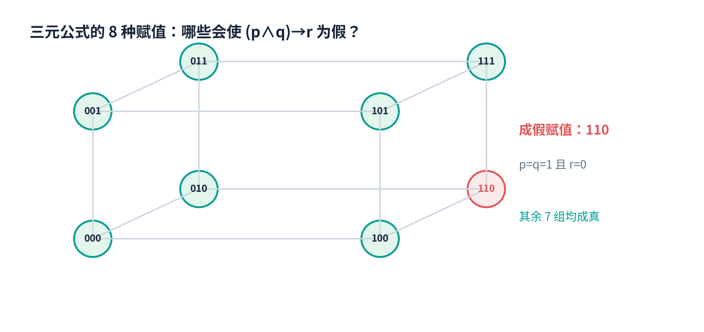

*图：三元赋值立方体中唯一使蕴涵公式成假的顶点。*

### 1.4 重言式、矛盾式与可满足式

| 公式类型 | 判定条件 | 典型例子 |
|---|---|---|
| **重言式 / 永真式** | 所有赋值均使公式为 $1$ | $p\lor\neg p$、$p\to p$ |
| **矛盾式 / 永假式** | 所有赋值均使公式为 $0$ | $p\land\neg p$ |
| **可满足式** | **至少存在一组**成真赋值 | $p\land q$；重言式也可满足 |
| **可满足而非重言式** | 至少一真，且至少一假 | $p\to q$、$p\land q$ |

> [!important] 逻辑包含关系
> 所有重言式都是可满足式，但可满足式不一定是重言式。矛盾式不可满足。对任何公式 $A$，$A$ 是重言式当且仅当 $\neg A$ 是矛盾式。

真值表最右侧输出列全为 $1$、全为 $0$ 或真假混合，分别对应该分类。重言式还有两个常用性质：两个重言式的合取、析取仍是重言式；若 $A$ 与 $A\to B$ 均为重言式，则 $B$ 也是重言式。

> [!example] 逆否命题的重言关系
> 对公式 $(p\to q)\to(\neg q\to\neg p)$，由于 $p\to q$ 和 $\neg q\to\neg p$ 等值，它们形成的蕴涵在所有四组赋值下都是 $1$，因此为重言式。

## 2. 逻辑等值：两种形式相同的真值规律

### 2.1 逻辑等值的定义与符号

若命题公式 $A,B$ **在所有有关命题变项的真值指派下真值完全相同**，称二者逻辑等值或逻辑等价，记为

$$
A\Leftrightarrow B.
$$

这里的 $\Leftrightarrow$ 表示**两公式之间的元语言关系**：无论怎样赋值，两侧的输出永远一致。

相反，$A\leftrightarrow B$ 是**可以放入公式内部的等价联结词**，表示在一次给定赋值下 $A,B$ 的真值是否一致。因此：

$$
\boxed{A\Leftrightarrow B\quad\Longleftrightarrow\quad A\leftrightarrow B\text{ 是重言式。}}
$$

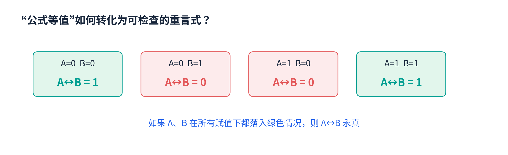

*图：A与B的真值相等当且仅当A↔B取1的四种情形。*

> [!warning] 两个箭头不能混写
> $A\leftrightarrow B$ 本身是命题公式，仍然可能真或假；$A\Leftrightarrow B$ 则是关于**两公式逻辑关系**的断言。例如 $p\leftrightarrow q$ 并非重言式，但 $p\to q\Leftrightarrow\neg p\lor q$ 成立。

### 2.2 判断是否等值的两条路径

**真值表法**：枚举所有赋值，逐行求 $A,B$ 的真值，比较它们的输出列。所有行对应相同才等值。优点是直观且机械可靠；缺点是变项数增大后行数 $2^n$ 迅速增长。

**等值演算法**：用已知的基本等值律逐步改写公式，直到两侧转化为同一个表达式。适合较长公式及理论证明，要求每一步都说明所依据的等值律。

> [!tip] 如何最快证明“不等值”
> 只需要给出**一个反例赋值**，使 $A,B$ 真值不同；不必完成整张真值表。证明等值则需要覆盖全部赋值，或给出有效的等值推导。

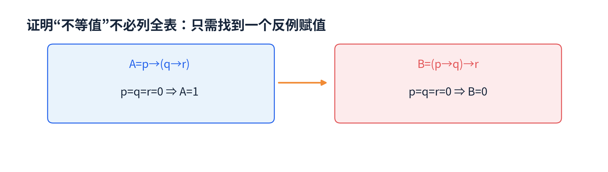

*图：以单个赋值证明两个公式真值不同。*

### 2.3 经典三式比较

考虑

$$
A=p\to(q\to r),\qquad
B=(p\to q)\to r,\qquad
C=(p\land q)\to r.
$$

三个公式虽然只改变了括号和联结词，却不一定逻辑等值。下面的逐行对照展示：$A$ 与 $C$ 真值完全相同，而 $B$ 不同。

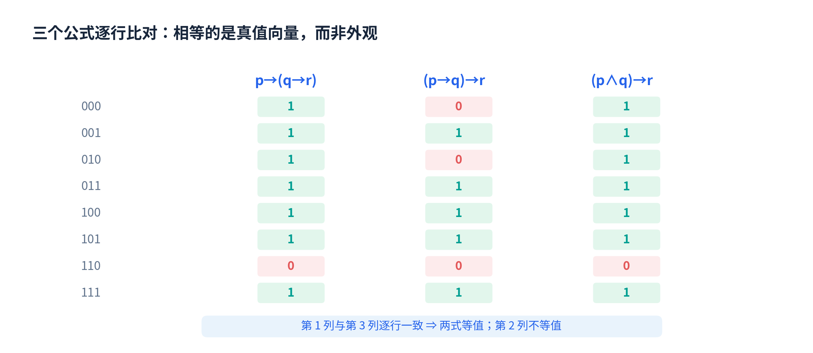

*图：三条逻辑公式的真值向量比较，展示相同与不同的输出列。*

代数上，

$$
\begin{aligned}
p\to(q\to r)
&\Leftrightarrow \neg p\lor(\neg q\lor r)\\
&\Leftrightarrow\neg p\lor\neg q\lor r,\\
(p\land q)\to r
&\Leftrightarrow\neg(p\land q)\lor r\\
&\Leftrightarrow\neg p\lor\neg q\lor r.
\end{aligned}
$$

所以

$$
p\to(q\to r)\Leftrightarrow(p\land q)\to r.
$$

但在 $p=q=r=0$ 时，$A=1$ 而 $B=0$，因此 $A\not\Leftrightarrow B$。

## 3. 必须熟练掌握的逻辑等值律

以下的 $A,B,C$ 均表示**任意命题公式**，不只是单个命题变项。这些规律是可用来匹配实际子公式的**等值式模式**。

### 3.1 关于合取、析取的代数规律

| 名称 | 等值式模式 | 使用场合 |
|---|---|---|
| 幂等律 | $A\lor A\Leftrightarrow A$；$A\land A\Leftrightarrow A$ | 删除重复条件 |
| 交换律 | $A\lor B\Leftrightarrow B\lor A$；$A\land B\Leftrightarrow B\land A$ | 调整条件顺序 |
| 结合律 | $(A\lor B)\lor C\Leftrightarrow A\lor(B\lor C)$；合取同理 | 重新分组 |
| 分配律 | $A\lor(B\land C)\Leftrightarrow(A\lor B)\land(A\lor C)$ | 展开或提取公共项 |
| 分配律 | $A\land(B\lor C)\Leftrightarrow(A\land B)\lor(A\land C)$ | 展开合取 |
| 吸收律 | $A\lor(A\land B)\Leftrightarrow A$；$A\land(A\lor B)\Leftrightarrow A$ | 删除冗余条件 |

**吸收律的本质是集合包含**：$A\land B$ 成立的范围一定包含于 $A$ 成立的范围，因此再把交集与 $A$ 求并，不会增加任何新情形。

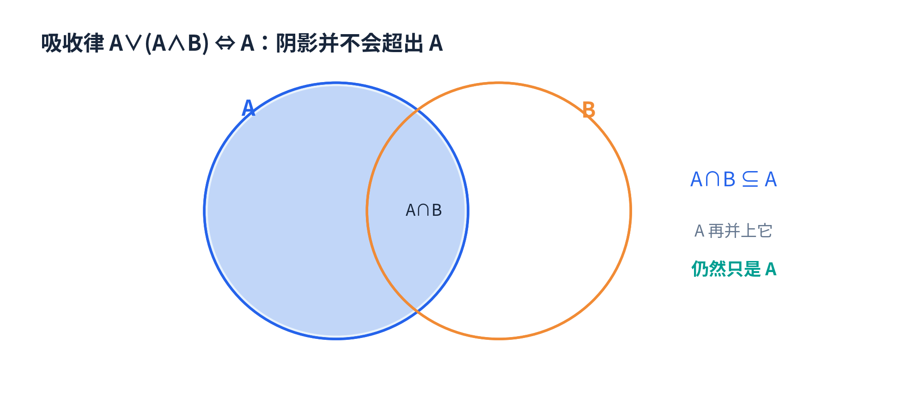

*图：吸收律的集合区域示意：交集已经包含在A内部。*

**分配律的本质是区域保持**：要求 $A$ 成立且 $B,C$ 至少一个成立，等于分别考虑“$A,B$ 都成立”与“$A,C$ 都成立”，再取并集。

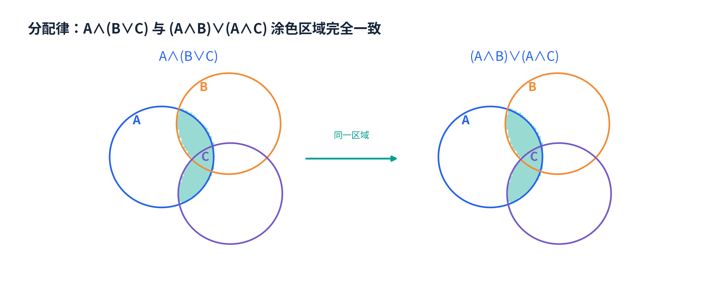

*图：用三集合重叠区域验证分配律两侧相等。*

> [!note] 还有两条关于 $\leftrightarrow$ 的规律
> $A\leftrightarrow B\Leftrightarrow B\leftrightarrow A$（交换），以及 $(A\leftrightarrow B)\leftrightarrow C\Leftrightarrow A\leftrightarrow(B\leftrightarrow C)$（结合）。此外，$A\to(B\to C)\Leftrightarrow(A\to B)\to(A\to C)$，可通过消去蕴涵并使用分配律验证。

### 3.2 否定律与德·摩根律

$$
\begin{aligned}
\neg\neg A&\Leftrightarrow A &&\text{（双重否定律）},\\
\neg(A\lor B)&\Leftrightarrow\neg A\land\neg B &&\text{（德·摩根律）},\\
\neg(A\land B)&\Leftrightarrow\neg A\lor\neg B &&\text{（德·摩根律）}.
\end{aligned}
$$

必须特别理解：**否定一个“或”，会得到两个条件都不成立；否定一个“且”，会得到至少一个条件不成立。** 它不是机械地在括号前添加负号，而是同时改变联结词和两个子公式的极性。

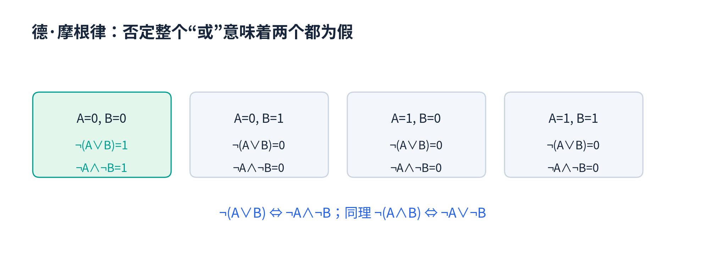

*图：德摩根律在四个二元赋值下的同步变化。*

> [!warning] 常见错误
> $\neg(A\lor B)\not\Leftrightarrow\neg A\lor\neg B$；$\neg(A\land B)\not\Leftrightarrow\neg A\land\neg B$。正确做法是**否定向内分配、$\land$ 与 $\lor$ 互换**。

### 3.3 常量、排中律和矛盾律

记 $1$ 为恒真，$0$ 为恒假：

| 名称 | 等值式 |
|---|---|
| 零律 | $A\lor1\Leftrightarrow1$；$A\land0\Leftrightarrow0$ |
| 同一律 | $A\lor0\Leftrightarrow A$；$A\land1\Leftrightarrow A$ |
| 排中律 | $A\lor\neg A\Leftrightarrow1$ |
| 矛盾律 | $A\land\neg A\Leftrightarrow0$ |

通过这些规律经常能快速判断公式是否为重言式或矛盾式。例如：

$$
(A\lor\neg A)\land B\Leftrightarrow1\land B\Leftrightarrow B,
$$

$$
(A\land\neg A)\lor B\Leftrightarrow0\lor B\Leftrightarrow B.
$$

> [!tip] 化简顺序
> 优先找 $A\lor\neg A$ 和 $A\land\neg A$，然后用零律、同一律消掉常量；遇到 $A\lor(A\land B)$ 时优先用吸收律，而非展开后再化简。

### 3.4 蕴涵和等价联结词的消去

**蕴涵等值式**：

$$
A\to B\Leftrightarrow\neg A\lor B.
$$

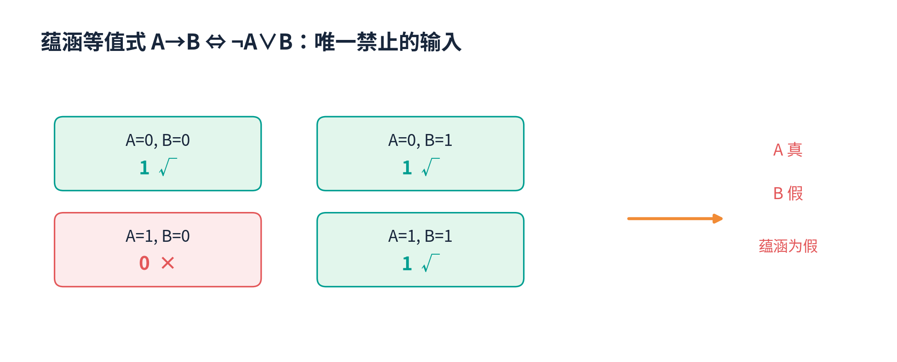

*图：蕴涵真值只有在前件为真后件为假时失败。*

**假言易位（逆否）**：

$$
A\to B\Leftrightarrow\neg B\to\neg A.
$$

**归谬型等值式**：

$$
(A\to B)\land(A\to\neg B)\Leftrightarrow\neg A.
$$

这表明：若假设 $A$ 成立会同时得到 $B$ 和 $\neg B$，那么 $A$ 必定不成立。代数验证：

$$
\begin{aligned}
(A\to B)\land(A\to\neg B)
&\Leftrightarrow(\neg A\lor B)\land(\neg A\lor\neg B)\\
&\Leftrightarrow\neg A\lor(B\land\neg B)\\
&\Leftrightarrow\neg A.
\end{aligned}
$$

**等价等值式**：

$$
A\leftrightarrow B\Leftrightarrow(A\to B)\land(B\to A).
$$

由此可得另一种重要写法：

$$
A\leftrightarrow B\Leftrightarrow(A\land B)\lor(\neg A\land\neg B).
$$

**等价否定等值式**：

$$
A\leftrightarrow B\Leftrightarrow\neg A\leftrightarrow\neg B.
$$

> [!important] 核心技巧
> 许多复杂公式不能直接“看出”怎样化简，但只要先用 $A\to B\Leftrightarrow\neg A\lor B$ 消去所有 $\to$，再用德·摩根律把否定推进括号内部，就会转化为只含 $\neg,\land,\lor$ 的布尔代数问题。

## 4. 等值演算的操作规则与证明方法

### 4.1 等值式模式与代入规则

因为 $A\to B\Leftrightarrow\neg A\lor B$ 对任意公式都成立，所以令

$$
A=(p\lor q\lor r),\quad B=(p\land q),
$$

便得到

$$
(p\lor q\lor r)\to(p\land q)
\Leftrightarrow
\neg(p\lor q\lor r)\lor(p\land q).
$$

**代入规则**：若一个公式是重言式，则用任意公式**统一代换其中同一个命题变项的所有出现**，所得公式仍是重言式。

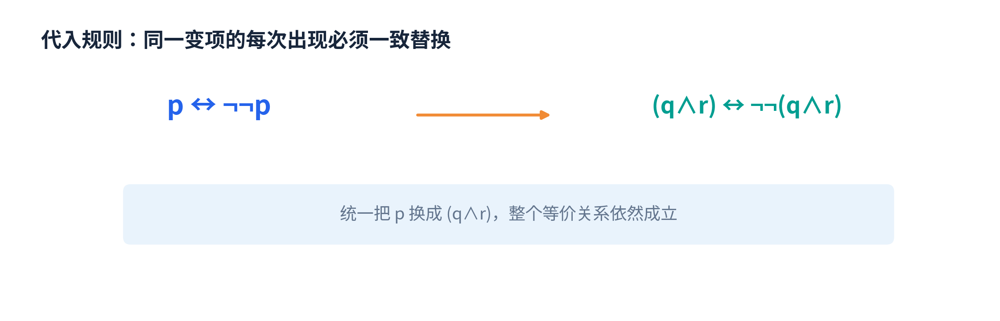

*图：重言式代入规则展示同一命题变项全局统一替换。*

例如 $p\leftrightarrow\neg\neg p$ 是重言式，把每个 $p$ 同时替换为 $q\land r$，得到

$$
(q\land r)\leftrightarrow\neg\neg(q\land r),
$$

仍然是重言式。

### 4.2 置换规则：局部替换任意等值子式

**置换规则**：若 $A\Leftrightarrow B$，则一个复杂公式中出现的 $A$，可以用与其等值的 $B$ 替换，整体真值保持不变；**不强制所有相同子式同时替换**。

以 $p\lor(p\land q)\Leftrightarrow p$ 为例：

$$
\bigl(p\lor(p\land q)\bigr)\land r
\Leftrightarrow p\land r.
$$

*图：置换规则示意：局部用吸收律替换不改变整体真值。*

| 比较点 | 代入规则 | 置换规则 |
|---|---|---|
| 起点 | 一个已知**重言式** | 一个含有等值子公式的**公式** |
| 替换对象 | 某个命题变项 | 某个出现的子公式 |
| 替换依据 | 任意命题公式，统一代入 | 必须与原子公式等值 |
| 替换范围 | 相同变项的**全部出现** | 指定的某个或某些出现 |
| 保证结果 | 仍是重言式 | 整个公式与原式等值 |

> [!warning] 不要混淆“同时代入”和“局部置换”
> 例如把重言式 $p\leftrightarrow p$ 的左侧 $p$ 换成 $q$、右侧仍保留 $p$，得到 $q\leftrightarrow p$，**不保证是重言式**；这是错误的代入。置换则必须先证明被替换的子公式与新公式等值。

### 4.3 等值演算的标准书写方式

证明两个公式等值，推荐采用下面的格式：

$$
\begin{aligned}
(p\land q)\to r
&\Leftrightarrow\neg(p\land q)\lor r &&\text{（蕴涵等值式）}\\
&\Leftrightarrow(\neg p\lor\neg q)\lor r &&\text{（德·摩根律）}\\
&\Leftrightarrow\neg p\lor\neg q\lor r &&\text{（结合律）}.
\end{aligned}
$$

*图：三步把(p∧q)→r改写成仅含否定和析取的公式。*

这里应用的是等值关系的**传递性**：$A\Leftrightarrow B$ 且 $B\Leftrightarrow C$，则 $A\Leftrightarrow C$。验证等值式时常采用“两边分别化成同一形式”的路线，不必强行只变换左侧。

### 4.4 例题：两条不同结构的公式为什么等值？

证明

$$
p\to(q\to r)\Leftrightarrow(p\to q)\to(p\to r).
$$

左侧：

$$
p\to(q\to r)
\Leftrightarrow\neg p\lor(\neg q\lor r)
\Leftrightarrow\neg p\lor\neg q\lor r.
$$

右侧：

$$
\begin{aligned}
(p\to q)\to(p\to r)
&\Leftrightarrow\neg(\neg p\lor q)\lor(\neg p\lor r)\\
&\Leftrightarrow(p\land\neg q)\lor\neg p\lor r\\
&\Leftrightarrow(\neg p\lor p\lor r)\land(\neg p\lor\neg q\lor r)\\
&\Leftrightarrow 1\land(\neg p\lor\neg q\lor r)\\
&\Leftrightarrow\neg p\lor\neg q\lor r.
\end{aligned}
$$

两侧都等值于 $\neg p\lor\neg q\lor r$，所以原命题得证。这里最关键的一步是对 $\lor$ 与 $\land$ 施加分配律，并通过排中律消掉一整个因子。

### 4.5 用等值演算判定公式类型

**例一：重言式。** 判断

$$
A=q\lor\neg((\neg p\lor q)\land p).
$$

先由分配律及矛盾律发现

$$
(\neg p\lor q)\land p
\Leftrightarrow(\neg p\land p)\lor(q\land p)
\Leftrightarrow p\land q.
$$

因此

$$
\begin{aligned}
A&\Leftrightarrow q\lor\neg(p\land q)\\
&\Leftrightarrow q\lor\neg p\lor\neg q\\
&\Leftrightarrow\neg p\lor(q\lor\neg q)\\
&\Leftrightarrow\neg p\lor1\\
&\Leftrightarrow1.
\end{aligned}
$$

故 $A$ 为重言式。

**例二：矛盾式。** 判断

$$
B=(p\lor\neg p)\to((q\land\neg q)\land r).
$$

利用排中律、矛盾律和零律，

$$
B\Leftrightarrow1\to(0\land r)
\Leftrightarrow1\to0
\Leftrightarrow0.
$$

故 $B$ 为矛盾式。

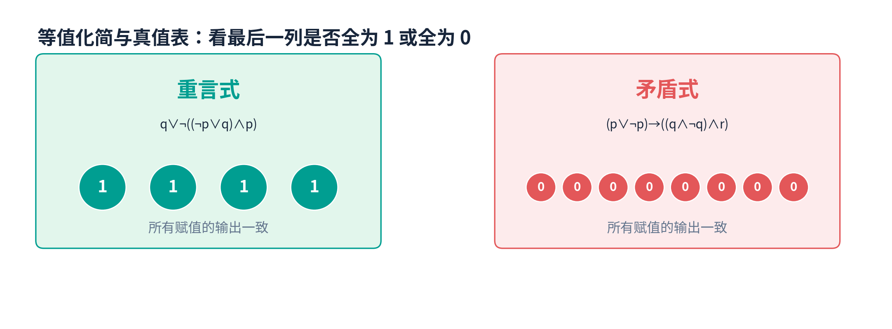

*图：化简后恒为1或恒为0的公式类型及输出向量。*

> [!tip] 真值表与等值演算各有优势
> 成真、成假赋值较少时，直接利用“什么情况下整个公式为假/真”反推变量往往最快；遇到大量对立项或子公式重复时，等值演算通常更快。两种方法可互相验算。

### 4.6 典型证明：含重复分支的公式

**练习一。** 证明

$$
(\neg p\land(\neg q\land r))\lor(q\land r)\lor(p\land r)
\Leftrightarrow r.
$$

提出公共因子 $r$：

$$
\begin{aligned}
& (\neg p\land\neg q\land r)\lor(q\land r)\lor(p\land r)\\
\Leftrightarrow{}&r\land\bigl((\neg p\land\neg q)\lor q\lor p\bigr)\\
\Leftrightarrow{}&r\land\bigl(\neg(p\lor q)\lor(p\lor q)\bigr)\\
\Leftrightarrow{}&r\land1\\
\Leftrightarrow{}&r.
\end{aligned}
$$

**练习二。** 证明

$$
\begin{aligned}
C={}&((p\lor q)\land\neg(\neg p\land(\neg q\lor\neg r)))\\
&\lor(\neg p\land\neg q)\lor(\neg p\land\neg r)
\end{aligned}
$$

是重言式。取

$$
X=(p\lor q)\land(p\lor r).
$$

根据德·摩根律和分配律，$C$ 的第一部分等值于 $X$，而余下两部分

$$
(\neg p\land\neg q)\lor(\neg p\land\neg r)
\Leftrightarrow\neg(p\lor q)\lor\neg(p\lor r)
\Leftrightarrow\neg X.
$$

于是 $C\Leftrightarrow X\lor\neg X\Leftrightarrow1$。这个证明的关键不是展开所有项，而是**识别“某式及其否定”**。

## 5. 等值演算在判断问题中的应用

### 5.1 排名预测：每人“对一半”意味着异或条件

四名选手 $A,B,C,D$ 参加比赛，无并列。三位观众预测：

| 观众 | 第一个判断 | 第二个判断 |
|---|---|---|
| 甲 | $C$ 第一 | $B$ 第二 |
| 乙 | $C$ 第二 | $D$ 第三 |
| 丙 | $A$ 第二 | $D$ 第四 |

每人恰有一个判断正确。记 $C_1$ 为“$C$ 第一”，其他符号同理。

“两个判断恰好一个为真”写成

$$
(X\land\neg Y)\lor(\neg X\land Y),
$$

也即**异或**，不是简单的 $X\lor Y$（后者允许两者同时真）。三个条件为

$$
\begin{aligned}
&(C_1\land\neg B_2)\lor(\neg C_1\land B_2),\\
&(C_2\land\neg D_3)\lor(\neg C_2\land D_3),\\
&(A_2\land\neg D_4)\lor(\neg A_2\land D_4).
\end{aligned}
$$

还需满足比赛**同一名次只能由一个人占有，同一个人也只能占一个名次**的约束。例如 $C_1\land C_2$ 不可能成立，$A_2\land B_2$ 也不可能成立。

*图：三组预测恰有一真及唯一有效名次的约束关系。*

运用三个“恰好一个为真”约束及名次不冲突条件排除分支，唯一解为

$$
\boxed{C\text{ 第一，}A\text{ 第二，}D\text{ 第三，}B\text{ 第四。}}
$$

验证：甲只猜中 $C$ 第一；乙只猜中 $D$ 第三；丙只猜中 $A$ 第二；且四人名次没有重复。

### 5.2 红黑帽问题：从“沉默”获取间接信息

桌上有两顶红帽、三顶黑帽，商人和两位应试者在暗处各戴一顶。开灯后，两名应试者都看到商人戴红帽，并能看到另一名应试者所戴帽子的颜色。过一段时间，其中一人断定自己戴的是黑帽。

推理可以分成两层：

1. **直接观察**：若某人同时看见商人和另一应试者戴着两顶红帽，由于只有两顶红帽，他必定立即知道自己戴的是黑帽。
2. **观察别人未立即回答**：一名应试者如果看见另一人戴黑帽，会继续推想：“假如我戴红帽，对方就看见两顶红帽，应该立即得出自己戴黑帽的结论；但对方没有立即回答，因此我不可能戴红帽。”

由此，在双方公开知道帽子总数、都能正确推理，并且“立即回答”有共同可观察意义的前提下，可以得出**两位应试者都戴黑帽**。

*图：帽子推理中的可见信息与沉默所提供的间接信息。*

> [!note] 这道题的隐藏前提
> 这里利用了“所有参与者都知道其他人也能进行正确推理”这一层次的信息。如果不允许观察等待过程，或不知道他人能否及时回答，仅凭“看到商人戴红帽”并不能直接判定自己的帽色。

### 5.3 围棋子的一问猜色问题：辨明“说谎”的含义

一人手持黑棋或白棋，另一人只能问一个是非问题，回答者可以说真话或假话。**仅凭一次普通回答不可能在允许任意选择说真话、说假话的情况下保证猜中**：对于相同棋色，他完全可以选择相反回答。

若另加明确条件：回答者具有**固定的诚实或说谎规则**，并且会按这一规则回答假设性问题，可以问：“如果我问你‘棋子是黑色的吗？’，你会回答‘是’吗？”在固定诚实者或固定说谎者的标准谜题模型下，可以消去一次说谎的影响；但这**不适用于随时任意改变真假回答策略**的情形。

## 6. 真值函数与全部可能的联结词

### 6.1 从公式到真值函数

设 $F$ 是一个 $n$ 元真值函数：

$$
F:\{0,1\}^{n}\longrightarrow\{0,1\}.
$$

其输入是 $n$ 个布尔真值，输出是一个布尔真值。任一包含 $n$ 个变项的命题公式都对应这样一个函数。反过来，在通常的命题逻辑联结词体系中，任一这样的真值函数都能用适当命题公式表达。

**一元情况**：输入只有 $0$、$1$ 两行，输出列的全部可能是

| 函数 | $F(0)$ | $F(1)$ | 对应公式 |
|---|---:|---:|---|
| $F_1$ | 0 | 0 | 恒假 $0$ |
| $F_2$ | 0 | 1 | $p$ |
| $F_3$ | 1 | 0 | $\neg p$ |
| $F_4$ | 1 | 1 | 恒真 $1$ |

因此一元真值函数有 $2^2=4$ 种。

**二元情况**：输入固定为 $(0,0),(0,1),(1,0),(1,1)$ 四行，输出列的每一位都能自由取 $0$ 或 $1$，所以共有

$$
2^4=16
$$

种不同的二元真值函数，也就是 16 种不同真值行为的二元联结词。

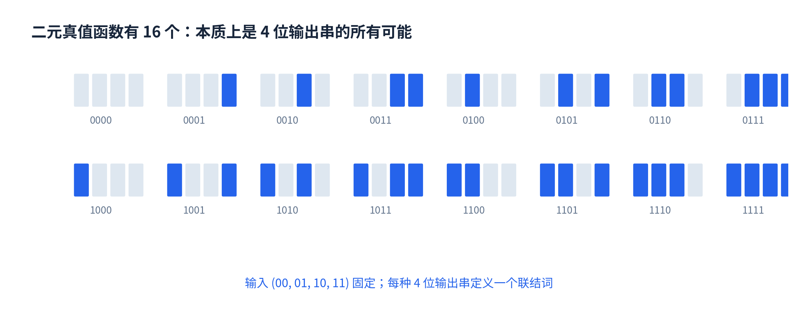

*图：二元联结词的全部16种四位真值函数指纹。*

### 6.2 一般的数量公式：为什么有两个指数？

首先有 $2^n$ 组不同输入；对于每一组输入，真值函数都能独立指定一个 $0$ 或 $1$。所以函数种数为

$$
\boxed{2^{(2^n)}}.
$$

> [!warning] 两个数字不可混淆
> $2^n$ 是**一个 n 元公式的真值表行数**；$2^{(2^n)}$ 是**可能出现的不同输出列数，即真值函数总数**。例如 $n=3$ 时，真值表有 $8$ 行，但可能的真值函数有 $2^8=256$ 种。

在**变项集合和变项次序固定**的前提下，真值函数还可以一一对应地转换为规范化的**主析取范式**或**主合取范式**：输出为 $1$ 的各行决定主析取范式中的极小项，输出为 $0$ 的各行决定主合取范式中的极大项。这是后续范式与逻辑综合问题的重要联系；这里先理解其与真值表的对应，不额外引入复杂范式算法。

### 6.3 非基本联结词：异或、蕴涵否定、与非、或非

除了五种常用联结词，还可定义：

| 名称 | 常用符号 | 真值表达式 | 为真的条件 |
|---|---|---|---|
| 不可兼或 / 异或 | $p\oplus q$（也常记 $p\nabla q$） | $\neg(p\leftrightarrow q)$ | 恰好一个为真 |
| 蕴涵否定 | $p\nrightarrow q$ | $\neg(p\to q)=p\land\neg q$ | $p$ 真、$q$ 假 |
| 与非 NAND | $p\uparrow q$ | $\neg(p\land q)$ | 不是两者同时真 |
| 或非 NOR | $p\downarrow q$ | $\neg(p\lor q)$ | 两者都假 |

这里异或按惯常符号 $\oplus$ 书写；当出现资料中使用的 $\nabla$ 时，指的是相同的“不兼容或”真值行为。

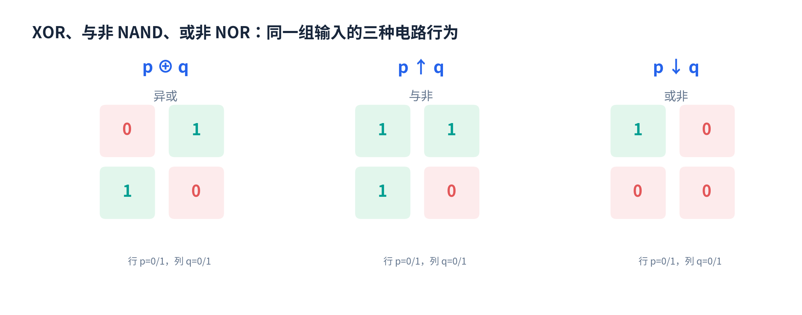

*图：三个非常用联结词在2×2赋值表上的不同真值模式。*

特别记住：

$$
p\uparrow q\Leftrightarrow\neg(p\land q),\qquad
p\downarrow q\Leftrightarrow\neg(p\lor q).
$$

与非、或非在数字电路中经常出现。可把它们理解为“先做与/或，最后再把输出翻转”，门图的输出端小圆圈即代表反相。

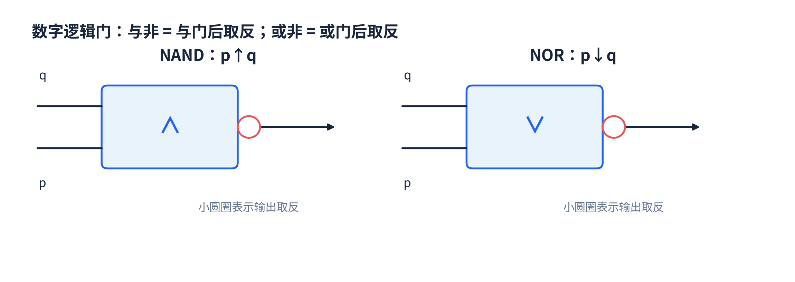

*图：与非门和或非门的输入、逻辑运算及输出反相结构。*

## 7. 联结词完备集：用尽可能少的工具表达所有公式

### 7.1 完备集与极小完备集的定义

设 $S$ 为一个联结词集合。若**任意命题公式都等值于一个仅使用 $S$ 中联结词的公式**，则称 $S$ 是一个**联结词完备集**（functionally complete set）。

若 $S$ 完备，并且删掉其中任意一个联结词后所得真子集都不再完备，称 $S$ 为**极小完备联结词集**（按集合包含关系极小）。

> [!important] “完备”与“极小”是两回事
> 完备意味着**表达能力足够**；极小意味着**其中每一个元素都不可删除**。极小不是指不同候选完备集中元素个数绝对最少。例如 $\{\neg,\land\}$ 是极小完备集，但 $\{\uparrow\}$ 只需要一个联结词，同样完备。

### 7.2 从五种常用联结词逐步压缩

基础集合

$$
S_0=\{\neg,\land,\lor,\to,\leftrightarrow\}
$$

显然完备。由

$$
A\to B\Leftrightarrow\neg A\lor B,
$$

$$
A\leftrightarrow B\Leftrightarrow(A\to B)\land(B\to A),
$$

可知 $\to$ 和 $\leftrightarrow$ 都能由 $\neg,\land,\lor$ 表达。因此

$$
\{\neg,\land,\lor\}
$$

也是完备集。

再用德·摩根律：

$$
A\lor B\Leftrightarrow\neg(\neg A\land\neg B),
$$

$$
A\land B\Leftrightarrow\neg(\neg A\lor\neg B),
$$

于是

$$
\boxed{\{\neg,\land\}\text{ 和 }\{\neg,\lor\}\text{ 都是完备集。}}
$$

此外，

$$
A\lor B\Leftrightarrow\neg A\to B,
$$

$$
A\land B\Leftrightarrow\neg(A\to\neg B),
$$

所以

$$
\boxed{\{\neg,\to\}\text{ 也是完备集。}}
$$

### 7.3 为什么仅用一个 NAND 就足够？

设 $p\uparrow q=\neg(p\land q)$。先用两个相同输入实现否定：

$$
\neg p\Leftrightarrow p\uparrow p.
$$

接着使用两级与非，恢复合取：

$$
p\land q
\Leftrightarrow(p\uparrow q)\uparrow(p\uparrow q).
$$

最后结合德·摩根律构造析取：

$$
p\lor q
\Leftrightarrow(p\uparrow p)\uparrow(q\uparrow q).
$$

这三步已经构造出 $\neg,\land,\lor$。由于它们组成完备集，所以**只用 $\uparrow$ 就能表达任意命题公式**。

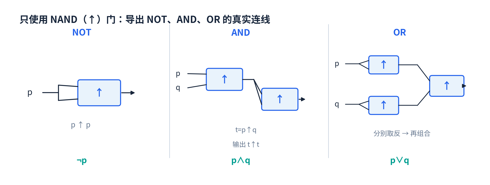

*图：NAND门分线、两级反相、三级组合构造三种基本联结词。*

> [!tip] 证明单联结词完备的统一套路
> 不必直接证明“所有公式都能写出来”。只需**构造出一个已知的完备集**，例如 $\{\neg,\land\}$ 或 $\{\neg,\lor\}$，即足以完成证明。

### 7.4 为什么仅用一个 NOR 也足够？

设 $p\downarrow q=\neg(p\lor q)$，同样从否定开始：

$$
\neg p\Leftrightarrow p\downarrow p.
$$

两级或非恢复析取：

$$
p\lor q\Leftrightarrow(p\downarrow q)\downarrow(p\downarrow q).
$$

而由德·摩根律构造合取：

$$
p\land q\Leftrightarrow(p\downarrow p)\downarrow(q\downarrow q).
$$

故

$$
\boxed{\{\uparrow\}\quad\text{与}\quad\{\downarrow\}\quad\text{均为单元素完备集。}}
$$

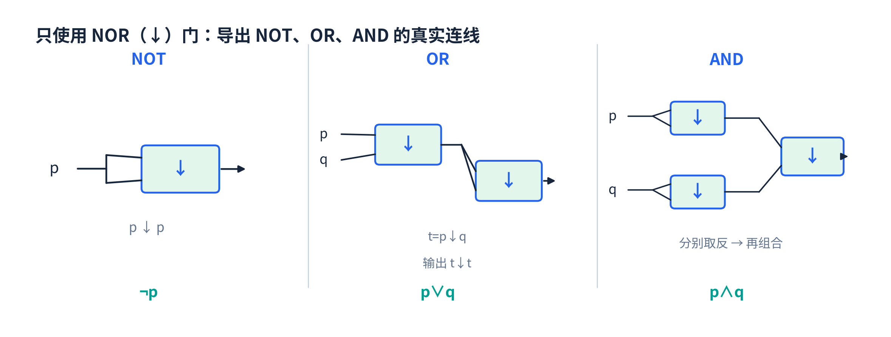

*图：NOR门分线、两级反相、三级组合构造三种基本联结词。*

### 7.5 几个不完备集合及其不可能性证明

判断一个联结词集**不完备**，关键是找出它的所有公式都必须满足的某种**不变性质**，再找一个逻辑函数不满足该性质。

**情况一：$\{\land,\lor,\to,\leftrightarrow\}$ 不完备。**

把所有命题变项都赋值为 $1$。有

$$
1\land1=1,\quad1\lor1=1,\quad1\to1=1,\quad1\leftrightarrow1=1.
$$

因此，**用这些联结词递归构成的任意公式，在全 $1$ 赋值时仍然为 $1$**。但 $\neg p$ 在 $p=1$ 时为 $0$，无法表达，所以该集合不完备。

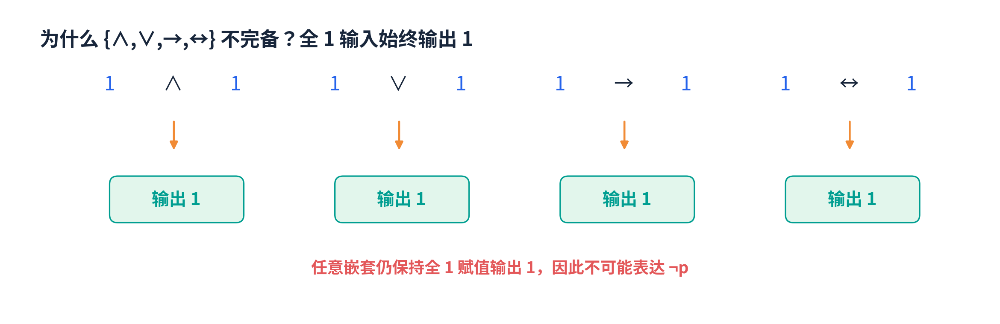

*图：无否定联结词集合在全真输入下的闭包性质及不完备性。*

这类性质称为保持 $1$（1-preserving）。类似思路还能说明只有 $\land$、只有 $\lor$、只有 $\to$ 或只有 $\leftrightarrow$ 都不能表达任意真值函数。

**情况二：$\{\neg,\leftrightarrow\}$ 不完备。**

在固定的两个或更多变项上，这种联结词组合得到的函数都属于奇偶型布尔函数：其输出可以表达成若干变量的异或，再加一个固定真值常量。特别在**两元真值表的四行中，输出 $1$ 的行数总为偶数**。但 $p\land q$ 在四行中恰有一行输出 $1$，故无法表示，集合不完备。

> [!note] 此处不能只说“没有合取符号”
> 一个集合是否完备不取决于有没有写出某个联结词的字符，而在于**能否用其他联结词组合出同样真值函数**。$\{\uparrow\}$ 没有 $\neg,\land,\lor$ 的符号却完全能构造它们；$\{\neg,\leftrightarrow\}$ 虽然有两个联结词，却仍不能表达所有二元函数。

### 7.6 常见联结词集结论速查

| 联结词集合 | 完备性 | 是否极小 | 关键理由 |
|---|---|---|---|
| $\{\neg,\land,\lor,\to,\leftrightarrow\}$ | 是 | 否 | 包含基本完备集 |
| $\{\neg,\land,\lor\}$ | 是 | 否 | $\land$ 与 $\lor$ 可互相用否定表达 |
| $\{\neg,\land\}$ | 是 | 是 | 可构造析取 |
| $\{\neg,\lor\}$ | 是 | 是 | 可构造合取 |
| $\{\neg,\to\}$ | 是 | 是 | 可构造合取、析取 |
| $\{\uparrow\}$ | 是 | 是 | 单独构造非、且、或 |
| $\{\downarrow\}$ | 是 | 是 | 单独构造非、或、且 |
| $\{\neg,\leftrightarrow\}$ | 否 | — | 只能构造奇偶型函数 |
| $\{\land,\lor,\to,\leftrightarrow\}$ | 否 | — | 保持全 $1$ 赋值输出为 $1$ |
| 只含一个 $\land/\lor/\neg/\to/\leftrightarrow$ | 否 | — | 表达能力受限 |

## 8. 把公式转换到指定完备集

### 8.1 转换为只含 $\neg$ 与 $\to$ 的公式

要求把

$$
C=(p\land\neg q)\lor r
$$

转换为 $S=\{\neg,\to\}$ 上的公式。思路是先分配，再逐个消去 $\lor$，最后把合取改成“否定蕴涵”。

$$
\begin{aligned}
C&\Leftrightarrow(p\lor r)\land(\neg q\lor r)\\
&\Leftrightarrow(\neg p\to r)\land(q\to r)\\
&\Leftrightarrow\neg\Big((\neg p\to r)\to\neg(q\to r)\Big).
\end{aligned}
$$

所以结果是

$$
\boxed{\neg\big((\neg p\to r)\to\neg(q\to r)\big).}
$$

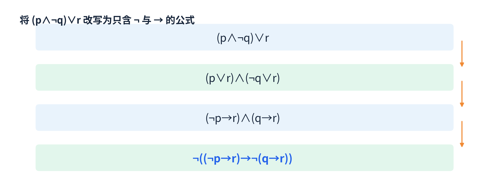

*图：通过分配、蕴涵表达和德摩根改写到{¬,→}的四阶段。*

> [!warning] 不要“只换运算符，不管括号”
> $A\land B\Leftrightarrow\neg(A\to\neg B)$，外层与内层否定必须成对出现；$A\lor B\Leftrightarrow\neg A\to B$，否定作用的是整个 $A$。在复合子公式上改写，应先把 $A,B$ 看成完整的括号单元。

### 8.2 优先级输入线路：从文字要求到逻辑公式

三个输入信号分别为 $A,B,C$，优先顺序为

$$
A>B>C.
$$

规则：**同一时间只能有一个输出**；多个信号同时输入时，优先级较高的信号先获得通行权。对应输出为 $F_A,F_B,F_C$。

按情形直接得到：

- $A$ 只需自己存在就能获得通行权，不受 $B,C$ 影响：$F_A=A$；
- $B$ 能输出，必须 $B=1$ 且 $A=0$：$F_B=\neg A\land B$；
- $C$ 能输出，必须 $C=1$ 且 $A=B=0$：$F_C=\neg A\land\neg B\land C$。

因此结果为

$$
\boxed{F_A=A,\qquad F_B=\neg A\land B,\qquad F_C=\neg A\land\neg B\land C.}
$$

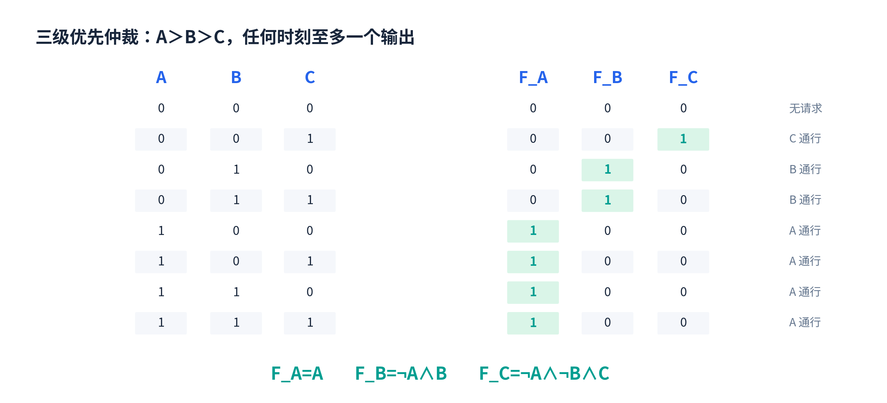

*图：A>B>C优先仲裁输出的8种真值组合与简化公式。*

真值表对应的实际时序效果如下，展示输入怎样被优先级规则筛选，保证同一时刻不会有多个输出为 $1$。

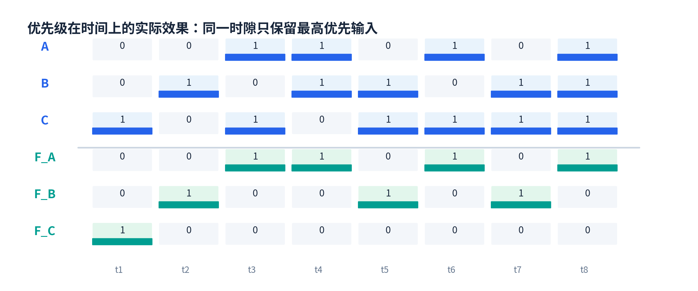

*图：离散时间波形显示A、B、C请求与互斥输出。*

这也是一种常见的逻辑设计思想：**先描述约束，再列出各输出的成真条件，最后用等值律化简**。例如由最小项展开 $F_A$：

$$
\begin{aligned}
F_A={}&(A\land\neg B\land\neg C)
\lor(A\land\neg B\land C)\\
&\lor(A\land B\land\neg C)
\lor(A\land B\land C)\\
\Leftrightarrow{}& A.
\end{aligned}
$$

同理，$F_B$ 由两个最小项合并成 $\neg A\land B$，$F_C$ 只对应一个最小项 $\neg A\land\neg B\land C$。

## 9. 解题方法总览与自测

### 9.1 常见问题的选法

| 题目任务 | 推荐方法 | 最常见失误 |
|---|---|---|
| 找成真/成假赋值 | 从外层联结词的真假条件倒推；必要时列真值表 | 蕴涵为假条件记反 |
| 判断是否重言式 | 等值演算化成 $1$，或真值表全 $1$ | 把可满足式误当重言式 |
| 证明两式等值 | 消去 $\to,\leftrightarrow$；分别化为同一形式 | 用一个特例证明普遍等值 |
| 证明两式不等值 | 找一个输出不同的赋值 | 无意义地枚举全部情况 |
| 用代入规则 | 同一命题变项全体统一替换 | 只替换一部分出现 |
| 用置换规则 | 找到已证等值的局部子公式 | 没有验证局部等值 |
| 证明完备集 | 构造已知的完备集 | 仅罗列几种例子而没有一般证明 |
| 证明不完备 | 找所有组合都保留的不变量 | 只凭“缺少某个符号”判断 |
| 转换指定联结词集 | 逐步消去不允许的联结词 | 忘记括号和否定范围 |
| 设计逻辑线路 | 从优先条件求各个输出函数 | 忽略互斥条件 |

### 9.2 核心公式压缩速查

$$
\begin{gathered}
A\to B\Leftrightarrow\neg A\lor B,\qquad
A\leftrightarrow B\Leftrightarrow(A\to B)\land(B\to A),\\
\neg(A\lor B)\Leftrightarrow\neg A\land\neg B,\qquad
\neg(A\land B)\Leftrightarrow\neg A\lor\neg B,\\
A\lor(A\land B)\Leftrightarrow A,\qquad
A\land(A\lor B)\Leftrightarrow A,\\
A\lor\neg A\Leftrightarrow1,\qquad
A\land\neg A\Leftrightarrow0,\\
\neg A\Leftrightarrow A\uparrow A\Leftrightarrow A\downarrow A,\\
A\land B\Leftrightarrow(A\uparrow B)\uparrow(A\uparrow B),\\
A\lor B\Leftrightarrow(A\downarrow B)\downarrow(A\downarrow B).
\end{gathered}
$$

### 9.3 独立练习

> [!question] 练习 A：等值与反例
> 1. 判断 $p\to(q\to r)$ 和 $(p\to q)\to r$ 是否等值，尽可能少用赋值。
> 2. 证明 $\neg(p\to q)\Leftrightarrow p\land\neg q$。
> 3. 证明 $(p\leftrightarrow q)\Leftrightarrow(\neg p\leftrightarrow\neg q)$。

> [!question] 练习 B：完备集与转换
> 1. 把 $p\leftrightarrow q$ 改写为只含 $\neg,\land,\lor$ 的公式。
> 2. 只用 $\uparrow$ 写出 $p\lor q$。
> 3. 说明为什么仅使用 $\land,\lor,\to,\leftrightarrow$ 无法得到 $\neg p$。
> 4. 将 $p\lor q$ 转写为仅含 $\neg,\to$ 的公式。

> [!example]- 参考答案与关键思路
> **A1**：不等值；令 $(p,q,r)=(0,0,0)$，左侧为 $1$，右侧为 $0$。
>
> **A2**：$\neg(p\to q)\Leftrightarrow\neg(\neg p\lor q)\Leftrightarrow p\land\neg q$。
>
> **A3**：可从等价两式均要求两边同真或同假出发，或将左右化为 $(p\land q)\lor(\neg p\land\neg q)$。
>
> **B1**：$(p\land q)\lor(\neg p\land\neg q)$。
>
> **B2**：$(p\uparrow p)\uparrow(q\uparrow q)$。
>
> **B3**：全体变项都取 $1$ 时，这四种联结词组合的输出必为 $1$；但 $\neg p=0$，矛盾。
>
> **B4**：$\neg p\to q$。

> [!summary] 学习完成后的关键能力
> 真值表能回答**某一公式或两公式是否等值**；基本等值律能让你**高效证明和化简**；代入和置换让有限的等值律推广到任意大公式；真值函数把公式变为输入输出规律；完备性则回答**哪些联结词足以表达所有这样的规律**。真正的掌握标准，是能够在真值表、等值演算和逻辑线路三种表达之间准确切换。
