# 命题逻辑：范式（析取范式、合取范式与主范式）

> [!abstract] 学习目标
> 理解文字、简单析取式/合取式、析取范式/合取范式、极小项/极大项之间的关系；熟练完成普通范式与主范式的等值转换，能用真值表法及互补下标法快速求主范式，并能将其用于判定公式类型、比较等值性和枚举实际可行方案。

本笔记以命题变项 $p,q,r$ 为主，真值用 $1/0$ 表示。**主范式下标按既定的变项顺序由二进制编码得到**。除另有说明，三元公式统一按 $(p,q,r)$ 排序，真值表按 $000,001,010,011,100,101,110,111$ 排列。

## 一、准备知识：赋值、等值与标准化的必要性

### 1. 赋值与公式类型

若公式 $A$ 含有 $n$ 个命题变项 $p_1,\ldots,p_n$，则它共有 $2^n$ 种真值指派。某指派使 $A=1$，称为**成真赋值**；使 $A=0$，称为**成假赋值**。

- **重言式（永真式）**：所有指派都使公式为 $1$，例如 $p\lor\neg p$。
- **矛盾式（永假式）**：所有指派都使公式为 $0$，例如 $p\land\neg p$。
- **可满足式**：至少存在一个成真赋值。注意：**重言式也属于可满足式**；若需要三种互斥情形，第三类应表述为“可满足但非重言式”。

### 2. 等值的意义

$A\Leftrightarrow B$ 表示 $A$ 与 $B$ 在所有赋值下真值相同；等价地，公式 $A\leftrightarrow B$ 是重言式。注意：$\Leftrightarrow$ 表示逻辑等值关系，$\leftrightarrow$ 才是公式内部的双条件联结词。

例如：

$$
\begin{aligned}
p\to(q\to r)&\Leftrightarrow\neg p\lor\neg q\lor r,\\
(p\land q)\to r&\Leftrightarrow\neg p\lor\neg q\lor r.
\end{aligned}
$$

因此二者等值，虽然语法树、括号结构不同。

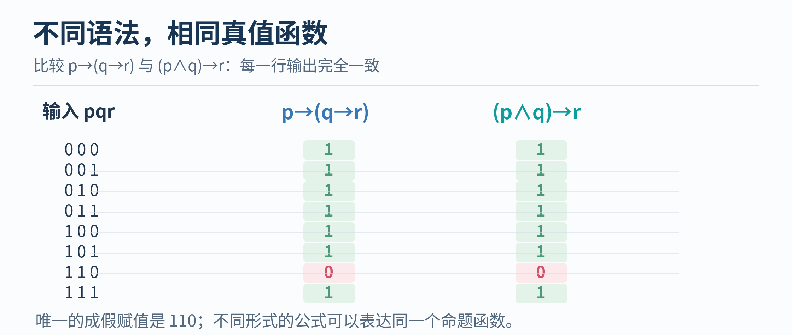

*图：用逐行同值来判别逻辑等值，而非比较公式外观。*

### 3. 常用等值变形（本章必备）

| 名称 | 等值式 |
|---|---|
| 蕴涵消去 | $A\to B\Leftrightarrow\neg A\lor B$ |
| 双条件消去 | $A\leftrightarrow B\Leftrightarrow(A\to B)\land(B\to A)$ |
| 双重否定 | $\neg\neg A\Leftrightarrow A$ |
| 德摩根律 | $\neg(A\land B)\Leftrightarrow\neg A\lor\neg B$；$\neg(A\lor B)\Leftrightarrow\neg A\land\neg B$ |
| 分配律（求析取范式） | $A\land(B\lor C)\Leftrightarrow(A\land B)\lor(A\land C)$ |
| 分配律（求合取范式） | $A\lor(B\land C)\Leftrightarrow(A\lor B)\land(A\lor C)$ |
| 排中律、矛盾律 | $A\lor\neg A\Leftrightarrow1$；$A\land\neg A\Leftrightarrow0$ |
| 幂等律 | $A\lor A\Leftrightarrow A$；$A\land A\Leftrightarrow A$ |
| 吸收律 | $A\lor(A\land B)\Leftrightarrow A$；$A\land(A\lor B)\Leftrightarrow A$ |

> [!important] 为什么要求主范式？
> 与同一个真值函数等值的普通表达式很多；**固定命题变项及其顺序**后，主析取范式和主合取范式由真值表唯一确定（项的排列次序不计）。这里的“唯一”指主范式；**普通析取、合取范式不唯一**。

## 二、从文字到普通析取范式、合取范式

### 1. 文字与简单式

**文字（literal）**：命题变项及其否定，例如 $p,\neg p,q,\neg q$。一个单独的文字既可以看作简单析取式，也可以看作简单合取式。

- **简单析取式**：有限个文字通过 $\lor$ 连接，例如 $p\lor\neg q\lor r$。
- **简单合取式**：有限个文字通过 $\land$ 连接，例如 $p\land\neg q\land r$。

一个简单析取式若同时出现 $p$ 与 $\neg p$，则无论 $p$ 取何值，整体必真；一个简单合取式若同时出现 $p$ 与 $\neg p$，则整体必假。这两条判定都是充要条件（在简单式语境下）。

### 2. 析取范式（DNF）

把**若干个简单合取式**通过“或”连接，得到析取范式：

$$A=B_1\lor B_2\lor\cdots\lor B_k,$$

其中 $B_i$ 都是简单合取式。典型例子：

$$(p\land q\land\neg r)\lor(p\land\neg q)\lor(\neg p\land r).$$

语义：**满足任意一条合取支路，整个公式就为真**。

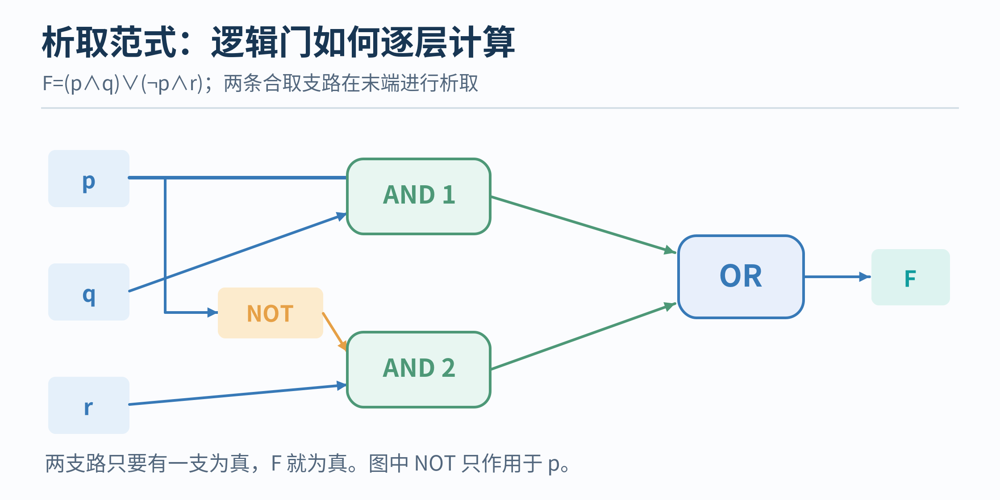

*图：以逻辑门呈现简单合取式作为支路、析取联结词作为汇合点。*

### 3. 合取范式（CNF）

把**若干个简单析取式**通过“且”连接，得到合取范式：

$$A=C_1\land C_2\land\cdots\land C_t,$$

其中 $C_i$ 都是简单析取式。例如：

$$(p\lor q\lor\neg r)\land(p\lor\neg q)\land(\neg p\lor r).$$

语义：**必须同时满足每一条简单析取子句，整体才为真**。

> [!warning] 不要把“外层”和“内层”弄反
> 析取范式：外层 $\lor$，内层 $\land$；合取范式：外层 $\land$，内层 $\lor$。像 $p\lor q\lor\neg r$ 这样的单个简单析取式，同时也可视为析取范式和合取范式（将其作为单项或单子句）。

### 4. 性质与快速判定

- 析取范式永假，当且仅当其**每个简单合取式**都永假。
- 合取范式永真，当且仅当其**每个简单析取式**都永真。

原因分别是：若每条析取支路均为 $0$，整体为 $0$；若每个合取子句恒为 $1$，整体恒为 $1$。注意这个结论不能倒过来写成“析取范式永真则每条简单合取式永真”。

### 5. 范式存在定理与转换算法

**范式存在定理**：任一命题公式均有与其等值的析取范式和合取范式。常用做法：先消去 $\to,\leftrightarrow$；再将否定推进到文字层；最后应用两种方向相反的分配律。

*图：合取对析取分配，把一个组合条件拆成两条支路。*

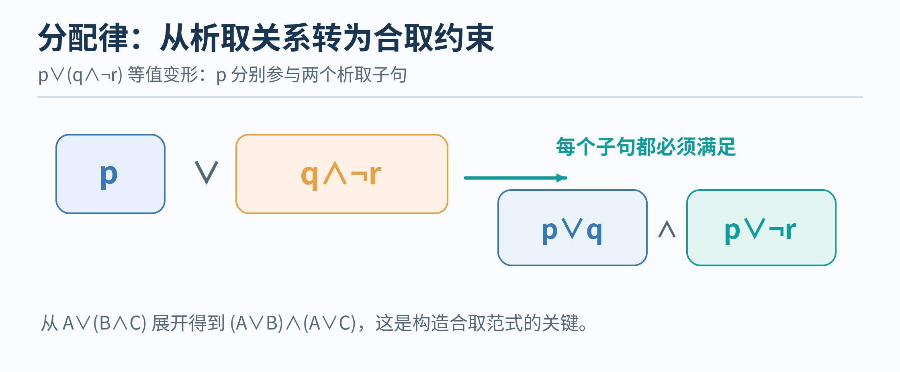

*图：析取对合取分配，把一个选择条件改写为两个同时成立的子句。*

> [!tip] 三步求普通范式
> 1. 消联结词：只保留 $\neg,\land,\lor$；2. 内移否定：只允许否定直接放在命题变项前；3. 分配与化简：求析取范式用 $\land$ 对 $\lor$ 分配，求合取范式用 $\lor$ 对 $\land$ 分配。

> [!example] 双向演算：$F=((p\lor q)\to r)\to p$
> 首先统一消去蕴涵：
>
> $$
> \begin{aligned}
> F&\Leftrightarrow\neg(\neg(p\lor q)\lor r)\lor p\\
> &\Leftrightarrow((p\lor q)\land\neg r)\lor p\\
> &\Leftrightarrow p\lor(q\land\neg r)\qquad\text{（吸收律）}.
> \end{aligned}
> $$
>
> 再分别展开：
>
> $$
> \underbrace{p\lor(q\land\neg r)}_{\text{析取范式}}
> \Leftrightarrow
> \underbrace{(p\lor q)\land(p\lor\neg r)}_{\text{合取范式}}.
> $$
>
> 不做吸收化简时，$p\lor(p\land\neg r)\lor(q\land\neg r)$ 同样是析取范式；这是普通范式不唯一的具体体现。

---

## 三、极小项与主析取范式

### 1. 极小项的定义及编码

对固定的 $n$ 个变项，**极小项**是满足以下条件的简单合取式：每个变项恰好出现一次，出现形式在原变量与否定变量中二选一，顺序按预设变项排列。共存在 $2^n$ 个极小项。

极小项 $m_i$ 的下标就是它的==唯一成真赋值==所对应的二进制数转换成十进制后的结果。**二进制位取 1：该处为原变量；取 0：该处为否定变量**。

例如按 $(p,q,r)$：

$$m_5=p\land\neg q\land r,\qquad (p,q,r)=(1,0,1).$$

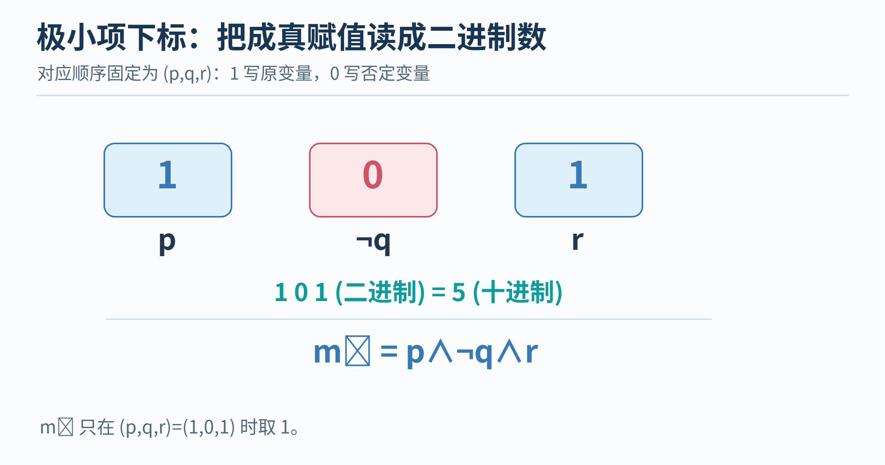

*图：用 101 的三位逐位决定极小项 m₅ 的文字。*

三变元全部极小项如下：

| 下标 | 成真赋值 $pqr$ | 极小项 |
|---|---|---|
| $m_0$ | 000 | $\neg p\land\neg q\land\neg r$ |
| $m_1$ | 001 | $\neg p\land\neg q\land r$ |
| $m_2$ | 010 | $\neg p\land q\land\neg r$ |
| $m_3$ | 011 | $\neg p\land q\land r$ |
| $m_4$ | 100 | $p\land\neg q\land\neg r$ |
| $m_5$ | 101 | $p\land\neg q\land r$ |
| $m_6$ | 110 | $p\land q\land\neg r$ |
| $m_7$ | 111 | $p\land q\land r$ |

### 2. 极小项的两个性质

1. 任意 $m_i$ 仅在下标 $i$ 对应的那一行取真，其余 $2^n-1$ 行为假。
2. 全体极小项的析取是重言式：

$$m_0\lor m_1\lor\cdots\lor m_{2^n-1}\Leftrightarrow1.$$

为什么第二点必然成立？任取一行赋值，恰好有且只有一个极小项取真，它保证整条析取式取真。

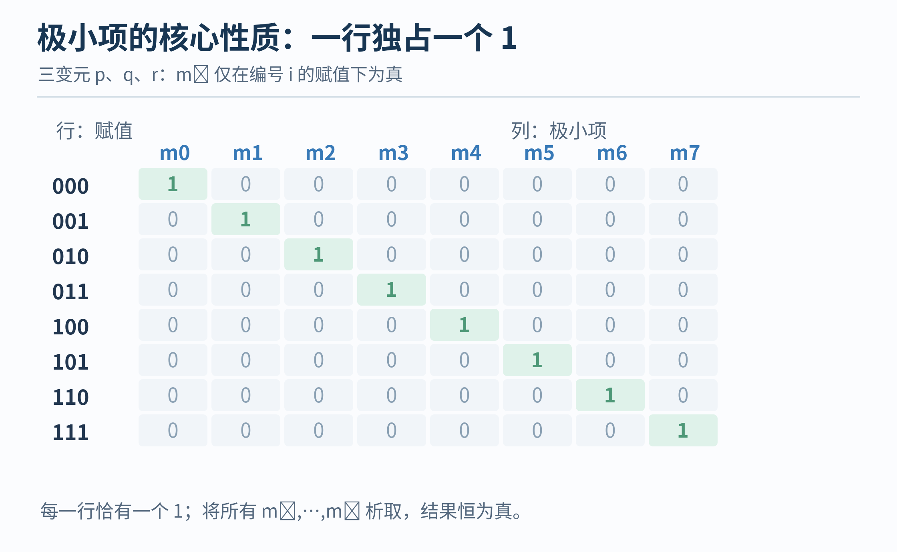

*图：极小项在真值矩阵中形成对角线式的“独占 1”。*

### 3. 主析取范式的定义与唯一性

对 $n$ 个固定变项构造的析取范式，如果每个简单合取项**都是这 $n$ 个变项的极小项**，它就是**主析取范式（PDNF）**。采用记号：

$$A\Leftrightarrow m_{i_1}\lor\cdots\lor m_{i_k}\Leftrightarrow\Sigma(i_1,\ldots,i_k).$$

这里 $\Sigma$ 表示==指定下标对应极小项的析取==，不是把下标数值做普通算术求和。固定变项集合后，主析取范式**存在且唯一（忽略项的交换、重复）**；其原因在于每一项都由唯一一行真值决定。

*图：真值输出位串决定被挑选的极小项编号。*

### 4. 求主析取范式：等值演算法

先求出普通析取范式；若某一简单合取项缺少 $p_i$，就乘上恒真式 $p_i\lor\neg p_i$：

$$B\Leftrightarrow B\land(p_i\lor\neg p_i)
\Leftrightarrow(B\land p_i)\lor(B\land\neg p_i).$$

然后用幂等律、矛盾律和交换律删除重复文字、矛盾项、重复极小项，并按下标排序。

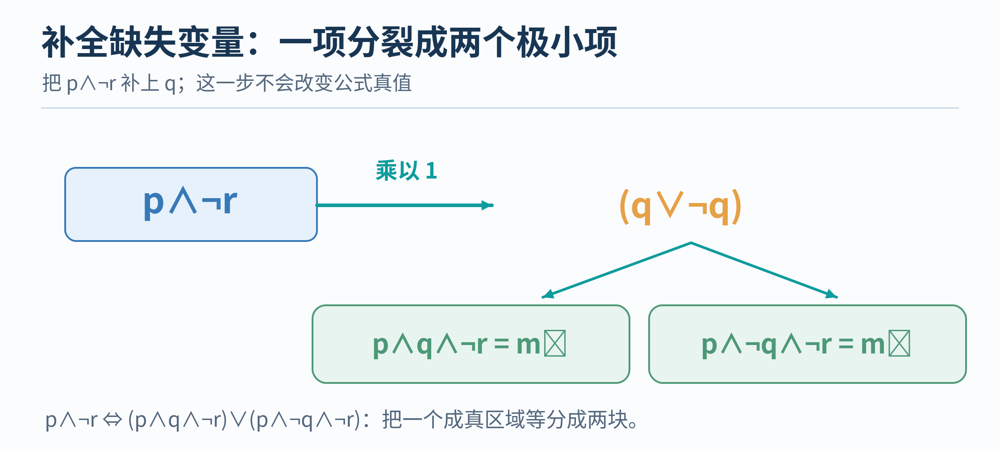

*图：原来同时覆盖多行的合取项补全变量后，成为两条各覆盖一行的极小项。*

> [!example] 继续求 $F=((p\lor q)\to r)\to p$ 的主析取范式
> 已知 $F\Leftrightarrow p\lor(q\land\neg r)$。补全 $p$ 所缺的 $q,r$，有
>
> $$
> p\Leftrightarrow m_4\lor m_5\lor m_6\lor m_7.
> $$
>
> 对 $q\land\neg r$ 补上 $p$：
>
> $$
> q\land\neg r\Leftrightarrow(\neg p\land q\land\neg r)\lor(p\land q\land\neg r)
> =m_2\lor m_6.
> $$
>
> 去重后：
>
> $$\boxed{F\Leftrightarrow\Sigma(2,4,5,6,7).}$$
>
> $m_6$ 虽然由两条支路产生，但在主范式里只保留一次。

### 5. 求主析取范式：真值表法

按变项顺序列真值表，把==公式值为 1 的赋值编号==选出来。每一行成真赋值对应一个极小项，最后取它们的析取。对 $F$ 的过程见下面的完整真值分区图。

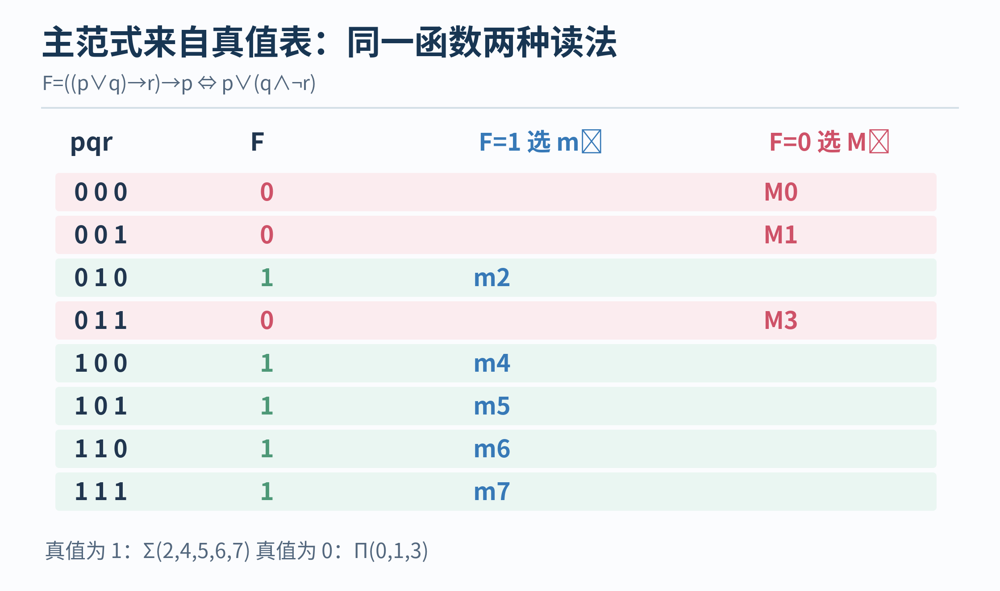

*图：同一张真值表，读取成真行得到 Σ，读取成假行得到 Π。*

上图显示 $F$ 的成真行是 $010,100,101,110,111$，即下标 $2,4,5,6,7$。这一方法通常比复杂等值演算更稳，尤其适用于变项数量不大的公式。

> [!note] 极小项与相邻成真区域
> 普通析取范式中的 $p$ 一项覆盖四个赋值；而主析取范式把它拆成 $m_4,m_5,m_6,m_7$ 四项。**普通范式在压缩条件，主范式在逐行枚举**。

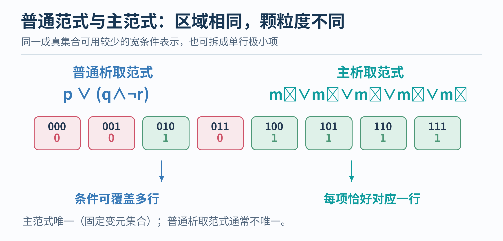

*图：同一个真值集合分别以简洁条件和逐行极小项表达。*

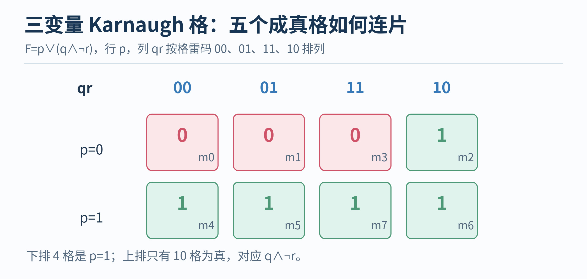

*图：Karnaugh 格仅作理解性辅助：相邻格仅相差一个变量位；对应普通式的覆盖区域。*

---

## 四、极大项与主合取范式

### 1. 极大项的定义与编码

固定 $n$ 个变项时，**极大项**是每个变项恰出现一次、只选原变量或其否定之一的简单析取式，一共有 $2^n$ 个。

极大项 $M_i$ 的下标是它的==唯一成假赋值==对应的二进制数。**与极小项反过来：若成假赋值位取 0，则在极大项中写原变量；位取 1，则写否定变量。**

$$M_5=\neg p\lor q\lor\neg r,$$

因为在 $(p,q,r)=(1,0,1)$ 时，这三个文字全假。

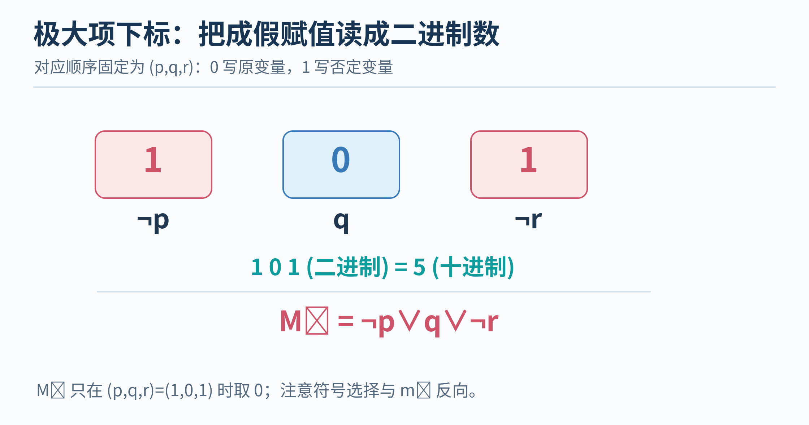

*图：用成假赋值 101 编写极大项 M₅，逐位选择与极小项相反。*

三变元全部极大项如下：

| 下标 | 成假赋值 $pqr$ | 极大项 |
|---|---|---|
| $M_0$ | 000 | $p\lor q\lor r$ |
| $M_1$ | 001 | $p\lor q\lor\neg r$ |
| $M_2$ | 010 | $p\lor\neg q\lor r$ |
| $M_3$ | 011 | $p\lor\neg q\lor\neg r$ |
| $M_4$ | 100 | $\neg p\lor q\lor r$ |
| $M_5$ | 101 | $\neg p\lor q\lor\neg r$ |
| $M_6$ | 110 | $\neg p\lor\neg q\lor r$ |
| $M_7$ | 111 | $\neg p\lor\neg q\lor\neg r$ |

### 2. 极大项的两个性质

1. 每个 $M_i$ 仅在它编号的赋值行取 $0$，其他 $2^n-1$ 行均取 $1$。
2. 全部极大项的合取式为永假式：

$$M_0\land M_1\land\cdots\land M_{2^n-1}\Leftrightarrow0.$$

由于每个赋值必然使一个对应的极大项为假，整个合取式必假。

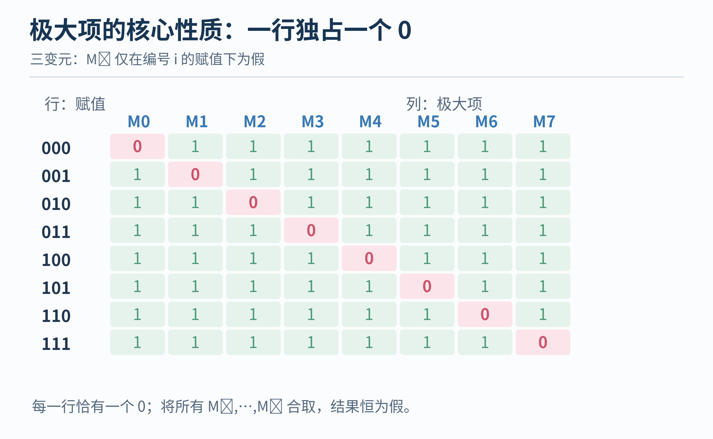

*图：极大项真值矩阵中形成对角线式的“独占 0”。*

### 3. 同编号极小项与极大项互为否定

由德摩根律，逐个对应文字取反可得：

$$\boxed{m_i\Leftrightarrow\neg M_i,\qquad M_i\Leftrightarrow\neg m_i.}$$

例如：

$$\neg(p\land\neg q\land r)\Leftrightarrow\neg p\lor q\lor\neg r.$$

这是两种主范式互相转换的核心。

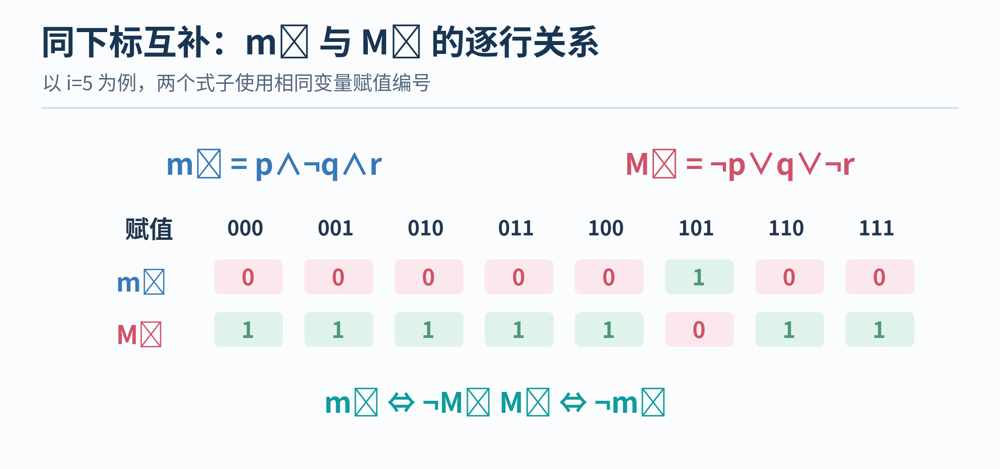

*图：同一个编号的一对极小项与极大项，在所有行都呈逻辑互补。*

### 4. 主合取范式的定义

若某个合取范式里的每条简单析取子句都是固定 $n$ 个变项的极大项，它称为**主合取范式（PCNF）**：

$$A\Leftrightarrow M_{j_1}\land\cdots\land M_{j_t}
\Leftrightarrow\Pi(j_1,\ldots,j_t).$$

这里 $\Pi$ 表示**指定下标对应极大项的合取**，不是把下标做普通乘法。固定变量集合后主合取范式同样存在且唯一（不计排列）。

### 5. 求主合取范式：等值演算法

先化成普通合取范式；如果某个简单析取子句 $C$ 中缺变量 $p_i$，用恒假式拆分：

$$C\Leftrightarrow C\lor(p_i\land\neg p_i)
\Leftrightarrow(C\lor p_i)\land(C\lor\neg p_i).$$

再消去重复变量、永真子句和重复极大项（注意不能把 $p_i\lor\neg p_i$ 当成永假式）。

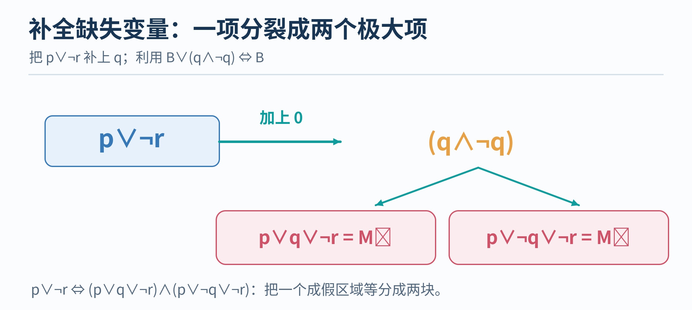

*图：一个简单析取式补全缺少的变项后，被拆成两个极大项的合取。*

> [!example] 求同一个 $F$ 的主合取范式
> 已有 $F\Leftrightarrow(p\lor q)\land(p\lor\neg r)$。展开缺失变量：
>
> $$
> \begin{aligned}
> p\lor q&\Leftrightarrow(p\lor q\lor r)\land(p\lor q\lor\neg r)
> =M_0\land M_1,\\
> p\lor\neg r&\Leftrightarrow(p\lor q\lor\neg r)\land(p\lor\neg q\lor\neg r)
> =M_1\land M_3.
> \end{aligned}
> $$
>
> 去重得：
>
> $$\boxed{F\Leftrightarrow M_0\land M_1\land M_3\Leftrightarrow\Pi(0,1,3).}$$
>
> **注意：这里必须写 $M_0\land M_1\land M_3$，不能将极大项用 $\lor$ 连接；否则就不再是正确的主合取范式。**

### 6. 求主合取范式：真值表法

选择==全部成假赋值==，每行写出对应极大项，然后用 $\land$ 连接。对上例 $F$，成假下标为 $0,1,3$，所以直接得到 $\Pi(0,1,3)$。与求主析取范式相反，**不要选成真行**。

### 7. 两种主范式互求：互补下标法

固定相同的变量集合，下标全集为 $U=\{0,1,\ldots,2^n-1\}$。若

$$A\Leftrightarrow\Sigma(S),$$

则主合取范式为

$$\boxed{A\Leftrightarrow\Pi(U\setminus S).}$$

反过来，如果已知 $A\Leftrightarrow\Pi(T)$，则 $A\Leftrightarrow\Sigma(U\setminus T)$。

**注意“互补”是在下标集合层面取补集，不是把原本出现的 $m_i$ 逐项直接改成同下标 $M_i$。**

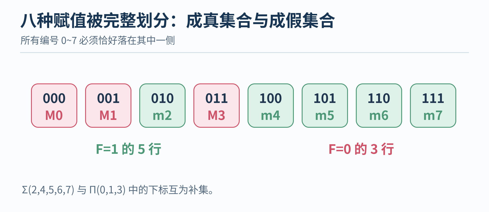

*图：八种赋值严格分成真、假两组；两个主范式由两组互补下标确定。*

### 8. 互补下标法的逻辑理由

设 $U\setminus S=\{j_1,\ldots,j_t\}$ 是 $A$ 的成假下标。那么 $\neg A$ 只在这些行取真：

$$\neg A\Leftrightarrow m_{j_1}\lor\cdots\lor m_{j_t}.$$

两边取反并用 $\neg m_i\Leftrightarrow M_i$：

$$\begin{aligned}
A&\Leftrightarrow\neg(m_{j_1}\lor\cdots\lor m_{j_t})\\
&\Leftrightarrow M_{j_1}\land\cdots\land M_{j_t}.
\end{aligned}$$

这同时解释了**为什么主析取范式和主合取范式都唯一**：各自只编码相同真值表的一侧。

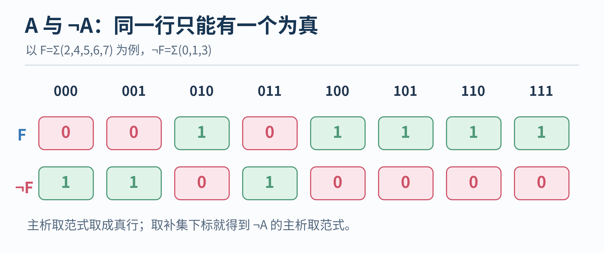

*图：一个公式与其否定的成真行恰好互为补集。*

---

## 五、求主范式的三条路线与专项例题

### 1. 三种方法的适用情形

| 方法 | 主析取范式 | 主合取范式 | 适用条件 |
|---|---|---|---|
| 等值演算法 | DNF 中逐项补全变项 | CNF 中逐个子句补全变项 | 公式容易化简，需要完整代数推导 |
| 真值表法 | 选 $A=1$ 的行 → $m_i$ | 选 $A=0$ 的行 → $M_i$ | 变量个数较少、希望稳妥列举 |
| 互补下标法 | 已知 $\Pi(T)$，取 $U\setminus T$ | 已知 $\Sigma(S)$，取 $U\setminus S$ | 已经求出任意一侧主范式 |

### 2. 典型例题：$(p\land q)\to r$

$$G=(p\land q)\to r\Leftrightarrow\neg(p\land q)\lor r.$$

只有在 $p=q=1,r=0$ 时公式为假（赋值 $110$，下标 $6$）。因此：

$$\boxed{G\Leftrightarrow\Pi(6).}$$

其余七个赋值使公式为真：

$$\boxed{G\Leftrightarrow\Sigma(0,1,2,3,4,5,7).}$$

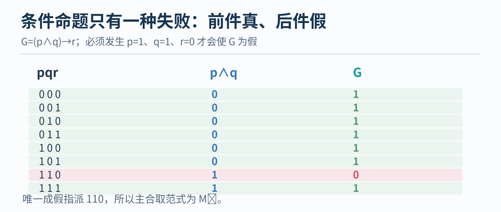

*图：条件命题 $a	o b$ 仅在 $a=1,b=0$ 时失败；这里 a=p∧q。*

### 3. 典型例题：$(p\to q)\land q$

消蕴涵并利用吸收律：

$$H=(\neg p\lor q)\land q\Leftrightarrow q.$$

只要 $q=1$ 就真，二元下标 $01,11$ 对应 $1,3$：

$$\boxed{H\Leftrightarrow\Sigma(1,3)\Leftrightarrow\Pi(0,2).}$$

具体对应：

$$H\Leftrightarrow(\neg p\land q)\lor(p\land q)
\Leftrightarrow(p\lor q)\land(\neg p\lor q).$$

### 4. 典型例题：先化成普通式，再取互补

设 $J=(((p\to q)\land\neg p)\to\neg q)$。先化简：

$$\begin{aligned}
J&\Leftrightarrow\neg((\neg p\lor q)\land\neg p)\lor\neg q\\
&\Leftrightarrow p\lor\neg q.
\end{aligned}$$

该二元公式只在 $(p,q)=(0,1)$ 时为假，下标为 $1$：

$$J\Leftrightarrow\Pi(1)\Leftrightarrow\Sigma(0,2,3).$$

> [!tip] 更快的判断方式
> 如果你已经得到 $p\lor\neg q$，不要再展开八九步：看一眼条件“$p=0$ 且 $q=1$”才假，立即得到 $\Pi(1)$，再取补集写出主析取范式。

---

## 六、主范式的核心应用

### 1. 判定公式类型

固定 $n$ 个变项：

| 类型 | 主析取范式特征 | 主合取范式特征 |
|---|---|---|
| 重言式 | 含全部 $2^n$ 个极小项 | 不含极大项，空合取记作 $1$ |
| 矛盾式 | 不含极小项，空析取记作 $0$ | 含全部 $2^n$ 个极大项 |
| 可满足式 | 至少含一个极小项 | 至少有一行取真，故极大项数小于 $2^n$ |
| 可满足但非重言 | 极小项数介于 $1$ 与 $2^n-1$ 之间 | 极大项数介于 $1$ 与 $2^n-1$ 之间 |

这里“空析取记为 $0$、空合取记为 $1$”是规范的空运算约定。

*图：通过输出模式区分重言、矛盾以及可满足但非重言。*

> [!example] 三个常见公式
> 1. $\neg(p\to q)\land q\Leftrightarrow(p\land\neg q)\land q\Leftrightarrow0$：矛盾式。
> 2. $((p\to q)\land p)\to q$：重言式（肯定前件对应的有效推理形式）。
> 3. $(p\to q)\land q\Leftrightarrow q$：可满足但非重言；二元主析取范式为 $\Sigma(1,3)$。

### 2. 判断两公式是否等值

对两个公式先统一变项集合与顺序，再分别求主析取或主合取范式。**相同即等值，不同即不等值**。找出一个不同的赋值行，本身就是不等值的反例。

例如：

$$A=p\leftrightarrow(q\leftrightarrow r),\quad B=(p\leftrightarrow q)\leftrightarrow(p\leftrightarrow r).$$

两者并不等值。其主合取范式下标分别为 $\Pi(0,3,5,6)$ 与 $\Pi(1,2,5,6)$；实际只需要考察 $p=q=r=0$，此时 $A=0,B=1$。

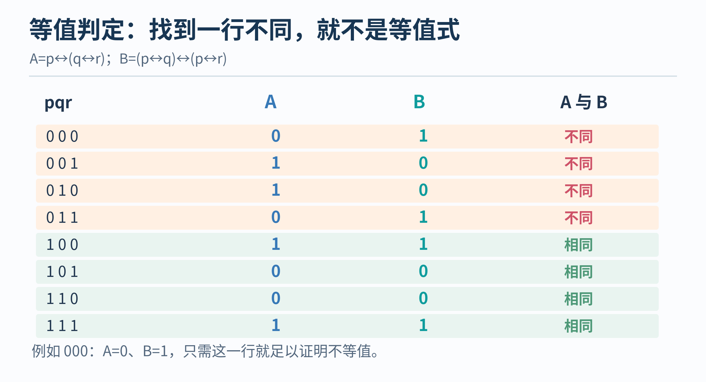

*图：逐行对照两公式；不同赋值形成显式反例。*

### 3. 从真值表恢复公式、由主范式恢复真值表

- 已知主析取范式：其出现的每个 $m_i$ 对应**一行 $1$**，其余行为 $0$。
- 已知主合取范式：其出现的每个 $M_i$ 对应**一行 $0$**，其余行为 $1$。
- 已知真值表：取真行构成主析取范式，取假行构成主合取范式。

因此主范式是**命题真值函数的完整编码**，不是单纯的公式写法变化。

### 4. 应用题：三名教师的选派方案

从 A、B、C 中选派 1～2 人，满足：A 去则 C 同去；B 去则 C 不去；C 不去则 A 或 B 去。记 $p,q,r$ 分别表示 A、B、C 去，则：

$$S=(p\to r)\land(q\to\neg r)\land(\neg r\to(p\lor q)).$$

穷举八种赋值、逐条检验：

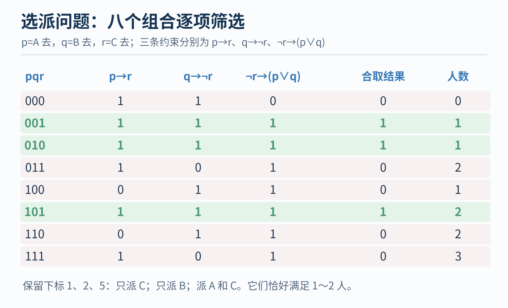

*图：每组候选方案按三条选派约束逐列筛选，所有条件为真才可行。*

由真值表：

$$S\Leftrightarrow m_1\lor m_2\lor m_5=\Sigma(1,2,5).$$

对应三种真实方案：

| 编码 $(p,q,r)$ | 派出人员 | 人数 |
|---|---|---:|
| 001 | C | 1 |
| 010 | B | 1 |
| 101 | A、C | 2 |

它们均满足题设的“1～2 人”条件；特别地，**人数约束并不是三条逻辑蕴涵的文字表述，而应在最终结果中核对**。本题这三条约束已经排除了零人及三人方案，因此无需增加约束项也得到相同答案。

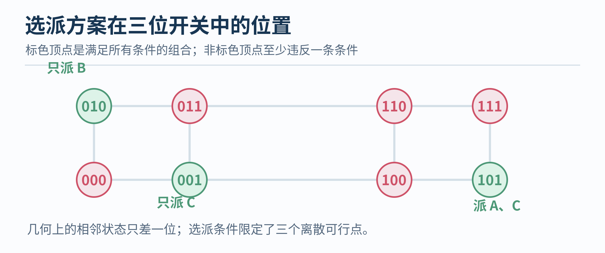

*图：三个独立开关组成的八状态立方图；绿色顶点是可行选派组合。*

---

## 七、结构对比与易错点

| 比较项目 | 极小项 $m_i$ | 极大项 $M_i$ |
|---|---|---|
| 最内层联结词 | 合取 $\land$ | 析取 $\lor$ |
| 每个变量出现次数 | 恰好一次 | 恰好一次 |
| 编码依据 | 唯一成真赋值 | 唯一成假赋值 |
| 二进制位 $1$ | 写原变量 | 写否定变量 |
| 二进制位 $0$ | 写否定变量 | 写原变量 |
| 相同编号关系 | $m_i\Leftrightarrow\neg M_i$ | $M_i\Leftrightarrow\neg m_i$ |
| 组成主范式 | 各 $m_i$ 用 $\lor$ 连接 | 各 $M_i$ 用 $\land$ 连接 |
| 快速求下标 | 取公式值为 $1$ 的行 | 取公式值为 $0$ 的行 |

> [!warning] 六个必须检查的错误
> 1. **下标编码顺序**未明确：$(p,q,r)$ 与 $(r,q,p)$ 编号不同。
> 2. **极大项误用极小项的极性规则**：极大项 $M_5$ 是 $\neg p\lor q\lor\neg r$，不是 $p\lor\neg q\lor r$。
> 3. **使用错误的外层联结词**：$\Sigma$ 取析取，$\Pi$ 取合取。
> 4. **没补齐全体变量**：如 $p\land q$ 不是三元极小项；但它可以是普通析取范式中的简单合取项。
> 5. **忘记去重、去矛盾项、去永真子句**，使最终主范式不规范。
> 6. **把“可满足式”当成与重言式互斥**：重言式也有成真赋值，所以属于可满足式。

### 知识速查

$$
\begin{array}{c}
A\text{ 的真值表}\longleftrightarrow
\left\{\begin{array}{l}
\text{真行下标集合 }S\longrightarrow \Sigma(S),\\
\text{假行下标集合 }U\setminus S\longrightarrow\Pi(U\setminus S).
\end{array}\right.
\end{array}
$$

**记忆口诀**：==真行取小、以或连接；假行取大、以且连接。缺字补全，编号看位；两边互求，取下标补集。==

---

## 八、自测题（答案置后）

1. 给定三元顺序 $(p,q,r)$，分别写出 $m_3$、$M_3$，并指出它们的唯一成真/成假赋值。
2. 求 $(p\lor q)\land\neg r$ 的普通析取范式与主析取范式。
3. 求 $p\to q$ 的主析取范式与主合取范式（变项顺序 $(p,q)$）。
4. 已知 $A\Leftrightarrow\Sigma(0,2,5,7)$（三元），求 $A$ 的主合取范式及其成假赋值。
5. 判断 $B=(p\lor\neg p)\land(q\to q)$ 与 $C=(p\land\neg p)\lor q$ 的公式类型。
6. 设 $T=p\oplus q$（异或：恰好一个为真），写出它的二元主范式。

### 参考答案

1. $m_3=\neg p\land q\land r$，只在 $011$ 取 $1$；$M_3=p\lor\neg q\lor\neg r$，只在 $011$ 取 $0$。
2. 普通析取范式 $(p\land\neg r)\lor(q\land\neg r)$。成真行 $010,100,110$，故主析取范式 $\Sigma(2,4,6)$。
3. $p\to q\Leftrightarrow\Sigma(0,1,3)\Leftrightarrow\Pi(2)$。
4. 全集 $U=\{0,1,2,3,4,5,6,7\}$，补集为 $\{1,3,4,6\}$，故 $\Pi(1,3,4,6)$；成假赋值分别为 $001,011,100,110$。
5. $B$ 是重言式；$C\Leftrightarrow q$，可满足但非重言式。
6. 异或在 $01,10$ 为真，所以 $T\Leftrightarrow\Sigma(1,2)\Leftrightarrow\Pi(0,3)$。

> [!summary] 本章最后要能做的事
> 输入一个命题公式，可以完成**消蕴涵 → 否定内移 → 普通范式 → 补全变量得主范式**；或通过真值表直接得到主范式，并利用互补下标法反求另一种主范式。随后能直接读出成真/成假指派、判定公式类型、比较等值性并枚举实际问题的全部方案。
