# 世界法学知识体系

## 第一篇　法学基础原理与法律思维

### 第一章　法律的本质、功能与价值

#### 1.1 社会规范的整体结构

法律并不是人类社会中唯一约束行为的规范。

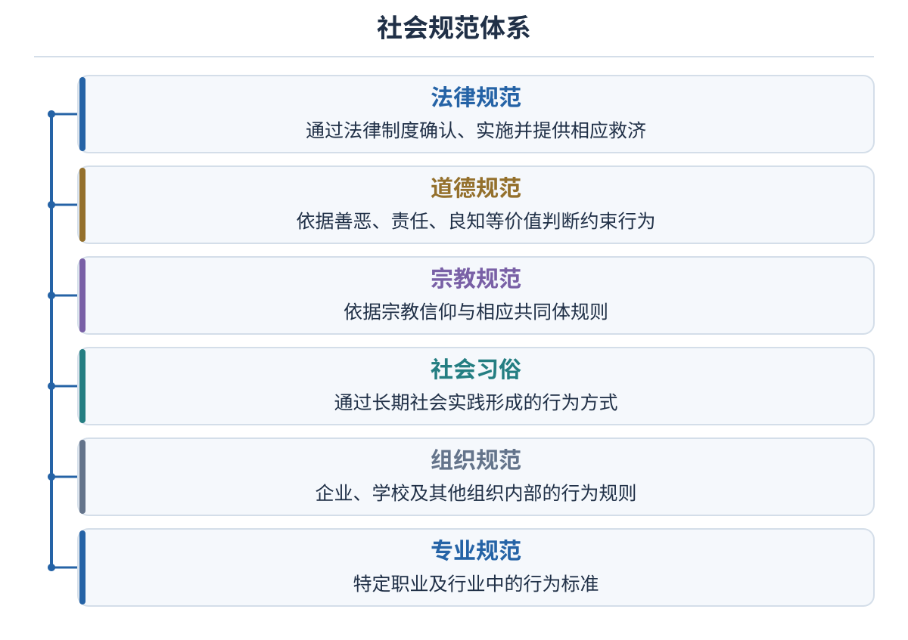
*图 001　社会规范体系*

> [!note]- 图示文字索引
> - 法律规范：通过法律制度确认、实施并提供相应救济
> - 道德规范：依据善恶、责任、良知等价值判断约束行为
> - 宗教规范：依据宗教信仰与相应共同体规则
> - 社会习俗：通过长期社会实践形成的行为方式
> - 组织规范：企业、学校及其他组织内部的行为规则
> - 专业规范：特定职业及行业中的行为标准

法律与其他社会规范可能相互支持，也可能发生冲突。某种社会习俗可以在满足一定条件时获得法律承认，某些道德义务也可能被转化为法律义务。但并非所有不道德的行为都应当由法律处罚。

#### 1.2 法律、道德与社会评价

| 行为性质 | 可能的现实情形 |
|---|---|
| 合法且具有道德正当性 | 诚信履约、依法维护他人权益 |
| 合法但受到道德批评 | 在不违反适用法律的情况下作出不近人情的决定 |
| 违法但存在道德争议 | 某些出于道德信念而违反特定规则的行为 |
| 违法且受到道德谴责 | 欺诈、故意侵害他人等行为 |

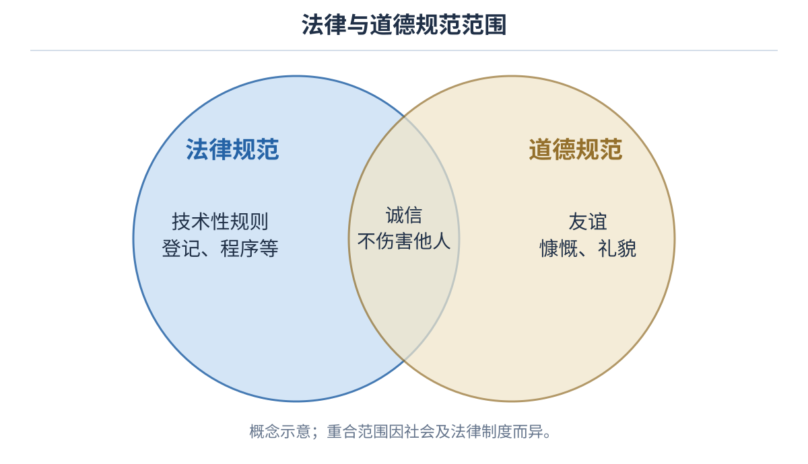
*图 002　法律与道德规范范围*

> [!note]- 图示文字索引
> 法律规范与道德规范部分重合；法律还涵盖登记、程序等技术性规则，道德还涵盖友谊、慷慨、礼貌等。

法律判断、道德判断和事实判断是三种不同性质的判断。例如，「某人没有遵守合同」是需要验证的事实判断；「某人应承担违约责任」是法律判断；「某人的行为缺乏诚信」则可能属于道德评价。

#### 1.3 法律的主要功能

| 功能 | 核心作用 |
|---|---|
| 指引功能 | 使人们了解可以、应当或不得采取哪些行为 |
| 评价功能 | 为评价行为提供法律标准 |
| 预测功能 | 使人们能够合理预期行为的法律后果 |
| 教育功能 | 通过规范及法律实践影响社会行为 |
| 强制功能 | 通过合法制度保障规范实施 |
| 纠纷解决功能 | 为利益冲突提供制度化解决途径 |
| 权利保障功能 | 确认并保护个人及组织的合法权利 |
| 权力约束功能 | 为公共权力的产生、行使及监督建立规则 |
| 资源配置功能 | 通过财产、合同、税收及其他制度影响资源分配 |

法律并不仅仅是惩罚人的工具，也是降低社会交易不确定性、建立合作预期的重要制度。

#### 1.4 法律的基本价值

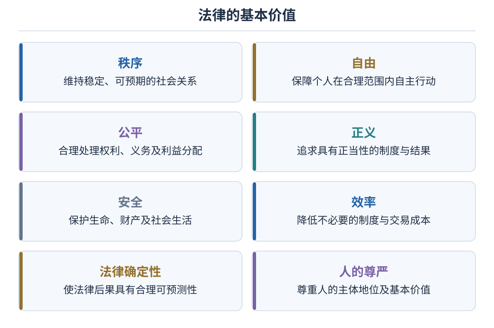
*图 003　法律的基本价值*

> [!note]- 图示文字索引
> - 秩序：维持稳定、可预期的社会关系
> - 自由：保障个人在合理范围内自主行动
> - 公平：合理处理权利、义务及利益分配
> - 正义：追求具有正当性的制度与结果
> - 安全：保护生命、财产及社会生活
> - 效率：降低不必要的制度与交易成本
> - 法律确定性：使法律后果具有合理可预测性
> - 人的尊严：尊重人的主体地位及基本价值

这些价值之间可能发生冲突。例如，信息公开能够促进透明与监督，但无限制的信息公开可能侵害个人隐私；严格的市场监管可以降低金融风险，但不合理的监管也可能抑制创新。法律制度的重要任务之一，就是在不同价值之间建立具有正当性的协调机制。

#### 1.5 形式公平与实质公平

| 概念 | 核心含义 |
|---|---|
| 形式公平 | 对处于相同法律条件的主体适用一致标准 |
| 实质公平 | 进一步考虑实际处境、能力及结构性差异 |
| 程序正义 | 作出决定的过程具有公正性及适当保障 |
| 实体正义 | 法律决定的内容和实际结果具有正当性 |
| 分配正义 | 研究社会利益、机会及负担如何合理分配 |
| 矫正正义 | 研究如何纠正侵害及恢复受损的权利关系 |

例如，所有交易双方采用相同合同规则，可能体现形式公平；针对消费者与大型企业之间的信息及议价能力差异建立特别保护，则可能体现实质公平。

### 第二章　法哲学与主要法学流派
法哲学研究法律的本质、权威、正当性以及法律与正义之间的关系。不同法学流派的重要差异，在于它们试图从不同角度回答：什么使法律成为法律，以及人为什么应当遵守法律。

#### 2.1 法学的主要研究方向

| 研究方向 | 核心问题 |
|---|---|
| 分析法学 | 法律的概念、结构与效力如何理解？ |
| 规范法学与规范性理论 | 法律应该如何设计，什么样的法律具有正当性？ |
| 法教义学 | 如何系统理解及解释现行法律？ |
| 实证法律研究 | 法律在实际社会中产生怎样的影响？ |
| 比较法学 | 不同法律制度如何解决相同或类似问题？ |
| 法律史 | 法律制度如何形成及演变？ |

#### 2.2 主要法学思想流派

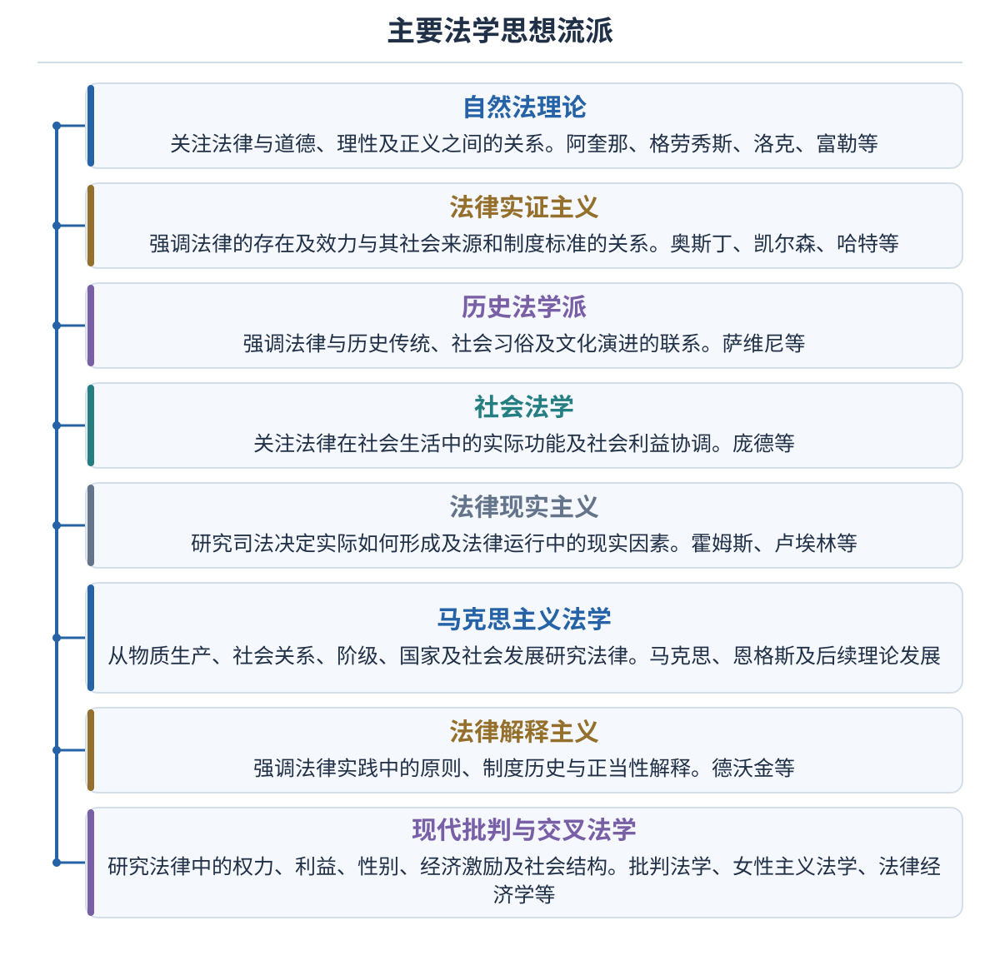
*图 004　主要法学思想流派*

> [!note]- 图示文字索引
> - 自然法理论：关注法律与道德、理性及正义之间的关系。阿奎那、格劳秀斯、洛克、富勒等
> - 法律实证主义：强调法律的存在及效力与其社会来源和制度标准的关系。奥斯丁、凯尔森、哈特等
> - 历史法学派：强调法律与历史传统、社会习俗及文化演进的联系。萨维尼等
> - 社会法学：关注法律在社会生活中的实际功能及社会利益协调。庞德等
> - 法律现实主义：研究司法决定实际如何形成及法律运行中的现实因素。霍姆斯、卢埃林等
> - 马克思主义法学：从物质生产、社会关系、阶级、国家及社会发展研究法律。马克思、恩格斯及后续理论发展
> - 法律解释主义：强调法律实践中的原则、制度历史与正当性解释。德沃金等
> - 现代批判与交叉法学：研究法律中的权力、利益、性别、经济激励及社会结构。批判法学、女性主义法学、法律经济学等

这些流派之间存在复杂联系，同一思想家也可能被置于不同理论传统中。

#### 2.3 自然法与法律实证主义
这是理解现代法哲学最重要的理论争论之一。

| 比较维度 | 自然法理论 | 法律实证主义 |
|---|---|---|
| 主要关注 | 法律与道德正当性的联系 | 法律效力的社会及制度来源 |
| 核心问题 | 不正义的规范如何具有法律权威？ | 如何判断一项规范是否属于有效法律？ |
| 研究侧重 | 正义、理性、基本价值 | 制度、规则、法律识别标准 |

法律实证主义并不意味着只要法律已经制定，就必须认为它在道德上正确；自然法理论也不意味着个人可以根据自身道德偏好任意否定法律。

#### 2.4 法律效力、正当性与实效性

*图 005　法律效力、正当性与实效性*

> [!note]- 图示文字索引
> - 法律效力 Validity：它是否依照相应制度具有法律效力？
> - 法律正当性 Legitimacy：其权威、内容及实施是否具有合理依据？
> - 法律实效性 Efficacy：它是否在实际社会生活中得到遵守和实施？

一项法律可能具有形式效力，却在社会中缺乏充分实施；也可能得到有效实施，却仍然存在关于正当性的争论。不能将法律是否有效、是否正义以及是否真正发挥作用混为一谈。

### 第三章　法律规范、法律渊源与法律效力

#### 3.1 法律规范的基本逻辑
在一种常见的教学模型中，法律规范可以分为适用条件、行为规则与法律后果。

*图 006　法律规范的逻辑结构*

> [!note]- 图示文字索引
> - 适用条件：在什么情况下适用？
> - 行为规则：可以、必须或者不得怎样行动？
> - 法律后果：相关行为产生什么法律效果？

一项完整的法律规范不一定全部写在同一个法条中。有时需要结合多个条文、定义、例外规定和司法解释才能确定完整内容。

#### 3.2 法律规则与法律原则

| 法律规则 | 法律原则 |
|---|---|
| 通常具有相对具体的适用条件 | 通常具有更广泛的指导性质 |
| 规定一定条件下的法律效果 | 为解释、协调及评价规则提供依据 |
| 较容易形成明确适用标准 | 往往需要结合其他原则进行判断 |

常见法律原则包括诚信原则、平等原则、比例原则、禁止权利滥用、法律确定性及公平程序等。不同法域对于这些原则的名称、效力及具体适用方式可能不同。

#### 3.3 法律规范的多维分类

| 分类依据 | 主要类型 |
|---|---|
| 行为要求 | 授权性规范、义务性规范、禁止性规范 |
| 当事人能否改变规则 | 强制性规范、任意性规范 |
| 规范内容 | 实体性规范、程序性规范 |
| 适用范围 | 一般规范、特别规范 |
| 确定程度 | 相对明确的规则、开放性标准等 |

强制性规范通常不能由当事人自由约定排除；任意性规范则可以在法律允许的范围内由当事人作出不同安排。例如，买卖双方通常可以自行协商交付时间，但未必能够通过合同排除全部法定消费者保护义务。

#### 3.4 法律渊源
法律渊源主要研究具有法律权威的规范来自何处。

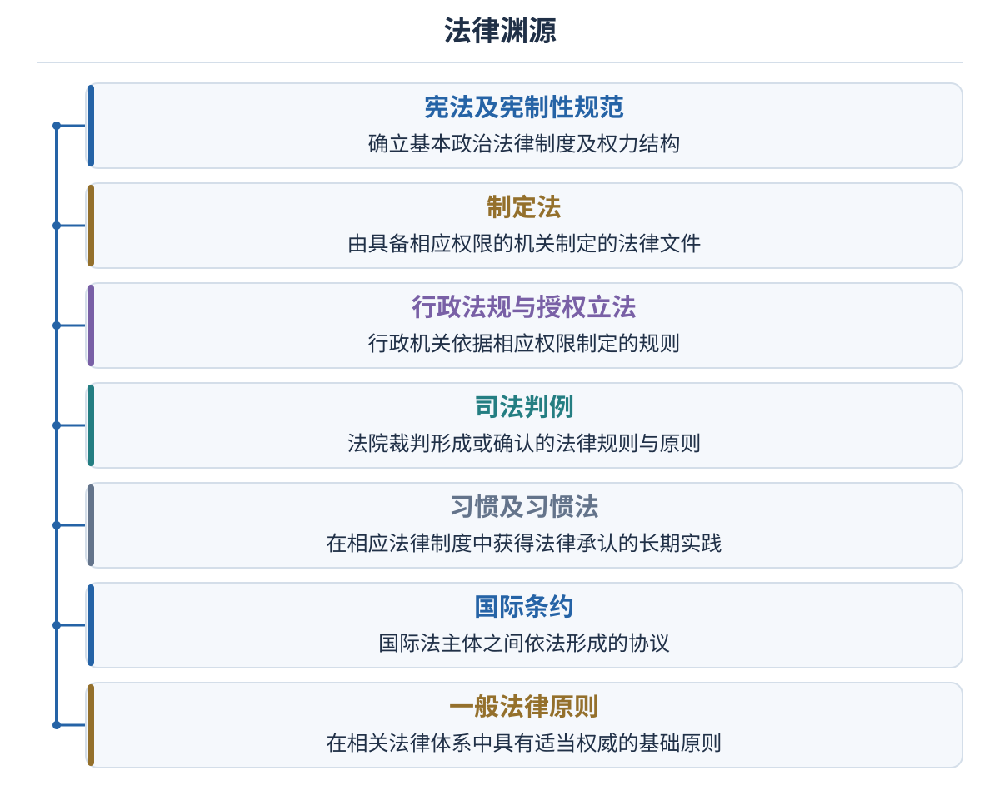
*图 007　法律渊源*

> [!note]- 图示文字索引
> - 宪法及宪制性规范：确立基本政治法律制度及权力结构
> - 制定法：由具备相应权限的机关制定的法律文件
> - 行政法规与授权立法：行政机关依据相应权限制定的规则
> - 司法判例：法院裁判形成或确认的法律规则与原则
> - 习惯及习惯法：在相应法律制度中获得法律承认的长期实践
> - 国际条约：国际法主体之间依法形成的协议
> - 一般法律原则：在相关法律体系中具有适当权威的基础原则

学术著作、行业标准、专业指引、司法解释等材料在不同法律体系中的法律地位也不相同。不能认为所有国家都存在完全一样的法律渊源及效力等级。

#### 3.5 法律的效力范围

| 效力维度 | 核心问题 |
|---|---|
| 时间效力 | 何时生效、何时失效，是否适用于此前行为？ |
| 空间效力 | 在什么地域或司法辖区内适用？ |
| 对人效力 | 对哪些自然人、组织及其他主体适用？ |
| 对事效力 | 适用于哪些事项和法律关系？ |
| 层级效力 | 与其他法律规范发生冲突时如何处理？ |

#### 3.6 法律规范冲突的处理
许多法律体系存在类似的规范冲突处理思想：上位规范与下位规范的效力关系；特别规范与一般规范的适用关系；新旧规范之间的衔接关系；强制性规范与私人约定的关系；国内法与国际法之间的关系。
这些不是可以脱离法域直接套用的绝对公式。例如，新的一般规定是否能够排除旧的特别规定，需要进一步研究具体制度、立法意图及冲突处理规则。

### 第四章　法律主体与法律关系

#### 4.1 法律关系的基本结构
法律关系是法律规范所确认或调整的权利、义务及其他法律地位之间的关系。

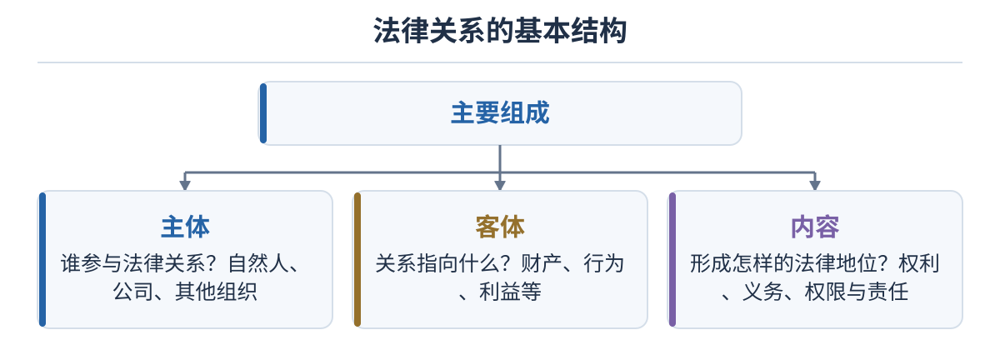
*图 008　法律关系的基本结构*

> [!note]- 图示文字索引
> - 主体：谁参与法律关系？自然人、公司、其他组织
> - 客体：关系指向什么？财产、行为、利益等
> - 内容：形成怎样的法律地位？权利、义务、权限与责任

法律事实引起关系的产生、变更或消灭。例如，甲向乙购买一台电脑。甲、乙是法律关系主体；交付电脑、支付价款等属于相关义务及行为；双方的合同成立、履行等事实可能引起相应法律效果。

#### 4.2 法律主体的分类

| 主体 | 基本含义 |
|---|---|
| 自然人 | 作为法律主体的人 |
| 法人 | 依法具有独立法律人格的组织 |
| 非法人组织 | 具有一定法律主体资格但不具有法人地位的组织 |
| 国家 | 在相应国内法及国际法关系中具有法律地位的主体 |
| 国际组织 | 根据其成立依据及相关国际法规则享有相应法律人格的组织 |

不同法律体系对公司、合伙、信托及其他组织的主体资格存在明显差异。

#### 4.3 法律人格、权利能力与行为能力

| 概念 | 核心问题 |
|---|---|
| 法律人格 | 是否被法律承认为能够享有权利及承担义务的主体？ |
| 权利能力 | 是否具有享有相应权利及承担义务的资格？ |
| 行为能力 | 能否通过自己的行为独立产生相应法律效果？ |
| 责任能力 | 能否依据相关制度对行为承担相应法律责任？ |

例如，未成年人可以拥有财产权益，但其独立订立某些合同的能力可能受到限制。这些概念在民事责任、刑事责任及其他法律领域中具有不同适用条件。

#### 4.4 法律事实
法律事实是能够引起相关法律效果的事实。

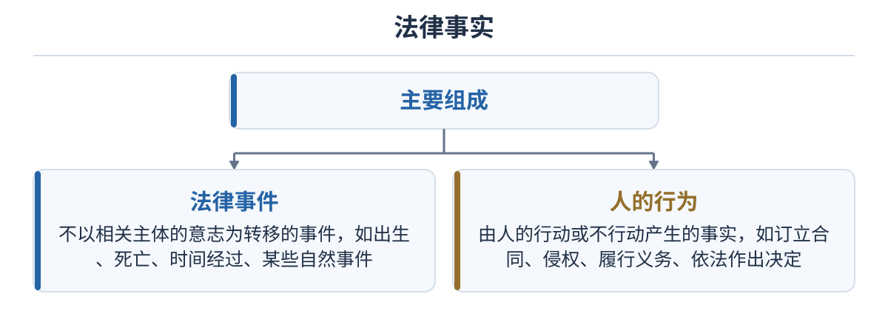
*图 009　法律事实*

> [!note]- 图示文字索引
> - 法律事件：不以相关主体的意志为转移的事件，如出生、死亡、时间经过、某些自然事件
> - 人的行为：由人的行动或不行动产生的事实，如订立合同、侵权、履行义务、依法作出决定

这是民法学中常见的教学分类。进一步分类可区分民事法律行为、事实行为、违法行为等。签订合同可能产生债权债务关系；履行合同可能使特定义务消灭；死亡可能引起继承法律关系。

#### 4.5 法律关系的主要类型

- 民事法律关系：私人之间的财产及人身关系。
- 商事法律关系：商业活动、企业组织及市场交易关系。
- 行政法律关系：公共行政权力行使及相关主体之间的关系。
- 刑事法律关系：犯罪、刑事责任及相关国家权力关系。
- 程序法律关系：诉讼、仲裁及其他法律程序中的关系。
- 国际法律关系：相关国际法主体之间的法律关系。

同一个现实事件可能同时产生多种法律关系。

### 第五章　法律权利、义务与责任

#### 5.1 权利与利益
利益是主体所重视或能够从中获益的事物，法律权利则是受到相应法律制度确认的地位、请求、自由或法律能力。一个人希望获得某项利益，并不意味着他已经具有要求他人提供该利益的法律权利。

#### 5.2 权利的基本分类

| 分类依据 | 主要类型 |
|---|---|
| 权利性质 | 财产权、人身权及其他权利 |
| 约束对象 | 绝对权、相对权 |
| 权利功能 | 支配权、请求权、形成权、抗辩权 |
| 存续关系 | 主权利、从权利 |
| 产生依据 | 法定权利、约定权利等 |
| 转让条件 | 可转让权利、受限制或不可转让权利 |

这些分类采用不同分析维度。例如，一项债权可以同时是财产权、相对权和请求权。

##### 5.2.1 按照权利功能进行分类

| 权利 | 核心含义 |
|---|---|
| 支配权 | 对特定对象进行直接支配的法律地位 |
| 请求权 | 要求特定主体实施或停止特定行为的权利 |
| 形成权 | 在满足法定或约定条件时，通过单方意思表示改变法律关系的权利 |
| 抗辩权 | 在相应条件下对抗他人请求权行使的权利 |

#### 5.3 霍菲尔德法律权利分析模型
这是理解权利与义务关系的一项非常重要的分析工具。

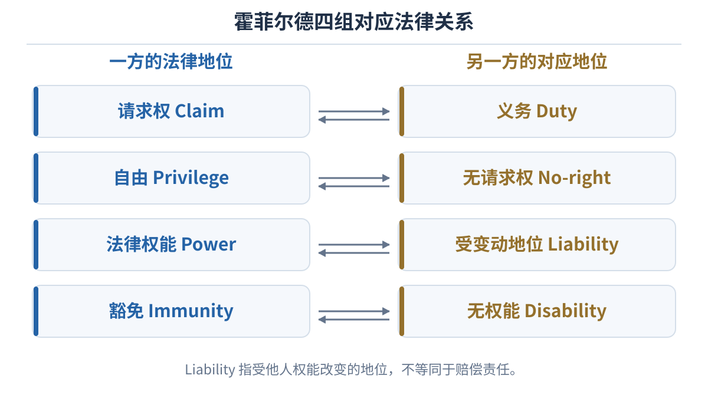
*图 010　霍菲尔德四组对应法律关系*

> [!note]- 图示文字索引
> 请求权 Claim ↔ 义务 Duty；自由 Privilege ↔ 无请求权 No-right；法律权能 Power ↔ 受变动地位 Liability；豁免 Immunity ↔ 无权能 Disability。

这里的 Liability 是法律关系受到他人权能改变的地位，不等同于违法后的赔偿责任。

| 法律地位 | 示例 |
|---|---|
| 请求权 | 债权人具有要求债务人支付相应款项的权利 |
| 自由 | 一个人在没有相关法律义务限制时，可以选择不参与某项交易 |
| 法律权能 | 当事人在符合条件时可以解除某项合同 |
| 豁免 | 某个人在特定关系中不受另一方单方面改变其法律地位的权力支配 |

这个模型说明，「拥有权利」并不总是意味着他人必须为自己提供某种东西。

#### 5.4 法律义务的分类

| 类型 | 含义 |
|---|---|
| 积极义务 | 要求实施特定行为 |
| 消极义务 | 要求不实施特定行为 |
| 法定义务 | 由适用法律产生的义务 |
| 约定义务 | 由有效协议等安排产生的义务 |
| 一般义务 | 面向较广泛主体的义务 |
| 特定义务 | 特定法律关系中针对特定主体的义务 |

#### 5.5 法律责任的主要类型

*图 011　法律责任的主要类型*

> [!note]- 图示文字索引
> - 民事责任：赔偿损失、履行义务、停止侵害等
> - 刑事责任：犯罪所引起的刑事法律后果
> - 行政责任：违反相应行政法律规范或履行行政职责不当产生的后果
> - 其他制度性责任：宪制性责任、纪律责任及国际法律责任等

一个行为可以同时产生不同性质的法律责任。例如，企业生产并销售不符合安全要求的商品，可能同时涉及消费者民事赔偿、行政监管措施，以及在满足刑事法律规定时的刑事责任。

#### 5.6 责任与救济的区别
责任强调相关主体承担什么法律后果；救济强调受影响主体如何实现或恢复其法律权利。

| 典型救济方式 | 主要功能 |
|---|---|
| 损害赔偿 | 补偿相应损失 |
| 返还财产 | 恢复相关财产关系 |
| 停止侵害 | 阻止持续或可能发生的侵害 |
| 实际履行 | 在相应条件下要求完成约定义务 |
| 撤销或确认无效 | 消除相应法律行为或决定的效力 |
| 禁令 | 通过司法命令要求实施或停止相关行为 |
| 确认性裁判 | 明确相应权利及法律关系 |

具体救济方式及适用条件具有法域差异，尤其在损害赔偿、实际履行及禁令制度方面。

### 第六章　法律解释、推理与分析方法
法律思维并不是记住某项规定之后直接给出结论，而是需要将事实、规范、证据、解释与责任判断有机结合。

#### 6.1 法律分析的基本结构

*图 012　法律分析的基本结构*

> [!note]- 图示文字索引
> - 识别事实：究竟发生了什么？哪些内容尚未得到证明？
> - 识别法律关系：涉及哪些主体、权利、义务及行为？
> - 确定法律问题：争议究竟集中在哪里？
> - 寻找适用规范：哪些法律、判例或原则具有权威？
> - 解释与适用：事实是否满足规范所要求的条件？
> - 确定法律后果：权利是否成立，责任是否产生？
> - 分析救济与执行：如何通过合法程序实现相关权利？

#### 6.2 法律三段论
法律三段论是将一般法律规范适用于具体案件的一种基本推理方式。设 $F(x)$：行为 $x$ 满足某项法律规范的适用条件；$R(x)$：行为 $x$ 产生该规范规定的法律后果。
$$
\forall x(F(x)\rightarrow R(x))
$$
$$
F(a)
$$
$$
\therefore R(a)
$$

*图 013　法律三段论*

> [!note]- 图示文字索引
> 大前提：法律规范。小前提：经认定的案件事实。结论：产生相应法律后果。

实际法律问题的困难，往往不在于最后的演绎推理，而在于如何确定大前提、证明小前提，以及如何处理例外、原则冲突及不同解释。

#### 6.3 法律解释的主要方法

| 解释方法 | 核心思想 |
|---|---|
| 文义解释 | 根据法律文字、语言习惯及专业含义理解规范 |
| 体系解释 | 结合其他条文及整个法律体系理解规范 |
| 历史解释 | 研究立法历史及相关制度背景 |
| 目的解释 | 根据规范的制度目的理解其含义 |
| 合宪性解释 | 在相关制度允许的范围内选择与宪法一致的解释 |
| 比较法解释 | 参考其他法律体系的经验及理论 |
| 后果导向分析 | 研究不同解释可能产生的实际后果 |

这些方法在不同法域中的地位和使用限制有所不同。例如，不能为了达到某种预期社会效果而无限扩大刑事处罚规范的适用范围。

#### 6.4 演绎推理、归纳推理与类比推理

| 推理方式 | 法学中的用途 |
|---|---|
| 演绎推理 | 将一般规范适用于具体事实 |
| 归纳推理 | 从多个案件及实践中概括相关规则 |
| 类比推理 | 根据具有法律相关性的相似性进行分析 |
| 区别推理 | 说明当前案件与既有案件存在重要差异 |
| 反面推论 | 在适当条件下从规则限定范围推导其他情形 |
| 利益衡量 | 分析不同法律利益及价值之间的冲突 |

类比推理在普通法判例分析中具有重要作用，在成文法体系中也可能用于特定法律漏洞的处理。但许多法域禁止通过不利于被告人的类推扩大犯罪及刑罚范围。

#### 6.5 IRAC法律分析模型

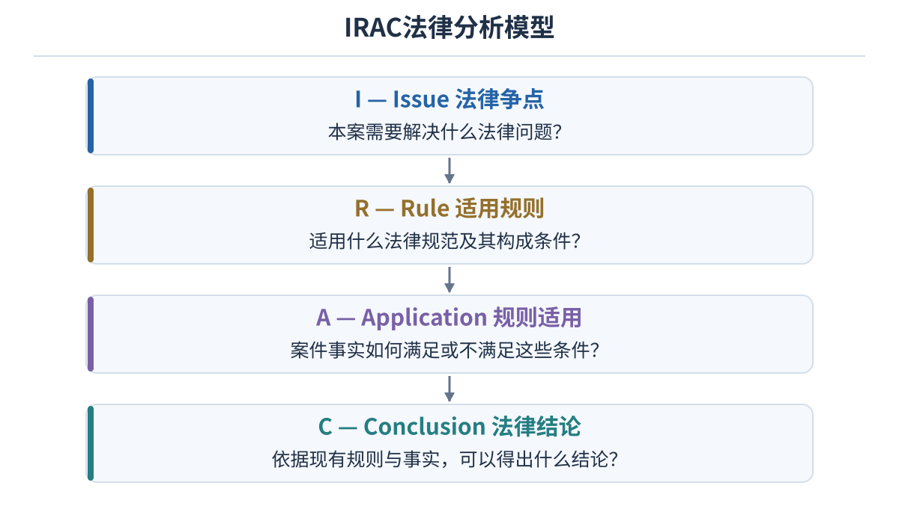
*图 014　IRAC法律分析模型*

> [!note]- 图示文字索引
> - I — Issue 法律争点：本案需要解决什么法律问题？
> - R — Rule 适用规则：适用什么法律规范及其构成条件？
> - A — Application 规则适用：案件事实如何满足或不满足这些条件？
> - C — Conclusion 法律结论：依据现有规则与事实，可以得出什么结论？

IRAC是法律教育中常用的分析及写作框架，而不是某个国家特有的实体法律规则。

#### 6.6 法律事实与证据的区别

- 客观事实：现实中实际发生的事情。
- 当事人陈述：相关人员对事实作出的描述。
- 证据材料：能够用于证明或反驳相关事实的信息和材料。
- 待证事实：法律程序中需要证明的事项。
- 认定事实：裁判机构依据适用规则及证据形成的事实判断。

客观事实与司法认定事实并不必然完全一致。证据不足、证明规则及程序限制都可能影响最终认定。
**法律思维的第一项能力，就是在掌握充分事实与依据之前，不急于作出确定性的法律结论。**

## 第二篇　世界法律体系与法治制度

### 第七章　法律历史与法律制度演进

#### 7.1 法律制度的历史发展

*图 015　法律制度的历史发展*

> [!note]- 图示文字索引
> - 早期习惯与共同体规则：依靠亲属关系、传统、宗教及共同体权威维持社会秩序
> - 早期成文法律：通过文字记录财产、债务、家庭、处罚及社会身份等规则
> - 古典法律体系：逐步形成更加系统的财产、契约、程序及法律概念
> - 中世纪多元法律秩序：宗教法、习惯法、地方制度、王权及商业规则并存
> - 近代国家与法律体系：国家立法、现代宪制、个人权利及系统化法律逐步发展
> - 现代社会与国际法律秩序：劳动保护、社会保障、经济监管、国际合作及人权保护进一步发展
> - 数字时代的法律变革：数据、算法、人工智能及跨境数字活动带来新的制度问题

这是概括性的历史分析框架，不代表所有文明都沿相同路线发展。

#### 7.2 具有重要影响的法律传统与历史事件

| 历史制度或事件 | 主要学科意义 |
|---|---|
| 《汉谟拉比法典》 | 早期成文法律及社会秩序研究 |
| 古罗马法 | 财产、债、契约及私法理论的发展 |
| 《查士丁尼民法大全》 | 罗马法的系统整理及后世法律传统 |
| 中华传统法律制度 | 礼法关系、国家治理及历史社会秩序 |
| 英国《大宪章》 | 权力约束及英国宪制发展的历史研究 |
| 英国普通法的发展 | 法院裁判、判例与衡平法传统 |
| 法国《人权和公民权宣言》 | 近代权利思想及政治法律制度 |
| 法国民法典 | 近代民法典编纂的重要代表 |
| 德国民法典 | 系统化民法理论及法律概念的发展 |
| 《联合国宪章》 | 现代国际法律秩序的重要基础 |
| 《世界人权宣言》 | 现代国际人权规范发展的重要文件 |

这些历史法律文件的意义，不在于它们的所有内容仍然适用，而在于它们反映了法律制度与社会结构之间的演进关系。

#### 7.3 法律制度为什么会发生变化

| 影响因素 | 对法律制度的可能影响 |
|---|---|
| 经济结构 | 影响财产、契约、劳动及商业制度 |
| 政治结构 | 影响国家权力、立法及司法制度 |
| 社会文化 | 影响家庭、道德及身份关系 |
| 技术发展 | 产生新的交易方式及责任问题 |
| 人口变化 | 影响劳动、福利、养老及移民制度 |
| 国际交流 | 促进法律移植、制度借鉴及规则协调 |
| 社会冲突 | 推动权利确认及制度改革 |

例如，电子商务出现之后，法律需要进一步处理电子合同、数字证据、平台责任、跨境交易及消费者保护问题。

#### 7.4 法律移植与制度趋同

- 法律移植：一个法律体系引入其他法律体系的规范、概念或制度。
- 法律继受：在历史发展中吸收既有法律传统。
- 法律本土化：对外来法律制度进行适应性调整。
- 法律协调：减少不同法域之间的制度冲突。
- 法律统一：通过特定机制建立共同适用的规则。

一项制度在其他国家运行良好，并不能直接证明它适合完全不同的政治、经济与社会环境。

### 第八章　大陆法系、普通法系与其他法律传统

#### 8.1 法律体系、法系与法域

| 概念 | 核心含义 |
|---|---|
| 法律体系 | 特定制度内法律规范及相关制度形成的整体 |
| 法律传统 | 长期形成的法律思想、制度和实践方式 |
| 法系 | 根据历史来源、法律技术及共同特征进行的比较法分类 |
| 法域（Jurisdiction） | 具有特定法律适用及管辖体系的范围 |
| 法律部门 | 按照调整对象及方法划分的法律规范类别 |

**国家与法域不是完全等同的概念。** 同一个国家内部可能存在不同的法律制度。同属于普通法传统的多个国家和地区，也不意味着其具体法律完全相同。

#### 8.2 世界主要法律传统

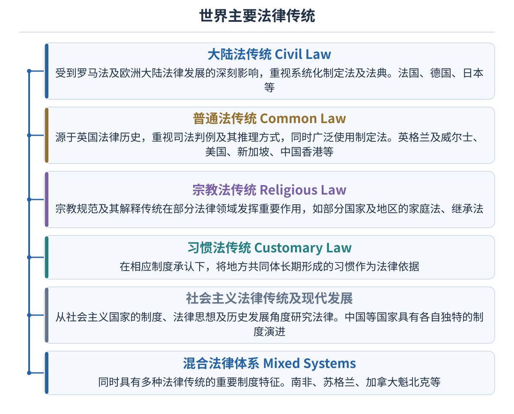
*图 016　世界主要法律传统*

> [!note]- 图示文字索引
> - 大陆法传统 Civil Law：受到罗马法及欧洲大陆法律发展的深刻影响，重视系统化制定法及法典。法国、德国、日本等
> - 普通法传统 Common Law：源于英国法律历史，重视司法判例及其推理方式，同时广泛使用制定法。英格兰及威尔士、美国、新加坡、中国香港等
> - 宗教法传统 Religious Law：宗教规范及其解释传统在部分法律领域发挥重要作用，如部分国家及地区的家庭法、继承法
> - 习惯法传统 Customary Law：在相应制度承认下，将地方共同体长期形成的习惯作为法律依据
> - 社会主义法律传统及现代发展：从社会主义国家的制度、法律思想及历史发展角度研究法律。中国等国家具有各自独特的制度演进
> - 混合法律体系 Mixed Systems：同时具有多种法律传统的重要制度特征。南非、苏格兰、加拿大魁北克等

现代法律体系往往相互借鉴，法系只是比较和理解制度的工具，而不是将所有国家绝对划分为互不相关的类别。

#### 8.3 大陆法系与普通法系的核心区别

| 比较维度 | 大陆法传统 | 普通法传统 |
|---|---|---|
| 历史基础 | 罗马法及欧洲大陆法律传统 | 英国法院及法律传统 |
| 法律渊源侧重 | 成文法、法典、法律原则 | 制定法、判例、普通法及衡平法 |
| 法律组织 | 较强调概念体系及系统编纂 | 较强调具体争议及既有判例的发展 |
| 法律推理 | 规范解释与事实涵摄 | 判例分析、区别推理及规范解释 |
| 判例作用 | 依具体制度具有不同程度的权威 | 遵循先例原则通常具有重要地位 |
| 法律教育 | 常从基本概念及规范体系切入 | 常通过案件及法律问题展开 |
| 司法程序 | 部分制度较强调法官调查和程序管理 | 部分制度较强调当事人对抗及举证 |

上述均为比较法上的一般倾向。现代普通法体系具有大量成文法律，大陆法体系也重视司法裁判的一致性。不能将二者简单理解为「一个有法条，一个没有法条」。

#### 8.4 两种典型法律推理路径

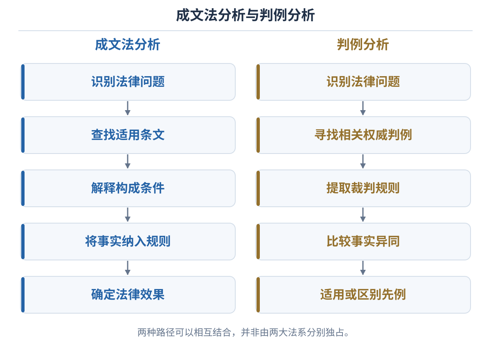
*图 017　成文法分析与判例分析*

> [!note]- 图示文字索引
> 成文法分析：识别问题 → 查找条文 → 解释构成条件 → 将事实纳入规则 → 确定法律效果。判例分析：识别问题 → 寻找相关权威判例 → 提取裁判规则 → 比较事实异同 → 适用或区别先例。

两种典型分析方式可以相互结合，并非分别由两大法系独占。

#### 8.5 普通法判例的主要概念

| 概念 | 核心含义 |
|---|---|
| Precedent 先例 | 先前法院裁判对后续案件具有的相关法律意义 |
| Stare Decisis 遵循先例 | 根据相应规则尊重或遵循已有裁判原则 |
| Ratio Decidendi 裁判理由 | 支持裁判结果所必需的法律理由 |
| Obiter Dictum 附带意见 | 非裁判结果所必需的相关法律意见 |
| Binding Authority 约束性权威 | 依法需要遵循的法律依据 |
| Persuasive Authority 说服性权威 | 可以参考但不必然具有约束力的依据 |
| Distinguishing 区别先例 | 根据重要事实或法律差异说明先例不直接适用 |
| Overruling 推翻先例 | 有权法院否定先前判例所确立的法律规则 |

阅读判例时，不是判决书中的每一句话都具有同等法律效力。

#### 8.6 普通法与衡平法
衡平法（Equity）在英国法律历史中发展形成，曾用于弥补传统普通法规则及救济方式的不足。重要相关概念包括信托、受信义务、禁令及实际履行等。衡平法不是法官可以依据个人公平观念任意否定法律，而是具有自身规则、原则及历史传统的制度。

#### 8.7 主要国家与地区的法律体系比较

| 国家或地区 | 主要制度特征 |
|---|---|
| 中国大陆 | 中国特色社会主义法律体系，以成文法为主要法律渊源 |
| 中国香港 | 在基本法确立的宪制框架下保留普通法及衡平法传统 |
| 英格兰及威尔士 | 普通法与制定法共同构成法律体系 |
| 美国 | 普通法传统与联邦、州法律体系并存 |
| 法国 | 具有重要法典编纂传统的大陆法体系 |
| 德国 | 重视系统化法律概念及制定法的大陆法体系 |
| 日本 | 受到欧洲大陆法等多种法律传统影响的现代法律体系 |
| 新加坡 | 源于英国普通法传统，并形成自身制定法及司法制度 |
| 欧盟 | 在成员国各自法律体系之外形成区域性法律秩序 |

中国香港和新加坡尤其适合用于理解普通法如何在亚洲社会及国际商业环境中发展。两地都具有大量制定法，并不是直接沿用英国全部法律。

### 第九章　法治、宪法与国家权力

#### 9.1 法制与法治

| 概念 | 核心关注 |
|---|---|
| 法制 | 法律规范、法律机构及相关制度的建立与运行 |
| 法治 | 公共权力及社会活动受到法律约束，并具有权利保障和程序机制 |
| 依法治理 | 依据相应法律规则开展治理活动 |
| 宪制秩序 | 国家及公共机构权力的基本法律安排 |

拥有大量法律文件，并不自动意味着已经解决了公共权力约束、法律平等适用及司法救济等问题。

#### 9.2 法治的主要分析维度

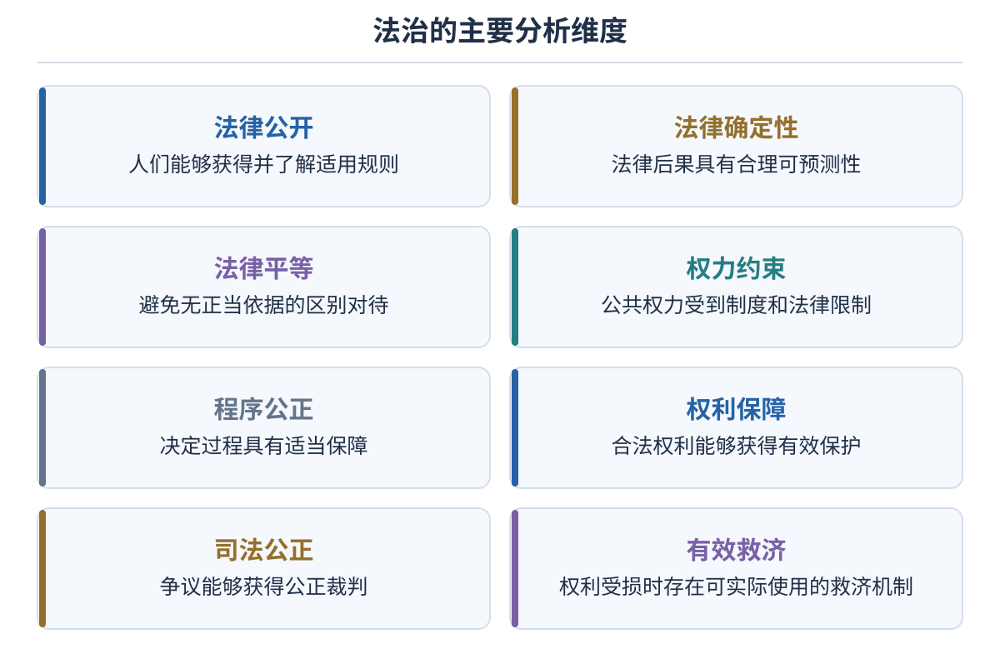
*图 018　法治的主要分析维度*

> [!note]- 图示文字索引
> - 法律公开：人们能够获得并了解适用规则
> - 法律确定性：法律后果具有合理可预测性
> - 法律平等：避免无正当依据的区别对待
> - 权力约束：公共权力受到制度和法律限制
> - 程序公正：决定过程具有适当保障
> - 权利保障：合法权利能够获得有效保护
> - 司法公正：争议能够获得公正裁判
> - 有效救济：权利受损时存在可实际使用的救济机制

联合国关于法治的理解也强调法律公开、平等适用、问责、法律确定性、程序透明及避免任意行使权力等内容。

#### 9.3 宪法的基本研究结构
宪法研究国家的基本制度、公共权力结构及基本权利。

| 研究领域 | 主要问题 |
|---|---|
| 国家性质与基本制度 | 国家权力建立在怎样的制度基础之上？ |
| 国家组织结构 | 国家由哪些主要机构组成？ |
| 权力配置 | 立法、行政、司法及其他权力如何安排？ |
| 中央与地方关系 | 不同层级公共权力如何划分？ |
| 基本权利 | 个人受到怎样的宪法性保障？ |
| 宪法监督 | 如何处理其他法律及公共行为与宪法的关系？ |
| 宪法变迁 | 基本制度如何通过修正、解释及实践变化？ |

#### 9.4 国家权力的基本功能

*图 019　国家权力的基本功能*

> [!note]- 图示文字索引
> - 立法：制定具有普遍约束力的法律规范
> - 行政：实施法律及开展公共管理
> - 司法：依法处理法律争议及相关案件

立法、行政与司法是常见的国家功能分类，但各国具体机构设置及相互关系并不相同。权力的产生、配置、授权、监督及责任均需研究。

#### 9.5 国家结构与政体

| 分类维度 | 主要类型 |
|---|---|
| 国家结构形式 | 单一制、联邦制等 |
| 国家元首制度 | 共和制、君主制等 |
| 政府组织及权力关系 | 议会制、总统制、半总统制、人民代表大会制度等不同制度安排 |

这些属于不同分析维度。例如，联邦制不必然与总统制同时存在，君主制也不必然意味着君主直接掌握全部政治权力。

#### 9.6 人权、公民权与基本权利

| 概念 | 主要含义 |
|---|---|
| 人权 | 基于人的主体地位及尊严受到承认或主张的基本权利 |
| 公民权 | 与特定国家公民身份相联系的权利 |
| 基本权利 | 在宪法或其他基础性法律体系中受到重要保障的权利 |
| 普通法律权利 | 由一般法律、合同等法律依据形成的权利 |

基本权利的研究通常涉及生命与人身安全、人格尊严、平等、隐私、表达、宗教或信仰、财产、政治参与、教育及社会保障等方面。各种权利的具体法律内容、限制条件及救济方式因制度而异。

#### 9.7 权利限制与比例原则
在承认比例原则的法律体系中，对于限制权利的公共措施，可以从以下层次进行分析。

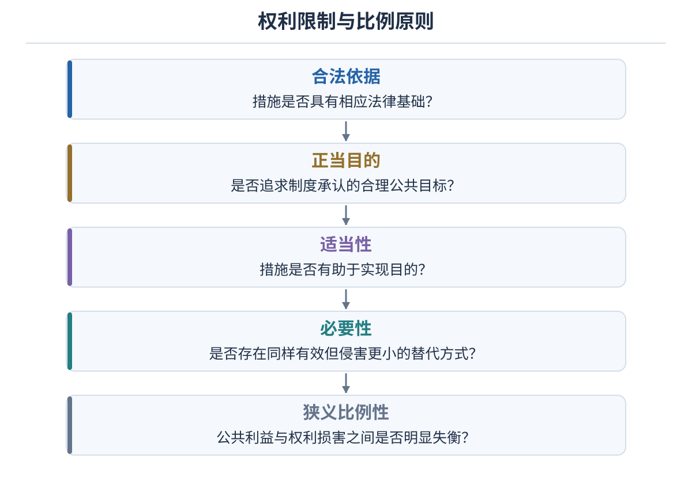
*图 020　权利限制与比例原则*

> [!note]- 图示文字索引
> - 合法依据：措施是否具有相应法律基础？
> - 正当目的：是否追求制度承认的合理公共目标？
> - 适当性：措施是否有助于实现目的？
> - 必要性：是否存在同样有效但侵害更小的替代方式？
> - 狭义比例性：公共利益与权利损害之间是否明显失衡？

这一分析思路能够帮助理解为什么公共利益并不当然意味着可以无限制地牺牲个人权利。

#### 9.8 宪法监督与违宪审查
常见比较研究包括：由普通法院在具体案件中进行宪法性审查；由专门宪法法院或相关机构承担宪法审查；由立法机关及相关制度承担宪法监督；事前审查与事后审查；抽象审查与具体案件审查。宪法监督机制的存在形式、权限及法律效果需要根据具体国家的宪制制度分析。

### 第十章　行政法与公共权力约束

#### 10.1 行政法研究什么
行政法主要研究公共行政机关如何行使权力，以及行政活动如何受到法律规范和监督。它既研究行政机关能够做什么，也研究行政机关不能做什么。

#### 10.2 行政行为的主要分类

| 行为类别 | 核心功能 |
|---|---|
| 行政许可 | 在满足条件时允许开展特定活动 |
| 行政处罚 | 对违反行政法律规范的行为施加相应法律后果 |
| 行政强制 | 依法采取强制措施或实施强制执行 |
| 行政征收 | 依法取得财产、资金或相关权益 |
| 行政给付 | 向符合条件的主体提供公共利益或保障 |
| 行政检查 | 对相关活动进行监督及检查 |
| 行政确认 | 对特定事实、身份或法律状态作出确认 |
| 行政规范制定 | 在相应权限内形成一般性行政规则 |

各国行政法的分类方法及具体术语并不完全相同。

#### 10.3 行政权力的法律边界

*图 021　行政权力的法律边界*

> [!note]- 图示文字索引
> - 主体合法：作出决定的机关是否具有相应资格？
> - 权限合法：是否超出法定权力范围？
> - 依据合法：是否具有适用的法律依据？
> - 事实清楚：决定是否建立在充分事实基础上？
> - 程序正当：是否遵循应有程序及参与保障？
> - 目的正当：是否为相应法律授权的目的行使权力？

#### 10.4 羁束行政与行政裁量

| 概念 | 含义 |
|---|---|
| 羁束行政 | 法律对决定条件及结果规定得相对明确 |
| 行政裁量 | 法律在一定范围内给予行政机关选择空间 |
| 越权 | 超出相应法定权限 |
| 滥用权力 | 将权力用于不正当目的或以不当方式行使 |
| 行政不作为 | 在负有相应法定职责时未依法履行 |

行政裁量并不是任意决定的自由，而是在法定权限及目的范围内作出选择的空间。

#### 10.5 行政程序与行政救济
行政程序常涉及申请、调查、告知、陈述申辩、听证、决定、说明理由及送达等环节。行政救济可能包括内部复核、行政复议、司法审查、行政诉讼、国家赔偿及其他监督机制。不同制度对这些救济途径的名称、使用顺序、受理范围和期限具有不同规定。

## 第三篇　民法与私人权利体系
民法涉及个人身份、财产归属、日常交易、债权债务、合同履行、损害赔偿、婚姻家庭及继承等大量现实问题。

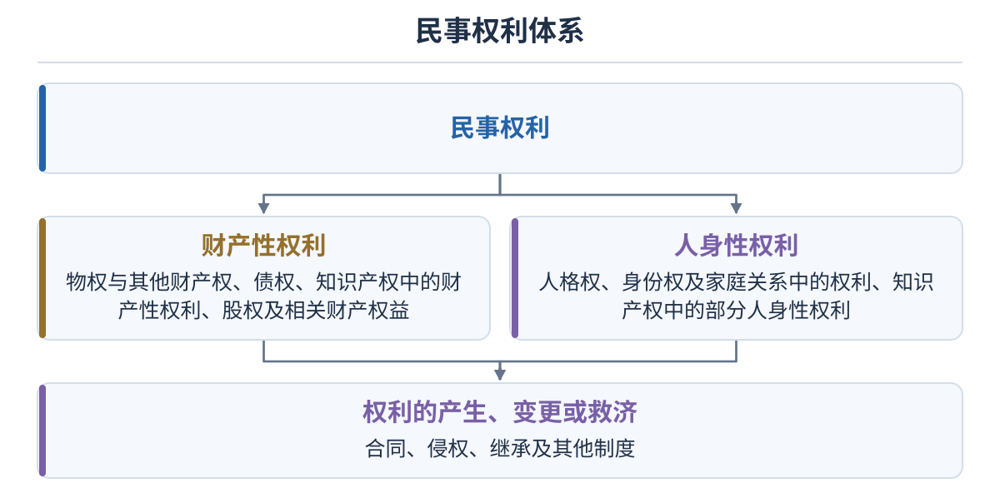
*图 022　民事权利体系*

> [!note]- 图示文字索引
> 财产性权利：物权与其他财产权、债权、知识产权中的财产性权利、股权及相关财产权益；人身性权利：人格权、身份权及家庭关系中的权利、知识产权中的部分人身性权利。

股权、知识产权及部分身份关系同时包含不同性质的法律地位。合同、侵权、继承及其他制度可以引起权利的产生、变更或救济。

### 第十一章　民法基本原理与民事主体

#### 11.1 私法自治
私法自治是指私人主体在法律允许的范围内，可以通过自己的意思决定是否建立、变更或终止相应法律关系。其典型表现包括合同自由、财产处分自由、遗嘱自由及组织设立自由等。私法自治不是绝对自由，而是受到强制性法律规范、第三人权利及其他公共利益要求的限制。

#### 11.2 民法的主要基础原则

| 原则 | 核心含义 |
|---|---|
| 平等原则 | 民事主体在相应法律关系中具有平等法律地位 |
| 自愿原则 | 尊重主体依法表达及实现自身意思 |
| 公平原则 | 合理协调当事人之间的权利义务 |
| 诚信原则 | 在法律关系中遵循诚实、信用及合理信赖 |
| 禁止权利滥用 | 不得以不正当方式行使自身权利损害相关权益 |
| 公共秩序与善良风俗 | 私人自治受到相关公共秩序及基本价值限制 |

这些原则在大陆法传统中具有重要地位，其他法律传统也可能通过不同规则实现类似功能。

#### 11.3 法律上的平等与实际能力差异
法律地位平等，并不意味着交易双方具有相同的资金、信息、知识及谈判能力。因此，现代私法制度往往同时存在两种机制：

*图 023　私人自治与特别保护*

> [!note]- 图示文字索引
> - 一般自治机制：允许当事人自行决定交易及权利安排，如自由协商、合同约定、财产处分
> - 特别保护机制：应对实际能力差异及不公平风险，如消费者保护、劳动保护、格式条款控制

#### 11.4 自然人与组织主体
自然人的民事主体资格涉及出生、死亡、年龄、行为能力、住所及监护等制度。组织主体则涉及成立条件、独立人格、代表权限、财产独立性、组织责任及终止等制度。自然人和法人都可能成为合同主体，但二者产生及行使法律权利的方式并不完全相同。

#### 11.5 期间、时效与权利存续

| 概念 | 主要作用 |
|---|---|
| 期间 | 为法律行为或法律效果确定时间范围 |
| 诉讼时效 | 对特定请求权的司法保护产生时间上的法律影响 |
| 除斥期间 | 在相应制度中影响特定权利的存续 |
| 取得时效 | 部分法律体系允许满足条件的长期占有产生财产权效果 |
| 时效中止、中断或延长 | 在符合法定条件时改变相关时效的计算或效果 |

权利存在、权利可依法主张、法院可以提供救济，三者不一定完全相同。不能简单认为经过某个期限之后，所有债务和法律关系都自动消失。

### 第十二章　法律行为、意思表示与代理

#### 12.1 法律行为的本质
在大陆法民法理论中，民事法律行为主要指以意思表示为核心、旨在产生相应民事法律效果的行为。

*图 024　民事法律行为的形成*

> [!note]- 图示文字索引
> - 行为人的法律效果意思：希望建立、变更或终止法律关系
> - 意思表示：通过语言、文字、电子方式或相关行为表达
> - 产生相应法律效果：满足法律条件

例如，签订合同、订立遗嘱、发出符合条件的解除通知，可能分别形成不同性质的法律行为。

#### 12.2 法律行为的主要分类

| 分类依据 | 主要类型 |
|---|---|
| 意思表示数量 | 单方法律行为、双方法律行为、多方法律行为 |
| 是否具有对价或相应负担 | 有偿行为、无偿行为 |
| 形式要求 | 要式行为、不要式行为 |
| 法律效果发生时间 | 生前行为、死因行为等 |
| 法律效果性质 | 负担行为、处分行为等理论分类 |

合同通常需要双方或多方意思表示相互结合；遗嘱通常属于单方行为。负担行为与处分行为的区分在部分大陆法理论中具有重要地位，但并非所有法律体系都接受相同结构。

#### 12.3 意思表示与真实意思

| 概念 | 含义 |
|---|---|
| 内心意思 | 行为人实际希望实现的法律效果 |
| 表示行为 | 将意思以外部形式表达的行为 |
| 意思表示解释 | 判断相关表达在法律上的合理含义 |
| 意思表示瑕疵 | 意思形成或表达过程中存在相关缺陷 |
| 信赖保护 | 对相对人合理形成的信赖给予相应法律保护 |

常见意思表示问题包括错误、欺诈、胁迫、虚假表示、重大误解以及其他影响自主决定的情形。法律既需要尊重真实意思，也需要维护合理信赖与交易安全。

#### 12.4 法律行为的成立与效力

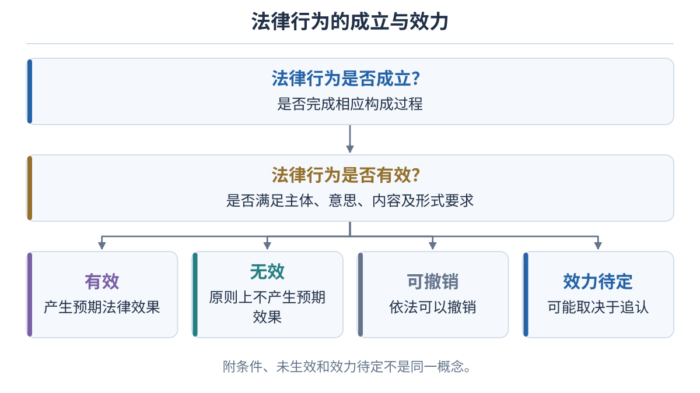
*图 025　法律行为的成立与效力*

> [!note]- 图示文字索引
> 先判断法律行为是否成立，再判断效力；可能存在有效、无效、可撤销、效力待定等状态。

法律行为是否成立，主要研究是否完成相应法律行为的构成过程；法律行为是否有效，主要研究是否满足相关主体、意思、内容及形式要求。

| 效力状态 | 核心含义 |
|---|---|
| 有效 | 产生相应法律效果 |
| 无效 | 原则上不能产生预期的法律效果 |
| 可撤销 | 符合条件的主体可以依法撤销 |
| 效力待定 | 效力可能取决于追认等因素 |
| 附条件 | 法律效果的发生或消灭取决于约定条件 |

附条件行为与效力待定行为具有不同理论结构，并非同义概念。尤其需要区分无效、可撤销、未生效与合同解除。它们产生的原因及后果并不相同。

#### 12.5 代理制度
代理是指代理人在相应权限内实施行为，使相关法律效果按照适用规则归属于被代理人等主体的制度。

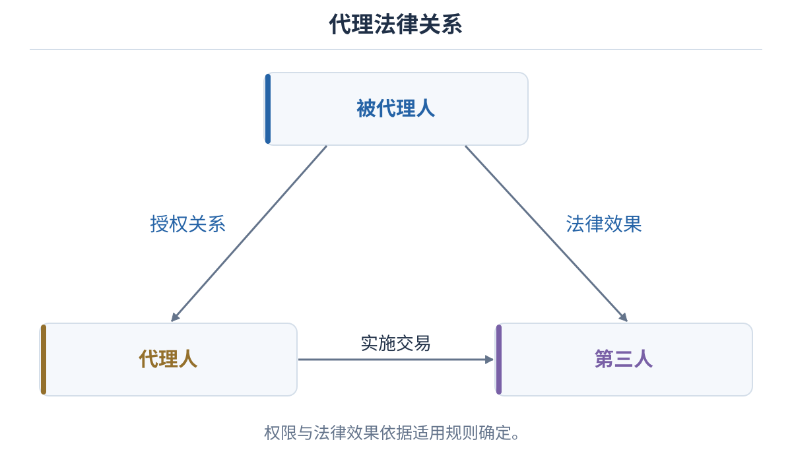
*图 026　代理法律关系*

> [!note]- 图示文字索引
> 被代理人向代理人授权，代理人对第三人实施交易，相关法律效果依规则归属于被代理人。

代理相关知识包括委托代理、法定代理、代理权限、代理权终止、无权代理、表见代理及追认等。需要区分代理权与委托合同。前者研究代理人能否使法律效果归属于他人，后者主要研究当事人之间的内部权利义务。

### 第十三章　物权、财产权与财产制度

#### 13.1 财产与财产权
财产不只是物质实体，也可能包括无形资产及具有经济价值的法律权益。财产权则是对相应财产或经济利益享有的法律权利。

| 财产类别 | 示例 |
|---|---|
| 不动产 | 土地、建筑物及相应权益 |
| 动产 | 车辆、设备、商品等 |
| 债权性资产 | 应收款、贷款债权等 |
| 知识产权 | 专利、著作权中的财产性权益等 |
| 企业权益 | 股份、合伙份额等 |
| 数字资产及相关权益 | 特定数字资源或数字化权益，法律性质因法域而异 |

财产、资产、物和物权是相互关联但不能直接等同的概念。

#### 13.2 物权与债权
这是理解财产制度最重要的一组概念。

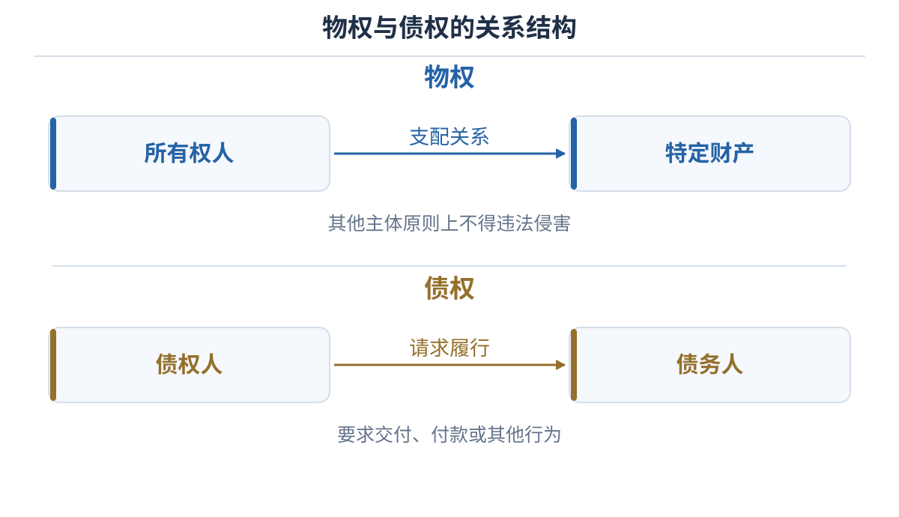
*图 027　物权与债权的关系结构*

> [!note]- 图示文字索引
> 物权：所有权人直接支配特定财产。债权：债权人向特定债务人请求履行。

| 比较维度 | 物权 | 债权 |
|---|---|---|
| 权利结构 | 通常具有直接支配性 | 通常具有特定主体之间的请求关系 |
| 对抗范围 | 原则上具有对世效力 | 原则上针对特定债务人 |
| 权利实现 | 可以直接支配相关财产 | 通常需要债务人履行 |
| 典型实例 | 所有权、抵押权 | 货款请求权、借款返还请求权 |

普通法中的财产权概念体系与大陆法物权理论不完全相同，但二者都会研究财产权能否对抗第三人及不同权益之间的优先关系。

#### 13.3 物权的基本分类
以下采用大陆法民法理论中的常见分类。

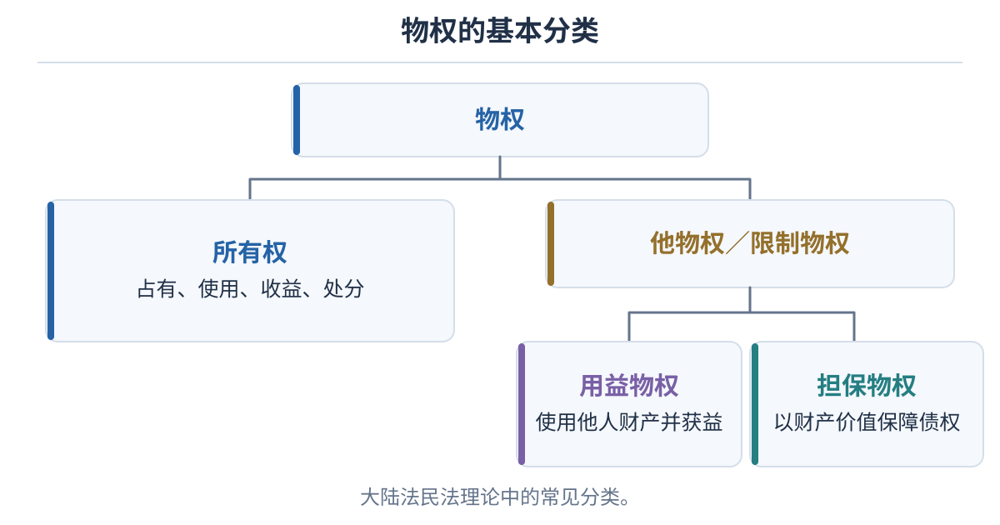
*图 028　物权的基本分类*

> [!note]- 图示文字索引
> 物权分为所有权与他物权（限制物权）；限制物权包括用益物权、担保物权。

具体用益物权与担保物权的种类由各法域确定。

#### 13.4 所有权的主要权能

| 权能 | 核心含义 |
|---|---|
| 占有 | 对财产进行实际控制的相关权能 |
| 使用 | 按照财产用途加以利用 |
| 收益 | 获取财产产生的利益 |
| 处分 | 在法律允许范围内改变相关财产状态或权利归属 |

占有并不一定意味着拥有所有权。例如，租客实际占有房屋，却不因此取得房屋所有权。在普通法财产理论中，还可以从权利束（Bundle of Rights）的角度理解财产权益，即财产权可能由多项可分离、受限制的法律权能组成。

#### 13.5 财产权的公示与交易安全

| 概念 | 作用 |
|---|---|
| 公示 | 使相关财产权利状态能够通过适当方式为外部主体了解 |
| 登记 | 通过相应登记制度记录权利及其变动 |
| 交付 | 在相关制度中转移占有并可能产生财产权变动效果 |
| 公信 | 在特定条件下保护对公示状态产生的合理信赖 |
| 善意取得等制度 | 在满足相应条件时保护部分交易第三人的财产权 |

登记并不总是财产权产生的唯一方式，登记是生效条件还是对抗条件，也取决于财产类型及适用法律。

#### 13.6 合同成立与财产权转移

*图 029　合同义务与财产权变动*

> [!note]- 图示文字索引
> - 买卖双方达成有效协议
> - 产生交付、付款等合同义务
> - 根据相关规则完成财产权变动

合同义务与财产权变动是两个不同分析问题。二者发生的时间及条件可能相同，也可能不同。签订房屋买卖合同，并不当然意味着买方已经取得完整房屋所有权。

#### 13.7 信托与财产权分离
信托（Trust）是普通法与国际财产管理中的重要制度。

*图 030　信托的基本结构*

> [!note]- 图示文字索引
> - 委托人 Settlor：依法设立信托并作出相关财产安排
> - 受托人 Trustee：管理信托财产并承担相应信义义务
> - 受益人 Beneficiary：按照信托安排享有相应受益权益

信托研究的核心问题包括财产独立、管理权、受益权、受托责任及财产保护。普通法中的信托财产权结构与其他法域的信托制度可能存在差异。信托也不意味着可以无条件规避债务、税收或监管义务。

### 第十四章　债权与合同法
个人消费、软件服务、公司经营、借贷、投资、跨境贸易等大量活动都需要以合同及债权债务制度为基础。

#### 14.1 债的基本结构
债是一种特定主体之间具有相应给付义务及请求权的法律关系。法律上的债不仅包括借钱产生的债务，还包括交付商品、提供服务、赔偿损失等多种义务关系。

#### 14.2 债的发生原因

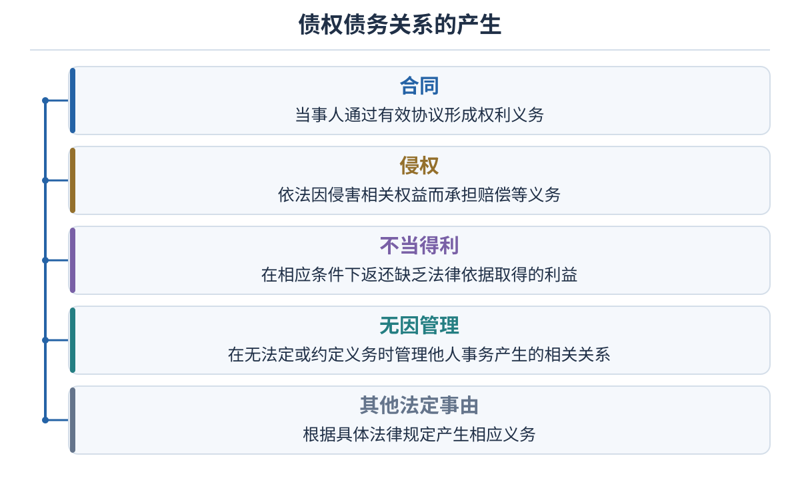
*图 031　债权债务关系的产生*

> [!note]- 图示文字索引
> - 合同：当事人通过有效协议形成权利义务
> - 侵权：依法因侵害相关权益而承担赔偿等义务
> - 不当得利：在相应条件下返还缺乏法律依据取得的利益
> - 无因管理：在无法定或约定义务时管理他人事务产生的相关关系
> - 其他法定事由：根据具体法律规定产生相应义务

以上是大陆法债法中的常见体系。普通法通常以合同、侵权及返还法等不同部门组织相近问题，并不一定采用统一的债法总论结构。

#### 14.3 合同的本质与功能
合同是当事人之间具有相应法律约束力的协议或安排。

- 建立可预期的合作关系。
- 分配双方权利及义务。
- 确定交易价格、期限及质量要求。
- 分配商业风险。
- 建立违约后果及纠纷解决机制。

合同需要具有法律上的成立及效力基础。

#### 14.4 合同成立的主要过程

*图 032　合同成立与履行*

> [!note]- 图示文字索引
> - 交易接触与磋商：了解需求、价格、条件及合作可能性
> - 要约 Offer：提出具有相应确定性及缔约意图的交易条件
> - 承诺 Acceptance：对要约作出符合相关规则的接受
> - 合同成立：满足适用法律要求的合意及其他条件
> - 效力判断：判断该合同是否具有预期的法律约束力
> - 合同履行：按照有效约定及法律规则完成义务

现实合同也可能通过谈判行为、平台操作、标准化交易流程及其他方式成立，并非必须经历形式明确的书面要约和承诺。

#### 14.5 不同法律传统中的合同成立问题

| 比较问题 | 大陆法常见研究方式 | 普通法常见研究方式 |
|---|---|---|
| 合意 | 意思表示与合同成立 | Offer 与 Acceptance |
| 交易约束力 | 法律行为及合同效力 | 缔约意图、对价及其他条件 |
| 无偿承诺 | 依具体合同类型及形式判断 | 常需要研究对价、契据或其他例外机制 |
| 合同解释 | 文义、目的、诚信及体系解释 | 合同文字、背景、判例及相关解释规则 |
| 违约救济 | 履行、赔偿、解除等 | 损害赔偿及特定条件下的衡平法救济等 |

对价（Consideration）是许多普通法合同制度中的重要概念，通常指作为承诺交换条件的法律认可价值。它不等于合同价格必须公平，也不等于每项有效承诺都必须直接支付金钱。

#### 14.6 合同的多维分类

| 分类依据 | 主要类型 |
|---|---|
| 交易性质 | 买卖、租赁、借款、服务、承揽、运输、保险等 |
| 权利义务结构 | 双务合同、单务合同等 |
| 经济交换 | 有偿合同、无偿合同 |
| 成立及形式 | 相关要式、非要式等类型 |
| 条款形成 | 协商合同、格式合同 |
| 履行时间 | 即时履行、持续性履行等 |
| 跨境性质 | 国内合同、跨境合同 |

#### 14.7 一份商业合同的基本组成

| 条款模块 | 主要解决的问题 |
|---|---|
| 当事人 | 谁是承担义务的法律主体？ |
| 定义与解释 | 重要术语具体指什么？ |
| 合同标的 | 双方究竟交易什么？ |
| 数量与质量 | 产品或服务需要达到什么标准？ |
| 价格与支付 | 支付多少、何时支付、使用什么方式？ |
| 交付与验收 | 如何确认义务已经完成？ |
| 陈述与保证 | 当事人对相关事实及法律状态作出什么承诺？ |
| 保密与知识产权 | 信息及技术成果归谁所有、如何使用？ |
| 风险分配 | 发生意外或外部变化时如何处理？ |
| 责任及赔偿 | 违约或损害产生什么后果？ |
| 期限与终止 | 合作何时开始、结束或提前退出？ |
| 适用法律 | 使用哪个法域的实体法律？ |
| 争议解决 | 通过何种法院、仲裁或其他方式解决纠纷？ |

合同的核心价值不仅在于建立合作，更在于提前安排合作出现问题时的处理方式。

#### 14.8 合同履行中的主要问题

| 概念 | 含义 |
|---|---|
| 全面履行 | 按照相应约定及法律要求完成义务 |
| 部分履行 | 仅完成部分约定义务 |
| 迟延履行 | 未在相应期限内完成义务 |
| 瑕疵履行 | 交付结果不符合约定或法律要求 |
| 拒绝履行 | 在相关条件下明确或实际不履行义务 |
| 同时履行抗辩 | 在相互给付关系中依法拒绝先行履行 |
| 不安抗辩等机制 | 在对方履约能力发生相关风险时采取法律允许的措施 |

后两项属于特定法律制度中的履行保护机制，并非可以无条件停止履行的依据。

#### 14.9 违约与合同救济

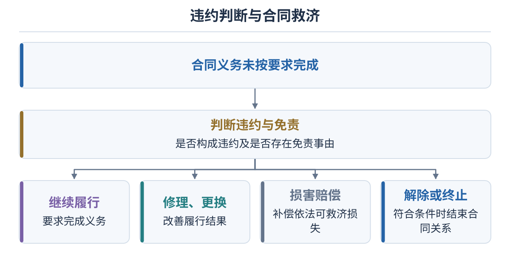
*图 033　违约判断与合同救济*

> [!note]- 图示文字索引
> 判断是否构成违约及免责事由后，依法选择继续履行、修理更换、损害赔偿、解除或终止等救济。

不同法域可能对实际履行、损害赔偿、违约金、解除条件及免责条款采取不同规定。

#### 14.10 不可抗力、情势变更与商业风险

| 概念 | 主要关注 |
|---|---|
| 不可抗力 | 超出合理控制范围的事件对合同履行产生的影响 |
| 情势变更／艰难情势 | 合同基础发生重大变化，继续履行可能造成严重失衡 |
| 合同受挫 Frustration | 普通法部分制度中因重大事件改变履行性质等产生的法律问题 |
| 商业风险 | 正常经营活动中应当考虑的价格、需求及成本变化 |

发生自然灾害、市场下跌或成本上涨，并不必然意味着合同可以自动解除或免除责任。需要具体研究风险是否属于合同已经分配的范围、事件与不能履行之间的关系，以及通知等程序要求。
国际统一私法协会的《国际商事合同通则》提供了跨法律传统学习合同问题的有价值参照，但其本身不是对所有跨国交易自动适用的强制性法律。

#### 14.11 合同的转让、变更与终止
相关知识包括债权转让、债务转移、合同权利义务概括转让、合同变更、解除、抵销、免除及债的更新等。

| 概念 | 核心区别 |
|---|---|
| 合同无效 | 涉及合同的法律效力基础 |
| 合同撤销 | 根据特定事由改变合同或法律行为的效力 |
| 合同解除 | 对已经形成的合同关系依法进行解除 |
| 合同履行完毕 | 通过履行完成主要合同义务 |
| 合同到期 | 根据合同期限及相关规则结束部分关系 |

终止合作不必然意味着保密、责任及争议解决等条款同时失去效力。

### 第十五章　侵权责任与损害赔偿

#### 15.1 侵权法为什么存在
侵权法主要研究私人主体或其他主体侵害他人权益后，如何承担相应法律责任。它不仅用于补偿损失，也影响社会活动中的安全义务、风险分配及行为激励。

#### 15.2 一般过错侵权的分析结构

*图 034　一般过错侵权的分析结构*

> [!note]- 图示文字索引
> - 行为或不作为：行为人实施了什么行为，或者未履行何种义务？
> - 侵害及违法性判断：是否侵害受到法律保护的权益，是否存在相应违法或义务违反？
> - 归责依据：是否具有过错，或者是否适用其他责任基础？
> - 损害：是否产生依法具有救济意义的损害？
> - 因果关系：行为与损害之间是否具有法律上的关联？

常见损害赔偿型侵权分析框架。不同侵权类型并不都要求相同构成要件。

#### 15.3 过错与归责原则

| 概念 | 主要含义 |
|---|---|
| 故意 | 行为人具有相关侵害意图或符合适用规则的主观认识 |
| 过失 | 未达到相应注意义务或合理行为标准 |
| 过错责任 | 责任成立需要相应过错依据 |
| 过错推定 | 在特定规则下对过错采取推定或举证安排 |
| 无过错责任 | 特定责任的成立不要求证明行为人具有过错 |
| 严格责任 | 普通法等体系中某些不以传统过错证明为必要条件的责任 |

无过错责任并不意味着在任何情况下都必须承担全部损失，仍然需要判断其法律依据、因果关系及相关抗辩。

#### 15.4 普通法中的过失侵权
Negligence 是普通法侵权研究中的重要类型。常见分析包括注意义务（Duty of Care）、违反义务（Breach）、事实因果关系、法律归责范围及可认定损害等。例如，企业提供专业服务时，可能需要履行特定注意义务，但责任范围仍然取决于服务关系、法律制度及实际事实。

#### 15.5 事实因果关系与法律因果关系

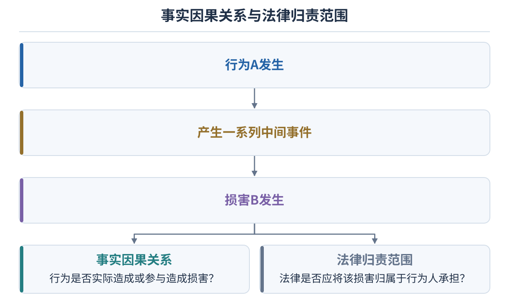
*图 035　事实因果关系与法律归责范围*

> [!note]- 图示文字索引
> 行为A → 中间事件 → 损害B。分别判断事实因果关系与法律归责范围。

存在事实上的关联，并不意味着所有后续损失都必然可以要求赔偿。

#### 15.6 特殊侵权责任类型

| 类型 | 主要研究对象 |
|---|---|
| 产品责任 | 缺陷产品造成的损害 |
| 医疗损害责任 | 医疗行为及专业义务相关损害 |
| 交通事故责任 | 交通运行及事故造成的损害 |
| 雇主及替代责任 | 工作相关行为是否使其他主体承担责任 |
| 高风险活动责任 | 特定危险活动造成的损害 |
| 环境侵权 | 污染及生态环境相关损害 |
| 网络侵权 | 网络传播、信息及平台活动造成的侵害 |
| 专业责任 | 专业人员未达到相关义务标准造成的损失 |

#### 15.7 损害及赔偿的主要分类

| 概念 | 含义 |
|---|---|
| 财产损害 | 具有相应经济价值的损失 |
| 人身损害 | 身体、生命及健康相关损害 |
| 非财产性损害 | 精神痛苦等依法可以获得救济的损害 |
| 实际损失 | 已经实际发生的损失 |
| 未来损失 | 在符合证明条件时可以合理预期的损失 |
| 补偿性赔偿 | 以弥补相关损害为主要目标 |
| 惩罚性赔偿 | 在特定法律制度及条件下具有惩罚、威慑性质的赔偿 |

直接损失、间接损失、可预见损失及纯经济损失等概念在合同法和侵权法中具有不同的适用规则。

#### 15.8 合同责任与侵权责任

| 比较维度 | 合同责任 | 侵权责任 |
|---|---|---|
| 主要义务来源 | 合同及相关法律规则 | 法定保护义务、注意义务等 |
| 主体关系 | 通常存在相关合同关系 | 不必事先存在合同 |
| 主要保护方向 | 合同履行利益及相关权益 | 人身、财产及其他受保护利益 |
| 责任条件 | 依合同义务及违约规则确定 | 依侵权类型及归责规则确定 |

同一事件可能同时涉及合同与侵权。例如，购买的设备因缺陷造成财产或人身损害，就需要同时研究合同义务及产品责任等问题。

### 第十六章　人格权、隐私与个人信息

#### 16.1 人格与人格权
法律人格强调主体的法律地位，人格权则主要保护与人自身存在、尊严及人格利益相关的权利。

| 人格利益或权利 | 主要保护对象 |
|---|---|
| 生命与健康 | 生命安全及身心健康 |
| 身体 | 身体完整及相关自主决定 |
| 姓名 | 身份识别及姓名使用 |
| 肖像 | 个人形象及相关使用利益 |
| 名誉 | 社会评价及声誉 |
| 隐私 | 私人生活、私人空间及相关秘密 |
| 人格尊严 | 人作为主体受到合理尊重的地位 |

这些利益在不同法律体系中可能通过人格权、宪法权利、侵权法或专门立法等方式受到保护。

#### 16.2 隐私权与个人信息保护

| 隐私保护 | 个人信息保护 |
|---|---|
| 强调私人生活及私人领域 | 强调与可识别个人有关的信息处理 |
| 关注不当窥探、公开及侵扰 | 关注收集、存储、使用、传输及删除 |
| 并非所有隐私都以数字数据存在 | 并非所有个人信息都属于秘密信息 |

电话号码即使已经在特定场合公开，也可能仍然属于受到相应法律保护的个人信息。

#### 16.3 个人信息处理的生命周期

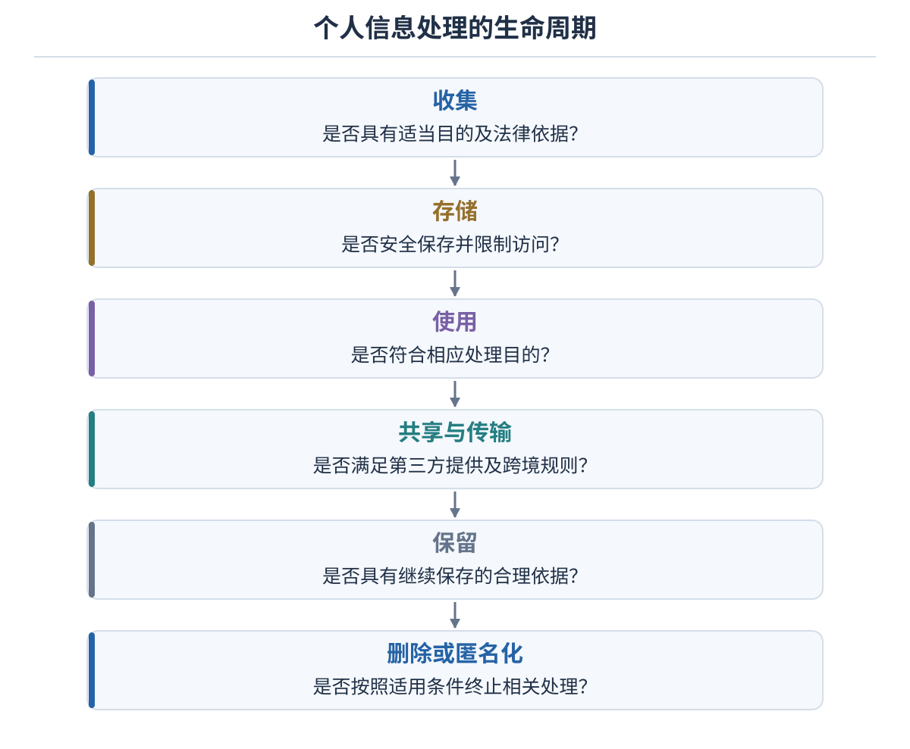
*图 036　个人信息处理的生命周期*

> [!note]- 图示文字索引
> - 收集：是否具有适当目的及法律依据？
> - 存储：是否安全保存并限制访问？
> - 使用：是否符合相应处理目的？
> - 共享与传输：是否满足第三方提供及跨境规则？
> - 保留：是否具有继续保存的合理依据？
> - 删除或匿名化：是否按照适用条件终止相关处理？

#### 16.4 人格权益与其他利益的冲突
常见冲突包括名誉保护与表达自由、隐私与新闻报道、信息保护与公共安全、肖像权益与商业宣传，以及个人数据控制与技术创新。法律判断通常需要考虑信息性质、使用目的、传播范围、公共利益及可能造成的损害等因素，而不能仅凭一方主张某项权利便得出结论。

### 第十七章　婚姻家庭与继承制度
这一部分容易受到国家制度、宗教、文化及社会历史差异影响。

#### 17.1 家庭法的研究结构

| 领域 | 核心问题 |
|---|---|
| 婚姻成立 | 何种关系获得婚姻法律地位？ |
| 夫妻关系 | 双方拥有哪些人身及财产权利义务？ |
| 婚姻财产 | 个人财产与共同财产如何区分？ |
| 婚姻解除 | 如何终止婚姻及处理后续法律关系？ |
| 亲子关系 | 父母与子女的法律身份及义务 |
| 收养 | 如何依法建立相应亲子法律关系？ |
| 监护 | 如何保护不能完全独立处理事务的主体？ |
| 抚养、扶养与赡养 | 家庭成员之间的经济及照料责任 |

#### 17.2 婚姻财产制度的主要模型

| 模型 | 基本思想 |
|---|---|
| 共同财产制 | 特定范围内的婚姻财产共同归属 |
| 分别财产制 | 夫妻双方在相应条件下分别享有财产权益 |
| 剩余财产或增值分享制度 | 在婚姻终止等情形下对特定财产增益进行分配 |
| 约定财产制度 | 允许当事人在法律许可范围内约定财产安排 |

各模型内部还存在大量具体变体，不能仅凭名称推断某项财产的实际归属。

#### 17.3 继承制度
继承法主要研究自然人死亡后，其财产及相关法律关系如何依法处理。

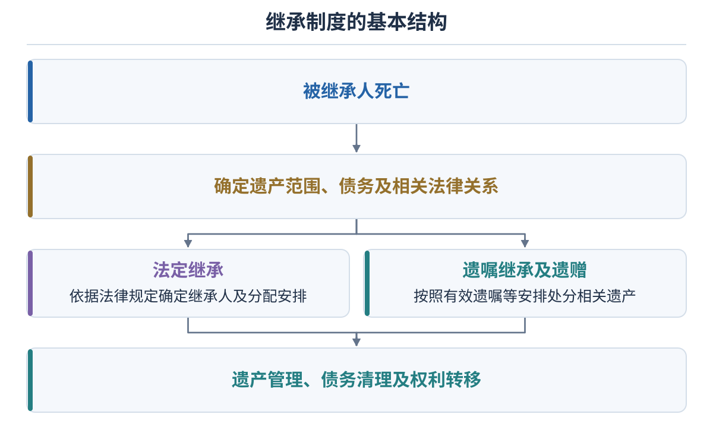
*图 037　继承制度的基本结构*

> [!note]- 图示文字索引
> 死亡 → 确定遗产及债务 → 法定继承或遗嘱继承及遗赠 → 遗产管理、债务清理、权利转移。

#### 17.4 继承中的重要概念
遗产、继承人、遗嘱、遗赠、代位继承、遗产管理人、遗嘱执行人、遗产债务、特留份或强制份额等。各法域对遗嘱自由、家庭成员最低保障、遗产债务及遗产税等问题的处理存在明显差异。

### 第十八章　知识产权法

#### 18.1 知识产权的基本分类

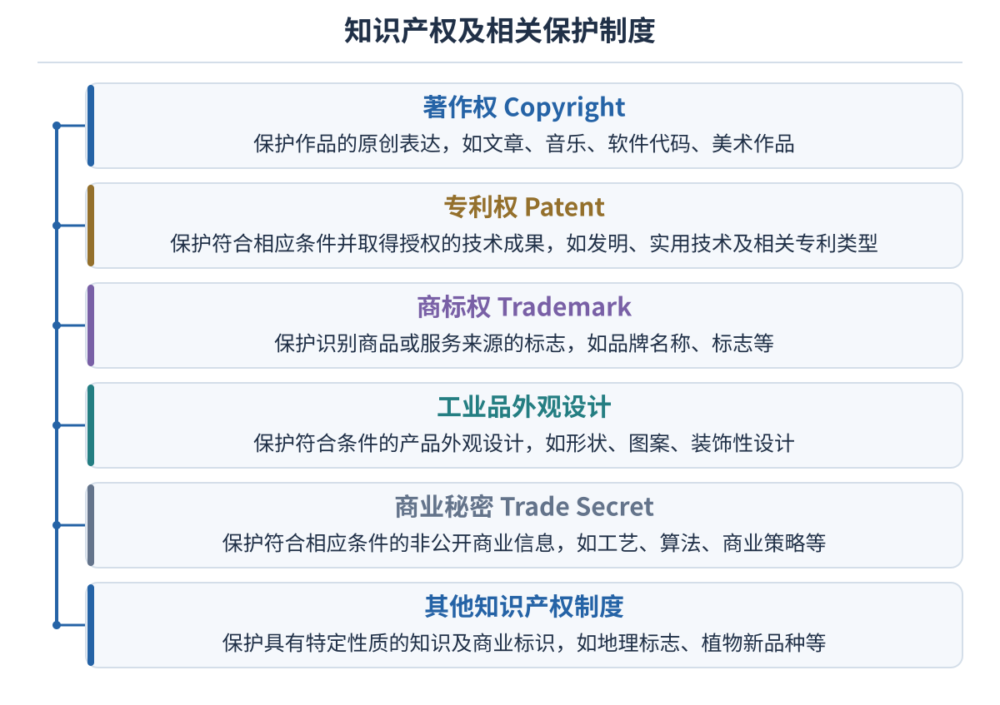
*图 038　知识产权及相关保护制度*

> [!note]- 图示文字索引
> - 著作权 Copyright：保护作品的原创表达，如文章、音乐、软件代码、美术作品
> - 专利权 Patent：保护符合相应条件并取得授权的技术成果，如发明、实用技术及相关专利类型
> - 商标权 Trademark：保护识别商品或服务来源的标志，如品牌名称、标志等
> - 工业品外观设计：保护符合条件的产品外观设计，如形状、图案、装饰性设计
> - 商业秘密 Trade Secret：保护符合相应条件的非公开商业信息，如工艺、算法、商业策略等
> - 其他知识产权制度：保护具有特定性质的知识及商业标识，如地理标志、植物新品种等

#### 18.2 著作权、专利权与商标权的区别

| 维度 | 著作权 | 专利权 | 商标权 |
|---|---|---|---|
| 保护对象 | 作品表达 | 符合条件的技术方案等 | 商品或服务来源标识 |
| 产生方式 | 许多法域原则上随作品创作产生 | 通常需要申请与授权 | 注册及使用规则因法域而异 |
| 主要目的 | 保护创作及传播中的相关权益 | 激励技术创新并形成公开机制 | 保护商业识别及减少来源混淆 |
| 保护期限 | 有相应法定期限 | 通常具有有限保护期 | 可能通过续展或持续使用等条件长期维持 |

例如，同一个软件产品可以同时涉及代码著作权、技术专利、品牌商标及商业秘密。这些法律制度保护的并不是完全相同的对象。

#### 18.3 思想与表达的区别
著作权一般保护作品的具体表达，而不是抽象思想、事实、原理或方法本身。对于软件开发而言：

- 软件源代码可能受到著作权保护。
- 某个抽象算法或数学原理不因被写入代码而自动受到著作权垄断。
- 特定技术实现能否获得专利保护，需要研究专利客体及授权条件。
- 未公开的技术经验或代码也可能涉及商业秘密制度。

#### 18.4 专利与商业秘密的选择

| 专利保护 | 商业秘密保护 |
|---|---|
| 通常需要公开相关技术内容 | 依赖保持信息秘密 |
| 通过授权形成相应排他权 | 主要防止不当取得、使用及披露 |
| 保护期限受到法律规定限制 | 可能持续至秘密性等条件不再满足 |
| 可以限制相关独立实施行为 | 通常不当然禁止合法独立研发 |

企业需要根据技术生命周期、反向工程可能性、公开成本、商业价值及法域规则选择保护方式。

#### 18.5 知识产权的归属与利用
重要概念包括作者、发明人、申请人、权利人、职务成果、委托创作、共同创作、许可使用及权利转让。

| 概念 | 核心区别 |
|---|---|
| 知识产权转让 | 将相应知识产权权益转移给其他主体 |
| 知识产权许可 | 允许他人在约定范围内使用相关权利 |
| 独占许可 | 在约定范围内具有较强排他性的许可安排 |
| 普通许可 | 在相应条件下可以许可多个主体使用 |

出资开发软件、实际编写代码以及最终拥有相应知识产权，可能是三个不同的法律问题。

#### 18.6 软件开源许可证

| 许可类型 | 主要特点 |
|---|---|
| MIT | 较宽松的使用、修改及分发条件，通常需要保留相关声明 |
| BSD系列 | 较宽松的许可体系，具体版本条件有所区别 |
| Apache-2.0 | 较宽松，并包含明确的相关专利许可条款 |
| GPL系列 | 在符合相应分发等触发条件时承担著佐权相关义务 |
| AGPL | 在GPL相关义务之外涉及特定网络交互条件下的源代码提供要求 |
| 专有软件许可 | 根据权利人的许可条件限制使用、修改及分发 |

开源不等于放弃著作权，也不等于任何情况下都可以不受限制地将开源代码并入闭源商业产品。

## 第四篇　商法、经济法与现代商业制度
民法研究私人之间的基本法律关系，商法则进一步研究商业主体、商业组织及具有专业性质的交易活动。经济法和经济监管相关制度还需要研究国家如何维护市场秩序、限制不公平竞争以及处理经济活动产生的公共风险。

### 第十九章　商法与商业组织

#### 19.1 民法、商法与经济法

| 法律领域 | 主要研究对象 | 核心思想 |
|---|---|---|
| 民法 | 一般私人财产及人身关系 | 私人自治、权利保护 |
| 商法 | 商业组织及专业商业活动 | 交易安全、商业效率、组织责任 |
| 经济法 | 市场运行及经济活动的公共规制 | 公平竞争、公共利益、经济秩序 |

不同国家对商法和经济法的学科划分存在差异。有些国家独立编纂商法典，有些国家采用民商合一或其他立法结构。

#### 19.2 商业组织的基本分类

*图 039　商业组织的基本分类*

> [!note]- 图示文字索引
> - 个人经营：主要由个人承担经营活动及相关法律责任
> - 合伙组织：多方通过相应合伙关系共同开展经营
> - 公司组织：依法建立具有相应组织及资本结构的经营主体
> - 合作社：以成员共同参与及共同利益为重要组织基础
> - 其他商业组织：根据特定交易、资产管理或行业需要建立的组织

选择商业组织形式，主要需要考虑法律人格、责任承担、融资能力、控制结构、税务安排及组织延续性。

#### 19.3 不同商业组织形式的核心区别

| 比较维度 | 个人经营 | 普通合伙 | 有限责任公司类组织 |
|---|---|---|---|
| 组织基础 | 个人 | 合伙关系 | 公司及其成员权益 |
| 经营控制 | 通常由经营者负责 | 按合伙安排及法律确定 | 按股权、章程及治理制度确定 |
| 债务责任 | 通常涉及个人财产 | 普通合伙人可能承担无限责任 | 成员通常享有一定有限责任保护 |
| 融资结构 | 相对简单 | 主要依靠合伙投入等 | 可以形成较复杂的资本结构 |
| 延续性 | 与经营者关系密切 | 取决于合伙制度 | 通常具有较强独立延续性 |

表格仅说明典型制度结构。有限合伙、有限责任合伙、不同类型公司等还具有各自规则。

#### 19.4 商事登记与商业许可

| 概念 | 核心作用 |
|---|---|
| 商事登记 | 依法记录商业主体身份及相关事项 |
| 营业资格 | 依法开展相关经营活动的主体条件 |
| 行业许可 | 开展特定受监管业务所需要的许可 |
| 商事公示 | 向外部主体提供相应商业法律信息 |
| 受益所有人识别 | 识别最终拥有或控制相关主体的自然人等相关主体 |

成立一家公司，并不意味着该公司已经具有开展所有商业活动的资格。例如，一家软件公司可以提供符合适用法律的技术服务，但直接从事证券经纪、资产管理、吸收存款等业务，可能需要完全不同的监管许可。

### 第二十章　公司法、股权与公司治理
公司法是理解现代资本组织和企业经营制度的核心。

#### 20.1 现代公司的基本法律结构

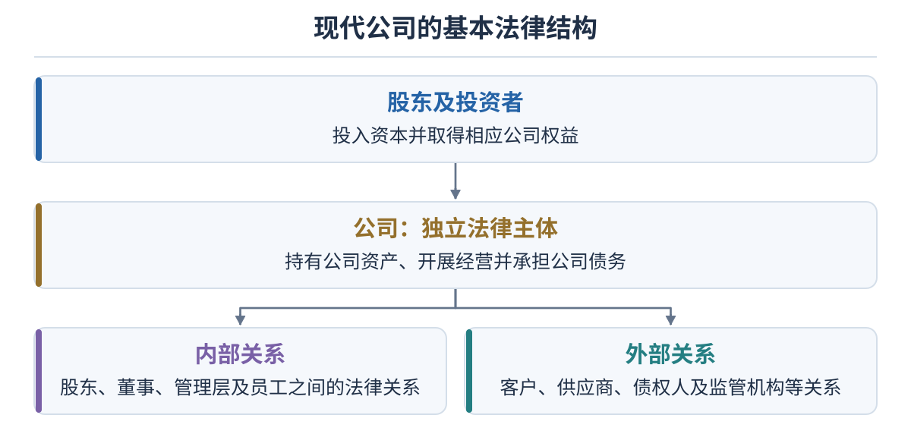
*图 040　现代公司的基本法律结构*

> [!note]- 图示文字索引
> 股东投资 → 独立公司主体 → 内部关系与外部关系。

公司制度最重要的两项基本机制，是独立法律人格与有限责任。

#### 20.2 独立法人财产与有限责任

| 概念 | 核心含义 |
|---|---|
| 独立法律人格 | 公司能够以自身名义享有权利、承担义务 |
| 独立财产 | 公司财产原则上区别于股东个人财产 |
| 有限责任 | 股东通常不因股东身份而无限承担公司债务 |
| 法人人格否认等例外 | 在满足特定法律条件时，相关主体可能无法享受通常的责任隔离 |

例如，假设某公司拥有100万元资产，但负有150万元债务。不能仅因为某股东持有该公司全部股权，就当然要求其以个人财产补足所有债务。但个人担保、未履行出资义务、违法分配、滥用公司人格及其他独立责任依据，可能改变具体责任结果。

#### 20.3 股权的权利结构

*图 041　股权及股东权利*

> [!note]- 图示文字索引
> - 经济性权益：利润分配权益、剩余财产分配权益、股权转让相关权益
> - 治理及参与权益：表决权、知情权、提案及参与决策等权利

具体股东权利受到股份类别、公司章程及适用法律的影响。持有股权不等于直接拥有公司具体财产。公司的厂房、现金、专利及设备通常属于公司，而不是按持股比例直接归股东个人所有。

#### 20.4 股权比例、表决权与控制权

| 概念 | 主要研究问题 |
|---|---|
| 持股比例 | 持有多少公司权益？ |
| 表决权 | 在相关事项中能够行使多少投票权？ |
| 控制权 | 能否实际影响公司重大决定及经营方向？ |
| 受益权 | 能够取得怎样的经济利益？ |
| 董事提名及任免权 | 能否影响公司治理机构的组成？ |

这几项权利可能相互结合，也可能根据公司制度及合同安排发生分离。

#### 20.5 股权稀释的基本原理
假设原股东持有全部100万股，公司随后新发行股份给外部投资者，且原股东不参与认购。假设所有股份具有相同经济权利及表决权。

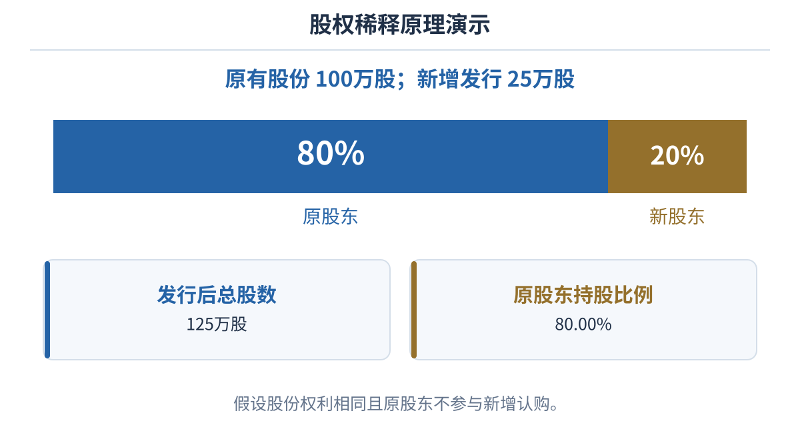
*图 042　股权稀释原理演示*

> [!note]- 图示文字索引
> 默认示例：原有100万股、新增25万股，发行后125万股；原股东80%，新股东20%。

[离线交互演示：股权稀释原理](#social-law_dilution)

$$
\text{原股东持股比例}=\frac{100}{100+\text{新增发行股份（万股）}}\times100\%
$$
持股比例下降不必然意味着持股价值下降，因为新增资本也可能提高公司价值。股份数量、企业估值、持股比例及实际控制权需要分别计算和判断。

#### 20.6 公司治理的法律关系

*图 043　公司治理的法律关系*

> [!note]- 图示文字索引
> - 股东及股东决策机制：依法选任、表决及行使相关权利
> - 董事会及相关治理机构：战略决策、授权及监督
> - 高级管理层与经营执行体系：信息报告、责任承担及监督反馈

各法域的法定机构设置、职责及选任机制并不一致。

#### 20.7 公司管理人员的义务

| 义务或制度 | 主要内容 |
|---|---|
| 忠实义务 | 不应利用相关职位不当谋取私人利益 |
| 勤勉义务 | 按照适用标准合理履行职责 |
| 利益冲突管理 | 对个人利益与公司利益发生冲突的事项进行合理处理 |
| 关联交易控制 | 对具有特殊利益关系的交易实施适当程序 |
| 信息披露 | 按照相应要求提供重要公司信息 |
| 商业判断规则 | 部分法域在特定条件下尊重管理者的合理商业判断 |

管理者经营失败，不一定意味着违反法律义务；经营获得利润，也不意味着所有经营行为均合法。

#### 20.8 中小股东保护
公司治理中的常见保护机制包括知情权、平等对待、关联交易审查、股东诉讼、派生诉讼、退出及回购机制等。这些制度主要研究如何减少控股股东或管理层利用权力不当损害其他股东利益的风险。OECD的公司治理原则也将股东权利、公平对待、信息透明及董事会责任作为重要研究领域。

#### 20.9 母公司、子公司与分公司

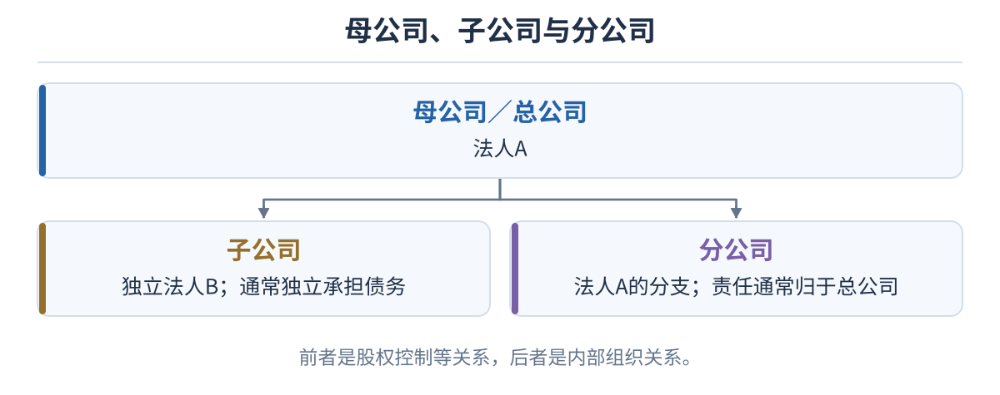
*图 044　母公司、子公司与分公司*

> [!note]- 图示文字索引
> 子公司具有独立法人地位；分公司通常是总公司分支机构，不具有独立法人地位。

具体主体资格、担保、集团责任及例外依据适用法律确定。

### 第二十一章　证券法与金融监管

#### 21.1 为什么金融活动需要特别监管
金融活动具有资金集中、信息不对称、风险传递及社会影响广泛等特征。仅依靠普通合同法，往往难以充分处理金融机构经营风险、证券发行欺诈、市场操纵及系统性风险等问题。国际证券监管原则将保护投资者、促进公平有效透明的市场以及减少系统性风险作为重要目标。

#### 21.2 金融法律制度的分类

*图 045　金融法律制度的分类*

> [!note]- 图示文字索引
> - 银行法与银行监管：银行设立、存贷款、资本、流动性及存款保护
> - 证券法：证券发行、交易、披露及投资者保护
> - 期货与衍生品监管：衍生品交易、保证金、清算及风险控制
> - 基金与资产管理法律：资金募集、资产托管、受托责任及投资运作
> - 保险法：保险合同、保险机构及偿付能力
> - 支付与金融科技监管：支付业务、客户资金、金融数据及业务许可

#### 21.3 证券发行与证券交易

| 领域 | 主要法律问题 |
|---|---|
| 证券发行 | 发行资格、募集方式、披露及发行责任 |
| 公开募集 | 面向公众融资的相关要求 |
| 非公开募集 | 针对特定投资者的发行条件 |
| 证券上市 | 进入相应交易场所的条件 |
| 持续信息披露 | 上市或其他相关主体持续披露重要信息 |
| 证券交易 | 交易行为、市场公平及交易制度 |
| 清算与结算 | 确定及履行证券、资金交付义务 |

证券发行、公司上市及二级市场交易是三个相互关联但不同的法律过程。

#### 21.4 证券市场中的违法行为

| 类型 | 核心含义 |
|---|---|
| 内幕交易 | 在符合相关法律要件时利用重大非公开信息进行交易等行为 |
| 市场操纵 | 通过相关行为不当影响市场价格、交易量或市场形成机制 |
| 虚假陈述 | 对具有法律意义的信息进行虚假、误导性披露或重大遗漏 |
| 欺诈发行 | 在证券发行过程中实施相关欺诈行为 |
| 非法经营 | 未取得必要资格而开展受监管业务 |
| 客户资产侵占等违法行为 | 不当使用、占有或处分客户资产 |

股票价格剧烈上涨，不足以证明市场操纵；某人提前获利，也不足以单独证明内幕交易。需要结合具体行为、信息来源、交易记录、主观状态及法律构成要件分析。

#### 21.5 金融监管的主要机制

| 监管机制 | 主要功能 |
|---|---|
| 市场准入监管 | 对金融机构及业务资格进行管理 |
| 审慎监管 | 关注资本、流动性及机构风险 |
| 行为监管 | 关注销售、交易及客户待遇 |
| 信息披露监管 | 促进重要信息的透明度 |
| 市场交易监管 | 识别相关违法交易及市场风险 |
| 金融消费者保护 | 保护相关消费者及投资者权益 |
| 宏观审慎监管 | 关注金融体系整体风险及风险传递 |

审慎监管与行为监管是不同维度。某家金融机构可能具有较强偿付能力，却仍然存在误导销售或利益冲突问题。

#### 21.6 反洗钱与客户身份识别
相关基本概念包括反洗钱（AML）、了解你的客户（KYC）、客户尽职调查（CDD）、强化尽职调查（EDD）、受益所有人识别及可疑交易报告。其目的主要在于识别相关金融犯罪和资金流动风险。不同金融业务、客户类型及司法辖区的具体要求可能不同。

### 第二十二章　担保、融资与破产制度

#### 22.1 债权为什么需要担保
当债务人无法按约履行义务时，普通债权人可能无法获得全部清偿。担保制度通过第三人承担一定责任，或者通过特定财产建立优先受偿等权利，为债权实现提供额外保障。

#### 22.2 担保的基本分类

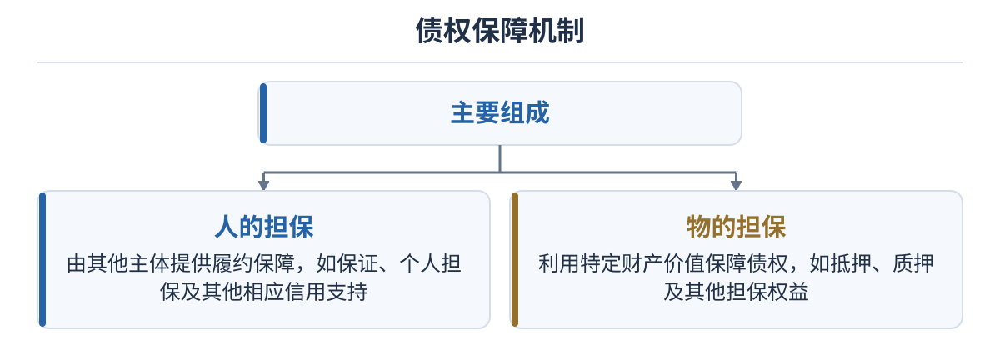
*图 046　债权保障机制*

> [!note]- 图示文字索引
> - 人的担保：由其他主体提供履约保障，如保证、个人担保及其他相应信用支持
> - 物的担保：利用特定财产价值保障债权，如抵押、质押及其他担保权益

#### 22.3 抵押、质押、保证与留置

| 制度 | 典型机制 |
|---|---|
| 抵押 | 通常不要求债务人交付财产占有，而在财产上建立担保权利 |
| 质押 | 通过交付占有、登记或其他方式建立相关担保权益 |
| 保证 | 由保证人依相应约定和法律承担保证责任 |
| 留置 | 在符合法定条件时保留相关财产并实现相应权利 |
| 所有权保留 | 在相应条件下由出卖人保留所有权以保障交易 |

具体制度名称及构成方式具有法域差异。现代跨境担保法律研究还强调从交易实际经济功能识别担保权益。

#### 22.4 优先权与债权清偿
债权人之间并不必然具有完全相同的受偿地位。常见分析类别包括有担保债权、普通无担保债权、法定优先债权及次级债权等。优先顺序通常受到以下因素影响：担保权是否有效设立、是否完成必要公示、不同担保权之间的顺序、破产程序费用以及法律规定的特殊优先权益。

#### 22.5 财务困难、资不抵债与破产

| 概念 | 核心区别 |
|---|---|
| 财务困难 | 企业面临资金、收益或债务压力 |
| 流动性不足 | 难以取得足够现金履行当前支付义务 |
| 资不抵债 | 资产价值不足以覆盖相应负债 |
| 无法清偿债务 | 在相应条件下不能履行到期支付义务 |
| 破产或无力偿债程序 | 根据适用法律启动的集体债务处理程序 |

企业拥有大量资产，并不意味着能够立即偿还债务；企业出现短期资金困难，也不一定需要进入破产清算。

#### 22.6 破产制度的基本功能
破产制度不是单纯惩罚经营失败者，而是建立集体债务处理机制，减少个别债权人无序争夺财产，并在适当情况下保存具有经营价值的企业。

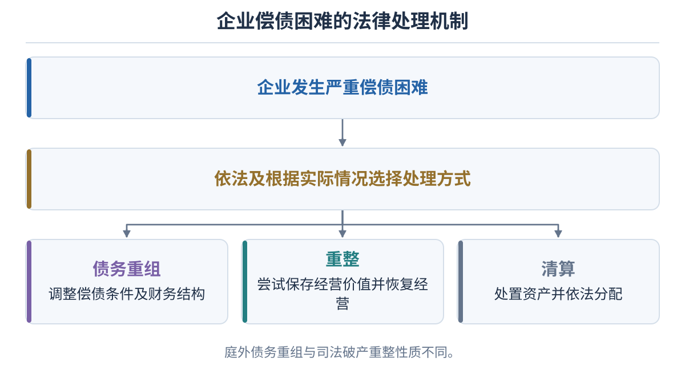
*图 047　企业偿债困难的法律处理机制*

> [!note]- 图示文字索引
> 偿债困难的处理方式：庭外债务重组、重整、清算。

庭外债务重组与司法破产重整具有不同程序性质。

#### 22.7 破产程序中的重要制度

| 制度 | 主要作用 |
|---|---|
| 破产财产或债务人财产体系 | 确定用于相应程序处理的财产范围 |
| 程序停止机制 | 限制个别债权人继续独立追偿等行为 |
| 债权申报与确认 | 确定债权性质、金额及参与资格 |
| 破产管理人等程序主体 | 管理财产及相关程序事务 |
| 可撤销交易制度 | 处理符合条件的不当财产处分或偏颇清偿 |
| 重整计划 | 安排企业经营恢复及债务处理 |
| 债务免责 | 在相应法律条件下免除部分剩余债务 |

各国对于企业破产、个人破产、担保权保护及债务免责的制度安排差异很大。联合国国际贸易法委员会的破产立法指南提供了跨法域比较这些制度的参考框架。

### 第二十三章　竞争法与消费者保护

#### 23.1 竞争法研究什么
竞争法主要研究如何保护市场竞争过程，防止经营者通过不当方式排除、限制竞争。需要注意，保护竞争并不等于保护每一个竞争者不遭受商业失败。

#### 23.2 竞争法的核心结构

*图 048　竞争法的核心结构*

> [!note]- 图示文字索引
> - 限制竞争协议：多个经营者之间形成具有相关限制竞争效果的协议或协调行为
> - 滥用市场支配地位：具有相应市场力量的经营者实施符合违法条件的行为
> - 经营者集中审查：研究合并、收购等交易对市场竞争的影响
> - 不正当竞争：研究商业活动中的混淆、欺骗及其他不正当竞争行为

不正当竞争法与反垄断法存在联系，但在很多法域中属于具有不同制度目标的法律领域。

#### 23.3 市场力量与违法垄断

| 概念 | 含义 |
|---|---|
| 相关市场 | 用于竞争分析的产品、地域等市场范围 |
| 市场份额 | 企业在相关市场中的经营比例 |
| 市场力量 | 企业影响价格、产量或其他竞争条件的能力 |
| 市场支配地位 | 在相应法律制度中达到一定程度的市场力量 |
| 滥用支配地位 | 在具有相应地位时实施符合法律禁止条件的行为 |

企业规模大、市场份额高或者拥有先进技术，不一定意味着违法。竞争法分析往往还需要考虑进入壁垒、替代关系、消费者利益及实际竞争影响。

#### 23.4 消费者保护的制度基础
消费者通常在产品信息、法律知识、风险识别及谈判能力方面与专业经营者存在差异。因此，消费者保护制度常研究商品安全、真实宣传、知情权、公平交易、格式条款控制、售后服务及有效救济等问题。

#### 23.5 格式条款与不公平条款
格式条款通常由一方预先拟定，用于重复使用。格式合同具有降低交易成本的作用，但也可能存在责任分配失衡、信息不透明及消费者难以实际协商等问题。当事人点击「同意」并不当然意味着合同中的全部条款在所有情况下都有效。仍需研究提示说明、强制性规定、不公平条款及合同成立等制度。

### 第二十四章　劳动法与社会保障法

#### 24.1 劳动法与普通合同法的区别
劳动关系具有持续性、组织管理性及一定程度的经济和权力依赖，因此劳动法往往在合同自由之外建立特别保护机制。

| 比较维度 | 一般商事合同 | 劳动关系 |
|---|---|---|
| 关系目的 | 完成相关交易或服务 | 持续提供劳动并获得报酬 |
| 管理关系 | 通常具有较大独立性 | 通常涉及组织管理及工作安排 |
| 法律保护 | 主要通过合同及相关法律 | 可能适用强制性劳动保护 |
| 争议处理 | 一般合同纠纷机制 | 可能具有专门劳动争议机制 |

合同名称并不一定决定法律关系性质。被称为「独立承包人」的工作者，仍可能根据实际工作关系被认定为劳动者。

#### 24.2 劳动法的主要知识结构

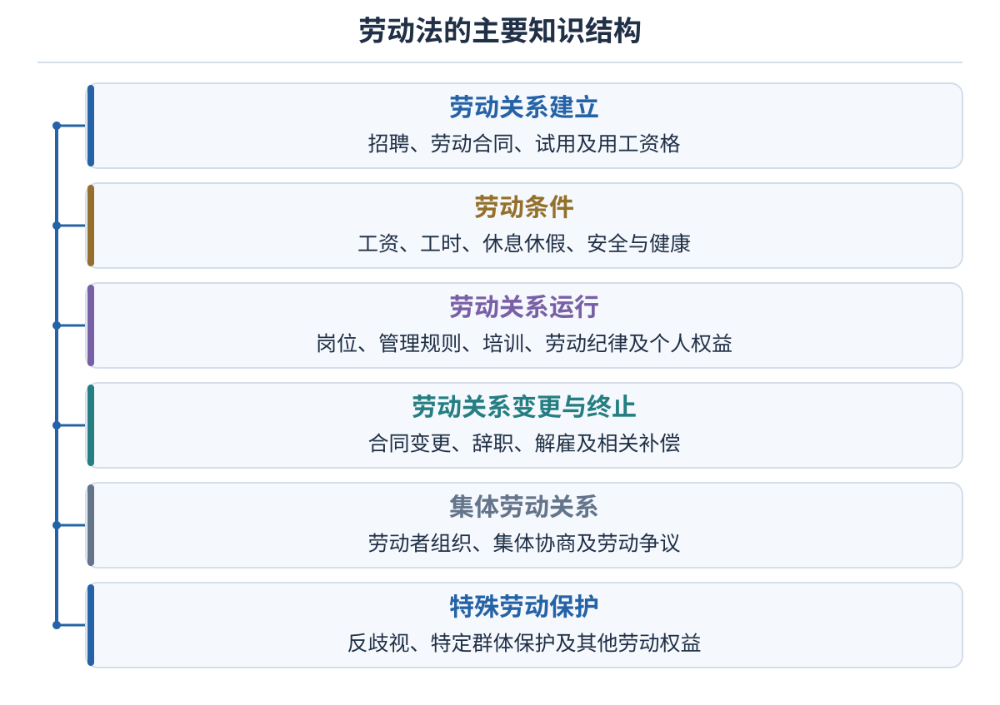
*图 049　劳动法的主要知识结构*

> [!note]- 图示文字索引
> - 劳动关系建立：招聘、劳动合同、试用及用工资格
> - 劳动条件：工资、工时、休息休假、安全与健康
> - 劳动关系运行：岗位、管理规则、培训、劳动纪律及个人权益
> - 劳动关系变更与终止：合同变更、辞职、解雇及相关补偿
> - 集体劳动关系：劳动者组织、集体协商及劳动争议
> - 特殊劳动保护：反歧视、特定群体保护及其他劳动权益

国际劳工组织的基本劳动权利框架涵盖结社及集体协商、消除强迫劳动、废除童工、消除就业歧视以及安全健康的工作环境等领域。具体国内保障仍需要依据相应法域制度。

#### 24.3 社会保障制度
社会保障法主要研究社会风险如何通过公共或制度化机制进行分担。

| 类型 | 主要研究内容 |
|---|---|
| 社会保险 | 养老、医疗、失业、工伤等相关风险 |
| 社会救助 | 对符合条件的困难主体提供基本保障 |
| 社会福利 | 通过公共或相关制度改善社会生活条件 |
| 职业及补充保障 | 企业、行业或其他组织提供的补充保障 |

社会保险与商业保险具有风险分担方面的联系，但二者的制度目标、参与方式及资金来源可能不同。

### 第二十五章　税法、财政法与经济监管

#### 25.1 税收的法律结构
税法研究国家依法取得税收收入的权力，以及纳税主体的义务、权利及救济机制。

*图 050　税收的法律结构*

> [!note]- 图示文字索引
> - 纳税主体：谁承担相应纳税义务？
> - 征税对象：对什么收入、财产或经济活动征税？
> - 计税依据：按照什么金额或数量计算？
> - 税率：按照怎样的比例或标准计算？
> - 税收优惠：是否存在减免、抵扣或其他安排？
> - 征管及救济：如何申报、征收、监督及处理争议？

#### 25.2 税收法律关系
税法主要研究税收依据、纳税义务、法律程序、税收争议及相关制度安排。

#### 25.3 合法税务安排与逃税

| 概念 | 主要含义 |
|---|---|
| 税务筹划 | 在适用法律允许范围内安排经济活动及税务事项 |
| 避税 | 利用法律结构降低税负，可能受到反避税规则审查 |
| 逃税 | 违反税收法律规定逃避相应纳税义务 |
| 反避税 | 对不当利用法律形式等安排实施相应法律调整 |
| 税收协定 | 协调不同税收管辖权及跨境征税问题 |

跨境公司税务不能只根据名义注册地点或某个国家的税率判断，还需要研究税收居民身份、实际经营活动、所得来源及其他规则。

#### 25.4 财政法与公共预算
财政法相关研究包括公共收入、预算编制与批准、公共支出、政府债务、政府采购及财政监督。财政法研究政府如何依据法律取得、使用及管理这些资源。

#### 25.5 环境法与其他经济监管领域

| 领域 | 主要法律问题 |
|---|---|
| 环境与资源法 | 污染防治、环境许可、生态责任及资源利用 |
| 能源法 | 能源开发、供应、安全及行业监管 |
| 土地与房地产法 | 土地权益、规划、开发及交易 |
| 医疗与药品监管 | 专业资格、产品安全及公共健康 |
| 行业监管法 | 特定行业的准入、经营标准及风险控制 |
| 公共采购法 | 公共资源采购中的程序、公平与监督 |

这些领域通常同时涉及行政许可、私人交易、侵权责任、经济政策及公共利益。

### 第二十六章　数字经济、数据与人工智能法律

#### 26.1 数字技术产生的新法律问题

| 技术领域 | 对应法律问题 |
|---|---|
| 电子商务 | 电子合同、消费者权益、平台责任 |
| 软件与云计算 | 知识产权、服务合同、数据安全 |
| 大数据 | 个人信息处理、数据使用权限 |
| 人工智能 | 训练数据、生成内容、算法责任 |
| 区块链 | 数字资产、交易记录、监管与责任 |
| 网络平台 | 平台治理、内容责任、市场竞争 |
| 网络安全 | 系统保护、数据泄露及安全义务 |

#### 26.2 数据、数据权益与数据所有权
数据可以具有经济价值，但不能因此直接推断所有数据都具有类似传统物权的统一所有权。数据法律研究可能涉及：

- 个人信息权益及隐私。
- 数据处理及使用的合法依据。
- 合同约定的访问、使用与收益权限。
- 商业秘密及数据库保护。
- 数据跨境流动。
- 公共数据开放及国家安全要求。

同一份数据可能同时涉及多个主体的不同权益和责任。

#### 26.3 人工智能的责任分析

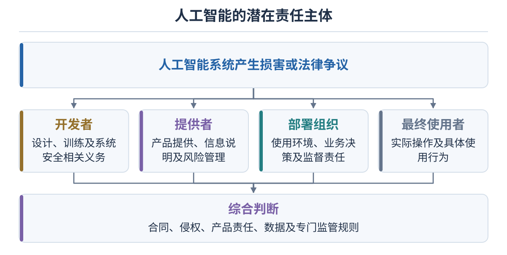
*图 051　人工智能的潜在责任主体*

> [!note]- 图示文字索引
> 潜在责任主体：开发者、提供者、部署组织、最终使用者；依据合同、侵权、产品责任、数据及专门监管规则综合判断。

潜在责任主体的分析框架，不意味着每个主体都必然承担法律责任。人工智能系统能够自主生成内容或执行任务，不意味着它在法律上已经成为独立责任主体。

#### 26.4 智能合约与传统合同
智能合约（Smart Contract）通常指根据预先设定条件自动执行相关操作的计算机程序或技术安排。它与法律合同存在联系，但并非完全等同。

| 智能合约 | 法律合同 |
|---|---|
| 以程序规则自动执行 | 以具有法律约束力的约定安排权利义务 |
| 关注计算条件及系统状态 | 关注意思、效力、权利及责任 |
| 可能发生程序错误 | 可能发生解释、履行及效力争议 |
| 技术执行可能难以逆转 | 法律制度可能提供撤销、赔偿等救济 |

程序按照代码执行，并不自动证明相应结果符合法律。

## 第五篇　刑法与公共法律责任
刑法是国家法律体系中具有较强强制性的法律领域。学习刑法最重要的目的，不是背诵不同罪名对应多少年刑罚，而是理解国家在什么条件下能够认定犯罪、为什么能够处罚个人，以及刑事处罚权需要受到怎样的限制。

### 第二十七章　犯罪的本质与刑事责任

#### 27.1 违法、侵权与犯罪

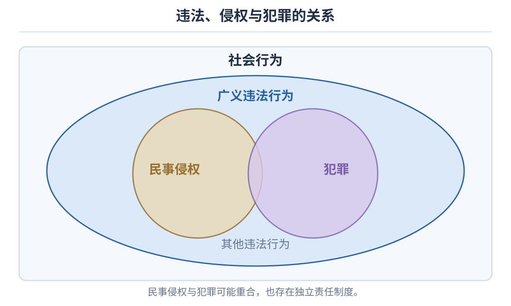
*图 052　违法、侵权与犯罪的关系*

> [!note]- 图示文字索引
> 广义违法包括犯罪与民事侵权等；两者可能发生重合。

| 概念 | 主要含义 |
|---|---|
| 违法行为 | 违反相应法律规范的行为 |
| 民事侵权 | 侵害依法受保护权益并符合相应民事责任条件的行为 |
| 行政违法 | 违反相关行政法律规范的行为 |
| 犯罪 | 满足适用刑事法律所规定犯罪条件的行为 |

犯罪不能仅依据社会影响恶劣、行为不道德或者造成严重损失来确定，还必须满足相应法律条件。民事侵权及犯罪可能重合，也存在各自独立的责任制度。

#### 27.2 刑法的主要功能
刑法具有保护法益、预防犯罪、明确行为边界、追究刑事责任以及限制国家刑罚权等功能。尤其重要的是，刑法既赋予国家处罚犯罪的法律权力，也限制国家在没有充分法律依据时处罚个人。

#### 27.3 刑法的基本原则

| 原则 | 核心思想 |
|---|---|
| 罪刑法定 | 犯罪认定及刑罚必须具有法律依据 |
| 责任原则 | 刑事归责需要相应行为及责任基础 |
| 罪责刑相适应 | 刑罚应与犯罪及责任程度保持适当关系 |
| 法律适用平等 | 避免无正当依据的区别对待 |
| 刑法谦抑 | 强调刑事处罚作为严厉手段，应具有适当边界 |
| 不利溯及限制 | 原则上避免事后以新设或加重的刑事规则处罚此前行为 |

这些原则的具体法律地位、表述及例外制度存在法域差异。

#### 27.4 犯罪学与刑法学

| 学科 | 研究重点 |
|---|---|
| 刑法学 | 什么行为构成犯罪，应当承担什么刑事责任 |
| 犯罪学 | 犯罪的社会分布、形成原因及预防机制 |
| 犯罪心理学 | 犯罪行为的心理及行为相关因素 |
| 刑事政策学 | 如何通过法律及其他政策处理犯罪问题 |
| 刑事诉讼法学 | 如何依法调查、起诉、审判及处理刑事案件 |

解释犯罪的社会原因，不等于判断某个人在法律上构成犯罪。

### 第二十八章　犯罪构成、违法性与责任判断

#### 28.1 不同法律传统的犯罪分析模型
刑法理论并没有全世界统一的犯罪构成体系。

*图 053　不同法律传统的犯罪分析模型*

> [!note]- 图示文字索引
> - 中国刑法学传统四要件分析：犯罪客体、犯罪客观方面、犯罪主体、犯罪主观方面
> - 大陆法系中的三阶层分析：构成要件符合性、违法性、有责性
> - 普通法刑法分析：犯罪外在要素、主观要素、相关抗辩及责任排除机制

上述属于具有代表性的理论组织方式。各国及不同理论学派之间仍有具体差异。这些体系都试图解决行为是否符合犯罪定义、是否存在正当理由，以及行为人是否应当承担刑事责任等问题，但其概念之间不能机械地一一对应。

#### 28.2 犯罪的客观与主观要素

| 要素 | 研究内容 |
|---|---|
| 行为 | 是否实施相关作为或不作为 |
| 行为对象 | 行为针对什么主体或事物 |
| 行为结果 | 是否发生法律规定的相关结果 |
| 因果关系 | 行为与结果之间是否具有相应关系 |
| 主观要素 | 行为人是否具备法律要求的故意、认识、过失等心理状态 |
| 主体条件 | 是否满足相关年龄、身份、能力等要求 |

并非所有犯罪都要求实际损害结果已经发生，也并非所有犯罪都以故意为唯一主观条件。

#### 28.3 故意、过失与严格责任

| 类型 | 基本含义 |
|---|---|
| 故意 | 行为人具有法律要求的相关认识、意图或意志状态 |
| 过失 | 未达到相应注意标准并满足法律规定的责任条件 |
| 鲁莽 Recklessness | 部分普通法制度中的特定风险认识及承担状态 |
| 严格责任型违法 | 在特定刑事或监管领域不要求证明全部传统主观要素 |

故意与动机不同。故意主要研究行为人对行为及相关结果的心理状态；动机则研究行为人为什么实施该行为。

#### 28.4 正当化事由与责任排除事由

*图 054　正当化与免责*

> [!note]- 图示文字索引
> - 正当化 Justification：行为在相应条件下具有法律允许或正当化依据。正当防卫、紧急避险等可能属于此类分析
> - 免责 Excuse：即使行为具有违法性质，行为人的个人责任也可能因特定事由受到排除或限制。责任能力、胁迫等可能涉及此类问题

正当化与免责是比较刑法中的重要分析区别，具体抗辩的归类因法域而异。

#### 28.5 犯罪认定的基本分析流程

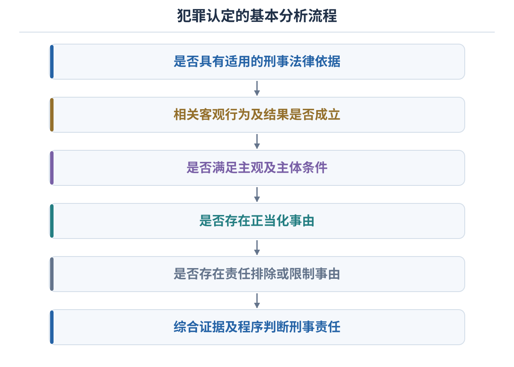
*图 055　犯罪认定的基本分析流程*

> [!note]- 图示文字索引
> - 是否具有适用的刑事法律依据
> - 相关客观行为及结果是否成立
> - 是否满足主观及主体条件
> - 是否存在正当化事由
> - 是否存在责任排除或限制事由
> - 综合证据及程序判断刑事责任

这是一种帮助理解的综合分析顺序，并不替代任何法域的具体犯罪构成体系。

### 第二十九章　犯罪形态与刑罚制度

#### 29.1 犯罪的主要分类维度

| 分类依据 | 主要类型 |
|---|---|
| 主观状态 | 故意犯罪、过失犯罪等 |
| 行为方式 | 作为犯罪、不作为犯罪等 |
| 行为主体 | 自然人犯罪、组织或法人犯罪等 |
| 完成程度 | 既遂、未遂及相关未完成形态 |
| 参与人数 | 单独犯罪、共同犯罪等 |
| 保护对象 | 人身、财产、公共安全、经济秩序等相关犯罪 |

这些分类可以交叉。一项犯罪可能同时属于故意犯罪、财产犯罪及共同犯罪。

#### 29.2 犯罪的完成与未完成形态
相关理论包括犯罪预备、犯罪未遂、犯罪既遂、犯罪中止及其他未完成犯罪形态。其核心研究问题是：行为尚未达到犯罪定义要求的最终状态时，国家能否及应当如何追究责任。不同制度对这些形态的处罚条件、范围及自愿放弃行为的法律效果存在差异。

#### 29.3 多人参与犯罪的责任结构
刑法通常需要区分实际实施者、组织者、教唆者、帮助者及其他参与者的行为与责任。是否构成共同犯罪，不是仅根据行为人之间是否认识、是否处于同一地点或者是否具有相同身份判断，而需要研究各自行为、主观状态及适用法律。

#### 29.4 刑罚目的的主要理论

| 理论 | 核心思想 |
|---|---|
| 报应理论 | 根据行为责任给予具有相应正当性的刑罚 |
| 一般预防 | 通过法律后果影响社会成员的行为 |
| 特殊预防 | 降低特定行为人再次犯罪的可能性 |
| 矫正与 Rehabilitation | 促进相关人员改变行为及重新适应社会 |
| 隔离保护 | 在相应条件下限制危险行为及保护社会 |
| 恢复性司法 | 重视损害修复、责任承担及相关主体参与 |

刑罚目的并非只能采用其中一种。不同司法制度可能采取不同组合。

#### 29.5 刑罚与其他刑事法律措施
常见制度包括自由刑、财产刑、资格限制、社区矫正、缓刑、假释及其他依法采取的措施。刑罚种类、处罚幅度、执行条件及犯罪记录制度，属于高度依赖具体法域的知识。

## 第六篇　司法、证据与纠纷解决
**拥有法律权利，并不等于在现实中一定能够实现该权利。** 实体法规定什么是权利和责任，程序法与证据法则研究如何认定这些权利和责任，以及如何通过相应制度实现它们。

### 第三十章　司法制度与法律职业

#### 30.1 立法、行政执法与司法的区别

| 活动 | 主要功能 |
|---|---|
| 立法 | 制定、修改及废止法律规范 |
| 行政执法 | 由行政主体依法实施法律及监管决定 |
| 司法 | 由相应司法机构依法审理案件及解决法律争议 |
| 法律监督 | 依据不同制度监督法律及公共权力运行 |
| 裁判执行 | 将具有相应效力的裁判转化为实际法律结果 |

司法不等同于公安、警察、行政监管或所有形式的法律实施活动。

#### 30.2 法律职业的主要分工

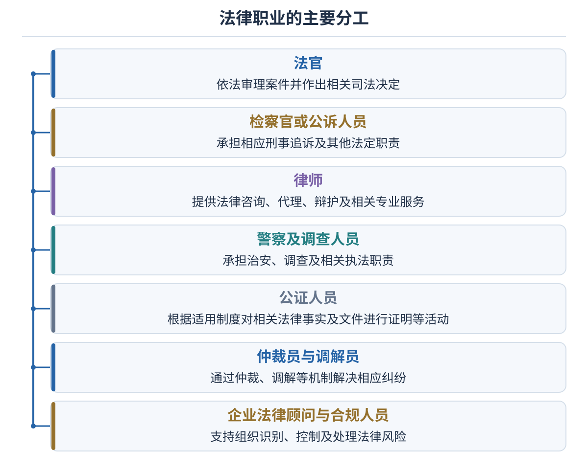
*图 056　法律职业的主要分工*

> [!note]- 图示文字索引
> - 法官：依法审理案件并作出相关司法决定
> - 检察官或公诉人员：承担相应刑事追诉及其他法定职责
> - 律师：提供法律咨询、代理、辩护及相关专业服务
> - 警察及调查人员：承担治安、调查及相关执法职责
> - 公证人员：根据适用制度对相关法律事实及文件进行证明等活动
> - 仲裁员与调解员：通过仲裁、调解等机制解决相应纠纷
> - 企业法律顾问与合规人员：支持组织识别、控制及处理法律风险

不同国家对于法律职业的准入、执业范围及职业分工存在较大区别。

#### 30.3 法院体系与审级制度
常见法院分类包括基层或初审法院、上诉法院、最高审级法院、专门法院，以及部分国家设置的宪法法院、行政法院等。

| 概念 | 主要含义 |
|---|---|
| 一审 | 对案件进行初次审理 |
| 二审或上诉审 | 根据适用程序审查先前裁判 |
| 终审 | 在相应普通程序中达到最终审级 |
| 再审或特别救济 | 符合条件时通过特别程序重新审查相关裁判 |

上诉审是否重新审理事实、是否主要审查法律问题，以及能够上诉的范围，都需要依据具体程序制度确定。

#### 30.4 司法公正的主要制度问题
司法制度研究需要关注裁判者公正性、回避机制、依法裁判、当事人参与权、合理期限、公开审理及其例外、法律援助、上诉及纠错机制。其中，司法独立、公正及问责之间的具体制度安排，是比较宪法和司法制度研究的重要内容。

### 第三十一章　民事诉讼与权利救济

#### 31.1 民事诉讼的本质
民事诉讼是当事人通过法院等法定司法机制解决民事争议并寻求救济的程序。它与民事权利关系既有联系，又具有独立的程序结构。

#### 31.2 民事诉讼的主要参与者

| 主体 | 主要角色 |
|---|---|
| 原告 | 提出相应诉讼请求的一方 |
| 被告 | 被提出相应诉讼请求的一方 |
| 第三人 | 根据相关制度参与或受到案件影响的其他主体 |
| 诉讼代理人 | 在授权及法律允许范围内参与程序 |
| 证人 | 就相关事实提供证言 |
| 专家或鉴定人员 | 提供具有相关专业性质的意见 |
| 法院 | 管理诉讼程序并作出裁判 |

#### 31.3 民事诉讼的典型流程

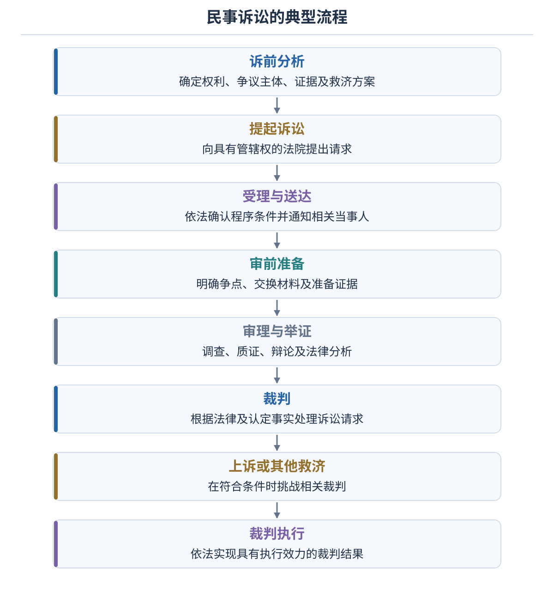
*图 057　民事诉讼的典型流程*

> [!note]- 图示文字索引
> - 诉前分析：确定权利、争议主体、证据及救济方案
> - 提起诉讼：向具有管辖权的法院提出请求
> - 受理与送达：依法确认程序条件并通知相关当事人
> - 审前准备：明确争点、交换材料及准备证据
> - 审理与举证：调查、质证、辩论及法律分析
> - 裁判：根据法律及认定事实处理诉讼请求
> - 上诉或其他救济：在符合条件时挑战相关裁判
> - 裁判执行：依法实现具有执行效力的裁判结果

实际程序可能简化、分流、和解或反复进行。

#### 31.4 诉讼请求与请求权基础

| 概念 | 核心区别 |
|---|---|
| 实体权利 | 当事人在实体法上享有的权益 |
| 请求权基础 | 支持某项请求的法律规范及构成条件 |
| 诉讼请求 | 当事人要求法院作出怎样的具体裁判 |
| 诉讼理由 | 支持诉讼请求的事实及法律论证 |

例如，某人主张对方拖欠货款，不能只说明自己具有损失，还需要分析合同成立、义务履行、付款到期及请求权基础等问题。

#### 31.5 法院管辖
法院管辖主要研究哪个法院具有处理相关案件的法律权限。

| 管辖维度 | 核心问题 |
|---|---|
| 事项管辖 | 哪类法院有权处理这类争议？ |
| 地域管辖 | 哪个地区的法院可以受理？ |
| 级别管辖 | 应由哪个层级的法院审理？ |
| 专属管辖 | 是否必须由特定法院处理？ |
| 协议管辖 | 当事人能否依法约定法院？ |
| 国际管辖 | 涉外争议可以在哪个国家或地区处理？ |

选择适用法律与选择具有管辖权的法院是两个不同问题。

#### 31.6 保全及临时救济
诉讼过程中的财产保全、证据保全、行为保全及临时禁令等制度，主要用于降低财产转移、证据灭失或损害持续发生等风险。这些措施通常具有相应的申请条件、审查程序及责任安排，不意味着当事人已经在最终案件中胜诉。

### 第三十二章　刑事诉讼与程序保障

#### 32.1 刑事诉讼的基本结构
刑法研究犯罪及刑罚，刑事诉讼法研究国家通过什么程序调查犯罪、提出指控并确定刑事责任。

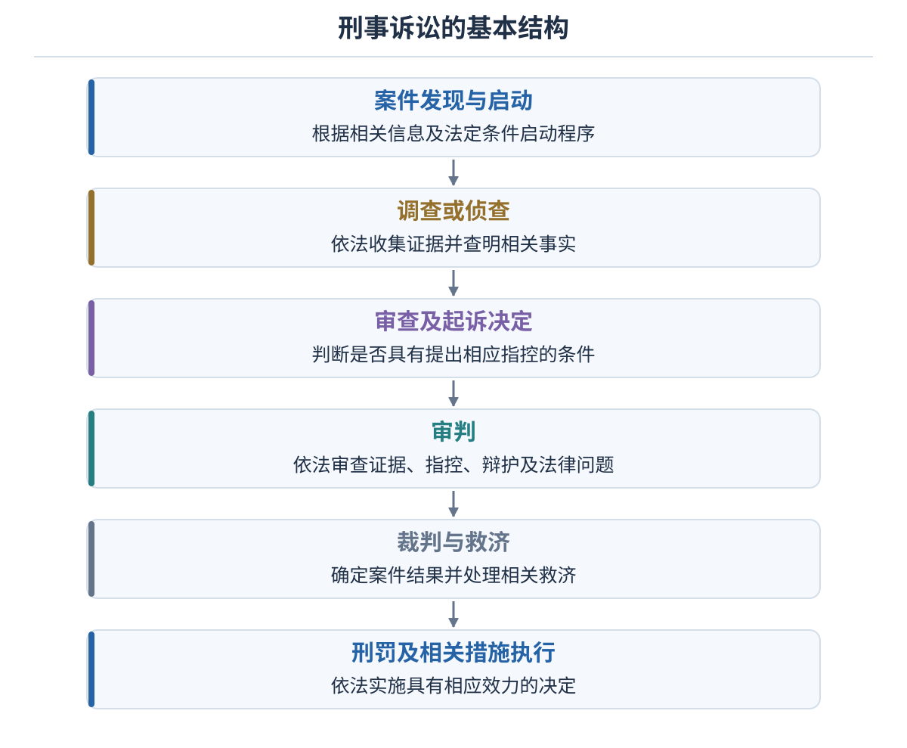
*图 058　刑事诉讼的基本结构*

> [!note]- 图示文字索引
> - 案件发现与启动：根据相关信息及法定条件启动程序
> - 调查或侦查：依法收集证据并查明相关事实
> - 审查及起诉决定：判断是否具有提出相应指控的条件
> - 审判：依法审查证据、指控、辩护及法律问题
> - 裁判与救济：确定案件结果并处理相关救济
> - 刑罚及相关措施执行：依法实施具有相应效力的决定

#### 32.2 无罪推定与证明责任
无罪推定是现代刑事司法中的重要程序原则。一个人被调查、逮捕、起诉或者受到社会怀疑，并不等于已经依法被认定有罪。刑事程序通常要求控方证明犯罪成立，并按照相应证明标准及程序规则处理案件。

#### 32.3 刑事诉讼中的程序保障

| 保障领域 | 主要研究内容 |
|---|---|
| 辩护权 | 获得辩护及提出相关意见的权利 |
| 获知指控 | 了解国家提出的具体指控 |
| 沉默权及反自证其罪保障 | 对强迫个人提供不利于自身的相关陈述进行限制 |
| 人身自由保障 | 限制不当拘禁及其他强制措施 |
| 非法证据排除等制度 | 处理违法取得的证据及其使用 |
| 公正审判 | 保障适当参与、证据审查及公正裁判 |
| 救济权 | 在符合条件时挑战不利决定 |

这些保障的具体范围和实施方式因法域而异。

#### 32.4 对抗式与职权主义程序传统

| 比较维度 | 对抗式倾向 | 职权主义倾向 |
|---|---|---|
| 当事人作用 | 较强调控辩双方提出及挑战证据 | 较强调司法机构主动查明事实 |
| 裁判者角色 | 较强调公正裁判及程序管理 | 可能具有更积极的调查作用 |
| 证据组织 | 较强调当事人举证与询问 | 可能较强调案卷及司法调查 |

二者是比较诉讼制度的理想类型。现代司法程序常融合不同机制，不能据此将所有国家的刑事诉讼简单归为两类。

### 第三十三章　证据法与事实认定
证据法不只是用于诉讼，也能够提高事实判断及证据意识。

#### 33.1 证据的主要评价维度

*图 059　证据的主要评价维度*

> [!note]- 图示文字索引
> - 关联性：证据是否与需要证明的事实具有相关联系？
> - 真实性：证据是否确实来自所声称的来源，是否经过篡改？
> - 合法性与可采性：是否满足相应法律程序及证据使用条件？
> - 证明力：该证据在多大程度上支持相关事实？
> - 完整性：是否存在上下文缺失或重要内容遗漏？
> - 相互印证：是否与其他独立证据形成合理支持？

证据与待证事实具有联系，并不一定意味着其足以证明该事实。

#### 33.2 证据的主要分类

| 证据类别 | 常见表现 |
|---|---|
| 书证 | 合同、文件、信件及书面记录 |
| 物证 | 与案件事实相关的实物 |
| 证人证言 | 证人对相关事实的陈述 |
| 当事人陈述 | 相关当事人的事实说明 |
| 电子数据 | 电子邮件、聊天记录、交易日志、数字文件 |
| 视听材料 | 音频、视频及相关记录 |
| 专家意见或鉴定意见 | 对专业问题作出的分析 |
| 勘验、检查等记录 | 对相关对象或现场实施调查形成的记录 |

不同法律体系具有不同证据分类和可采规则。

#### 33.3 直接证据与间接证据

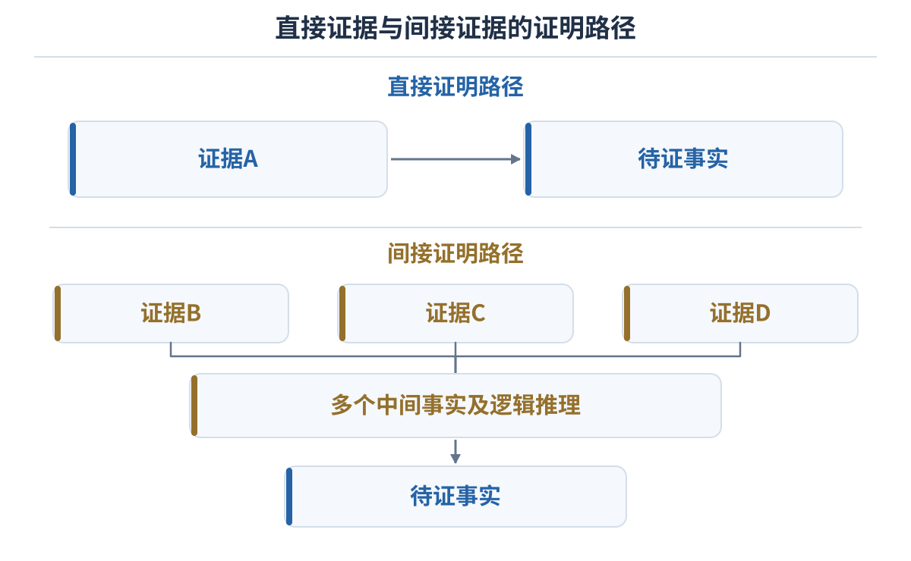
*图 060　直接证据与间接证据的证明路径*

> [!note]- 图示文字索引
> 直接证据直接指向待证事实；间接证据通过中间事实及逻辑推理支持待证事实。

直接与间接描述的是证明关系，并不表示直接证据必然更加可靠。例如，一名证人的直接陈述可能存在记忆错误，而多个相互独立的客观记录可能形成较强的间接证明。

#### 33.4 证明责任
证明责任主要研究由谁承担提出证据及证明相关事实的负担，以及事实最终不能得到充分证明时产生怎样的后果。通常需要进一步区分提出证据的责任、说服裁判者的责任、法律推定及反驳推定，以及特定情况下的举证责任调整。不同法律领域和法域的证明责任配置并不完全相同。

#### 33.5 证明标准

| 证明标准 | 典型使用背景 |
|---|---|
| 优势证据或盖然性衡量 | 许多普通法民事案件 |
| 高度盖然性 | 部分大陆法民事证明理论及相关实践 |
| 清楚且令人信服的证据 | 部分法域的特定民事或其他事项 |
| 排除合理怀疑 | 许多刑事案件中的定罪证明标准 |

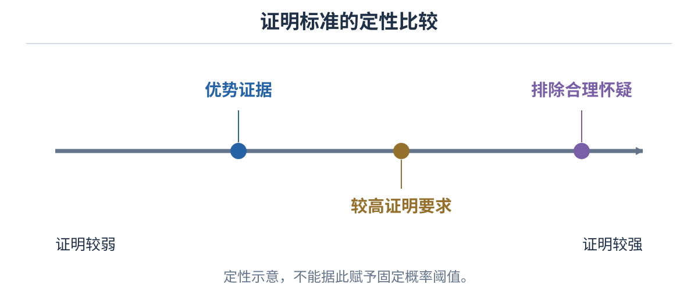
*图 061　证明标准的定性比较*

> [!note]- 图示文字索引
> 优势证据、较高证明要求及排除合理怀疑的定性比较，不是统一概率阈值。

仅表示部分证明标准的定性高低关系，不代表统一概率阈值，也不能将司法判断直接量化为固定百分比。

#### 33.6 电子证据的特殊问题
电子证据分析通常需要研究数据来源、生成时间、身份关联、系统可靠性、文件完整性、修改历史及证据保管链。哈希值可以帮助验证文件在特定时间之后是否发生变化，但不能单独证明文件内容本身真实，也不能单独证明文件由某个特定人制作。数字签名、时间戳、访问日志及电子认证机制，分别解决不同的身份、完整性及时间证明问题。

#### 33.7 证据与认知偏差

| 偏差 | 在法律中的相关问题 |
|---|---|
| 确认偏误 | 只关注支持既有案件假设的证据 |
| 锚定效应 | 初始金额或判断影响后续评价 |
| 错误记忆 | 回忆内容可能在提取过程中发生变化 |
| 误导信息效应 | 事后信息可能影响原有记忆 |
| 基本归因错误 | 过度依靠人格解释他人行为 |
| 结果偏差 | 根据最终结果反推此前行为一定不合理 |

证据制度的一项重要价值，就是通过程序化审查降低单凭直觉、印象或社会舆论作出判断的风险。

### 第三十四章　仲裁、调解与裁判执行

#### 34.1 争议解决方式的总体分类

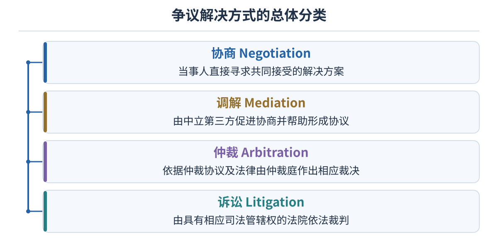
*图 062　争议解决方式的总体分类*

> [!note]- 图示文字索引
> - 协商 Negotiation：当事人直接寻求共同接受的解决方案
> - 调解 Mediation：由中立第三方促进协商并帮助形成协议
> - 仲裁 Arbitration：依据仲裁协议及法律由仲裁庭作出相应裁决
> - 诉讼 Litigation：由具有相应司法管辖权的法院依法裁判

#### 34.2 四种争议解决方式的比较

| 比较维度 | 协商 | 调解 | 仲裁 | 诉讼 |
|---|---|---|---|---|
| 是否由第三方决定 | 否 | 通常否 | 是 | 是 |
| 基础机制 | 自主协商 | 第三方协助 | 仲裁协议等法律基础 | 法定司法权限 |
| 程序灵活性 | 通常较高 | 通常较高 | 依规则及约定确定 | 依司法程序确定 |
| 结果性质 | 和解协议 | 调解协议等 | 仲裁裁决 | 法院裁判 |
| 强制执行 | 需要相应法律基础 | 依协议及制度确定 | 可依法申请执行 | 可依法申请执行 |
| 公开程度 | 通常非公开 | 通常非公开 | 通常较为保密 | 依法公开或适用例外 |

仲裁不一定比诉讼更便宜或更快，也不意味着可以完全排除法院在仲裁支持、监督及执行方面的作用。

#### 34.3 仲裁中的核心概念

| 概念 | 含义 |
|---|---|
| 仲裁协议 | 当事人同意以仲裁解决相应争议的安排 |
| 仲裁机构 | 提供相应仲裁管理服务的机构 |
| 仲裁庭 | 实际负责审理及裁决争议的人员组成 |
| 仲裁地 Seat | 确定相关仲裁程序法律框架的重要法律连接点 |
| 开庭地点 Venue | 实际进行听证的地点 |
| 仲裁规则 | 用于安排相应仲裁程序的规则 |
| 仲裁裁决 | 仲裁庭作出的相关决定 |

仲裁地与实际开庭地点可以不同，仲裁程序适用的法律与合同实体法也可以不同。

#### 34.4 判决、裁决与执行

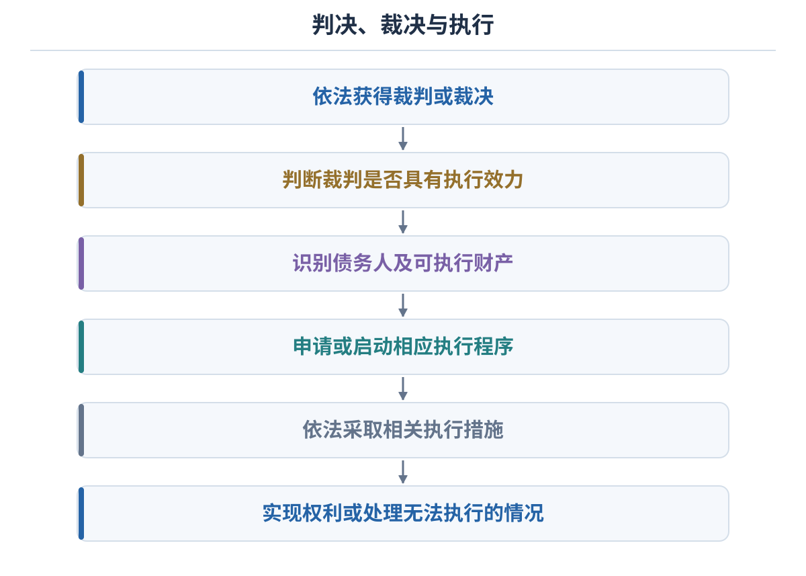
*图 063　判决、裁决与执行*

> [!note]- 图示文字索引
> - 依法获得裁判或裁决
> - 判断裁判是否具有执行效力
> - 识别债务人及可执行财产
> - 申请或启动相应执行程序
> - 依法采取相关执行措施
> - 实现权利或处理无法执行的情况

胜诉不代表一定能够获得实际赔偿。债务人是否拥有可执行财产、财产位于何处、是否存在其他优先债权以及跨境执行是否具有法律基础，都可能影响权利最终实现。

## 第七篇　国际法与跨境法律关系

### 第三十五章　国际公法与国际秩序

#### 35.1 国内法与国际法

| 比较维度 | 国内法 | 国际公法 |
|---|---|---|
| 主要研究对象 | 特定国家或法域内部的法律关系 | 国家及其他国际法主体之间的法律关系 |
| 法律形成 | 主要依靠国内立法、司法及其他制度 | 条约、国际习惯及其他国际法渊源 |
| 权力结构 | 通常存在相对集中的公共权力体系 | 国际社会总体上具有较分散的权力结构 |
| 实施方式 | 国内行政、司法及执行机制 | 国际合作、争端解决、国内实施及其他机制 |
| 责任形式 | 民事、行政、刑事等责任 | 国家责任、国际组织责任及其他国际法律责任 |

国际法并不是一个拥有完整全球政府、全球警察及统一强制执行系统的世界法律体系。它的实施需要依靠国际制度、国家实践、国内法律以及不同形式的国际合作。

#### 35.2 国际法主体

| 主体 | 主要国际法律地位 |
|---|---|
| 国家 | 国际法中的基本主体 |
| 国际组织 | 根据成立依据及职能享有相应国际法律人格 |
| 个人 | 在国际人权法、国际刑法等领域具有相应权利与责任 |
| 其他特殊主体 | 根据特定国际法律制度取得相应地位 |

跨国公司并不因为经营规模巨大，就自然取得与主权国家完全相同的国际法律地位。

#### 35.3 国际法的主要渊源

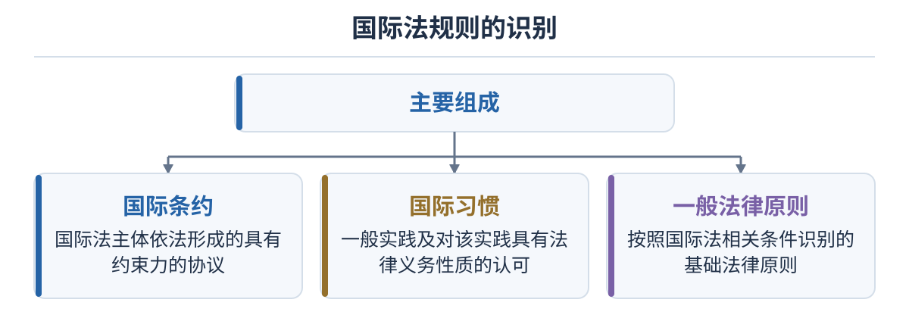
*图 064　国际法规则的识别*

> [!note]- 图示文字索引
> - 国际条约：国际法主体依法形成的具有约束力的协议
> - 国际习惯：一般实践及对该实践具有法律义务性质的认可
> - 一般法律原则：按照国际法相关条件识别的基础法律原则

辅助识别方式包括司法裁判、具有相关权威性的学术著述等。《国际法院规约》第38条是研究国际法渊源的经典起点，但不应将其理解为国际法律规则形成方式的全部内容。

#### 35.4 国际公法的主要分支

| 分支 | 核心研究内容 |
|---|---|
| 国际条约法 | 条约成立、解释、效力及终止 |
| 国际组织法 | 国际组织的设立、权限及运行 |
| 外交与领事关系法 | 外交关系、领事职能及相关豁免 |
| 国际海洋法 | 海洋空间、航行、资源及海洋权益 |
| 国际航空与空间法 | 国际航空及外层空间活动 |
| 国际人权法 | 国际层面的个人权利保障 |
| 国际人道法 | 武装冲突中的人道保护及相关规则 |
| 国际刑法 | 特定国际犯罪及个人刑事责任 |
| 国际环境法 | 跨境环境影响与全球环境合作 |
| 国际经济法 | 国际贸易、投资及其他经济制度 |
| 国际争端解决法 | 国际争端处理及相关法律机制 |

#### 35.5 国家主权与国际义务
国家主权主要涉及国家在其制度范围内的权力及国际关系中的独立法律地位。但国家主权不意味着国家完全不受国际法约束。国家通过条约、国际习惯及其他国际法规则承担相应国际义务，违反国际义务可能产生国际法律责任。

#### 35.6 国际法律文件的不同性质

| 文件或制度 | 主要特点 |
|---|---|
| 国际条约 | 在满足相应条件时对有关主体具有法律约束力 |
| 国际习惯法 | 依据国际实践及法律确信等条件形成 |
| 国际组织决议 | 法律效力取决于组织权限及具体文件性质 |
| 国际示范法 | 为各国制定或改革国内法律提供参考 |
| 国际原则及指南 | 通常用于促进制度协调及指导法律实践 |
| 行业国际标准 | 可能通过合同、国内监管等方式取得具体法律意义 |

尤其需要区分具有约束力的国际法与软法（Soft Law）。一份国际组织发布的文件，即使具有较高权威性，也不意味着自动成为所有国家必须遵守的国内法律。

#### 35.7 国际争端解决

| 解决机制 | 主要方式 |
|---|---|
| 国际谈判 | 国家等主体直接协商 |
| 调解与斡旋 | 第三方协助解决争端 |
| 国际仲裁 | 根据相应法律基础由仲裁机构或仲裁庭处理 |
| 国际司法 | 由具有相应管辖权的国际法院或法庭审理 |
| 国际组织争端机制 | 根据特定国际制度处理相关争议 |

国际法院、国际刑事法院、国际海洋法法庭及国际商事仲裁机构，具有不同的管辖范围和制度性质。

### 第三十六章　国际私法与法律冲突
国际私法是理解不同国家法律之间如何发生联系的核心学科。

#### 36.1 什么是涉外法律关系
当一项私人法律关系与两个或多个法域发生法律上的联系时，就可能出现国际私法问题。例如，一家中国大陆的软件企业与一家新加坡公司签订合同，约定在中国香港进行仲裁，软件实际部署于欧洲。

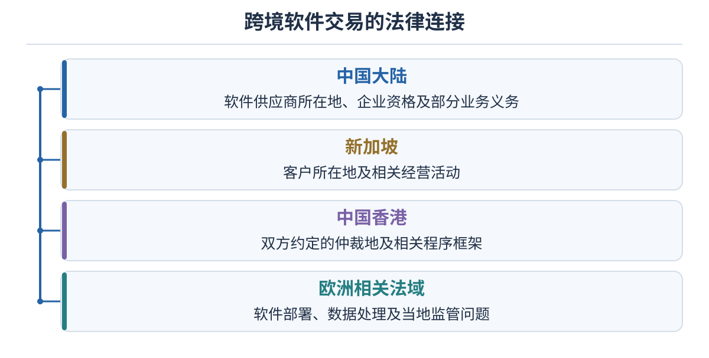
*图 065　跨境软件交易的法律连接*

> [!note]- 图示文字索引
> - 中国大陆：软件供应商所在地、企业资格及部分业务义务
> - 新加坡：客户所在地及相关经营活动
> - 中国香港：双方约定的仲裁地及相关程序框架
> - 欧洲相关法域：软件部署、数据处理及当地监管问题

虚构案例。实际适用法律需要结合合同约定、冲突规范、强制性规则及具体事实确定。这些不同法律制度可能同时发挥作用，而不是只能从中选择一个国家的全部法律。

#### 36.2 国际私法的三大核心问题

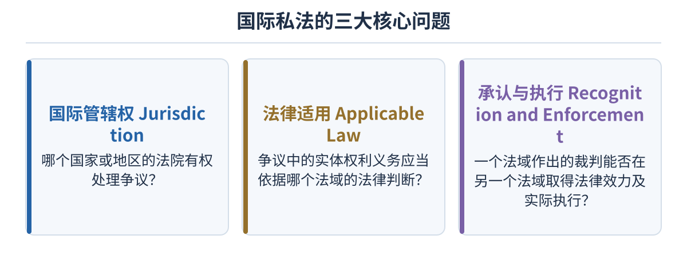
*图 066　国际私法的三大核心问题*

> [!note]- 图示文字索引
> - 国际管辖权 Jurisdiction：哪个国家或地区的法院有权处理争议？
> - 法律适用 Applicable Law：争议中的实体权利义务应当依据哪个法域的法律判断？
> - 承认与执行 Recognition and Enforcement：一个法域作出的裁判能否在另一个法域取得法律效力及实际执行？

这是跨境法律分析中必须牢牢记住的三个独立问题。新加坡法院在符合相应条件时可能适用外国实体法律，而某地作出的法院判决，也不当然能够在世界其他地区直接执行。

#### 36.3 冲突规范与实体规范

| 概念 | 核心作用 |
|---|---|
| 实体规范 | 直接规定相关主体的权利义务及责任 |
| 冲突规范 | 确定某类涉外法律问题应当适用哪个法域的法律 |
| 准据法 | 根据相应规则确定、用于处理有关实体法律问题的法律 |
| 连接点 | 将某项法律关系与特定法域联系起来的法律因素 |

常见连接点包括国籍、住所、经常居所、财产所在地、行为地、损害发生地、合同履行地及公司设立地等。

#### 36.4 法律适用的典型分析过程

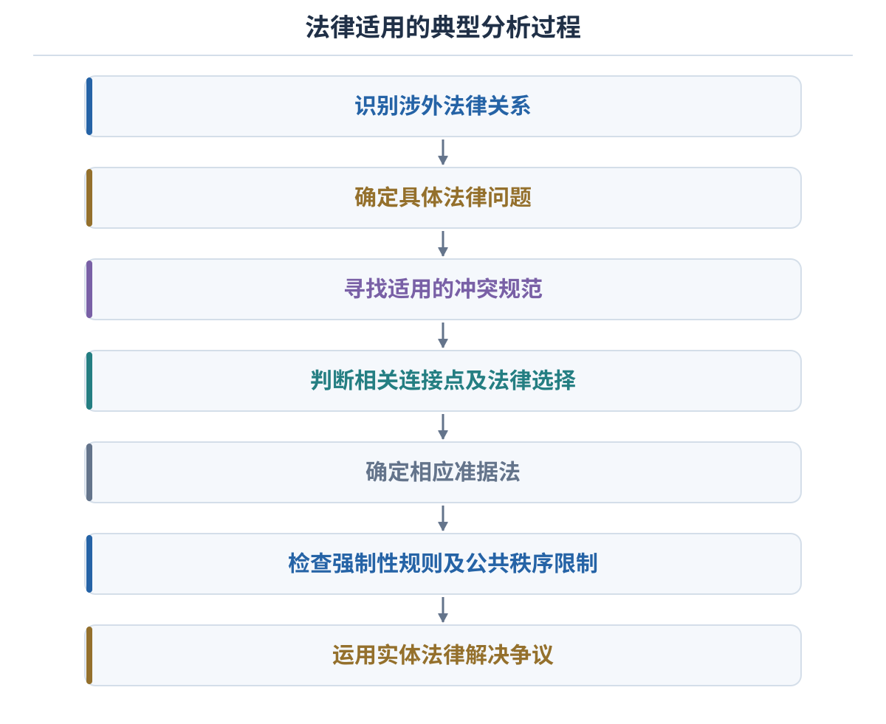
*图 067　法律适用的典型分析过程*

> [!note]- 图示文字索引
> - 识别涉外法律关系
> - 确定具体法律问题
> - 寻找适用的冲突规范
> - 判断相关连接点及法律选择
> - 确定相应准据法
> - 检查强制性规则及公共秩序限制
> - 运用实体法律解决争议

例如，跨国婚姻、跨境合同与境外不动产交易，可能分别适用不同的冲突规范，而不能简单使用同一判断方法。

#### 36.5 当事人意思自治
在许多国际商事合同中，当事人可以在相关法律允许的范围内约定合同适用的法律。这一机制可以提高交易的法律确定性。但是，选择某个国家的合同法，并不意味着可以排除其他依法必须适用的劳动保护、消费者保护、金融监管、数据安全及其他强制性规范。
海牙国际私法会议的《国际商事合同法律选择原则》就是研究跨境商业合同意思自治的重要参考文件，其性质属于软法，而不是自动适用的国际条约。

#### 36.6 法律冲突中的特殊制度

| 概念 | 主要研究问题 |
|---|---|
| 识别 | 应当将争议归入哪个法律类别？ |
| 反致 | 某些情形下如何处理不同冲突规范之间的指引？ |
| 公共秩序保留 | 是否因适用外国法的结果违反本地重要公共秩序而限制其适用？ |
| 直接适用的强制性规范 | 某些规则是否不受当事人法律选择影响？ |
| 外国法查明 | 如何确定外国法律的实际内容及解释？ |
| 法律规避 | 如何处理通过不当法律连接安排逃避相关强制性规则的问题？ |

这些制度在不同国家之间的适用方式具有明显差异。

### 第三十七章　国际经济法与跨境商业

#### 37.1 国际经济法的整体结构

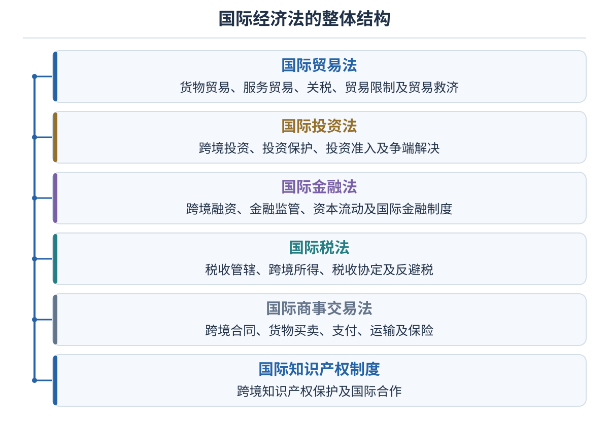
*图 068　国际经济法的整体结构*

> [!note]- 图示文字索引
> - 国际贸易法：货物贸易、服务贸易、关税、贸易限制及贸易救济
> - 国际投资法：跨境投资、投资保护、投资准入及争端解决
> - 国际金融法：跨境融资、金融监管、资本流动及国际金融制度
> - 国际税法：税收管辖、跨境所得、税收协定及反避税
> - 国际商事交易法：跨境合同、货物买卖、支付、运输及保险
> - 国际知识产权制度：跨境知识产权保护及国际合作

国际经济法既包括国家之间的经济规则，也可能广义地涵盖私人主体跨境经济活动中的法律问题。

#### 37.2 国际贸易制度

| 概念 | 主要含义 |
|---|---|
| 最惠国待遇 | 在相应制度范围内避免对不同贸易伙伴进行不符合规则的区别对待 |
| 国民待遇 | 在适用条件下避免对外国相关产品、服务或主体实施不符合规则的差别待遇 |
| 市场准入 | 外国商品、服务及相关经营活动进入市场的法律条件 |
| 关税 | 对相关进出口商品征收的税费 |
| 非关税措施 | 许可证、技术标准及其他可能影响贸易的措施 |
| 贸易救济 | 反倾销、反补贴及保障措施等制度 |
| 贸易争端解决 | 依据国际贸易制度处理成员之间的争议 |

WTO法律体系主要涉及货物贸易、服务贸易、知识产权以及相关争端解决与贸易政策审查制度。

#### 37.3 国际投资制度
国际投资法律研究包括投资准入、外资企业经营、投资保护、征收与补偿、公平与公正待遇、投资者与国家之间的争端解决等问题。

| 概念 | 核心区别 |
|---|---|
| 国际证券投资 | 跨境持有证券及相关金融资产 |
| 外国直接投资 | 具有相应长期经济联系及影响的跨境投资 |
| 国际投资协定 | 国家之间形成的相关投资法律安排 |
| 投资合同 | 投资者与相关交易主体之间的具体合同 |
| 投资仲裁 | 基于相应法律依据处理投资争议的仲裁机制 |

国际投资协定并不意味着外国投资者可以无条件排除当地公共监管。

#### 37.4 国际商业规则的重要参考文件

| 文件 | 性质与主要用途 |
|---|---|
| CISG《联合国国际货物销售合同公约》 | 对符合适用条件的国际货物买卖提供统一法律规则 |
| UNIDROIT《国际商事合同通则》 | 为国际商事合同提供非强制性的通用规则及解释参考 |
| Incoterms 国际贸易术语解释通则 | 通过合同采用的贸易术语安排交货、费用及风险分配 |
| UCP 跟单信用证统一惯例 | 在相关信用证采用时提供操作规则 |
| 《纽约公约》 | 为承认仲裁协议及外国仲裁裁决提供国际法律框架 |
| UNCITRAL国际商事仲裁示范法 | 为各法域制定仲裁法律制度提供参考 |
| 海牙法律选择原则 | 为国际商事合同中的法律选择提供参考 |

上述文件并不具有完全相同的法律性质。国际公约、示范法、非约束性原则及合同采用的商业惯例，需要分别分析其适用依据。

#### 37.5 跨境交易中的法律关系

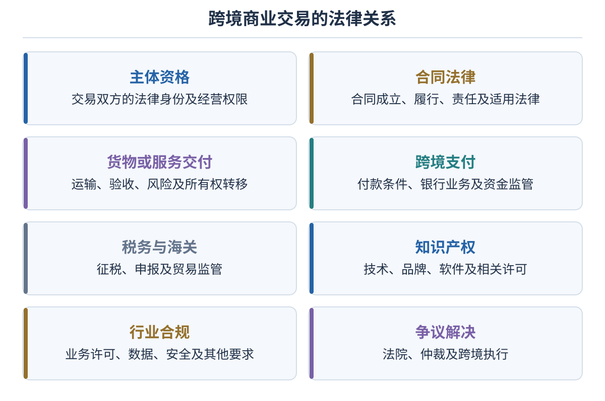
*图 069　跨境商业交易的法律关系*

> [!note]- 图示文字索引
> - 主体资格：交易双方的法律身份及经营权限
> - 合同法律：合同成立、履行、责任及适用法律
> - 货物或服务交付：运输、验收、风险及所有权转移
> - 跨境支付：付款条件、银行业务及资金监管
> - 税务与海关：征税、申报及贸易监管
> - 知识产权：技术、品牌、软件及相关许可
> - 行业合规：业务许可、数据、安全及其他要求
> - 争议解决：法院、仲裁及跨境执行

国际商业涉及不同市场、监管制度、税务结构及法律关系之间的协调。

## 第八篇　法律制度研究与实践

### 第三十八章　法律制度的实效与研究方法

#### 38.1 法律规则与实际运行
法律社会学主要研究法律如何在实际社会中运行，以及社会结构如何影响法律。

| 研究领域 | 核心问题 |
|---|---|
| 法律意识 | 人们如何认识、评价及使用法律？ |
| 法律实效 | 已经制定的规则是否得到实际实施？ |
| 法律与社会分层 | 不同群体取得法律资源的能力是否存在差异？ |
| 法律与组织 | 企业、公共机构及社会组织如何适用法律？ |
| 法律与社会变迁 | 社会结构变化如何推动制度改革？ |
| 法律多元主义 | 不同规范体系如何在社会中共存？ |
| 司法可及性 | 不同主体能否实际获得法律服务与救济？ |

法律文本中的规则与现实社会中的实际运行可能存在差距。这种差距可能来自实施资源、社会文化、法律成本、信息不足或其他制度因素。

#### 38.2 法律责任与制度设计
法律制度设计需要研究财产权的界定、合同履行、侵权责任及公共监管等规则如何影响实际行为。以工厂噪声纠纷为例，需要确定各方的权利义务，考虑协商及法律救济的可行性，并比较侵权责任、行政标准等制度安排。

*图 070　法律制度的评价维度*

> [!note]- 图示文字索引
> - 合法性：规则及实施是否具有法律依据？
> - 权利保障：是否充分保护相关合法权益？
> - 实际效果：规则是否实现制度目标？
> - 救济可及性：权利受损时是否有实际可用的救济？

#### 38.3 司法事实判断与实证研究
司法事实判断需要研究记忆、证言、认知偏差、专业评估及组织行为对证据可靠性的影响，但任何有关行为机制的研究都不能直接替代法律对责任及证据的判断。实证法律研究可以利用案件数据、调查、访谈及其他证据评估制度运行结果。

### 第三十九章　法律风险、企业合规与法律尽职调查

#### 39.1 法律风险的本质
法律风险是由于法律规则、合同关系、监管要求、权利义务或其他法律因素的不确定性，对个人或组织目标产生影响的可能性。法律风险并不仅仅来自违法行为。一个完全正常的商业活动，也可能因为合同不清晰、权利归属不明确、对方偿债能力不足或者法律发生变化，而产生重大法律风险。

#### 39.2 企业法律风险的分类

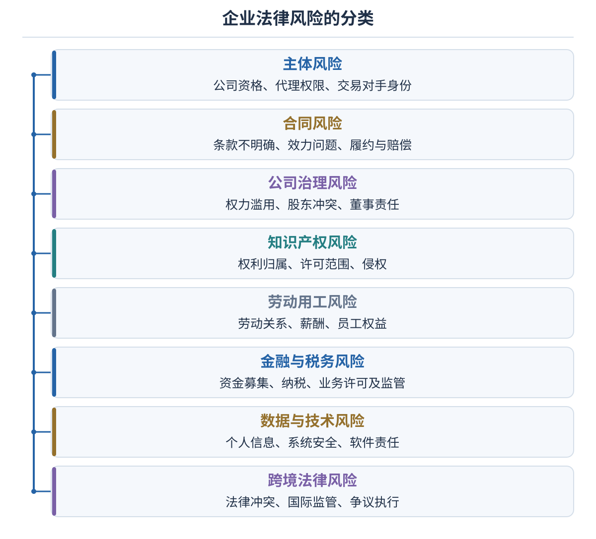
*图 071　企业法律风险的分类*

> [!note]- 图示文字索引
> - 主体风险：公司资格、代理权限、交易对手身份
> - 合同风险：条款不明确、效力问题、履约与赔偿
> - 公司治理风险：权力滥用、股东冲突、董事责任
> - 知识产权风险：权利归属、许可范围、侵权
> - 劳动用工风险：劳动关系、薪酬、员工权益
> - 金融与税务风险：资金募集、纳税、业务许可及监管
> - 数据与技术风险：个人信息、系统安全、软件责任
> - 跨境法律风险：法律冲突、国际监管、争议执行

#### 39.3 法务、合规、风险管理与审计

| 职能 | 核心职责 |
|---|---|
| 法务 Legal | 处理合同、法律咨询、交易及法律争议 |
| 合规 Compliance | 识别适用义务并建立相应遵守机制 |
| 风险管理 Risk Management | 从组织目标出发识别和管理各类风险 |
| 内部控制 Internal Control | 建立具体控制措施及运行制度 |
| 内部审计 Internal Audit | 对相关治理、风险及控制体系提供独立评价 |

法务不能代替全部合规工作，合规也不能代替企业经营部门自身承担的法律义务。

#### 39.4 法律尽职调查
法律尽职调查（Legal Due Diligence）是通过系统检查相关法律事实、文件及风险，支持投资、并购、融资及其他重大交易的过程。

| 调查模块 | 主要检查内容 |
|---|---|
| 主体资格 | 注册信息、存续状态、业务许可 |
| 股权结构 | 股东、实际控制及相关股权限制 |
| 公司治理 | 章程、重大决策、内部权限 |
| 资产权利 | 不动产、设备、知识产权及相关限制 |
| 重大合同 | 客户、供应商、融资及合作协议 |
| 债务及担保 | 负债、抵押、保证及或有义务 |
| 劳动关系 | 员工合同、知识产权及劳动争议 |
| 诉讼与监管 | 现有纠纷、行政处罚及潜在责任 |
| 数据与安全 | 数据处理依据、安全制度及风险 |
| 跨境与税务 | 相关交易结构及适用规则 |

#### 39.5 合同法律风险的分析框架

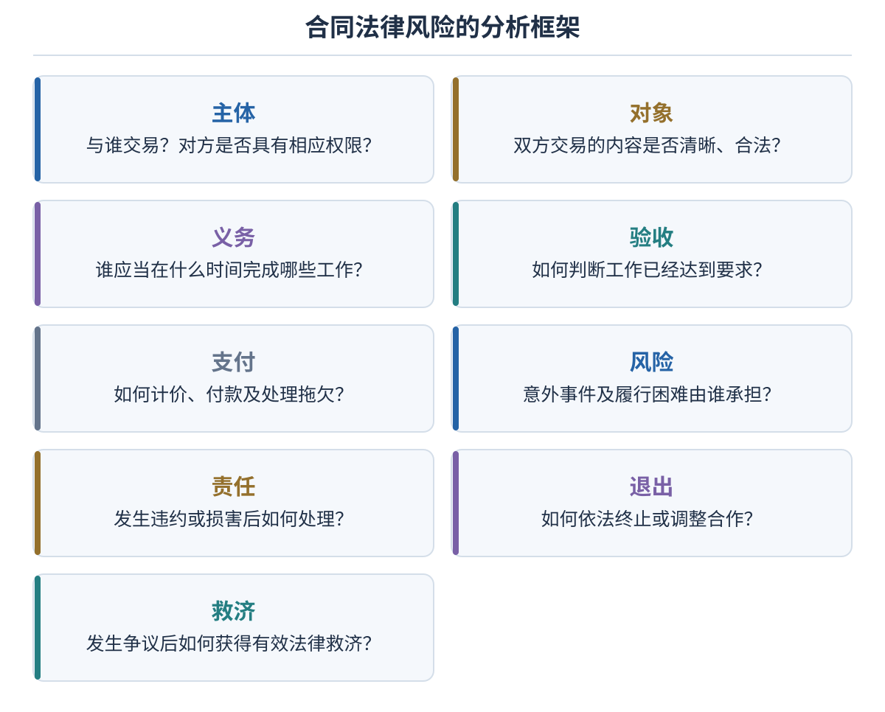
*图 072　合同法律风险的分析框架*

> [!note]- 图示文字索引
> - 主体：与谁交易？对方是否具有相应权限？
> - 对象：双方交易的内容是否清晰、合法？
> - 义务：谁应当在什么时间完成哪些工作？
> - 验收：如何判断工作已经达到要求？
> - 支付：如何计价、付款及处理拖欠？
> - 风险：意外事件及履行困难由谁承担？
> - 责任：发生违约或损害后如何处理？
> - 退出：如何依法终止或调整合作？
> - 救济：发生争议后如何获得有效法律救济？

这套框架可以迁移到采购、软件开发、租赁、借贷及企业合作等多种合同场景。但它是识别法律问题的工具，并不能代替针对具体合同及法域开展的专业审查。

### 第四十章　综合案例与法律问题分析方法

#### 40.1 法律分析的通用九问模型

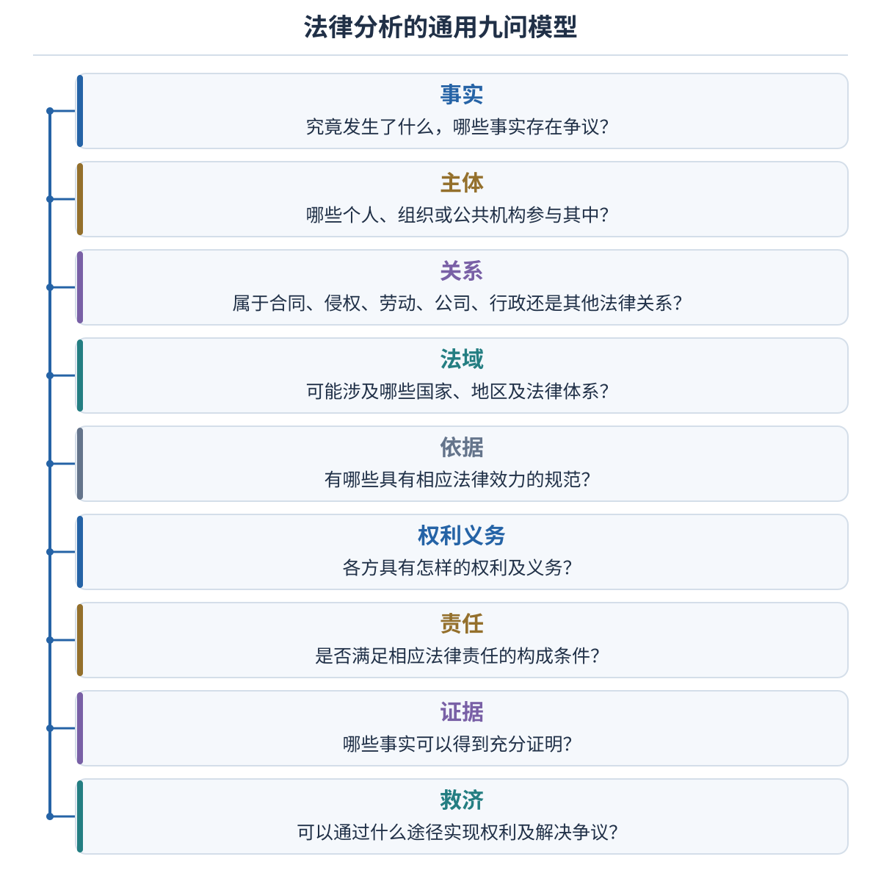
*图 073　法律分析的通用九问模型*

> [!note]- 图示文字索引
> - 事实：究竟发生了什么，哪些事实存在争议？
> - 主体：哪些个人、组织或公共机构参与其中？
> - 关系：属于合同、侵权、劳动、公司、行政还是其他法律关系？
> - 法域：可能涉及哪些国家、地区及法律体系？
> - 依据：有哪些具有相应法律效力的规范？
> - 权利义务：各方具有怎样的权利及义务？
> - 责任：是否满足相应法律责任的构成条件？
> - 证据：哪些事实可以得到充分证明？
> - 救济：可以通过什么途径实现权利及解决争议？

#### 40.2 案例一：委托开发软件后，软件归谁所有？
假设甲公司支付费用，委托乙开发一款商业软件。软件完成后，甲认为既然自己已经付款，软件全部知识产权当然属于自己。这一判断未必成立。

| 法律分析维度 | 需要研究的问题 |
|---|---|
| 合同法 | 双方约定的交付内容究竟是什么？ |
| 知识产权法 | 著作权、技术成果及相关权益如何归属？ |
| 许可制度 | 甲获得的是所有权、许可权还是其他使用权限？ |
| 开源许可 | 是否使用了附带相关义务的第三方代码？ |
| 商业秘密 | 双方能否继续使用开发过程中的技术及信息？ |
| 证据法 | 合同、沟通记录、代码提交记录能否证明相关事实？ |
| 争议解决 | 适用哪个法域的法律，如何处理纠纷？ |

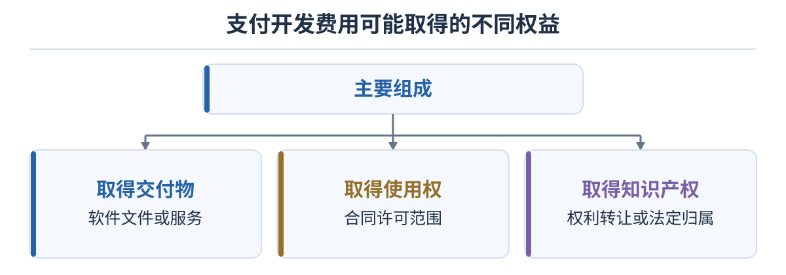
*图 074　支付开发费用可能取得的不同权益*

> [!note]- 图示文字索引
> - 取得交付物：软件文件或服务
> - 取得使用权：合同许可范围
> - 取得知识产权：权利转让或法定归属

三项结果可以同时存在，但也可以分别成立。

#### 40.3 案例二：公司经营失败，股东是否必须偿还债务？
假设一家有限责任公司拥有60万元可用于清偿的资产，但负有100万元债务。

| 分析方向 | 核心问题 |
|---|---|
| 主体资格 | 公司是否具有独立法律人格？ |
| 公司财产 | 哪些财产依法属于公司？ |
| 股东义务 | 股东是否履行出资等相关义务？ |
| 个人担保 | 股东是否以个人身份承担保证责任？ |
| 公司治理 | 是否存在违法处分财产等行为？ |
| 破产制度 | 是否满足相应程序条件？ |
| 债权性质 | 是否存在担保或法定优先权益？ |

因此，公司有40万元债务清偿缺口，并不能直接推导出股东个人必须支付40万元，也不能推导出股东在任何情况下均没有责任。

#### 40.4 案例三：买入股票后发生重大亏损，能否要求赔偿？
投资亏损可能来自正常市场风险，也可能与违法行为有关。

*图 075　投资亏损的法律责任分析*

> [!note]- 图示文字索引
> 区分正常投资风险与可能的违法行为，再判断法律依据、损失、因果关系及证据。

发生亏损本身，并不足以证明他人应当承担法律责任。

#### 40.5 案例四：消费者接受了平台用户协议
一个人在使用软件时点击了「我已阅读并同意」。

| 法律领域 | 主要问题 |
|---|---|
| 合同法 | 是否依法成立相关合同？ |
| 格式条款制度 | 是否存在需要特别提示或受到限制的条款？ |
| 消费者保护 | 是否不当排除消费者法定权益？ |
| 个人信息保护 | 数据处理是否具有适当法律依据？ |
| 知识产权 | 用户上传内容的使用权限如何安排？ |
| 争议解决 | 管辖、仲裁及法律选择条款是否有效？ |

同意用户协议，并不必然意味着同意该平台未来采取任何行为。

#### 40.6 案例五：一家金融科技企业进入海外市场

*图 076　跨境经营的法律分析过程*

> [!note]- 图示文字索引
> - 确定业务性质：软件服务、支付、投资咨询、证券交易还是其他金融活动？
> - 确认经营主体：通过本地公司、境外子公司还是跨境服务开展经营？
> - 分析市场准入：是否需要监管许可及其他经营资格？
> - 建立交易法律体系：客户协议、服务合同、知识产权与责任安排
> - 建立数据合规体系：数据处理、安全、保存及跨境传输
> - 研究税收与资金安排：税务身份、支付、融资及资金流动要求
> - 建立争议处理机制：适用法律、管辖、仲裁及执行
> - 持续法律风险管理：监管变化、业务发展及组织合规

## 附录一　法学整体知识关联图谱

### A.1 法学的总体知识网络

*图 077　法学总体知识网络*

> [!note]- 图示文字索引
> 社会秩序与利益冲突 → 法律价值与法哲学 → 法律规范与法律渊源 → 主体、事实、客体 → 法律关系 → 权利、义务、责任 → 各部门法 → 解释与证据 → 司法、救济、执行。

连线表示主要研究联系，而非各法律部门之间严格的一一对应关系。

### A.2 二十条核心法律知识链

| 基础概念 | 中间机制 | 延伸制度 |
|---|---|---|
| 社会利益冲突 | 法律规范 | 社会秩序 |
| 法律价值 | 法律原则 | 法律解释 |
| 法律渊源 | 法律效力 | 规范适用 |
| 法律主体 | 权利能力与行为能力 | 民事法律行为 |
| 意思表示 | 私人自治 | 合同制度 |
| 法律事实 | 法律关系变动 | 权利产生与消灭 |
| 财产权 | 公示与第三人保护 | 物权制度 |
| 债权 | 履行与违约 | 合同救济 |
| 侵害行为 | 过错与因果关系 | 侵权赔偿 |
| 创新与知识 | 排他性权利及许可 | 知识产权制度 |
| 公司人格 | 财产独立与有限责任 | 公司制度 |
| 股权 | 表决与控制 | 公司治理 |
| 债务 | 担保与优先权 | 融资及破产 |
| 信息不对称 | 信息披露与监管 | 证券法 |
| 市场力量 | 竞争秩序 | 反垄断制度 |
| 国家权力 | 法律授权与监督 | 宪法及行政法 |
| 犯罪行为 | 构成要件及责任 | 刑事处罚 |
| 证据 | 证明责任及证明标准 | 事实认定 |
| 法律权利 | 诉讼与仲裁 | 权利救济 |
| 跨境活动 | 管辖与法律冲突 | 国际私法 |

## 附录二　法学重要概念分类与辨析

### B.1 具有上下位或组成关系的概念

| 上位概念 | 下位类别或组成 |
|---|---|
| 社会规范 | 法律规范、道德规范、习俗等 |
| 法律主体 | 自然人、法人及其他主体 |
| 法律关系 | 主体、客体、内容 |
| 法律事实 | 法律事件、人的行为 |
| 意思表示数量分类 | 单方、双方、多方法律行为 |
| 民事权利功能分类 | 支配权、请求权、形成权、抗辩权 |
| 物权 | 所有权、限制物权等 |
| 限制物权 | 用益物权、担保物权等 |
| 债的发生原因 | 合同、侵权、不当得利、无因管理等 |
| 法律责任 | 民事责任、行政责任、刑事责任等 |
| 担保 | 人的担保、物的担保等 |
| 知识产权保护 | 著作权、专利、商标等制度 |
| 争议解决 | 协商、调解、仲裁、诉讼 |
| 国际私法核心问题 | 国际管辖、法律适用、承认与执行 |

### B.2 容易混淆的重要概念

| 概念组合 | 核心区别 |
|---|---|
| 法学与法律 | 研究法律的学科与法律规范体系 |
| 法律与法条 | 整体规范体系与具体条文 |
| 法制与法治 | 法律制度建设与法律约束、权利保障 |
| 法系与法域 | 法律传统分类与具体法律适用体系 |
| 国家与法域 | 政治法律主体与相应司法管辖范围 |
| 法律效力与正当性 | 制度上的有效性与权威、内容的合理性 |
| 法律效力与实效性 | 法律上的有效性与现实实施情况 |
| 法律规则与法律原则 | 相对具体的适用规则与基础指导原则 |
| 公法与私法 | 公共权力相关法律关系与私人法律关系 |
| 实体法与程序法 | 权利义务责任与其实现程序 |
| 法人与法定代表人 | 法律组织主体与依法代表该组织的自然人 |
| 权利能力与行为能力 | 享有权利的资格与独立产生法律效果的能力 |
| 权利与利益 | 法律确认的地位与主体重视的利益 |
| 权利与权力 | 受法律承认的主体地位与影响、决定相关事项的能力 |
| 请求权与形成权 | 请求他人履行与依法改变法律关系 |
| 请求权与诉讼请求 | 实体法上的请求权与要求法院作出的裁判 |
| 法律义务与法律责任 | 应当承担的行为要求与相应责任后果 |
| 法律事件与法律行为 | 特定事件引发法律效果与以意思表示等形成法律效果 |
| 代理权与委托合同 | 对外产生相关法律效果的权限与内部合同关系 |
| 所有权与占有 | 财产权利归属与实际控制状态 |
| 物权与债权 | 财产直接支配与特定主体间的请求关系 |
| 财产权与物权 | 广义财产性权益与特定类型的财产权 |
| 合同成立与合同生效 | 完成缔约过程与取得相应法律效力 |
| 合同效力与合同履行 | 是否具有法律约束力与是否完成义务 |
| 合同无效与合同解除 | 效力基础问题与合同关系的依法终止 |
| 不可抗力与商业风险 | 特定外部履行障碍与一般经营不确定性 |
| 违约与侵权 | 违反合同义务与侵害依法受保护的权益 |
| 故意与过失 | 不同性质的法律归责状态 |
| 故意与动机 | 行为相关心理状态与实施行为的原因 |
| 因果关系与相关性 | 行为造成结果的联系与一般统计或事实联系 |
| 隐私与个人信息 | 私人生活利益与可识别个人的信息 |
| 著作权与专利权 | 作品表达保护与授权技术成果保护 |
| 转让与许可 | 权利归属转移与授权使用 |
| 开源与公有领域 | 依据许可开放使用与相应权利不再排他 |
| 股权与公司财产 | 股东持有的权益与公司自身资产 |
| 股权与控制权 | 持有公司权益与影响公司重大决定的能力 |
| 子公司与分公司 | 独立公司主体与总公司的组织分支 |
| 公司注册与行业许可 | 主体设立与特定业务经营资格 |
| 抵押与质押 | 不同形式的财产担保机制 |
| 保证与担保物权 | 第三人承担相关义务与利用财产价值担保 |
| 破产与资不抵债 | 法律程序与资产负债状态 |
| 垄断地位与滥用支配地位 | 市场力量状态与符合违法条件的行为 |
| 证券发行与证券交易 | 新证券发行与已有证券的交易 |
| 投资亏损与投资侵权 | 市场损失与具有相应法律责任依据的侵害 |
| 违法与犯罪 | 广义法律规范违反与符合刑法规定的行为 |
| 刑法与刑事诉讼法 | 犯罪刑罚制度与刑事司法程序 |
| 侦查与审判 | 收集调查证据与司法裁判 |
| 嫌疑人与罪犯 | 受到犯罪怀疑的主体与依法认定有罪的主体 |
| 证据与事实 | 证明材料与需要认定的客观情况 |
| 可采性与证明力 | 能否作为证据使用与实际证明作用 |
| 证明责任与证明标准 | 谁承担证明负担与需要达到何种证明程度 |
| 仲裁机构与仲裁庭 | 仲裁管理组织与实际裁决主体 |
| 仲裁地与开庭地点 | 法律上的仲裁连接点与实际活动地点 |
| 判决与执行 | 确定权利责任与实际实现裁判 |
| 管辖权与准据法 | 谁负责处理争议与依据什么法律处理 |
| 国际公法与国际私法 | 国际法律主体间关系与涉外私人法律关系 |
| 国际条约与示范法 | 国际法律协议与国内立法参考工具 |
| 法务与合规 | 法律事务处理与遵守义务的管理机制 |

## 附录三　不同国家法律制度的比较方法

### C.1 同一法律问题的多法域比较框架
假设希望了解中国大陆、英国、新加坡及中国香港对于某种合同问题的处理。应该建立统一的问题分析框架。

| 比较维度 | 需要研究的问题 |
|---|---|
| 制度目的 | 这项法律制度试图解决什么问题？ |
| 历史来源 | 为什么形成当前的规则？ |
| 法律渊源 | 主要依据法律条文、司法判例还是其他规范？ |
| 构成要件 | 在什么条件下产生法律效果？ |
| 当事人权利 | 哪些主体获得何种法律保护？ |
| 法定义务 | 哪些主体需要承担什么义务？ |
| 风险分配 | 交易失败及相关损失由谁承担？ |
| 例外机制 | 是否存在特别保护、免责及其他例外？ |
| 救济方式 | 如何通过司法或其他机制实现权利？ |
| 社会效果 | 对市场效率、公平及行为激励有什么影响？ |

### C.2 制度比较示例

| 法律问题 | 共同研究对象 | 不同法域可能采取的不同机制 |
|---|---|---|
| 合同约束力 | 为什么承诺能够获得法律强制保护？ | 合意、对价、形式及信赖保护 |
| 财产转移 | 怎样确定财产归属发生变化？ | 合意、交付、登记及其他机制 |
| 公司责任 | 股东与公司债务如何分离？ | 有限责任、担保、人格否认等 |
| 企业破产 | 债务无法偿还时如何分配损失？ | 重整、清算、免责及优先权 |
| 婚姻财产 | 家庭成员如何享有及分配财产？ | 共同财产、分别财产、增值分享 |
| 刑事责任 | 什么行为可以受到刑事处罚？ | 不同犯罪构成及抗辩体系 |
| 事实认定 | 如何证明一个事件已经发生？ | 不同证明责任、标准及证据规则 |
| 权力监督 | 如何限制公共权力的不当行使？ | 司法审查、宪法监督及其他机制 |

## 附录四　法学主要思想家及理论索引

| 代表人物 | 主要关联思想 |
|---|---|
| 柏拉图 | 正义、理想国家及法律思想 |
| 亚里士多德 | 分配正义、矫正正义、政治与法律 |
| 西塞罗 | 罗马法律思想与自然法 |
| 托马斯·阿奎那 | 自然法及法律的道德基础 |
| 格劳秀斯 | 自然法与近代国际法思想 |
| 霍布斯 | 国家权力、社会契约及法律秩序 |
| 洛克 | 自然权利、财产权与政府权力 |
| 孟德斯鸠 | 法律与政治制度、权力制约 |
| 卢梭 | 社会契约与政治合法性 |
| 贝卡利亚 | 刑罚正当性及刑法改革 |
| 边沁 | 功利主义与法律改革 |
| 奥斯丁 | 分析法学及法律实证主义 |
| 萨维尼 | 历史法学派 |
| 梅因 | 法律史及社会制度演进 |
| 耶林 | 法律目的及利益研究 |
| 马克思、恩格斯 | 法律与社会经济结构、国家及阶级 |
| 霍姆斯 | 法律经验、司法实践及现实主义思想 |
| 罗斯科·庞德 | 社会法学及利益协调 |
| 汉斯·凯尔森 | 纯粹法学与法律规范体系 |
| 韦斯利·霍菲尔德 | 基本法律权利关系分析 |
| 卡尔·卢埃林 | 美国法律现实主义 |
| 哈特 | 法律规则、法律实证主义 |
| 富勒 | 法律的内在道德及法治条件 |
| 德沃金 | 法律原则、权利与解释理论 |
| 罗尔斯 | 正义理论及制度公平 |
| 罗纳德·科斯 | 交易成本与财产权制度 |
| 卡拉布雷西 | 侵权法的经济分析 |
| 理查德·波斯纳 | 法律经济学 |
| 罗伯特·阿列克西 | 法律原则、基本权利与比例分析 |

## 附录五　法律领域常见认知误区

| 常见误区 | 更准确的认识 |
|---|---|
| 学法律就是背法条 | 法学还研究法律原理、制度、解释及应用 |
| 不同国家法律不同，所以法学无法迁移 | 具体规则不同，但许多法律问题及分析方法可以迁移 |
| 合法就一定合理 | 法律效力与道德正当性是不同问题 |
| 不道德就一定违法 | 道德规范与法律规范并不完全重合 |
| 有法律就意味着有法治 | 法治还涉及权力约束、程序及有效救济 |
| 普通法国家没有成文法律 | 普通法国家同样具有大量制定法 |
| 大陆法国家不研究判例 | 裁判经验及法律解释同样具有重要意义 |
| 法律上的权利就是要求别人提供某种利益 | 权利还可能表现为自由、权能或豁免等法律地位 |
| 实际控制财产就拥有所有权 | 占有与所有权可以分离 |
| 付款就一定取得全部知识产权 | 知识产权归属需要依据法律及合同确定 |
| 只有书面合同才有效 | 合同形式及成立要求因法律制度和交易类型而异 |
| 签过合同就必须执行全部条款 | 仍需要研究合同效力及强制性法律规范 |
| 发生意外就属于不可抗力 | 必须满足相应法律及合同条件 |
| 违反合同就构成犯罪 | 民事违约与刑事责任具有不同构成条件 |
| 公司是股东的，所以公司财产可以随意使用 | 公司财产与股东个人财产原则上相互独立 |
| 有限责任意味着永远不承担个人责任 | 可能存在个人担保及其他独立责任依据 |
| 企业有资产就不会破产 | 仍可能面临严重流动性及债务清偿问题 |
| 企业规模大就违反反垄断法 | 需要研究实际市场力量及相关行为 |
| 股票亏损就可以要求证券公司赔偿 | 正常市场风险与违法责任需要区分 |
| 受到调查就证明已经犯罪 | 犯罪需要通过相应司法程序认定 |
| 直接证据一定比间接证据可靠 | 证据的可靠性与证明关系属于不同维度 |
| 有聊天截图就能证明全部事实 | 仍需研究真实性、上下文及相关证明力 |
| 法官可以凭个人公平观念随意判决 | 法律裁判需要相应法律依据及程序 |
| 胜诉一定能够获得赔偿 | 还受到财产及执行制度限制 |
| 在国外注册公司就只需要遵守当地法律 | 实际经营地及相关活动可能受到其他法律约束 |
| 选择外国法律就能排除本国所有规定 | 强制性规范及其他监管规则可能仍然适用 |
| 国际组织发布的文件全部具有强制效力 | 需要区分条约、决议、示范法及软法 |
| 互联网项目没有实体商品，所以法律风险很小 | 软件、数据、知识产权及跨境业务均可能产生重大风险 |
| 程序代码允许某项操作，就意味着法律允许 | 技术权限与法律权限不是同一个概念 |

## 附录六　法学专业分支扩展索引

### F.1 基础理论与研究方法

| 分支 | 主要研究内容 |
|---|---|
| 法理学 | 法律的一般概念、原则及运行规律 |
| 法哲学 | 法律本质、正当性、权利与正义 |
| 法律史 | 法律制度及思想的历史演变 |
| 比较法学 | 不同法律制度之间的比较 |
| 法律逻辑学 | 法律推理、论证及逻辑结构 |
| 法律解释学 | 法律规范的理解及解释方法 |
| 法教义学 | 对现行法律进行系统化解释及研究 |
| 实证法学 | 运用统计、调查及其他方法研究法律运行 |

### F.2 主要部门法学

| 分支 | 主要研究内容 |
|---|---|
| 宪法学 | 国家基本制度、权力及基本权利 |
| 行政法学 | 公共行政权力及其法律约束 |
| 民法学 | 私人财产、人身及相关法律关系 |
| 商法学 | 商业组织及专业商业交易 |
| 刑法学 | 犯罪、刑事责任及刑罚 |
| 经济法学 | 市场秩序及经济活动监管 |
| 劳动法学 | 劳动关系及劳动权益 |
| 社会保障法学 | 社会风险及保障制度 |
| 知识产权法学 | 创新成果、作品及商业标识保护 |
| 环境资源法学 | 环境保护及资源利用制度 |
| 诉讼法学 | 民事、刑事及行政诉讼等法律程序 |
| 证据法学 | 证据规则及事实认定 |
| 国际法学 | 国际法律秩序及跨境法律关系 |

### F.3 专门法律领域

| 分支 | 主要研究内容 |
|---|---|
| 公司法 | 公司组织、股东权利及治理 |
| 证券法 | 证券发行、交易及市场监管 |
| 银行法 | 银行业务及金融监管 |
| 保险法 | 保险关系、合同及机构监管 |
| 信托法 | 信托财产、管理及受益权益 |
| 破产法 | 偿债困难、重整及清算 |
| 竞争法 | 市场竞争及限制竞争行为 |
| 消费者保护法 | 消费交易及消费者权益 |
| 税法 | 税收权力、义务及征管 |
| 海商法 | 海上运输及相关商业法律关系 |
| 医事法 | 医疗关系、健康权益及专业监管 |
| 房地产法 | 土地、建筑及相关交易 |
| 网络法 | 网络活动及平台法律关系 |
| 数据法 | 数据处理、权益及治理 |
| 人工智能法 | 人工智能开发、使用及责任 |
| 国际贸易法 | 跨境贸易规则 |
| 国际投资法 | 跨境投资保护及监管 |
| 移民与国籍法 | 人员跨境流动、身份及居留制度 |

这些分支中，有些属于传统部门法，有些属于以特定行业或法律问题为中心的专业研究方向，不具有完全互斥的层级结构。

## 附录七　全球法律知识查询资源

### G.1 主要法域的法律查询平台

| 法域 | 法律资源 |
|---|---|
| 中国大陆 | [国家法律法规数据库](https://flk.npc.gov.cn/) |
| 中国大陆 | [人民法院案例库](https://rmfyalk.court.gov.cn/) |
| 中国香港 | [香港电子版法例](https://www.elegislation.gov.hk/) |
| 中国香港 | [香港律政司](https://www.doj.gov.hk/) |
| 新加坡 | [Singapore Statutes Online](https://sso.agc.gov.sg/) |
| 新加坡 | [Singapore Courts](https://www.judiciary.gov.sg/) |
| 英国 | [Legislation.gov.uk](https://www.legislation.gov.uk/) |
| 美国 | [United States Code](https://uscode.house.gov/) |
| 美国 | [Cornell Legal Information Institute](https://www.law.cornell.edu/) |
| 欧盟 | [EUR-Lex](https://eur-lex.europa.eu/) |
| 德国 | [Gesetze im Internet](https://www.gesetze-im-internet.de/) |
| 日本 | [e-Gov 法令検索](https://elaws.e-gov.go.jp/) |

### G.2 国际法律资源

| 机构 | 主要学习及查询内容 |
|---|---|
| [联合国 UN](https://www.un.org/) | 国际法律秩序及国际组织 |
| [国际法院 ICJ](https://www.icj-cij.org/) | 国际争端及国际法司法实践 |
| [世界贸易组织 WTO](https://www.wto.org/) | 国际贸易规则及争端解决 |
| [世界知识产权组织 WIPO](https://www.wipo.int/) | 国际知识产权制度 |
| [联合国国际贸易法委员会 UNCITRAL](https://uncitral.un.org/) | 国际商事、仲裁及破产法律协调 |
| [国际统一私法协会 UNIDROIT](https://www.unidroit.org/) | 国际私法及商事合同统一原则 |
| [海牙国际私法会议 HCCH](https://www.hcch.net/) | 跨境法律冲突及司法合作 |
| [国际劳工组织 ILO](https://www.ilo.org/) | 国际劳动标准 |
| [经济合作与发展组织 OECD](https://www.oecd.org/) | 公司治理、国际税务及经济制度 |
| [国际证监会组织 IOSCO](https://www.iosco.org/) | 国际证券监管原则 |

### G.3 法律查询的正确方法

*图 078　法律查询的正确方法*

> [!note]- 图示文字索引
> - 确定法律问题：合同、财产、公司、刑事还是其他问题？
> - 确定相关法域：在哪个国家或地区，是否涉及跨境活动？
> - 确定相关时间：行为发生时及当前分别适用哪些规则？
> - 查找权威法律资料：官方法律数据库、权威裁判及监管资料
> - 核实法律状态：是否已经生效、修订、废止或存在过渡规定？
> - 检查适用范围及例外：主体、行业、金额、行为及其他条件
> - 进行解释与事实分析：结合相关制度及具体证据判断

网络文章、法律问答及人工智能生成的解释，可以作为初步了解问题的辅助材料，但不能自动成为具有法律效力的依据。

## 附录八　法学学习资源及经典著作

### H.1 综合法学与法律思维

| 书籍 | 主要学习方向 |
|---|---|
| 《法理学》——张文显主编 | 中文法学基础概念及理论体系 |
| 《法理学：法律哲学与法律方法》——博登海默 | 法学流派、法律价值及研究方法 |
| 《法律的概念》——哈特 | 法律规则、法律制度及法律实证主义 |
| 《法律的道德性》——富勒 | 法律运行、程序及法治原则 |
| 《认真对待权利》——德沃金 | 法律原则、个人权利及司法判断 |
| 《法律之门》——博西格诺等 | 法律制度及法律思维入门 |
| Thinking Like a Lawyer —— Frederick Schauer | 法律推理及法律论证 |
| Law 101 —— Jay M. Feinman | 以美国法律为背景理解基本法律领域 |
| The Civil Law Tradition —— John Henry Merryman 等 | 大陆法传统及其制度特征 |
| Comparative Legal Traditions in a Nutshell | 比较法及主要法律传统 |

### H.2 法律思想与制度研究

| 书籍 | 主要学习方向 |
|---|---|
| 《论法的精神》——孟德斯鸠 | 法律与政治、社会及制度环境 |
| 《社会契约论》——卢梭 | 政治合法性及社会契约 |
| 《政府论》——洛克 | 权利、财产及公共权力 |
| 《论犯罪与刑罚》——贝卡利亚 | 刑罚正当性与刑法思想 |
| 《正义论》——罗尔斯 | 社会正义、制度及权利 |
| 《法律的经济分析》——理查德·波斯纳 | 法律制度中的经济激励及效率 |
| 《企业、市场与法律》——罗纳德·科斯 | 交易成本、产权与制度 |
| 《古代法》——亨利·梅因 | 法律制度的历史及社会演变 |

其中部分作品具有特定历史背景或理论立场，不应将其全部观点直接视为现代法律制度的统一结论。

## 附录九　法学学习路线与重点分配

### I.1 建议学习依赖关系

*图 079　法学学习依赖关系*

> [!note]- 图示文字索引
> 法律基础原理 → 法律思维 → 比较法与制度理解 → 私法与商业／公法与责任 → 证据与权利实现 → 全球法律秩序。

### I.2 建议学习精力分配

*图 080　法学学习精力分配*

> [!note]- 图示文字索引
> 第一篇20%；第二篇10%；第三篇20%；第四篇20%；第五篇5%；第六篇10%；第七篇10%；第八篇5%。

其中，法学基础原理、民法及商业法律制度合计占60%。上述比例为学习建议，并非法学专业标准课时分配。

### I.3 专题延伸索引

| 专题 | 主要内容 |
|---|---|
| 法律思维与法律逻辑 | 事实、证据、推理、权利、责任及利益衡量 |
| 民商法与日常法律知识 | 财产、合同、消费、劳动及私人权利保护 |
| 企业法律与公司治理 | 公司设立、股权、控制权、董事责任、企业风险 |
| 金融法律与证券监管 | 股票、证券、基金、银行、金融许可及投资者保护 |
| 全球法律制度比较 | 大陆法、普通法及不同国家制度的比较 |
| 国际商业法律 | 跨境合同、国际贸易、投资、仲裁及法律冲突 |
| 科技与知识产权法律 | 软件、专利、开源协议、数据及人工智能 |
| 法律制度设计 | 产权、责任及公共监管 |

## 知识体系总结

*图 081　法学十二个核心问题*

> [!note]- 图示文字索引
> - 人类社会为什么需要法律？：社会秩序、利益冲突及法律价值
> - 法律凭什么具有约束力？：法律效力、法律渊源及正当性
> - 不同国家为什么具有不同法律？：法律史、法律传统及比较法
> - 个人拥有什么样的法律权利？：法律人格、权利能力及私人权利
> - 权利与义务如何形成？：法律事实、意思表示及法律关系
> - 人们怎样建立可靠的交易关系？：财产权、债权、合同及担保
> - 企业如何依法组织及经营？：公司法、商法、劳动法及金融监管
> - 国家权力如何受到约束？：宪法、行政法及法治制度
> - 什么情况下应当承担法律责任？：违约、侵权、行政责任及刑事责任
> - 如何判断一件事情是否真实？：证据、证明责任及事实认定
> - 法律权利如何在现实中实现？：司法、诉讼、仲裁及救济
> - 不同法律体系如何共同运行？：国际法、法律冲突及跨境制度

**利益不等于权利，权利不等于实际控制，控制不等于合法授权，损失不等于他人责任，怀疑不等于事实，事实不等于充分证明，胜诉也不等于权利已经实现。**
