# 政治学知识体系

**Political Science**

政治学是研究政治权力、国家制度、政治行为、利益分配、公共决策及政治发展规律的社会科学。其核心研究对象不是某个国家的政治制度，也不是某一种政治思想，而是人类社会中权力如何产生、组织、分配、行使、受到约束以及发生转移。本体系采用全球性、比较性的知识结构。

## 总体知识架构

- **第一篇　政治学基础理论**
  - 第一章　政治的本质与研究对象
  - 第二章　政治权力、权威与影响力
  - 第三章　政治利益与政治资源
  - 第四章　国家、主权与民族
  - 第五章　政治合法性与政治秩序
- **第二篇　政治思想与意识形态**
  - 第六章　政治思想的历史发展
  - 第七章　主要政治思想与意识形态
  - 第八章　自由、平等、正义与权利
  - 第九章　政治理论与分析流派
- **第三篇　国家结构与政治制度**
  - 第十章　国家结构、政体与政权类型
  - 第十一章　宪制与权力配置
  - 第十二章　立法制度
  - 第十三章　行政制度
  - 第十四章　司法制度与政治监督
  - 第十五章　中央与地方政治
  - 第十六章　官僚制度与国家能力
- **第四篇　政治主体与政治运行**
  - 第十七章　政党与政党制度
  - 第十八章　政治精英与政治领导
  - 第十九章　利益集团与社会组织
  - 第二十章　政治文化与政治社会化
  - 第二十一章　政治参与与政治行为
  - 第二十二章　选举与政治代表制度
  - 第二十三章　政治传播、舆论与议程设置
- **第五篇　比较政治与政治发展**
  - 第二十四章　比较政治学基本原理
  - 第二十五章　民主制度及其运行机制
  - 第二十六章　非民主政体与混合政体研究
  - 第二十七章　政治发展与制度变迁
  - 第二十八章　政治冲突、革命与社会运动
  - 第二十九章　世界主要国家政治制度比较
- **第六篇　公共治理与政治经济**
  - 第三十章　公共政策与政策过程
  - 第三十一章　政治决策与集体行动
  - 第三十二章　国家治理与公共管理
  - 第三十三章　政治经济学与国家市场关系
  - 第三十四章　政治监督、腐败与问责
- **第七篇　国际政治与全球秩序**
  - 第三十五章　国际政治基本理论
  - 第三十六章　地缘政治与国家战略
  - 第三十七章　外交、国际组织与全球治理
- **第八篇　政治学研究方法与现实分析**
  - 第三十八章　政治学研究方法与因果推断
  - 第三十九章　政治博弈与制度分析工具
  - 第四十章　现实政治事件的综合分析

## 第一篇　政治学基础理论
### 第一章　政治的本质与研究对象
#### 1.1 什么是政治
政治是社会成员围绕公共事务、权力、利益及集体决策形成的活动和关系。政治不仅存在于国家政府之中，也存在于地方共同体、国际组织及其他涉及集体决策与权力分配的社会环境中。拉斯韦尔（Harold Lasswell）以谁获得什么、何时获得以及如何获得概括政治研究的重要问题。

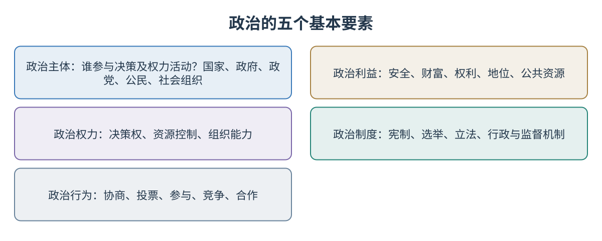
*图 1　政治的五个基本要素*

- 政治主体：谁参与决策及权力活动？国家、政府、政党、公民、社会组织
- 政治利益：安全、财富、权利、地位、公共资源
- 政治权力：决策权、资源控制、组织能力
- 政治制度：宪制、选举、立法、行政与监督机制
- 政治行为：协商、投票、参与、竞争、合作

#### 1.2 政治、政治学与政治哲学

| 概念 | 核心含义 |
|---|---|
| 政治 Politics | 围绕权力、公共事务与集体决策形成的活动 |
| 政治学 Political Science | 系统研究政治现象、制度及行为的学科 |
| 政治理论 Political Theory | 研究政治概念、基本原则及理论解释 |
| 政治哲学 Political Philosophy | 研究政治权威、正义、自由及制度正当性 |
| 政治思想 Political Thought | 历史上形成的政治观念与思想体系 |
| 意识形态 Ideology | 对社会政治秩序形成系统解释及价值主张的思想体系 |
| 政治制度 Political Institutions | 组织和约束政治活动的正式及非正式规则 |

描述性问题：某国政府由哪些机构组成？解释性问题：为什么某项制度会形成并长期存在？规范性问题：这种制度是否具有正当性，应当如何改进？描述事实、解释原因与评价制度不能相互替代。
#### 1.3 Politics、Polity与Policy

*图 2　制度、过程与政策*

- Polity 政治体制：制度、规则、机构
- Politics 政治过程：竞争、协商、权力互动
- Policy 公共政策：决策内容、措施、结果

例如教育改革，Polity 研究权限，Politics 研究支持、反对和协商，Policy 研究具体措施及效果。
#### 1.4 政治学的主要分支

| 分支 | 研究对象 |
|---|---|
| 政治理论 | 权力、正义、合法性与政治思想 |
| 比较政治学 | 不同国家的制度、行为与发展路径 |
| 政治制度研究 | 国家机构、政党、选举及制度设计 |
| 政治行为研究 | 政治态度、参与及决策行为 |
| 政治社会学 | 政治活动与社会结构的关系 |
| 政治经济学 | 权力、制度及经济资源的关系 |
| 公共政策学 | 公共决策的形成、实施及效果 |
| 公共管理学 | 公共机构的组织及运行 |
| 国际政治学 | 国家间权力关系及国际秩序 |
| 政治方法论 | 政治现象的研究、测量及因果分析 |

#### 1.5 政治系统的运行模型

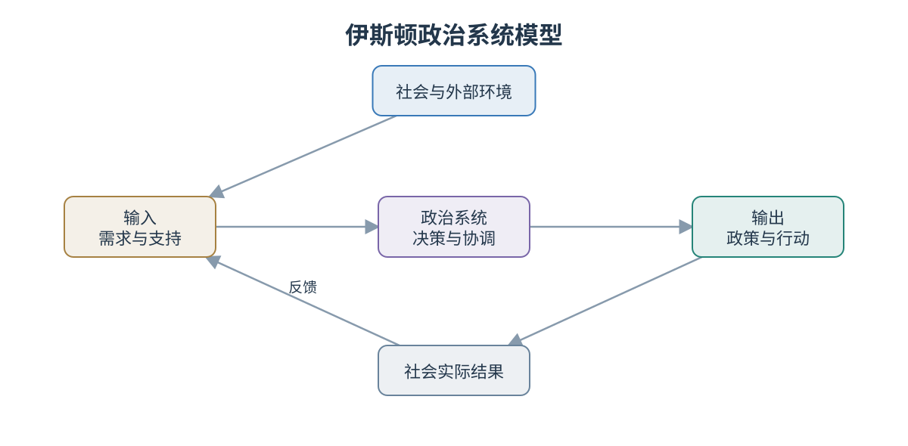
*图 3　伊斯顿政治系统模型*

戴维·伊斯顿（David Easton）将政治体系理解为具有输入、转换、输出与反馈机制的系统。政治决策不是单向过程，而是不断受到社会需求、外部环境及政策结果的影响。
### 第二章　政治权力、权威与影响力
#### 2.1 权力的本质
政治权力（Political Power）是政治主体影响他人行为、集体决策、资源分配或政治结果的能力。控制议程、掌握信息、制定规则及影响认知也可能构成权力。
#### 2.2 权力、权利、权威与强制

| 概念 | 核心含义 |
|---|---|
| 权力 Power | 影响行为及结果的能力 |
| 权利 Right | 主体依据法律或规范享有的地位 |
| 权限 Competence | 制度赋予的特定决策及行动范围 |
| 权威 Authority | 被认可具有正当性的支配或指挥关系 |
| 影响力 Influence | 改变认知、态度或行为的能力 |
| 强制 Coercion | 通过制裁、威胁或强制手段影响行为 |
| 控制 Control | 对资源、过程或行为实际支配 |

正式职位与实际影响力并不完全一致。
#### 2.3 政治权力的来源

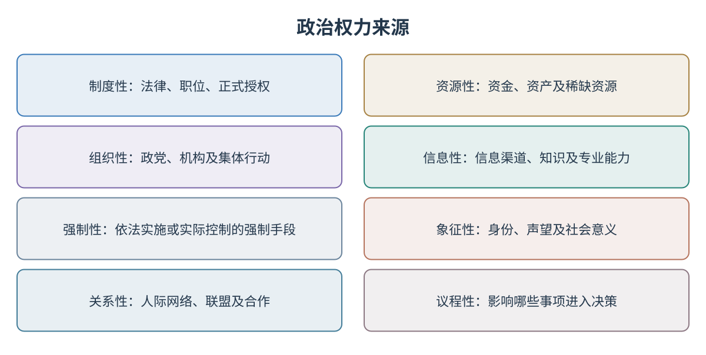
*图 4　政治权力来源*

- 制度性：法律、职位、正式授权
- 资源性：资金、资产及稀缺资源
- 组织性：政党、机构及集体行动
- 信息性：信息渠道、知识及专业能力
- 强制性：依法实施或实际控制的强制手段
- 象征性：身份、声望及社会意义
- 关系性：人际网络、联盟及合作
- 议程性：影响哪些事项进入决策

权力来源可以相互转化，例如社会声望可能转化为组织动员能力。
#### 2.4 权力的三个维度

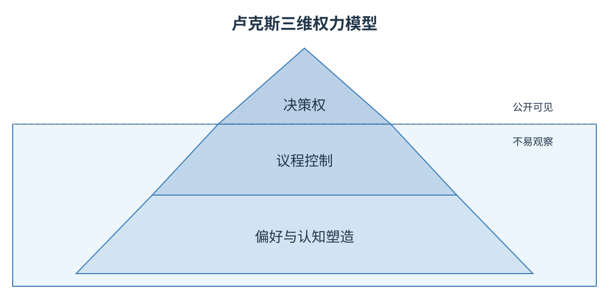
*图 5　卢克斯三维权力模型*

| 维度 | 核心问题 |
|---|---|
| 决策权力 | 公开利益冲突中谁影响最终决定？ |
| 议程权力 | 谁决定哪些问题进入或无法进入决策？ |
| 偏好塑造 | 社会规范、信息及制度如何影响人们对自身利益的理解？ |

第三维度的识别与测量具有理论争议，不能仅因观点受到社会影响就断定存在操纵。
#### 2.5 韦伯的三种权威类型

| 类型 | 认可基础 | 典型表现 |
|---|---|---|
| 传统型 | 长期习俗与传统 | 世袭制度、传统共同体 |
| 魅力型 | 对领导者个人特殊品质的信任 | 个人号召力 |
| 法理型 | 对正式规则与合法职位的认可 | 现代行政组织 |

现实权威通常包含多种成分，而非完全符合一种理想类型。
#### 2.6 硬实力、软实力与国家影响力
硬实力（Hard Power）通过物质力量、经济利益或强制影响行为；软实力（Soft Power）通过吸引力、文化、价值及政策信誉影响偏好；巧实力（Smart Power）综合运用两者。软实力并非所有宣传活动的统称。
### 第三章　政治利益与政治资源
#### 3.1 政治利益的多维分类

| 分类依据 | 主要类型 |
|---|---|
| 利益主体 | 个人、群体、组织、国家利益 |
| 利益范围 | 特定利益、公共利益、跨国共同利益 |
| 利益性质 | 经济、安全、政治、文化利益 |
| 时间维度 | 短期、长期 |
| 表达状态 | 显性、潜在 |
| 相互关系 | 共同、竞争性、冲突性利益 |

公共利益并不一定具有唯一且不受争议的定义。
#### 3.2 政治资源

| 类别 | 内容 |
|---|---|
| 物质 | 财政、资金及物质条件 |
| 制度 | 权限、职位及程序性权利 |
| 组织 | 成员、网络及动员能力 |
| 信息 | 数据、知识、媒体及渠道 |
| 人力 | 人员、专业与领导能力 |
| 信任 | 社会信任、信誉与合作预期 |
| 象征 | 身份、声望及社会认可 |

#### 3.3 利益表达与利益聚合

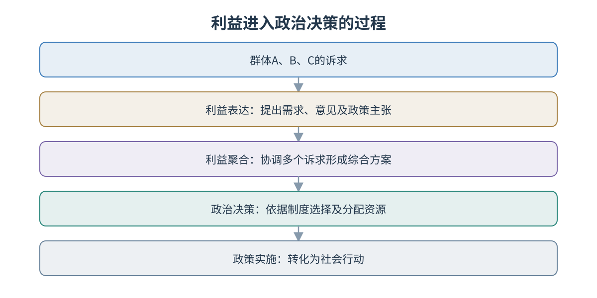
*图 6　利益进入政治决策的过程*

- 群体A、B、C的诉求
- 利益表达：提出需求、意见及政策主张
- 利益聚合：协调多个诉求形成综合方案
- 政治决策：依据制度选择及分配资源
- 政策实施：转化为社会行动

部分利益可能因组织能力、信息条件及制度限制而难以进入议程。
### 第四章　国家、主权与民族
#### 4.1 国家的基本要素

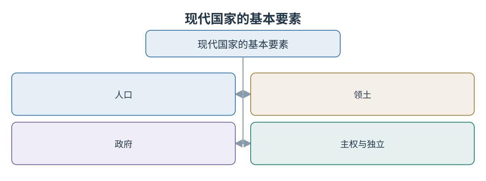
*图 7　现代国家的基本要素*

- 人口
- 领土
- 政府
- 主权与独立

国际法上的国家资格及承认还涉及具体法律问题。
#### 4.2 国家、政府、政权、民族与社会

| 概念 | 核心含义 |
|---|---|
| 国家 State | 具有领土、人口及公共权力体系的政治实体 |
| 政府 Government | 承担公共决策及管理职能的机构体系 |
| 政权或政体 Regime | 权力取得、组织及行使的基本制度安排 |
| 民族 Nation | 具有共同身份认同及历史文化联系的群体 |
| 国民 Citizenry | 具有相应国家公民身份的成员整体 |
| 社会 Society | 人际关系、组织及社会活动体系 |

政府更替不意味着国家消失，国家也不一定只包含一个民族群体。
#### 4.3 国家起源与形成的主要理论

| 理论 | 主要解释角度 |
|---|---|
| 社会契约论 | 共同同意、权利保障及政治义务 |
| 阶级理论 | 社会分化、阶级关系及物质利益 |
| 战争与强制理论 | 军事竞争、财政汲取及强制力量集中 |
| 制度演进理论 | 社会组织、交易及公共事务协调 |
| 历史社会学 | 战争、经济、社会关系及历史条件的结合 |

社会契约论通常首先是政治权威正当性理论，并非所有国家都通过实际签订契约建立。
#### 4.4 国家的主要职能
安全：国防与公共安全；制度：立法、司法、权利确认及实施；经济：财政及监管；社会：教育、医疗、保障与服务；对外：外交及合作；长期发展：基础设施、环境及规划。各国介入范围及实施方式不同。
#### 4.5 主权的不同维度
对内主权：相应政治法律体系中的最高地位；对外主权：国际关系中的独立法律地位；人民主权：人民是权力正当性的重要或最终来源；国家自主性：实际独立决策及实施能力。主权与实际能力不能等同。
### 第五章　政治合法性与政治秩序
#### 5.1 政治合法性的本质
政治合法性（Political Legitimacy）研究权力为何被接受及政治权威是否具有正当依据。

| 概念 | 核心问题 |
|---|---|
| Legality 合法性 | 是否符合法律规定？ |
| Legitimacy 正当性 | 权力是否具有合理依据？ |
| Political Support 政治支持 | 社会成员是否支持制度、机构或领导者？ |
| Political Trust 政治信任 | 是否相信机构能适当履职？ |
| Political Stability 政治稳定 | 制度及秩序能否持续？ |

法律有效性、公众支持与规范正当性不同。
#### 5.2 政治合法性的主要分析维度

*图 8　合法性的分析维度*

- 输入：权力授权、参与及表达
- 过程：规则、程序与监督
- 输出：安全、公共服务及政策成果
- 价值认同：共同价值与身份

#### 5.3 政治秩序与政治稳定
政治秩序是政治活动能够按照相对稳定的规则及关系持续运行的状态。稳定可能受制度适应、绩效、信任、利益协调、经济变化、权力交接及外部环境影响。稳定不等于没有冲突。
#### 5.4 政治信任的反馈机制

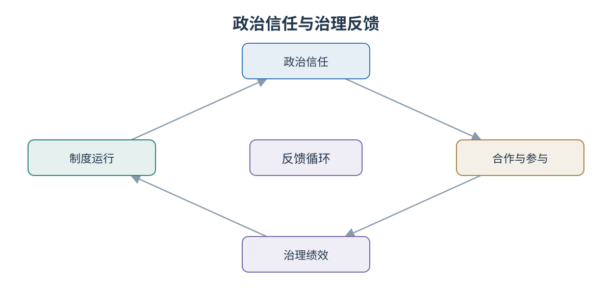
*图 9　政治信任与治理反馈*

- 政治信任
- 合作与参与
- 治理绩效
- 制度运行

这是概念性反馈模型，反映可能的双向关系，并非必然因果规律。

## 第二篇　政治思想与意识形态
### 第六章　政治思想的历史发展
#### 6.1 政治思想的主要历史阶段

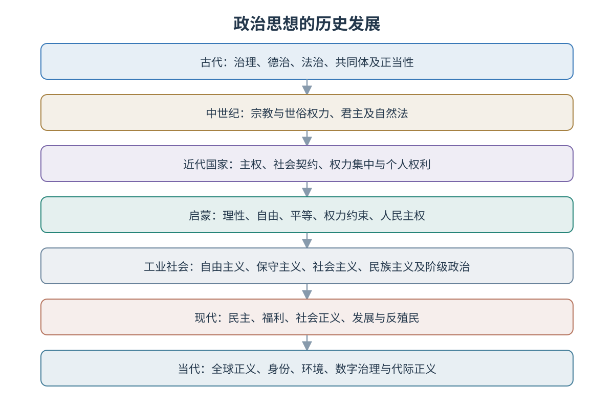
*图 10　政治思想的历史发展*

- 古代：治理、德治、法治、共同体及正当性
- 中世纪：宗教与世俗权力、君主及自然法
- 近代国家：主权、社会契约、权力集中与个人权利
- 启蒙：理性、自由、平等、权力约束、人民主权
- 工业社会：自由主义、保守主义、社会主义、民族主义及阶级政治
- 现代：民主、福利、社会正义、发展与反殖民
- 当代：全球正义、身份、环境、数字治理与代际正义

世界政治思想具有多种文明传统，不存在单一演进路线。
#### 6.2 中国古代政治思想

| 思想传统 | 主要观念 | 代表人物 |
|---|---|---|
| 儒家 | 德治、礼制、仁政、民本及政治伦理 | 孔子、孟子、荀子 |
| 法家 | 法、术、势、制度约束及国家治理 | 商鞅、韩非 |
| 道家 | 无为而治、减少过度干预及顺应自然 | 老子、庄子 |
| 墨家 | 兼爱、非攻、尚贤及公共利益 | 墨子 |
| 黄老思想 | 无为治理与法律制度结合 | 黄老思想传统 |
| 明清政治思想 | 反思君主权力、公共利益及传统制度 | 黄宗羲、顾炎武、王夫之 |

法家的法治观与现代法治不同，民本与现代人民主权也不能直接等同。
#### 6.3 世界主要政治思想家

| 思想家 | 主要理论贡献 |
|---|---|
| 柏拉图 | 理想国家、正义与哲学家治理 |
| 亚里士多德 | 政体分类、公民身份及政治共同体 |
| 西塞罗 | 共和思想、自然法与公共事务 |
| 阿奎那 | 权威、自然法及宗教伦理 |
| 马基雅维利 | 国家权力、政治现实与治理 |
| 让·博丹 | 国家主权 |
| 霍布斯 | 契约、安全及国家权威 |
| 洛克 | 自然权利、财产权及有限政府 |
| 孟德斯鸠 | 政治制度及权力制约 |
| 卢梭 | 人民主权、社会契约及公意 |
| 伯克 | 传统、制度演进及保守主义 |
| 边沁 | 功利主义及制度改革 |
| 密尔 | 个人自由、代议制及参与 |
| 黑格尔 | 国家、自由及伦理生活 |
| 马克思、恩格斯 | 阶级、国家与历史唯物主义 |
| 托克维尔 | 民主社会、组织及多数权力 |
| 韦伯 | 国家、权威、官僚制度 |
| 葛兰西 | 文化领导权、市民社会与政治权力 |
| 甘地 | 非暴力政治行动及自治 |
| 法农 | 殖民主义、民族解放及认同 |
| 阿伦特 | 公共领域、政治行动及极权主义研究 |
| 罗尔斯 | 正义、公平及政治自由主义 |
| 诺齐克 | 个人权利及最小国家 |
| 阿马蒂亚·森 | 能力、自由与社会正义 |

思想主张具有历史背景，不能当作已证实的事实。
### 第七章　主要政治思想与意识形态
#### 7.1 意识形态的基本结构

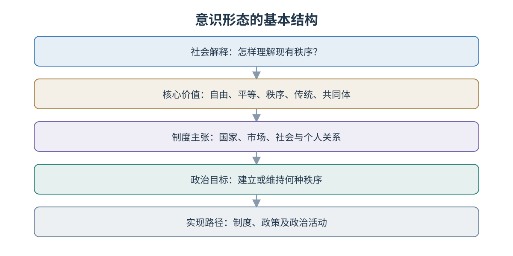
*图 11　意识形态的基本结构*

- 社会解释：怎样理解现有秩序？
- 核心价值：自由、平等、秩序、传统、共同体
- 制度主张：国家、市场、社会与个人关系
- 政治目标：建立或维持何种秩序
- 实现路径：制度、政策及政治活动

#### 7.2 世界主要政治思想与意识形态

| 思想体系 | 核心关注 | 内部流派或方向 |
|---|---|---|
| 自由主义 | 个人自由、权利、权威正当性 | 古典、社会、政治自由主义 |
| 保守主义 | 传统、秩序、制度延续、审慎变革 | 传统、自由、社会保守主义 |
| 社会主义 | 平等、劳动权益、社会所有及经济权力 | 民主社会主义、马克思主义社会主义等 |
| 马克思主义 | 物质生产、阶级、社会结构及历史发展 | 经典及不同理论实践传统 |
| 社会民主主义 | 民主、保障、劳动保护及经济调节 | 福利国家、社会改革 |
| 共和主义 | 公共事务、公民参与、免于任意支配 | 古典及现代共和主义 |
| 民族主义 | 民族认同、共同体及政治自主 | 公民、族裔民族主义 |
| 无政府主义 | 批判强制等级权力及自愿自治 | 互助主义、无政府共产主义 |
| 女性主义 | 性别平等及社会政治权力 | 自由主义、社会主义等理论 |
| 绿色政治 | 可持续性、环境责任及代际正义 | 生态主义、绿色社会思想 |
| 社群主义 | 共同体、社会联系与共同价值 | 共同体及公共伦理理论 |
| 自由意志主义 | 个人自主、产权及限制强制权力 | 左翼、右翼等 |
| 法西斯主义 | 极端民族主义、威权领导及反自由民主 | 历史法西斯运动及制度 |

自由主义、保守主义与社会主义内部存在重要分歧。法西斯主义研究关注历史上的独裁、压制、暴力及极端民族主义的条件与后果。
#### 7.3 马克思主义政治理论的基本知识结构

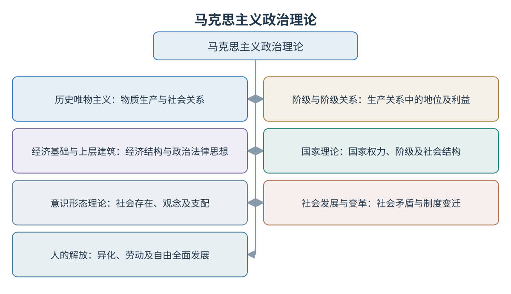
*图 12　马克思主义政治理论*

- 历史唯物主义：物质生产与社会关系
- 阶级与阶级关系：生产关系中的地位及利益
- 经济基础与上层建筑：经济结构与政治法律思想
- 国家理论：国家权力、阶级及社会结构
- 意识形态理论：社会存在、观念及支配
- 社会发展与变革：社会矛盾与制度变迁
- 人的解放：异化、劳动及自由全面发展

经典理论、后续发展、各国制度实践应分别研究。
#### 7.4 自由主义与保守主义的内部差异

| 理论 | 主要侧重 |
|---|---|
| 古典自由主义 | 自由、产权、法治、有限政府 |
| 社会自由主义 | 自由权利、教育、保障及实际机会 |
| 政治自由主义 | 多元价值下的政治合作原则 |
| 传统保守主义 | 历史经验及社会连续性 |
| 自由保守主义 | 市场自由与保守制度观 |
| 社会保守主义 | 传统规范、家庭及文化 |

#### 7.5 左翼、右翼与多维政治光谱

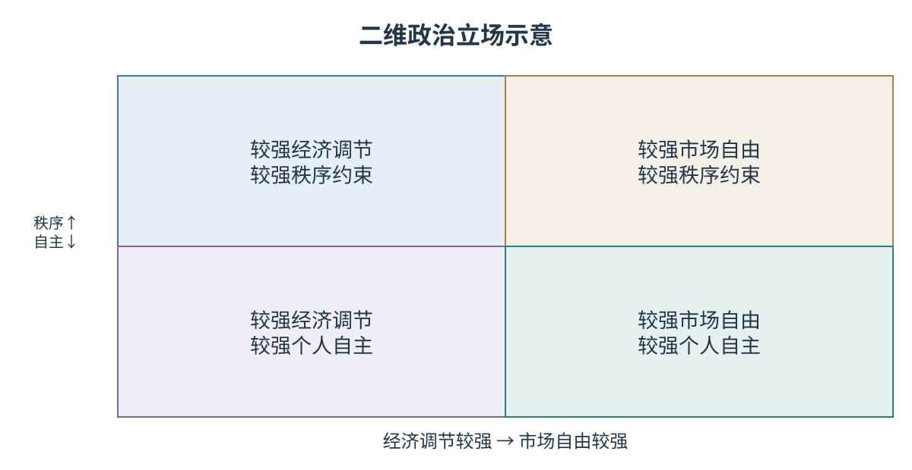
*图 13　二维政治立场示意*

左右翼标签仅提供有限信息。应分别研究经济政策、社会文化、国家权力及国际开放等维度。同一思想名称在不同历史与国家背景中含义不同。图示不用于现实政党或人物评分。
### 第八章　自由、平等、正义与权利
#### 8.1 政治学的核心价值
自由（自主范围）、平等（平等地位）、正义（资源及负担安排）、秩序（稳定安全）、权利（制度保障）、公共利益（共同利益协调）、政治参与（影响决定）、政治责任（权力行使者的责任）。
#### 8.2 自由的主要理论分类

| 类型 | 核心含义 |
|---|---|
| 消极自由 | 免于他人的不当干预 |
| 积极自由 | 实现自主决定及行动能力 |
| 共和主义自由 | 免于任意支配 |

一个人法律上可以接受教育但缺乏资源，可从不同自由理论分析。
#### 8.3 平等的主要类型

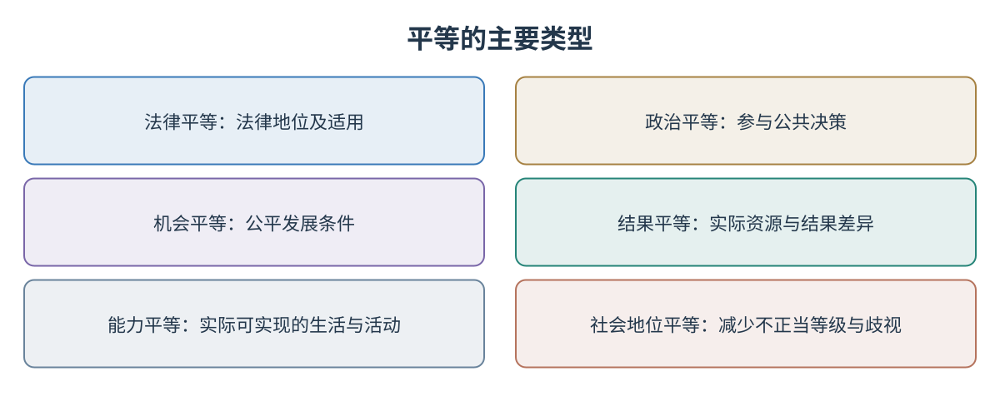
*图 14　平等的主要类型*

- 法律平等：法律地位及适用
- 政治平等：参与公共决策
- 机会平等：公平发展条件
- 结果平等：实际资源与结果差异
- 能力平等：实际可实现的生活与活动
- 社会地位平等：减少不正当等级与歧视

各种平等观念不等价，并不必然要求所有人拥有相同生活结果。
#### 8.4 正义的主要理论

| 理论 | 核心思想 |
|---|---|
| 功利主义 | 总体福利 |
| 权利理论 | 权利不应仅因总体利益被牺牲 |
| 罗尔斯公平正义 | 基本自由、公平机会及最不利者的制度安排 |
| 诺齐克持有正义 | 取得、转让及纠正过程的正当性 |
| 能力进路 | 实际生活选择与能力 |
| 社群主义 | 共同体、社会关系、共同价值 |
| 矫正正义 | 损失、侵害及责任的纠正 |

#### 8.5 罗尔斯的无知之幕

*图 15　无知之幕思想实验*

- 财富阶层、家庭身份、能力健康
- 无知之幕：暂时不知道自己在社会中的具体位置
- 选择社会的基本正义原则

这不是现实政治谈判，而是减少既有优势对基本规则选择影响的思想实验。
### 第九章　政治理论与分析流派
#### 9.1 现代政治学的主要理论流派

| 理论或方法 | 主要分析视角 |
|---|---|
| 传统制度主义 | 宪法、正式机构及政府组织 |
| 行为主义 | 实际政治态度及可观察行为 |
| 理性选择 | 偏好、约束及策略 |
| 历史制度主义 | 历史过程、关键节点、路径依赖 |
| 社会学制度主义 | 规范、文化及组织合法性 |
| 结构功能主义 | 政治体系组成部分及功能 |
| 政治系统理论 | 输入、输出与反馈 |
| 多元主义 | 利益集团竞争与协调 |
| 精英理论 | 关键资源及权力集中 |
| 马克思主义分析 | 阶级、生产关系与经济结构 |
| 建构主义 | 观念、身份、社会意义 |
| 政治心理学 | 情绪、身份、认知 |
| 公共选择 | 激励、公共决策与制度约束 |

#### 9.2 新制度主义的三个主要方向

*图 16　新制度主义*

- 理性选择制度主义：制度改变激励及策略
- 历史制度主义：历史路径与权力关系
- 社会学制度主义：社会规范、文化及身份

#### 9.3 不同理论如何解释同一个政治问题
假设高社会支持度的改革迟迟未实施。制度主义研究否决机构；理性选择研究参与者激励；利益集团理论研究成本收益；历史制度主义研究改变成本；精英理论研究关键资源掌握者；建构主义研究观念与身份；国家能力理论研究实际执行能力。哪种解释成立需要证据。

## 第三篇　国家结构与政治制度
### 第十章　国家结构、政体与政权类型
#### 10.1 政治制度的多维分类

| 分类维度 | 主要类型 | 核心问题 |
|---|---|---|
| 国家结构 | 单一制、联邦制 | 中央地方如何分权？ |
| 国家元首制度 | 共和制、君主制 | 元首如何产生？ |
| 政府组织形式 | 总统制、议会制、半总统制等 | 行政权如何产生及负责？ |
| 政权类型 | 民主、威权及混合类型等 | 权力如何获得、竞争与约束？ |
| 政党制度 | 两党、多党、一党等 | 政党如何组织权力？ |
| 决策机制 | 多数决、协商、共识等 | 集体决定如何形成？ |

中国政治学常用国体与政体：国体研究国家权力的社会性质及归属，政体研究权力组织形式，与 regime、form of government 并非完全对应。
#### 10.2 单一制与联邦制

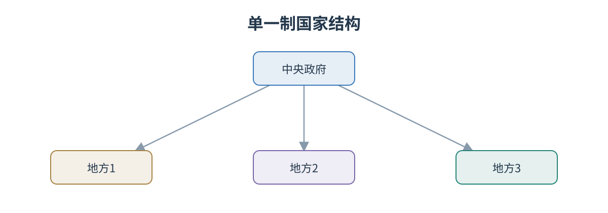
*图 17　单一制国家结构*

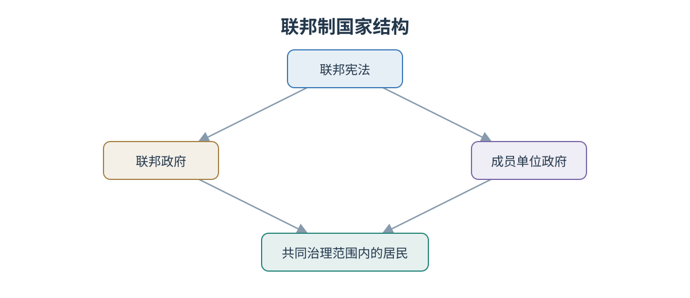
*图 18　联邦制国家结构*

| 维度 | 单一制 | 联邦制 |
|---|---|---|
| 权力结构 | 统一国家权力体系 | 联邦与成员单位宪制分权 |
| 地方权限 | 按国家法律及宪制安排 | 通常具有宪法保障的自治权限 |
| 法律体系 | 通常强调国家法律统一 | 联邦法与成员单位法律可能并存 |
| 实例 | 中国、法国、日本 | 美国、德国、澳大利亚 |

单一制不意味着中央直接管理全部事务，联邦制不意味着中央必然弱小。
#### 10.3 共和制与君主制
共和制：国家元首原则上不由世袭君主制度产生；君主制：元首为君主，通常依据继承等制度产生；君主立宪制：君主权力受宪制限制；绝对君主制：君主拥有广泛实际统治权力。共和制不必然等于民主制度，君主制不必然排斥民主政治。
#### 10.4 总统制、议会制与半总统制

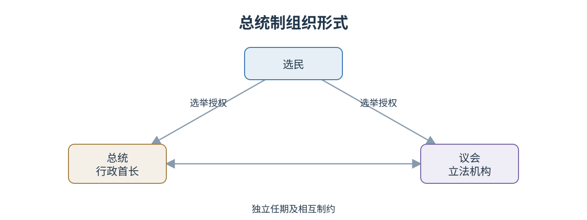
*图 19　总统制组织形式*

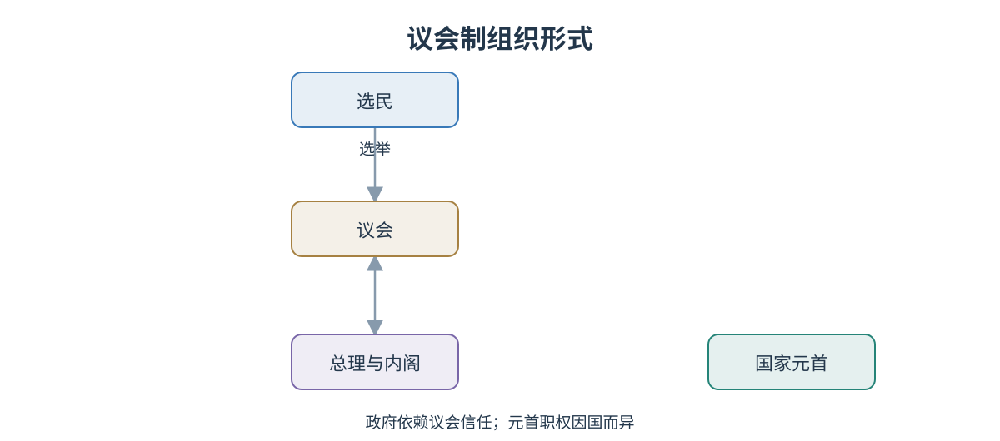
*图 20　议会制组织形式*

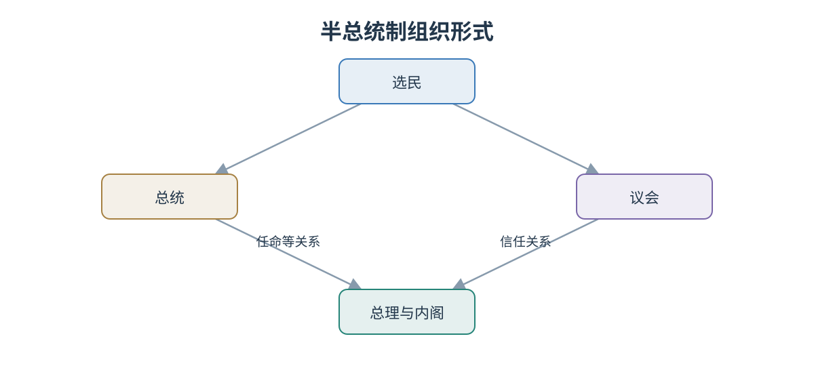
*图 21　半总统制组织形式*

| 维度 | 总统制 | 议会制 | 半总统制 |
|---|---|---|---|
| 行政首长 | 总统 | 总理或首相 | 总理与有实际权力的总统 |
| 政府产生 | 总统具有独立于议会信任的任期授权 | 依赖议会支持 | 总统与议会共同影响 |
| 政府存续 | 通常固定行政任期 | 通常需要维持议会信任 | 总理内阁对议会承担政治责任 |
| 实例 | 美国 | 英国、德国、日本 | 法国 |

中国人民代表大会制度具有不同的国家权力组织结构，不能简单归入上述类型。各国实际任命及责任关系存在差异。
### 第十一章　宪制与权力配置
#### 11.1 宪法与宪制
宪法规定基本制度、机构权限及权利保障；宪制（Constitutional Order）由宪法规范、政治惯例、正式机构及实际实践共同形成。不能只读宪法文本而忽略实际运行。
#### 11.2 国家权力的主要功能

| 功能 | 任务 |
|---|---|
| 立法 | 制定法律规则 |
| 行政 | 实施政策、管理公共事务 |
| 司法 | 依法处理争议及案件 |
| 监督 | 检查权力行使及责任履行 |
| 财政预算 | 决定公共收入及支出 |
| 宪制监督 | 处理基本制度与其他决定的关系 |

#### 11.3 权力分立与制约

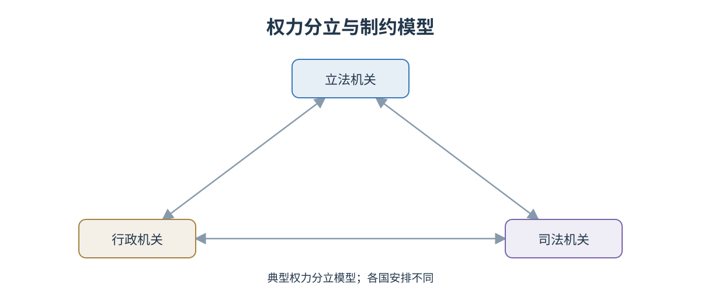
*图 22　权力分立与制约模型*

权力分立不意味着各机构完全没有合作或权限交叉。政府需要同时解决约束、协调及效率问题。
#### 11.4 否决者理论
否决者（Veto Player）是改变现状必须取得其同意的个人或集体行动者。例如法案需要两院通过与元首签署。考察否决者数量、偏好差异及替代机制。否决者较多可能提高政策连续性，也可能增加调整难度，效果取决于制度及政治条件。
### 第十二章　立法制度
#### 12.1 立法机关的主要功能
立法（制定及修改法律）、政治代表（表达及聚合意见）、预算审议、行政监督（质询与调查）、政治人事（依法参与选任或批准）、公共讨论（政策辩论与协商）。
#### 12.2 一院制与两院制

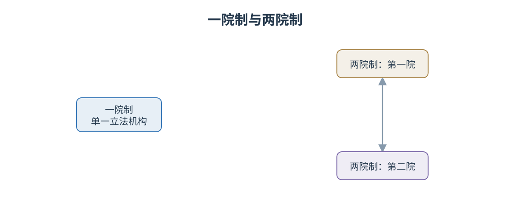
*图 23　一院制与两院制*

两院制可反映地域利益、不同代表基础或提供额外审议机制；各国两院权限不一定相同。
#### 12.3 典型立法过程

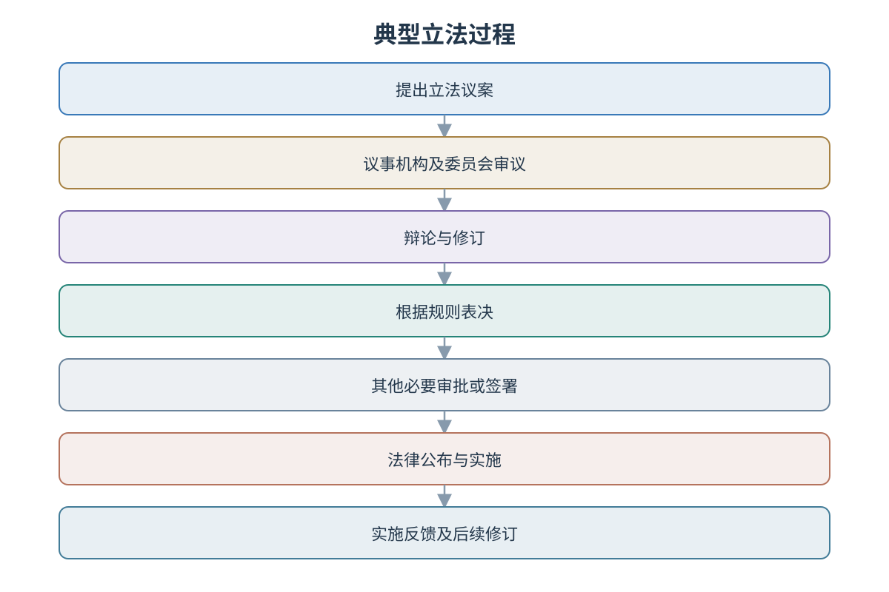
*图 24　典型立法过程*

- 提出立法议案
- 议事机构及委员会审议
- 辩论与修订
- 根据规则表决
- 其他必要审批或签署
- 法律公布与实施
- 实施反馈及后续修订

这是一般比较模型，并非各国统一程序。
### 第十三章　行政制度
#### 13.1 行政权力的基本结构

| 概念 | 主要含义 |
|---|---|
| 国家元首 | 代表国家并履行宪制职能 |
| 政府首脑 | 领导政府及行政政策体系 |
| 内阁 | 高级政府人员组成的决策机构 |
| 行政部门 | 承担特定行政职责 |
| 公务员 | 根据制度履行公共行政职务 |
| 独立监管机构 | 特定授权下相对独立的专业监管机构 |

国家元首不一定是实际行政首长，内阁成员不一定是职业公务员。
#### 13.2 行政权力的组织与运行

*图 25　行政系统的一般组织*

- 行政领导与决策机构
- 经济财政部门、社会公共部门、安全及其他部门
- 专业行政机构与执行人员
- 法律实施、监管及公共服务

#### 13.3 行政裁量与授权
行政机关难以机械执行规则处理所有问题，因此制度可能授予裁量。需考察权限来源、专业判断、资源限制、责任、程序保障及监督。授权能提高专业性和适应能力，但过宽可能导致边界不清与问责困难。
### 第十四章　司法制度与政治监督
#### 14.1 司法制度的政治学研究

| 维度 | 核心问题 |
|---|---|
| 司法组织 | 法院及其他机关如何设置？ |
| 人员产生 | 法官如何选任、任免及负责？ |
| 司法权限 | 哪些事项可以司法处理？ |
| 司法独立 | 如何避免不当干预？ |
| 宪法审查 | 公共决定与宪法关系如何处理？ |
| 裁判实施 | 司法决定能否执行？ |

#### 14.2 政治监督的多维结构

| 监督类型 | 典型机制 |
|---|---|
| 立法监督 | 预算、质询、调查 |
| 行政监督 | 层级监督、内部检查 |
| 司法监督 | 司法审查及救济 |
| 专门监督 | 审计、监察与反腐败机构 |
| 政党监督 | 政党内部或外部监督 |
| 社会监督 | 新闻报道、组织及公众监督 |

具体权限及结论约束力依制度而异。
### 第十五章　中央与地方政治
#### 15.1 集权与分权

*图 26　集权与分权连续谱*

集权与分权研究决策权限在不同层级之间如何配置。不同政策领域可能采取不同程度的集权或分权。
#### 15.2 分权的主要形式

| 形式 | 含义 |
|---|---|
| 行政分权 | 行政事务交由下级机构 |
| 政治分权 | 地方具有政治决策及代表权限 |
| 财政分权 | 公共收入、支出及财政责任划分 |
| 地方自治 | 地方共同体自主处理部分公共事务 |

各类分权并不必然同步。
#### 15.3 中央与地方关系的核心问题
权限、财政资源、公共服务差异、地方创新、跨区域协调及问责。中央制定统一政策的能力不等于地方实施条件相同。
### 第十六章　官僚制度与国家能力
#### 16.1 官僚制
官僚制（Bureaucracy）依靠正式规则、专业分工、层级权限及职业人员运行，并非单纯贬义。韦伯理想类型强调分工、层级、书面规则、专业资格、职业化与非人格化处理。

| 制度优势或目的 | 可能问题 |
|---|---|
| 决策实施连续性 | 组织惯性 |
| 明确权限责任 | 部门推诿 |
| 专业处理事务 | 信息壁垒及专业垄断 |
| 统一程序 | 程序僵化 |
| 减少私人关系影响 | 特殊情境响应不灵活 |

#### 16.2 国家能力的主要维度

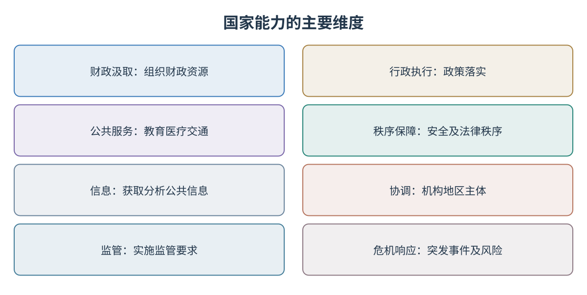
*图 27　国家能力的主要维度*

- 财政汲取：组织财政资源
- 行政执行：政策落实
- 公共服务：教育医疗交通
- 秩序保障：安全及法律秩序
- 信息：获取分析公共信息
- 协调：机构地区主体
- 监管：实施监管要求
- 危机响应：突发事件及风险

#### 16.3 国家能力与国家权力范围

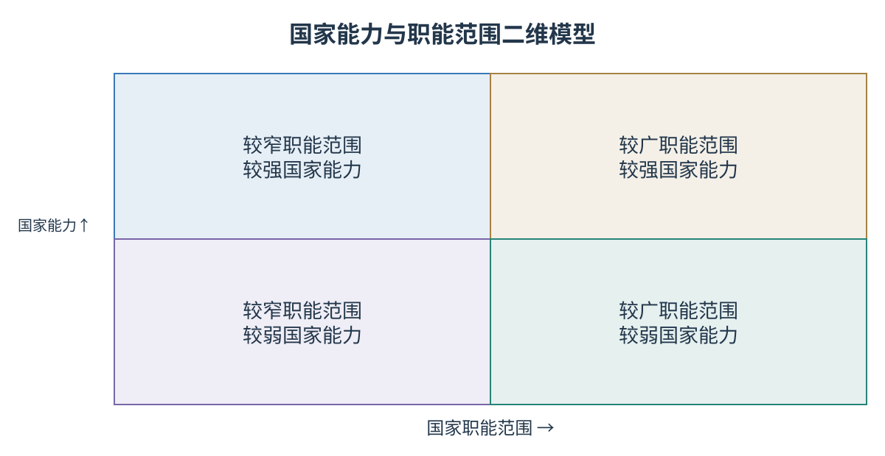
*图 28　国家能力与职能范围二维模型*

权力范围研究政府有权介入哪些事务；国家能力研究实际能否完成任务。扩大职能不自动提高治理能力，缩小职能也不自动提高效率。

## 第四篇　政治主体与政治运行
### 第十七章　政党与政党制度
#### 17.1 政党的本质
政党是围绕政治目标、政策主张、社会利益及权力活动形成的组织。功能包括利益聚合、人员培养与选任、社会动员、政策制定、代表、治理及责任承担。
#### 17.2 政党的组织类型

| 类型 | 主要特征 |
|---|---|
| 干部党 | 政治骨干及精英网络 |
| 群众党 | 广泛成员及组织体系 |
| 全民党或包容型政党 | 跨社会群体支持 |
| 纲领型 | 政策纲领与理念 |
| 庇护型 | 特定资源及支持关系 |
| 运动型 | 社会运动及特定议题 |

这些类别依据不同维度划分，并非互斥。
#### 17.3 政党制度的主要类型

| 类型 | 核心含义 |
|---|---|
| 一党制 | 单一政党具有制度性执政地位，缺乏其他政党竞争性执政渠道 |
| 主导党制 | 多个政党存在，一个长期主导 |
| 两党制 | 两个主要政党占核心地位 |
| 多党制 | 多个政党对权力及政府组成有重要影响 |
| 中国共产党领导的多党合作和政治协商制度 | 具有特定历史及制度基础的政党合作与协商安排 |

中国除中国共产党外还有八个民主党派。正式定位及运行逻辑不同于以竞争执政为主要特征的多党制。
#### 17.4 两党制与多党制的典型运行机制

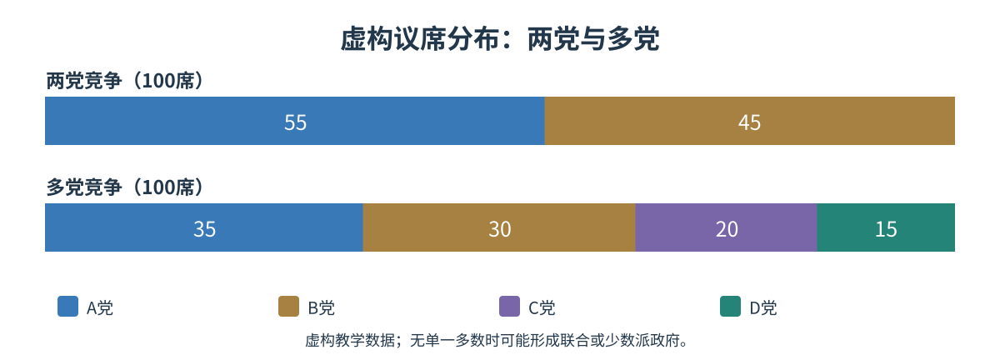
*图 29　虚构议席分布：两党与多党*

假设100席：两党A55、B45；多党A35、B30、C20、D15。无单一多数时可能通过联合政府、少数派政府等形成行政领导。以上均为虚构数据。
#### 17.5 政党联盟与联合政府
政党联盟：围绕选举、立法或其他目标合作；联合政府：多个政党组成政府；多数派政府：拥有议会多数支持；少数派政府：自身没有多数但依靠其他支持维持；反对党：在竞争性制度中承担反对、监督或提出替代政策。议会制中最多席位不必然单独组阁。
### 第十八章　政治精英与政治领导
#### 18.1 政治精英
对重要政治决策、资源及制度运行具有较大影响力的个人或群体。研究权力集中、精英产生机制、成员关系与责任约束，不预设少数人秘密控制一切。
#### 18.2 主要精英理论

| 理论家 | 理论 | 研究内容 |
|---|---|---|
| 帕累托 | 精英循环 | 更替及社会流动 |
| 莫斯卡 | 政治阶级 | 有组织少数与政治统治 |
| 米歇尔斯 | 寡头统治铁律 | 大型组织权力集中倾向 |
| 米尔斯 | 权力精英 | 政治经济军事精英联系 |
| 达尔 | 多元主义 | 不同政治领域多个权力中心竞争 |

#### 18.3 政治精英的产生与流动

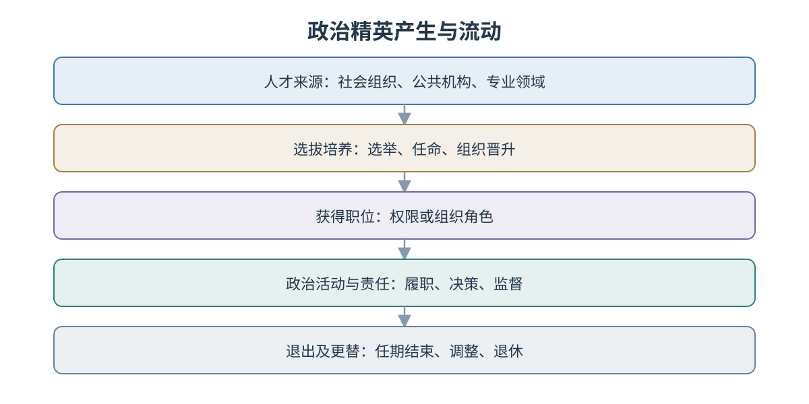
*图 30　政治精英产生与流动*

- 人才来源：社会组织、公共机构、专业领域
- 选拔培养：选举、任命、组织晋升
- 获得职位：权限或组织角色
- 政治活动与责任：履职、决策、监督
- 退出及更替：任期结束、调整、退休

#### 18.4 政治领导的研究维度
除个人特征外还需要分析正式权限、组织支持、信息条件、决策环境、实施能力、责任及权力交接。政治决定常是个人偏好、制度约束及多方互动共同作用的结果。
### 第十九章　利益集团与社会组织
#### 19.1 利益集团
利益集团（Interest Group）是为表达或维护特定利益、影响公共决策形成的群体。类型：商业与行业组织（经营监管）、劳工组织（工资劳动权益）、专业协会（职业标准）、公共利益组织（环境与消费）、地域社区组织、身份文化组织。
#### 19.2 政党与利益集团的区别
政党通常具有综合政治目标、可能直接参与执政权力组织、提出广泛政策纲领；利益集团通常集中于特定利益与议题、通过影响公共决策表达利益。两者可能合作及交叉。
#### 19.3 多元主义与社团主义

| 理论或模式 | 基本思想 |
|---|---|
| 多元主义 Pluralism | 利益集团竞争及协商 |
| 社团主义 Corporatism | 制度化代表机制参与协调 |
| 国家社团主义 | 国家发挥较强组织协调作用 |
| 社会社团主义 | 相对自主的社会组织参与制度化协商 |

现实可能同时包含开放竞争与制度化协商。
#### 19.4 国家与市民社会

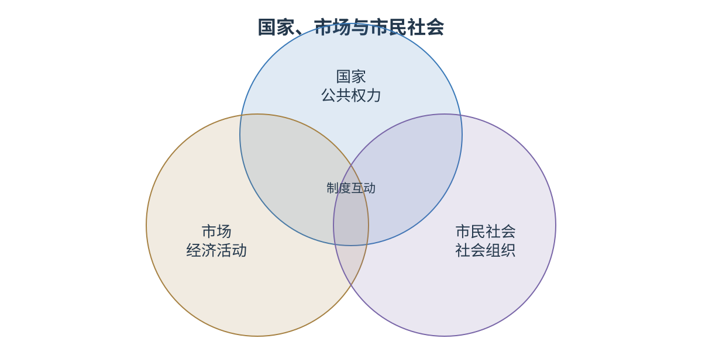
*图 31　国家、市场与市民社会*

市民社会（Civil Society）通常指国家正式权力体系之外的社会组织及公共活动空间，其范围存在理论差异。
### 第二十章　政治文化与政治社会化
#### 20.1 政治文化
社会成员关于政治权力、制度、权利、责任及参与的认知、情感及评价模式，包括政治信任、制度认同、公民责任、权威观念、参与习惯和价值观。
#### 20.2 阿尔蒙德与维巴的政治文化类型
地方型：对国家政治体系认知及参与有限；臣属型：较多认知权威及政策输出，主动输入参与较少；参与型：了解政治体系并重视自身参与。属于理想类型，一个社会成员并非全都相同。
#### 20.3 政治社会化

*图 32　政治社会化的渠道与结果*

- 家庭、学校、同辈群体、媒体、工作组织、公共制度
- 个人政治认知与身份形成
- 政治价值观、政治态度、政治行为

个人也能通过经验和独立思考改变观念。
#### 20.4 政治认同与政治极化

| 概念 | 含义 |
|---|---|
| 政治认同 | 对共同体、制度或理念的归属 |
| 政党认同 | 对特定政党的稳定归属 |
| 意识形态极化 | 群体政策及价值立场差异扩大 |
| 情感极化 | 对其他政治群体情感排斥增强 |
| 政治冷漠 | 缺乏兴趣或参与意愿 |
| 政治效能感 | 对自身理解、参与及影响政治能力的认识 |

政策分歧不必然导致相互敌视。
### 第二十一章　政治参与与政治行为
#### 21.1 政治参与的主要形式
选举参与（投票及选举活动）、协商参与（公共讨论、听证、意见征集）、组织参与（政党、社会团体）、政策表达（建议与诉求）、社区参与、公共监督、社会运动参与。法律条件、渠道与效果因制度而异。
#### 21.2 政治参与的影响因素

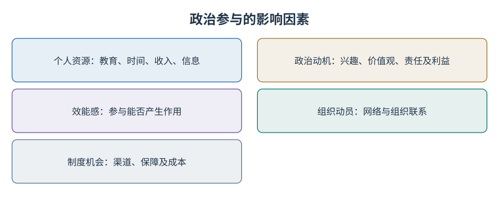
*图 33　政治参与的影响因素*

- 个人资源：教育、时间、收入、信息
- 政治动机：兴趣、价值观、责任及利益
- 效能感：参与能否产生作用
- 组织动员：网络与组织联系
- 制度机会：渠道、保障及成本

#### 21.3 投票行为的主要解释模型

| 理论 | 分析内容 |
|---|---|
| 社会学模型 | 阶层、教育、职业、地域及群体 |
| 政治心理模型 | 政党认同、态度及情感 |
| 理性选择模型 | 政策收益、成本及偏好 |
| 回顾性投票 | 过去执政表现评价 |
| 前瞻性投票 | 未来政策主张及预期 |
| 议题投票 | 特定政策议题及立场 |

不能根据个人社会身份直接确定其政治选择。
### 第二十二章　选举与政治代表制度
#### 22.1 选举的主要功能
选任、授权、代表、竞争、责任追究及交接。仅有选举不说明实际竞争、代表性及责任机制。
#### 22.2 世界主要选举制度

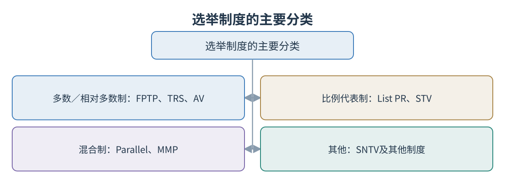
*图 34　选举制度的主要分类*

- 多数／相对多数制：FPTP、TRS、AV
- 比例代表制：List PR、STV
- 混合制：Parallel、MMP
- 其他：SNTV及其他制度

#### 22.3 选票比例与议席比例
假设10个单议席选区各自票数A40%、B35%、C25%。相对多数制下A赢得10席；若全国10席名单比例代表制采用D'Hondt法，则为A4、B4、C2。此为虚构教学数据，不预测实际选举。

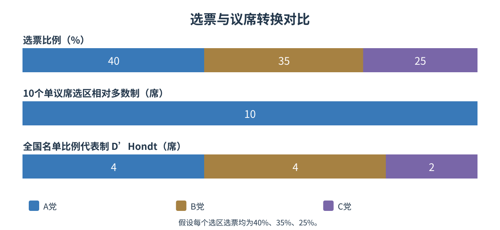
*图 35　选票与议席转换对比*

#### 22.4 D'Hondt议席分配法
设政党选票数为 $V_i$，已分配议席数为 $s_i$，下一席比较值：

$$
q_i=\frac{V_i}{s_i+1}
$$

每次分配给商值最大者并更新议席数。教学模型不含门槛及特殊规则，同商值按A、B、C顺序处理。

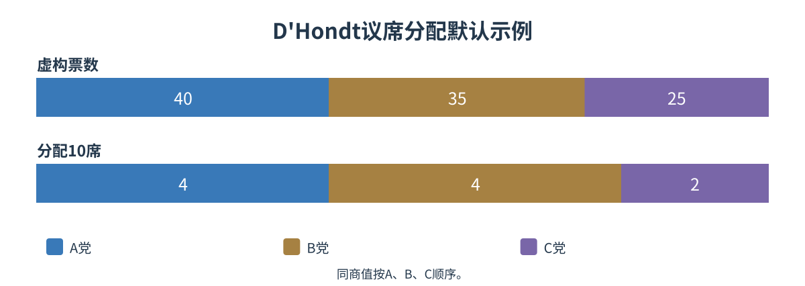
*图 36　D'Hondt议席分配默认示例*

离线交互：[比例代表制议席分配演示（HTML）](#social-politics_dhondt)

#### 22.5 政治代表的主要形式

| 类型 | 含义 |
|---|---|
| 描述性代表 | 在社会属性上反映被代表群体 |
| 实质性代表 | 实际表达和维护利益 |
| 象征性代表 | 具有身份、认同及象征意义 |
| 委托人模式 | 侧重遵循选民意愿 |
| 受托人模式 | 根据自身判断处理公共事务 |

政治代表还研究实际表达及责任承担。
### 第二十三章　政治传播、舆论与议程设置
#### 23.1 政治传播的基本模型

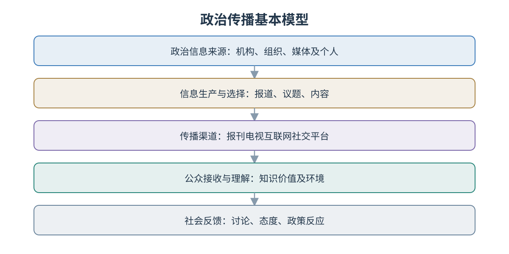
*图 37　政治传播基本模型*

- 政治信息来源：机构、组织、媒体及个人
- 信息生产与选择：报道、议题、内容
- 传播渠道：报刊电视互联网社交平台
- 公众接收与理解：知识价值及环境
- 社会反馈：讨论、态度、政策反应

#### 23.2 政治传播的主要理论

| 理论 | 核心思想 |
|---|---|
| 议程设置 Agenda Setting | 媒体关注可能影响公众认为哪些问题重要 |
| 框架效应 Framing | 呈现方式影响理解 |
| 启动效应 Priming | 突出信息影响评价标准 |
| 把关 Gatekeeping | 信息选择组织传播 |
| 两级传播 | 信息经意见领袖进一步影响成员 |
| 沉默的螺旋 | 意见环境感知影响表达意愿 |
| 选择性接触 | 倾向接触符合既有观点的信息 |

实际效果取决于受众、信息环境及事件。
#### 23.3 议程设置与框架效应的区别

*图 38　同一项公共交通改革*

- 议程设置：是否成为社会重点讨论问题？
- 框架效应：主要被理解为财政、出行便利还是环境问题？

#### 23.4 政治信息的核查框架
区分原始事实、当事方声明、媒体报道、专家解释、价值评论及未经证实信息；核查出处、日期、语境、统计口径、证据链和独立来源。重复传播不等于事实得到证明。

## 第五篇　比较政治与政治发展
### 第二十四章　比较政治学基本原理
#### 24.1 比较政治学的研究对象
比较政治学（Comparative Politics）通过比较国家、地区、制度及历史时期研究政治现象的共同机制与差异，不仅研究制度是什么，也研究为什么形成以及在不同条件下的结果。
#### 24.2 政治制度比较的核心维度

| 维度 | 主要研究问题 |
|---|---|
| 历史基础 | 国家及制度如何形成？ |
| 权力来源 | 权力根据什么机制获得？ |
| 权力配置 | 机构如何分工协调？ |
| 政治代表 | 社会利益如何进入体系？ |
| 政治参与 | 社会成员有哪些渠道？ |
| 权力交接 | 领导者如何产生、更替与退出？ |
| 监督问责 | 如何监督及纠正？ |
| 国家能力 | 政府能否有效实施政策？ |
| 权利保障 | 个人及群体权利如何保护？ |
| 制度适应 | 如何应对社会与外部变化？ |

#### 24.3 比较政治学的两种经典研究设计
最相似系统设计（MSSD）：背景相似而结果不同，寻找可能解释差异的因素。最不同系统设计（MDSD）：背景差异大而结果相似，寻找可能解释共同结果的因素。

| MSSD因素 | 国家A | 国家B |
|---|---|---|
| 经济水平 | 相似 | 相似 |
| 人口结构 | 相似 | 相似 |
| 制度因素X | 存在 | 不存在 |
| 研究结果Y | 出现 | 未出现 |

| MDSD因素 | 国家C | 国家D |
|---|---|---|
| 经济水平 | 较高 | 较低 |
| 历史文化 | 不同 | 不同 |
| 制度因素X | 存在 | 存在 |
| 研究结果Y | 出现 | 出现 |

*图 39　最相似与最不同系统设计*

两种方法帮助提出及检验解释，但不保证排除全部其他原因。
#### 24.4 正式制度与非正式制度
正式制度：宪法、法律及成文程序，由法定组织与程序实施；非正式制度：政治惯例、社会规范及实际行为规则，可能没有明确文本，通过社会期待及组织关系维持。相似宪法并不保证相同政治实践。
### 第二十五章　民主制度及其运行机制
#### 25.1 民主的基本含义
民主（Democracy）源自人民统治的政治观念，现代民主理论研究人民如何参与决策、获得代表、约束权力及实现政治平等。不同理论强调的制度条件不完全相同。
#### 25.2 民主理论的主要类型

| 类型 | 核心研究重点 |
|---|---|
| 直接民主 | 公民直接决定公共事务 |
| 代议民主 | 通过代表参与决策 |
| 选举民主 | 竞争、选举授权及更替 |
| 自由民主 | 选举、个人权利、法治及权力约束 |
| 参与式民主 | 广泛持续参与 |
| 协商民主 | 公共讨论、理由交换及集体判断 |
| 多数民主 | 多数决策及明确政治责任 |
| 共识民主 | 权力分享、协商及多元代表 |
| 平等主义民主 | 参与所需实际平等条件 |

中国官方提出全过程人民民主，强调选举、协商、决策、管理与监督等环节的参与；研究应分别考察官方理论、正式制度与实际运行。
#### 25.3 达尔的多头政体理论

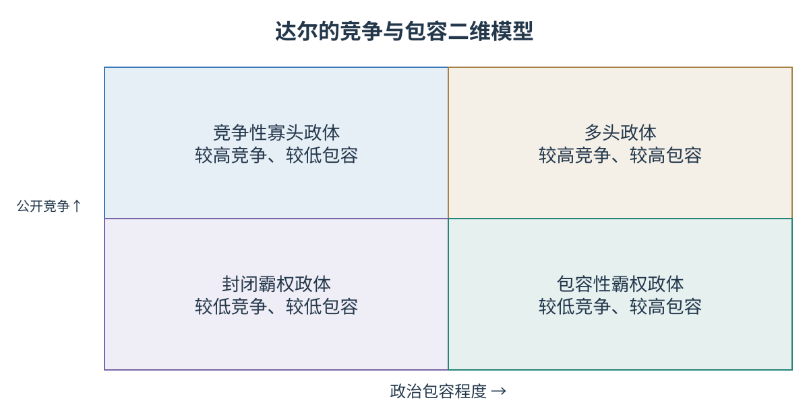
*图 40　达尔的竞争与包容二维模型*

罗伯特·达尔（Robert Dahl）以政治竞争程度及政治包容程度研究现实制度。竞争性寡头政体（高竞争、低包容）、多头政体（高竞争、高包容）、封闭霸权政体（低竞争、低包容）、包容性霸权政体（低竞争、高包容）。不对现实国家定位。
#### 25.4 民主的多维测量

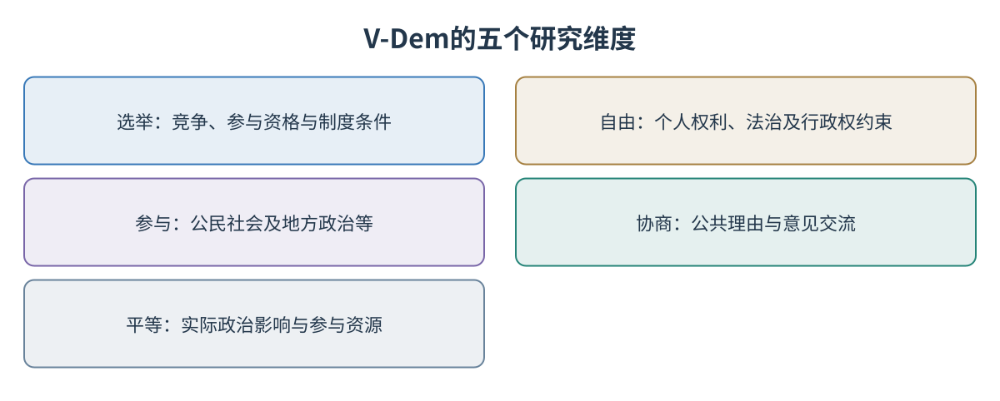
*图 41　V-Dem的五个研究维度*

- 选举：竞争、参与资格与制度条件
- 自由：个人权利、法治及行政权约束
- 参与：公民社会及地方政治等
- 协商：公共理由与意见交流
- 平等：实际政治影响与参与资源

指标是特定理论与测量方法下的研究工具，不替代具体制度分析。
### 第二十六章　非民主政体与混合政体研究
#### 26.1 比较政治学中的政权分类

| 类型 | 主要研究特征 |
|---|---|
| 民主政体 | 按相关理论标准具有制度化竞争、参与及授权机制 |
| 威权政体 | 政治竞争或更替受实质限制，权力相对集中 |
| 极权政体 | 经典理论中权力高度集中、广泛政治控制及强烈意识形态动员 |
| 混合政体 | 同时具有部分竞争性制度与限制竞争机制 |

具体国家分类需明确理论、历史时期及证据。
#### 26.2 威权政体的内部类型
军事政体：军事组织为核心；个人化政体：领导者权力较集中；政党型：政党为运行基础；君主型：君主及王室具有重要地位；混合型：多种组织特征并存。形成及权力交接机制可显著不同。
#### 26.3 威权政治与极权政治的区别
极权研究尤其强调权力向社会领域深入延伸、全面动员及高度集中的意识形态控制；威权是更广泛的分析类别。不能将术语作为情绪化标签。
#### 26.4 政体与治理绩效的区别

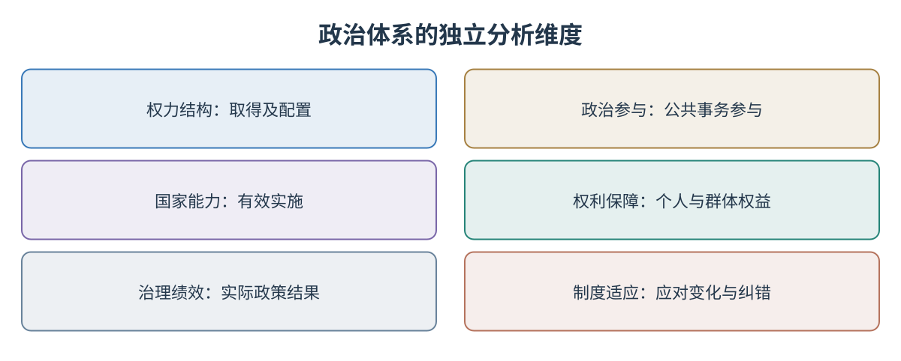
*图 42　政治体系的独立分析维度*

- 权力结构：取得及配置
- 政治参与：公共事务参与
- 国家能力：有效实施
- 权利保障：个人与群体权益
- 治理绩效：实际政策结果
- 制度适应：应对变化与纠错

不能只凭增长率、基建规模或一次选举判断全部制度。
### 第二十七章　政治发展与制度变迁
#### 27.1 政治发展的主要内容
国家建构（公共权力与国家组织）、政治制度化（规则及组织稳定）、政治现代化（工业化城市化带来的调整）、政治参与发展、行政专业化、政治权利发展、政治体系适应。各国不必沿同一路径。
#### 27.2 政治发展的主要解释理论

| 理论 | 主要解释方向 |
|---|---|
| 现代化理论 | 经济社会发展、教育、城市化与政治变化 |
| 依附理论 | 国际经济结构与不平等发展 |
| 国家中心理论 | 国家组织、能力与自主性 |
| 历史制度主义 | 关键节点、积累及路径依赖 |
| 精英协商理论 | 精英冲突、合作及协议 |
| 社会运动理论 | 动员、组织及集体行动 |

经济发展与政治变化并非确定、无条件关系。
#### 27.3 路径依赖与关键节点

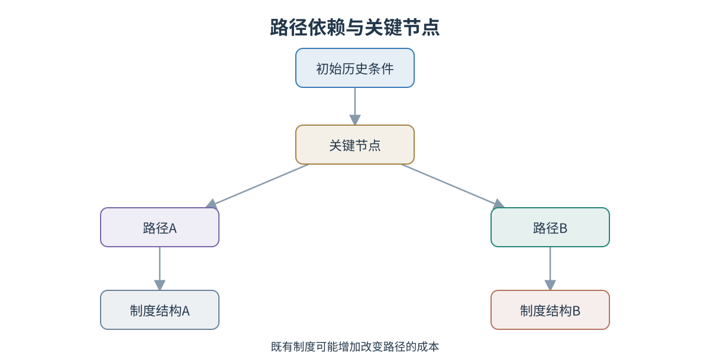
*图 43　路径依赖与关键节点*

既有法律、组织、公共投资、利益分布及行为预期影响未来改革成本。路径依赖不等于永远无法改变。
#### 27.4 制度变迁的主要形式

| 形式 | 特点 |
|---|---|
| 渐进改革 | 连续调整 |
| 制度替换 | 新制度取代旧制度 |
| 制度叠加 | 既有制度上增加新规则 |
| 制度转换 | 原机构或规则用于新目的 |
| 制度漂移 | 环境变化使原规则产生不同效果 |
| 政治转型 | 基本权力结构发生重要变化 |

### 第二十八章　政治冲突、革命与社会运动
#### 28.1 政治冲突的主要来源
资源分配、权力竞争、价值差异、身份、地域利益、代表不足与政策方向分歧。冲突不必然是暴力，辩论、谈判、选举及司法也能处理冲突。
#### 28.2 政治冲突的不同形态

| 概念 | 区别 |
|---|---|
| 政治竞争 | 围绕权力或政策竞争 |
| 社会运动 | 持续集体行动表达诉求 |
| 政治改革 | 在一定制度框架内调整规则机构 |
| 政治革命 | 权力及社会制度根本变革 |
| 政变 | 非常规方式改变政治领导或夺取国家权力 |
| 内战 | 国内达到一定组织及强度条件的武装冲突 |

具体事件须依据事实及研究定义分类。
#### 28.3 社会运动的主要研究理论
相对剥夺（预期与实际差距）、资源动员（组织、资金与网络）、政治过程（环境与机会）、框架（理解与表达问题）、集体认同（共同身份与归属）。用于解释行为，并非成功或发生的必然公式。
#### 28.4 政治冲突的制度化解决

*图 44　公共利益或政治诉求发生冲突*

- 协商与谈判：共同接受方案
- 政治代表：利益进入决策
- 法律与司法：依据规范处理争议
- 政策调整：处理实际问题
- 形成决定：实施及监督

### 第二十九章　世界主要国家政治制度比较
本章关注正式宪制结构，不作国家优劣排名。
#### 29.1 主要国家的国家权力组织形式

| 国家 | 正式宪制结构与行政组织 |
|---|---|
| 中国 | 人民代表大会制度；国务院为最高国家行政机关；中国共产党领导的多党合作和政治协商制度 |
| 美国 | 联邦宪制下立法、行政及司法三大分支，总统领导联邦行政体系 |
| 英国 | 君主立宪及议会政府，政府存续需要下议院信任 |
| 法国 | 第五共和国；总统任命总理，总统、政府、议会有特定权限及责任 |
| 德国 | 联邦议会制；联邦议院选举联邦总理，联邦总统任命 |
| 新加坡 | 议会政府，总统为元首，总理领导内阁，总统具有特定宪制职权 |

正式制度与实际运行应分别研究。原始资料见附录七。
#### 29.2 中国政治制度的基本组织框架

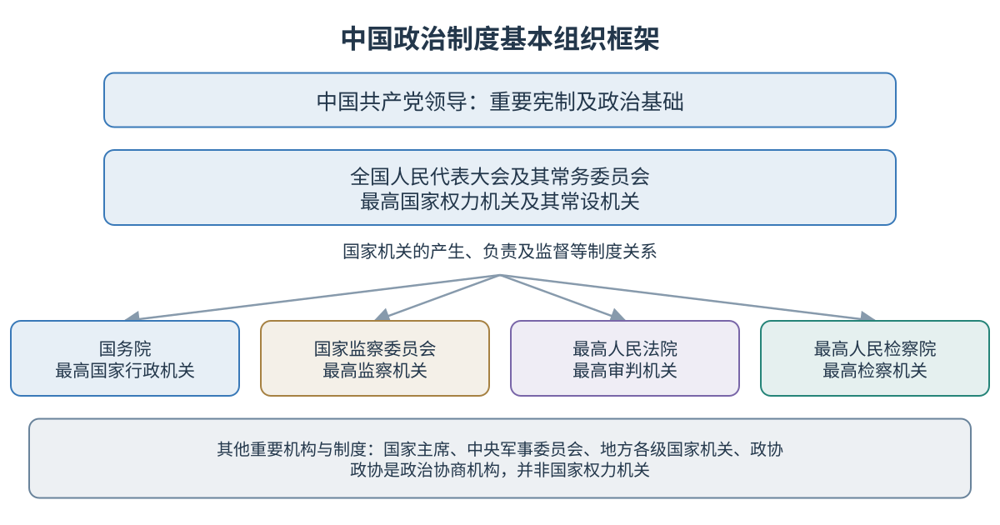
*图 45　中国政治制度基本组织框架*

全国人大为最高国家权力机关，全国人大常委会为其常设机关；国务院为最高国家行政机关，国家监察委员会为最高监察机关，最高人民法院为最高审判机关，最高人民检察院为最高检察机关。其他重要制度包括国家主席、中央军委、地方各级国家机关及政协。中国共产党领导是中国政治制度的重要宪制及政治基础。政协是政治协商机构，并非国家权力机关。图为简化框架，不是完整党和国家机构隶属图。
进一步研究代表产生、党和国家领导体制、中央地方关系、民族区域自治、基层群众自治、特别行政区制度。
#### 29.3 美国政治制度的基本组织框架

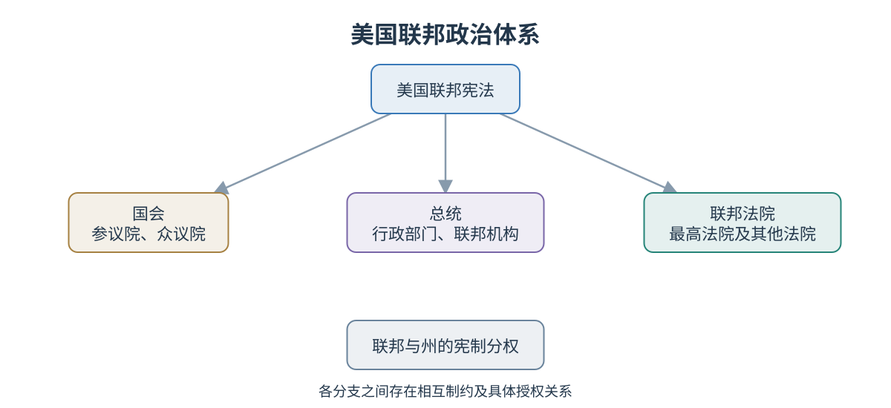
*图 46　美国联邦政治体系*

美国国会（参议院、众议院）、总统（行政部门、联邦机构）、联邦法院（最高法院、其他联邦法院）分别承担立法、行政及司法职能，并存在相互制约；联邦与州之间有宪制分权。进一步研究选举人团、国会选举、司法审查、政党及利益集团。
#### 29.4 英国、法国与德国的主要比较方向

| 维度 | 英国 | 法国 | 德国 |
|---|---|---|---|
| 国家元首 | 君主 | 总统 | 联邦总统 |
| 政府首脑 | 首相 | 总理 | 联邦总理 |
| 行政结构 | 首相及内阁 | 总统、总理及政府 | 联邦总理及内阁 |
| 与议会关系 | 依赖下议院信任 | 政府对议会承担相应责任 | 总理由联邦议院选举产生 |

相同或相近的机构名称在不同国家可能具有不同实际权限。

## 第六篇　公共治理与政治经济
### 第三十章　公共政策与政策过程
#### 30.1 公共政策的基本含义
公共权力主体为处理社会问题、实现公共目标形成的行动安排，可体现为法律、行政规范、财政支出、公共服务、监管措施或特定情况下不干预的决定。
#### 30.2 公共政策的主要分类

| 分类依据 | 类型 |
|---|---|
| 领域 | 经济、教育、医疗、住房、环境、科技、安全等 |
| 作用 | 分配性、再分配性、规制性、构成性 |
| 层级 | 国家、区域、地方 |
| 时间 | 短期、中长期 |
| 工具 | 法律规制、财政激励、服务、信息等 |

#### 30.3 公共政策的生命周期

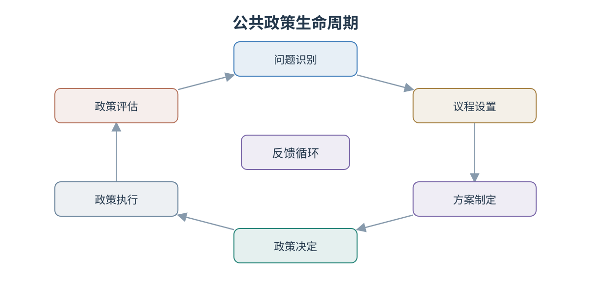
*图 47　公共政策生命周期*

- 问题识别
- 议程设置
- 方案制定
- 政策决定
- 政策执行
- 政策评估

持续反馈、修订或终止。现实过程可能反复协商、阶段重叠及并行调整。
#### 30.4 政策工具

| 工具 | 作用机制 | 示例 |
|---|---|---|
| 法律规制 | 规则约束行为 | 产品安全标准 |
| 财政税收 | 改变成本收益 | 税收、补贴 |
| 公共服务 | 直接供给 | 公共交通 |
| 信息 | 改善信息条件 | 风险提示、披露 |
| 市场化 | 市场机制实现目标 | 排放交易 |
| 自愿合作 | 协商或承诺 | 行业合作及自律 |
| 行为干预 | 调整选择环境 | 简化行政服务 |

需考虑有效性、法律依据、成本、分配及权利保障。
#### 30.5 公共政策形成的主要理论

| 理论 | 核心思想 |
|---|---|
| 理性综合 | 比较问题、目标、方案与预期结果 |
| 有限理性 | 信息、认知与时间限制 |
| 渐进主义 | 既有制度基础上调整 |
| 多源流 | 问题、政策方案与政治环境结合可能推动变化 |
| 倡议联盟 | 共同政策信念的主体长期互动 |
| 间断均衡 | 长期稳定与阶段性快速变化转换 |

#### 30.6 政策评估

*图 48　公共政策逻辑模型*

- 投入：资金、人员
- 活动：政策实施
- 产出：服务数量
- 结果：社会变化

| 评估维度 | 核心问题 |
|---|---|
| 相关性 | 是否针对真实重要问题？ |
| 有效性 | 是否实现目标？ |
| 效率 | 投入与结果的关系？ |
| 公平性 | 各群体承担成本与获益？ |
| 可持续性 | 效果能否长期维持？ |
| 外部影响 | 其他正负后果？ |
| 合法性与可实施性 | 法律依据及执行条件？ |

长期影响须识别其他因素与因果机制。OECD政策评估研究强调系统评价设计、实施及效果。
### 第三十一章　政治决策与集体行动
#### 31.1 政治决策的主要约束
信息、时间、财政资源、法律权限、组织协调、公众诉求及长期目标。须研究有效方案及制度可行性。
#### 31.2 集体行动困境
个体根据自身利益作出选择，可能导致集体无法实现共同目标。公共利益：共同获益目标；搭便车：享受成果却不愿承担成本；公地悲剧：缺乏适当制度时共同资源可能过度使用；协调困境：希望合作却难统一行动；承诺困境：难确信他方履约。
#### 31.3 囚徒困境模型

| A / B | B合作 | B不合作 |
|---|---|---|
| A合作 | (3, 3) | (0, 5) |
| A不合作 | (5, 0) | (1, 1) |

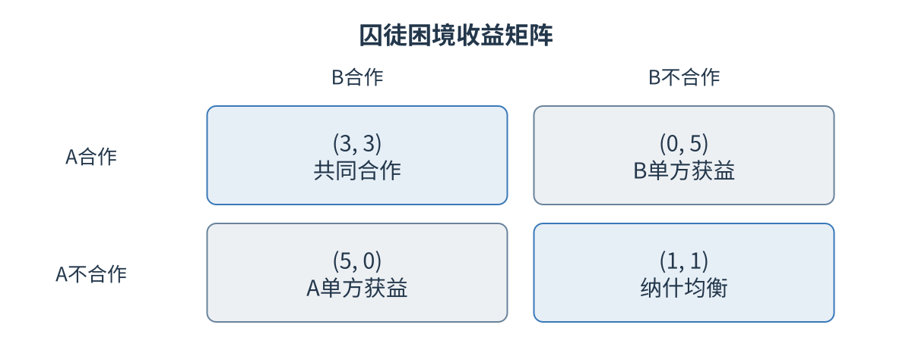
*图 49　囚徒困境收益矩阵*

虚构收益。一次性博弈中双方不合作是纳什均衡，但共同合作能产生更高的双方收益。重复互动、可信承诺、监督及规则可能改善困境。
#### 31.4 奥斯特罗姆的共同资源治理

| 设计原则 | 含义 |
|---|---|
| 边界明确 | 资源范围及使用者明确 |
| 规则适应当地条件 | 规则符合环境 |
| 集体选择 | 使用者可参与制定规则 |
| 监督机制 | 监督使用及遵守 |
| 渐进制裁 | 按违规情况采取措施 |
| 纠纷解决 | 相对低成本的争议处理 |
| 自组织权利 | 组织权利获承认 |
| 嵌套式治理 | 大规模系统多层级协调 |

原则提供分析工具，并非成功保证。
#### 31.5 集体偏好与投票悖论

| 决策者 | 第一选择 | 第二选择 | 第三选择 |
|---|---|---|---|
| 甲 | A | B | C |
| 乙 | B | C | A |
| 丙 | C | A | B |

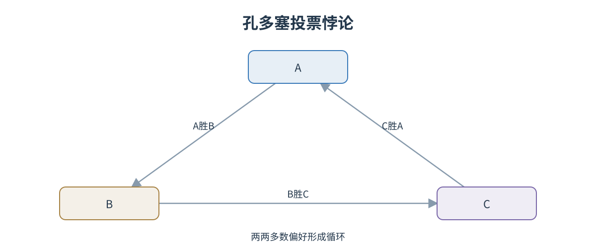
*图 50　孔多塞投票悖论*

两两多数决：A胜B，B胜C，C胜A。个人偏好传递，但集体结果可能循环。阿罗不可能定理说明，在三个及以上选项的标准社会选择框架下，不存在同时满足一组特定合理性条件的通用社会福利排序规则。集体决策还取决于汇总规则。
### 第三十二章　国家治理与公共管理
#### 32.1 统治、管理、治理与善治

| 概念 | 含义 |
|---|---|
| 政治统治 | 维持权力关系及秩序 |
| 公共管理 | 组织公共资源人员及机构 |
| 国家治理 | 通过制度及多种机制处理国家事务 |
| 社会治理 | 协调社会主体与公共事务 |
| 全球治理 | 缺乏统一世界政府时协调跨国问题 |
| 善治 Good Governance | 治理质量与正当性的规范性概念 |

#### 32.2 公共治理的主要模式
传统公共行政（层级、规则、责任）；新公共管理（绩效、效率、市场化）；新公共治理（跨组织、网络协调）；公共价值治理（社会价值及正当性）；数字治理（技术改善公共服务）；协同治理（多主体制度化合作）。可同时存在。
#### 32.3 多主体公共治理结构

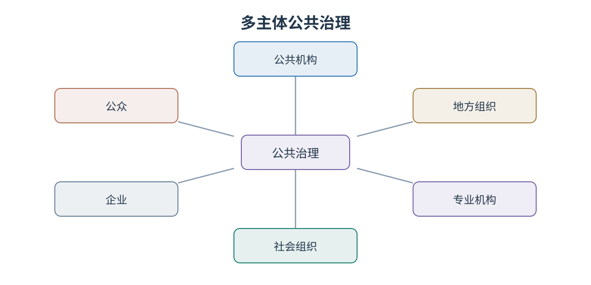
*图 51　多主体公共治理*

- 公共机构
- 地方组织
- 专业机构
- 社会组织
- 企业
- 公众

各主体正式权限、责任及影响力不同。
#### 32.4 公共治理的质量评价

| 世界银行WGI维度 | 测量方向 |
|---|---|
| 话语权与问责 | 公民参与及问责条件 |
| 政治稳定 | 政治不稳定与暴力风险 |
| 政府效能 | 公共服务、行政与政策实施 |
| 监管质量 | 制定实施监管政策 |
| 法治 | 对规则及制度的信任遵守 |
| 腐败控制 | 公共权力用于私人利益的问题 |

综合指标依调查及专家评价等资料，存在测量误差与数据限制，不是最终结论。
### 第三十三章　政治经济学与国家市场关系
#### 33.1 政治经济学的核心问题
研究政治权力、经济资源、社会利益与制度相互关系：谁制定经济规则，财政如何筹集分配，社会群体如何影响政策，经济结构如何改变权力，制度如何影响产权、竞争及长期发展。
#### 33.2 政治与经济关系的基本循环

*图 52　政治经济制度反馈*

- 政治制度
- 经济规则
- 资源及财富分布
- 政治利益与力量

经济实力可以影响政治资源分布，制度通过法律、税收、监管及投资影响资源配置。
#### 33.3 政治经济学的主要理论传统

| 理论 | 研究重点 |
|---|---|
| 古典政治经济学 | 财富、分配、劳动、市场与国家 |
| 马克思主义政治经济学 | 生产关系、资本、劳动、阶级 |
| 新制度经济学 | 产权、交易成本及制度演进 |
| 公共选择 | 个人激励及集体选择 |
| 发展型国家 | 国家能力、产业政策与发展 |
| 比较资本主义 | 市场经济制度与企业协调机制 |
| 国际政治经济学 | 国际权力、贸易、金融及发展结构 |

#### 33.4 国家与市场的制度关系
市场竞争（价格与供需）、公共供给、产业政策、社会保障、财政再分配、市场监管、公私合作。关注制度与干预方式，不只是政府干预多或少；实际经济并非两个极端之一。
#### 33.5 寻租与利益分配

| 概念 | 核心区别 |
|---|---|
| 生产性经营 | 产品服务及创新创造价值 |
| 经济租 | 超过资源维持当前用途所需报酬的收益 |
| 寻租 | 影响规则或获取特权争取收益，可能没有相应社会价值创造 |
| 腐败 | 滥用受托权力谋取私人利益等 |
| 监管俘获 | 监管决策受被监管利益不当支配或影响 |

经济租不必然违法，合法利益表达不必然腐败。
#### 33.6 公共财政与政治责任
研究收入来源、预算权限、支出方向、透明度、债务责任与社会成本分配。预算反映资源配置优先方向，但支出与政策效果不同。
### 第三十四章　政治监督、腐败与问责
#### 34.1 政治问责的含义
政治问责（Political Accountability）研究权力行使者是否解释行为、接受审查及承担责任，包括说明责任（Answerability）和纠正及后果机制（Enforcement）。仅披露信息未必构成完整问责。
#### 34.2 问责的主要类型

*图 53　政治问责类型*

- 纵向：公众与权力行使者之间的授权参与监督
- 横向：国家机构之间法定监督与约束
- 社会：媒体、组织及公众监督
- 内部：机构及组织内部责任机制

#### 34.3 腐败的主要研究类型

| 类型 | 核心含义 |
|---|---|
| 贿赂 | 不当利益交换影响职务行为 |
| 公共资产侵占 | 不当占有使用公共财产 |
| 权力寻租 | 利用公共权力获取不当特殊利益 |
| 任人唯亲 | 私人关系不当替代选任标准 |
| 利益冲突 | 公共职责与私人利益可能影响判断的冲突 |
| 庇护主义 | 特定利益交换维系政治支持 |
| 监管俘获 | 监管受特殊利益不当支配 |

利益冲突是风险状态，不自动证明腐败。
#### 34.4 腐败的制度分析
公共权力范围、裁量、透明度、监督、责任、组织规范及个人激励共同影响风险。垄断性权力、裁量权与问责机制的概念关系并非严格数学预测模型。
#### 34.5 公共监督的主要制度工具
财政审计、信息公开、利益申报、行政程序、司法救济、监察与纪律制度、举报人保护、专门监督机构。监督自身亦需明确权限、程序与责任。

## 第七篇　国际政治与全球秩序
本篇整理国家间权力关系、国际制度及全球秩序基础理论；外交、国际安全、地区政治及国际政治经济可在国际关系学进一步展开。
### 第三十五章　国际政治基本理论
#### 35.1 国内政治与国际政治

| 维度 | 国内政治 | 国际政治 |
|---|---|---|
| 主体 | 政府、政党、公民及社会组织 | 国家、国际组织及非国家行为体 |
| 权力结构 | 相对集中的国家权力 | 总体不存在统一世界政府 |
| 制度基础 | 国内宪法、法律及制度 | 国际法、国际组织及国家间制度 |
| 安全机制 | 公共安全及法律实施 | 国防、联盟、合作与集体安全 |
| 利益关系 | 国内群体利益协调 | 国家及跨国主体竞争与合作 |

无政府状态（Anarchy）指不存在高于所有主权国家的统一最高政治权威，并非没有规则与秩序。
#### 35.2 国际政治的三个分析层次

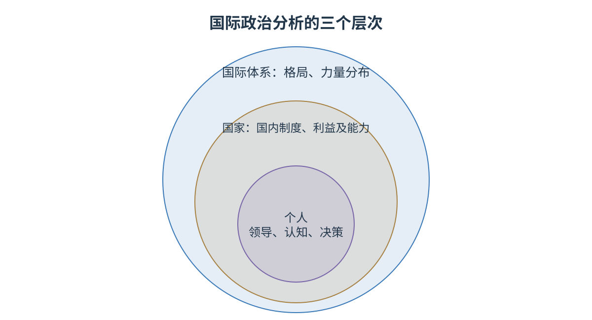
*图 54　国际政治分析的三个层次*

国际体系层次：格局、力量分布；国家层次：国内制度、利益及能力；个人层次：领导、认知及决策。一个事件可能同时受多层因素影响，也可进一步研究组织、地区及跨国网络。
#### 35.3 国际关系的主要理论流派

| 理论 | 核心关注 |
|---|---|
| 现实主义 | 安全、权力、竞争及体系约束 |
| 新现实主义 | 体系结构及力量分布 |
| 自由主义 | 合作、国内制度、经济联系及共同利益 |
| 新自由制度主义 | 国际制度降低合作成本及不确定性 |
| 建构主义 | 身份、观念、规范与社会意义 |
| 英国学派 | 国际体系、国际社会及共同规则 |
| 马克思主义国际关系理论 | 国际资本主义、阶级及全球不平等 |
| 世界体系理论 | 核心、半边缘与边缘的结构关系 |
| 女性主义国际关系理论 | 性别、权力与安全 |
| 后殖民理论 | 殖民历史、知识权力与国际秩序 |

#### 35.4 三种主要理论的比较

| 维度 | 现实主义 | 自由主义 | 建构主义 |
|---|---|---|---|
| 重点 | 权力与安全 | 合作与制度 | 观念与身份 |
| 行为解释 | 安全利益、能力、竞争压力 | 国内偏好、利益互动、国际规则 | 身份、规范及意义结构 |
| 合作 | 限制及相对收益 | 共同收益及合作机制 | 信任、身份及规范变化 |
| 秩序变化 | 权力分布变化 | 制度及相互依赖变化 | 观念及社会关系变化 |

三者不必相互排斥，不能代表整个学科。
#### 35.5 国际体系的权力结构

*图 55　国际体系单极、两极与多极*

单极：一个主要权力中心；两极：两个主要中心；多极：多个主要中心。图仅为理论模型，不对当前格局作确定分类。军事、经济、科技、金融等指标可能产生不同结论。
### 第三十六章　地缘政治与国家战略
#### 36.1 地缘政治的基本含义
地缘政治（Geopolitics）研究地理空间、资源、交通、国家能力与国际权力关系。地理条件影响战略，但不决定国家命运。
#### 36.2 地缘政治的主要研究要素

| 要素 | 主要影响 |
|---|---|
| 地理位置 | 对外联系及战略环境 |
| 领土规模 | 资源、人口与行政条件 |
| 海陆结构 | 贸易、海上及陆地交通 |
| 自然资源 | 能源、粮食及工业条件 |
| 人口分布 | 劳动力、市场及服务需求 |
| 战略通道 | 航运、物流及跨境联系 |
| 科技基础 | 通信、工业、运输及技术 |
| 周边环境 | 安全及经济关系 |

#### 36.3 经典地缘政治理论

| 理论 | 人物 | 方向 |
|---|---|---|
| 海权论 | 马汉 | 海上交通、商业、海军力量 |
| 心脏地带理论 | 麦金德 | 欧亚地理及陆地权力 |
| 边缘地带理论 | 斯皮克曼 | 欧亚沿海及边缘战略意义 |
| 地缘经济学 | 卢特瓦克等 | 经济工具与国际战略竞争 |
| 批判地缘政治学 | 当代相关学者 | 地理叙事、认同及权力 |

经典理论有历史背景；航空、通信、互联网、金融与科技改变地理因素作用，不是万能决定公式。
#### 36.4 国家综合实力的主要维度

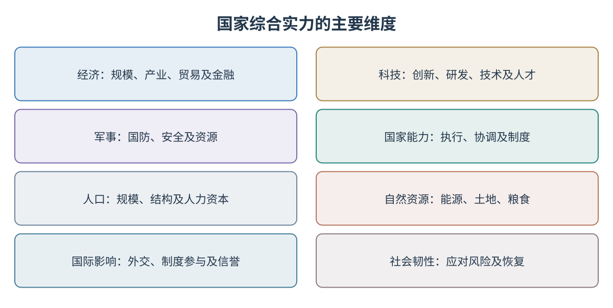
*图 56　国家综合实力的主要维度*

- 经济：规模、产业、贸易及金融
- 科技：创新、研发、技术及人才
- 军事：国防、安全及资源
- 国家能力：执行、协调及制度
- 人口：规模、结构及人力资本
- 自然资源：能源、土地、粮食
- 国际影响：外交、制度参与及信誉
- 社会韧性：应对风险及恢复

资源不自动转化为政治影响力。
#### 36.5 安全困境

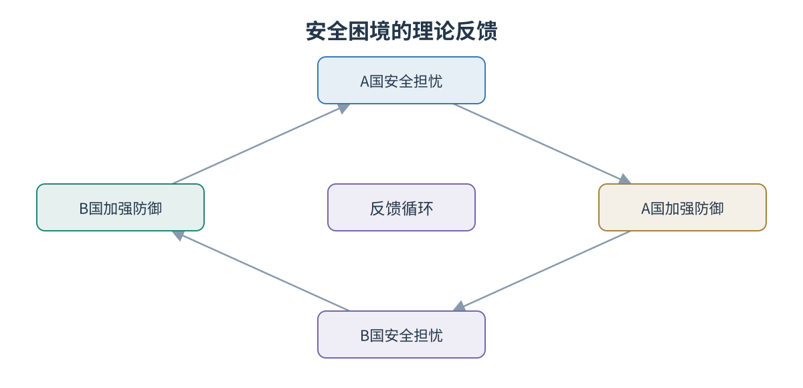
*图 57　安全困境的理论反馈*

- A国安全担忧
- A国加强防御
- B国安全担忧
- B国加强防御

一国为提高自身安全采取的措施可能被他国视为威胁，从而相互强化不安全感。不是所有防御行为都具有相同意图或结果。
#### 36.6 国际安全的主要概念

| 概念 | 含义 |
|---|---|
| 国家安全 | 国家及其社会面临的安全问题 |
| 集体安全 | 通过共同制度应对破坏国际和平的行为 |
| 同盟 | 国家间安全合作安排 |
| 威慑 | 通过预期代价影响行为 |
| 权力平衡 | 力量配置及政治关系限制单方面支配 |
| 人类安全 | 个人生命、生计、健康与尊严 |
| 非传统安全 | 卫生、网络、环境、能源等 |

### 第三十七章　外交、国际组织与全球治理
#### 37.1 外交的主要功能
处理对外关系、表达利益、谈判及合作。双边外交（两国关系）、多边外交（多国参与）、经济外交（贸易投资）、公共外交（外国社会及公众）、科技外交（科研创新）、文化外交（文化教育人员交流）、危机外交（重大国际冲突及突发问题）。
#### 37.2 国际组织的主要类型

| 类型 | 代表机构 |
|---|---|
| 综合性政府间国际组织 | 联合国 |
| 国际经济金融组织 | 国际货币基金组织、世界银行 |
| 国际贸易组织 | 世界贸易组织 |
| 区域组织 | 欧盟、东盟、非洲联盟 |
| 安全合作组织 | 北约等 |
| 专业国际组织 | 世界卫生组织、国际劳工组织 |
| 国际非政府组织 | 公益及专业跨国组织 |

成员资格、权限、法律基础与执行能力有差异。
#### 37.3 联合国主要机关

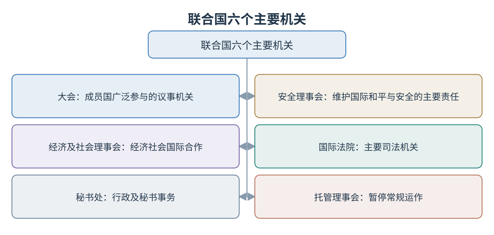
*图 58　联合国六个主要机关*

- 大会：成员国广泛参与的议事机关
- 安全理事会：维护国际和平与安全的主要责任
- 经济及社会理事会：经济社会国际合作
- 国际法院：主要司法机关
- 秘书处：行政及秘书事务
- 托管理事会：暂停常规运作

制度基础：[《联合国宪章》](https://www.un.org/en/about-us/un-charter/full-text)。专门机构、基金等不都属于六个主要机关。
#### 37.4 全球治理的主要问题

| 议题 | 难点 |
|---|---|
| 和平与安全 | 安全利益差异及集体行动 |
| 气候变化 | 跨境影响、长期成本与责任分配 |
| 公共卫生 | 信息共享、资源及跨境风险 |
| 国际贸易 | 市场准入、规则及利益冲突 |
| 国际金融 | 资本风险、稳定及监管 |
| 科技与AI | 标准、安全、数据及制度差异 |
| 全球发展 | 贫困、教育、基建及资源 |
| 人口流动 | 移民、劳动力及权利 |

公共问题超越国界，但权力、资源与责任仍主要分布于不同国家和机构。

## 第八篇　政治学研究方法与现实分析
### 第三十八章　政治学研究方法与因果推断
政治研究需要明确概念、问题、解释、证据及结论适用范围。
#### 38.1 政治学的研究方法分类

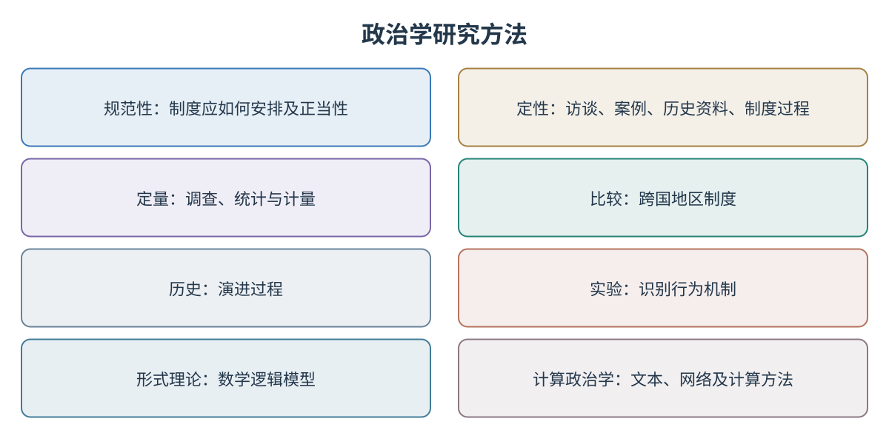
*图 59　政治学研究方法*

- 规范性：制度应如何安排及正当性
- 定性：访谈、案例、历史资料、制度过程
- 定量：调查、统计与计量
- 比较：跨国地区制度
- 历史：演进过程
- 实验：识别行为机制
- 形式理论：数学逻辑模型
- 计算政治学：文本、网络及计算方法

#### 38.2 政治学研究的基本流程

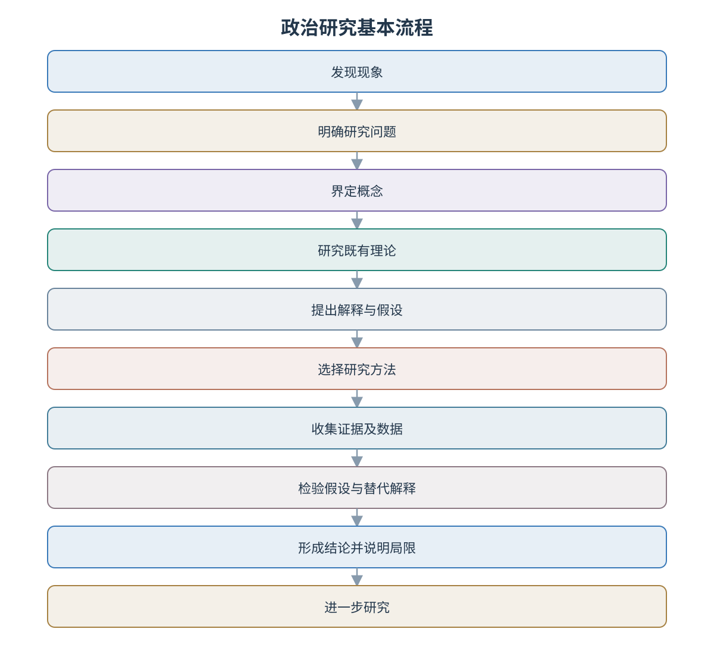
*图 60　政治研究基本流程*

- 发现现象
- 明确研究问题
- 界定概念
- 研究既有理论
- 提出解释与假设
- 选择研究方法
- 收集证据及数据
- 检验假设与替代解释
- 形成结论并说明局限
- 进一步研究

#### 38.3 概念化与操作化

| 概念 | 含义 |
|---|---|
| 概念化 | 界定含义及边界 |
| 操作化 | 抽象概念转化为可观察指标 |
| 变量 | 在对象间变化的属性 |
| 指标 | 测量概念的具体依据 |
| 信度 | 测量稳定性及一致性 |
| 效度 | 是否真正测量目标概念 |

治理能力可用公共服务可及性、行政效率及财政执行等指标，但任何单项指标都不完整。
#### 38.4 自变量、因变量与控制变量
研究经济发展与政治信任：自变量为经济发展水平；因变量为政治信任；控制变量如年龄、教育及社会环境；中介变量如公共服务改善；调节变量如制度环境及群体特征。

$$
Y_i=\beta_0+\beta_1X_i+\sum_{k=2}^{p}\beta_k Z_{ki}+\varepsilon_i
$$

$Y_i$ 为被解释现象，$X_i$ 为主要解释变量，$Z_{ki}$ 为其他解释或控制变量，$\beta_k$ 为回归系数，$\varepsilon_i$ 为误差项。回归系数反映模型设定下的统计关系，满足识别条件才可解释因果效应。
#### 38.5 相关性与因果关系

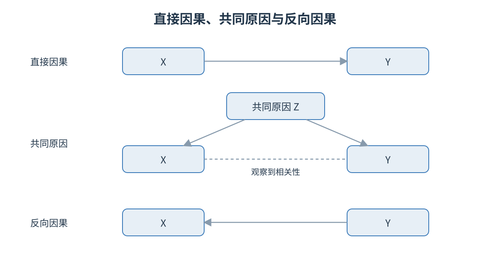
*图 61　直接因果、共同原因与反向因果*

经济发展可能影响政治稳定，政治稳定也可能影响发展，还可能共同受历史与制度影响。相关性不等于因果。
#### 38.6 常见因果推断方法

| 方法 | 基本思想 |
|---|---|
| RCT 随机对照实验 | 随机分组减少系统差异 |
| DID 双重差分 | 比较处理组、对照组政策前后变化 |
| RDD 断点回归 | 利用阈值附近处理差异 |
| IV 工具变量 | 满足相关条件的外部变量识别效应 |
| 合成控制法 | 多个对照对象构造比较基准 |
| 过程追踪 | 具体证据识别因果机制 |
| 比较案例研究 | 跨案例差异研究解释 |

每种方法均有识别假设，没有万能因果方法。
#### 38.7 双重差分模型示例

| 地区 | 政策前就业率 | 政策后就业率 | 变化 |
|---|---:|---:|---:|
| 政策实施地区 | 70% | 80% | +10个百分点 |
| 对照地区 | 68% | 73% | +5个百分点 |

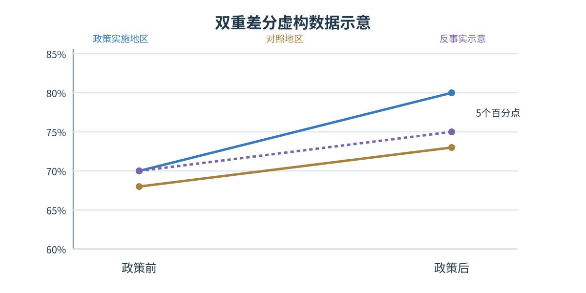
*图 62　双重差分虚构数据示意*

$$
\begin{aligned}
\widehat{\tau}_{DID}&=(80\%-70\%)-(73\%-68\%)\\
&=5\text{个百分点}
\end{aligned}
$$

两组就业率变化相差5个百分点。平行趋势等识别条件成立才可解释政策效果；数据为虚构。
#### 38.8 政治调查与民意测量

| 概念 | 主要含义 |
|---|---|
| 总体 | 全部研究对象 |
| 样本 | 实际调查对象 |
| 抽样方法 | 从总体选取对象的方式 |
| 抽样误差 | 使用样本产生随机误差 |
| 覆盖误差 | 部分总体难以进入范围 |
| 无应答偏差 | 参与与未参与者系统差异 |
| 问题措辞偏差 | 表述影响回答 |
| 社会期许偏差 | 倾向给出社会认为适当的回答 |

简单随机抽样等理想条件下，比例估计近似95%置信区间：

$$
\hat p\pm1.96\sqrt{\frac{\hat p(1-\hat p)}{n}}
$$

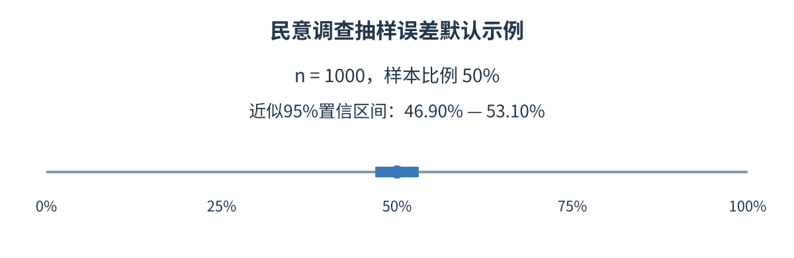
*图 63　民意调查抽样误差默认示例*

离线交互：[民意调查抽样误差演示（HTML）](#social-politics_poll)

默认样本1000、比例50%，近似误差±3.10个百分点、区间46.90%—53.10%。不包含无应答、措辞、复杂设计及其他系统性误差，不代表真实民调。样本大不自动意味着可靠。
### 第三十九章　政治博弈与制度分析工具
#### 39.1 博弈论的主要概念

| 概念 | 含义 |
|---|---|
| 行动者 | 参与策略互动主体 |
| 策略 | 不同条件下行动安排 |
| 收益 | 结果效用 |
| 信息结构 | 可获得的信息 |
| 占优策略 | 无论对方如何选均具有相应收益优势 |
| 纳什均衡 | 他方策略不变时无人能通过单方面改变提高收益 |
| 重复博弈 | 持续重复的策略互动 |
| 序贯博弈 | 按先后顺序选择 |

模型用于分析激励及互动，非准确预测所有行为。
#### 39.2 委托—代理模型

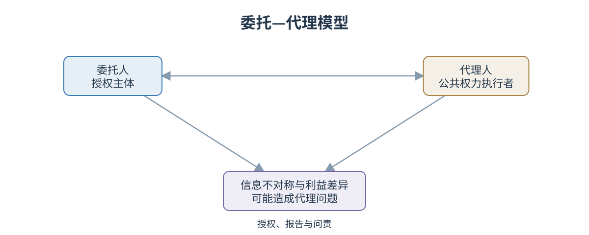
*图 64　委托—代理模型*

公众与代表、立法与行政、上下级之间都可能存在委托代理关系。信息不对称及利益差异可能产生代理问题；多重委托人及多层代理增加监督复杂性。
#### 39.3 可信承诺
可信承诺（Credible Commitment）研究如何使他方相信未来会履行约定。法律与合同（明确义务和后果）、独立审查（减少单方面改变）、信息透明（观察履行）、长期信誉（未来合作机会）、制度化责任（违约后果）。不能只根据公开表态判断。
#### 39.4 中位选民定理

*图 65　中位选民定理示意*

一维政策空间、单峰偏好及两两多数决等条件下，中位选民理想点可战胜其他位置的两两多数表决挑战。实际政治竞争常包含多个维度、政党认同、候选人特征及其他因素。
#### 39.5 有效政党数量
拉克索与塔格佩拉的有效政党数量指标：

$$
N_{\mathrm{eff}}=\frac{1}{\sum_{i=1}^{n}p_i^2}
$$

$p_i$ 为第 $i$ 个政党选票或议席份额，份额之和为1。

*图 66　有效政党数量默认示例*

离线交互：[有效政党数量演示（HTML）](#social-politics_effective)

默认A45、B35、C20，名义3党，有效政党数量约2.740。规模越接近，指标越接近3；一党占绝大份额时接近1。指标测量规模分布，不直接测量民主程度、竞争公平性或绩效。
### 第四十章　现实政治事件的综合分析
#### 40.1 政治事件的通用分析框架

*图 67　政治事件十问*

- 事实：什么发生且有证据？
- 历史：背景及演进？
- 主体：哪些国家机构组织个人？
- 利益：公开目标及证据支持的利益？
- 权力：正式权限及实际资源？
- 制度：法律程序约束？
- 行为：实际采取什么行动？
- 政策：决定与实施机制？
- 结果：对不同主体影响？
- 解释：哪些理论及替代解释？

#### 40.2 案例一：一项改革为什么无法顺利实施？
虚构教育改革：政治制度（审批程序）、利益（各群体成本收益）、财政（持续资源）、国家能力（行政执行）、地方政治（地方执行力）、历史制度（改变成本）、参与（反馈渠道）、评价（是否符合需求）。没有证据不能将困难简单归因于个人、群体或单一制度。
#### 40.3 案例二：为什么相同政策在不同地区效果不同？

*图 68　统一政策与地方执行条件*

地区A财政、人员及基础设施较充分，地区B相关资源有限；相同政策可能产生不同结果。虚构示意，涉及央地关系、国家能力、制度适应与政策执行。
#### 40.4 案例三：如何理解一项公共政策的利益分配？
虚构交通补贴：使用者（出行支出与条件）、运营机构（收入及要求）、公共财政（支出预算）、非使用者（负担及间接受益）、地方行政（管理监督）、社会整体（拥堵、环境、公平及运行）。评价需结合目标、成本、效果、分配及价值标准。
#### 40.5 案例四：两个国家为什么可能同时竞争与合作？

*图 69　国家共同利益与独立利益*

虚构A、B国可能在贸易、安全、科技、金融及环境等领域有不同关系，不能简单视为全面一致或对立，按具体领域分析。
#### 40.6 政治分析中的常见错误

| 错误 | 更严谨的分析 |
|---|---|
| 一个事件判断整个制度 | 较长时期、多维度 |
| 国家是单一意志主体 | 区分机构、社会群体及国内过程 |
| 只关注领导者个人 | 同时研究权限、组织与制度 |
| 口号判断结果 | 检查政策、执行、结果 |
| 一切归于单一利益 | 研究价值、身份及其他因素 |
| 简单分为善恶 | 区分事实、法律责任、利益、规范评价 |
| 舆论等于全体意见 | 检查样本及代表性 |
| 短期推断长期 | 历史资料及持续证据 |
| 相关即因果 | 检查替代解释及识别条件 |

## 附录一　政治学整体知识图谱
### A.1 政治学的核心知识网络

*图 70　政治学整体知识关联图谱*

连线表示主要研究联系，而非严格学科从属关系。
### A.2 二十条核心政治学知识链

| 基础概念 | 中间机制 | 延伸知识 |
|---|---|---|
| 公共利益 | 集体决策 | 政治体系 |
| 政治资源 | 政治权力 | 权力分配 |
| 政治权力 | 政治权威 | 政治合法性 |
| 国家形成 | 主权 | 国家制度 |
| 政治思想 | 意识形态 | 制度主张 |
| 政治价值 | 权利与正义 | 政治哲学 |
| 宪制安排 | 权力配置 | 政治监督 |
| 国家结构 | 中央地方分权 | 多层级治理 |
| 社会利益 | 利益表达 | 公共议程 |
| 政党组织 | 政治代表 | 政治决策 |
| 政治社会化 | 政治认同 | 政治行为 |
| 选举规则 | 议席分配 | 政党制度 |
| 政治传播 | 议程及框架 | 公共舆论 |
| 国家能力 | 行政执行 | 政策结果 |
| 公共问题 | 政策制定 | 政策评估 |
| 个体利益 | 集体行动 | 合作制度 |
| 公共授权 | 委托—代理 | 政治问责 |
| 历史条件 | 路径依赖 | 制度变迁 |
| 国际体系 | 国家利益 | 国际政治 |
| 政治现象 | 研究设计 | 因果分析 |

## 附录二　政治学重要概念分类与辨析

| 概念组合 | 核心区别 |
|---|---|
| 政治与政治学 | 活动与研究学科 |
| 政治理论与政治思想 | 概念理论研究与历史思想体系 |
| 政治理论与意识形态 | 理论解释及规范研究与系统价值主张 |
| 政治与公共政策 | 政治过程与具体决策 |
| 权力与权利 | 影响结果能力与规范确认地位 |
| 权力与权威 | 影响能力与被认可的正当支配 |
| 权力与权限 | 实际能力与授权范围 |
| 合法性与正当性 | 符合法律与权力合理依据 |
| 正当性与政治支持 | 权力依据与实际支持 |
| 国家与政府 | 政治实体与管理机构 |
| 国家与民族 | 政治组织与共同身份群体 |
| 国家与政权 | 政治实体与权力运行制度 |
| 主权与国家能力 | 法律政治地位与治理能力 |
| 国家能力与政府职能 | 完成任务能力与介入范围 |
| 国体与政体 | 权力社会性质与组织形式 |
| 单一制与联邦制 | 不同中央地方权力配置 |
| 共和制与民主制 | 元首制度与权力组织原则 |
| 君主制与绝对君主制 | 君主制度与广泛统治权形式 |
| 国家元首与政府首脑 | 国家代表与政府领导 |
| 总统制与半总统制 | 行政权力与责任结构不同 |
| 议会制与两院制 | 政府组织方式与立法组成 |
| 权力分立与地方分权 | 功能配置与央地配置 |
| 宪法与宪制 | 基本法律与基本政治秩序 |
| 立法与行政 | 制定与实施法律及管理 |
| 司法与行政执法 | 裁判与行政实施 |
| 官僚制与官僚主义 | 正式组织与不良组织行为 |
| 政党与利益集团 | 综合政治组织与特定利益表达 |
| 政党联盟与联合政府 | 合作关系与共同组阁 |
| 两党制与多党制 | 主要政党竞争结构不同 |
| 选票与议席 | 选择数量与代表职位 |
| 政治竞争与政治参与 | 权力政策竞争与社会成员介入 |
| 直接民主与代议民主 | 直接决策与通过代表参与 |
| 多数民主与共识民主 | 多数决定与权力分享强调 |
| 政治文化与意识形态 | 认知模式与系统思想主张 |
| 政治社会化与政治传播 | 观念形成与信息交流 |
| 议程设置与框架效应 | 关注对象与理解方式 |
| 民意调查与实际投票 | 样本测量与制度行为 |
| 政治精英与政治领导者 | 重要影响群体与领导角色 |
| 政治改革与政治革命 | 制度调整与根本变革 |
| 政治冲突与政治暴力 | 利益权力冲突与暴力行为 |
| 政治发展与经济发展 | 政治制度变化与经济社会发展 |
| 政策产出与政策结果 | 完成活动服务与实际变化 |
| 政策制定与政策执行 | 形成决定与落实决定 |
| 治理与公共管理 | 多种协调机制与公共组织运行 |
| 寻租与腐败 | 争取制度性收益与不当滥权 |
| 监督与问责 | 检查与解释纠正承担责任 |
| 国家利益与政府目标 | 国家层面利益与特定政府政策目标 |
| 国际政治与国际法 | 国际权力关系与国际法律规范 |
| 集体安全与军事同盟 | 共同安全制度与特定安全合作 |
| 硬实力与软实力 | 物质机制与吸引力机制 |
| 相关性与因果关系 | 统计联系与产生结果机制 |

## 附录三　政治学主要理论模型索引

| 代表人物 | 重要理论或领域 |
|---|---|
| 哈罗德·拉斯韦尔 | 权力、利益分配及传播 |
| 戴维·伊斯顿 | 政治系统理论 |
| 加布里埃尔·阿尔蒙德 | 比较政治与结构功能主义 |
| 西德尼·维巴 | 文化及参与 |
| 马克斯·韦伯 | 合法支配、国家、官僚制 |
| 罗伯特·达尔 | 多头政体与多元主义 |
| 史蒂文·卢克斯 | 权力三维度 |
| 维尔弗雷多·帕累托 | 精英循环 |
| 加埃塔诺·莫斯卡 | 政治阶级 |
| 罗伯特·米歇尔斯 | 寡头统治铁律 |
| C.赖特·米尔斯 | 权力精英 |
| 莫里斯·迪韦尔热 | 选举与政党体系 |
| 乔万尼·萨托利 | 政党制度及比较政治概念 |
| 阿伦德·利普哈特 | 多数民主与共识民主 |
| 胡安·林茨 | 威权主义及政体 |
| 塞缪尔·亨廷顿 | 秩序、制度化及发展 |
| 西摩·马丁·李普塞特 | 社会条件与政治制度 |
| 查尔斯·蒂利 | 国家形成及集体行动 |
| 西达·斯考切波 | 国家与社会革命 |
| 巴林顿·摩尔 | 现代化历史路径 |
| 道格拉斯·诺斯 | 制度及变迁 |
| 保罗·皮尔逊 | 路径依赖及历史制度主义 |
| 乔治·策贝利斯 | 否决者理论 |
| 弗朗西斯·福山 | 国家能力、制度及秩序 |
| 赫伯特·西蒙 | 有限理性 |
| 查尔斯·林德布洛姆 | 渐进主义 |
| 约翰·金登 | 多源流 |
| 保罗·萨巴蒂尔 | 倡议联盟框架 |
| 曼瑟尔·奥尔森 | 集体行动逻辑 |
| 埃莉诺·奥斯特罗姆 | 共同资源与多中心治理 |
| 安东尼·唐斯 | 政治竞争与理性选择 |
| 詹姆斯·布坎南 | 公共选择 |
| 肯尼斯·阿罗 | 社会选择与不可能定理 |
| 汉斯·摩根索 | 古典现实主义 |
| 肯尼思·华尔兹 | 结构现实主义 |
| 罗伯特·基欧汉 | 国际制度及合作 |
| 约瑟夫·奈 | 软实力及相互依赖 |
| 亚历山大·温特 | 国际关系建构主义 |
| 赫德利·布尔 | 国际社会及英国学派 |

## 附录四　政治学主要研究工具索引

| 领域 | 工具与模型 |
|---|---|
| 政治系统 | 伊斯顿输入输出模型 |
| 权力 | 卢克斯三维模型 |
| 权威 | 韦伯三种合法支配 |
| 国家能力 | 职能范围—能力二维模型 |
| 制度 | 否决者、制度分析 |
| 发展 | 路径依赖、关键节点、制度漂移 |
| 民主 | 达尔双维、多维民主研究 |
| 政党 | 有效政党数、政党制度分类 |
| 选举 | D'Hondt、Sainte-Laguë、选票议席比例 |
| 集体决策 | 中位选民、孔多塞悖论、阿罗定理 |
| 博弈 | 囚徒困境、协调博弈、重复博弈 |
| 治理 | 委托代理、共同资源治理 |
| 政策 | 生命周期、多源流、逻辑模型 |
| 问责 | 横向、纵向及社会问责 |
| 国际政治 | 三层次、权力平衡、安全困境 |
| 比较 | MSSD、MDSD、比较案例 |
| 调查 | 抽样、置信区间、问卷 |
| 因果推断 | DID、RDD、IV、RCT、合成控制 |
| 定性 | 过程追踪、历史、访谈 |
| 计算政治学 | 文本、社会网络、计算模拟 |

## 附录五　政治学常见认知误区

| 误区 | 更准确的理解 |
|---|---|
| 政治只是政府政党活动 | 也涉及公共事务、权力及集体决策 |
| 政治学就是时事评论 | 有理论、方法与证据标准 |
| 政治学就是政治思想教育 | 思想只是一个研究领域 |
| 政治完全由利益决定 | 价值、制度、历史、身份也起作用 |
| 职位决定全部权力 | 资源、组织、制度也影响 |
| 国家等于政府 | 政府只是国家组成部分 |
| 共和制必然民主 | 不同分类维度 |
| 君主制没有民主 | 君主立宪可与议会民主并存 |
| 联邦中央弱小 | 宪制分权不决定能力 |
| 集权一定更有效率 | 还要研究信息及执行 |
| 分权一定改善治理 | 地方资源及能力有差异 |
| 权力分立完全独立 | 仍有相互制约与合作 |
| 官僚制就是官僚主义 | 官僚制是正式组织形式 |
| 政党越多代表性越强 | 需研究规则及表达 |
| 得票最多必然执政 | 可能需要联盟等条件 |
| 稳定就是无冲突 | 制度化竞争可与稳定并存 |
| 政策发布就落实 | 制定与执行不同 |
| 增长证明全部制度有效 | 经济绩效仅一个方面 |
| 一次民调代表整体 | 检查抽样、时间及误差 |
| 国际政治只有竞争 | 可同时合作与竞争 |
| 地理决定发展 | 仅为因素之一 |
| 经典理论解释一切 | 有假设与适用范围 |
| 政策完全由领导者决定 | 制度、组织、利益、能力也影响 |
| 政治指标完整反映国家 | 只是有限测量 |
| 政治现象只能价值评价 | 也可事实及因果研究 |

## 附录六　政治学经典著作与学习资源
### F.1 综合入门与政治学理论

| 著作 | 作者 | 学习方向 |
|---|---|---|
| 《政治学通识》 | 包刚升 | 基本概念及比较政治入门 |
| 《政治学基础》 | 王浦劬等 | 权力、制度、发展 |
| Politics | Andrew Heywood | 综合知识结构 |
| Introduction to Political Science | Rom、Hidaka、Walker | 全球制度及行为入门 |
| 《政治学》 | 亚里士多德 | 政治共同体及政体 |
| 《论法的精神》 | 孟德斯鸠 | 制度、权力及环境 |
| 《利维坦》 | 霍布斯 | 国家权威及契约 |
| 《社会契约论》 | 卢梭 | 人民主权及正当性 |
| 《正义论》 | 罗尔斯 | 正义及制度 |

### F.2 比较政治、权力与国家发展

| 著作 | 作者 | 方向 |
|---|---|---|
| 《多头政体》 | 达尔 | 竞争及包容 |
| 《权力：一种激进的观点》 | 卢克斯 | 多维权力 |
| Patterns of Democracy | 利普哈特 | 比较民主制度 |
| 《变化社会中的政治秩序》 | 亨廷顿 | 制度化与发展 |
| 《政治秩序的起源》 | 福山 | 国家与制度演进 |
| 《政治秩序与政治衰败》 | 福山 | 现代制度与变化 |
| Social Origins of Dictatorship and Democracy | 巴林顿·摩尔 | 政治发展历史比较 |
| 《国家与社会革命》 | 斯考切波 | 国家结构与革命 |

### F.3 公共政策、集体行动与政治制度

| 著作 | 作者 | 方向 |
|---|---|---|
| 《集体行动的逻辑》 | 奥尔森 | 利益集团与集体行动 |
| 《公共事物的治理之道》 | 奥斯特罗姆 | 共同资源与自治 |
| 《民主的经济理论》 | 唐斯 | 政治竞争及理性选择 |
| 《制度、制度变迁与经济绩效》 | 诺斯 | 制度演进及约束 |
| Agendas, Alternatives, and Public Policies | 金登 | 政策与议程 |
| Veto Players | 策贝利斯 | 制度与政策稳定 |

### F.4 国际政治与国际关系

| 著作 | 作者 | 方向 |
|---|---|---|
| 《国家间政治》 | 摩根索 | 国际权力及现实主义 |
| 《国际政治理论》 | 华尔兹 | 国际体系与结构现实主义 |
| 《霸权之后》 | 基欧汉 | 国际制度及合作 |
| 《国际政治的社会理论》 | 温特 | 建构主义 |
| 《无政府社会》 | 布尔 | 国际社会与秩序 |

著作有不同理论立场，应关注假设、论证、历史背景及后续争论。
## 附录七　政治学权威资料与数据查询平台
### G.1 学术知识资源

| 资源 | 主要内容 |
|---|---|
| [APSA](https://apsanet.org/) | 学科分类及研究 |
| [IPSA](https://www.ipsa.org/) | 国际学术研究 |
| [OpenStax](https://openstax.org/details/books/introduction-political-science) | 免费政治学综合教材 |
| [斯坦福哲学百科全书](https://plato.stanford.edu/) | 政治哲学及思想 |
| [牛津大学政治与国际关系系](https://www.politics.ox.ac.uk/) | 政治研究及课程 |
| [LSE政府系](https://www.lse.ac.uk/government) | 制度、理论及政策 |
| [复旦大学政治学原理课程](https://www.icourse163.org/course/FUDAN-1461787179) | 中文入门 |

### G.2 国际政治与治理研究数据库

| 平台 | 研究内容 |
|---|---|
| [V-Dem](https://www.v-dem.net/) | 多维民主及历史数据 |
| [International IDEA](https://www.idea.int/) | 选举、参与、宪制 |
| [World Values Survey](https://www.worldvaluessurvey.org/) | 价值、政治态度及调查 |
| [European Social Survey](https://www.europeansocialsurvey.org/) | 欧洲社会与态度 |
| [WGI](https://www.worldbank.org/en/publication/worldwide-governance-indicators) | 治理指标 |
| [OECD](https://www.oecd.org/) | 公共政策、治理及社会经济 |
| [Our World in Data](https://ourworldindata.org/) | 全球长期数据 |
| [Constitute Project](https://www.constituteproject.org/) | 各国宪法 |
| [UCDP](https://ucdp.uu.se/) | 有组织暴力与冲突 |

阅读方法说明，注意指标、编码与数据来源差异，不将综合指数视作完整结论。
### G.3 国家政治制度的原始资料

| 国家或地区 | 查询平台 |
|---|---|
| 中国 | [中国政府网](https://www.gov.cn/)、[中国人大网](http://www.npc.gov.cn/) |
| 美国 | [USAGov](https://www.usa.gov/)、[国会](https://www.congress.gov/) |
| 英国 | [议会](https://www.parliament.uk/)、[政府](https://www.gov.uk/) |
| 法国 | [总统府](https://www.elysee.fr/en/) |
| 德国 | [联邦议院](https://www.bundestag.de/en/) |
| 新加坡 | [议会](https://www.parliament.gov.sg/) |
| 欧盟 | [官方门户](https://european-union.europa.eu/) |
| 国际组织 | [联合国](https://www.un.org/) |

官方资料适于查询正式制度、法律权限及政策说明；实际运行及后果还需学术研究、统计及其他证据。
## 附录八　政治学学习路线与重点分配
### H.1 知识学习依赖关系

*图 71　政治学学习路线*

- 政治基本概念：权力、利益、国家、主权及合法性
- 政治理论思想：意识形态、哲学及分析理论
- 政治制度与行为：国家结构、政党、参与及传播
- 比较政治与公共治理：制度差异、政策、政治经济
- 国际政治：体系、战略及治理
- 综合研究与现实分析：方法、因果、制度工具

研究方法应贯穿全程。
### H.2 建议学习精力分配

*图 72　建议学习精力分配*

| 篇目 | 比例 |
|---|---:|
| 政治学基础理论 | 15% |
| 政治思想与意识形态 | 15% |
| 国家结构与政治制度 | 20% |
| 政治主体与政治运行 | 15% |
| 比较政治与政治发展 | 10% |
| 公共治理与政治经济 | 10% |
| 国际政治与全球秩序 | 5% |
| 研究方法与现实分析 | 10% |

面向政治认知和现实分析的建议比例，不是高校标准课时。国际政治比例较低是因为国际关系可独立建设。
### H.3 后续可以独立深化的特别专栏

| 专栏 | 主要内容 |
|---|---|
| 世界政治制度比较 | 国家结构、政府组织及运行 |
| 中国政治制度 | 国家机构、政党、央地及基层治理 |
| 政治思想史 | 中国与世界思想经典 |
| 政治权力与国家治理 | 权力、精英、监督与能力 |
| 政党与选举制度 | 政党、议会、代表、选举规则 |
| 政治经济学 | 国家市场、利益分配及制度发展 |
| 公共政策分析 | 形成、执行、评价 |
| 地缘政治与国际关系 | 格局、外交、安全及战略 |
| 政治学研究方法 | 统计、比较、博弈及因果 |

## 知识体系总结

*图 73　政治学的十二个核心问题*

- 为什么需要政治：公共事务、利益协调、集体决策
- 权力从何而来：资源、组织及权威
- 权力为什么获认可：合法性、制度及支持
- 国家为什么形成：起源、主权及秩序
- 权力如何组织分配：结构、政体、宪制及机构
- 如何约束权力：法律、监督、权利及问责
- 成员如何影响政治：参与、政党、利益集团及舆论
- 制度为何不同：历史、结构及比较
- 决策如何产生落实：政策、执行、能力
- 制度为何变化：发展、路径依赖及变迁
- 国家为何竞争合作：体系、利益及制度
- 如何科学理解政治：证据、方法及因果推断

本体系采用全球性政治学与比较政治框架，兼顾中国政治学课程基础概念及国际研究方法。国家制度仅选代表案例，未逐国展开；部分概念存在学术争论，模型和虚构数据仅解释原理。
政治学知识的价值在于区分政治事实、制度结构、利益关系、理论解释及价值判断，形成基于证据的独立分析能力。

> 归档说明：本文根据对话中的政治学知识体系转录及压缩排版；保留原八篇四十章、八个附录、公式和主要教学案例，图表重新绘制。原对话的逐条网页引用未原样导出，附录七保留主要公开资料入口，具体政治制度和数据使用时应核对原始资料及日期。离线演示请在浏览器打开相应 HTML 文件。
