# 经济学知识体系 V2.5

**知识框架版 · 树状知识结构 · 零基础学习**

V2.0 解决了知识覆盖和概念解释的问题，但是没有充分解决知识之间的组织关系。一个真正的知识框架，不应该只是告诉学习者有哪些概念，还应该告诉学习者：

- 一个概念属于哪个上位概念；
- 哪些概念是同一事物的不同分类；
- 哪些概念由其他概念进一步衍生；
- 哪些概念之间存在因果关系；
- 哪些知识相对独立，但存在交叉联系。

因此，V2.5 将采用类似数据结构中**树（Tree）**的组织方式，以经济学为根节点，以各个学科为一级分支，再逐级细分研究对象、理论体系、基本概念和派生知识。

不过，经济学知识并不是严格意义上的树，而更接近一张知识图谱，因为一个知识点可能同时与多个领域产生联系。因此，本版本采用：

**树状结构负责知识分类，关系说明负责连接不同节点。**

## 0.1 知识组织规范

| 关系类型 | 含义 | 示例 |
|---|---|---|
| 从属关系 | 一个知识点属于某个上位知识体系 | 微观经济学 → 消费者理论 |
| 并列关系 | 同一上位概念下的不同知识点 | 固定成本、可变成本 |
| 分类关系 | 根据某一标准对事物进行分类 | 完全契约、不完全契约 |
| 构成关系 | 多个部分共同组成一个整体 | 总成本＝固定成本＋可变成本 |
| 派生关系 | 从基础概念进一步发展出的概念 | 效用 → 边际效用 |
| 因果关系 | 一个经济因素影响另一个经济因素 | 融资成本下降 → 投资可能增加 |
| 交叉关系 | 分属不同体系，但存在重要联系 | 货币政策与国际汇率 |
| 对比关系 | 两个相关概念需要结合起来辨析 | 名义GDP与实际GDP |

树状结构中的上下层级不一定表示严格的数学集合包含关系，也可能表示某一研究主题包含的概念、理论和方法。因果关系则单独说明，避免将因果关系误认为分类关系。

## 0.2 知识体系总体结构

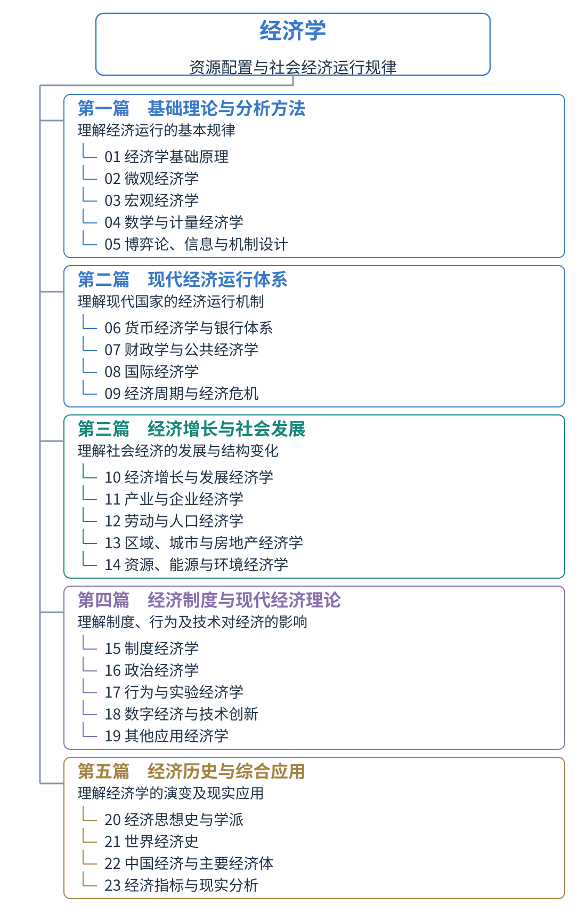

---

# 第一篇　经济学基础理论与分析方法

# 第一章　经济学基础原理

## 1.1 经济学的根本问题

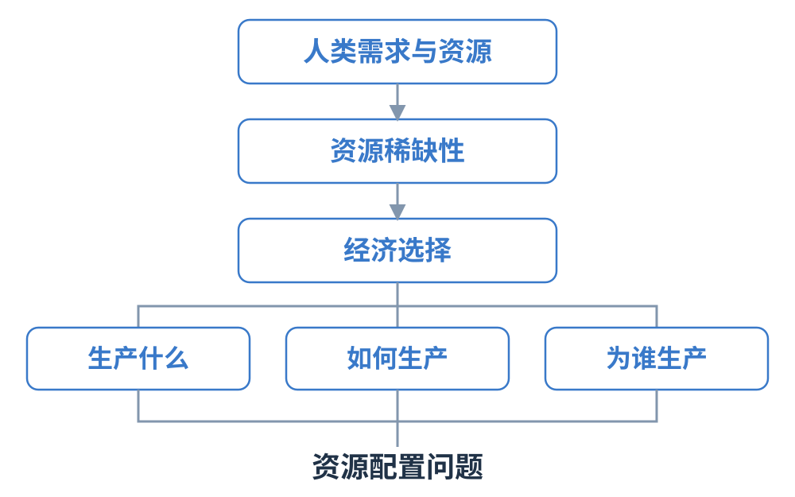

经济学基本问题的逻辑来源

### 1.1.1 经济活动产生的根源

- **人类需求**：人们对物质、服务和生活条件的需要。
  - 生存需求：食品、住房、医疗等基本需要。
  - 发展需求：教育、文化、娱乐等进一步提高生活水平的需要。
- **经济资源**：能够用于满足人类需求的各种资源，例如劳动、土地和设备。
- **稀缺性**：资源相对于人类需求是有限的，无法同时满足所有用途。

### 1.1.2 稀缺性衍生的经济问题

- **经济选择**：在有限资源条件下决定优先满足哪些需求。
  - 生产什么：决定商品与服务的种类和数量。
  - 如何生产：决定采用什么技术、资源和生产方式。
  - 为谁生产：决定生产成果如何在社会成员之间分配。
- **资源配置**：决定资源分别投入哪些用途。
- **资源利用**：研究已经投入的资源能否得到充分、高效的使用。

**逻辑关系：** 资源稀缺使人们必须选择，选择进一步产生资源配置和资源利用问题。这是经济学研究的基本起点。

## 1.2 经济决策的基本原理

### 1.2.1 成本与收益

- **成本**：为了实现某个目标而付出的代价。
  - 直接成本：实际支付的资金和资源。
  - 机会成本：放弃的最佳可行替代方案所具有的价值。
  - 沉没成本：已经发生且无法收回的成本。
- **收益**：经济活动所带来的利益。
  - 经济收益：能够以经济价值衡量的利益。
  - 非货币收益：时间节约、生活便利、个人满足等不一定直接表现为金钱的利益。

### 1.2.2 边际分析

- **边际量**：经济活动额外增加一个单位时产生的变化。
  - 边际成本：额外实施一单位活动所增加的成本。
  - 边际收益：额外实施一单位活动所增加的收益。
  - 边际效用：额外消费一单位商品所增加的满足程度。
  - 边际产量：额外增加一单位生产要素所增加的产出。
- **边际决策原则**：通过比较新增成本和新增收益决定是否继续增加某项经济活动。

### 1.2.3 决策行为与激励

- **经济理性**：经济主体根据自身目标和约束作出选择。
  - 完全理性：理论上能够充分处理相关信息并作出最优选择。
  - 有限理性：受到信息、时间和认知能力限制，无法始终作出最优决策。
- **激励机制**：通过改变行为的成本和收益影响决策。
  - 正向激励：通过奖励、收益等鼓励某种行为。
  - 负向激励：通过惩罚、成本等减少某种行为。

### 1.2.4 经济决策的评价标准

- **经济效率**：有限资源是否得到了有效使用。
  - 生产效率：能否以较少投入实现既定产出。
  - 配置效率：资源是否被投入能够产生更大经济价值的用途。
- **经济公平**：经济机会、收入、财富及社会资源的分配是否合理。
  - 机会公平：不同主体能否获得相对公平的发展机会。
  - 分配公平：经济活动的成果是否得到合理分配。

**本节知识联系：** 成本和收益是决策依据，边际分析是决策方法，激励机制影响决策行为，效率与公平则用于评价决策结果。

## 1.3 社会经济活动的基本结构

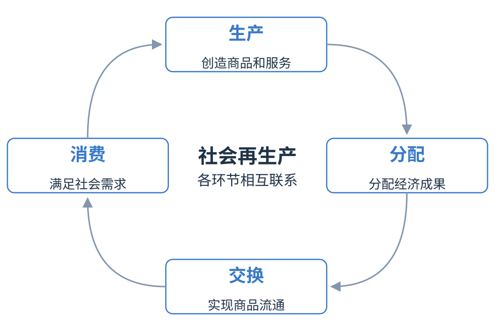

### 1.3.1 经济活动的四个基本环节

- **生产**：利用各种资源创造商品和服务。
- **分配**：决定生产成果和收入归属于哪些社会成员。
- **交换**：通过交易使不同商品和资源在主体之间流动。
- **消费**：使用商品和服务满足人类需求。

### 1.3.2 经济活动的延续与扩大

- **储蓄**：将当前收入中未用于消费的部分保留下来。
- **投资**：将当前资源投入未来生产或收益活动。
- **资本积累**：不断增加机器、厂房等能够支持未来生产的资源。
- **社会再生产**：社会生产活动不断重复和延续的过程。
  - 简单再生产：生产活动大体维持原有规模。
  - 扩大再生产：生产活动在新增投入和生产能力改善下扩大规模。

**经济联系：** 生产创造收入，收入支持消费与储蓄，储蓄可以通过金融系统支持投资，投资又可能提高未来的生产能力。这些环节共同构成持续运行的经济系统。

## 1.4 经济资源与生产要素

### 1.4.1 传统生产要素

- **劳动**：人投入生产过程中的体力、脑力和时间。
- **土地**：土地、矿产、水源等自然资源。
- **资本**：机器、厂房和设备等用于进一步生产的资源。
- **企业家才能**：组织生产、发现市场机会、承担风险和开展创新的能力。

### 1.4.2 现代经济中的重要投入

- **人力资本**：通过教育、技能、经验和健康形成的生产能力。
- **技术**：能够提高生产效率和生产能力的方法。
- **知识**：用于研发、创新、决策和生产的认知成果。
- **数据**：能够参与经济决策和价值创造的信息资源。

这些现代投入不一定是相互独立的生产要素。例如，知识可能体现在劳动者的人力资本中，也可能体现在机器设备及生产技术中。

### 1.4.3 生产要素的报酬

| 生产要素 | 典型收入形式 | 含义 |
|---|---|---|
| 劳动 | 工资 | 提供劳动获得的报酬 |
| 土地及自然资源 | 地租 | 使用稀缺自然资源所支付的报酬 |
| 资本 | 资本回报 | 提供资本所获得的收益 |
| 企业家才能 | 企业家收益 | 组织经营、创新和承担风险所获得的收益 |

这是理解社会收入分配的初步基础。现实中的企业利润可能同时包含资本回报、创新收益、经济租金等多种成分。

## 1.5 分工、专业化与生产效率

- **社会分工**：不同劳动者和组织承担不同的生产任务。
  - 专业化：集中资源从事特定生产活动。
  - 协作：不同专业化主体相互配合完成生产。
- **生产优势**
  - 绝对优势：相同投入能够创造更多产出。
  - 比较优势：生产某种商品所放弃的其他产出相对更少。
- **生产效率**
  - 劳动生产率：单位劳动投入创造的产出。
  - 规模经济：扩大生产规模使长期平均成本下降。
  - 规模不经济：生产规模过大使平均成本上升。
  - 范围经济：联合生产多种商品比各自单独生产更节省成本。
- **生产能力约束**
  - 生产可能性边界（PPF）：现有资源和技术能够实现的最大产出组合。
  - 边际报酬递减：其他投入不变时，不断增加某一生产要素，其新增产出最终趋于下降。

**逻辑关系：** 比较优势为专业化分工提供基础，专业化与协作可能提高生产率，生产率提高则能够扩大社会生产能力。

## 1.6 经济制度与资源配置机制

### 1.6.1 按生产目的与交换方式分类

- **自然经济**：生产主要用于自身消费。
- **商品经济**：生产较大程度上以市场交换为目的。

### 1.6.2 按资源配置方式分类

- **市场经济**：主要通过价格、供求和自主决策配置资源。
- **计划经济**：主要通过集中计划和行政安排配置资源。
- **混合经济**：市场机制和政府调节共同发挥作用。

### 1.6.3 按生产资料所有权分类

- **公有制**：生产资料由国家、集体等公共主体所有。
- **私有制**：生产资料由私人或私人组织所有。
- **混合所有制**：不同所有权主体共同参与资产所有和经营。

### 1.6.4 综合经济制度

- **资本主义经济**：私人资本、市场交换和资本积累具有重要地位的经济制度。
- **社会主义市场经济**：社会主义基本经济制度与市场经济机制相结合的经济制度。

**特别辨析：** 市场经济与计划经济是按照资源配置方式划分的；公有制与私有制是按照所有权划分的。两组概念不属于同一个分类维度，不能直接画等号。

## 1.7 经济学研究方法

- **按研究对象分类**
  - 微观经济学：研究个人、家庭、企业与单个市场。
  - 宏观经济学：研究国家和整体经济系统。
- **按研究目的分类**
  - 实证经济学：研究经济现象实际上是什么。
  - 规范经济学：研究经济结果应该是什么。
- **按均衡分析范围分类**
  - 局部均衡：单独研究某个市场。
  - 一般均衡：同时研究多个市场之间的关系。
  - 非均衡分析：研究经济主体未达到相互协调状态时的调整过程。
- **按时间维度分类**
  - 静态分析：研究给定条件下的经济状态。
  - 比较静态分析：比较条件变化前后的经济状态。
  - 动态分析：研究经济变量随时间变化的过程。
- **按证据与推理方式分类**
  - 理论分析：通过假设和模型推导经济规律。
  - 实证分析：使用实际数据检验经济关系。
  - 因果分析：判断某一因素是否真正导致另一现象。
  - 反事实分析：研究某个事件没有发生时可能产生的结果。

---

# 第二章　微观经济学

微观经济学的主体结构可以归纳为：**消费者形成需求，生产者形成供给，供求关系形成市场价格，不同市场结构产生不同竞争结果，最终通过福利经济学评价资源配置效率。**

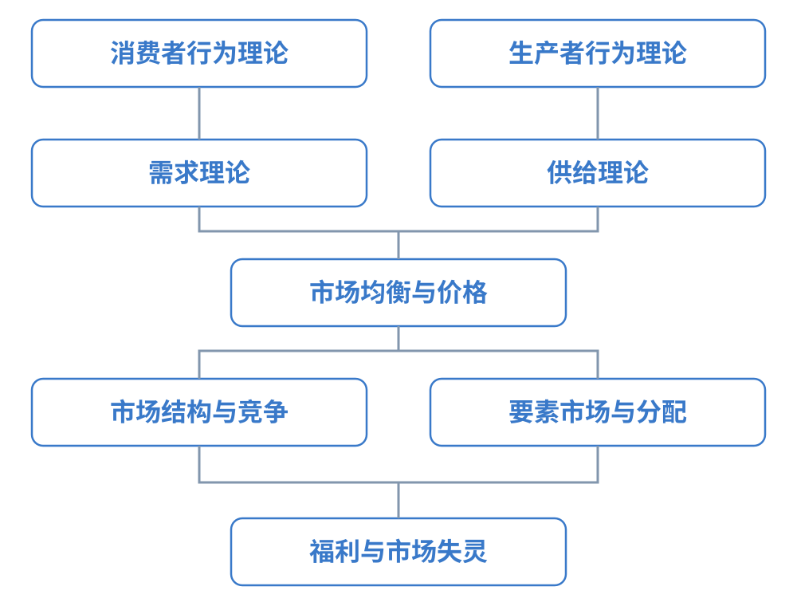

微观经济学各理论之间的主要联系，而非严格的学科从属关系

## 2.1 市场供求理论

### 2.1.1 需求理论

- **需求**：消费者在不同价格下愿意且能够购买的商品数量关系。
  - 需求量：消费者在某个具体价格下愿意并能够购买的数量。
  - 需求函数：用数学关系描述需求量与价格、收入等因素之间的联系。
  - 需求曲线：将需求函数中的价格与需求量关系用图像表示出来。
  - 需求定律：其他条件不变时，商品价格上涨通常导致需求量下降。

### 2.1.2 需求的两种变化

- **需求量变动**：商品自身价格变化引起购买数量改变，表现为沿原有需求曲线移动。
- **需求变动**：收入、偏好等其他因素发生变化，表现为整个需求曲线移动。

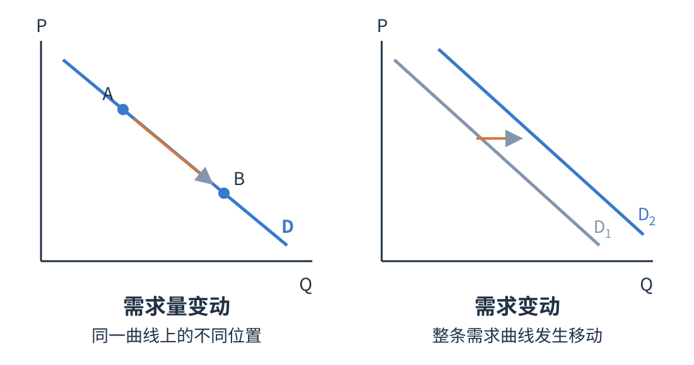

### 2.1.3 商品的需求属性分类

同一种商品可以同时属于下面两个分类体系。

- **按照消费者收入变化分类**
  - 正常品：收入增加时，需求增加。
    - 必需品：需求增长比例通常低于收入增长比例。
    - 奢侈品：需求增长比例通常高于收入增长比例。
  - 劣等品：收入增加时，需求反而减少。
    - 吉芬品：在特定条件下，自身价格上涨反而使需求量增加的一类劣等品。
- **按照商品之间的需求关系分类**
  - 替代品：能够相互替代，例如茶与咖啡。
  - 互补品：需要或倾向于配合使用，例如汽车与汽油。
  - 独立品：一种商品价格变化对另一种商品需求影响很小。

**特别辨析：** 吉芬品属于劣等品的特殊情况，但并非所有劣等品都是吉芬品；正常品和替代品则属于不同分类维度，并不相互排斥。

### 2.1.4 供给理论

- **供给**：生产者在不同价格下愿意且能够出售的商品数量关系。
  - 供给量：在某个具体价格下愿意出售的数量。
  - 供给函数：描述供给量与价格、生产成本等因素的数量关系。
  - 供给曲线：用图像表示价格与供给量之间的关系。
  - 供给定律：其他条件不变时，价格上涨通常使供给量增加。
- **供给的变化**
  - 供给量变动：商品自身价格变化引起的出售数量变化。
  - 供给变动：成本、技术、生产条件等变化使整个供给曲线移动。
  - 供给冲击：突发事件使生产能力或生产成本显著变化。

## 2.2 市场均衡与价格形成

### 2.2.1 供求关系产生的市场状态

- **市场均衡**：需求量与供给量相等的状态。
  - 均衡价格：实现供求相等的价格。
  - 均衡数量：均衡价格下的交易数量。
- **市场非均衡**
  - 供不应求：需求量超过供给量，通常形成价格上涨压力。
  - 供过于求：供给量超过需求量，通常形成价格下降压力。

### 2.2.2 价格的经济作用

- **价格信号**：通过价格变化反映商品的相对稀缺程度。
- **价格机制**：通过价格影响消费者和生产者的行为，使资源在不同用途之间流动。

### 2.2.3 政府对市场价格的干预

- **直接价格干预**
  - 最高限价：规定商品不能超过某个价格。
  - 最低限价：规定商品不能低于某个价格。
- **间接价格干预**
  - 税收：通过增加相关交易成本影响供给、需求和价格。
  - 补贴：通过降低相关成本或增加收益影响生产和消费。
- **非价格分配**
  - 配给制度：通过购买资格、购买数量等限制分配稀缺商品。

**逻辑关系：** 供求决定均衡价格；价格又反过来影响供给量和需求量，形成不断调整的反馈机制。政府干预可能改变这一机制的运行结果。

## 2.3 弹性理论

弹性属于供求理论的进一步发展，研究价格、收入等因素变化时，供给和需求究竟会发生多大程度的变化。

- **需求弹性**
  - 需求价格弹性：需求量对商品自身价格变化的敏感程度。
  - 需求收入弹性：需求量对消费者收入变化的敏感程度。
  - 需求交叉弹性：一种商品需求量对另一种商品价格变化的敏感程度。
- **供给弹性**
  - 供给价格弹性：供给量对商品自身价格变化的敏感程度。
  - 供给的其他弹性：供给量对生产成本等因素变化的敏感程度。

需求价格弹性按绝对值又可以分为：

| 分类 | 基本含义 |
|---|---|
| 完全无弹性 | 价格变化不引起需求量变化 |
| 缺乏弹性 | 需求量变化比例小于价格变化比例 |
| 单位弹性 | 两者变化比例相等 |
| 富有弹性 | 需求量变化比例大于价格变化比例 |
| 完全弹性 | 极小的价格变化就可能引起需求量的巨大变化，属于极限情形 |

**交叉联系：** 需求收入弹性可以用于区分正常品与劣等品，需求交叉弹性可以用于判断替代品与互补品，供求弹性还会影响税负最终由谁承担。

## 2.4 消费者行为理论

供求理论描述了消费者如何购买商品，而消费者行为理论进一步解释消费者为什么这样购买。

### 2.4.1 消费者偏好与效用

- **消费者偏好**：消费者对不同商品和消费组合的喜好顺序。
- **效用**：商品或服务给消费者带来的满足程度。
  - 总效用：消费一定数量商品获得的全部满足程度。
  - 边际效用：额外消费一单位商品所增加的满足程度。
  - 边际效用递减：持续消费同一种商品时，新增满足程度通常趋于下降。

### 2.4.2 效用的两种分析体系

- **基数效用理论**：假设效用大小可以通过具体数值衡量。
- **序数效用理论**：不要求准确测量效用，只要求消费者能够比较偏好顺序。
  - 无差异曲线：表示能够带来相同效用水平的商品组合。
  - 边际替代率：维持相同满足程度时，两种商品之间的替换比例。

### 2.4.3 消费者面临的约束

- **收入约束**：消费者能够支配的收入有限。
- **价格约束**：不同商品需要支付不同成本。
- **预算约束**：收入和价格共同决定消费者能够购买的商品组合。
  - 预算线：表示恰好用完预算的不同商品组合。

### 2.4.4 消费者的最优决策

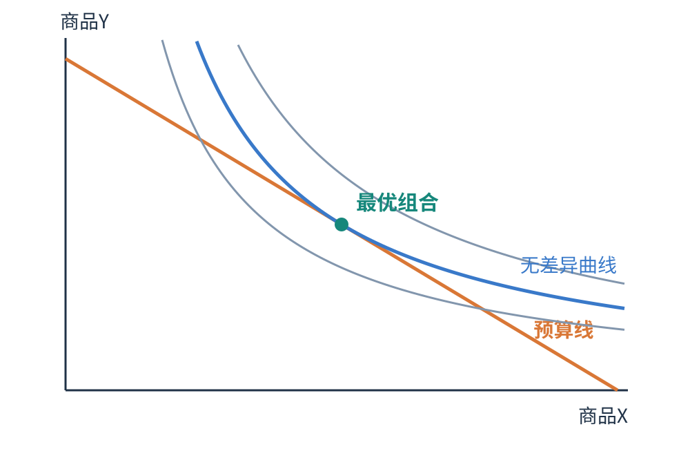

在常见的内部最优条件下，消费者选择预算线与最高可达到的无差异曲线相切的位置。

- **消费者均衡**：在有限预算内选择最符合自身偏好的商品组合。
- **消费者效用最大化**：消费者选择能够获得最高可实现效用的方案。

### 2.4.5 价格变化对消费的影响

商品价格变化的总效应，可以进一步分解为两种效应：

- **替代效应**：相对价格发生变化，消费者调整不同商品的购买比例。
- **收入效应**：价格变化改变消费者的实际购买力，进而改变需求。

### 2.4.6 消费者理论的扩展

- **恩格尔曲线**：描述收入与某种商品消费量之间的关系。
  - 恩格尔定律：收入提高时，食品支出占总消费支出的比例通常下降。
- **显示性偏好理论**：根据实际购买行为推断消费者偏好。
- **跨期消费理论**：研究消费者如何在当前消费和未来消费之间进行选择。
- **不确定条件下的决策**
  - 期望效用：根据各种可能结果及其概率评价决策。
  - 风险厌恶：倾向于避免风险，或者要求获得额外补偿才愿意承担风险。
  - 风险中性：在基本模型中主要关注预期收益而非风险大小。
  - 风险偏好：在一定条件下更偏好具有风险的选择。

**本节知识链：** 消费者偏好＋预算约束 → 最优消费决策 → 个体需求 → 市场需求。

## 2.5 生产者行为理论

生产者理论与消费者理论基本对应：消费者在预算约束下追求效用最大化，企业则在生产、成本等约束下追求利润或其他经营目标。

### 2.5.1 生产投入与产出

- **生产要素**：用于生产的劳动、资本、自然资源等。
- **生产函数**：描述生产要素投入与产品产出之间的关系。
- **产量指标**
  - 总产量：一定投入所创造的全部产出。
  - 平均产量：每单位某种投入平均创造的产出。
  - 边际产量：额外增加一单位投入所创造的新增产出。

### 2.5.2 生产时期

- **短期生产**：至少有一种生产要素无法立即调整。
  - 固定投入：短期内保持不变的生产要素。
  - 可变投入：能够根据生产需求调整的生产要素。
- **长期生产**：所有生产要素投入原则上均可调整。

经济学中的短期和长期，主要根据生产要素是否能够调整划分，并非固定的几个月或几年。

### 2.5.3 生产中的技术规律

- **边际报酬规律**：研究单独增加某种投入如何改变新增产出。
- **规模报酬规律**：研究所有投入按相同比例增加时，产出如何变化。
  - 规模报酬递增：产出增加比例大于投入增加比例。
  - 规模报酬不变：产出与投入按相同比例增加。
  - 规模报酬递减：产出增加比例小于投入增加比例。

### 2.5.4 生产要素的最优配置

- **等产量曲线**：能够生产相同产量的不同要素组合。
  - 边际技术替代率：维持相同产量时，两种生产要素之间的替换比例。
- **等成本线**：在相同成本下能够选择的不同要素组合。
- **生产要素最优组合**
  - 成本最小化：以最低成本实现既定产量。
  - 产量最大化：在既定投入预算下获得最大产量。

## 2.6 企业的成本、收益与利润

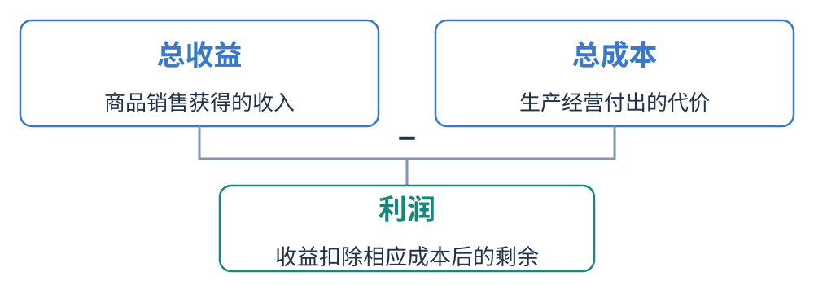

### 2.6.1 成本的不同分类

- **按照是否随产量变化分类**
  - 固定成本：短期内不随产量变化的成本。
  - 可变成本：随产量变化而变化的成本。
  - 总成本：固定成本与可变成本之和。
- **按照计算单位分类**
  - 平均固定成本：每单位产出承担的固定成本。
  - 平均可变成本：每单位产出承担的可变成本。
  - 平均总成本：每单位产出承担的全部成本。
  - 边际成本：额外生产一单位产品增加的成本。
- **按照是否实际发生支付分类**
  - 显性成本：实际支付的工资、租金等。
  - 隐性成本：使用自有资源所放弃的其他收益。
- **按照分析口径分类**
  - 会计成本：按照会计规则确认的成本。
  - 经济成本：显性成本与隐性机会成本之和。
- **按照生产时期分类**
  - 短期成本：部分生产要素固定条件下的成本。
  - 长期成本：所有生产要素可以调整条件下的成本。

### 2.6.2 收益的构成

- **总收益**：销售全部商品获得的收入。
- **平均收益**：每单位商品平均获得的销售收入。
- **边际收益**：额外销售一单位商品增加的收入。

### 2.6.3 利润的分类

- **会计利润**：收入减去会计成本。
- **经济利润**：收入减去全部经济成本。
  - 正经济利润：收入超过全部经济成本。
  - 零经济利润：收入恰好覆盖全部经济成本，包括机会成本。
  - 负经济利润：收入无法覆盖全部经济成本。
- **正常利润**：企业维持当前经营所需要的最低机会成本补偿，属于经济成本的一部分。

### 2.6.4 企业经营决策

- **利润最大化**：寻找使经济利润最大的生产方案。
  - 边际收益与边际成本：在常见的内部最优条件下，通过二者的关系确定最优产量。
- **盈亏判断**
  - 盈亏平衡：收入恰好覆盖相应成本。
  - 继续生产：短期收入能够覆盖可变成本等相关条件时，企业可能继续生产，即使存在亏损。
  - 暂时停产：继续生产造成的损失超过停产损失。
  - 退出市场：长期无法获得足够收益覆盖相关经济成本。

**知识联系：** 生产函数决定投入与产出关系，投入价格进一步形成成本，市场需求影响企业收益，收益与成本共同决定利润，利润影响企业生产、扩张和退出决策。

## 2.7 市场结构与企业竞争

### 2.7.1 市场结构的判断标准

- 企业数量：市场中有多少生产者和购买者。
- 产品差异：不同企业的产品是否可以相互替代。
- 进入壁垒：新企业进入市场的难度。
- 市场势力：企业影响价格和交易条件的能力。

### 2.7.2 四种基本市场结构

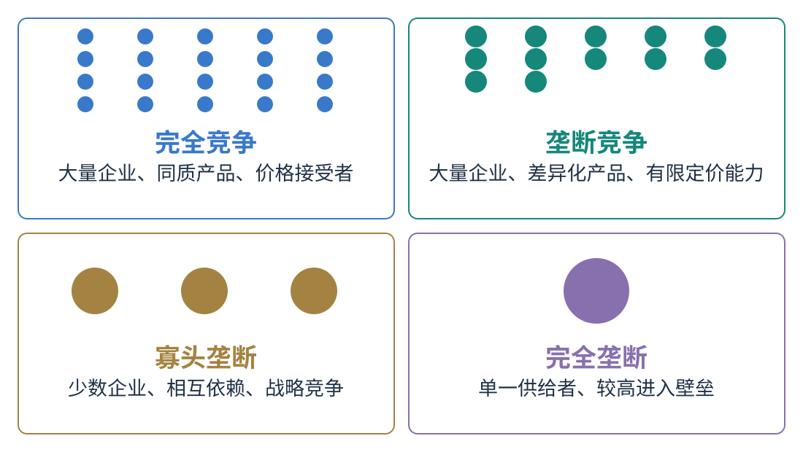

四种基本市场结构是根据竞争条件划分的理论类型，并不意味着现实行业只能归于某一个绝对类别。

- **完全竞争市场**：单个企业无法有效控制市场价格。
  - 价格接受者：企业只能接受市场形成的价格。
  - 自由进入与退出：企业能够相对自由地参与或离开市场。
- **垄断竞争市场**：大量企业通过产品差异化进行竞争。
  - 品牌竞争：通过品牌认知吸引消费者。
  - 产品差异化：通过质量、设计和服务区别于其他企业。
- **寡头垄断市场**：少数大型企业的经营决策相互影响。
  - 古诺模型：研究企业之间的产量竞争。
  - 伯特兰模型：研究企业之间的价格竞争。
  - 斯塔克尔伯格模型：研究企业之间具有先后顺序的战略竞争。
  - 卡特尔：企业通过协议协调产量、价格等经营行为。
- **完全垄断市场**：一个企业控制相关市场的供给。
  - 自然垄断：由一家企业供应市场可能具有显著成本优势的情况。
  - 法定垄断：由特定法律权利或制度限制形成的垄断。
  - 资源垄断：由控制关键稀缺资源形成的垄断。

### 2.7.3 从购买者角度研究市场势力

- **买方垄断**：单一主要购买者能够影响市场交易条件。
- **寡头买方市场**：少数购买者拥有较强市场势力。
- **双边垄断**：主要供给者与主要购买者均具有垄断地位。

这一分类与前面的四种市场结构不同，前者主要观察卖方，后者重点观察买方。

### 2.7.4 企业定价策略

- 统一定价：对相同商品采用统一价格。
- 价格歧视：基于消费者支付意愿等因素实施不同价格。
  - 一级价格歧视：尽可能按照每个消费者的最高支付意愿定价。
  - 二级价格歧视：按照购买数量、产品版本等设置不同价格安排。
  - 三级价格歧视：对不同消费者群体分别定价。
- 捆绑定价：将多种商品组合出售。
- 动态定价：根据时间、需求和市场条件调整价格。

## 2.8 生产要素市场与收入分配

### 2.8.1 生产要素的市场需求

- **要素需求**：企业为了生产商品而对劳动、土地、资本等产生的需求。
  - 派生需求：生产要素的需求来自最终商品的生产需求。
  - 边际生产力：额外增加生产要素所产生的新增产出。
  - 边际收益产品：额外使用生产要素所带来的新增企业收益。

### 2.8.2 不同生产要素的市场

- **劳动力市场**：交易劳动服务，形成工资。
- **土地市场**：交易土地使用权及相关服务，形成地租。
- **资本服务市场**：交易机器设备等资本服务，形成相关资本使用成本和回报。
- **资金与资本融资市场**：为企业等主体提供资金，形成融资成本。

### 2.8.3 社会收入的分配维度

- **功能性收入分配**：研究工资、利润、资本回报等收入形式占社会收入的比例。
- **个人收入分配**：研究不同个人和家庭实际获得的收入。
- **经济租金**：某种资源获得的收入超过维持其当前用途所需最低报酬的部分。

## 2.9 福利经济学

福利经济学不是研究社会福利金，而是研究各种经济安排是否有效率，以及不同安排如何影响社会成员的利益。

### 2.9.1 市场交易创造的经济剩余

- **消费者剩余**：消费者愿意支付的金额超过实际支付金额的部分。
- **生产者剩余**：生产者获得的收入超过其最低可接受金额的部分。
- **社会总剩余**：在基本市场模型中，消费者剩余与生产者剩余之和。

### 2.9.2 经济效率的评价

- **帕累托效率**
  - 帕累托改进：至少改善一个人的处境，同时不损害其他人。
  - 帕累托最优：已经不存在能够继续实现帕累托改进的方案。
- **无谓损失**：由于资源配置低效而无法实现的经济剩余。

### 2.9.3 市场均衡与经济效率之间的关系

- **福利经济学第一定理**：在特定理想条件下，竞争市场均衡能够实现帕累托效率。
- **福利经济学第二定理**：在一定条件下，通过调整初始资源分配，可以借助竞争市场实现不同的有效配置。

### 2.9.4 社会福利与集体选择

- **社会福利函数**：将不同个人的福利纳入整体评价的理论工具。
- **社会选择理论**：研究如何把个人偏好汇总为集体决策。
  - 阿罗不可能定理：说明某些合理的集体偏好汇总要求无法同时满足。

**特别辨析：** 经济效率与经济公平是不同的评价维度。资源配置有效不代表收入分配一定公平。

## 2.10 市场失灵与政府干预

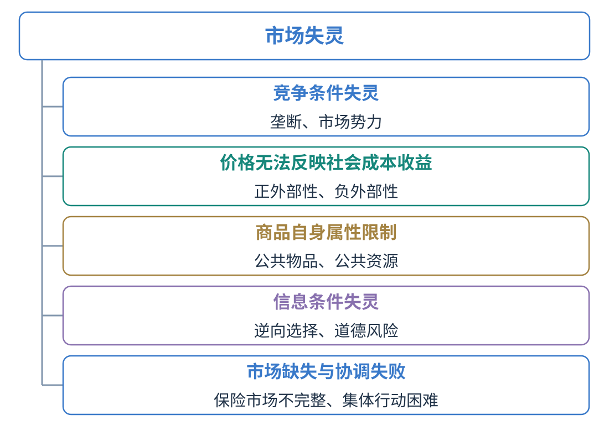

### 2.10.1 不完全竞争

- 市场势力：企业能够影响价格和交易条件。
- 垄断低效率：垄断企业可能限制产量、提高价格，造成无谓损失。
- 应对方式：反垄断政策、促进市场准入、自然垄断监管。

### 2.10.2 外部性

外部性是某项经济活动对其他人产生了影响，但这种影响没有被充分反映在交易价格之中。

- **按影响方向分类**
  - 正外部性：给第三方带来额外收益，例如知识传播。
  - 负外部性：给第三方带来额外成本，例如环境污染。
- **按成本与收益的承担主体分类**
  - 私人成本与私人收益：经济活动参与者自身承担的成本和获得的收益。
  - 外部成本与外部收益：由其他主体承担的成本和获得的收益。
  - 社会成本与社会收益：私人部分与外部部分的综合。
- **外部性的解决机制**
  - 庇古税：让造成负外部性的人承担更多社会成本。
  - 补贴：鼓励具有正外部性的经济活动。
  - 产权界定与协商：在合适条件下通过协商处理外部影响。
    - 科斯定理：在产权明确、交易成本为零等理想条件下，相关主体可以通过协商实现有效配置。
  - 行政监管：通过排放标准等制度直接限制相关行为。

### 2.10.3 商品属性与公共资源问题

商品可以根据排他性和竞争性两个维度进行分类。

- **排他性**：能否阻止没有取得使用资格的人使用商品。
- **竞争性**：一个人使用商品是否会减少其他人的可用数量。

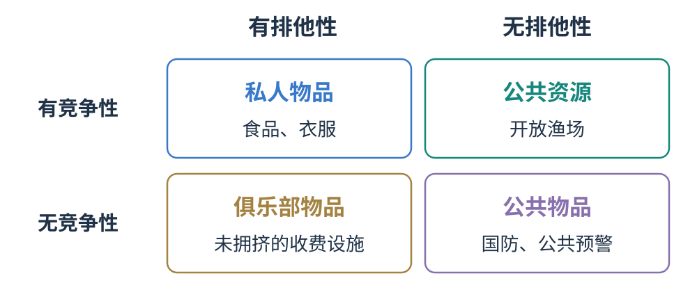

由不同商品属性进一步衍生出不同问题：

- **公共物品 → 搭便车问题**：人们可能不愿承担公共物品成本，却希望享受其收益。
  - 应对方式：公共财政供给、集体筹资等。
- **公共资源 → 公地悲剧**：个人追求自身利益可能导致公共资源被过度使用。
  - 应对方式：使用配额、产权安排、共同治理等。

### 2.10.4 信息不对称

- 交易前的信息问题：逆向选择。
- 交易后的隐藏行为问题：道德风险。
- 委托人与代理人之间的信息和利益冲突：委托代理问题。

详细理论归入第五章的信息经济学。

### 2.10.5 政府干预及其局限

- 市场失灵：解释为什么可能需要政府干预。
- 政府干预：通过税收、补贴、公共服务、监管等改善经济结果。
- 政府失灵：政府也可能受到信息不足、利益冲突、执行成本等问题限制。

**完整逻辑：** 市场机制可能产生低效率，但政府干预也存在成本和局限。因此需要比较不同制度安排的实际效果，而不是简单地认定市场或政府必然更加有效。

---

# 第三章　宏观经济学

微观经济学研究各个经济主体的行为，宏观经济学研究这些主体共同组成的经济系统。

宏观经济学的知识可以围绕四个基本问题组织：**经济生产了多少、为什么发生波动、长期如何增长、政府如何调控。**

## 3.1 宏观经济的组成结构

### 3.1.1 按经济主体分类

- **国内经济主体**
  - 居民部门：提供劳动、获得收入、进行消费与储蓄。
  - 非金融企业部门：组织生产、提供商品和服务、进行投资。
  - 金融部门：提供支付、信用和资金融通服务。
  - 政府部门：征税、提供公共服务和实施公共政策。
- **国外部门**：通过贸易、投资和资本流动与国内经济发生联系的境外主体。

### 3.1.2 按市场类型分类

- 商品与服务市场：交易经济生产的商品和服务。
- 生产要素市场：交易劳动、土地、资本服务等。
- 金融市场：进行资金配置、融资和金融资产交易。

### 3.1.3 按经济体系开放程度分类

- 封闭经济：理论上不存在对外经济交易。
- 开放经济：与其他经济体存在贸易、投资和资本流动。

## 3.2 国民经济核算

国民经济核算是为整个国家建立经济账本，记录经济活动的生产、收入、支出和财富。

### 3.2.1 经济产出指标

- **国内生产总值（GDP）**：一定时期内经济体生产的最终商品和服务总价值。
  - 名义GDP：按照当期价格计算的产出价值。
  - 实际GDP：剔除价格变动影响后的产出水平。
  - 人均GDP：GDP除以人口数量。
  - GDP增速：GDP相对于上一时期的变化速度，分析经济增长时通常使用实际GDP增速。
- **国内生产净值（NDP）**：GDP扣除固定资本消耗后的价值。

### 3.2.2 国民收入指标

- **国民总收入（GNI）**：本国常住单位获得的初次收入总额。
  - 国民生产总值（GNP）：与GNI密切对应的传统核算概念。
- **国民净收入**：国民总收入扣除固定资本消耗后的收入。
- **居民可支配收入**：经过税收及转移收支调整后，可以用于消费和储蓄的收入。

GDP与GNI主要区别在于核算角度：

$$
GNI=GDP+\text{来自国外的净初次收入}
$$

GDP重点研究国内生产，GNI重点研究本国常住单位获得的收入。

### 3.2.3 GDP的三种计算方法

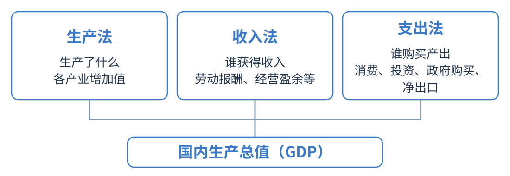

三种方法从不同角度衡量同一个生产过程，理论上结果一致。

- **生产法涉及的概念**
  - 总产出：生产单位创造的全部产出价值。
  - 中间投入：生产过程中消耗的其他商品和服务。
  - 增加值：总产出减去中间投入后的新增价值。
- **收入法涉及的概念**
  - 劳动者报酬：生产活动中劳动者获得的收入。
  - 经营盈余与混合收入：企业及其他生产主体相关的经营收入。
  - 生产和进口税减补贴：政府通过相关生产活动取得的净税收。
- **支出法涉及的概念**
  - 消费支出：用于最终消费的支出。
  - 资本形成：固定资本形成、存货变动等。
  - 政府购买：政府用于商品和服务的购买支出。
  - 净出口：出口减去进口。

基本支出恒等式：

$$
Y=C+I+G+(X-M)
$$

在这一简化模型中，各项必须采用一致的分类口径，政府投资不能在 $I$ 与 $G$ 中重复计算。

### 3.2.4 国民经济核算的扩展

- 国民经济核算体系（SNA）：统一记录经济生产、收入和资产负债的统计体系。
  - 投入产出表：记录各产业之间的生产和投入关系。
  - 资金流量表：记录不同部门的资金来源与使用。
  - 国民资产负债表：记录社会资产、负债与净财富。

## 3.3 消费、储蓄与投资理论

### 3.3.1 消费理论

- **消费支出**：居民购买商品与服务的支出。
- **消费函数**：描述收入和其他因素如何影响消费。
  - 自主消费：简化模型中不直接依赖当前收入的消费。
  - 引致消费：随着收入变化而变化的消费。
- **消费倾向**
  - 平均消费倾向：消费占可支配收入的比例。
  - 边际消费倾向：新增收入中用于新增消费的比例。

### 3.3.2 储蓄理论

- **储蓄**：收入中没有用于消费的部分。
- **储蓄函数**：描述储蓄与收入等因素之间的关系。
  - 平均储蓄倾向：储蓄占可支配收入的比例。
  - 边际储蓄倾向：新增收入中用于新增储蓄的比例。

在基本家庭收支模型中：

$$
Y_d=C+S
$$

$$
MPC+MPS=1
$$

其中，$Y_d$ 为可支配收入，$C$ 为消费，$S$ 为储蓄，$MPC$ 和 $MPS$ 分别为边际消费倾向和边际储蓄倾向。

### 3.3.3 投资理论

- **实体投资**：用于增加机器、厂房、建筑等生产资本的活动。
  - 固定资本形成：增加长期生产资产。
  - 存货投资：企业存货数量发生变化。
  - 总投资：尚未扣除固定资本消耗的投资。
  - 净投资：扣除固定资本消耗后的投资。
- **金融投资**：购买股票、债券等金融资产的活动，详细内容归入金融学。
- **投资函数**：描述融资成本、预期收益和经济前景等因素如何影响投资。

### 3.3.4 消费与储蓄理论的进一步发展

- 凯恩斯消费理论：强调当前收入对消费支出的影响。
- 生命周期假说：根据整个生命周期的预期收入安排消费。
- 永久收入假说：消费主要受到长期预期收入的影响。
- 节俭悖论：需求不足时，所有人同时减少消费可能使总收入下降，实际储蓄未必增加。

**知识联系：** 消费与储蓄属于收入的不同用途；投资则是经济支出的组成部分。在简化封闭经济核算中，事后国民储蓄与投资相等，但居民增加储蓄意愿并不保证企业立即增加投资。

## 3.4 总需求与总供给理论

### 3.4.1 总需求（AD）

表示不同总体价格水平下，社会对国内最终产出的需求。

按照支出主体分为：

- 居民消费需求。
- 企业投资需求。
- 政府购买需求。
- 国外净需求，即净出口。

### 3.4.2 总供给（AS）

表示不同价格水平下，整个经济体愿意并能够提供的产出。

- **短期总供给（SRAS）**：部分工资、价格和生产条件尚未完全调整时的供给关系。
- **长期总供给（LRAS）**：主要由劳动、资本、技术等实际生产能力决定的供给关系。
  - 潜在产出：资源得到正常、可持续利用时的产出水平。
  - 实际产出：经济体实际实现的产出。
  - 产出缺口：实际产出与潜在产出之间的差距。

### 3.4.3 总需求与总供给的均衡

- 需求不足：需求偏弱，生产能力未得到充分利用。
- 需求过热：需求过强，经济可能出现通胀压力。
- 需求冲击：居民消费、投资意愿等因素突然变化。
- 供给冲击：能源价格、技术和生产条件等因素突然变化。
- 宏观均衡：总需求与总供给相互协调形成的价格和产出状态。

**特别辨析：** 微观经济学的供求研究单个商品的价格和数量，宏观经济学的总供求研究整体价格水平与经济产出。二者具有相似的分析形式，但不能简单认为总需求曲线就是所有商品需求曲线的直接相加。

## 3.5 国民收入决定理论

### 3.5.1 基础模型的发展

- **凯恩斯交叉模型**：研究计划总支出与实际产出如何决定短期国民收入。
- **IS-LM模型**：在国民收入决定模型中进一步纳入利率和货币市场。
  - IS曲线：商品市场均衡时利率与产出的关系。
  - LM曲线：货币市场均衡时利率与产出的关系。
- **AD-AS模型**：进一步研究总体价格水平变化及供给条件对经济的影响。
- **蒙代尔—弗莱明模型**：在相关宏观模型中引入汇率和国际资本流动，研究开放经济。

### 3.5.2 支出变化的放大机制

- **乘数效应**：初始支出通过多轮收入和支出活动产生放大作用。
  - 投资乘数：投资变化对总产出的放大作用。
  - 政府支出乘数：政府购买变化对总产出的影响。
  - 税收乘数：税收通过可支配收入影响经济产出。
  - 平衡预算乘数：政府支出与税收同时等额变化对产出的影响。
- **加速原理**：需求和产出变化可能引起企业投资更大幅度的变化。
- **挤出效应**：政府支出或融资扩大在一定条件下可能减少私人投资等活动。

乘数与加速原理可能相互作用，共同放大经济波动；挤出效应则可能限制财政扩张的实际作用。

## 3.6 物价与通货膨胀

### 3.6.1 物价水平的衡量

- 消费者价格指数（CPI）：衡量居民消费商品和服务的价格变化。
- 生产者价格指数（PPI）：衡量生产者层面的价格变化。
- GDP平减指数：衡量国内最终产出的总体价格变化。
- 核心通胀指标：通过剔除特定波动项目等方法观察基础价格趋势。

### 3.6.2 物价水平的变化类型

- **通货膨胀**：总体物价水平持续上涨。
  - 通胀加速：物价上涨速度进一步提高。
  - 通胀放缓：物价仍然上涨，但上涨速度降低。
  - 恶性通胀：物价以极高速度上涨并严重破坏经济秩序。
- **通货紧缩**：总体物价水平持续下降。
- **物价稳定**：物价变化相对平稳，通常不意味着价格完全不变。

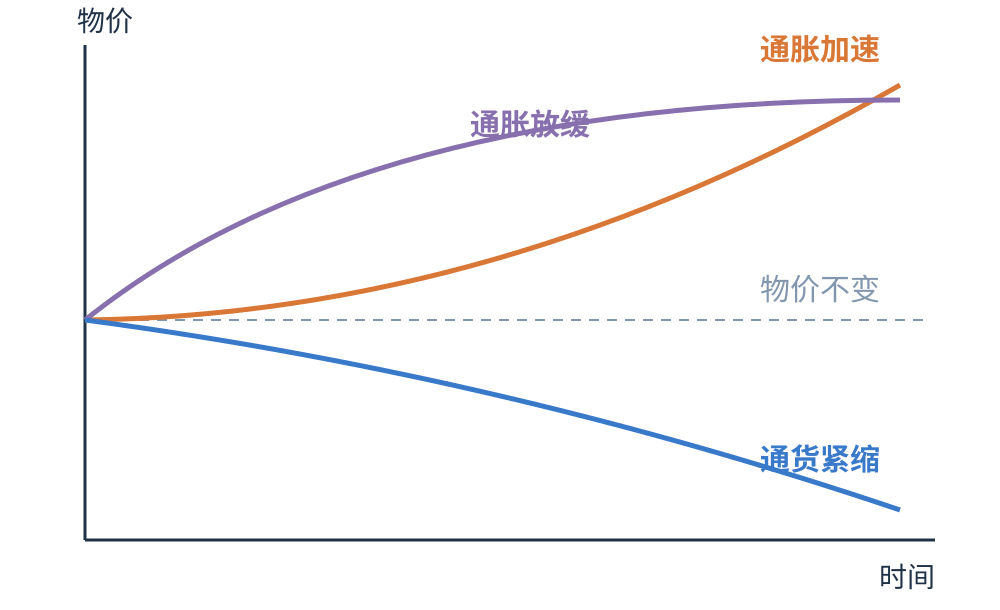

通胀放缓与通货紧缩不是同一个概念。

### 3.6.3 按通胀形成机制分类

- 需求拉动型通胀：总需求增长超过供给能力。
- 成本推动型通胀：原材料、能源、工资等成本上涨。
- 输入型通胀：国外价格和汇率变化向国内传导。
- 结构性通胀：行业间供需结构变化及生产瓶颈形成价格压力。
- 预期推动机制：人们对未来涨价的预期影响当前工资和价格决策。

这些机制可能同时存在，而不是绝对互斥的分类。

### 3.6.4 通胀的经济影响

- 货币购买力：物价上涨通常降低单位货币的购买能力。
- 实际收入：名义收入增长低于通胀率时，实际购买力可能下降。
- 实际利率：通胀变化会影响真实借贷成本。
- 收入再分配：意外通胀可能改变债权人、债务人及不同收入群体的利益。
- 工资—价格螺旋：工资与物价在一定条件下相互推动。
- 滞胀：经济低迷与较高通胀同时出现。

## 3.7 就业与失业理论

### 3.7.1 劳动人口的分类

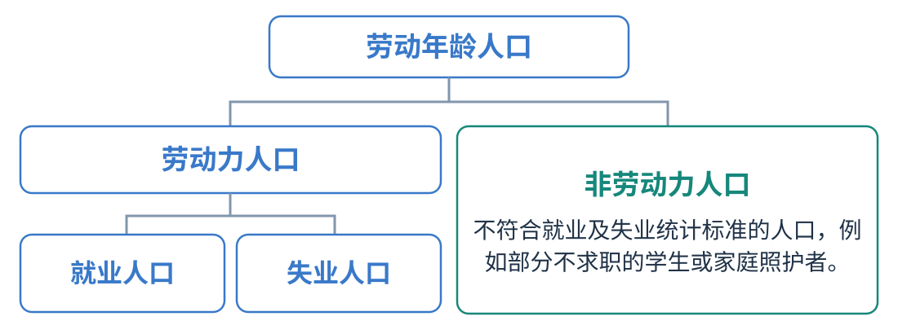

### 3.7.2 就业统计指标

- 失业率：失业人口占劳动力人口的比例。
- 劳动参与率：劳动力人口占相应劳动年龄人口的比例。
- 就业人口比率：就业人口占相应人口的比例。

### 3.7.3 按失业形成原因分类

- 摩擦性失业：寻找工作或转换工作产生的暂时失业。
- 结构性失业：劳动技能、地域与岗位需求不匹配产生的失业。
  - 技术性失业：技术进步使部分原有岗位消失或需求下降。
- 周期性失业：整体经济衰退、总需求不足引起的失业。
- 季节性失业：行业活动随季节变化产生的失业。

### 3.7.4 就业与宏观经济的关系

- 自然失业率：长期均衡条件下仍然存在的失业率。
- 充分就业：不存在显著周期性失业的状态。
- 工资黏性：工资无法随市场条件立即调整。
- 奥肯定律：描述实际产出与失业率变化之间的经验关系。
- 菲利普斯曲线：研究通胀、失业和经济活动强度之间的关系。

**交叉联系：** 奥肯定律连接经济产出与就业，菲利普斯曲线连接就业与物价，二者是宏观政策分析的重要工具，但相关关系会随经济环境和预期变化。

## 3.8 经济增长理论的基本结构

- **经济增长的来源**
  - 劳动投入增长。
  - 资本积累与资本深化。
  - 人力资本提高。
  - 技术进步与生产率提高。
- **经济增长的衡量**
  - 实际GDP增长率。
  - 实际人均GDP增长率。
  - 劳动生产率。
  - 全要素生产率（TFP）：无法直接由传统劳动和资本投入变化解释的产出效率部分。
- **经济增长方式**
  - 粗放型增长：主要依靠增加生产要素投入。
  - 集约型增长：更加依靠技术进步和资源利用效率。
- **经济增长与经济发展**
  - 经济增长关注实际产出提高。
  - 经济发展还关注产业结构、生活质量和社会条件改善。

完整增长模型归入第十章，避免重复展开。

## 3.9 宏观经济政策体系

### 3.9.1 政策目标

- 促进经济增长。
- 改善就业水平。
- 维持物价稳定。
- 促进国际收支的可持续性。
- 维护金融稳定。

### 3.9.2 按政策工具分类

- 财政政策：政府通过税收、支出和转移支付影响经济。
- 货币政策：中央银行通过利率和金融条件影响经济。
- 汇率政策：通过汇率制度及相关措施影响对外经济条件。
- 产业政策：通过制度和政策影响产业结构与发展方向。
- 宏观审慎政策：降低整个金融系统的风险积累。

### 3.9.3 按政策作用方向分类

- 扩张性政策：支持经济活动、刺激需求。
- 紧缩性政策：抑制需求过热、通胀等问题。
- 逆周期调节：根据经济波动方向采取相反方向的稳定措施。
- 顺周期行为：行为或政策进一步放大现有经济波动。

### 3.9.4 按作用对象分类

- 需求侧管理：主要通过消费、投资等调节总需求。
- 供给侧政策：主要通过技术、制度和生产能力改善经济供给。

### 3.9.5 按实施方式分类

- 自动稳定器：无需临时政策决定便能够缓冲波动的制度。
- 相机抉择：根据具体经济状况主动选择政策。
- 政策规则：按照预先设定的原则约束政策决策。

### 3.9.6 政策实施的限制

- 政策时滞：政策从制定到产生效果需要时间。
- 政策可信度：公众是否相信政策制定者会履行承诺。
- 政策冲突：增长、通胀等不同目标可能相互制约。
- 政策组合：通过多种政策协调处理不同经济问题。

## 3.10 高级宏观经济理论

高级理论按其试图解释的经济问题分类，而不按照理论名称平铺。

| 理论分支 | 下属理论与模型 | 研究目的 |
|---|---|---|
| 经济预期 | 适应性预期、理性预期 | 解释人们如何形成对未来的判断 |
| 长期增长 | 索洛、拉姆齐、内生增长模型 | 解释长期产出增长 |
| 经济周期 | 实际经济周期模型（RBC） | 研究实际经济冲击引发的波动 |
| 市场摩擦 | 新凯恩斯主义模型 | 解释价格黏性与政策的短期效果 |
| 世代差异 | 世代交叠模型（OLG） | 解释不同世代的储蓄与资源分配 |
| 动态宏观分析 | DSGE模型 | 将跨期决策、随机冲击和市场均衡纳入统一模型 |
| 部门资产负债 | SFC模型 | 从各部门收支及资产负债的一致性分析宏观经济 |
| 主体差异 | 异质性主体宏观模型 | 研究不同收入、财富主体的行为及其总体影响 |
| 政策有效性 | 卢卡斯批判、时间不一致性、李嘉图等价 | 研究政策变化、公众行为及政策承诺之间的关系 |
| 金融摩擦 | 金融加速器、托宾Q理论 | 研究融资约束和资产价值如何影响实体投资与经济波动 |

---

# 第四章　数学经济学与计量经济学

数学经济学负责**建立理论模型**，计量经济学负责**利用数据估计经济关系、检验理论和识别因果**。

## 4.1 数学经济学

### 4.1.1 基础数学工具

- 函数：描述经济变量之间的关系。
- 微积分：分析边际变化、累计变化及最优条件。
- 线性代数：处理多个经济变量之间的数量关系。
- 概率论：描述经济活动中的不确定性。
- 微分方程与差分方程：描述经济变量随时间变化的规律。
- 随机过程：研究具有随机性的经济变量演变过程。

### 4.1.2 最优化理论

- 静态最优化：研究给定时点的最优决策。
  - 无约束最优化：不存在额外限制的最优问题。
  - 约束最优化：受到预算、资源等限制的最优问题。
    - 拉格朗日乘数法：处理等式约束的优化问题。
    - KKT条件：处理更一般的约束优化问题。
- 动态最优化：研究跨时间的最优决策。
  - 动态规划：将跨期决策分解为多个阶段。
  - 最优控制：研究连续动态系统中的最优控制方案。
- 数学规划
  - 线性规划：目标与约束均采用线性关系。
  - 非线性规划：目标或约束包含非线性关系。

### 4.1.3 经济建模

- 局部均衡模型：研究单个市场。
- 一般均衡模型：研究多个市场共同运行。
- 投入产出模型：描述各产业之间的生产联系。
- 可计算一般均衡模型（CGE）：利用数值方法模拟经济系统及政策变化。
- 多主体模型（ABM）：通过模拟大量个体行为研究整体经济现象。

## 4.2 统计学与经济数据

### 4.2.1 数据类型

- 截面数据：同一时期不同研究对象的数据。
- 时间序列数据：同一变量在不同时期的数据。
- 面板数据：多个研究对象在多个时期的数据。

### 4.2.2 统计分析方法

- 描述性统计：使用均值、中位数、方差等概括数据。
- 统计推断：利用样本研究总体。
  - 参数估计：推断未知经济参数。
  - 置信区间：构造具有规定覆盖性质的参数估计区间。
  - 假设检验：判断数据是否提供足够证据拒绝某个假设。

## 4.3 计量经济模型

### 4.3.1 回归模型

- 一元回归：研究一个主要解释变量与被解释变量的关系。
- 多元回归：同时研究多个解释变量的作用。
- 非线性回归：研究不适合使用简单线性关系描述的经济现象。

### 4.3.2 参数估计方法

- 普通最小二乘法（OLS）：最小化残差平方和。
- 最大似然估计（MLE）：寻找使观测数据出现可能性最大的参数。
- 广义最小二乘法（GLS）：在特定误差结构下改进估计。
- 广义矩估计（GMM）：利用模型所规定的矩条件进行参数估计。

### 4.3.3 回归分析中的常见问题

- 内生性：解释变量与模型误差相关，导致估计可能失真。
  - 遗漏变量偏误：缺少重要变量导致其他变量的估计偏误。
  - 反向因果：因果作用可能由结果变量反向影响解释变量。
  - 某些测量误差：变量测量不准确导致内生性等问题。
- 多重共线性：多个解释变量高度相关，难以区分各自影响。
- 异方差：不同观测值的误差波动程度不同。
- 自相关：不同时期或观测单位的误差之间存在相关性。

### 4.3.4 按数据类型发展的模型

| 数据类型 | 下属模型 |
|---|---|
| 截面数据 | 线性回归、离散选择模型等 |
| 时间序列 | AR、MA、ARIMA、VAR等动态模型 |
| 面板数据 | 固定效应、随机效应、动态面板模型 |
| 空间数据 | 空间计量模型、区域关联模型 |

其中，时间序列模型主要研究趋势、波动和预测；面板模型重点利用多个主体的跨期变化；空间模型重点研究地区之间的经济联系。

## 4.4 因果推断

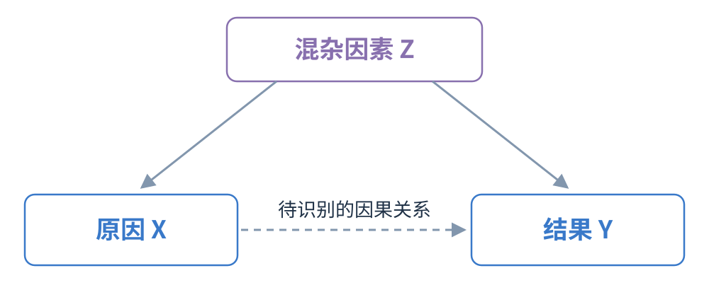

两个变量相关，可能是因为它们同时受到第三个因素影响。

### 4.4.1 因果推断的基本问题

- 相关性：变量共同发生变化。
- 因果性：一个因素真正导致另一个因素变化。
- 混杂因素：同时影响原因与结果的其他变量。
- 反事实：同一个研究对象在未接受某项政策时可能产生的结果。

### 4.4.2 因果识别方法

- **实验研究**
  - 随机对照实验（RCT）：随机分配处理措施，比较不同组的结果。
- **准实验研究**
  - 自然实验：利用外部事件产生的近似随机变化。
  - 双重差分法（DID）：比较处理组与对照组在政策前后的变化差异。
  - 断点回归法（RDD）：利用政策门槛附近的差异识别政策效果。
  - 工具变量法（IV）：借助满足相关条件的外部变量识别因果效应。
- **基于可观测特征的比较方法**
  - 倾向得分匹配（PSM）：根据可观测特征寻找相似的比较对象。
  - 合成控制法（SCM）：利用多个对照对象构造反事实比较对象。

这些方法均需要满足相应的识别条件，不能仅凭采用了某种方法就认定因果关系成立。

## 4.5 现代计算与实证工具

- 贝叶斯分析：利用已有信息和新数据更新判断。
- 蒙特卡洛模拟：通过大量随机试验研究模型结果。
- Bootstrap：通过重复抽样研究估计量的统计性质。
- 机器学习：利用算法识别数据模式和复杂关系。
- 文本分析：从经济新闻、政策文件等文本中提取信息。
- 政策模拟：通过模型预测不同政策方案可能产生的结果。

---

# 第五章　博弈论、信息经济学与机制设计

这一章是微观经济学的进一步发展，研究个体之间的战略互动、信息差异，以及如何设计制度来协调利益。

## 5.1 博弈论

### 5.1.1 博弈的组成要素

- 参与者：作出决策的个人或组织。
- 行动：参与者在某一时点采取的具体行为。
- 策略：参与者在各种可能情况下的完整行动方案。
- 收益：不同策略组合产生的利益结果。
- 信息结构：参与者能够获得哪些决策信息。
- 博弈规则：行动顺序及相关制度约束。

### 5.1.2 博弈的分类体系

博弈可以按照多个独立维度分类。

| 分类依据 | 下属类型 |
|---|---|
| 能否建立有约束力的合作安排 | 合作博弈、非合作博弈 |
| 收益是否完全对立 | 零和博弈、非零和博弈 |
| 决策是否存在先后顺序 | 静态博弈、动态博弈 |
| 是否了解参与者类型与收益结构 | 完全信息博弈、不完全信息博弈 |
| 是否能够观察此前的全部相关行动 | 完美信息博弈、不完美信息博弈 |
| 博弈是否重复发生 | 单次博弈、重复博弈 |

例如，一场企业价格竞争可以同时属于非合作博弈、非零和博弈、静态博弈和不完全信息博弈。

### 5.1.3 博弈的策略与求解

- **策略分类**
  - 纯策略：按照确定的方案行动。
  - 混合策略：按照一定概率选择不同纯策略。
- **策略判断**
  - 严格占优策略：无论其他参与者采取什么策略，收益都严格高于其他可选策略。
  - 最佳反应：给定其他参与者策略时，能够实现自身最大收益的策略。
- **均衡概念**
  - 纳什均衡：各参与者的策略均是对其他参与者策略的最佳反应。
  - 子博弈精炼纳什均衡：进一步排除动态博弈中不可信的行动承诺。
  - 贝叶斯纳什均衡：在参与者信息不完全时研究最优战略选择。
  - 完美贝叶斯均衡：结合动态博弈中的策略与信念进行均衡分析。

### 5.1.4 典型博弈模型

| 模型 | 主要研究的问题 |
|---|---|
| 囚徒困境 | 个体理性为什么可能产生集体低效率 |
| 协调博弈 | 多个主体如何在不同共同方案之间实现协调 |
| 鹰鸽博弈 | 强硬与让步策略如何相互影响 |
| 智猪博弈 | 不同能力主体之间如何形成差异化策略 |
| 讨价还价博弈 | 交易双方如何通过谈判分配利益 |
| 公共物品博弈 | 个人是否愿意为集体利益承担成本 |

### 5.1.5 合作与策略演化

- 合作博弈：研究联盟形成与利益分配。
  - 沙普利值：根据参与者对不同合作联盟的平均边际贡献分配收益。
- 重复博弈：研究长期互动如何改变合作与竞争激励。
- 演化博弈：研究策略如何通过学习、模仿和选择逐渐演变。

## 5.2 信息经济学

信息经济学研究信息如何影响经济行为、市场交易及资源配置。

### 5.2.1 信息本身的经济属性

- 信息价值：信息帮助经济主体改善决策所带来的价值。
- 信息获取成本：搜索、验证和处理信息的成本。
- 信息不确定性：决策者无法完全了解真实状态和未来结果。

### 5.2.2 信息不对称产生的问题

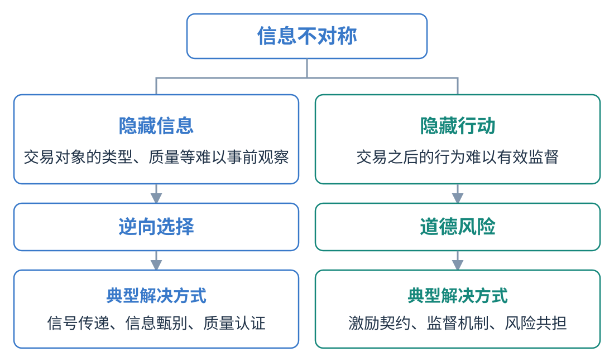

- **逆向选择**：由于事前信息差异，高风险或低质量对象可能更容易进入交易。
  - 柠檬市场：买方无法准确识别商品质量，低质量商品可能排挤高质量商品。
- **道德风险**：由于行为难以观察或后果未被完全承担，交易一方可能改变行为。
- **委托代理问题**：委托人与代理人目标不一致，且委托人无法充分获取代理人的信息或监督行为。

### 5.2.3 缓解信息不对称的机制

- 信号传递：信息较多的一方主动传递自身信息，例如学历、质量保证。
- 信息甄别：信息较少的一方设计方法识别不同对象，例如考试和审查。
- 信息披露：通过制度要求公开必要信息。
- 监督机制：持续观察并约束交易对象的行为。
- 激励契约：通过收益和成本安排使代理人采取符合约定目标的行为。

## 5.3 契约理论

这一节尤其需要区分分类关系、构成关系与因果关系。

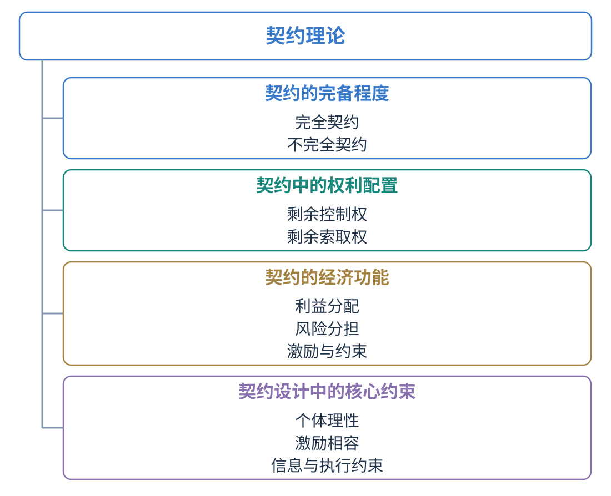

### 5.3.1 按契约的完备程度分类

- **完全契约**：理论上能够提前规定所有相关情况及其对应的权利、义务和行动。
- **不完全契约**：由于未来难以预测、信息无法验证、签约成本等因素，部分事项无法预先写入合同。

二者是同一分类维度下的并列概念。

### 5.3.2 不完全契约衍生的权利配置问题

当合同无法规定所有未来情况时，就需要研究未约定事项的处理权及相关收益的归属。

- **剩余控制权**：合同未明确规定的事项由谁作出决定。
- **剩余索取权**：在履行工资、债务等既定义务后，剩余经济收益归谁所有。

| 权利类型 | 回答的问题 |
|---|---|
| 剩余控制权 | 谁拥有决定权？ |
| 剩余索取权 | 谁获得剩余收益？ |

两种权利都与产权配置和企业治理密切相关，但并不互相包含，也不一定归属于同一主体。

例如，企业管理层可能拥有较大的经营决策权，而股东通常拥有相应的剩余收益请求权。这种权利分离又可能进一步产生委托代理问题。

需要注意，剩余控制权尤其是不完全契约理论的核心概念；剩余索取权则是更广泛的收益权配置概念，并非只在不完全契约中存在。

### 5.3.3 契约的经济功能

- **利益分配**：规定不同参与者如何分享经济成果。
- **风险分担**：规定未来收益不确定或损失发生时，各方分别承担多少风险。
- **激励与约束**：通过报酬、处罚和权利安排引导各方行为。

风险分担不是剩余控制权的下位概念，也不是机制设计的同义词。它是契约可能需要实现的一项经济功能。

### 5.3.4 最优契约设计

最优契约研究如何在信息不完全、风险和利益冲突等条件下设计相对有效的合同。

- 个体理性约束：参与者接受契约的收益不能低于其他可行选择。
- 激励相容约束：参与者追求自身利益的行为能够符合设计者的目标。
- 信息约束：某些信息无法观察、验证或写入合同。
- 执行约束：合同能够得到监督、履行及法律执行。

## 5.4 机制设计与市场设计

### 5.4.1 机制设计的基本组成

机制设计可以理解为博弈论的反向运用：

- 博弈论：给定规则，分析人们会采取什么行为。
- 机制设计：给定希望实现的目标，设计能够引导人们实现这一目标的规则。

机制设计主要包含：

- 社会目标：希望实现效率、公平、收入或其他结果。
- 参与者信息：了解参与者的私人信息及偏好。
- 分配规则：决定资源最终如何配置。
- 支付规则：规定参与者需要支付或获得什么。
- 激励约束：保证参与者愿意参与并采取预期行为。
  - 个体理性约束。
  - 激励相容约束。
  - 显示原理：在一定条件下，将可实现的结果转化为真实报告机制进行研究。

### 5.4.2 机制设计的应用分支

- **拍卖理论**
  - 英式拍卖：价格逐步提高的公开竞价。
  - 荷兰式拍卖：价格逐步降低，直到有人接受。
  - 第一价格密封拍卖：中标者支付自己的报价。
  - 第二价格密封拍卖：中标者支付第二高报价。
- **匹配理论**
  - 双边匹配：研究学生与学校、劳动者与岗位等双方配置。
  - 稳定匹配：不存在双方都愿意脱离当前匹配、重新组合的情况。
- **公共资源分配**
  - 公共物品筹资机制。
  - 环境排放额度分配机制。
  - 公共服务资格及配给机制。

### 5.4.3 市场设计

市场设计将博弈论、机制设计和具体市场制度结合起来，解决实际市场中的交易、匹配与资源配置问题。

## 5.5 本章各理论之间的关系

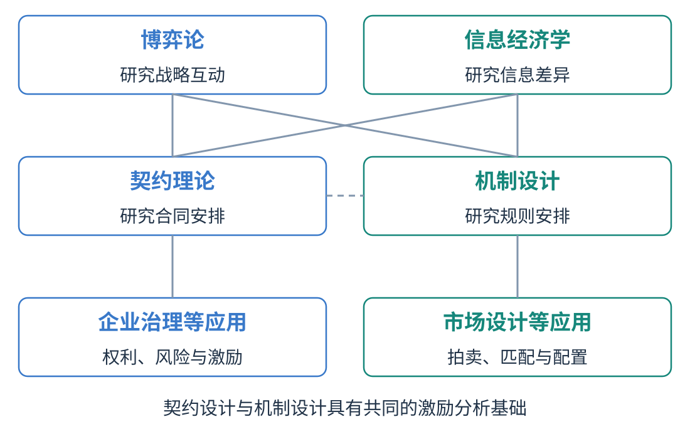

具体来说，**博弈论提供分析方法，信息经济学提出信息问题，契约理论研究如何利用合同协调各方利益，机制设计研究如何通过更广泛的制度规则实现目标。**

风险分担可以成为契约设计的目标，也可以成为机制设计中的目标。剩余控制权与剩余索取权可以影响契约激励和企业治理，但它们与风险分担、机制设计并不存在简单的上下位关系。

这正是 V2.5 不再采用单纯术语表的原因：需要明确知识之间究竟是什么关系，而不是仅仅把相关名词放在同一章节。

---

# 第二篇　现代经济运行体系

第一篇提供理解经济活动的理论基础，第二篇则研究现实社会通过哪些机制组织整体经济运行。

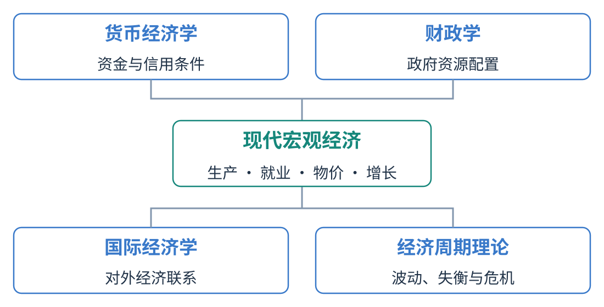

# 第六章　货币经济学与银行体系

本章的核心逻辑是：

**货币的产生 → 信用的发展 → 银行体系的形成 → 货币供给与需求 → 利率与货币政策 → 实体经济运行。**

专业金融工具的定价、交易和投资管理继续归入独立金融学体系。

## 6.1 货币的起源、本质与职能

### 6.1.1 交换方式

- 物物交换：直接交换商品，需要交易双方的需求相互匹配。
- 货币交换：利用普遍接受的货币充当中间交换媒介，降低交易困难。

### 6.1.2 货币的基本类型

- **按照货币价值基础分类**
  - 商品货币：本身具有使用价值的交换媒介。
  - 金属货币：以黄金、白银等金属作为货币。
  - 信用货币：主要依靠发行机构信用、制度和社会接受程度维持使用价值。
- **按照法律地位分类**
  - 法定货币：法律和国家货币制度确立其货币地位。
  - 其他交换媒介：在特定群体或场景中能够用于交易，但不一定具有法定货币地位。
- **按照表现形式分类**
  - 实物现金：纸币、硬币等。
  - 账户货币：例如银行存款。
  - 中央银行数字货币（CBDC）：由中央银行发行的数字形式货币。

上述分类维度存在交叉，例如中央银行数字货币既是数字形式的货币，也可以具有法定货币地位。

### 6.1.3 货币的基本职能

- 价值尺度：为不同商品提供统一计价单位。
- 交换媒介：降低商品交换中的困难。
- 支付手段：用于偿还债务和履行支付义务。
- 价值储藏：将购买力保存到未来。
- 国际货币职能：在国际交易中承担计价、支付和储备等作用。

## 6.2 货币数量与货币层次

### 6.2.1 按发行和创造主体划分

- **中央银行货币**
  - 流通中的现金。
  - 商业银行在中央银行持有的准备金。
  - 二者等项目通常构成基础货币。
- **商业银行货币**
  - 活期存款：通常可以较方便地用于支付。
  - 储蓄存款：主要用于储蓄和日常资金管理。
  - 定期存款：按照约定期限和条件存放的资金。

### 6.2.2 按流动性划分的货币层次

概念性包含关系示意。具体货币统计口径因国家和时期而异。

- 流动性：资产能够迅速、低成本地转换为支付手段的程度。
- 狭义货币：流动性较高、能够方便用于支付的货币。
- 广义货币：在狭义货币基础上纳入更多具有货币性质的资产。
- 准货币：不便直接用于日常支付，但能够较方便转换为货币的资产。

**特别辨析：** 基础货币是从中央银行货币负债等角度划分的，M0、M1、M2则主要按照货币流动性及统计口径划分。基础货币与M0不是同一概念。

## 6.3 信用、债权与债务

### 6.3.1 信用的基本关系

- **信用**：基于未来履约承诺进行资源和购买力转移的经济关系。
  - 债权人：拥有要求其他主体偿还或履约的权利。
  - 债务人：承担偿还资金或履行义务的责任。
  - 债权：债权人拥有的请求权。
  - 债务：债务人承担的经济义务。

### 6.3.2 按信用主体分类

- 商业信用：企业之间通过延期付款等方式提供信用。
- 银行信用：银行通过贷款等方式提供信用。
- 国家信用：政府通过发债等方式获得资金。
- 消费信用：居民为满足消费需求而获得的信用。

### 6.3.3 信用规模与经济活动

- 信用扩张：贷款及其他信用活动增加。
- 信用收缩：融资活动减少、信用条件收紧。
- 杠杆：通过借债等方式扩大资产和经营规模。
- 去杠杆：降低债务相对于资产、收入或权益资本的比例。

### 6.3.4 债务问题及处理

- 债务负担：偿债支出对主体经济资源形成的压力。
- 债务可持续性：主体能否在合理条件下长期履行偿债义务。
- 债务违约：未能按照合同规定履行偿债义务。
- 债务重组：重新安排本金、利率和期限等偿债条件。

## 6.4 现代银行体系

### 6.4.1 银行体系的机构分类

- **中央银行**
  - 发行中央银行货币。
  - 实施货币政策。
  - 支持银行间支付结算。
  - 在符合条件时充当最后贷款人。
  - 承担相应的金融稳定职责。
- **商业银行**
  - 接受存款。
  - 发放贷款。
  - 提供支付和结算服务。
  - 开展信用创造。
- **政策性银行**
  - 主要服务于特定国家发展和公共政策目标。
- **其他信用中介机构**
  - 提供传统银行以外的信用和融资服务。
  - 影子银行：在传统银行监管体系之外或边缘开展信用中介活动的机构和安排。

### 6.4.2 商业银行的资产负债结构

- **资产端**：银行拥有的经济资源和债权。
  - 贷款资产。
  - 准备金。
  - 持有的其他金融资产。
- **负债端**：银行对其他经济主体承担的义务。
  - 客户存款。
  - 银行借款及其他负债。
- **所有者权益**：银行资产扣除负债后属于所有者的剩余权益。

基本关系：

$$
\text{资产}=\text{负债}+\text{所有者权益}
$$

这一关系也是现代银行货币创造机制的理解基础。

### 6.4.3 银行的经营约束与稳定机制

- 资本约束：银行需要拥有能够承担潜在损失的资本。
  - 资本充足率：银行资本相对于风险加权资产的比例。
- 流动性约束：银行需要能够满足存款提取及其他支付义务。
  - 流动性不足：短期缺乏能够使用的支付资金。
- 信用风险约束：银行需要判断贷款能否按时收回。
  - 不良贷款：偿还情况存在问题的贷款。
- 稳定保障制度
  - 存款保险：按照规定为符合条件的存款提供保障。
  - 最后贷款人：在符合条件时提供紧急流动性支持。
  - 银行监管：通过规则和监督限制过度风险承担。

## 6.5 货币创造与消灭

### 6.5.1 中央银行货币创造

中央银行可以通过资产购买、向金融机构提供贷款等方式形成新的中央银行货币。

### 6.5.2 商业银行信用创造

商业银行发放贷款时，通常同时形成贷款资产和客户存款负债。

银行贷款增加了存款货币，但不会因此立即创造等额的真实生产资料和社会净财富。

### 6.5.3 货币消灭

借款人使用银行存款偿还贷款本金时，银行的贷款资产及存款负债通常相应减少。

### 6.5.4 货币创造的理论解释

- 外生货币假设：将货币供给视为由货币当局决定的变量。
- 内生货币理论：强调货币供给随银行信用活动和社会融资需求变化。
- 货币乘数：广义货币与基础货币之间的比例；传统模型用它解释货币扩张。

**特别辨析：** 现代商业银行并非简单地先获得一定存款，再按照固定倍数发放贷款。贷款活动同时受到资本、流动性、借款需求和信用风险等多重约束。

## 6.6 货币供给与货币需求

### 6.6.1 货币供给

- 基础货币供给：中央银行相关操作形成的货币供给。
- 存款货币供给：商业银行等货币金融机构相关活动形成的货币供给。
- 货币存量：在特定时点存在的货币数量。

### 6.6.2 货币需求

按照凯恩斯货币需求理论中的持有动机分类：

- 交易动机：为日常经济交易持有货币。
- 预防动机：为应对不确定支出持有货币。
- 投机动机：根据利率及资产价格预期选择是否持有货币。

### 6.6.3 货币需求与供给的理论联系

- 流动性偏好理论：解释人们为什么愿意持有货币等流动性资产。
- 货币市场均衡：货币供给与货币需求相互协调的状态。
- 流动性陷阱：在特定低利率环境下，传统货币扩张难以进一步降低利率并刺激经济。

### 6.6.4 货币数量与经济产出的关系

货币数量方程：

$$
MV=PY
$$

- $M$：货币数量。
- $V$：货币流通速度。
- $P$：总体价格水平。
- $Y$：实际经济产出。

由此发展出货币数量论、货币中性等理论，研究货币数量变化如何影响物价和实际经济活动。

这一恒等关系本身不能证明货币增加必然导致物价等比例上涨。

## 6.7 利率理论

### 6.7.1 利率的本质

- 利息：使用资金所支付的报酬。
- 利率：单位本金在一定时期内对应的利息比例。
- 融资成本：经济主体获取资金所承担的经济代价。

### 6.7.2 利率的分类体系

- **按是否考虑通胀分类**
  - 名义利率：未扣除通胀影响的利率。
  - 实际利率：考虑购买力变化后的利率。
    - 事前实际利率：根据预期通胀计算。
    - 事后实际利率：根据实际通胀计算。
- **按形成机制分类**
  - 政策利率：中央银行用于传导货币政策的利率。
  - 市场利率：市场交易和供求关系等形成的利率。
- **按借贷活动分类**
  - 存款利率：存款人获得的相应利率。
  - 贷款利率：借款人承担的相应利率。
  - 银行间利率：金融机构之间资金融通的相关利率。
- **按理论分析用途分类**
  - 自然利率：与潜在产出、通胀稳定等状态相一致的理论实际利率。
  - 无风险利率：理论上不包含违约风险的基准利率。

### 6.7.3 利率的影响因素

- 社会储蓄与投资需求。
- 中央银行货币政策。
- 通货膨胀及其预期。
- 借款人信用风险。
- 资金使用期限与流动性。
- 宏观经济增长预期。

### 6.7.4 利率的相关理论

- 可贷资金理论：从储蓄与投资等资金供求关系解释利率。
- 流动性偏好理论：从货币持有需求与供给关系解释利率。
- 费雪效应：在一定条件下，预期通胀变化会影响名义利率。
- 风险溢价：资金提供者承担额外风险所要求的补偿。

利率期限结构、收益率曲线和利率金融产品的深入分析归入金融学。

## 6.8 中央银行货币政策

### 6.8.1 政策目标与操作工具

- **常规货币政策工具**
  - 政策利率调整：改变市场资金成本。
    - 降息：降低相关政策利率。
    - 加息：提高相关政策利率。
  - 公开市场操作：通过证券买卖、回购等影响金融体系流动性。
  - 存款准备金政策：调整银行准备金要求。
    - 降准：降低存款准备金要求。
    - 提高准备金率：增加相关准备金要求。
  - 中央银行贷款工具：为符合条件的金融机构提供资金。
    - 再贷款。
    - 再贴现。
    - 常备借贷便利等。
- **非传统货币政策工具**
  - 量化宽松（QE）：通过大规模资产购买等方式放松金融条件。
  - 量化紧缩（QT）：通过减少资产持有等方式收缩中央银行资产负债表。
  - 前瞻性指引：通过政策沟通影响公众对未来政策的判断。
  - 负利率政策：在特定制度下使某些政策利率低于零。

### 6.8.2 货币政策的传导渠道

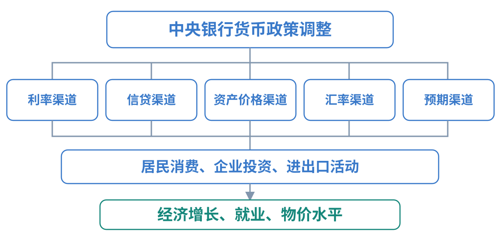

五种传导渠道属于并列关系，不是必须依次发生的五个阶段。

- 利率渠道：融资成本变化影响消费与投资。
- 信贷渠道：贷款可获得性影响企业和居民的经济行为。
- 资产价格渠道：通过财富、抵押品价值影响经济活动。
- 汇率渠道：通过相对价格和资本流动影响进出口等活动。
- 预期渠道：通过改变市场对未来经济和政策的判断影响当前决策。

### 6.8.3 货币政策的制度框架

- 通胀目标制：将通胀目标作为政策决策的重要依据。
- 泰勒规则：根据通胀、产出缺口等变量提供利率政策参考。
- 中央银行独立性：中央银行在法定框架内自主开展政策决策的程度。
- 财政主导与货币主导：研究财政需求和货币政策目标之间的制度关系。

## 6.9 金融系统与实体经济

### 6.9.1 金融系统的基本构成

- 金融机构：银行、保险公司等提供金融服务的机构。
- 金融市场：资金和金融资产发生交易的市场。
  - 货币市场：主要提供短期资金融通。
  - 资本市场：主要提供中长期融资和资本配置。
- 金融工具
  - 股票：代表对企业的相关所有权和权益。
  - 债券：代表发行主体承担的债务义务。
  - 贷款：以信用合同建立的借贷关系。

### 6.9.2 金融系统的社会经济职能

- 资金融通
  - 直接融资：通过股票、债券等直接联系资金供求主体。
  - 间接融资：通过银行等金融中介配置资金。
- 支付与结算：支持经济活动中的资金转移。
- 风险分担：通过保险、合同等机制配置经济风险。
- 跨期资源配置：使当前储蓄能够支持未来消费和生产。
- 信息处理：通过信用评价等方法减少资源错配。

### 6.9.3 金融发展的经济影响

- 金融深化：金融活动和服务在经济中的作用逐渐增强。
- 金融普惠：提高不同社会群体获得适当金融服务的能力。
- 金融脱媒：资金部分绕过传统银行中介直接配置。
- 金融化：金融活动和金融动机在经济系统中的重要性提高。
- 金融稳定：金融体系能够承受风险并持续发挥经济职能。
- 系统性金融风险：局部金融问题扩散并冲击整个经济系统。

---

# 第七章　财政学与公共经济学

财政学研究政府怎样获得公共资源、使用公共资源和承担债务；公共经济学则进一步研究政府为什么参与经济活动，以及其参与是否合理有效。

## 7.1 政府参与经济活动的理论基础

- **市场失灵**
  - 公共物品供给不足。
  - 外部性未得到充分处理。
  - 市场竞争受到限制。
  - 信息不对称及市场缺失。
- **社会分配问题**
  - 收入与财富差距。
  - 社会保障不足。
  - 基本公共服务获取机会不均等。
- **宏观经济波动**
  - 经济衰退与失业。
  - 需求不足与经济过热。
  - 重大经济危机。

上述问题对应政府的三项主要经济职能：

| 经济职能 | 主要目标 | 典型工具 |
|---|---|---|
| 资源配置职能 | 改善资源使用效率 | 公共投资、监管 |
| 收入分配职能 | 调节社会收入与机会差距 | 税收、社会保障 |
| 经济稳定职能 | 减轻宏观经济波动 | 财政政策、自动稳定器 |

## 7.2 财政运行的基本结构

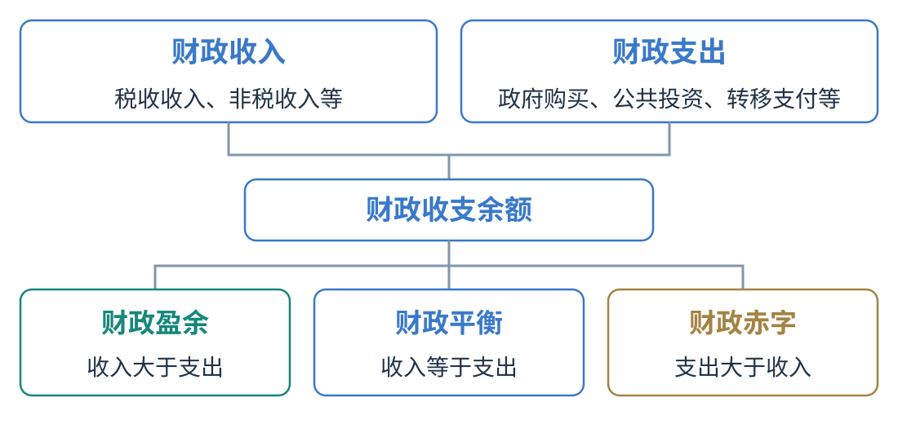

财政赤字可能产生融资需求，融资活动进一步影响政府债务。

## 7.3 财政收入与税收

### 7.3.1 财政收入的来源

- 税收收入：依法征收的公共收入。
- 非税收入：行政收费、国有资产相关收益等税收之外的财政收入。
- 政府间收入：来自其他政府层级的相关转移资金。

政府举债属于融资活动，不能简单视为与税收相同性质的财政收入。

### 7.3.2 税收的基本构成

- 纳税人：依法承担纳税义务的主体。
- 税基：用于确定应缴税额的计税基础。
- 税率：按照计税基础确定税额的相关比例或标准。
- 税额：实际需要缴纳的税收金额。

### 7.3.3 税收的分类体系

- **按照征税对象分类**
  - 所得税：对个人或企业所得征税。
    - 个人所得税。
    - 企业所得税。
  - 商品与服务税：对商品、服务及相关交易征税。
    - 增值税。
    - 消费税。
    - 部分销售税。
  - 财产税：对财产及其相关价值征税。
  - 关税：对相关跨境商品交易征税。
- **按照征收和承担方式分类**
  - 直接税：通常直接针对收入和财产征收。
  - 间接税：通常通过商品和服务交易征收。
- **按照税负比例随计税基础变化的关系分类**
  - 累进税：税负比例随计税基础增加而提高。
  - 比例税：税负比例保持相对固定。
  - 累退税：税负比例随相关收入或计税基础增加而降低。

### 7.3.4 税收对经济的影响

- 税负归宿：研究消费者、企业等最终由谁承担税负。
- 税负转嫁：通过价格、工资等变化转移部分税负。
- 税收扭曲：税收改变原有经济行为和资源配置。
- 税收公平：评价不同主体承担的税负是否合理。
  - 横向公平：经济条件相近的主体承担相近税负。
  - 纵向公平：不同经济能力主体按照适当原则承担不同税负。
- 最优税收理论：研究财政收入、效率和公平之间的权衡。
- 拉弗曲线：描述税率与税收总收入之间可能存在的非线性关系。

**交叉联系：** 税负归宿与第二章的供给、需求弹性直接相关。相对缺乏弹性的一方通常更难改变行为，因而可能承担更多税负。

## 7.4 财政支出

### 7.4.1 按政府是否获得直接对价分类

- **购买性支出**：政府购买商品、工程和服务所产生的支出。
  - 政府消费：用于提供公共服务的经常性资源使用。
  - 公共投资：用于道路、学校、基础设施等长期资产建设。
  - 公共采购：政府取得商品、工程和服务的制度过程。
- **转移性支出**：不以直接取得商品和服务为条件的资金转移。
  - 社会福利。
  - 养老金等社会保障支出。
  - 财政补贴。
  - 政府间转移支付。

### 7.4.2 按公共服务目的分类

- 教育、医疗与社会保障支出。
- 基础设施与公共建设支出。
- 行政管理与公共安全支出。
- 国防支出。
- 产业发展与技术创新支持。

### 7.4.3 财政支出效果的评价

- 财政支出效率：公共资金是否得到有效使用。
- 成本收益分析：比较公共项目的社会成本和收益。
- 财政乘数：财政支出等变化对整体经济产出的影响。

## 7.5 政府预算与财政赤字

### 7.5.1 政府预算制度

- 政府预算：一定时期内财政收入与支出的计划。
- 预算执行：按照批准的预算安排实际收入与支出。
- 财政决算：对实际财政收支结果进行汇总。
- 财政监督：监督公共资金使用的合法性和有效性。

### 7.5.2 财政余额的不同统计维度

- **按收入与支出关系分类**
  - 财政盈余。
  - 财政平衡。
  - 财政赤字。
- **按是否剔除利息支出分类**
  - 总体财政余额：包含相关利息支出的财政余额。
  - 初级财政余额：剔除利息支出后的财政余额。
- **按经济周期影响分类**
  - 周期性财政赤字：由经济波动导致的财政收支恶化。
  - 结构性财政赤字：排除经济周期等暂时因素后的财政赤字。
- **按经济规模标准化**
  - 财政赤字率：财政赤字占GDP的比例。

## 7.6 政府债务

### 7.6.1 政府债务的类型

- **按举债主体分类**
  - 中央政府债务。
  - 地方政府债务。
- **按债务记录与确认情况分类**
  - 显性债务：已经明确确认和记录的债务。
  - 隐性债务：没有充分体现在正式记录中、可能需要承担的债务义务。
- **按债务责任性质分类**
  - 直接债务：已经存在的确定偿债义务。
  - 或有负债：在特定事件发生时才形成的偿付义务。

### 7.6.2 政府债务的形成与管理

- 国债：中央政府发行的债务工具。
- 政府债务融资：通过发债、借款等获得资金。
- 债务滚续：通过新融资偿还到期债务。
- 债务重组：重新安排债务偿还条件。
- 财政货币化：通过中央银行相关货币创造机制提供财政融资。

### 7.6.3 政府债务的评价指标

- 政府债务率：政府债务余额与GDP之比。
- 利息负担：政府利息支出相对于财政收入等指标的比例。
- 财政空间：政府能够实施扩张性财政措施的余地。
- 债务可持续性：政府能否长期维持偿债能力。
- 主权债务危机：政府出现严重偿债或再融资困难。

**重要联系：** 财政赤字是一定时期内形成的流量，政府债务是特定时点存在的存量。赤字通常会增加融资需求和债务，但二者之间还受到其他财政金融交易及价值变化等因素影响。

## 7.7 财政体制与中央地方关系

- **财政权责划分**
  - 财权：取得和管理财政资源的权限。
  - 事权：承担公共事务的责任。
  - 支出责任：为相关公共事务承担资金支出的责任。
- **财政分权**
  - 收入分权：划分不同层级政府的收入来源。
  - 支出分权：划分公共服务支出责任。
  - 分税制：按照规则划分不同层级政府的税收收入。
- **政府间财政调节**
  - 转移支付：在不同政府之间转移公共资金。
  - 财政均衡：缓解不同地区财政能力和服务水平差距。
- **地方财政运行**
  - 地方税收。
  - 地方公共支出。
  - 地方政府融资。
  - 土地财政：对土地出让等相关收入存在较高依赖的财政运行方式。

## 7.8 财政政策

- 扩张性财政政策
  - 增加政府支出。
  - 降低相关税收。
  - 增加转移支付。
- 紧缩性财政政策
  - 减少相关政府支出。
  - 增加税收。
  - 改善财政收支状况。
- 财政自动稳定器
  - 累进所得税等税收制度。
  - 失业保险等随经济条件变化的支出制度。
- 财政政策约束
  - 财政规则。
  - 债务可持续性。
  - 财政乘数的不确定性。
  - 政策时滞与执行能力。

## 7.9 公共选择与政府失灵

- **公共选择理论**：运用经济学方法研究政府和公共决策。
  - 投票理论：研究个人偏好如何形成集体决定。
  - 中位选民理论：特定投票条件下，中间偏好的选民可能决定政策结果。
  - 集体行动：研究个人如何组织起来实现共同利益。
  - 利益集团：通过组织行动影响公共政策的群体。
- **政府失灵的形成机制**
  - 信息不足。
  - 官僚激励与公共目标不一致。
  - 寻租行为：主要依靠争取特权获得收益。
  - 政策执行成本及监管困难。
- **政策评价**
  - 成本收益分析。
  - 公共服务绩效评价。
  - 因果推断与政策效果评估。

---

# 第八章　国际经济学

国际经济学内部存在两个主要理论分支：**国际贸易理论**与**国际货币金融及开放经济理论**。前者研究商品和服务跨境流动，后者研究国家之间的货币、资本和宏观政策联系。

## 8.1 国际经济活动的基本分类

- **国际商品流动**
  - 商品进口：从国外购买商品。
  - 商品出口：向国外出售商品。
- **国际服务流动**
  - 运输、旅游、软件、咨询等服务贸易。
- **国际生产要素流动**
  - 国际劳动迁移。
  - 国际资本流动。
  - 国际技术与知识传播。
- **国际生产组织**
  - 跨国公司：在多个经济体开展经营活动的企业。
  - 全球产业链：不同生产环节在多个国家分布。
  - 全球供应链：跨境采购、生产、运输和交付网络。
  - 全球价值链：不同国家在产品价值创造过程中承担不同环节。

## 8.2 国际贸易的衡量指标

- 进口额：进口商品或服务的价值。
- 出口额：出口商品或服务的价值。
- 贸易总额：相应进口额与出口额之和。
- 贸易差额：出口额减去进口额。
  - 贸易顺差：出口额大于进口额。
  - 贸易逆差：进口额大于出口额。
- 贸易依存度：通常以进出口总额占GDP的比例衡量国际贸易参与程度。
- 贸易条件：出口商品价格相对于进口商品价格的关系。

贸易差额与经常账户余额不是同一概念。经常账户还包括跨境初次收入和二次收入等交易。

## 8.3 国际贸易理论

### 8.3.1 传统贸易理论

- **绝对优势理论**：不同国家根据生产效率差异进行分工。
- **比较优势理论**：不同国家根据相对机会成本差异进行分工。
- **要素禀赋理论（H-O模型）**：国家倾向于出口密集使用本国相对丰富生产要素的商品。

### 8.3.2 贸易与收入分配理论

要素禀赋理论等模型进一步产生了研究贸易利益分配的理论。

- 斯托尔珀—萨缪尔森定理：商品相对价格变化可能使不同生产要素的报酬发生不同方向的变化。
- 要素价格均等化理论：在严格条件下，国际商品贸易可能推动各国要素报酬趋同。
- 雷布钦斯基定理：在特定条件下，生产要素数量变化会改变产业产出结构。
- 特定要素模型：研究要素不能自由跨行业移动时，贸易如何影响不同群体。

### 8.3.3 现代贸易理论

- 新贸易理论：利用规模经济、产品差异化和不完全竞争解释贸易。
  - 产业内贸易：不同国家同时进口和出口同一产业类别的商品。
- 异质性企业贸易理论：从企业生产率差异解释为什么只有部分企业参与出口。
- 贸易引力模型：利用经济规模、距离和贸易成本等因素解释贸易流量。

**理论发展联系：** 传统贸易理论重点解释国家之间为什么贸易，现代贸易理论进一步研究为什么相似国家也会大量贸易、为什么同一行业内的企业具有不同国际竞争力。

## 8.4 国际贸易政策

### 8.4.1 基本政策方向

- 自由贸易：尽量减少跨境商品和服务流动的限制。
- 贸易保护：通过政策限制国外竞争，以实现特定国内经济目标。

### 8.4.2 贸易政策工具

- **关税措施**
  - 进口关税。
  - 出口关税。
- **非关税措施**
  - 进口配额。
  - 技术标准。
  - 进口许可制度。
  - 原产地规则。
- **贸易支持措施**
  - 出口补贴等政策。
  - 出口信用支持。
- **贸易救济措施**
  - 反倾销措施：处理符合相关认定条件并造成损害的倾销行为。
  - 反补贴措施：处理符合条件并造成损害的国外补贴。
  - 保障措施：在满足相关条件时应对进口增加造成的严重损害。

### 8.4.3 贸易保护的理论依据

- 幼稚产业保护：暂时保护尚未具备充分竞争力的产业。
- 战略性贸易政策：利用产业规模经济和竞争特点争取经济利益。
- 产业安全：减少关键商品和技术的供应中断风险。
- 收入与就业保护：缓冲贸易变化对特定群体的冲击。

这些政策可能产生国内保护收益，也可能带来消费者成本、资源错配或其他国家的反制，因此需要结合实际条件评价。

## 8.5 国际货币与汇率

### 8.5.1 外汇的基本概念

- 外汇：可用于国际结算的外国货币及相关外币资产。
- 汇率：一种货币用另一种货币表示的兑换价格。
  - 本币升值：本国货币相对于另一种货币价值上升。
  - 本币贬值：本国货币相对于另一种货币价值下降。

### 8.5.2 汇率的分类

- **按计价方式分类**
  - 直接标价法：以本币表示一定单位外国货币的价格。
  - 间接标价法：以外币表示一定单位本币的价格。
- **按是否考虑物价分类**
  - 名义汇率：实际观察到的货币兑换比例。
  - 实际汇率：经过国内外价格水平调整后的相对价格关系。
- **按比较对象分类**
  - 双边汇率：两种货币之间的汇率。
  - 有效汇率：根据多个经济伙伴的货币及其权重形成的综合指标。

### 8.5.3 汇率制度

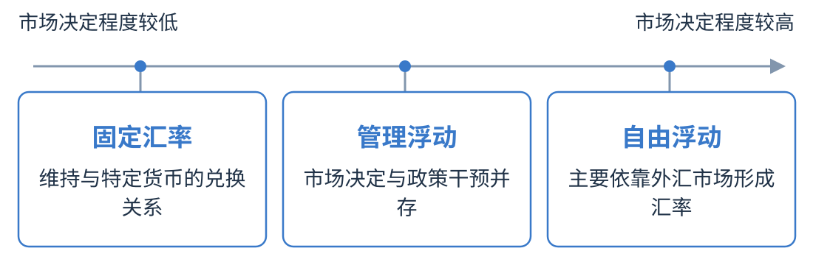

现实汇率制度存在更多中间类型。

- 固定汇率制度：货币当局努力维持特定汇率关系。
- 管理浮动制度：汇率受市场影响，同时保留政策干预。
- 自由浮动制度：汇率主要由市场供求决定。
- 汇率干预：货币当局通过外汇交易等措施影响汇率。

### 8.5.4 汇率形成理论

- 购买力平价理论：根据不同国家的价格水平解释长期汇率关系。
- 利率平价理论：研究不同货币利率及汇率预期或远期汇率之间的关系。
- 汇率超调理论：研究资产市场快速调整、商品价格缓慢调整所造成的汇率波动。
- 国际收支与汇率：研究跨境交易和资金供求如何影响货币价格。

### 8.5.5 汇率变化的经济影响

- 贸易竞争力：影响进出口商品的相对价格。
- 国内物价：进口商品价格变化可能影响通胀。
- 外债负担：外币债务的本币偿还成本发生变化。
- 跨境资本流动：汇率预期影响国际投资和融资。
- J曲线效应：货币贬值后，贸易余额可能先恶化再改善。
- 马歇尔—勒纳条件：在特定假设下，利用进出口需求弹性判断货币贬值能否改善贸易余额。

## 8.6 国际收支体系

国际收支是记录一国常住单位与境外主体发生的经济交易的核算体系。

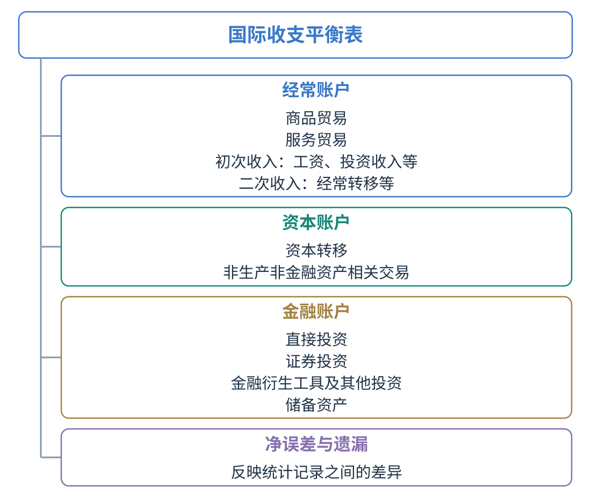

- 经常账户：反映跨境商品、服务和收入交易。
- 资本账户：记录特定资本转移及非生产非金融资产交易。
- 金融账户：记录跨境金融资产与负债交易。
- 净误差与遗漏：用于反映实际统计记录中的差异。

### 8.6.1 对外经济存量指标

- 国际投资头寸：特定时点的对外金融资产与负债。
  - 对外金融资产：本国常住单位对境外拥有的相关资产。
  - 对外金融负债：境外主体对本国常住单位拥有的相关债权和权益。
  - 净国际投资头寸：对外金融资产减去对外金融负债。
- 外汇储备：货币当局持有的相关外国货币储备资产。
- 外债：本国主体对非居民承担的债务义务。

**特别辨析：** 国际收支主要记录流量，国际投资头寸主要记录存量；外汇储备是对外资产的一部分，外债是对外负债的一部分。

## 8.7 国际资本流动

### 8.7.1 按投资性质分类

- 外国直接投资（FDI）：在境外企业建立持久经济利益和显著影响力。
- 国际证券投资：通过跨境购买股票、债券等证券进行投资。
- 其他国际融资：跨境贷款、存款和贸易信用等。

### 8.7.2 按流动方向分类

- 资本流入：国外资金通过相关交易进入国内。
- 资本流出：国内资金通过相关交易流向国外。
- 资本外逃：受风险预期等因素影响的大规模或异常资金转移。
- 资本流动逆转：原有资金流入趋势发生显著反转。

### 8.7.3 资本流动的制度与风险

- 资本自由流动：跨境资金交易受到较少限制。
- 资本管制：对部分跨境资本交易设置限制。
- 外部融资风险：对国外资金依赖过高可能造成融资压力。
- 全球金融周期：主要金融条件变化对多个国家资金流动和信用规模的共同影响。

## 8.8 开放经济宏观经济学

### 8.8.1 开放经济中的政策联系

- 国内利率影响国际资本流动。
- 国际资本流动影响汇率与融资条件。
- 汇率影响进出口及国内物价。
- 国际贸易进一步影响生产、就业和收入。

### 8.8.2 开放经济政策的基本模型

- 蒙代尔—弗莱明模型：研究不同汇率制度、资本流动条件下的财政和货币政策效果。
- 国际政策溢出：一个经济体的政策通过贸易和金融关系影响其他经济体。
- 国际政策协调：通过跨国合作减少政策冲突。

### 8.8.3 不可能三角

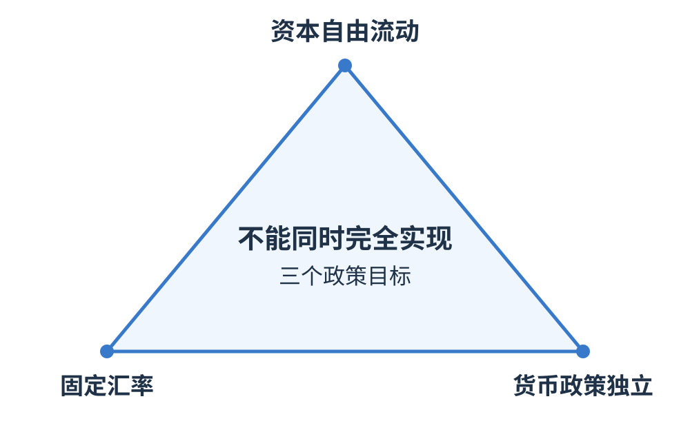

不可能三角并非三种政策工具的分类，而是三个政策目标之间的相互约束关系。

## 8.9 国际经济一体化

按照经济合作和一体化程度，可以研究以下类型：

- 优惠贸易安排：成员之间给予部分贸易优惠。
- 自由贸易区：成员之间减少贸易壁垒，各自保留对外贸易政策。
- 关税同盟：在内部自由贸易基础上实施共同对外关税。
- 共同市场：进一步允许生产要素自由流动。
- 经济联盟：进一步协调相关经济政策。
- 货币联盟：多个经济体共享货币或高度统一货币安排。
  - 最优货币区理论：研究哪些经济体适合共享货币。

现实中的国际合作并不一定严格按照上述顺序逐级发展。

## 8.10 国际货币制度与国际经济组织

### 8.10.1 国际货币制度的历史演变

- 金本位制度：将货币价值与黄金联系起来。
- 布雷顿森林体系：二战后以美元与黄金挂钩、其他货币与美元联系为核心的货币安排。
- 牙买加体系：允许多种汇率制度并存的国际货币制度框架。

### 8.10.2 国际货币体系的核心问题

- 国际储备货币：被各国广泛用于国际支付和储备的货币。
- 国际流动性：支持国际交易和融资的可用支付能力。
- 特里芬难题：国际储备货币发行国满足全球货币需求与维持货币信用之间的潜在冲突。
- 特别提款权（SDR）：国际货币基金组织创设的国际储备资产。

### 8.10.3 国际经济组织的职能分类

- 国际货币合作：国际货币基金组织（IMF）。
- 经济发展与减贫：世界银行（World Bank）。
- 多边贸易规则：世界贸易组织（WTO）。
- 中央银行合作：国际清算银行（BIS）。
- 国际经济政策研究：经济合作与发展组织（OECD）。

---

# 第九章　经济周期、经济波动与经济危机

这一章不是简单罗列各种危机名称，而是研究经济系统如何从正常运行转向失衡，失衡又如何形成自我强化的经济下行过程。

## 9.1 经济活动的两种时间变化

- **长期增长趋势**：由人口、资本、技术和制度等因素推动的生产能力长期变化。
- **短期经济波动**：实际经济活动围绕长期发展趋势发生的扩张与收缩。

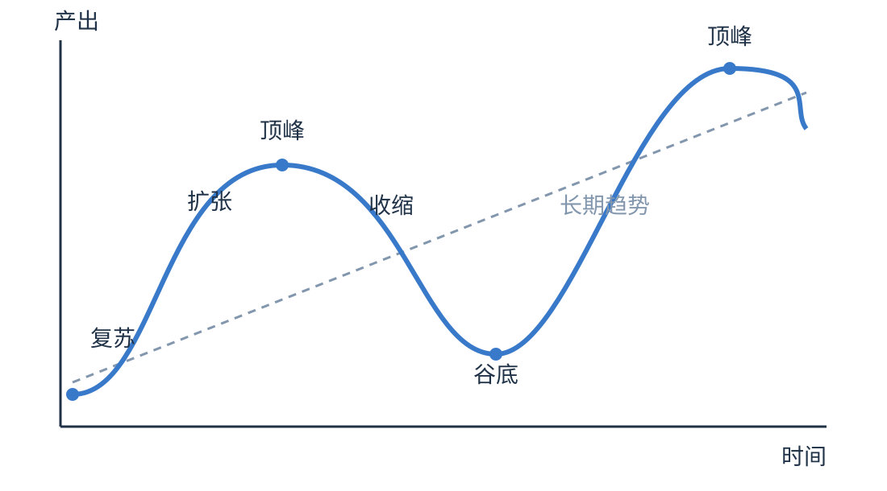

## 9.2 经济周期的基本阶段

- **扩张阶段**
  - 经济复苏：经济活动从谷底逐渐恢复。
  - 经济繁荣：产出、就业和需求处于较活跃状态。
- **顶峰**：经济由扩张转向收缩的转折点。
- **收缩阶段**
  - 经济衰退：经济活动显著且持续下降。
  - 经济萧条：严重且持久的经济低迷，并非每次衰退都会发展为萧条。
- **谷底**：经济由收缩重新转向扩张的转折点。

## 9.3 经济周期的不同形成机制

### 9.3.1 按主要驱动因素分类

- 库存周期：企业调整库存和生产计划产生的波动。
- 投资周期：资本建设和设备更新变化产生的波动。
- 房地产周期：住房建设、销售、价格及相关投资产生的波动。
- 信用周期：信贷条件不断扩张和收缩产生的波动。
- 金融周期：信用、杠杆及资产价格相互作用形成的波动。

### 9.3.2 经济周期的历史理论

- 基钦周期：强调短期库存调整。
- 朱格拉周期：强调设备和资本投资。
- 库兹涅茨周期：强调人口、建筑和基础设施投资。
- 康德拉季耶夫长波：尝试解释数十年的经济技术变化。

这些历史周期理论不是能够按照固定年数预测经济的精确时间规律。

## 9.4 经济失衡的来源

- **需求侧失衡**
  - 消费不足。
  - 投资意愿下降。
  - 国外需求减少。
- **供给侧失衡**
  - 关键资源短缺。
  - 原材料和能源成本上升。
  - 生产与物流中断。
  - 供给结构与需求结构不匹配。
- **金融与资产负债失衡**
  - 债务过度积累。
  - 资产价格泡沫。
  - 信用期限与资金使用期限不匹配。
  - 金融风险集中。
- **外部经济失衡**
  - 外部融资中断。
  - 大规模资本流动逆转。
  - 汇率及国际支付压力。

## 9.5 经济危机的分类

- **实体经济危机**
  - 需求危机：总需求严重不足。
  - 供给危机：生产能力或重要资源供给受到重大冲击。
- **金融危机**
  - 流动性危机：无法及时获得支付资金。
  - 偿付能力危机：资产及未来收入不足以覆盖相关债务。
  - 银行危机：银行系统出现严重经营和信用问题。
  - 系统性金融危机：金融问题广泛扩散并冲击整个经济体系。
- **政府债务危机**
  - 主权债务危机。
  - 地方财政债务压力。
- **外部经济危机**
  - 货币危机：汇率受到严重冲击。
  - 国际收支危机：国际支付和外部融资能力受到严重冲击。

上述危机并不互相排斥。一场金融危机可能同时引发货币危机、债务危机及实体经济衰退。

## 9.6 经济危机的自我强化机制

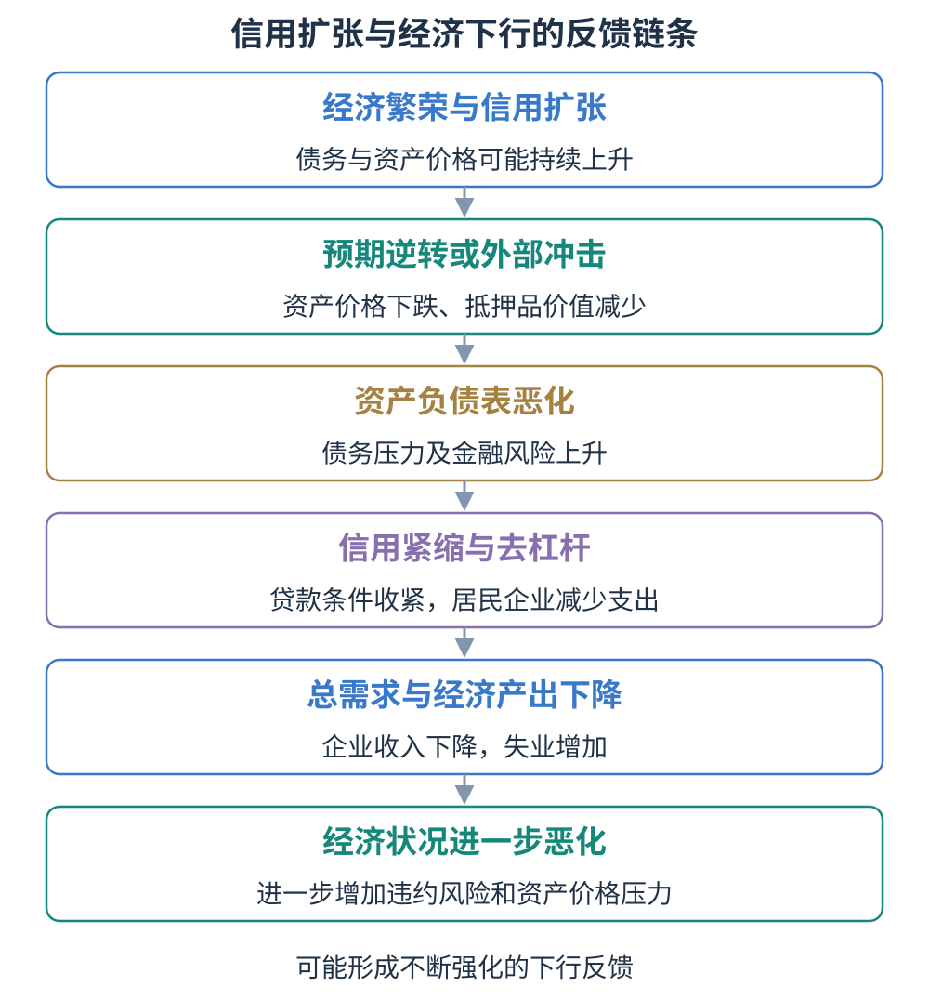

### 9.6.1 解释危机形成的理论

- 明斯基金融不稳定假说：长期稳定可能鼓励更多债务和风险承担，逐渐形成金融脆弱性。
- 债务通缩理论：物价下跌和资产出售可能增加实际债务负担，并进一步压缩经济活动。
- 资产负债表衰退理论：居民和企业优先修复资产负债表、减少债务，造成需求持续不足。
- 金融加速器：资产价值与融资能力相互影响，放大经济冲击。
- 风险传染理论：局部问题通过债务、贸易、金融联系和预期等向其他主体扩散。

这些理论解释的是不同机制，并不是五种互相排斥的危机。

## 9.7 经济危机的应对机制

- **需求稳定措施**
  - 扩张性财政政策。
  - 宽松货币政策。
  - 自动稳定器。
- **金融系统修复**
  - 流动性救助。
  - 银行资本补充。
  - 不良资产处置。
  - 债务重组。
- **长期结构修复**
  - 产业结构调整。
  - 就业技能改善。
  - 制度改革。
  - 生产率提升。
- **风险预防措施**
  - 宏观审慎监管。
  - 金融风险监测。
  - 财政债务约束。
  - 经济危机预警。
- **政策退出**
  - 逐步撤回临时救助。
  - 恢复正常的财政和货币政策框架。

## 9.8 第二篇知识的综合联系

| 理论体系 | 在正常经济中的作用 | 在经济危机中的作用 |
|---|---|---|
| 货币经济学 | 支持支付、信用与资金流动 | 处理流动性与信用紧缩 |
| 财政学 | 提供公共服务、调节资源分配 | 稳定需求、就业与社会保障 |
| 国际经济学 | 支持国际贸易与要素流动 | 处理外部冲击、资本流动和汇率风险 |
| 经济周期理论 | 解释经济扩张与收缩 | 识别危机来源及传播过程 |

前两篇的理论不是彼此独立的。例如，国内加息属于货币政策，但会影响政府债务成本、国际资本流动、汇率、居民消费、企业投资及经济周期。这也是理解经济运行时需要建立知识图谱而不能只记忆术语的原因。

---

# 第三篇　经济增长与社会发展

前两篇重点研究经济运行的一般规律，第三篇则根据具体的经济研究对象进一步分支：

- 国家发展 → 增长与发展经济学。
- 产业和企业 → 产业经济学。
- 人口与劳动 → 劳动及人口经济学。
- 地理空间 → 区域与城市经济学。
- 自然条件 → 资源、能源和环境经济学。

# 第十章　经济增长与发展经济学

## 10.1 经济增长的来源及衡量

### 10.1.1 生产要素投入

- 劳动力增长：更多劳动者或劳动时间参与生产。
- 资本积累：生产设备、基础设施等资源不断增加。
  - 资本深化：平均每个劳动者所使用的资本增加。
  - 资本广化：资本增加以适应劳动力规模扩大。
- 人力资本积累：通过教育、培训和健康改善提高劳动能力。

### 10.1.2 生产效率改善

- 技术进步：生产方法和技术工具不断改善。
- 组织创新：通过组织管理方式改善经济效率。
- 制度改善：通过产权、市场规则和公共治理改善资源配置。
- 全要素生产率：衡量劳动和资本投入之外的综合生产效率部分。

### 10.1.3 增长核算

将经济增长分解为资本、劳动及生产率等方面的贡献，研究经济增长主要依靠什么。

## 10.2 经济增长模型

按照对长期经济增长来源的不同解释，可以将重要增长理论归纳为以下发展脉络。

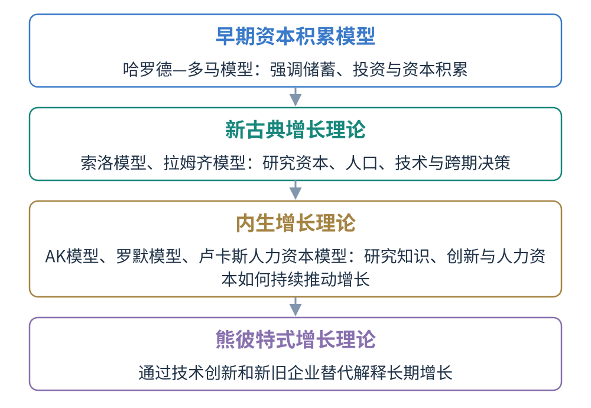

理论发展的简化脉络，不代表后出现的模型完全取代早期模型。

- **哈罗德—多马模型**：强调投资、储蓄及资本产出比例。
- **新古典增长模型**
  - 索洛模型：研究资本积累、人口增长与外生技术进步。
    - 稳态：经济主要变量达到相对稳定的长期增长关系。
    - 资本积累黄金律：研究使长期人均消费最大化的资本积累水平。
  - 拉姆齐模型：进一步引入居民跨期消费和储蓄决策。
- **内生增长模型**
  - AK模型：研究资本等广义投入如何在一定条件下支持持续增长。
  - 罗默模型：强调知识生产和研发创新。
  - 卢卡斯增长模型：强调人力资本积累。
  - 熊彼特式增长模型：强调创新及创造性破坏。

## 10.3 国家经济发展与结构转型

### 10.3.1 经济发展的主要过程

- 农业现代化：提高农业生产效率。
- 工业化：现代工业生产在经济中的作用扩大。
- 城市化：人口和经济活动向城市集中。
- 服务业发展：服务活动在经济中的重要性提高。
- 产业升级：向技术含量和生产率更高的经济活动转移。

### 10.3.2 结构转型理论

- 二元经济结构：传统低生产率部门与现代高生产率部门并存。
  - 刘易斯二元经济模型：解释传统部门劳动者向现代部门转移如何推动经济发展。
  - 刘易斯拐点：剩余劳动力减少后，现代部门扩张开始面临更明显的工资上涨压力。
- 结构转型：劳动、资本和其他资源在不同产业之间重新配置。

### 10.3.3 发展差距与发展障碍

- 经济收敛：落后经济体在一定条件下缩小发展差距。
- 经济发散：不同经济体的发展差距扩大。
- 贫困陷阱：低收入、低投资和低生产率可能形成自我强化循环。
- 中等收入陷阱：经济达到中等收入水平后，难以实现进一步产业升级和收入增长。
- 制度障碍：产权、治理或市场制度限制资源有效配置。
- 技术障碍：技术能力和创新条件不足，限制生产率提高。

## 10.4 收入、财富与贫困

### 10.4.1 分配对象的分类

- 收入分配：一定时期内获得的工资、经营收入等如何分布。
- 财富分配：已经拥有的资产和净财富如何分布。

### 10.4.2 收入分配的不同环节

- 初次分配：通过生产要素和市场活动形成收入。
- 再分配：通过税收、社会保障和转移支付调节收入。
- 第三次分配：通过慈善、公益和自愿捐赠等重新配置资源。

### 10.4.3 不平等的衡量

- 洛伦兹曲线：表示人口累计比例与收入累计比例的关系。
  - 基尼系数：根据洛伦兹曲线衡量分配不平等程度。
- 收入中位数：收入排列后处于中间位置的水平。
- 收入分位数：将人口按收入分成不同组别，研究各组收入状况。
- 泰尔指数：衡量不平等并可分析不同群体间差异的指标。

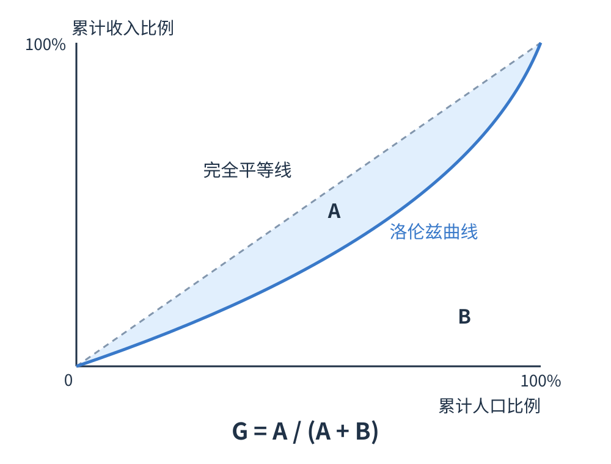

在通常的非负收入分布条件下，基尼系数越大，分配不平等程度越高。

### 10.4.4 贫困的分类

- 绝对贫困：缺乏满足基本生活需要的资源。
- 相对贫困：生活水平相对于社会通常水平明显偏低。
- 多维贫困：同时从教育、健康、住房等多个维度评价贫困。

### 10.4.5 社会经济地位的变化

- 社会流动性：个人改变社会经济地位的可能性。
  - 代内流动：个人一生中的经济地位变化。
  - 代际流动：子女相对于父母的经济地位变化。
- 代际财富传递：通过继承、教育和家庭支持传递经济优势。
- 库兹涅茨曲线：提出经济发展与收入不平等可能存在先升后降关系的假说。

## 10.5 发展战略与政策

- **按照国内与国外市场方向分类**
  - 进口替代战略：发展本国产业以减少进口依赖。
  - 出口导向战略：通过国际市场竞争推动产业发展。
- **按照产业发展协调程度分类**
  - 平衡增长战略：推动多个产业共同发展。
  - 非平衡增长战略：优先发展关键产业并带动其他部门。
  - 大推进理论：强调通过多个部门协调投资突破发展障碍。
- **按照发展目标分类**
  - 经济赶超：缩小与发达经济体的发展差距。
  - 包容性增长：让更多社会成员分享经济成果。
  - 可持续发展：兼顾当前发展和未来世代的需要。
  - 人力发展：改善教育、健康和实际发展机会。
    - 人类发展指数（HDI）：综合衡量教育、寿命和收入水平。

---

# 第十一章　产业经济学与企业经济学

产业经济学内部主要包括三个相互联系的研究层次：

**产业结构研究产业之间的关系，产业组织研究同一产业内部的竞争，企业经济学研究单个企业的形成与组织。**

## 11.1 产业结构

### 11.1.1 产业分类

- 第一产业：农业、林业、牧业、渔业等。
- 第二产业：制造业、采矿业、建筑业等工业和建设活动。
- 第三产业：商业、运输、金融、医疗、教育、信息等服务活动。

### 11.1.2 产业之间的联系

- 产业关联：不同产业之间的投入和产出关系。
- 产业链：从原材料到最终产品的生产环节。
- 供应链：采购、生产、仓储、运输与交付体系。
- 价值链：各生产经营环节创造价值的过程。
  - 附加值：经济活动在投入基础上创造的新增价值。
  - 微笑曲线：描述部分产业中研发和品牌等环节可能获得较高附加值的示意模型。

### 11.1.3 按产业经济作用分类

- 支柱产业：在经济产出和就业等方面占据重要地位。
- 主导产业：能够带动其他产业及结构变化。
- 战略性产业：对长期发展、创新或经济安全具有重要意义的产业。

### 11.1.4 产业结构的变化

- 产业转移：生产活动在不同地区之间迁移。
- 产业集聚：相关产业向特定区域集中。
  - 产业集群：形成具有配套关系的企业和机构网络。
- 产业升级：转向更高生产率、更高技术含量的经济活动。
- 产业空心化：部分关键生产活动持续减少或外迁。
- 再工业化：通过新增投资和技术重新扩大工业生产能力。

## 11.2 产业组织理论

### 11.2.1 市场结构、行为与绩效

- **市场结构（Structure）**
  - 企业数量。
  - 市场集中度。
  - 产品差异化。
  - 进入与退出壁垒。
- **企业行为（Conduct）**
  - 定价竞争。
  - 广告和研发竞争。
  - 企业合并。
  - 合作与合谋。
- **市场绩效（Performance）**
  - 生产效率。
  - 资源配置效率。
  - 企业创新能力。
  - 消费者福利。

上述三个方面构成传统的SCP产业组织分析框架，彼此可能存在双向影响。

### 11.2.2 市场集中度的衡量

- 集中率（CR）：最大若干家企业的市场份额之和。
- 赫芬达尔—赫希曼指数（HHI）：各企业市场份额平方之和。

### 11.2.3 企业扩张与产业组织变化

- 横向一体化：扩大同一产业环节的企业规模。
- 纵向一体化：将上下游生产环节纳入同一企业。
- 多元化经营：进入不同产业或产品领域。
- 外包：将部分内部经济活动交由外部组织完成。

## 11.3 企业经济学

### 11.3.1 企业为什么存在

- 市场交易成本：通过外部市场完成活动所付出的成本。
- 内部组织成本：企业内部管理、监督和协调的成本。
- 企业边界：两类成本及其他因素共同影响企业自营和外包的范围。

### 11.3.2 企业产权与组织

- 企业所有权：企业资产和相关权益的归属。
- 企业控制权：企业经营决策的权力。
- 剩余索取权：履行既定义务后获取剩余收益的权利。
- 公司治理：协调所有者、管理层和其他相关主体关系的制度。

### 11.3.3 企业经营决策

- 需求预测。
- 成本控制。
- 生产规模决策。
- 产品定价。
- 创新与研发。
- 市场进入与退出。

详细融资决策、企业估值、资本结构和并购融资归入金融学。

## 11.4 产业政策与竞争政策

- 产业政策：促进特定产业和经济结构发展。
  - 产业补贴。
  - 技术研发支持。
  - 基础设施建设。
  - 产业集群支持。
- 竞争政策：维护市场竞争条件。
  - 反垄断。
  - 市场准入改革。
  - 自然垄断监管。
- 产业链安全与韧性
  - 供应稳定性：维持关键生产投入供应的能力。
  - 供应链韧性：受到冲击后维持或恢复生产的能力。
- 产业政策评价
  - 产业发展收益。
  - 公共资金成本。
  - 资源错配风险。
  - 寻租与政策失灵。

---

# 第十二章　劳动经济学与人口经济学

## 12.1 劳动力市场

### 12.1.1 劳动力供给

- 工作与闲暇选择：个人在劳动收入和非工作时间之间作出权衡。
- 劳动参与决策：决定是否进入劳动力市场。
- 劳动时间决策：决定提供多少劳动时间。
- 保留工资：愿意接受某项工作的最低工资。

### 12.1.2 劳动力需求

- 派生需求：企业因商品生产需求而雇佣劳动者。
- 边际生产力：额外劳动投入产生的产出贡献。
- 劳动成本：工资、社会保险、培训等相关支出。
- 技术替代与互补：技术可能减少部分劳动需求，也可能增加其他劳动需求。

### 12.1.3 工资决定理论

- 竞争性工资理论：根据劳动力供求和生产贡献解释工资。
- 效率工资理论：较高工资可能提高劳动效率并降低人员流失。
- 谈判工资理论：工资受到劳动双方谈判能力影响。
- 制度性工资安排：最低工资、集体合同等制度影响工资水平。

## 12.2 就业匹配与劳动力市场结构

- 工作搜寻：劳动者和企业寻找合适岗位与人员。
- 搜寻与匹配理论：解释岗位空缺与失业为什么可能同时存在。
- 技能错配：劳动者技能与岗位需求不匹配。
- 劳动力市场分割：不同劳动群体面对不同工资、福利和流动条件。
- 就业歧视：劳动者因与生产能力无关的某些特征受到不平等对待。
- 灵活就业：采用不同于传统固定劳动关系的就业方式。

## 12.3 人力资本与教育经济学

- **人力资本的形成**
  - 教育。
  - 职业培训。
  - 工作经验。
  - 健康状况。
- **人力资本的变化**
  - 人力资本积累：能力不断提高。
  - 人力资本折旧：技能因长期不用或技术更新而贬值。
- **教育与收入关系**
  - 教育投资：投入资源提高未来能力和收入。
  - 教育收益率：衡量教育投入与新增经济收益之间的关系。
  - 明瑟工资方程：研究教育年限、经验和劳动收入的关系。
  - 技能溢价：特定技能产生的相对收入优势。
- **教育的其他经济作用**
  - 教育信号理论：学历可能传递能力等信息。
  - 学历通胀：学历普及后，特定学历的相对就业优势可能下降。

## 12.4 劳动关系与劳动制度

- 劳动合同：规定雇佣双方权利、义务和报酬。
- 工会：代表劳动者共同利益的组织。
- 集体谈判：劳动者集体与雇主协商劳动条件。
- 最低工资制度：规定相关劳动关系的最低工资标准。
- 劳动保护：保障劳动安全和劳动者权益。
- 社会保险：通过制度分担养老、失业等经济风险。

## 12.5 人口经济学

### 12.5.1 人口的基本变化

- 出生与生育：新增人口的来源。
- 死亡：人口自然减少的因素。
- 人口迁移：人口在地区之间流动。
- 人口增长：出生、死亡和迁移共同作用的结果。

### 12.5.2 人口结构

- 年龄结构：不同年龄人口的分布。
- 劳动年龄人口：处于相关统计劳动年龄范围的人口。
- 人口抚养比：非劳动年龄人口相对于劳动年龄人口的比例。
- 人口老龄化：老年人口比例提高。

### 12.5.3 人口变化的经济影响

- 人口转型：出生率和死亡率随经济社会发展发生长期变化。
- 人口红利：有利人口结构可能带来的增长机会。
- 劳动力供给变化：影响生产能力、工资与就业。
- 消费结构变化：不同年龄人群产生不同消费需求。
- 养老经济学：研究养老保障与养老服务。
- 银发经济：围绕老年人口需求形成的经济活动。

**本章联系：** 人口结构影响劳动力供给，教育与健康影响劳动者能力，劳动力市场决定就业与工资，最终共同影响经济增长、收入分配和财政负担。

---

# 第十三章　区域、城市与房地产经济学

这三个研究领域可以按照空间尺度理解：区域经济研究地区之间的差异和联系，城市经济研究城市内部的资源配置，房地产经济研究土地及住房市场。

## 13.1 区域经济学

- **经济活动的空间分布**
  - 区位理论：解释企业为什么选择特定地点开展生产。
  - 运输成本：商品与人员在空间移动所产生的成本。
  - 区域专业化：不同地区发展各自具有优势的产业。
- **经济活动的空间集中**
  - 集聚经济：企业和人口集中带来的效率优势。
  - 产业集群：相关企业及配套机构形成的地理网络。
  - 新经济地理学：从规模经济、运输成本和市场联系解释产业集中。
- **区域发展差距**
  - 中心—外围结构：资源与产业集中于核心地区。
  - 增长极理论：核心产业或地区可能带动周边发展。
  - 区域协调发展：通过合作和公共政策改善地区发展关系。

## 13.2 城市经济学

### 13.2.1 城市的形成与发展

- 城市化：人口和经济活动向城市集中。
- 城市规模经济：共享基础设施、劳动力市场和知识带来的收益。
- 城市拥堵成本：过度集中造成交通、住房和环境压力。

### 13.2.2 城市空间结构

- 城市土地利用：土地在住宅、商业和工业等用途间配置。
- 城市地租理论：位置和交通条件如何影响土地租金。
- 通勤成本：居民往返工作地点的时间与经济成本。
- 城市更新：改善既有建筑、设施和空间功能。

### 13.2.3 城市之间的经济联系

- 都市圈：围绕核心城市形成的通勤与经济联系区域。
- 城市群：多个相互联系城市组成的经济网络。
- 区域基础设施：支持城市和地区之间经济活动的交通与通信设施。

## 13.3 房地产经济学

### 13.3.1 房地产市场的组成

- 土地市场：土地及相关使用权的配置与交易。
- 住房市场
  - 新建住房市场。
  - 存量住房市场。
  - 住房租赁市场。
- 商业地产市场：办公、商业及其他经营性房地产交易。

### 13.3.2 房地产价格形成

- 土地供给。
- 建设成本。
- 居民收入与住房需求。
- 人口流入与地理区位。
- 信贷条件与利率。
- 对未来房价的预期。

### 13.3.3 房地产市场衡量指标

- 房价收入比：住房价格相对于居民收入的比例。
- 租金水平：住房使用权的市场价格。
- 房地产库存：尚未销售或出租的相关房地产存量。
- 开工与竣工面积：反映房地产建设活动的指标。

### 13.3.4 房地产与宏观经济

- 房地产周期：开发、销售、价格和融资活动的波动。
- 房地产泡沫：房地产价格可能显著偏离基本价值。
- 抵押贷款：以房地产等资产提供偿债保障的借款。
- 财富效应：房地产价格变化可能影响居民消费行为。
- 土地财政：土地相关收入与地方财政的联系。

### 13.3.5 房地产政策

- 土地供应政策。
- 住房保障政策。
- 房地产税收政策。
- 住房信贷政策。
- 租赁市场与公共住房制度。

---

# 第十四章　资源、能源与环境经济学

## 14.1 自然资源经济学

### 14.1.1 资源的分类

- 可再生资源：在适当条件下能够恢复的资源，例如森林。
- 不可再生资源：在人类经济活动时间尺度内难以恢复的资源，例如石油和矿产。

### 14.1.2 资源配置问题

- 资源稀缺性：可利用自然资源数量有限。
- 资源产权：自然资源由谁占有、使用和获得收益。
- 资源租金：开发稀缺资源产生的经济租金。
- 最优资源开采：在当前与未来资源使用之间进行权衡。
  - 霍特林规则：在特定假设下解释不可再生资源的跨期最优开采。

### 14.1.3 资源丰富国家的发展问题

- 资源诅咒：资源丰富未必带来良好长期经济发展。
- 荷兰病：资源等出口行业繁荣可能削弱其他可贸易产业竞争力。
- 经济多元化：降低经济对单一资源和产业的依赖。

## 14.2 能源经济学

- **能源供给体系**
  - 化石能源。
  - 核能。
  - 可再生能源。
- **能源市场**
  - 能源供给与需求。
  - 能源价格。
  - 能源生产和运输成本。
  - 电力市场。
- **能源发展问题**
  - 能源效率：单位能源投入创造的产出。
  - 能源安全：获得稳定、可靠且可负担能源的能力。
  - 能源转型：能源技术和生产消费结构发生改变。
  - 能源贫困：难以获得满足基本需求的能源服务。

## 14.3 环境经济学

### 14.3.1 环境问题的经济来源

- 负外部性：污染成本未完全由污染者承担。
- 公共资源问题：环境资源可能被过度使用。
- 代际利益冲突：当前生产收益与未来环境成本之间存在矛盾。

### 14.3.2 环境价值与成本

- 环境价值：生态环境带来的经济和社会利益。
- 污染损害成本：环境破坏造成的经济损失。
- 污染治理成本：减少污染所需投入的资源。
- 自然资本：能够提供长期生态和经济服务的自然资源。

### 14.3.3 环境政策工具

- 行政监管：规定排放和生产标准。
- 环境税：通过税收使污染者承担相关成本。
- 排污权交易：通过排放额度交易实现污染控制。
- 环保补贴：鼓励具有环境收益的生产与消费活动。

## 14.4 气候经济学与生态经济学

- 气候经济学：研究气候变化、经济损失与应对政策。
  - 碳排放的社会成本：新增碳排放可能造成的社会经济损失。
  - 碳税：对相关碳排放征税。
  - 碳排放权交易：利用排放额度及交易控制总排放。
- 生态经济学：将经济系统放入自然生态系统之中研究。
  - 生态约束：自然资源和环境承载能力对经济活动的限制。
  - 代际公平：协调当前世代与未来世代的利益。
- 可持续经济发展
  - 循环经济：减少浪费并重复利用资源。
  - 绿色增长：兼顾经济增长与环境影响。
  - 稳态经济：强调经济规模与生态约束的长期协调。

---

# 第四篇　经济制度与现代经济理论

第四篇不是按照具体产业划分，而是从不同的理论视角研究经济活动。

| 理论视角 | 对应学科 | 主要研究问题 |
|---|---|---|
| 制度与规则 | 制度经济学 | 规则怎样影响经济行为 |
| 权力与利益 | 政治经济学 | 政治、所有制与经济有什么关系 |
| 心理与行为 | 行为经济学 | 人为什么不总是理性决策 |
| 技术与创新 | 数字与创新经济学 | 技术如何改变经济运行方式 |
| 专项研究对象 | 其他应用经济学 | 如何理解具体社会经济问题 |

# 第十五章　制度经济学

## 15.1 制度的基本构成

- **制度**：约束和引导经济主体行为的一系列规则及执行机制。
  - 正式制度：法律、法规、合同等具有明确规定的规则。
  - 非正式制度：社会习惯、文化、道德和信任等行为规范。
  - 制度执行机制：使规则得到遵守和实施的监督、激励与处罚安排。

## 15.2 经济活动中的核心制度

### 15.2.1 产权制度

产权决定资源归谁所有、由谁使用以及收益如何分配。

- 所有权：对资产拥有的法律权利。
- 使用权：使用相关资源的权利。
- 收益权：获取资源经济收益的权利。
- 处置权：转让、出售或其他处理资源的权利。
- 剩余控制权：未明确约定事项的相关决定权。

这些权利可以通过制度安排由不同主体分别持有。

### 15.2.2 契约制度

- 契约形成：经济主体通过协议建立权利义务关系。
- 契约履行：按照约定开展经济活动。
- 契约执行：通过法律、信誉和其他机制保障合同履行。
- 契约保护：减少违约和不确定性。

### 15.2.3 交易成本理论

- 搜索成本：寻找交易对象和相关信息。
- 谈判成本：确定交易价格和合同条件。
- 签约成本：制定和确认合同。
- 监督成本：检查合同履行情况。
- 执行成本：处理违约和争议。

由此进一步连接企业理论：当内部组织活动比通过外部市场交易更有效时，企业组织可能具有经济优势。

## 15.3 制度的形成与演变

- 制度形成：经济主体在长期互动中建立相对稳定的规则。
- 制度变迁：旧制度随经济和社会条件变化而发生调整。
  - 制度创新：建立新的经济规则。
  - 制度改革：调整现有制度。
- 路径依赖：历史形成的制度持续影响未来选择。
- 制度惯性：原有制度具有持续存在的倾向。
- 制度锁定：转换成本等因素使制度难以改变。

## 15.4 制度与经济发展

- 产权保护：减少资源被不当侵占的风险。
- 契约执行：提高长期交易和投资的可靠性。
- 市场制度：影响企业进入、竞争和退出。
- 国家治理能力：影响政策执行和公共服务供给。
- 包容性制度：强调广泛经济参与和发展机会的理论概念。
- 汲取性制度：强调资源和利益被少数群体集中控制的理论概念。

**理论联系：** 制度影响交易成本与行为激励，交易成本和激励进一步影响投资、创新、资源配置及长期经济增长。

## 15.5 比较经济制度

- 所有制结构
  - 国有经济。
  - 集体经济。
  - 民营经济。
  - 混合所有制经济。
- 资源配置制度
  - 市场配置。
  - 计划配置。
  - 混合配置。
- 制度转型
  - 市场化。
  - 国有化。
  - 私有化。
  - 经济体制改革。
- 制度评价
  - 资源配置效率。
  - 经济发展能力。
  - 社会公平。
  - 制度执行成本。

---

# 第十六章　政治经济学

政治经济学主要研究经济活动背后的政治权力、社会关系、所有制和利益分配。

## 16.1 马克思主义政治经济学

这一理论体系具有自身的概念结构，不能直接套用现代主流微观经济学的价值、资本和利润定义。

### 16.1.1 社会生产方式

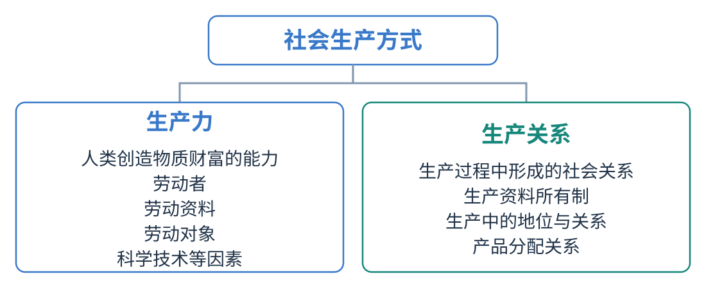

生产力与生产关系共同构成社会生产方式。

进一步形成两个有关社会结构的概念：

- 经济基础：一定社会占主导地位的生产关系的总和。
- 上层建筑：建立在一定经济基础之上的政治、法律和意识形态等社会结构。

### 16.1.2 商品与劳动价值理论

- **商品的二因素**
  - 使用价值：商品满足人类需要的属性。
  - 价值：在劳动价值论中，凝结在商品中的无差别人类劳动。
- **生产商品的劳动二重性**
  - 具体劳动：以特定方式创造使用价值的劳动。
  - 抽象劳动：撇开具体形式后的一般人类劳动。
- **价值量的决定**
  - 社会必要劳动时间：正常生产条件和平均劳动熟练程度下所需要的劳动时间。
  - 劳动生产率：单位劳动时间所创造的使用价值数量。
- **价值规律**
  - 商品价值量由社会必要劳动时间决定。
  - 商品交换以价值为基础。
  - 价格可能围绕价值发生波动。

### 16.1.3 资本与剩余价值理论

- 资本：在该理论中，能够带来剩余价值的价值及其体现的生产关系。
- 劳动力商品：劳动者将自身劳动能力作为商品出售。
- 剩余价值：劳动者创造的超过劳动力自身价值的新增价值。
  - 绝对剩余价值：主要通过延长劳动时间获得。
  - 相对剩余价值：通过缩短必要劳动时间获得。

### 16.1.4 资本的分类

不同资本分类的依据不同：

- **按照在价值增殖中的作用分类**
  - 不变资本：投入生产资料并转移原有价值。
  - 可变资本：用于购买劳动力，并通过劳动过程产生新增价值。
- **按照资本价值的周转方式分类**
  - 固定资本：价值逐步转移的生产资本部分。
  - 流动资本：价值较快完成周转的相关生产资本部分。

固定资本与不变资本不能直接等同，可变资本在生产资本周转分类中属于流动资本。

### 16.1.5 资本积累与社会再生产

- 资本积累：将部分剩余价值重新转化为资本。
  - 资本积聚：单个资本通过自身积累扩大。
- 资本集中：通过兼并等方式结合原有分散资本。
- 资本有机构成：由资本技术构成决定并反映其变化的价值构成。
- 资本循环：资本在购买、生产和销售等环节改变存在形式。
- 资本周转：资本循环不断重复及其速度。
- 社会再生产
  - 简单再生产。
  - 扩大再生产。

### 16.1.6 剩余价值的表现与分配形式

- 利润。
- 平均利润。
- 商业利润。
- 利息。
- 地租。

这一理论进一步通过生产价格等概念研究价值、市场价格与不同资本部门的利润关系。

### 16.1.7 资本主义经济危机理论

从生产关系、资本积累、社会再生产失衡及经济体系内部矛盾等角度解释经济危机。

## 16.2 现代政治经济学

### 16.2.1 政治行为与经济决策

- 政治激励：政治参与者的利益影响政策选择。
- 政治经济周期：政治活动和政策安排可能影响经济波动。
- 利益集团：不同群体通过组织活动影响公共决策。
- 寻租与腐败：利用特权或公共权力获取经济利益的相关问题。

### 16.2.2 国家制度与经济运行

- 国家能力：提供公共服务、征税和执行法律的能力。
- 政策可信度：社会是否相信政府能够履行政策承诺。
- 政策承诺问题：短期利益与长期制度承诺之间可能存在矛盾。
- 经济治理：国家如何通过制度协调市场、公共资源与社会利益。

### 16.2.3 国际政治经济学

- 国际经济制度：规范跨境经济活动的国际规则。
- 地缘经济学：贸易、资源、技术和金融在国家战略中的作用。
- 经济制裁：通过限制经济联系实现特定政策目标。
- 经济安全：经济体抵御重大冲击并维持关键经济活动的能力。

---

# 第十七章　行为经济学与实验经济学

行为经济学研究现实中的人如何作出决策，实验经济学则提供研究和检验这些行为的方法。

## 17.1 传统理性假设的扩展

- 完全理性：决策者能够充分处理信息并作出最优选择。
- 有限理性：决策受到认知、时间和信息条件限制。
  - 满意化决策：寻找足够满意的方案，而不是始终寻找绝对最优方案。
  - 启发式决策：依靠经验、直觉和简化规则进行判断。

## 17.2 风险条件下的决策行为

- 期望效用理论：根据可能结果及概率评价决策。
- 前景理论：根据参考点、收益和损失等因素解释风险决策。
  - 参考点依赖：人们根据某个基准判断收益和损失。
  - 损失厌恶：同等损失可能带来更强烈的心理影响。
  - 概率权重：人们对概率的主观评价可能偏离其客观大小。

## 17.3 认知偏差与经济决策

按照主要影响机制分类：

- **信息判断偏差**
  - 锚定效应：受到最初信息影响。
  - 确认偏误：倾向于接受支持已有观点的信息。
  - 过度自信：高估自身知识和判断能力。
- **选择与拥有偏差**
  - 框架效应：问题表达方式影响选择。
  - 禀赋效应：因已经拥有物品而赋予其更高价值。
  - 现状偏好：倾向于维持原有状态。
- **资金管理行为**
  - 心理账户：将资金在心理上划分为不同用途。
- **社会互动行为**
  - 从众行为：受到他人决策影响。
  - 公平偏好：重视经济成果分配是否公平。
  - 互惠行为：根据他人态度和行为作出相应回报。

## 17.4 跨期决策行为

- 时间偏好：当前收益与未来收益之间的相对偏好。
- 现时偏好：对眼前收益赋予额外权重。
- 时间不一致性：不同时间作出的最优选择可能相互冲突。
- 双曲贴现：解释人们为何可能过度重视近期收益的模型。
- 承诺机制：通过预先限制未来选择帮助实现长期目标。

## 17.5 行为经济学的政策应用

- 选择架构：安排不同选择的呈现方式及决策环境。
- 助推理论：在保留选择自由的条件下影响决策行为。
  - 默认选项：预先设置某个默认选择。
  - 信息提示：以更有效的方式提供决策信息。
  - 简化流程：降低作出有益选择的困难程度。

## 17.6 实验经济学

### 17.6.1 按实验环境分类

- 实验室实验：在相对可控的环境中研究经济行为。
- 现场实验：在真实经济生活中开展实验。

### 17.6.2 按研究行为分类

- 最后通牒博弈：研究公平偏好和讨价还价。
- 独裁者博弈：研究利他行为。
- 信任博弈：研究信任和互惠。
- 公共物品实验：研究集体合作和搭便车。

### 17.6.3 实验结果评价

- 内部有效性：研究能否正确识别实验条件下的因果关系。
- 外部有效性：实验结果能否推广到其他群体与真实环境。
- 可重复性：其他研究能否在相应条件下获得类似结果。

---

# 第十八章　数字经济学与技术创新经济学

## 18.1 技术创新经济学

### 18.1.1 从知识创造到经济应用

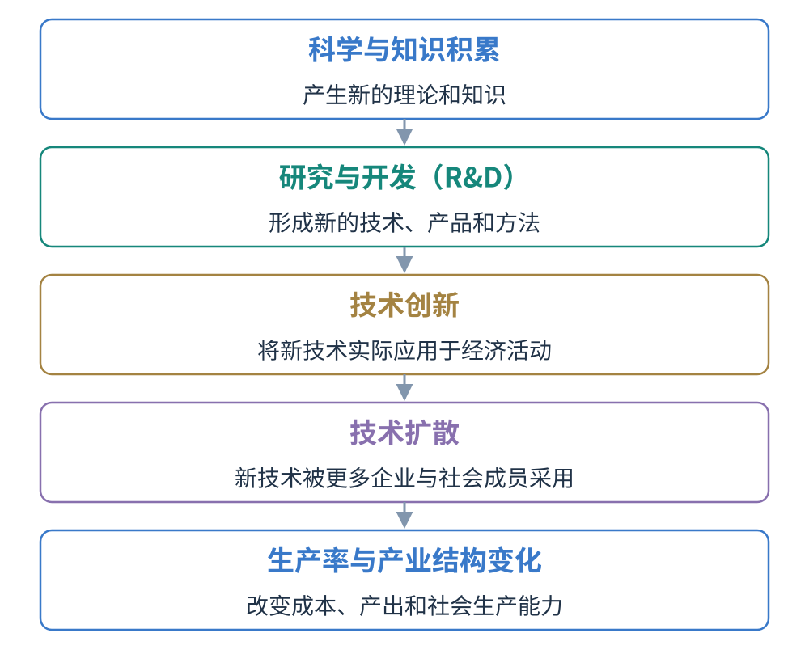

创新过程的简化逻辑链，现实中的各阶段可以反复交叉。

### 18.1.2 创新的经济属性

- 知识溢出：一个主体创造的知识被其他主体使用。
- 创新外部性：创新产生未被充分计入市场收益的社会影响。
- 创新不确定性：创新结果和未来市场需求难以准确预测。
- 通用目的技术：能够广泛应用于多个产业的基础性技术。

### 18.1.3 创新激励机制

- 知识产权：对发明、作品等知识成果提供法律权利。
  - 专利制度。
  - 著作权制度。
  - 商标保护制度。
- 市场激励：通过利润和竞争促进研发。
- 政策激励：通过公共科研投入、税收及补贴支持创新。
- 国家创新体系：政府、大学、企业和科研机构形成的创新网络。

### 18.1.4 创新与经济发展

- 技术追赶：通过学习和创新缩小技术差距。
- 创造性破坏：新技术、新企业替代旧经济活动。
- 产业升级：创新推动生产活动转向更高生产率环节。

## 18.2 数字经济学

### 18.2.1 数字经济的两种发展方向

- 数字产业化：数字技术发展为独立产业。
- 产业数字化：利用数字技术改造传统产业。

### 18.2.2 数字经济的基础资源

- 数据：能够参与生产和决策的信息资源。
  - 数据要素：具有经济生产用途的数据。
  - 数据产权：围绕数据持有、使用和经营形成的权利安排。
  - 数据市场：数据及相关服务的交易体系。
- 数字基础设施
  - 通信网络。
  - 数据中心。
  - 云计算。
  - 计算资源。
- 数字产品：以数字形式存在的商品和服务。

### 18.2.3 数字产品的经济特点

- 较高初始开发成本：部分软件和数字产品研发成本较高。
- 较低边际复制成本：复制新增数字产品的成本较低。
- 规模经济：服务更多用户可能降低平均成本。
- 网络效应：产品价值可能随用户数量变化。

### 18.2.4 数字经济的社会问题

- 数字鸿沟：不同群体获得数字技术和服务的机会存在差距。
- 数据治理：研究数据使用、保护和共享的制度安排。
- 算法定价：利用算法根据市场和用户条件制定价格。
- 数字贸易：通过数字方式订购或交付商品服务的国际贸易。

## 18.3 平台经济学

### 18.3.1 平台市场结构

- 单边市场：主要面向一类客户开展传统经营活动。
- 双边市场：连接两类相互依赖的用户。
- 多边市场：同时连接多类相互关联的用户。

### 18.3.2 网络效应

- 直接网络效应：同类用户增加影响其他同类用户的价值。
- 间接网络效应：一类用户增加影响另一类用户的价值。

### 18.3.3 平台竞争

- 转换成本：更换平台所承担的成本。
- 多平台归属：用户同时使用多个平台。
- 锁定效应：用户因数据、网络关系等原因难以离开原平台。
- 赢者通吃或赢者占优：市场份额高度集中于少数平台。
- 平台生态系统：围绕平台形成的用户、开发者和服务商网络。

### 18.3.4 平台监管

- 市场竞争监管。
- 数据与消费者保护。
- 平台劳动关系。
- 平台定价与交易规则监管。

## 18.4 人工智能经济学

- **人工智能与生产**
  - 自动化：技术系统完成原本由人承担的任务。
  - 劳动替代：减少部分劳动需求。
  - 劳动互补：提高劳动者能力。
  - 新任务创造：产生新的经济活动和岗位。
- **人工智能与产业**
  - 算力经济：围绕计算资源形成的供给与需求。
  - 模型与应用产业：围绕模型研发、部署和应用形成的产业活动。
  - 技术竞争与产业集中：研究人工智能产业中的规模及竞争优势。
- **人工智能与社会经济**
  - 生产率效应。
  - 技能需求变化。
  - 收入分配变化。
  - 就业结构变化。
  - 长期经济增长。

## 18.5 复杂性经济学与演化经济学

- **复杂经济系统**
  - 非线性：经济变量之间不一定等比例变化。
  - 涌现：个体相互作用产生新的整体经济特征。
  - 正反馈：经济变化不断强化自身。
  - 负反馈：经济变化受到反向作用抑制。
- **经济网络**
  - 企业网络。
  - 供应链网络。
  - 劳动力网络。
  - 金融网络。
  - 网络风险传播。
- **演化经济学**
  - 创新。
  - 学习与模仿。
  - 市场选择。
  - 企业及制度演变。
- **计算研究方法**
  - 多主体经济模型。
  - 网络分析。
  - 复杂系统模拟。

---

# 第十九章　其他应用经济学分支

应用经济学分支众多，因此本版本不逐个独立展开，而是按照研究对象进行进一步归类。

## 19.1 农业与自然产业经济

| 下属分支 | 研究范围 |
|---|---|
| 农业经济学 | 农业生产、农产品市场和农业补贴 |
| 农村经济学 | 农村土地、农村发展与城乡经济关系 |
| 食品经济学 | 食品生产、消费与价格 |
| 海洋经济学 | 海洋资源、港口、航运和海洋产业 |

## 19.2 人力发展与社会福利经济

| 下属分支 | 研究范围 |
|---|---|
| 教育经济学 | 教育投资、教育回报和教育公平 |
| 健康经济学 | 健康行为、健康资本和健康需求 |
| 医疗经济学 | 医疗资源、服务成本和医保制度 |
| 家庭经济学 | 家庭消费、劳动分工、生育及资源配置 |
| 社会保障经济学 | 养老、失业、医疗等社会保障制度 |
| 照护经济学 | 育儿、养老及家庭照护劳动 |
| 幸福经济学 | 收入、健康和就业对生活满意度的影响 |
| 性别经济学 | 不同群体的劳动、收入及经济机会差异 |

## 19.3 基础设施与工程产业经济

| 下属分支 | 研究范围 |
|---|---|
| 交通运输经济学 | 运输成本、交通定价和交通拥堵 |
| 物流经济学 | 仓储、配送和供应链效率 |
| 工程经济学 | 工程方案的投入、收益与可行性 |
| 航空航天经济学 | 航空运输及航天产业的经济活动 |
| 基础设施经济学 | 公共设施投资与长期社会经济收益 |

## 19.4 消费服务与文化经济

| 下属分支 | 研究范围 |
|---|---|
| 旅游经济学 | 旅游消费、产业发展及区域影响 |
| 文化经济学 | 文化产品及文化产业的资源配置 |
| 体育经济学 | 职业体育、赛事与体育消费 |
| 媒体经济学 | 新闻、影视、广告和内容市场 |
| 广告经济学 | 广告对消费者行为和市场竞争的影响 |

## 19.5 法律、安全与社会组织经济

| 下属分支 | 研究范围 |
|---|---|
| 法律经济学 | 法律制度、契约与司法活动的经济效率 |
| 犯罪经济学 | 犯罪激励、社会成本和治理资源 |
| 国防经济学 | 国防支出、军事工业与资源配置 |
| 灾害经济学 | 灾害风险、经济损失及灾后重建 |
| 非营利组织经济学 | 公益、慈善与社会组织的资源配置 |
| 宗教经济学 | 宗教组织、信任制度和相关经济行为 |

## 19.6 风险与金融交叉领域

- 保险经济学：重点研究风险分担、保险市场失灵及社会福利。
- 金融经济学：重点研究金融活动与经济资源配置之间的关系。
- 金融发展经济学：研究金融服务如何影响经济增长和减贫。

这些交叉分支在经济学中保留其社会经济理论部分，产品定价、经营及投资管理等专业内容仍然归入金融学。

---

# 第五篇　经济历史与综合应用

第五篇负责将前面建立的理论体系与真实世界联系起来。

# 第二十章　经济思想史与经济学流派

经济思想史需要建立理论发展脉络，而不是简单记忆经济学家姓名。

## 20.1 经济思想的历史主线

## 20.2 古典经济学及其相关流派

| 学派 | 代表人物 | 核心研究方向 |
|---|---|---|
| 重商主义 | 托马斯·孟 | 国际贸易与国家财富 |
| 重农学派 | 魁奈 | 农业生产与经济循环 |
| 古典经济学 | 亚当·斯密、李嘉图 | 分工、价值、市场与贸易 |
| 马克思主义经济学 | 马克思 | 资本、劳动与生产关系 |
| 德国历史学派 | 李斯特、施穆勒等 | 国家发展与历史制度 |

## 20.3 边际革命与现代微观经济学

- 边际革命：将新增效用、成本和产出等边际概念纳入经济学核心分析。
  - 奥地利学派早期理论：门格尔等，强调主观价值与个人选择。
  - 洛桑学派：瓦尔拉斯、帕累托等，研究一般均衡与效率。
  - 剑桥学派：马歇尔等，研究供求关系和局部均衡。
- 新古典经济学：广泛使用偏好、最优化和市场均衡等分析方法。
- 福利经济学：进一步研究市场结果的效率与社会福利。

## 20.4 现代宏观经济学的发展

| 理论分支 | 代表人物 | 核心关注 |
|---|---|---|
| 凯恩斯主义 | 凯恩斯 | 有效需求、失业与政府调控 |
| 后凯恩斯主义 | 琼·罗宾逊、明斯基 | 不确定性、内生货币、金融不稳定 |
| 新古典综合派 | 萨缪尔森、希克斯 | 新古典微观理论与凯恩斯宏观理论结合 |
| 货币主义 | 弗里德曼 | 货币数量、通胀与政策规则 |
| 新古典宏观经济学 | 卢卡斯、萨金特 | 理性预期与宏观政策 |
| 实际经济周期理论 | 基德兰德、普雷斯科特 | 实际经济冲击 |
| 新凯恩斯主义 | 曼昆、伍德福德等 | 价格黏性与市场摩擦 |
| 现代货币理论（MMT） | 兰德尔·雷、凯尔顿 | 主权货币、财政能力与实际资源约束 |

## 20.5 制度、行为与其他现代经济理论

- 旧制度经济学：凡勃伦、康芒斯，研究习惯、法律与制度。
- 新制度经济学：科斯、诺斯、威廉姆森，研究产权与交易成本。
- 公共选择理论：布坎南、塔洛克，研究公共决策中的经济激励。
- 熊彼特创新理论：研究创新、企业家和创造性破坏。
- 演化经济学：纳尔逊、温特，研究经济主体及技术的演变。
- 行为经济学：卡尼曼、塞勒，研究心理与经济决策。
- 结构主义发展经济学：普雷维什，研究发展差距和国际经济结构。
- 能力方法：阿马蒂亚·森，研究人的实际发展机会和社会福利。
- 复杂性经济学：布莱恩·阿瑟等，研究经济系统的非线性与主体互动。

上述分类是为了帮助学习者理解理论脉络，并非严格互斥的学派谱系；各理论也具有不同的适用条件和实证支持程度。

---

# 第二十一章　世界经济史

## 21.1 世界经济发展的主要历史阶段

- **农业经济的形成**
  - 农业革命。
  - 定居生活。
  - 土地制度。
  - 早期商品交换。
- **商业经济的发展**
  - 城市与市场形成。
  - 商贸网络扩大。
  - 货币与信用制度发展。
  - 跨地区贸易。
- **全球商业体系的扩张**
  - 地理大发现。
  - 国际航运与贸易。
  - 商业资本主义。
  - 殖民经济体系。
- **现代工业经济的形成**
  - 第一次工业革命：机械化、蒸汽动力和工厂制度。
  - 第二次工业革命：电力、钢铁、化工和内燃机。
  - 大规模生产和现代企业发展。
- **现代全球经济的发展**
  - 战后经济重建。
  - 国际经济制度建立。
  - 第三次科技革命。
  - 全球化与跨国生产。
  - 数字经济和人工智能发展。

不同地区的经济发展并未遵循完全相同的历史顺序。

## 21.2 世界经济史中的典型危机

不再单纯按照时间排列，而是根据危机的主要机制建立案例库。

| 研究主题 | 代表性历史事件 | 主要学习价值 |
|---|---|---|
| 资产投机 | 1630年代荷兰郁金香投机 | 资产价格与市场预期 |
| 股票泡沫与政府债务 | 1720年南海泡沫 | 公共债务与投机的关系 |
| 工业投资与信用 | 1873年金融恐慌 | 资本扩张与信用收缩 |
| 总需求与银行危机 | 1929年起的世界大萧条 | 失业、需求不足与金融风险 |
| 供给冲击 | 1970年代石油危机 | 能源成本、滞胀与政策冲突 |
| 国际债务 | 1980年代拉丁美洲债务危机 | 外债、国际利率与偿债能力 |
| 资产负债表衰退 | 1990年代初日本泡沫破裂 | 房地产、债务与长期低增长 |
| 货币与资本流动 | 1997年亚洲金融危机 | 汇率制度及国际风险传染 |
| 科技投资周期 | 2000年前后互联网泡沫破裂 | 技术创新与过度投资 |
| 系统性金融风险 | 2007—2009年全球金融危机 | 信用、房地产及金融传导 |
| 主权债务 | 2010年代初欧洲债务危机 | 财政制度与货币联盟 |
| 外部经济冲击 | 2020年起疫情经济冲击 | 生产中断与紧急政策 |
| 全球通胀 | 2021—2023年全球通胀冲击 | 供需变化与货币紧缩 |

## 21.3 国际经济制度史

- 金本位体系。
- 两次世界大战之间的国际经济秩序。
- 布雷顿森林体系。
- 战后多边贸易制度。
- 浮动汇率制度的发展。
- 全球金融自由化。
- 区域经济与货币一体化。
- 现代全球贸易与供应链体系。

---

# 第二十二章　中国经济与主要经济体研究

## 22.1 中国经济的发展脉络

- **传统经济时期**
  - 农业生产。
  - 土地制度。
  - 赋税制度。
  - 商业与货币体系。
- **近代经济转型**
  - 近代工业化。
  - 民族工业发展。
  - 对外贸易与国际经济联系。
- **新中国早期经济建设**
  - 计划经济体制。
  - 工业体系建设。
  - 农业生产组织。
- **改革开放与市场化发展**
  - 农村经济改革。
  - 家庭联产承包责任制。
  - 国有企业改革。
  - 民营经济发展。
  - 社会主义市场经济体制建设。
- **全球化与现代经济发展**
  - 分税制改革。
  - 住房市场化。
  - 加入世界贸易组织。
  - 工业化与城市化。
  - 国际产业链参与。
- **现代经济结构转型**
  - 产业升级。
  - 人口结构变化。
  - 数字经济。
  - 技术创新。
  - 供给侧结构性改革。
  - 统一市场建设。

## 22.2 中国经济的重点研究专题

| 上位理论 | 中国经济研究专题 |
|---|---|
| 财政学 | 中央地方财政、土地财政、地方政府债务 |
| 货币经济学 | 银行信用、社会融资与货币政策 |
| 产业经济学 | 制造业体系、产业升级、产业链安全 |
| 国际经济学 | 出口贸易、人民币汇率、全球价值链 |
| 人口经济学 | 老龄化、人口流动与劳动供给 |
| 城市经济学 | 城市化、城市群及住房问题 |
| 发展经济学 | 城乡差距、收入分配与增长模式 |
| 制度经济学 | 所有制结构、市场化与经济体制改革 |

## 22.3 主要经济体比较研究

按照具有代表性的经济问题建立研究专题，而不是孤立记忆各国资料。

| 经济体 | 重点研究主题 |
|---|---|
| 中国大陆 | 工业化、人口结构、地方财政、产业升级 |
| 美国 | 消费经济、科技创新、美元体系 |
| 欧盟 | 区域一体化、货币联盟、社会福利 |
| 英国 | 工业化历史、服务业与国际经济联系 |
| 日本 | 经济赶超、资产泡沫、老龄化 |
| 韩国 | 出口导向发展、企业集团、技术产业 |
| 中国香港 | 自由港、联系汇率、土地与住房经济 |
| 新加坡 | 国际贸易、公共住房、国家经济治理 |
| 印度 | 人口结构、工业化、服务业发展 |
| 东南亚 | 全球产业转移与区域贸易 |
| 拉丁美洲 | 外债、资源依赖与收入差距 |
| 中东 | 能源经济与产业多元化 |
| 非洲 | 人口增长、基础设施与经济发展 |

---

# 第二十三章　经济指标与现实经济分析

这一章是前面全部理论的现实接口，帮助学习者阅读经济新闻、经济报告和官方统计数据。

## 23.1 经济指标体系

### 23.1.1 衡量经济规模与增长

- GDP：经济生产总规模。
- 实际GDP增长率：剔除价格变化后的产出增长速度。
- 人均GDP：平均经济产出水平。
- GNI：本国常住单位获得的初次收入总额。
- 全要素生产率：反映传统要素投入之外的生产效率部分。

### 23.1.2 衡量物价与购买力

- CPI：居民消费价格变化。
- PPI：生产者价格变化。
- 核心通胀：基础价格变化趋势。
- GDP平减指数：国内最终产出价格水平变化。

### 23.1.3 衡量生产与投资

- 工业增加值：工业生产创造的新增价值。
- 产能利用率：生产能力的实际使用程度。
- 固定资产投资：一定统计范围内的固定资产建设和购置活动。
- PMI：通过采购经理调查反映经济活动变化。
  - 制造业PMI。
  - 服务业PMI或相关非制造业景气指标。

### 23.1.4 衡量居民收入与消费

- 居民可支配收入。
- 居民实际收入。
- 居民收入中位数。
- 居民消费支出。
- 社会消费品零售总额：中国用于统计相关商品零售和餐饮收入等活动的指标。
- 消费者信心指数。

### 23.1.5 衡量劳动与人口

- 就业人口。
- 失业率。
- 劳动参与率。
- 人口增长率。
- 人口抚养比。

### 23.1.6 衡量货币与信用

- 货币供应量：M0、M1、M2。
- 信贷余额与信贷增速。
- 社会融资规模：中国衡量实体经济从金融体系获得相关资金的统计指标。
- 政策利率与市场利率。
- 各部门债务和杠杆水平。

### 23.1.7 衡量财政运行

- 财政收入。
- 财政支出。
- 财政赤字及赤字率。
- 政府债务余额及债务率。
- 初级财政余额。

### 23.1.8 衡量国际经济联系

- 进口额、出口额。
- 贸易差额。
- 经常账户余额。
- 外汇储备。
- 国际投资头寸。
- 名义汇率、实际汇率。
- 外国直接投资。

### 23.1.9 衡量社会发展与分配

- 基尼系数。
- 贫困率。
- 人类发展指数。
- 收入与财富分布。
- 社会流动性指标。

## 23.2 经济数据的分类与比较方式

### 23.2.1 按统计时间性质分类

- 存量：某一时点已经存在的经济数量，例如债务余额。
- 流量：一定时期内发生的经济数量，例如年度收入。

### 23.2.2 按是否考虑价格变化分类

- 名义值：以当期价格衡量。
- 实际值：剔除价格变化影响。

### 23.2.3 按时间比较方式分类

- 同比：与上一年相同统计时期比较。
- 环比：与上一统计时期比较。
- 累计同比：与上一年相应累计时期比较。

### 23.2.4 按数据表达方式分类

- 绝对量：实际数量或金额。
- 相对量：比例、增速和指数。
- 百分点：两个百分比之间的差值。

### 23.2.5 按经济变化的时间顺序分类

- 领先指标：通常早于整体经济变化。
- 同步指标：通常与整体经济同时变化。
- 滞后指标：通常晚于整体经济变化。

### 23.2.6 影响数据解释的因素

- 基期效应：历史比较基数影响当前增速。
- 季节性因素：季节和节假日影响经济活动。
  - 季节性调整：减少重复性季节因素的影响。
- 统计口径：统计范围、对象与计算方式。
- 数据修订：随着信息完善调整历史统计数据。

## 23.3 部门资产负债体系

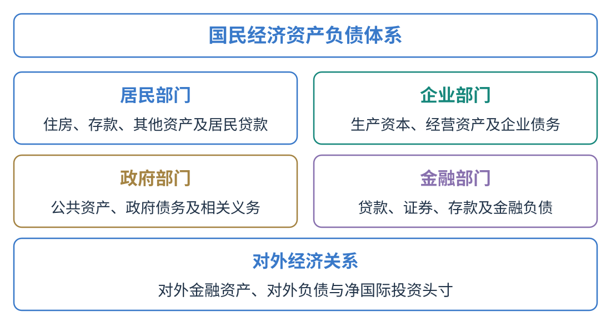

相关基础概念：

- 资产：能够产生经济利益的资源或权利。
- 负债：对其他主体承担的经济义务。
- 净资产：资产扣除负债后的剩余价值。
- 杠杆率：用于衡量债务相对于资产、权益或收入规模的指标。
- 国家财富：从整个经济体角度衡量相关资产与净财富。
- 资金流量：不同经济主体之间资金来源与使用的变化。

在整个经济体的综合核算中，内部部门之间的金融债权和债务需要对应处理，不能将所有部门资产简单相加便认定为国家净财富。

## 23.4 现实经济分析的基本逻辑

现实经济现象应该从不同理论维度共同解释。

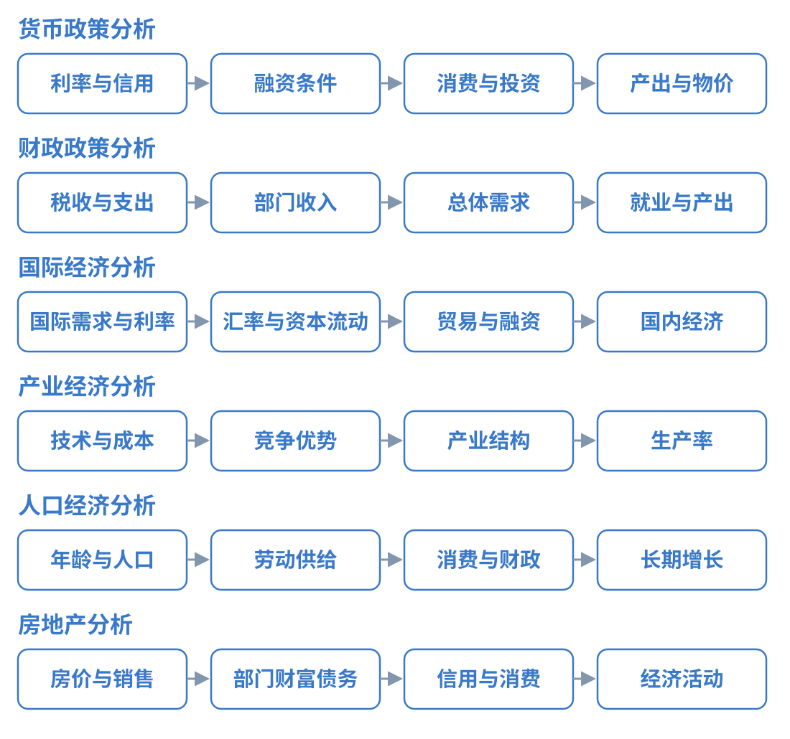

以上是主要传导路径，而非在任何经济条件下都会成立的确定因果规律。

## 23.5 经济数据来源的分类

| 数据类别 | 主要数据机构 |
|---|---|
| 中国宏观经济 | [国家统计局](https://www.stats.gov.cn/) |
| 中国货币与信用 | [中国人民银行](https://www.pbc.gov.cn/) |
| 中国财政 | [财政部](https://www.mof.gov.cn/) |
| 中国国际收支 | [国家外汇管理局](https://www.safe.gov.cn/) |
| 美国宏观经济 | [BEA](https://www.bea.gov/)、[FRED](https://fred.stlouisfed.org/) |
| 美国就业与物价 | [BLS](https://www.bls.gov/) |
| 国际宏观与金融 | [IMF](https://www.imf.org/)、[BIS](https://www.bis.org/) |
| 全球经济发展 | [世界银行](https://data.worldbank.org/) |
| 国际经济比较 | [OECD](https://data-explorer.oecd.org/) |
| 国际贸易 | [WTO](https://www.wto.org/)、[UNCTAD](https://unctad.org/) |
| 国际劳动就业 | [ILO](https://ilostat.ilo.org/) |

---

# 附录一　经济学核心概念的跨章节关系

树状结构解决的是知识归属问题，而经济学真正的理解难点在于不同树枝之间存在大量联系。

## A.1 整个经济学的核心知识图谱

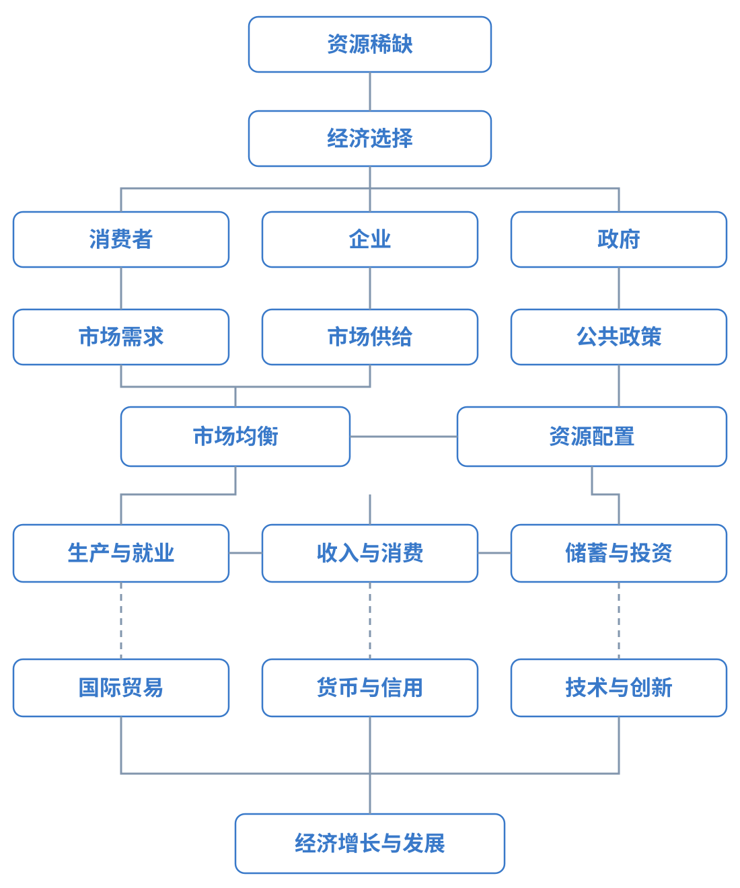

整体知识联系示意。连线表示理论联系和研究路径，不全部代表单向因果关系。

## A.2 最重要的跨章节概念链

| 基础概念 | 进一步衍生的知识 | 延伸研究领域 |
|---|---|---|
| 稀缺性 | 选择、机会成本、资源配置 | 全部经济学 |
| 边际分析 | 边际效用、边际成本、边际产量 | 消费者与生产者理论 |
| 消费者偏好 | 效用、预算约束、最优消费 | 需求理论 |
| 生产函数 | 产量、成本、利润 | 企业与供给理论 |
| 供给与需求 | 均衡、价格、弹性 | 市场与福利经济学 |
| 市场势力 | 垄断、定价、战略竞争 | 产业组织与博弈论 |
| 信息不对称 | 逆向选择、道德风险 | 信息经济学与契约理论 |
| 不完全契约 | 剩余控制权与产权配置 | 企业理论与制度经济学 |
| 经济激励 | 契约设计、机制设计 | 市场设计与公共选择 |
| 市场失灵 | 外部性、公共物品 | 公共经济学与环境经济学 |
| 货币与信用 | 利率、融资、债务 | 货币经济学与金融学 |
| 消费与投资 | 总需求、收入决定 | 宏观经济学 |
| 财政收入与支出 | 赤字、政府债务 | 财政学 |
| 比较优势 | 国际分工、贸易利益 | 国际经济学 |
| 国际资本流动 | 汇率、国际收支 | 开放经济宏观理论 |
| 信用扩张 | 杠杆、金融周期、风险 | 经济危机理论 |
| 资本与技术 | 生产率、长期增长 | 增长与发展经济学 |
| 人力资本 | 教育、技能、工资 | 劳动经济学 |
| 制度 | 产权、交易成本与激励 | 制度经济学 |
| 技术创新 | 创造性破坏、产业升级 | 创新与数字经济学 |

---

# 附录二　经济学与金融学的知识边界

继续遵循 V2.0 确立的原则：专业金融学独立建设，经济学只保留理解整体经济运行所必需的交叉知识。

| 知识领域 | 经济学研究重点 | 金融学研究重点 |
|---|---|---|
| 货币 | 货币创造、供求和社会经济影响 | 货币市场交易与金融工具 |
| 利率 | 利率与消费、投资、物价的关系 | 利率定价、期限结构与风险 |
| 银行 | 银行体系、信用创造 | 银行经营、盈利与风险管理 |
| 债务 | 信用周期、财政与宏观杠杆 | 债务工具、信用分析与定价 |
| 股票 | 企业融资与资源配置 | 股票交易、估值与投资 |
| 债券 | 债务融资及其经济影响 | 收益率、久期与债券定价 |
| 汇率 | 国际贸易及宏观政策 | 外汇交易与汇率风险管理 |
| 企业 | 生产、成本、竞争与组织 | 公司金融、资本结构、并购 |
| 房地产 | 住房供求、土地与经济周期 | 房地产融资与资产估值 |
| 保险 | 社会风险分担、市场失灵 | 保险产品、经营与精算 |
| 金融危机 | 经济衰退及社会影响 | 金融风险形成与管理 |
| 金融衍生品 | 基本社会经济职能 | 期货、期权、互换与定价 |
| 投资组合 | 不作专业展开 | 资产配置与收益风险优化 |
| 金融工程 | 不作专业展开 | 金融产品设计与数学定价 |
| 量化金融 | 不作专业展开 | 金融建模与算法交易 |

---

# 附录三　整个知识体系的学习依赖关系

需要特别区分**知识归属顺序**与**实际学习顺序**。例如数学经济学虽然位于第一篇，但零基础学习者不必先学完全部计量经济学才能理解货币政策。

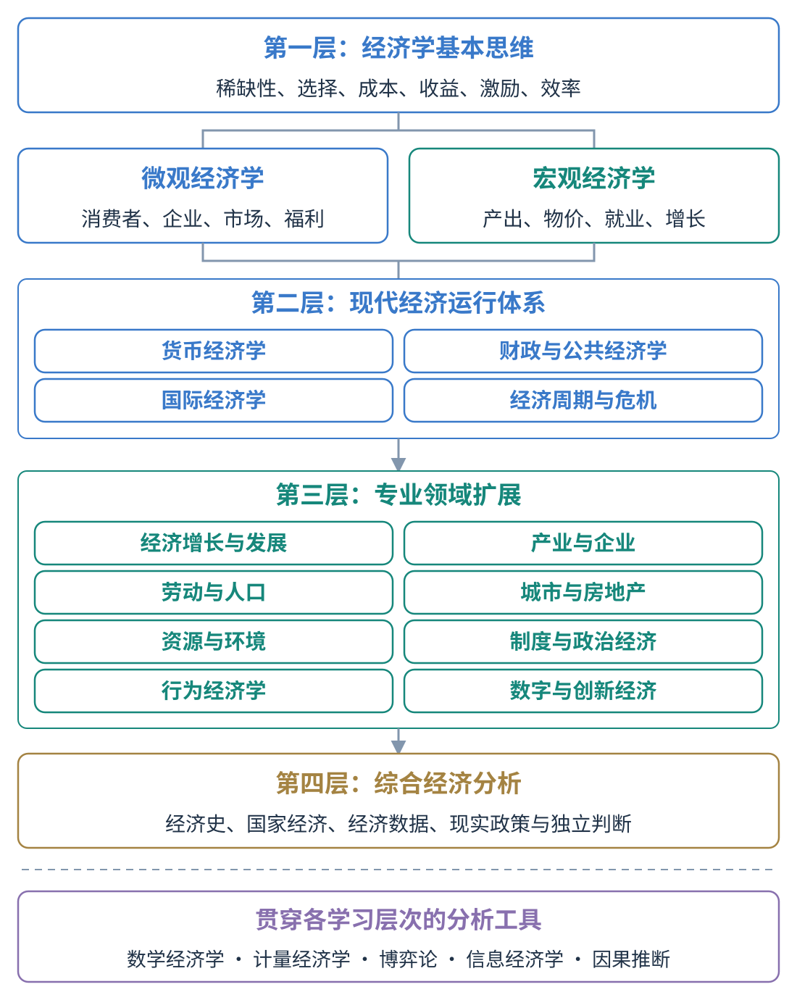

---

# 附录四　V2.5 版本调整总结

| 项目 | V2.0 | V2.5 |
|---|---|---|
| 基本组织方式 | 章节＋术语解释表 | 多级树状知识结构 |
| 概念之间的关系 | 主要依靠学习者自行理解 | 明确分类、构成、派生与交叉关系 |
| 同类概念 | 并列罗列 | 归入统一的上位概念 |
| 分类标准 | 部分混合 | 尽量区分不同分类维度 |
| 理论模型 | 罗列名称与作用 | 按研究问题及发展脉络组织 |
| 因果机制 | 部分独立展示 | 纳入章节内部的逻辑链 |
| 跨章节联系 | 较少 | 建立核心知识关联图谱 |
| 金融学边界 | 专业内容独立 | 继续保持独立 |
| 核心篇幅 | 重点建设前两篇 | 进一步强化前两篇的内部结构 |
| 学习功能 | 类似经济学术语手册 | 类似经济学知识地图 |

## 最终知识库的建设原则

建议未来继续沿用五级结构：

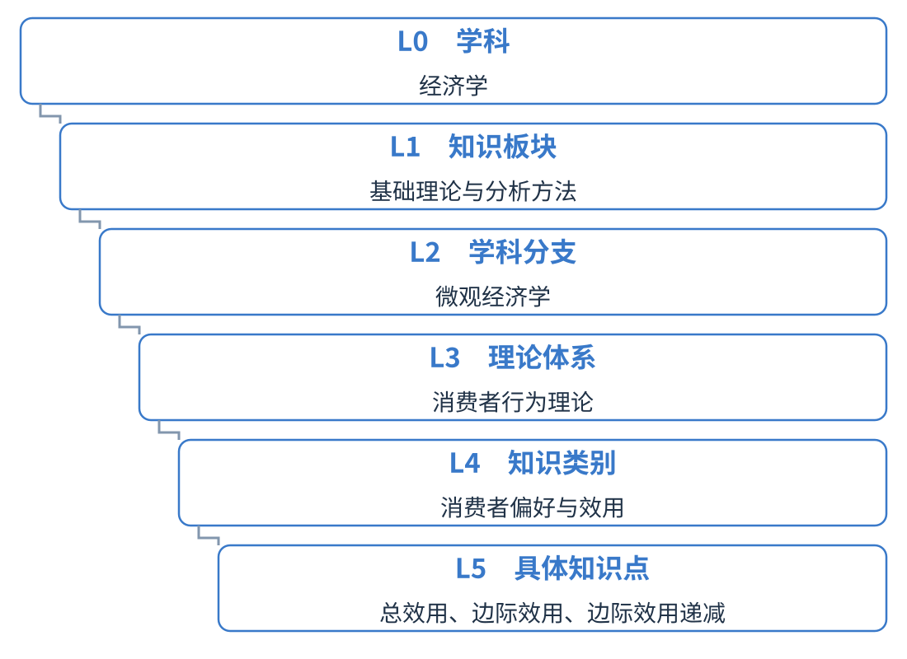

对于最末级的具体知识点，未来第二阶段再进一步补充：

- 概念定义。
- 产生背景与研究目的。
- 基本规律及适用条件。
- 数学公式与图像。
- 与其他知识点的区别和联系。
- 典型案例及现实应用。
- 常见误区。

**V2.5 的定位依然是知识框架，而不是完整教材。** 本版本保留五篇二十三章的主体架构，并对各章内部进行了重新分类；部分内容有意采用教学上的简化归类，而不是严格互斥的学术分类，也没有全面展开高级模型的数学假设。

V1.0 解决了「经济学有哪些知识」的问题，V2.0 解决了「这些知识大概是什么意思」的问题，V2.5 则进一步解决了「这些知识属于哪里，以及它们之间有什么联系」的问题。

这才是作为下一阶段系统深入学习所需要的经济学知识框架。
