# 金融学知识体系 V2.5

> 第一阶段：建立完整的金融学知识框架  
> 面向对象：零基础金融学学习者  
> 组织方式：树状知识结构＋概念关联图谱  
> 学习目标：理解现代社会中货币、信用、资金、资本、金融资产与风险的运行机制。

本体系与《经济学知识体系 V2.5》平行建设。

经济学重点研究社会经济如何组织生产、分配资源和实现发展；金融学则进一步研究**资金如何获得、如何流动、如何定价、如何配置，以及风险如何产生、转移和管理。**

本体系参考了 CFA Institute 的投资知识体系、GARP 的金融风险管理知识体系，并补充货币银行学、金融机构、国际金融、支付结算、金融工程和金融科技等内容。但不以任何一项职业资格考试为编写目标，而是建立更加完整的金融学知识地图。

# 0　金融学总体知识架构

## 0.1 金融学的核心研究问题

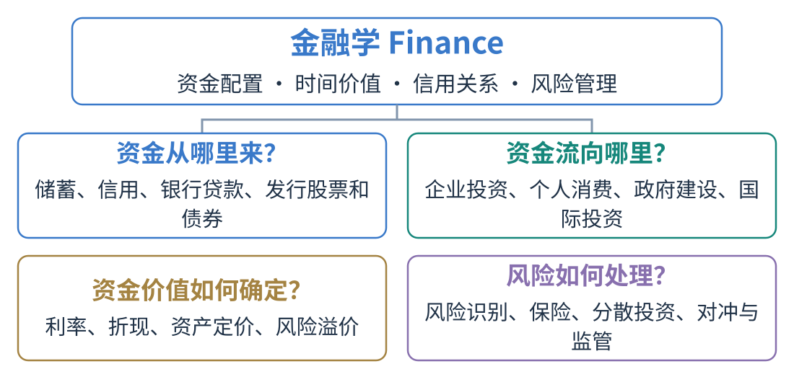

金融学主要围绕以下五项基本问题展开：

- **融资问题**：需要资金的主体如何取得资金。
- **投资问题**：拥有资金的主体如何配置资金。
- **定价问题**：不同金融资产究竟值多少钱。
- **风险问题**：如何认识、承担、转移和控制不确定性。
- **制度问题**：金融市场如何建立规则、完成交易并维持稳定。

## 0.2 金融学与经济学的关系

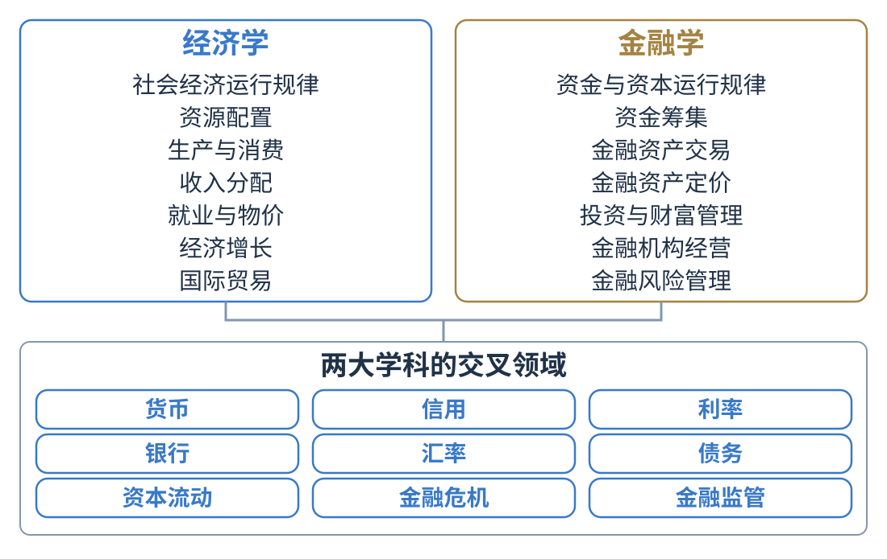

本体系不再重复展开经济学中的消费者理论、生产理论、经济增长模型、宏观经济政策等完整内容，而是保留金融学所需要的经济学基础，并将重点放在金融活动本身。

## 0.3 金融学总体目录

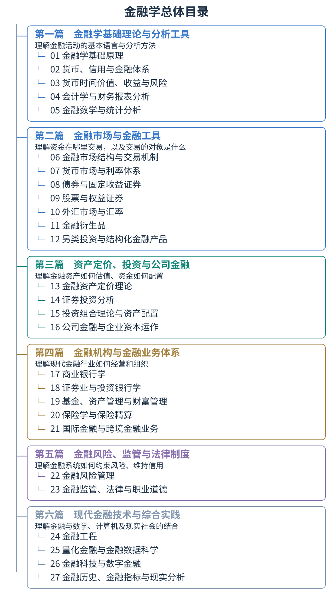

其中，前三篇是整个金融学体系的核心。第四篇研究现实金融行业的运行，第五篇研究风险和制度约束，第六篇研究金融技术与实际应用。

---

# 第一篇　金融学基础理论与分析工具

# 第一章　金融学基础原理

## 1.1 金融活动产生的根源

金融活动产生于不同经济主体之间、不同时间之间以及不同风险承担能力之间的差异。

### 1.1.1 资金供求差异

- **资金盈余主体**：拥有暂时不需要使用的资金，例如具有储蓄的居民。
- **资金短缺主体**：当前资金不足，但具有消费、生产或投资需求，例如需要扩大生产的企业。
- **资金融通**：通过一定制度和金融工具，将资金从盈余主体配置给短缺主体。

### 1.1.2 时间差异

- 当前资金需求：现在就需要购买商品、建设工厂或开展经营。
- 未来收入预期：预计未来能够获得工资、利润或其他收入。
- 跨期资源配置：通过储蓄、借贷和投资，在当前与未来之间重新分配购买力。

### 1.1.3 风险承担能力差异

- 风险承担者：愿意承担一定不确定性以获得潜在收益。
- 风险转移者：希望支付一定成本，将部分风险转移给其他主体。
- 风险分担：由多个经济主体共同承担可能发生的损失。

**逻辑关系：** 资金供求差异产生融资需求，时间差异产生利息和折现问题，风险差异产生保险、投资组合及金融衍生品等风险配置机制。

## 1.2 金融活动的基本循环

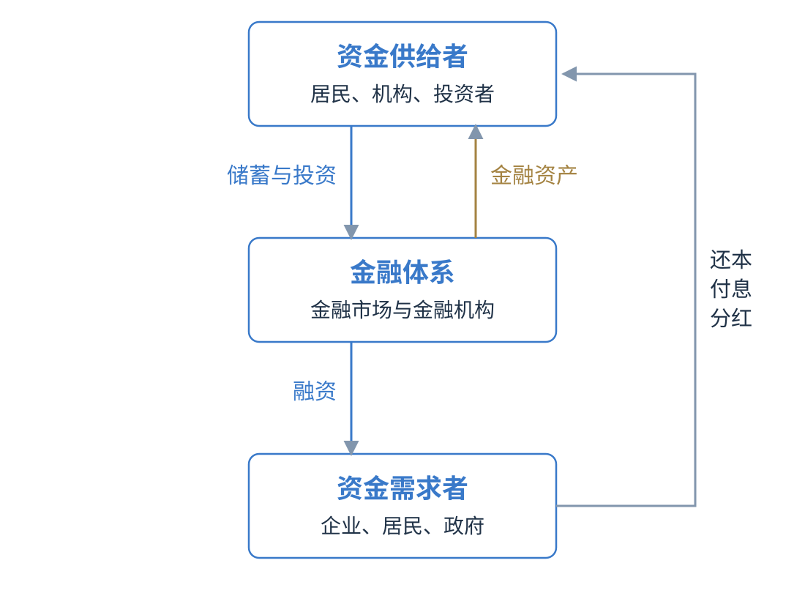

资金流动与金融权利形成的简化示意。实际金融活动还包括银行货币创造、二级市场交易及风险转移。

金融活动通常包含三个相互联系的部分：

- **资金筹集**：获得开展经济活动所需要的资金。
- **资金配置**：选择资金的具体使用方向。
- **收益与风险分配**：确定未来经济收益以及潜在损失由谁承担。

## 1.3 资产、负债与资本

这三个概念是学习整个金融学最重要的基础之一。

### 1.3.1 资产的分类

- **资产**：经济主体拥有或控制、能够带来经济利益的资源或权利。
  - 非金融资产：不以对其他主体的金融请求权为主要特征的资产。
    - 有形资产：土地、建筑、机器设备等。
    - 无形资产：符合资产确认条件的专利、软件等。
  - 金融资产：主要表现为现金或对其他经济主体的金融权利。
    - 现金与银行存款。
    - 债权类资产：贷款、债券等。
    - 权益类资产：股票及其他股权。
    - 金融衍生工具相关资产：具有正价值的期权、互换等金融合同。

### 1.3.2 负债

- **负债**：经济主体因过去的交易或事项形成的现有经济义务。
  - 流动负债：通常需要在较短时期内清偿的负债。
  - 非流动负债：通常在较长期限内偿还的负债。
- **债务**：负债中具有偿还资金等义务的部分，例如借款和已发行债券。

### 1.3.3 所有者权益与净资产

- 所有者权益：企业资产扣除负债后归属于所有者的剩余权益。
- 净资产：资产价值扣除负债后的净值。
- 股东权益：公司所有者权益中归属于股东的部分。

$$
\text{资产}=\text{负债}+\text{所有者权益}
$$

资产负债结构示例：企业拥有100万元资产，其中65万元由负债支持，剩余35万元为所有者权益。

### 1.3.4 资本的不同含义

资本在不同金融领域中具有不同的含义：

| 概念 | 简明解释 |
|---|---|
| 实物资本 | 机器、厂房等用于生产的资产 |
| 金融资本 | 以资金、证券等形式存在并用于投资或融资的资本 |
| 权益资本 | 由企业所有者投入或积累形成的资金 |
| 债务资本 | 企业通过借款、发行债券等方式取得的资金 |
| 监管资本 | 金融机构按照监管规则确认、用于吸收损失的资本 |

**特别辨析：** 资金、资产、资本并非同义词。资金强调可支配的货币资源，资产强调具有经济价值的资源和权利，资本则更强调用于经营、投资或承担损失的资源。

## 1.4 金融权利与金融契约

金融资产的本质往往不是某个实物，而是一项由合同或制度确定的经济权利。

### 1.4.1 债权关系

- 债权人：拥有要求其他主体偿还资金等权利的一方。
- 债务人：承担偿还义务的一方。
- 本金：借入或投入的基础资金金额。
- 利息：资金使用者按照约定支付的报酬。
- 到期日：相关债务应当按照合同偿付的日期。

### 1.4.2 股权关系

- 股东：持有企业股权的个人或机构。
- 所有权权益：股东对企业拥有的相关经济权益。
- 表决权：参与企业相关治理决策的权利。
- 分红权：按照规定和公司决议分享利润的权利。
- 剩余索取权：在满足其他优先请求权后，获得剩余价值的权利。

### 1.4.3 或有权利与义务

- 或有权利：是否获得收益取决于未来特定事件或条件。
- 或有义务：是否承担付款等义务取决于未来事件。
- 典型工具：保险合同、金融期权、部分担保合同。

债券主要形成债权关系，股票主要形成股权关系，衍生品与保险则大量涉及依赖未来事件的契约安排。

## 1.5 融资与投资的对应关系

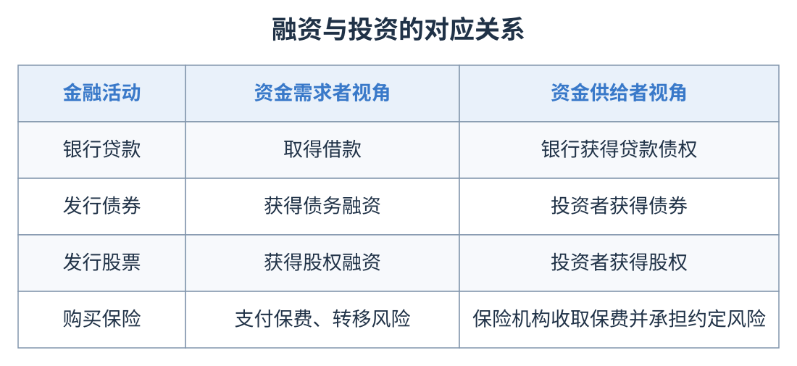

### 1.5.1 融资的分类

- **内部融资**：通过留存收益等企业内部资源获得资金。
- **外部融资**：通过企业外部主体获得资金。
  - 债务融资：形成偿债义务。
  - 股权融资：向投资者提供所有权权益。
  - 混合融资：同时具有一定债务和股权特征，例如可转换债券。

### 1.5.2 投资的分类

- **实体投资**：建设厂房、购置设备等直接形成生产能力的投资。
- **金融投资**：购买金融资产或建立金融契约的投资。
  - 权益投资：获得企业股权。
  - 债权投资：获得债务偿还请求权。
  - 其他投资：商品、房地产、衍生工具等相关投资活动。

### 1.5.3 投资与投机

- 投资：投入资源，希望通过资产收益或价值变化获得回报。
- 投机：主要根据未来价格变化预期承担风险，以获取收益。
- 套利：利用不同市场或相关资产之间的定价差异建立交易。

三者并没有完全绝对的现实边界，但套利与投机尤其需要区分：严格意义上的无风险套利要求在特定假设下不存在净损失风险，而通常所谓的统计套利并不保证无风险。

## 1.6 金融系统的基本职能

- **资金配置**：将资金引向不同企业、行业和地区。
- **跨期配置**：实现当前资源与未来资源的交换。
- **价格发现**：通过交易形成能够反映供求、信息及预期的价格。
- **流动性供给**：帮助资产持有者将资产转换为支付资金。
- **风险配置**：通过保险、投资组合和金融契约转移或分担风险。
- **信息处理**：通过财务披露、信用评价、市场价格等改善经济决策。
- **支付结算**：完成不同主体之间的货币及资产交付。

---

# 第二章　货币、信用与金融体系

本章与经济学第六章存在一定交叉，但更加重视货币和信用作为金融活动基础工具的作用。

## 2.1 货币体系

### 2.1.1 按货币的发行和创造主体分类

- **中央银行货币**
  - 现金：中央银行发行的纸币和硬币等。
  - 银行准备金：商业银行等机构存放在中央银行的相关余额。
  - 中央银行数字货币（CBDC）：由中央银行发行的数字形式货币。
- **商业银行货币**
  - 活期存款：能够较方便用于支付和转账的存款。
  - 定期存款：按照约定期限存放的资金。
  - 储蓄存款：主要服务于个人储蓄需求的银行存款。

### 2.1.2 按货币统计层次分类

概念性包含关系，不同国家和时期的具体统计口径可能不同。

### 2.1.3 货币与其他支付工具的区别

- 货币：具有支付、计价等基本职能的经济工具。
- 银行卡：访问和使用银行账户资金或信用额度的工具。
- 电子钱包：储存相关支付价值或管理支付凭证的工具。
- 电子支付：通过电子渠道完成支付的行为。
- 数字资产：以数字形式存在并具有一定经济价值的资产，不一定具有货币属性。

支付工具、支付渠道和货币本身属于不同概念，不能相互等同。

## 2.2 信用体系

### 2.2.1 按信用关系的参与主体分类

- 商业信用：企业之间通过延期付款等方式提供的信用。
- 银行信用：银行通过贷款等方式提供的信用。
- 国家信用：政府通过举债等方式建立的信用关系。
- 消费信用：个人或家庭为消费活动获得的信用。
- 国际信用：不同国家和地区的主体之间建立的信用关系。

### 2.2.2 按信用保障方式分类

- **无担保信用**：主要依据债务人的信用和偿债能力提供资金。
- **有担保信用**
  - 抵押：以相关财产作为债务履行保障，通常不转移财产占有。
  - 质押：以动产或相关权利提供债务保障。
  - 保证：由第三方按照约定承担相关偿债责任。

具体法律含义和执行方式因司法管辖区而异。

### 2.2.3 信用风险及信用质量

- 信用风险：债务人可能无法履行合同义务所产生的风险。
- 信用评级：对经济主体或债务工具信用质量进行评价。
- 信用利差：信用资产收益率相对于相关基准收益率的差额。
- 信用增级：通过担保、资产抵押等方式改善债务工具的信用保障。
- 债务违约：未按照合同要求履行债务义务。

**逻辑关系：** 信用质量影响资金提供者要求的收益和保障条件，进而影响债务人的融资成本与融资能力。

## 2.3 金融体系的组成结构

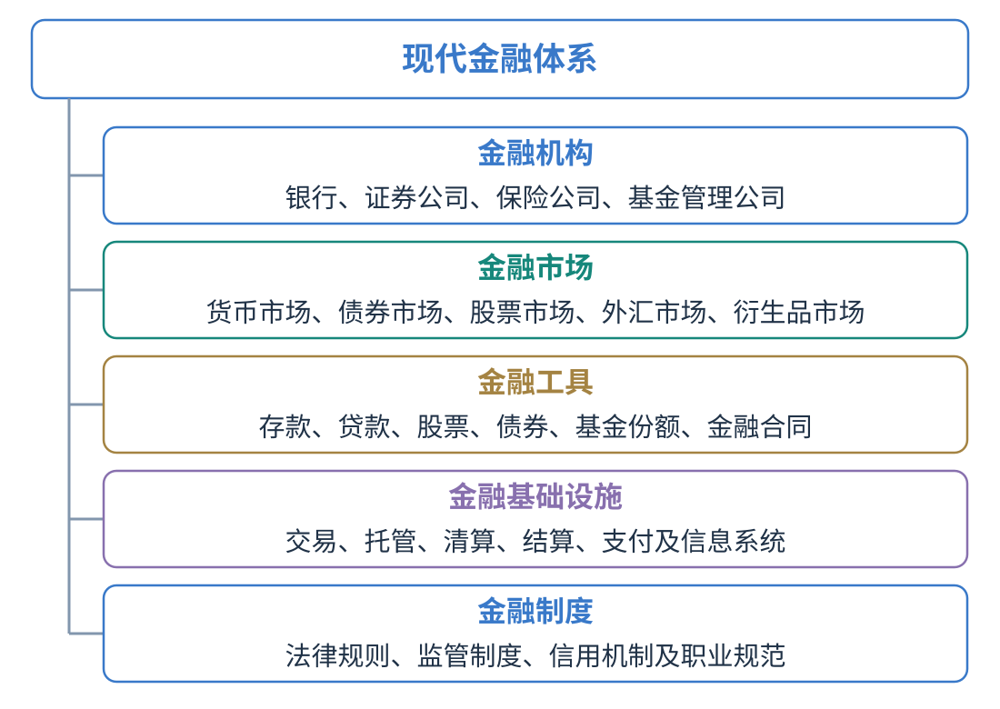

五个部分并非相互独立的系统。例如，银行属于金融机构，可以在金融市场发行金融工具，而工具的交易和资金交付需要金融基础设施支持，并受到金融制度约束。

## 2.4 直接融资与间接融资

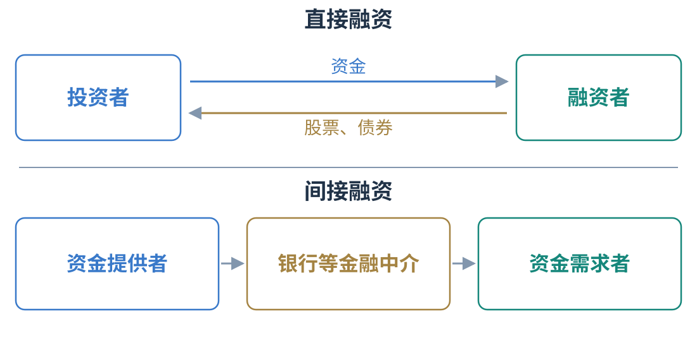

示意图重点展示金融债权关系。银行贷款也可以直接创造存款，并非必须先取得等额储蓄。

- **直接融资**：投资者通过股票、债券等工具直接获得融资主体的相关金融权利。
- **间接融资**：金融中介通过自身资产负债表建立资金供求关系，例如银行存款与银行贷款。

证券公司参与股票发行承销，并不意味着股票发行变成间接融资。区分的关键是金融中介是否通过自身资产负债表承担中间金融债权和负债关系。

## 2.5 金融机构的基本业务类型

- **信用中介业务**：通过贷款等方式提供融资。
- **证券中介业务**：帮助证券发行、交易和流通。
- **资产管理业务**：受托管理客户资金和金融资产。
- **保险业务**：收取保费并承担约定风险。
- **支付服务业务**：提供转账、清算及支付处理服务。
- **金融信息业务**：提供行情、评级、数据和研究服务。

## 2.6 金融体系的运行基础

- 产权制度：确定金融资产及相关权益归属。
- 契约制度：保障金融交易中的权利和义务。
- 信用机制：降低不同主体之间的交易不确定性。
- 信息披露：使参与者获得必要的财务和交易信息。
- 风险管理：控制违约、价格变化等风险。
- 金融监管：维护金融市场秩序及系统稳定。

---

# 第三章　货币时间价值、收益与风险

这一章是金融数学、资产定价、公司金融和投资理论的共同基础。

## 3.1 货币的时间价值

同样金额的货币在不同时间通常具有不同的经济价值，因为资金具有使用机会、购买力变化和风险等因素。

### 3.1.1 现金流的基本概念

- 现金流入：经济主体实际收到的资金。
- 现金流出：经济主体实际支付的资金。
- 净现金流：现金流入减去现金流出。
- 现金流时间线：按照时间顺序表示不同资金收付事项。

### 3.1.2 现值与终值

- **现值（PV）**：未来资金折算到当前时点的价值。
- **终值（FV）**：当前资金按照一定收益率计算到未来时点的价值。
- **折现**：将未来价值换算为当前价值。
- **复利计息**：将利息纳入后续计息本金的过程。

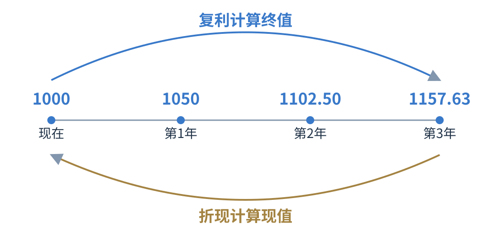

假设本金为1000元，年利率为5%，按年复利计息，无其他费用。

基本复利公式：

$$
FV=PV(1+r)^n
$$

$$
PV=\frac{FV}{(1+r)^n}
$$

其中，$r$ 为每期利率，$n$ 为计息期数。

## 3.2 利息的计算方式

### 3.2.1 单利与复利

- 单利：只对原始本金计算利息。
- 复利：对本金以及已经积累的相关利息计算后续利息。

### 3.2.2 按计息频率分类

- 年度复利：每年计算一次复利。
- 多期复利：每半年、季度或月等周期计息。
- 连续复利：将计息频率趋于无限大的理论计息方式。

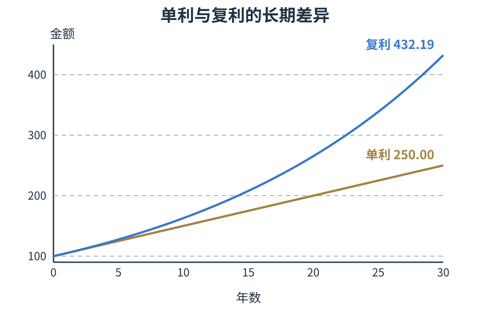

初始本金100，假设年利率恒定为5%，不考虑税费和通胀。

### 3.2.3 不同利率表达方式

- 报价年利率：按照规定方式表示的年度利率。
- 有效年利率（EAR）：考虑一年内复利效果后的实际年度计息利率。
- 实际利率：进一步考虑通胀对购买力的影响。

有效年利率解决的是计息频率问题，实际利率解决的是货币购买力问题，二者属于不同维度。

## 3.3 多期现金流的价值

- 单笔现金流：只在某个时间点发生一次资金收付。
- 多期现金流：在多个时间点发生资金收付。
  - 普通年金：每期期末发生等额现金流。
  - 预付年金：每期期初发生等额现金流。
  - 永续年金：理论上无限期持续发生的等额现金流。
  - 增长年金：现金流按照一定规律增长。

多期现金流现值的基本形式：

$$
PV=\sum_{t=1}^{n}\frac{CF_t}{(1+r)^t}
$$

其中，$CF_t$ 为第 $t$ 期现金流。

**交叉联系：** 债券估值、股票股利折现模型、企业估值、贷款还款计算、养老规划，均建立在未来现金流及其现值计算之上。

## 3.4 金融收益及其衡量

### 3.4.1 收益的来源

- 利息收入：持有存款、贷款债权或债券等获得的利息。
- 股利收入：持有股票等权益资产获得的分配。
- 租金收入：出租相关资产获得的收入。
- 资本利得：资产出售价格超过购入成本所形成的收益。
  - 资本损失：资产出售价格低于购入成本形成的损失。

### 3.4.2 收益率的分类

- 持有期收益率：整个资产持有期间的收益比例。
- 年化收益率：按照一致方法将不同期限收益换算为年度收益率。
- 名义收益率：没有扣除通胀影响的收益率。
- 实际收益率：考虑通胀后购买力的变化。
- 总收益率：综合现金收入和资产价格变化。
- 净收益率：进一步扣除交易费用、管理费用等成本后的收益率，具体口径需要明确。

基本持有期收益率：

$$
R=\frac{P_1-P_0+D}{P_0}
$$

其中，$P_0$ 为期初价格，$P_1$ 为期末价格，$D$ 为持有期间获得的现金收入。

### 3.4.3 多期收益率的计算

- 算术平均收益率：对各期收益率进行普通算术平均。
- 几何平均收益率：反映连续多期收益复合增长后的平均水平。
- 时间加权收益率：尽量排除外部资金进出对投资业绩的影响。
- 资金加权收益率：考虑实际投入资金的金额及时间，反映投资者的资金回报。

## 3.5 风险的基本理论

### 3.5.1 风险与不确定性

- 不确定性：未来结果无法完全确定。
- 风险：不确定性可能对经济目标造成影响，金融领域尤其关注潜在损失。
- 风险敞口：某项资产或经济活动受到特定风险因素影响的程度。

### 3.5.2 按风险来源分类

- 市场风险：利率、汇率、股票价格等发生变化。
- 信用风险：交易对象无法履行金融义务。
- 流动性风险：难以及时交易资产或取得支付资金。
- 操作风险：人员、流程、系统或外部事件造成损失。
- 法律与合规风险：法律责任或违规行为造成损失。
- 模型风险：错误的模型或假设导致决策失误。

完整风险体系归入第二十二章。

### 3.5.3 按能否通过分散投资降低分类

- 系统性风险：由共同市场因素等产生、难以通过普通分散投资消除的风险。
- 非系统性风险：主要来自个别企业或资产，可以通过适当分散投资降低的风险。

## 3.6 风险与收益的关系

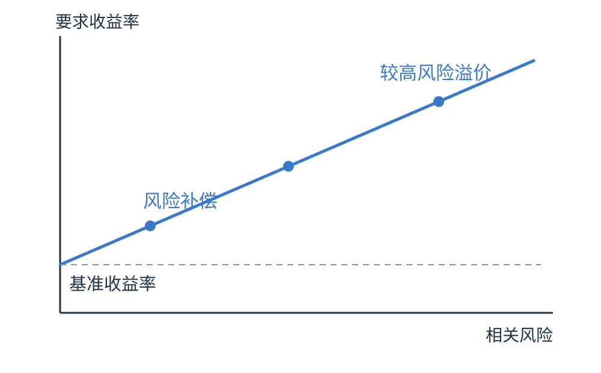

承担更多被市场定价的风险，投资者通常要求更高预期收益，但实际收益并不一定更高。

- 无风险收益率：理论上的无风险资金回报基准。
- 风险溢价：为承担特定风险而要求的额外预期回报。
- 预期收益率：根据未来可能结果估计的平均收益。
- 已实现收益率：投资结束后实际取得的收益。
- 风险调整后收益：结合所承担风险评价投资表现。

**特别辨析：** 高风险不必然带来高收益。风险溢价是对风险的预期补偿，而不是对实际盈利的保证；并非所有风险都会获得市场补偿。

## 3.7 金融市场的基本定价原则

- **一价定律**：在无交易摩擦等条件下，具有相同未来现金流的资产应具有相同价格。
- **无套利原则**：合理的资产价格不应允许持续存在严格意义上的无风险套利机会。
- **风险补偿原则**：资产价值需要考虑未来收益的不确定性。
- **现值原则**：资产价值与未来能够获得的现金流及折现条件有关。

这些原则将在债券、股票、衍生品和资产定价理论中反复使用。

---

# 第四章　会计学与财务报表分析

会计学是独立学科，但财务报表是金融投资、企业估值、信用分析和公司金融的重要信息来源。因此，本章只保留金融学所需要的会计知识，不展开完整的会计记账和审计实务。

## 4.1 会计的基本理论

### 4.1.1 会计核算的基本要素

- **反映财务状况的要素**
  - 资产：企业拥有或控制的经济资源。
  - 负债：企业承担的现有经济义务。
  - 所有者权益：资产扣除负债后的剩余权益。
- **反映经营成果的要素**
  - 收入：企业日常经营活动形成的相关经济利益流入。
  - 费用：企业日常经营活动产生的相关经济利益流出。
  - 利润：一定时期内收入、费用及相关利得损失共同形成的经营成果。

### 4.1.2 会计确认基础

- 收付实现制：主要根据现金实际收付确认相关收入和支出。
- 权责发生制：按照经济业务实际发生及权利义务形成的时期确认相关项目。

企业已经确认收入，并不意味着企业已经收到相应现金；已经确认利润，也不意味着拥有同等金额的可用资金。

## 4.2 企业三大核心财务报表

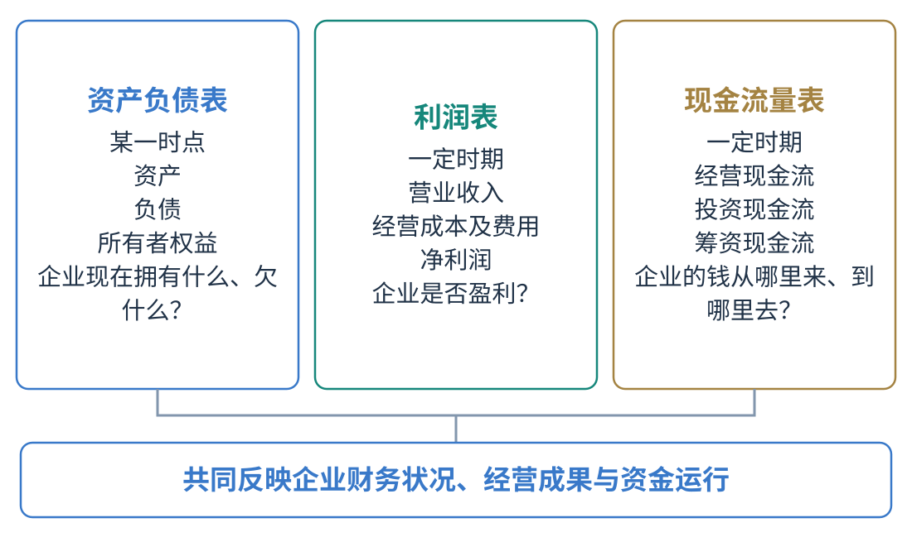

### 4.2.1 资产负债表

- **资产项目**
  - 流动资产：现金、应收账款、存货等较短期内可以使用或变现的资产。
  - 非流动资产：固定资产、长期投资及符合确认条件的无形资产等。
- **负债项目**
  - 流动负债：短期借款、应付账款等。
  - 非流动负债：长期借款、长期应付债券等。
- **所有者权益项目**
  - 股本或实收资本。
  - 资本公积等相关权益项目。
  - 留存收益：企业历年积累且尚未分配的相关利润。

### 4.2.2 利润表

- 营业收入：企业销售商品和服务形成的收入。
- 营业成本：与相关经营活动直接对应的成本。
- 毛利润：营业收入扣除相应营业成本后的余额。
- 营业利润：按照相应会计口径计算的经营利润。
- 息税前利润（EBIT）：未扣除利息及所得税影响的利润指标。
- 息税折旧摊销前利润（EBITDA）：在EBIT基础上加回相关折旧与摊销。
- 净利润：扣除相关成本、费用、税费及其他影响后的利润。

EBIT和EBITDA的具体调整口径可能存在差异，其中EBITDA尤其不能直接等同于现金流。

### 4.2.3 现金流量表

- **经营活动现金流**：由企业主要经营活动形成的现金收付。
- **投资活动现金流**：由购置长期资产、开展投资等活动形成的现金收付。
- **筹资活动现金流**：由借款、偿债、发行权益及相关资金分配等活动形成的现金收付。

### 4.2.4 其他财务报告

- 所有者权益变动表：记录所有者权益的变化。
- 财务报表附注：解释会计政策、重要项目及相关风险。
- 审计报告：注册会计师等专业主体对财务报表发表审计意见的报告。

## 4.3 重点会计项目

### 4.3.1 收入与应收款项

- 收入确认：按照相关会计标准确定何时确认收入。
- 应收账款：企业销售商品或服务后尚未收到的款项。
- 坏账与信用减值：部分应收款项可能无法收回所产生的损失。

### 4.3.2 存货与固定资产

- 存货：用于出售或生产经营的商品、材料等资产。
- 存货计价：按照相关会计方法确定存货成本。
- 折旧：将固定资产的可折旧金额在使用期限内系统分配。
- 摊销：将有关无形资产等的成本在相应期限内分配。
- 资产减值：资产可收回价值下降时确认相应损失。

### 4.3.3 无形资产与商誉

- 无形资产：没有实物形态、符合确认条件的可辨认非货币性资产。
- 商誉：企业并购中形成的、无法单独辨认确认的未来经济利益等所对应的会计项目。
- 商誉减值：相关经济利益预期下降后形成的减值损失。

## 4.4 财务报表分析

### 4.4.1 盈利能力分析

研究企业是否能够有效创造利润。

| 指标 | 简明解释 |
|---|---|
| 毛利率 | 毛利润占营业收入的比例 |
| 净利率 | 净利润占营业收入的比例 |
| 资产收益率（ROA） | 衡量企业使用资产创造收益的能力 |
| 净资产收益率（ROE） | 衡量所有者权益所产生的收益 |
| 投入资本回报率（ROIC） | 衡量投入经营活动的资本创造经营回报的能力 |

### 4.4.2 偿债能力分析

- **短期偿债能力**
  - 流动比率：流动资产相对于流动负债的比例。
  - 速动比率：排除存货等变现能力相对较弱资产后衡量短期偿债能力。
  - 现金比率：使用现金及相关高流动性资产衡量偿债能力。
- **长期偿债能力**
  - 资产负债率：负债占资产的比例。
  - 债务权益比：相关债务相对于所有者权益的比例。
  - 利息保障倍数：衡量相关盈利能否覆盖利息支出。

### 4.4.3 经营效率分析

- 存货周转率：衡量存货使用和销售效率。
- 应收账款周转率：衡量企业回收应收款项的效率。
- 总资产周转率：衡量资产创造营业收入的能力。
- 现金转换周期：衡量经营投入转化为回收现金所需要的时间。

### 4.4.4 成长能力分析

- 营业收入增长率。
- 净利润增长率。
- 经营现金流增长率。
- 资产及投入资本增长率。

企业规模增长、收入增长和盈利能力改善并不一定同步发生。

### 4.4.5 杜邦分析体系

杜邦分析将ROE进一步拆解，帮助判断企业的高收益究竟来自盈利能力、经营效率还是财务杠杆。

$$
ROE=\text{净利率}\times\text{总资产周转率}\times\text{权益乘数}
$$

各指标需采用一致的利润、资产和权益计算口径。

## 4.5 自由现金流与企业价值

- **自由现金流（FCF）**：满足经营和必要投资等支出后，可供相关资本提供者支配的现金流。
  - 企业自由现金流（FCFF）：从债权人与股东等全部相关资本提供者角度计算。
  - 股权自由现金流（FCFE）：考虑债务融资等因素后，可供股东支配的现金流。
- 资本性支出（CapEx）：购建长期资产等发生的支出。
- 营运资本：维持日常经营所需要的相关流动资产和流动负债净额。

**知识联系：** 会计利润反映经营成果，现金流反映资金收付，自由现金流进一步服务于企业估值和投资决策。

---

# 第五章　金融数学与统计分析

金融数学主要研究金融价值、随机变化和优化问题，金融统计则利用真实数据衡量金融现象及风险。

## 5.1 金融数学基础工具

- 微积分：分析资产价格变化、敏感度及最优决策。
- 线性代数：处理多个资产、风险因素与投资权重。
- 概率论：描述未来金融结果的不确定性。
- 数理统计：根据历史样本估计收益和风险。
- 最优化理论：在收益、风险和资金等约束条件下寻找最优方案。
- 数值分析：使用计算机近似求解复杂金融模型。

## 5.2 金融概率理论

### 5.2.1 随机变量与概率分布

- 随机变量：结果不确定但可以用数值表示的变量，例如未来资产收益率。
- 概率分布：描述不同随机结果发生概率的数学关系。
  - 正态分布：常用于描述金融收益的基础理论分布。
  - 对数正态分布：常用于部分资产价格模型。
  - 二项分布：描述有限次数独立试验中的成功次数。
  - 泊松分布：常用于描述一定时期内某类事件的发生次数。

现实金融收益不一定符合正态分布，尤其可能存在极端损失比正态模型预测更加频繁的现象。

### 5.2.2 随机变量的统计特征

- 期望值：随机结果按照发生概率计算的理论平均值。
- 方差：衡量随机结果偏离平均值的程度。
- 标准差：方差的平方根。
- 偏度：衡量概率分布的不对称程度。
- 峰度：反映分布尾部等特征的统计量。
- 厚尾现象：极端结果发生概率相对于某些基础分布更高。

### 5.2.3 不同金融变量之间的关系

- 协方差：衡量两个随机变量共同变化的方向与程度。
- 相关系数：标准化衡量两个变量线性相关程度的指标。
- 相关性矩阵：记录多个资产之间的相关关系。
- 因果关系：一个变量的变化真正导致另一变量变化。

相关性是投资组合风险分析的重要基础，但相关性并不等于因果性。

## 5.3 金融随机过程

- **随机过程**：描述金融变量随时间发生随机变化的数学模型。
  - 随机游走：变量的未来变化受到随机增量影响。
  - 布朗运动：连续时间随机过程的基础模型。
  - 几何布朗运动：经典资产价格模型中的一种随机过程。
  - 均值回复过程：变量具有向长期平均水平回归的趋势。
  - 跳跃过程：允许价格在某些时间出现不连续变化。
- **随机微积分**：研究随机过程中的微分与积分问题。
  - 伊藤引理：分析随机变量函数变化的重要数学工具。

该部分属于金融工程的数学基础，第一阶段只需要知道这些工具用于描述哪些问题。

## 5.4 金融统计与时间序列分析

### 5.4.1 金融数据类型

- 截面数据：同一时期多个资产或企业的数据。
- 时间序列数据：同一资产在不同时间的数据。
- 面板数据：多个资产或企业在多个时期的数据。
- 高频数据：在较短时间间隔内记录的报价、成交等数据。

### 5.4.2 金融统计模型

- 回归模型：估计金融变量之间的数量关系。
- 因子模型：利用若干共同因素解释资产收益。
- ARIMA模型：利用历史时间序列结构分析和预测变量变化。
- GARCH模型：研究金融收益波动率随时间变化的现象。
- VAR模型：分析多个金融变量之间的动态关系。

## 5.5 金融计算与模拟

- 蒙特卡洛模拟：通过大量随机情景计算金融资产价值和风险。
- 情景分析：研究特定经济条件下可能产生的金融结果。
- 敏感性分析：研究某个参数变化对金融结果的影响。
- 数值优化：使用计算方法确定投资权重等最优决策变量。

**本篇知识联系：** 金融学基础原理确定研究对象，货币和信用解释金融活动如何形成，时间价值和风险理论解释金融资产价值，财务报表提供基本信息，数学和统计工具则负责定量分析。

---

# 第二篇　金融市场与金融工具

本篇研究现代金融活动的主要场所和交易对象，是整个金融学中最需要建立清晰分类关系的部分。

## 金融市场与金融工具的总体关系

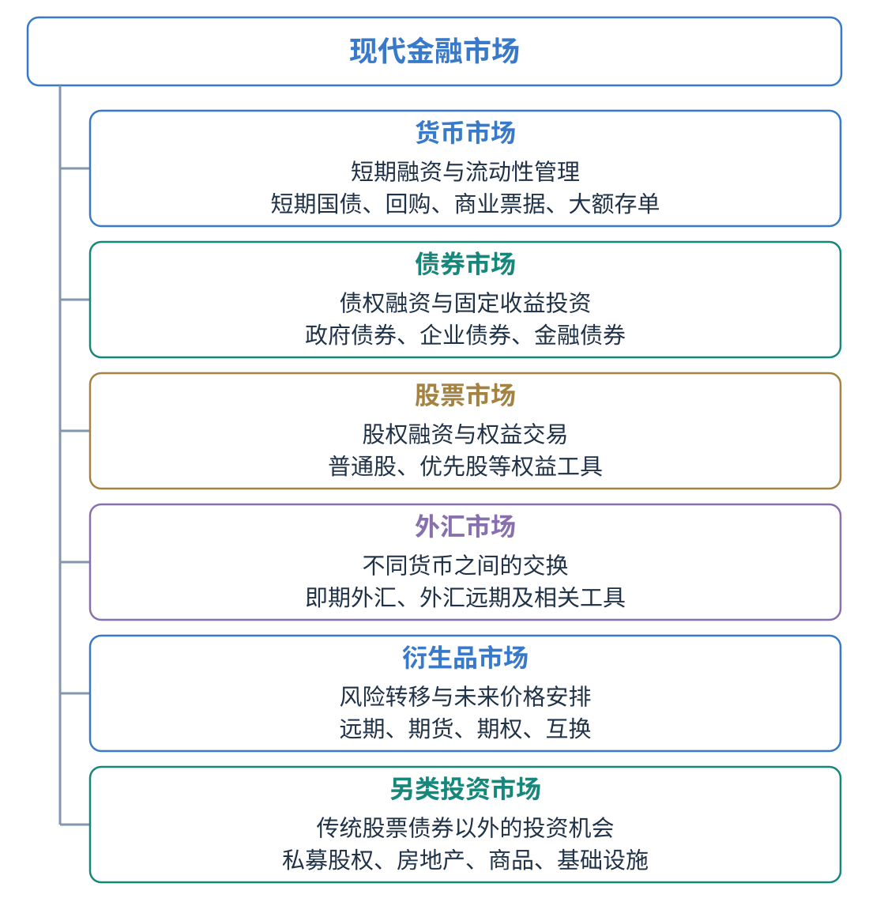

这是按主要学习领域划分的市场地图，并非完全互斥的市场分类。例如短期国债既是债券，也是货币市场工具；外汇期货既属于外汇相关产品，也属于衍生品。

# 第六章　金融市场结构与交易机制

## 6.1 金融市场的多维分类

金融市场不能简单划分成几个互相排斥的种类，因为不同分类标准可以同时应用于同一个市场。

### 6.1.1 按融资期限分类

- **货币市场**：主要交易一年以内的短期融资工具。
- **资本市场**：主要提供中长期融资和权益资本配置。
  - 中长期债券市场。
  - 股票市场。

### 6.1.2 按交易所处阶段分类

- **一级市场**：发行人首次向投资者发行证券的市场。
  - 首次公开发行。
  - 后续股票发行。
  - 新债券发行。
- **二级市场**：已经发行的证券在投资者之间再次交易的市场。

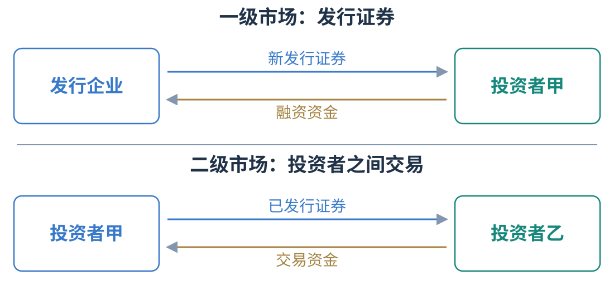

普通二级市场交易的资金通常在买卖双方之间流动，并不直接成为发行企业新增融资。

### 6.1.3 按交易组织形式分类

- 场内市场：通过交易所等有组织的交易场所进行交易。
- 场外市场（OTC）：在交易所集中交易机制之外，由交易双方或相关平台完成交易。

### 6.1.4 按价格形成机制分类

- 订单驱动市场：通过买卖订单之间的匹配形成成交价格。
- 报价驱动市场：由做市商等机构提供可交易的买卖报价。
- 混合交易市场：结合订单撮合和报价机制组织交易。

### 6.1.5 按交付安排分类

- 现货市场：按照现货交易惯例完成资产交付。
- 远期及其他衍生品市场：根据合同约定未来交付、结算或支付。

### 6.1.6 按参与者与发行方式分类

- 公开市场：按照相应规则向较广泛的投资者开放。
- 私募市场：主要面向符合条件的特定投资者开展发行或投资活动。

例如，一只在交易所上市交易的股票，可以同时属于资本市场、权益市场、二级市场、场内市场和现货交易市场。

## 6.2 金融市场参与者

### 6.2.1 按经济职能分类

- 发行人：发行股票、债券等金融工具募集资金。
- 投资者：购买或持有金融资产以实现投资目标。
- 经纪商：接受客户委托，帮助客户完成交易。
- 自营交易商：使用自身资金开展金融资产交易。
- 做市商：持续提供相关买卖报价或交易流动性。
- 承销商：帮助发行人组织证券发行和销售。
- 托管机构：承担金融资产保管及相关记录等职责。

### 6.2.2 按投资者性质分类

- 个人投资者：使用个人或家庭资金开展投资。
- 机构投资者：基金、保险公司、养老金等机构。
- 专业投资者与普通投资者：依据相应法律制度和资格条件划分的投资者类别。

## 6.3 交易价格的形成

### 6.3.1 市场报价

- 买价（Bid）：买方愿意支付的相关报价。
- 卖价（Ask）：卖方愿意接受的相关报价。
- 买卖价差：卖价与买价之间的差额。
- 中间价：买卖报价的中间水平。
- 最新成交价：最近一笔成交所形成的价格。

### 6.3.2 订单类型

- 市价单：优先按照当前可获得价格尽快成交。
- 限价单：只在指定价格或更有利价格条件下成交。
- 止损单：达到预设触发条件后生成相应订单。
- 止损限价单：触发后生成具有价格限制的订单。

市价单强调成交速度但不保证价格；限价单强调价格条件但不保证能够成交。止损单同样不保证最终损失被限制在触发价格。

### 6.3.3 订单簿与交易撮合

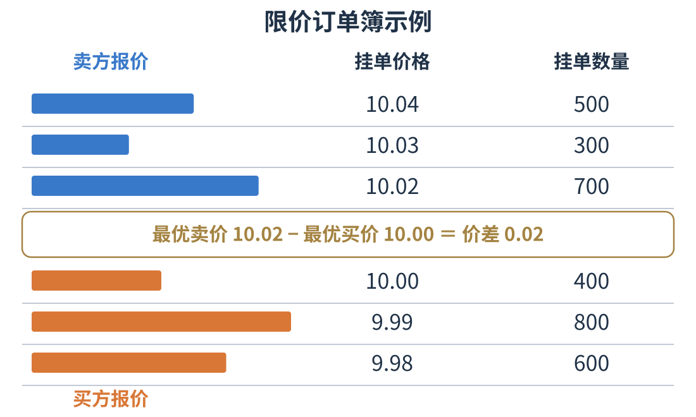

虚构教学数据。实际撮合方式取决于交易场所规则。

- 订单簿：记录尚未成交的买卖订单。
- 撮合：根据交易规则匹配相互兼容的买卖订单。
- 价格优先：更具竞争力的价格优先参与成交。
- 时间优先：在相同价格等条件下，较早提交的订单优先。
- 集合竞价：在一定时间内汇集订单后确定成交价格。
- 连续竞价：在交易过程中持续处理和匹配订单。

价格优先、时间优先属于常见的撮合原则，并非所有交易市场均使用完全相同的机制。

## 6.4 金融市场的流动性

- 市场深度：在不同价格水平上能够交易的资产数量。
- 市场宽度：常通过买卖价差等反映交易条件。
- 即时性：交易能否迅速执行。
- 市场韧性：受到交易冲击后恢复正常价格和流动性的能力。
- 滑点：实际成交价格与预期价格之间的差异。
- 市场冲击成本：交易行为本身导致价格变化而产生的成本。

流动性不仅意味着能否卖出资产，还意味着能否在合理时间内以接近预期的价格完成交易。

## 6.5 金融资产交易的方向与资金来源

### 6.5.1 按交易方向分类

- 做多：持有价格上涨时通常能够获益的头寸。
- 做空：建立价格下降时通常能够获益的头寸。
- 双向交易：通过相应市场工具建立不同方向的风险敞口。

### 6.5.2 按是否使用杠杆分类

- 现金交易：主要使用自身资金购买资产。
- 保证金交易：通过提交一定资金或资产作为履约保障开展交易。
- 融资交易：借入资金购买相关金融资产。
- 融券交易：借入相关证券进行卖出等交易。

杠杆可以放大盈利，也可以放大亏损；部分杠杆交易的损失可能超过初始投入。

## 6.6 金融交易的完整流程

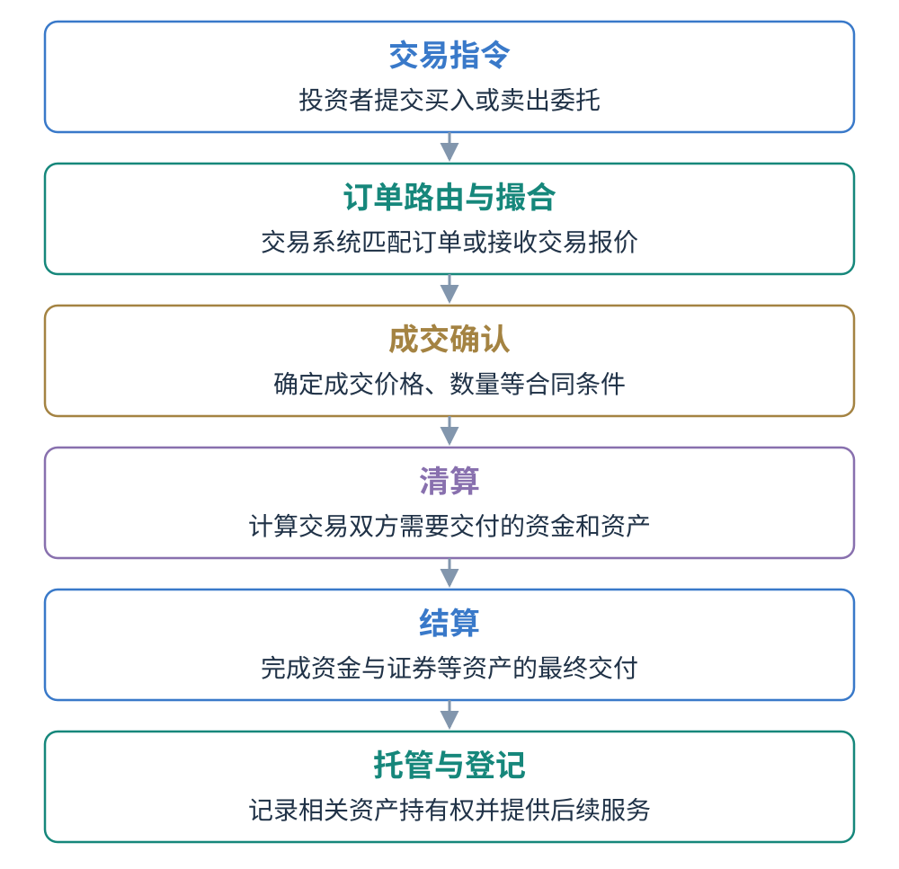

### 6.6.1 清算机制

- 双边清算：在交易双方之间确定相关支付义务。
- 多边净额清算：通过汇总多方交易减少最终交付金额。
- 中央对手方（CCP）：按照制度安排介入交易并管理相关履约风险。

### 6.6.2 结算机制

- 逐笔结算：按照单笔交易完成资金或资产交付。
- 净额结算：按照合并后的净支付义务完成结算。
- 券款对付（DvP）：将证券交付与相应资金支付相联系，降低本金结算风险。
- 同步交收（PvP）：将两种货币的支付相联系，降低外汇结算风险。
- 结算周期：从交易发生到最终结算之间的时间，例如T+1、T+2等。

不同市场的交易制度、交收周期和买卖限制可能不同。

## 6.7 金融市场的价格与交易指标

- 成交量：一定时期内交易资产的数量。
- 成交额：一定时期内交易资产的金额。
- 换手率：交易量相对于相关资产存量的比例。
- 持仓量：尚未关闭或结算的相关交易头寸数量，尤其常用于衍生品市场。
- 市场指数：按照规定规则综合反映一组资产价格或收益变化的指标。
- 波动率：衡量资产价格或收益率变化幅度的统计指标。

---

# 第七章　货币市场与利率体系

货币市场是现代金融系统进行短期资金融通、流动性管理和货币政策传导的重要场所。

## 7.1 货币市场的主要参与者

- 中央银行：通过相关操作影响金融系统流动性。
- 商业银行：管理短期资金缺口和流动性。
- 政府及企业：通过发行短期债务工具筹集资金。
- 货币市场基金：投资符合相应要求的短期金融工具。
- 其他金融机构：开展短期融资及资金管理活动。

## 7.2 货币市场工具

### 7.2.1 政府短期融资工具

- 短期国债：政府发行的较短期限债务证券。
- 央行票据：中央银行发行、可用于调节流动性等目的的债务工具。

### 7.2.2 银行与金融机构融资工具

- 银行间拆借：金融机构之间开展的短期资金融通。
- 大额可转让存单：符合相关条件、可以转让的存款类工具。
- 银行承兑汇票：由银行承担相关到期付款责任的票据。

### 7.2.3 企业短期融资工具

- 商业票据：企业等发行主体用于短期融资的债务工具。
- 短期融资券：企业按照相关市场制度发行的短期债务证券。
- 贸易票据：基于商业交易形成的相关票据工具。

### 7.2.4 回购交易

- 正回购：通过出售证券并约定未来购回等方式取得短期资金。
- 逆回购：提供短期资金并取得证券或相关保障、约定未来反向交易。

同一笔回购交易，从资金融入方看是正回购，从资金融出方看是逆回购。具体法律结构存在买断式、质押式等区别。

## 7.3 利率体系的分类

### 7.3.1 按利率的形成方式分类

- 政策利率：中央银行用于实施和传导货币政策的利率。
- 市场利率：由相关资金交易和市场条件形成的利率。
- 基准利率：被用作其他金融合同或资产定价参考的利率。

### 7.3.2 按期限分类

- 隔夜利率。
- 短期利率。
- 中期利率。
- 长期利率。

### 7.3.3 按合同是否允许利率调整分类

- 固定利率：在约定期限内保持不变。
- 浮动利率：根据基准利率或约定条件进行调整。
- 混合利率：在不同阶段采用不同计息安排。

### 7.3.4 按利率所对应的时间范围分类

- 即期利率：从当前开始、到未来指定时点的利率。
- 远期利率：对应未来某个开始时点与结束时点之间的利率。

### 7.3.5 典型金融利率基准

| 指标 | 基本作用 |
|---|---|
| SOFR | 反映美国相关隔夜国债回购融资成本的基准利率 |
| SONIA | 反映英镑相关隔夜无担保批发融资成本的基准利率 |
| HIBOR | 香港银行同业拆息相关基准 |
| SHIBOR | 上海银行间同业拆放利率 |
| LPR | 中国贷款市场报价利率 |
| DR007 | 中国存款类机构相关七天质押式回购利率指标 |

这些指标的具体形成机制不同，不能将它们全部理解为中央银行直接规定的政策利率。

## 7.4 利率期限结构

利率期限结构研究在信用风险等条件具有可比性的情况下，不同到期期限的收益率之间有什么关系。

### 7.4.1 收益率曲线

- 正常向上倾斜曲线：较长期限收益率高于较短期限。
- 平坦曲线：不同期限收益率差异较小。
- 倒挂曲线：较短期限收益率高于较长期限。
- 驼峰曲线：某些中间期限的收益率相对较高。

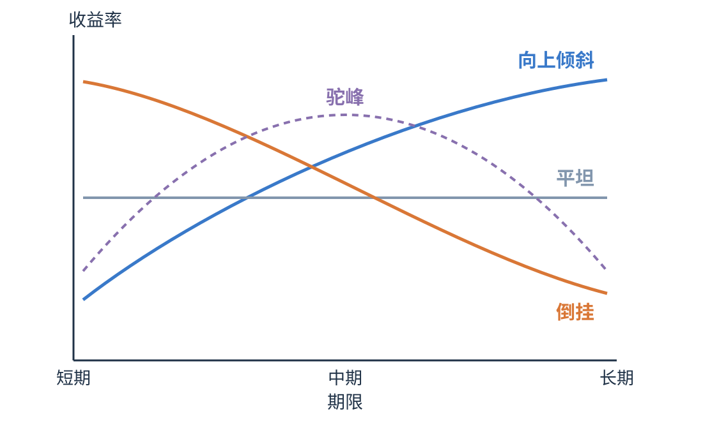

四种典型收益率曲线形态。曲线倒挂可以反映市场对未来利率和经济前景的预期，但不是经济衰退的确定性证明。

### 7.4.2 利率期限结构理论

- 纯预期理论：强调未来短期利率预期对长期利率的影响。
- 流动性溢价理论：认为投资者可能要求长期资金占用的额外补偿。
- 市场分割理论：强调不同期限市场具有相对独立的供求关系。
- 优先栖息地理论：投资者具有期限偏好，但在获得补偿时可能改变投资期限。

### 7.4.3 不同收益率曲线

- 即期利率曲线：不同期限零息现金流的折现利率。
- 远期利率曲线：由当前市场价格等推导出的未来期间隐含利率。
- 平价收益率曲线：使假设债券价格等于面值的相关票面利率曲线。
- 到期收益率曲线：根据不同期限债券到期收益率形成的曲线。

## 7.5 利差体系

利差用于衡量两个利率或收益率之间的差异。

- 期限利差：较长期限与较短期限收益率的差额。
- 信用利差：信用资产收益率相对于相关基准收益率的差额。
- 流动性利差：与资产流动性差异相关的收益率差额。
- 存贷款利差：银行相关贷款利率与存款利率之间的差额。
- 利率基差：不同利率基准或定价口径之间的差额。

利率、收益率和利差是不同层级的概念：利率和收益率描述资金价格或回报，利差则描述它们之间的相对关系。

---

# 第八章　债券与固定收益证券

固定收益证券是金融市场中重要的债权类投资工具。“固定收益”并不意味着实际投资收益固定，也不意味着没有亏损风险。

## 8.1 债券的基本结构

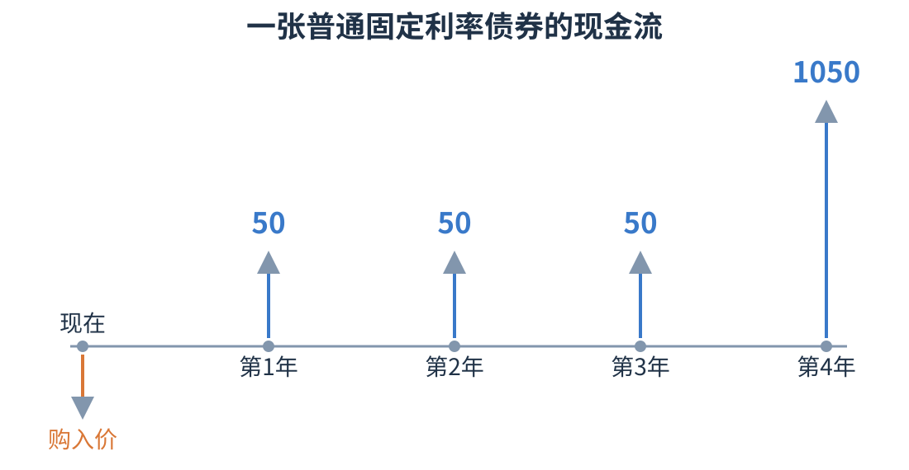

假设面值1000元、票面年利率5%、每年付息、四年到期，并且发行人正常履约。

### 8.1.1 债券合同的基本要素

- 发行人：承担债券相关付款义务的主体。
- 债券持有人：拥有相关债权的投资者。
- 面值：合同规定的名义本金。
- 票面利率：用于计算票息的约定利率。
- 票息：按照合同规定支付的利息。
- 到期日：相关债券本金应当偿还的日期。
- 发行价格：债券首次发行时的价格。
- 市场价格：债券在市场中的实际交易价格。

## 8.2 债券的多维分类

### 8.2.1 按发行主体分类

- 政府债券：中央政府等政府主体发行的债券。
  - 国债。
  - 地方政府债券或市政债券。
- 金融债券：银行等金融机构发行的债券。
- 公司信用类债券：企业等相关主体发行的债务证券。
- 国际机构债券：由国际金融机构等主体发行的债券。

### 8.2.2 按利息支付方式分类

- 固定利率债券：票面利率按照约定保持固定。
- 浮动利率债券：票面利率根据基准利率等条件调整。
- 零息债券：期间不支付常规票息，通常以低于到期偿付额的价格发行或交易。
- 通胀挂钩债券：本金或支付金额与相关通胀指标挂钩。

### 8.2.3 按信用质量分类

- 投资级债券：信用评级达到相应投资级标准的债券。
- 非投资级债券：信用评级低于相关投资级标准的债券。
  - 高收益债券：通常因较高信用风险而具有较高要求收益率的债券。
- 未评级债券：尚未取得相关信用评级的债券。

### 8.2.4 按清偿顺序和保障方式分类

- 有担保债券：具有相关担保或抵押安排。
- 无担保债券：主要依赖发行主体自身偿债能力。
- 优先债务：具有相对较高的清偿顺序。
- 次级债务：清偿顺序低于相关优先债务。

### 8.2.5 按是否包含特殊选择权分类

- 普通债券：按照基本债务合同约定支付。
- 可赎回债券：发行人可以按照约定提前赎回。
- 可回售债券：投资者可以按照约定要求提前回售。
- 可转换债券：持有人可以按照约定转换为股票等权益。
- 永续债券：没有普通意义上的固定到期日，具有相应合同安排。

这些分类维度可以交叉。例如，一只公司发行的债券可以同时属于固定利率、投资级、无担保和可赎回债券。

## 8.3 债券价格与收益率

### 8.3.1 债券的基本定价

普通固定利率债券的价值主要来自：

- 未来收到的票息。
- 到期收到的本金。
- 对应现金流的时间价值和风险。

在使用统一折现收益率的简化模型中：

$$
P=\sum_{t=1}^{n}\frac{C}{(1+y)^t}
+\frac{F}{(1+y)^n}
$$

其中，$P$ 为债券价格，$C$ 为每期票息，$F$ 为面值，$y$ 为每期折现收益率。

### 8.3.2 债券收益率的分类

- 票面利率：用于计算合同票息的利率。
- 当期收益率：年度票息相对于债券当前价格的比例。
- 到期收益率（YTM）：使未来约定现金流现值等于当前价格的内部收益率。
- 持有期收益率：投资者实际持有期间获得的综合回报。
- 赎回收益率（YTC）：假设债券按照相关赎回条件提前偿还时计算的收益率。
- 最差收益率（YTW）：在规定的可能偿付安排中计算的较低收益率指标。

到期收益率是根据约定现金流计算的收益率指标，并不保证投资者最终实际获得这一回报。

### 8.3.3 债券价格的分类

- 平价债券：价格等于面值。
- 溢价债券：价格高于面值。
- 折价债券：价格低于面值。
- 净价：通常不包含应计利息的报价。
- 全价：净价加应计利息后的相关交易价格。

## 8.4 债券价格与市场利率的关系

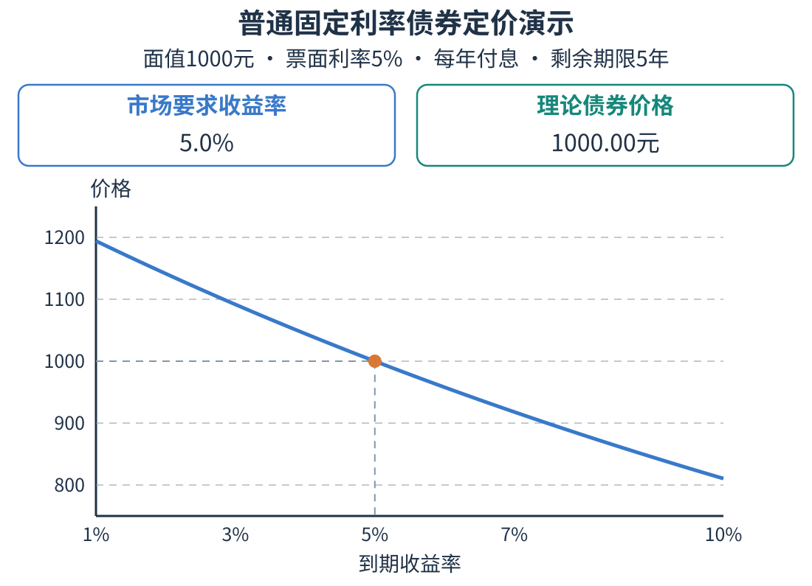

拖动滑块观察收益率变化。在未来合同现金流不变的假设下，市场要求收益率上升，债券价格下降。

（Obsidian 静态版：原交互演示的初始状态，滑块功能不可用。）

## 8.5 债券的利率风险衡量

- **久期**：衡量债券现金流时间特征及利率敏感度的一组指标。
  - 麦考利久期：按现金流现值加权计算的平均收款时间。
  - 修正久期：估计收益率发生小幅变化时债券价格的变化比例。
  - 有效久期：考虑利率变化可能改变债券现金流时的价格敏感度。
- **凸性**：衡量债券价格与收益率关系的弯曲程度，用于改善久期近似。
- **DV01**：衡量相关收益率变化一个基点时债券价值的近似变化金额。

一个基点（BP）等于0.01个百分点。

## 8.6 债券信用分析与信用风险

- 信用评级：评价发行人或债务工具的信用质量。
- 违约概率（PD）：在规定期限内发生违约的概率。
- 违约损失率（LGD）：发生违约后无法收回的风险敞口比例。
- 回收率：发生违约后能够收回的相应比例。
- 信用利差：债券收益率相对于适当基准收益率的差额。

信用利差并不只反映预期违约损失，还可能包含流动性、风险厌恶等因素。

## 8.7 固定收益投资的主要风险

- 利率风险：市场利率变化造成债券价格变动。
- 信用风险：发行人可能无法正常偿债。
- 再投资风险：收到的票息可能无法以原有收益率再投资。
- 流动性风险：债券难以迅速以合理价格出售。
- 通胀风险：实际购买力下降。
- 提前偿付风险：债券提前偿还，改变投资者原有现金流安排。
- 汇率风险：持有外币债券时面临的汇率变化。

## 8.8 债券投资组合的基本策略

- 梯形配置：将债券分布于多个到期期限。
- 子弹型配置：将到期期限集中于某个区间。
- 哑铃型配置：重点配置短期及长期债券。
- 久期管理：通过调整组合久期控制利率风险。
- 免疫策略：在一定假设下配置资产以匹配未来负债的利率敏感度。
- 信用策略：根据债券信用质量、利差和风险选择投资对象。

---

# 第九章　股票与权益证券

股票与债券的本质区别在于：债券投资者通常是企业的债权人，而股票投资者是企业的股权持有者。

## 9.1 股权与股票

- **股权**：投资者对企业拥有的相关所有权权益。
  - 非上市企业股权：没有在公开股票市场上市交易的企业权益。
  - 上市企业股权：由上市公司发行、部分可以在公开市场交易的权益。
- **股票**：代表股份公司相应权益的证券。

并非所有股权都属于上市股票，上市股票只是股权资产的一种重要表现形式。

## 9.2 股票的分类

### 9.2.1 按股东权利分类

- 普通股：通常享有相应表决权、利润分配权及剩余索取权。
- 优先股：按照合同安排，在股息或剩余财产分配等方面具有一定优先权。
- 不同表决权股份：每股拥有不同表决权安排的股份。

### 9.2.2 按交易市场分类

- 中国内地股票：包括A股、B股等不同历史制度形成的股票类别。
- 香港上市股票：在香港相关证券市场上市的股票。
- 美国上市股票：在美国相关证券市场上市的股票。
- 其他国家及地区的上市股票。

其中，H股特指在中国内地注册、符合相关条件并在香港上市的股份类别，并不等于全部香港上市股票。

### 9.2.3 按企业经营及投资特征分类

- 成长股：具有较高预期成长潜力的企业股票。
- 价值股：市场价格相对于某些基本面指标较低的股票。
- 蓝筹股：通常指经营规模、市场地位和稳定性较突出的企业股票。
- 周期股：经营表现对经济周期变化比较敏感的股票。
- 防御股：经营需求相对稳定、对经济周期通常不太敏感的股票。
- 高股息股票：股息收益率等指标相对较高的股票。

这些投资类别不存在统一且完全固定的边界，一只股票可以同时属于多个类别。

## 9.3 股票市场的发行与退出

### 9.3.1 股票发行

- 首次公开发行（IPO）：企业首次向公众发行相关股票。
- 后续发行：已经公开发行股票的企业进一步发行股票。
- 配股：按照规定向现有股东提供认购新增股票的机会。
- 定向发行：面向符合条件的特定投资者发行股票。
- 股权稀释：新增股份发行等行为使原股东持股比例可能下降。

### 9.3.2 股票上市与退出

- 上市：证券按照相关条件进入证券交易市场。
- 转板：证券从一个市场板块转入另一个板块。
- 停牌：暂时停止相关证券交易。
- 复牌：恢复相关证券交易。
- 退市：证券终止在相关交易所上市。
- 私有化：通过相关交易将公众持股公司转变为非公众持股状态等安排。

## 9.4 股票的公司行动

- 现金分红：向股东分配现金。
- 股票股利：通过增加股份等形式向股东分配。
- 股票拆分：将原有股份拆分为更多股份。
- 股票合并：将多股原有股份合并为较少股份。
- 股票回购：公司购买自身发行的股票。
- 除权除息：因分红、送股等公司行动调整相关交易权利和参考价格。

股票拆分、送股等行为本身不会机械地创造额外企业价值。

## 9.5 股票价值与市场价格

- 面值：股份所对应的名义金额。
- 账面价值：按照会计规则计算的相关净资产价值。
- 市场价格：股票在市场中的交易价格。
- 内在价值：根据未来经济利益和风险等估计的理论价值。
- 清算价值：企业清算后可能获得的相关剩余价值。
- 总市值：股票价格乘以相应总股份数量。
- 流通市值：按照相关可流通股份范围计算的市值。

**特别辨析：** 市值不是企业账上持有的现金，也不是企业发行股票时累计募集的资金，而是根据市场价格形成的权益价值指标。

## 9.6 股票估值方法

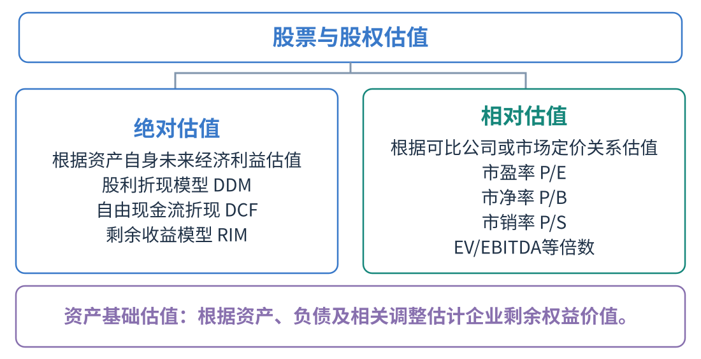

### 9.6.1 绝对估值

- 股利折现模型（DDM）：将未来预期股利折算为当前股权价值。
- 自由现金流折现模型（DCF）：将未来自由现金流折现。
  - FCFF估值：先估计企业经营资产等相关价值，再调整非经营资产及债务等项目得到股权价值。
  - FCFE估值：直接根据股权自由现金流估计股权价值。
- 剩余收益模型：结合股权账面价值和未来超额盈利估计价值。

在股利永久按照固定速度增长等严格假设下，戈登增长模型为：

$$
P_0=\frac{D_1}{r-g}
$$

其中，$D_1$ 为下一期预期股利，$r$ 为要求收益率，$g$ 为长期股利增长率，并且需要满足 $r>g$。

### 9.6.2 相对估值

| 估值指标 | 基本含义 |
|---|---|
| 市盈率（P/E） | 每股价格相对于每股收益的倍数 |
| 市净率（P/B） | 每股价格相对于每股账面净资产的倍数 |
| 市销率（P/S） | 股权市值相对于营业收入的倍数 |
| PEG | 将市盈率与预期盈利增长率结合的估值指标 |
| EV/EBITDA | 企业价值相对于息税折旧摊销前利润的倍数 |
| 股息收益率 | 年度相关股息相对于股票价格的比例 |

估值倍数较低并不必然代表资产被低估，因为企业可能存在低增长、高风险、盈利下降等问题。

## 9.7 股票指数

股票指数用于综合衡量一组股票的价格或投资收益变化。

### 9.7.1 按覆盖范围分类

- 宽基指数：覆盖较广泛的股票市场或企业群体。
- 行业指数：反映特定行业股票的变化。
- 主题指数：按照特定投资主题选择成分股。
- 风格指数：按照价值、成长、红利等特征选择成分股。

### 9.7.2 按权重形成方式分类

- 市值加权指数：市值较大的股票通常具有更高权重。
- 价格加权指数：权重受到股票价格影响。
- 等权重指数：将成分股按照相同或近似相同权重配置。
- 基本面或因子加权指数：根据盈利、股息等相关指标确定权重。

### 9.7.3 按收益计算方式分类

- 价格指数：主要反映成分股价格变化。
- 全收益指数：进一步考虑股息等收入再投资的影响。
- 净收益指数：按照规定考虑相关税费后的再投资收益。

股票指数本身是统计和比较工具，并不是通常可以直接购买的证券。指数基金、ETF和指数衍生品则可以帮助投资者获得与指数相关的风险敞口。

---

# 第十章　外汇市场与汇率

经济学中的汇率理论重点研究国际贸易和宏观政策；金融学中的外汇理论重点研究货币兑换、外汇定价、跨境交易以及汇率风险管理。

## 10.1 外汇市场的交易对象

- 外币：其他经济体发行的货币。
- 外汇存款：以外国货币计价的银行存款。
- 外币证券：以外国货币计价的相关金融资产。
- 外汇交易：不同货币之间的买卖和兑换。

## 10.2 汇率报价体系

### 10.2.1 货币对

上述假设报价表示1美元兑换7.20元人民币，并非实时汇率。

### 10.2.2 汇率的不同表达方式

- 直接标价法：使用本币表示一定单位外币的价格。
- 间接标价法：使用外币表示一定单位本币的价格。
- 双边汇率：两种货币之间的兑换比例。
- 交叉汇率：通过第三种货币等相关汇率推导出的兑换比例。

### 10.2.3 外汇交易报价

- 买入价：报价方买入基础货币所使用的价格。
- 卖出价：报价方卖出基础货币所使用的价格。
- 外汇买卖价差：买入价与卖出价之间的差额。
- 点值与报价单位：按照不同货币对惯例表示价格变化的最小常用单位等概念。

## 10.3 外汇交易工具

- **即期外汇交易**：按照即期市场惯例完成货币交付。
- **远期外汇交易**：约定在未来日期按照约定条件兑换货币。
  - 可交割远期。
  - 无本金交割远期（NDF）：通常根据汇率差额进行现金结算。
- **外汇期货**：在相关期货市场交易的标准化外汇合同。
- **外汇期权**：赋予持有人在规定条件下兑换货币的选择权。
- **外汇掉期**：同时安排一笔外汇交易和方向相反、交付时间不同的另一笔外汇交易。
- **货币互换**：在较长期限内交换不同货币的本金、利息等现金流安排。

外汇掉期与货币互换并非完全相同的金融工具，前者通常更侧重不同交付日期的货币兑换，后者通常涉及较长期的跨币种现金流交换。

## 10.4 外汇市场的主要参与者

- 商业银行及外汇交易商。
- 中央银行与货币当局。
- 跨国企业。
- 国际投资机构。
- 外汇经纪商。
- 个人及其他外汇交易主体。

## 10.5 外汇定价理论

- 购买力平价（PPP）：从国内外商品价格关系解释汇率。
- 抛补利率平价（CIP）：研究即期汇率、远期汇率与两种货币利率之间的无套利关系。
- 非抛补利率平价（UIP）：研究利率差与未来预期汇率变化之间的理论关系。
- 远期升贴水：远期汇率相对于即期汇率的差异。
- 跨币种基差：反映实际跨币种融资定价对简单利率平价关系的偏离等现象。

## 10.6 汇率风险的分类

- **交易风险**：已经约定的外币收付款因汇率变化而产生价值变化。
- **折算风险**：境外资产和财务报表折算为本币时产生的变化。
- **经济风险**：汇率长期变化影响企业竞争力和未来经营收益。

### 10.6.1 汇率风险管理方式

- 自然对冲：通过匹配相同货币的收入和支出减少风险。
- 远期对冲：通过远期合同约定未来兑换条件。
- 期货对冲：利用外汇期货调整风险敞口。
- 期权对冲：通过外汇期权限制部分不利汇率变化造成的损失。
- 跨币种资产负债管理：调整不同货币资产和负债的结构。

**知识联系：** 外汇交易是国际金融的重要组成部分，远期、期货、期权和互换则属于金融衍生品理论的具体应用。

---

# 第十一章　金融衍生品

金融衍生品是金融学中极为重要的工具体系，其价值取决于其他资产、利率、指数、信用事件等标的因素。

## 11.1 衍生品的基本组成

- 标的资产或变量：决定衍生品价值的股票、商品、货币、利率、指数等。
- 名义本金：计算相关合同支付金额的参考本金。
- 合约价格：按照合同约定形成的交易价格等条件。
- 到期日：合同到期或终止的相关日期。
- 结算方式：通过实物交割或现金结算履行合同。
- 多头与空头：持有不同方向合同权利或义务的交易头寸。

## 11.2 衍生品的总体分类

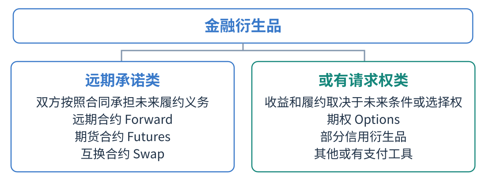

从合同支付结构出发的基础分类。复杂衍生品可能组合多种支付特征。

衍生品还可以按照标的资产分类：

- 股票衍生品。
- 利率衍生品。
- 外汇衍生品。
- 商品衍生品。
- 信用衍生品。
- 波动率及其他特殊标的衍生品。

前者按照合同结构分类，后者按照合同依赖的标的因素分类。

## 11.3 远期合约（Forward）

远期合约是交易双方约定在未来某个时间按照约定条件买卖资产或进行结算的合同。

### 11.3.1 远期合约的基本要素

- 标的资产。
- 交割价格。
- 合同数量。
- 到期日期。
- 交割或现金结算安排。

### 11.3.2 远期合约的特点

- 通常可以根据交易双方需要定制。
- 双方承担相应履约义务。
- 通常需要考虑交易对手信用风险。
- 部分合同具有保证金或抵押品等风险管理安排。

### 11.3.3 远期定价

- 持有成本理论：考虑融资、仓储及持有资产产生的收益等因素确定远期价格。
- 无套利定价：利用现货资产和融资等交易关系约束远期价格。
- 远期合约价值：合同签订后，市场条件变化所形成的合同价值。

远期价格是新合同的交易条件，远期合约价值则是现有合同本身在某一时点的价值。

## 11.4 期货合约（Futures）

期货合约通常是按照交易所等相关市场规则建立的标准化远期承诺类合同。

### 11.4.1 按标的分类

- 商品期货：原油、黄金、农产品等。
- 股指期货：以股票指数作为标的。
- 国债期货：以相关政府债券等作为标的。
- 利率期货：以相关利率等变量作为标的。
- 外汇期货：以货币兑换关系为标的。

### 11.4.2 期货市场的制度安排

- 标准化合约：统一规定交易单位、交割条件等。
- 保证金：用于保障履约的相关资金或资产。
  - 初始保证金：建立头寸时所需的保证金。
  - 维持保证金：维持头寸所需的最低相关保障水平。
  - 追加保证金：保证金不足时需要补充的资金或资产。
- 每日盯市：按照结算价格调整每日盈亏和账户余额。
- 平仓：通过建立相反头寸等方式关闭现有头寸。
- 移仓或展期：关闭临近到期合同并建立其他期限合同。
- 交割：按照合同规定完成最终履约。

### 11.4.3 期货价格的相关概念

- 现货价格：标的资产当前市场交易价格。
- 期货价格：相应期货合同的市场价格。
- 基差：现货价格与期货价格之间的差额，常用定义为现货价格减期货价格。
- 基差风险：现货与期货价格关系发生变化造成的对冲风险。
- 正向市场（Contango）：通常指较远期限期货价格相对较高等期限结构。
- 反向市场（Backwardation）：通常指较远期限期货价格相对较低等期限结构。

### 11.4.4 远期与期货的区别

| 维度 | 远期合约 | 期货合约 |
|---|---|---|
| 合同形式 | 通常可以定制 | 通常标准化 |
| 交易场所 | 主要为场外市场 | 主要为交易所市场 |
| 盈亏结算 | 按合同安排 | 通常每日结算 |
| 履约保障 | 双边信用及抵押等安排 | 保证金和集中清算等机制 |
| 灵活性 | 较高 | 受标准合同条件约束 |

## 11.5 期权（Options）

期权赋予购买方在规定条件下进行买入、卖出或获得相关支付的权利，但通常不要求其必须行使这一权利。

### 11.5.1 按权利方向分类

- **看涨期权（Call）**：赋予持有人按照规定条件买入标的资产或获得相应支付的权利。
- **看跌期权（Put）**：赋予持有人按照规定条件卖出标的资产或获得相应支付的权利。

### 11.5.2 按允许行权时间分类

- 欧式期权：通常只能在到期时行权。
- 美式期权：通常可以在到期前规定期间内行权。
- 百慕大式期权：可以在若干规定日期行权。

美式与欧式描述的是行权方式，而不是期权所在的地理市场。

### 11.5.3 期权的基本合同要素

- 行权价格（Strike）：行使期权权利时所采用的约定价格。
- 权利金（Premium）：购买期权权利所支付的价格。
- 到期日：期权最后有效的相关日期。
- 期权买方：支付权利金、取得选择权的一方。
- 期权卖方：收取权利金、承担相应履约义务的一方。

### 11.5.4 期权的四种基本头寸

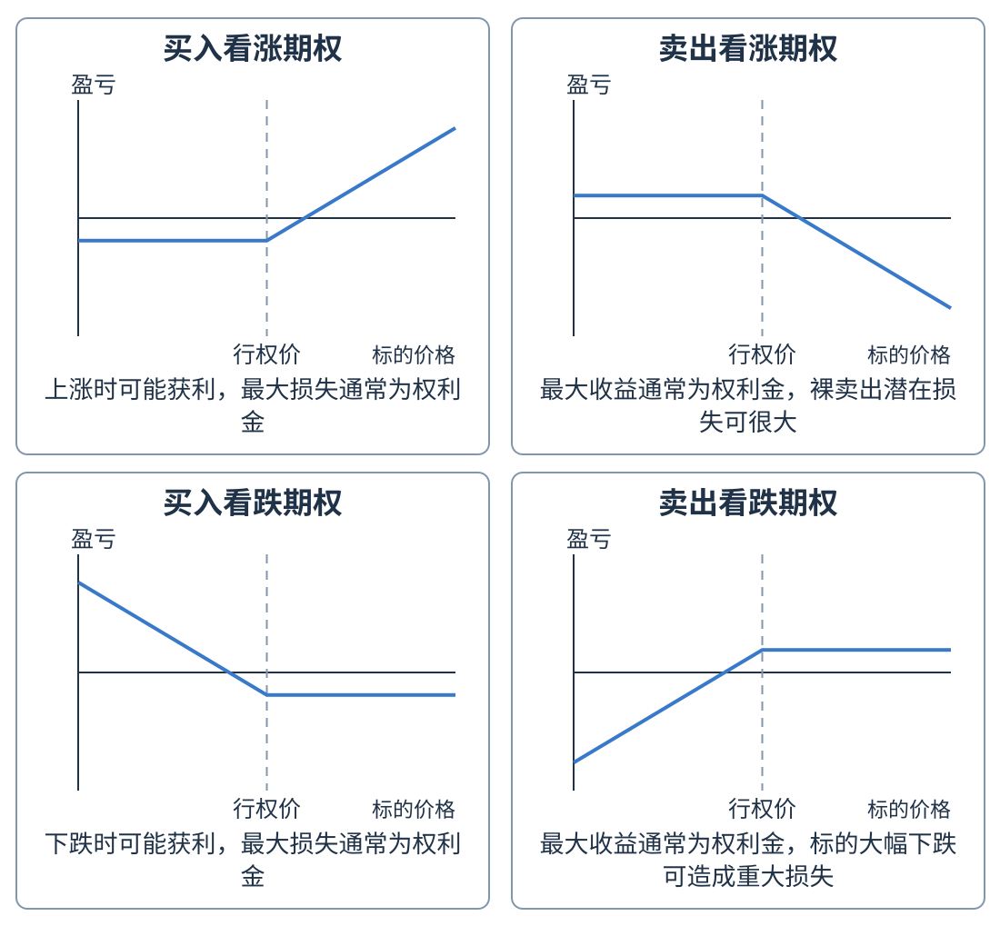

四种基本期权头寸的到期盈亏示意，已考虑示例权利金，未考虑交易费用。

### 11.5.5 期权价值的构成

- 内在价值：根据当前标的价格和行权价格计算的立即行权价值等相关价值。
- 时间价值：期权价格中超过内在价值的部分，通常受到剩余期限、波动率等影响；具体关系依合同及市场条件而定。
- 实值期权：具有正的立即行权价值的期权。
- 平值期权：标的价格接近行权价格的期权。
- 虚值期权：立即行权通常没有正收益的期权。

### 11.5.6 影响期权价值的因素

- 标的资产价格。
- 行权价格。
- 剩余期限。
- 标的波动率。
- 无风险利率。
- 股息等标的资产持有收益。

### 11.5.7 期权的风险敏感度（Greeks）

| 指标 | 衡量的风险因素 |
|---|---|
| Delta | 标的价格变化对期权价值的影响 |
| Gamma | 标的价格变化对Delta的影响 |
| Vega | 波动率变化对期权价值的影响 |
| Theta | 时间经过对期权价值的影响 |
| Rho | 利率变化对期权价值的影响 |

这些指标并不是五种不同的期权，而是同一期权对不同风险因素的敏感程度。

### 11.5.8 期权定价与组合

- 二叉树模型：通过多个离散价格变化情景计算期权价值。
- Black–Scholes–Merton模型（BSM）：在特定假设下对相关期权进行理论定价。
- 看涨—看跌期权平价：研究具有相关合同条件的看涨与看跌期权之间的无套利价格关系。
- 期权组合：通过组合多个期权或现货头寸形成不同收益风险结构。
  - 备兑看涨期权。
  - 保护性看跌期权。
  - 价差组合。
  - 跨式与宽跨式组合。

第一阶段只认识组合类型，具体构建、定价和风险推导留待进一步学习。

## 11.6 互换合约（Swap）

互换是交易双方按照约定规则交换未来现金流或相关经济利益的合同。

### 11.6.1 利率互换

- 固定对浮动利率互换：一方支付固定利率现金流，另一方支付浮动利率现金流。
- 基差互换：双方交换基于不同浮动利率指标的现金流。

普通单币种利率互换通常以名义本金计算利息，但不实际交换该名义本金。

### 11.6.2 其他互换类型

- 货币互换：交换不同货币的相关本金与利息现金流。
- 商品互换：交换与商品价格相关的现金流。
- 股权互换：交换与股票或股票指数收益相关的现金流。
- 总收益互换（TRS）：交换标的资产总收益与约定融资支付等现金流。
- 信用违约互换（CDS）：通过定期支付相关费用取得约定信用事件发生时的风险保护。

## 11.7 衍生品的三项主要经济功能

- 套期保值：降低已有业务或资产的特定风险。
- 投机：根据价格、利率等变化预期建立风险敞口。
- 套利：利用相关资产或合同之间的定价差异。

## 11.8 衍生品的风险

- 杠杆风险。
- 市场价格风险。
- 波动率风险。
- 基差风险。
- 交易对手信用风险。
- 保证金与流动性风险。
- 模型风险。
- 法律及合同风险。

金融衍生品本质上是配置风险的工具，不是天然危险或天然安全的资产。合理使用可以降低已有风险，不适当使用也可能创造更大的风险。

---

# 第十二章　另类投资与结构化金融产品

另类投资通常指传统公开市场股票、债券及现金类投资之外的相关投资领域。其分类边界会因市场惯例和研究机构而异。

## 12.1 私人资本市场

### 12.1.1 私募股权投资（PE）

研究非公开市场股权投资及相关企业价值创造。

- 风险投资（VC）：主要投资早期或具有较大成长潜力的企业。
  - 种子期投资：支持商业构想和早期产品开发。
  - 初创期投资：支持新企业建立经营业务。
  - 成长阶段风险投资：支持具有一定发展基础的创业企业。
- 成长股权投资：支持相对成熟企业扩大经营规模。
- 控股收购投资：通过取得企业控制权等方式实现经营改善和价值创造。
  - 杠杆收购（LBO）：使用较高比例债务等资金完成企业收购的安排。

广义私募股权包括风险投资等分支；行业实践中也经常将PE和VC作为相对独立的业务类别。

### 12.1.2 私募债务（Private Credit）

- 直接贷款：非银行等机构直接向企业等借款人提供贷款。
- 夹层融资：通常位于优先债务与普通股权之间的融资安排。
- 困境债务投资：投资存在严重经营或偿债困难的债务资产。
- 特殊机会融资：针对具有特殊融资需求的主体开展投资。

### 12.1.3 私人资本投资的生命周期

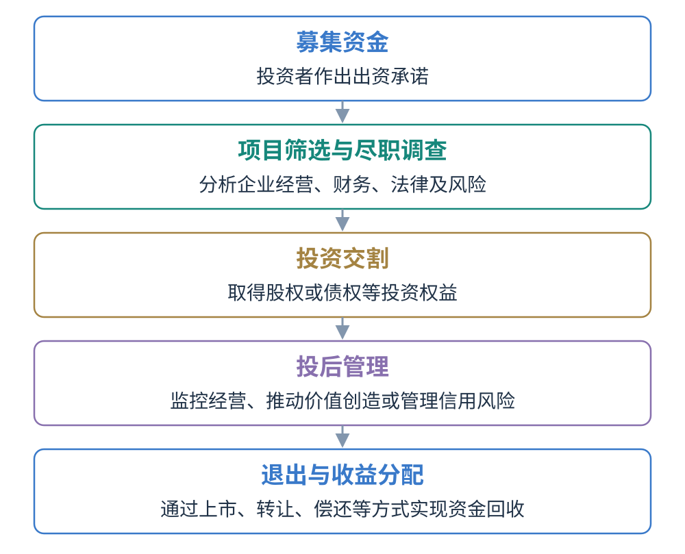

## 12.2 房地产投资

- **直接投资**
  - 住宅地产。
  - 商业地产。
  - 工业及物流地产。
- **间接投资**
  - 房地产投资基金。
  - 房地产投资信托基金（REITs）：通过相关制度安排投资房地产及其他符合条件资产的工具。
  - 房地产相关证券。

### 12.2.1 房地产金融分析指标

- 租金收益率：租金收入相对于房地产价值的比例。
- 净营业收入（NOI）：物业经营收入扣除相应经营费用后的金额。
- 资本化率（Cap Rate）：净营业收入相对于物业价值的比例。
- 贷款价值比（LTV）：贷款金额相对于相关抵押资产价值的比例。

## 12.3 商品与实物资产投资

- 贵金属：黄金、白银等。
- 能源商品：石油、天然气等。
- 工业金属：铜、铝等。
- 农产品：小麦、大豆等。
- 基础设施资产：交通、能源、通信等长期经营性资产。
- 其他实物资产：符合一定投资条件的收藏品、林地等。

商品投资可以通过实物持有、商品基金、期货等不同工具实现，这些工具承担的风险并不完全相同。

## 12.4 对冲基金与另类投资策略

对冲基金是一类采用相对灵活投资策略和组织安排的投资基金，并不意味着其所有风险都已经得到对冲。

- 多空策略：同时建立多头和空头头寸。
- 全球宏观策略：根据宏观经济、利率和汇率等因素进行配置。
- 相对价值策略：研究相关资产之间的相对价格关系。
- 事件驱动策略：研究并购、重组、破产等事件带来的投资机会。
- 管理期货策略：通过期货等工具开展系统化或其他形式的投资。

## 12.5 资产证券化

资产证券化是将能够产生现金流的相关资产进行组织，并发行由这些现金流支持的证券的金融安排。

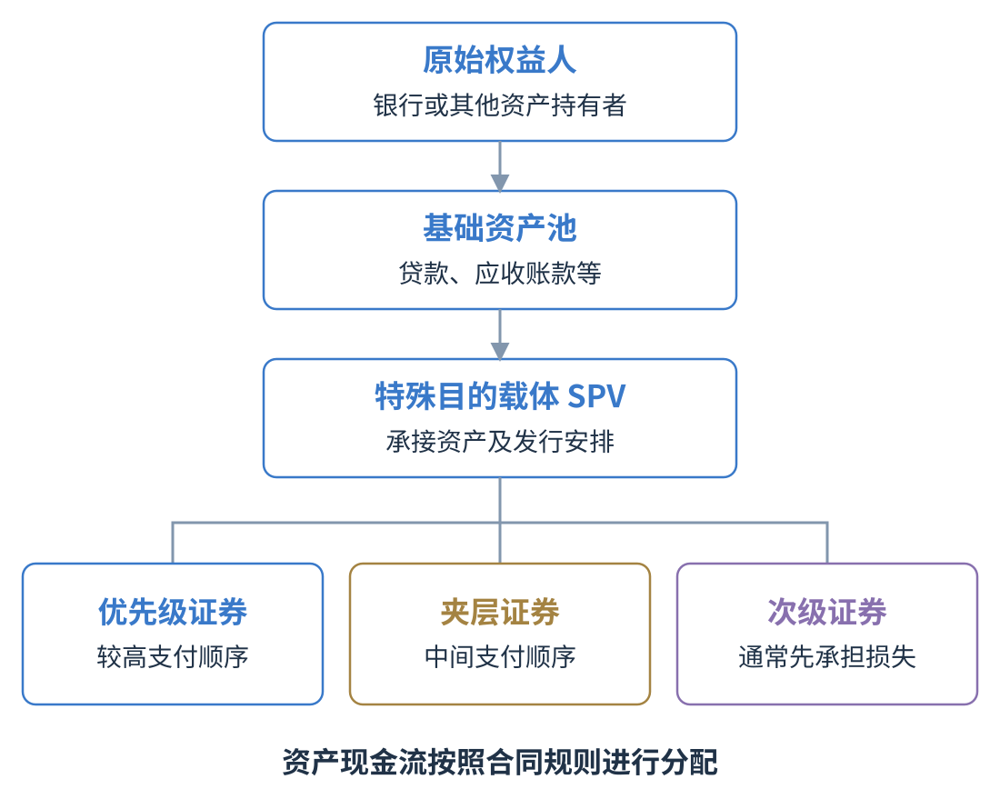

典型分层资产证券化结构示意。并非所有证券化产品都采用相同分层或法律结构。

### 12.5.1 资产证券化的核心组成

- 原始权益人：原先持有相关资产的主体。
- 基础资产：支持证券现金流的贷款、租赁债权等。
- 特殊目的载体（SPV）：承担相关资产持有或证券发行职能的法律载体。
- 资产服务机构：负责管理基础资产及相关现金流回收。
- 信用增级：改善部分证券信用保障的制度安排。
- 偿付顺序：规定不同投资者获得现金流及承担损失的顺序。

### 12.5.2 证券化产品的分类

- 资产支持证券（ABS）：由相关资产现金流支持的证券。
- 抵押贷款支持证券（MBS）：主要由抵押贷款现金流支持。
- 商业抵押贷款支持证券（CMBS）：主要由商业房地产抵押贷款支持。
- 住宅抵押贷款支持证券（RMBS）：主要由住宅抵押贷款支持。
- 担保贷款凭证（CLO）：通常由企业贷款等资产组成的相关证券化结构。
- 担保债务凭证（CDO）：以相关债务资产或信用风险等为基础的结构化产品。

### 12.5.3 证券化风险

- 基础资产信用风险。
- 提前偿付风险。
- 资产现金流不足风险。
- 分层结构风险。
- 模型与估值风险。
- 法律结构与信息不透明风险。

## 12.6 结构化金融产品

结构化产品通过组合基础资产、债务工具与衍生品等方式形成特定收益和风险结构。

- 结构性存款：按照相关监管定义，将存款与特定衍生品收益安排结合的产品。
- 结构性票据：通过债务工具和衍生支付安排形成的证券。
- 权益挂钩产品：收益与股票或股票指数等表现相关。
- 利率挂钩产品：收益取决于相关利率变化。
- 信用挂钩票据：收益或本金偿还与约定信用事件相关。

**特别辨析：** 结构化产品与资产证券化不是同一个概念。资产证券化重点解决资产现金流如何支持证券发行；结构化产品重点解决如何构造特定的金融支付结构，二者可以交叉。

---

# 第三篇　资产定价、投资与公司金融

第二篇回答了金融工具是什么、在哪里交易的问题。第三篇进一步研究三个核心问题：

- 一项资产究竟值多少钱？
- 拥有资金的人应该如何配置资金？
- 需要资金的企业应该如何获得和使用资金？

# 第十三章　金融资产定价理论

资产定价理论是连接金融数学、风险管理、证券投资和公司金融的核心理论体系。

## 13.1 价格、价值与收益率

- 市场价格：市场参与者实际交易所形成的价格。
- 内在价值：根据资产未来经济利益、风险及折现条件估计的价值。
- 公允价值：按照相关计量框架，在市场参与者之间有序交易中确定的价值。
- 要求收益率：投资者为承担相应时间和风险所要求的收益率。
- 预期收益率：投资者根据未来可能结果估计的收益率。

资产定价并不只是预测价格，而是研究资产未来经济利益、风险与当前价值之间的关系。

## 13.2 资产定价的两条基本理论主线

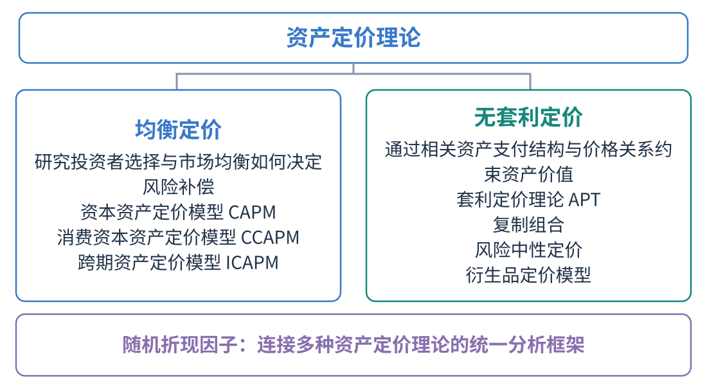

上述两条理论主线存在广泛联系，并非完全独立、互不相容的理论体系。

## 13.3 资本资产定价模型（CAPM）

CAPM研究在特定市场均衡假设下，资产承担多少系统性风险，就应该获得怎样的预期风险补偿。

### 13.3.1 核心组成

- 无风险收益率：基础资金回报基准。
- 市场组合：理论上包含全部相关风险资产的组合。
- 市场风险溢价：市场组合预期收益超过无风险收益的部分。
- Beta系数：资产收益对市场组合收益变化的敏感程度。

基本公式：

$$
E(R_i)=R_f+\beta_i[E(R_m)-R_f]
$$

### 13.3.2 Beta与Alpha

- **Beta**：衡量资产对市场共同风险因素的暴露程度。
  - Beta等于1：对市场变化的线性敏感程度与市场基准一致。
  - Beta大于1：市场风险敏感程度相对较高。
  - Beta小于1：相应市场风险敏感程度相对较低，也可能为负。
- **Alpha**：在给定资产定价模型下，实际或估计收益中不能被相关风险因素解释的部分。

Alpha可能来自投资能力，也可能来自运气、模型误差或遗漏的风险因素。

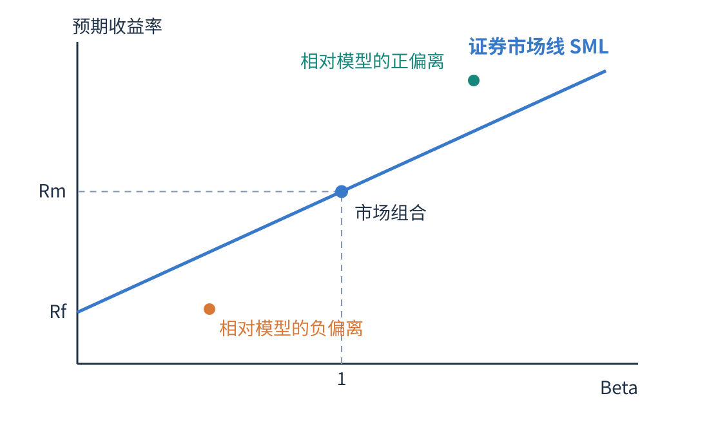

CAPM中的证券市场线描述系统性风险与均衡预期收益之间的理论关系。

## 13.4 多因子资产定价模型

CAPM主要通过一个市场因子解释资产风险，多因子模型则进一步考虑多个共同风险因素。

### 13.4.1 套利定价理论（APT）

研究在一定条件下，资产预期收益如何与多个系统性风险因子及相应风险溢价相关联。

### 13.4.2 典型多因子模型

- Fama–French三因子模型。
  - 市场因子。
  - 规模因子。
  - 价值因子。
- Carhart四因子模型。
  - 在传统三因子框架中加入动量因子。
- Fama–French五因子模型。
  - 在市场、规模、价值因素之外考虑盈利能力和投资行为等因素。
- 其他多因子模型。
  - 质量因子。
  - 低波动因子。
  - 流动性因子。
  - 宏观经济因子。

### 13.4.3 因子模型的基本构成

- 因子：能够解释多个资产共同变化的变量或构造的投资组合。
- 因子暴露：资产对相关因子的敏感程度。
- 因子溢价：与承担某种因子暴露相关的预期收益补偿。
- 特质收益：无法被模型中的共同因子解释的收益部分。

并非所有历史上表现良好的投资因子都具有稳定的未来风险溢价。

## 13.5 高级资产定价理论

- 消费资本资产定价模型（CCAPM）：研究资产收益与社会消费变化之间的关系。
- 跨期资本资产定价模型（ICAPM）：研究投资机会随时间变化时的资产配置和风险补偿。
- 随机折现因子（SDF）：根据不同未来经济状态调整现金流价值的统一定价工具。
- 状态价格理论：研究在某个特定未来状态下支付一单位资金的当前价值。
- 风险中性定价：在特定无套利条件下使用调整后的概率体系计算资产价值。
- 市场完备性：研究现有金融资产能否复制各种相关未来状态的支付。

## 13.6 金融市场有效性

### 13.6.1 有效市场假说（EMH）

根据市场价格反映的信息范围分类：

- 弱式有效：价格已经反映相关历史价格和交易信息。
- 半强式有效：价格已经反映公开可获得的信息。
- 强式有效：价格反映包括私人信息在内的全部相关信息。

强式有效属于非常严格的理论状态，现实市场并不必然达到。

### 13.6.2 市场异常与定价偏差

- 价值效应：某些价值特征资产在历史样本中表现出的收益差异。
- 动量效应：过去相对强势资产在一定时期内可能继续表现相对强势。
- 反转效应：过去价格表现可能在后续时期发生反向变化。
- 规模效应：不同规模企业可能具有不同历史收益特征。
- 过度反应与反应不足：市场对信息的价格调整可能超过或低于相应程度。

### 13.6.3 行为金融学

- 投资者有限理性。
- 过度自信。
- 损失厌恶。
- 处置效应：投资者可能倾向过早出售盈利资产、过久持有亏损资产。
- 羊群行为：投资者因他人行为而进行类似交易。
- 有限套利：由于风险、资金及交易约束等因素，错误定价可能不能立即被纠正。

**逻辑关系：** 有效市场假说提供市场信息效率的理论基准，市场异常揭示某些可能偏离理论预期的现象，行为金融学及有限套利理论则提供部分解释。

---

# 第十四章　证券投资分析

证券投资分析主要研究如何收集信息、评价金融资产并形成投资判断。

## 14.1 投资分析的总体框架

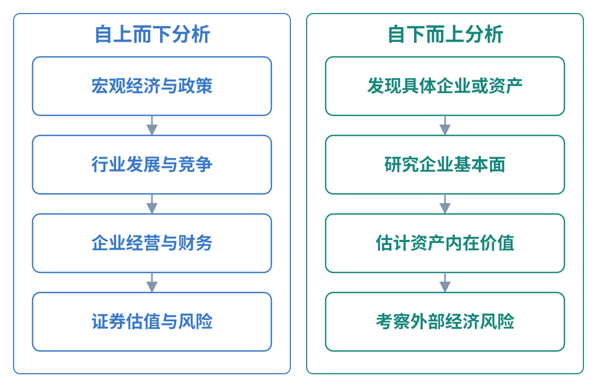

## 14.2 基本面分析

### 14.2.1 宏观经济分析

- 经济增长。
- 货币政策及市场利率。
- 通货膨胀。
- 财政政策。
- 汇率与国际资本流动。
- 经济周期。

### 14.2.2 行业分析

- 行业市场规模。
- 行业生命周期。
  - 导入期。
  - 成长期。
  - 成熟期。
  - 衰退期。
- 市场竞争结构。
- 技术变化及产业替代。
- 行业政策与进入壁垒。
- 行业盈利模式及资本需求。

### 14.2.3 企业分析

- 商业模式：企业通过什么方式创造价值和获得收入。
- 竞争优势：企业相对于竞争者具有的经济优势。
- 经济护城河：企业长期维持竞争优势的能力。
  - 成本优势。
  - 品牌优势。
  - 网络效应。
  - 转换成本。
  - 技术及规模优势。
- 管理层与公司治理。
- 财务报表及盈利能力。
- 企业成长潜力。
- 企业主要经营风险。

### 14.2.4 证券估值

- 未来现金流预测。
- 折现率选择。
- 相对估值指标。
- 安全边际：估计资产价值与购买价格之间预留的缓冲空间。
- 敏感性分析：判断不同估值假设对最终结果的影响。

安全边际建立在估值假设上，并不构成实际投资安全的保证。

## 14.3 技术分析

技术分析主要利用价格、成交量等市场交易数据研究市场行为及潜在变化。

### 14.3.1 行情图表

- K线：记录一定时期内开盘价、收盘价、最高价和最低价的图形。
- 折线图：使用连续价格数据展示资产价格变化。
- 成交量图：展示各时期成交数量变化。

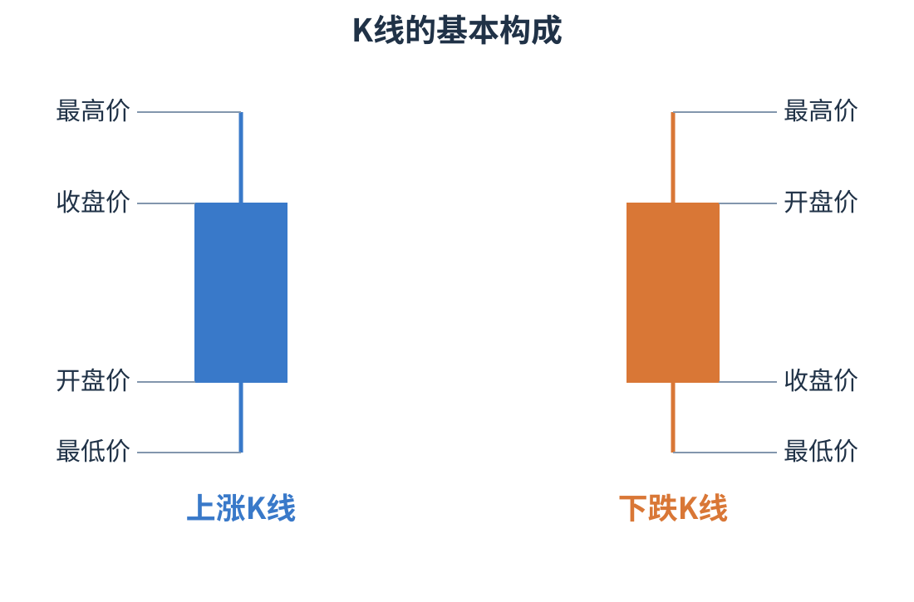

示意图使用蓝色和橙色区分涨跌。不同国家、交易软件的K线配色惯例可能相反。

### 14.3.2 趋势分析

- 上升趋势：价格整体呈相对上行特征。
- 下降趋势：价格整体呈相对下行特征。
- 横盘整理：价格主要在一定区间内波动。
- 支撑位：技术分析中可能出现较强买入需求的价格区域。
- 阻力位：技术分析中可能出现较强卖出压力的价格区域。
- 突破与假突破：价格越过原有区间后是否形成持续变化。

### 14.3.3 技术指标的分类

| 分类 | 典型指标 | 主要用途 |
|---|---|---|
| 趋势指标 | MA、EMA、MACD | 观察价格趋势及动量变化 |
| 动量指标 | RSI、随机指标 | 衡量近期价格变化强度 |
| 波动指标 | ATR、布林带 | 衡量价格波动和变化范围 |
| 成交量指标 | OBV、成交量均线 | 观察成交活动及价格量关系 |
| 执行参考指标 | VWAP | 衡量成交量加权平均价格 |

技术指标本质上通常是历史市场数据的数学变换，并不保证能够准确预测未来价格。

## 14.4 量化投资分析

- 因子分析：研究可量化的资产特征与收益之间的关系。
- 统计分析：研究价格、收益和风险变量的历史规律。
- 模型预测：通过统计或机器学习模型估计未来结果。
- 系统化投资：按照预先规定的数据和决策规则形成投资组合。

完整量化方法归入第二十五章。

## 14.5 投资理念与投资风格

- **价值投资**：重点研究资产价格是否低于估计的内在价值。
- **成长投资**：重点关注企业未来盈利和经营规模的增长。
- **股息投资**：重点关注相对稳定的现金分配能力。
- **指数投资**：以跟踪特定市场指数为主要目标。
- **趋势投资**：根据市场趋势等变化特征进行配置。
- **宏观投资**：依据经济周期、政策和市场共同因素进行配置。
- **事件驱动投资**：研究特定企业或市场事件产生的机会。
- **可持续投资**：将环境、社会和治理等因素纳入投资决策。

这些属于不同投资理念或决策风格，而不是不同的金融资产类型。

---

# 第十五章　投资组合理论与资产配置

单个证券是否具有投资价值，与它是否适合加入某个投资组合，是两个不同的问题。

投资组合理论研究如何将多个资产结合起来，使整体风险收益结构更符合投资者目标。

## 15.1 投资组合的基本构成

- 组合资产：投资组合所包含的金融资产。
- 资产权重：单项资产价值占组合相关总价值的比例。
- 组合收益：不同资产收益按照相应权重形成的整体结果。
- 组合风险：受到资产自身风险及资产之间共同变化关系影响的整体风险。
- 投资约束：资金、期限、流动性、风险承受能力及法律等限制。

组合预期收益的基本表达式：

$$
E(R_p)=\sum_{i=1}^{n}w_iE(R_i)
$$

组合风险不能简单地将各资产风险按照权重相加，还必须考虑它们之间的相关关系。

## 15.2 分散投资原理

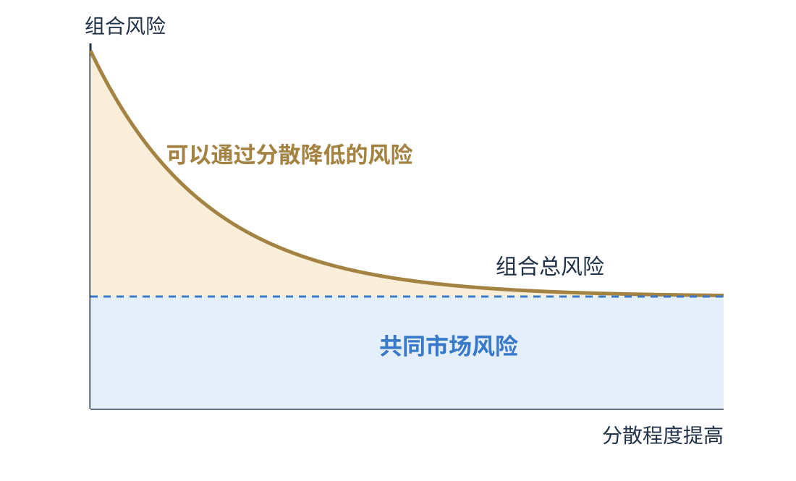

在具有适当相关性的资产组合中，分散投资可以降低个别资产风险，但通常无法消除共同市场风险。

### 15.2.1 分散投资的不同层次

- 证券分散：持有多个不同证券。
- 行业分散：避免集中于单一行业。
- 资产类别分散：配置股票、债券、现金等不同资产类别。
- 地理分散：投资不同国家和地区。
- 风险因子分散：避免多个资产实际上依赖相同经济风险因素。
- 期限分散：安排不同期限的资产及现金流。

持有的证券数量较多，并不一定意味着真正充分分散，因为这些资产可能具有高度相关的风险来源。

## 15.3 现代投资组合理论（MPT）

### 15.3.1 马科维茨均值—方差理论

在给定模型假设下，使用预期收益和收益波动等指标研究投资组合的最优配置。

- 均值：组合的预期收益。
- 方差：组合收益的不确定程度。
- 可行集合：满足投资约束的全部可能组合。
- 最小方差组合：在相关条件下风险最低的组合。
- 有效前沿：在给定风险下预期收益最高，或者给定预期收益下风险最低的组合集合。

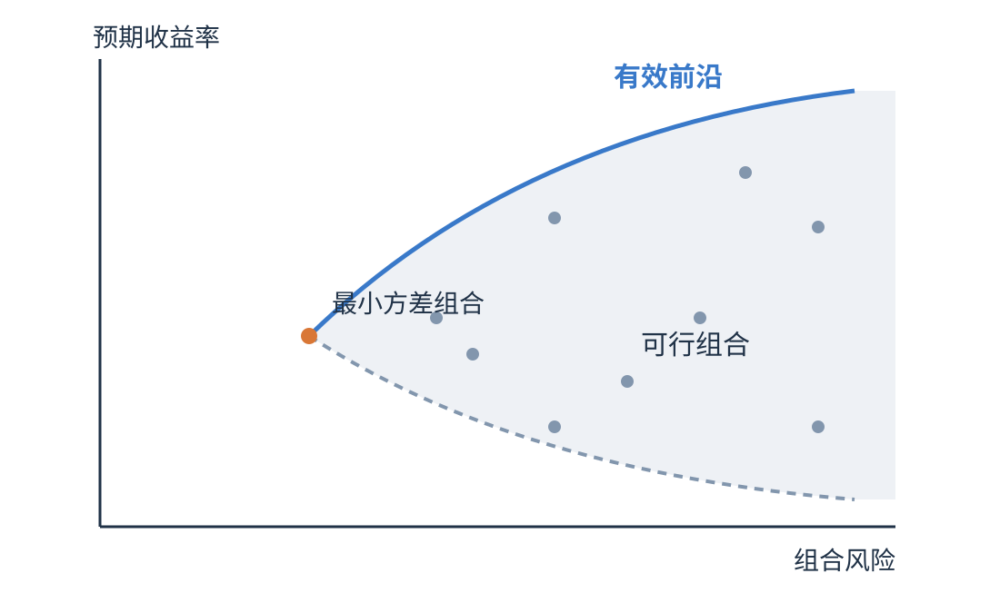

有效前沿示意。曲线形状取决于预期收益、协方差及投资约束等模型输入。

### 15.3.2 加入无风险资产后的理论

- 资本配置线（CAL）：风险资产组合与无风险资产的不同配置形成的风险收益关系。
- 最优风险资产组合：在相应模型和条件下具有最优风险收益权衡的风险资产组合。
- 资本市场线（CML）：在CAPM等假设下，无风险资产与市场组合形成的有效配置关系。
- 基金分离理论：在一定条件下，将风险资产组合选择与投资者风险承受能力的决定分开处理。

### 15.3.3 证券市场线与资本市场线的区别

| 对比维度 | 资本市场线 CML | 证券市场线 SML |
|---|---|---|
| 横轴风险指标 | 收益率标准差 | Beta系数 |
| 主要对象 | 特定有效投资组合 | 单项资产及投资组合 |
| 主要用途 | 分析有效资产配置 | 分析系统性风险的定价 |

## 15.4 资产配置体系

### 15.4.1 按资产类别配置

- 权益资产。
- 固定收益资产。
- 现金及货币市场工具。
- 房地产与基础设施等实物资产。
- 私募股权和其他另类资产。
- 用于风险管理的衍生品头寸。

### 15.4.2 按决策期限分类

- 战略资产配置（SAA）：根据长期投资目标确定基础资产比例。
- 战术资产配置（TAA）：根据阶段性市场判断调整长期配置比例。
- 动态资产配置：按照市场状态、风险水平或其他规则持续调整。

### 15.4.3 按组合构建方法分类

- 均值—方差配置：根据预期收益及协方差进行优化。
- 最小方差配置：重点降低组合收益波动。
- 风险平价：按照风险贡献而非单纯资金比例配置资产。
- Black–Litterman模型：结合市场均衡信息与投资者观点进行配置。
- 核心—卫星配置：通过核心长期配置与相对独立的策略配置组合投资。

### 15.4.4 投资组合再平衡

再平衡是指组合权重因市场变化等原因偏离目标后，重新进行调整。

- 定期再平衡：按照预先规定的时间进行调整。
- 阈值再平衡：权重偏离超过规定范围时进行调整。
- 其他动态再平衡：依据市场风险或约束条件进行调整。

## 15.5 主动投资与被动投资

- **主动投资**：通过主动选择证券、权重及其他投资决策争取达到特定目标或超过基准。
  - 主动选股。
  - 行业配置。
  - 主动债券管理。
  - 系统化主动投资。
- **被动投资**：主要以跟踪市场指数等基准为目标。
  - 完全复制。
  - 抽样复制。
  - 其他指数跟踪方式。
- **指数增强投资**：在跟踪基准的同时，争取获得一定超额收益。

主动或被动属于投资管理方式，而不是资产类别，也不等同于人工或计算机交易。

## 15.6 投资组合业绩评价

### 15.6.1 收益表现指标

- 累计收益率。
- 年化收益率。
- 超额收益率：组合收益相对于基准收益的差额。
- Alpha：相对于特定资产定价模型的超额收益部分。

### 15.6.2 风险表现指标

- 波动率。
- 最大回撤：组合价值从阶段性高点下跌到后续低点的最大比例。
- 下行风险：重点衡量不利收益变化。
- 跟踪误差：组合相对于基准收益差异的波动程度。

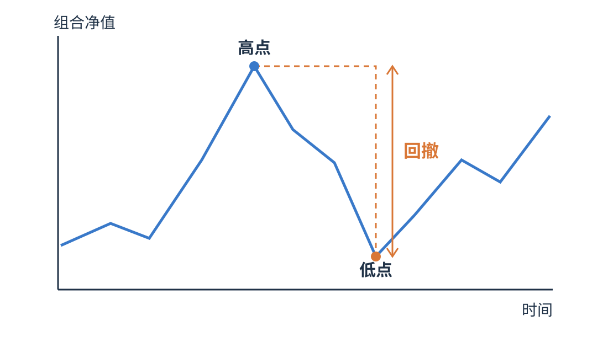

最大回撤关注投资者在持有过程中可能经历的最大高点至低点损失，而不仅是最终收益率。

### 15.6.3 风险调整后业绩指标

| 指标 | 主要衡量内容 |
|---|---|
| 夏普比率（Sharpe Ratio） | 单位总波动风险对应的超额收益 |
| 特雷诺比率（Treynor Ratio） | 单位系统性风险对应的超额收益 |
| 詹森Alpha | 相对于CAPM等相应模型的超额收益 |
| 索提诺比率（Sortino Ratio） | 单位下行风险对应的超额收益 |
| 信息比率（IR） | 单位跟踪误差对应的主动超额收益 |
| 卡玛比率（Calmar Ratio） | 年化收益与最大回撤之间的关系 |

不同指标采用不同风险定义，适合不同投资目标，并不能脱离投资期限和数据口径进行机械比较。

## 15.7 投资组合业绩归因

业绩归因研究投资表现究竟来自什么决策，而不仅仅研究盈利多少。

- 资产配置效应：不同资产或行业配置比例带来的影响。
- 证券选择效应：具体证券选择带来的影响。
- 交互效应：配置和选择相互影响形成的结果。
- 因子归因：将收益分解为不同风险因子暴露及其他部分。
- 交易执行归因：研究交易价格和执行成本对投资收益的影响。

---

# 第十六章　公司金融与企业资本运作

投资学主要从资金提供者角度研究资产配置，公司金融则主要从企业角度研究资金的获得、使用和分配。

## 16.1 公司金融的三项核心决策

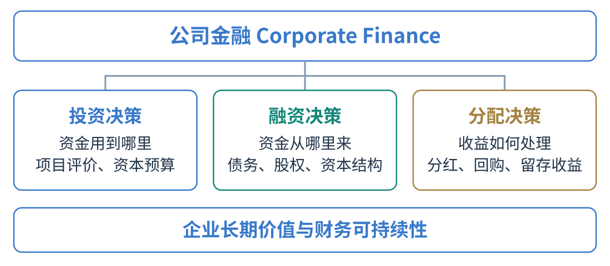

营运资本管理、财务规划和公司治理则贯穿这三项决策的全过程。

## 16.2 企业投资决策与资本预算

### 16.2.1 项目投资的现金流分析

- 初始投资：启动项目所需要投入的资源。
- 经营现金流：项目经营活动产生的现金流。
- 增量现金流：因为实施项目而新增或减少的现金流。
- 终结现金流：项目结束时产生的资产处置等现金流。
- 残值：项目结束后相关资产的剩余价值。

### 16.2.2 投资评价方法

- **非折现评价方法**
  - 投资回收期：收回初始投入所需要的时间。
  - 会计收益率：按照相应会计利润和投资额计算的评价指标。
- **折现评价方法**
  - 净现值（NPV）：未来现金流现值扣除投资成本后的净价值。
  - 内部收益率（IRR）：使项目净现值等于零的折现率。
  - 盈利指数（PI）：相关未来现金流现值相对于初始投入的比例。
  - 折现回收期：考虑资金时间价值后的投资回收时间。
- **实物期权分析**
  - 扩张选择权。
  - 延迟投资选择权。
  - 放弃项目选择权。

净现值的基本表达式：

$$
NPV=-I_0+\sum_{t=1}^{n}\frac{CF_t}{(1+r)^t}
$$

在相应假设和资金约束条件下，正净现值项目能够为企业创造新增经济价值。

IRR与NPV可能在互斥项目选择或非传统现金流条件下产生不同结论，需要结合具体情况判断。

## 16.3 企业融资决策

### 16.3.1 内部融资

- 留存收益：将已经获得但未分配的收益用于经营和投资。
- 内部现金积累：通过经营现金流及资产处置等形成可用资金。

### 16.3.2 外部股权融资

- 创始人出资。
- 风险投资。
- 私募股权融资。
- 公开发行股票。
- 后续股权融资。

股权融资通常没有普通债务式的固定还本付息义务，但可能稀释原有股东权益，并改变企业治理结构。

### 16.3.3 外部债务融资

- 银行贷款。
- 债券发行。
- 商业信用。
- 融资租赁。
- 其他合同融资安排。

### 16.3.4 混合融资

- 可转换债券。
- 部分优先股。
- 夹层融资。
- 其他同时具有债务和权益特征的融资工具。

## 16.4 资本成本

资本成本是企业取得和使用资本所需要承担的经济回报要求。

- 债务资本成本：债权人要求的资金回报及相关融资成本。
- 股权资本成本：股东为承担企业权益风险而要求的预期收益率。
- 加权平均资本成本（WACC）：按照相关资本结构对不同资本成本进行加权计算。

常见简化表达式：

$$
WACC=
\frac{E}{D+E}r_e+
\frac{D}{D+E}r_d(1-T)
$$

其中，$E$ 为股权市场价值，$D$ 为相关债务市场价值，$r_e$ 为股权资本成本，$r_d$ 为债务资本成本，$T$ 为相关税率。

该公式建立在利息税盾等相应假设上，不适用于所有资本结构和税收环境。

## 16.5 资本结构理论

资本结构研究企业应该如何在债务资本与权益资本之间进行安排。

### 16.5.1 财务杠杆

- 财务杠杆：使用债务等具有固定支付义务的融资工具。
- 经营杠杆：固定经营成本对企业利润变化产生的放大作用。
- 联合杠杆：经营杠杆和财务杠杆共同形成的利润敏感性。

### 16.5.2 资本结构的理论体系

- **MM理论**：在严格理想条件下研究融资结构与企业价值之间的关系。
  - 无税MM模型：在相关条件下资本结构不改变企业总价值。
  - 含税MM模型：考虑债务利息税盾等因素对企业价值的影响。
- **权衡理论**：在债务融资的税收利益与财务困境等成本之间寻找合理平衡。
- **优序融资理论**：在信息不对称等条件下，企业可能偏好内部融资，其次是债务融资，再其次是外部股权融资。
- **代理成本理论**：研究债权人、股东和管理层之间的利益冲突如何影响融资结构。
- **市场择时理论**：研究企业是否根据不同融资工具的市场定价条件选择融资时机。

## 16.6 企业收益分配决策

- **股利分配**
  - 现金股利。
  - 股票股利。
  - 稳定股利政策。
  - 固定股利支付率政策。
  - 剩余股利政策。
- **股票回购**
  - 公开市场回购。
  - 要约回购等方式。
- **利润留存**
  - 用于扩大经营。
  - 用于研发和长期投资。
  - 用于降低债务。
  - 用于维持财务安全储备。

股利、股票回购和留存收益是企业分配与使用资金的不同方式，其合理性取决于投资机会、融资条件和股东利益等因素。

## 16.7 企业价值评估

### 16.7.1 企业价值的不同层次

- 企业股权价值：归属于股东的经济价值。
- 企业价值（EV）：反映企业经营资产等相关价值的常用指标，具体需按照估值口径调整债务、现金及其他权益项目。
- 账面价值：按照会计规则记录的价值。
- 清算价值：终止经营、处置资产并处理负债后的相关价值。

### 16.7.2 企业估值的主要方法

- 收益法：根据未来经济利益进行折现。
- 市场法：参考可比企业或可比交易的市场价格。
- 资产基础法：从资产与负债的价值出发估计企业价值。
- 分部加总估值法（SOTP）：分别估计不同业务板块的价值后进行汇总。

## 16.8 企业并购与重组

### 16.8.1 并购的分类

- 横向并购：企业之间处于相同或相近产业环节。
- 纵向并购：企业之间存在上下游产业关系。
- 混合并购：企业之间属于不同产业或经营领域。

### 16.8.2 并购的经济动机

- 协同效应：合并后的企业可能创造高于分别经营的价值。
  - 成本协同：减少重复经营成本。
  - 收入协同：提高销售和市场机会。
  - 财务协同：改善部分融资和资本使用条件。
- 获得技术和人才。
- 扩大市场范围。
- 获得关键生产资源。
- 实现经营结构调整。

### 16.8.3 并购交易的主要环节

- 寻找目标企业。
- 尽职调查。
- 企业估值。
- 交易结构设计。
- 融资安排。
- 审批与交易交割。
- 并购后整合。

### 16.8.4 企业重组与财务困境

- 业务重组：调整企业经营范围。
- 资产重组：重新配置、购买或出售企业资产。
- 债务重组：调整债务本金、期限及偿还条件。
- 分拆：将部分业务分离为独立经营主体。
- 破产重整：通过相关法律程序调整企业债务和经营结构。
- 破产清算：按照相关程序处置资产并分配剩余财产。

## 16.9 营运资本管理与公司治理

### 16.9.1 营运资本管理

- 现金管理：保持必要的支付能力。
- 应收账款管理：控制信用销售和回款风险。
- 存货管理：在库存成本和经营连续性之间取得平衡。
- 应付账款管理：安排对供应商等主体的付款义务。
- 短期融资管理：处理企业日常经营中的资金缺口。

### 16.9.2 公司治理

- 股东权利。
- 董事会职责。
- 管理层激励。
- 内部控制。
- 财务信息披露。
- 债权人及其他利益相关者保护。

**本篇知识联系：** 资产定价研究风险如何决定金融价值，证券投资分析研究如何评价具体资产，投资组合理论研究如何配置已有资金，公司金融则从企业角度研究如何获得资本和创造企业价值。四个领域共同连接资金供给者与资金需求者。

---

# 第四篇　金融机构与金融业务体系

金融市场是交易关系形成的场所，金融机构则是组织和提供金融服务的重要主体。

从现实金融行业的角度看，不同机构具有不同的经营模式、收益来源、资产负债结构与风险承担方式。

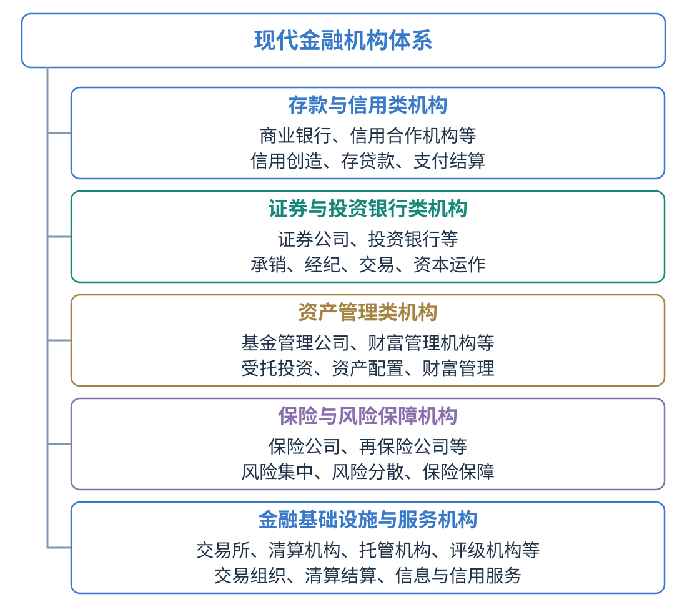

# 第十七章　商业银行学

商业银行是现代信用体系的重要组成部分，主要通过存款、贷款、支付结算以及其他金融服务开展业务。

## 17.1 银行体系的基本分类

### 17.1.1 按机构职能分类

- 中央银行：承担货币政策、中央银行货币发行及相应金融稳定职责。
- 商业银行：开展存贷款、支付等经营性金融服务。
- 政策性银行：主要服务于特定国家发展和公共政策目标。
- 合作金融机构：根据合作金融制度为相应成员及客户提供服务。
- 开发性金融机构：主要支持长期发展、基础设施等项目。

### 17.1.2 商业银行的经营类型

- 零售银行：主要面向个人和家庭客户。
- 公司银行：主要面向企业等组织客户。
- 批发银行：主要开展大型企业、机构客户及同业相关业务。
- 私人银行：主要为符合相关条件的高净值客户提供金融服务。
- 综合性银行：同时经营多个金融业务领域。
- 数字银行：主要通过数字化渠道提供银行服务。

这些经营类型通常可以在同一家银行内部并存。

## 17.2 商业银行的资产负债结构

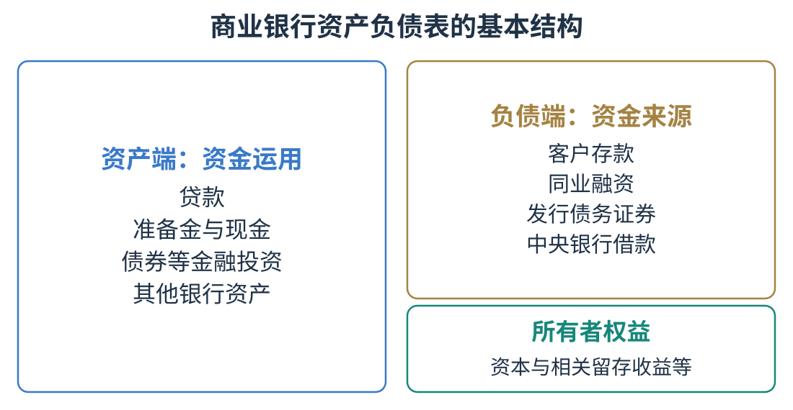

客户存款对于客户而言是资产，对于银行而言是负债；银行贷款对于银行而言是资产，对于借款人而言是负债。

## 17.3 商业银行的业务分类

### 17.3.1 负债业务

负债业务是银行取得资金和形成相关偿付义务的业务。

- **存款业务**
  - 个人存款。
  - 企业存款。
  - 活期存款。
  - 定期存款。
- **借款业务**
  - 同业拆借。
  - 回购融资。
  - 中央银行借款。
- **债务证券融资**
  - 发行金融债券。
  - 发行存单等相关金融工具。

### 17.3.2 资产业务

资产业务是银行通过贷款、投资等方式配置资产的业务。

- **个人贷款**
  - 住房贷款。
  - 消费贷款。
  - 个人经营贷款。
- **企业贷款**
  - 流动资金贷款。
  - 固定资产贷款。
  - 项目融资。
  - 银团贷款：多个贷款机构共同向借款人提供融资。
- **金融投资业务**
  - 债券投资。
  - 同业金融资产。
  - 其他符合相应监管条件的金融投资。

### 17.3.3 中间业务与金融服务

- 支付结算。
- 资金汇划。
- 代理业务。
- 托管业务。
- 财务顾问。
- 财富管理相关服务。
- 外汇及跨境金融服务。

### 17.3.4 表外业务

表外业务通常指不直接作为传统资产负债表资产或负债全额确认、但可能产生风险或未来义务的业务安排。

- 银行担保。
- 信用证。
- 未提用贷款承诺。
- 其他或有信用义务。

部分表外业务在达到相关会计确认条件时仍需要确认资产、负债或准备。表外业务不等于没有风险。

## 17.4 银行的信用创造

银行可以通过贷款等活动创造存款，但不能无限扩张信贷，因为它同时受到资本充足、风险承受能力、流动性、融资成本和有效借款需求等因素约束。

## 17.5 商业银行的盈利模式

- 利息收入：贷款和债券等相关资产产生的利息。
- 利息支出：存款和其他融资负债产生的利息成本。
- 净利息收入：利息收入减去利息支出。
- 手续费及佣金收入：提供支付、托管等服务获得的收入。
- 交易及投资收益：相关金融市场业务产生的收益。
- 信用减值损失：贷款等资产可能无法正常收回而确认的损失。
- 经营费用：人员、系统、网点和管理等成本。

### 17.5.1 银行经营指标

| 指标 | 简明解释 |
|---|---|
| 净息差（NIM） | 净利息收入相对于平均生息资产的比例 |
| 成本收入比 | 衡量银行经营成本相对于经营收入的程度 |
| 不良贷款率 | 不良贷款占相关贷款余额的比例 |
| 拨备覆盖率 | 相关贷款损失准备相对于不良贷款的比例 |
| ROA | 银行使用资产创造利润的能力 |
| ROE | 银行使用所有者权益创造利润的能力 |
| 资本充足率 | 衡量监管资本对风险加权资产的覆盖程度 |

净息差不能简单等同于贷款利率减去存款利率，因为银行还存在其他生息资产及融资负债。

## 17.6 银行信贷管理

### 17.6.1 贷前管理

- 客户身份与背景识别。
- 偿债能力分析。
- 信用评级。
- 抵押品或担保评价。
- 贷款额度与利率确定。

### 17.6.2 贷中管理

- 贷款审批。
- 合同签订。
- 资金发放。
- 用途及合同条件管理。

### 17.6.3 贷后管理

- 还款情况监测。
- 客户财务状况跟踪。
- 风险预警。
- 贷款分类。
- 违约处置与债务重组。

### 17.6.4 贷款损失管理

- 预期信用损失。
- 贷款损失准备。
- 不良贷款处置。
- 债务核销：按照规定处理无法合理收回的贷款账面价值，不一定意味着借款人债务法律义务同时消失。

## 17.7 银行资产负债管理（ALM）

银行资产负债管理研究如何协调资金来源与资金运用之间的结构、期限及风险。

- 期限匹配：协调资产和负债的到期期限。
- 利率风险管理：处理资产和负债利率变化不同步的问题。
- 流动性管理：维持足够资金履行支付义务。
- 资本管理：确保银行具备适当损失承担能力。
- 资金转移定价（FTP）：通过内部资金价格评价不同业务的资金成本和收益。
- 利率重定价缺口：分析资产与负债利率调整时间的差异。

### 17.7.1 银行的期限转换

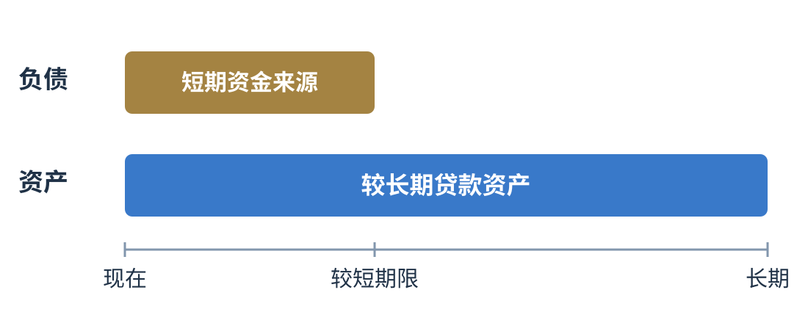

期限转换能够满足长期融资需求，但也使银行承担再融资和流动性风险。图中期限仅为概念示意。

## 17.8 银行危机与稳定机制

- 银行挤兑：大量存款人在短时间内集中提取资金。
- 流动性危机：银行难以及时履行支付义务。
- 偿付能力危机：资产价值不足以承担相应负债等义务。
- 存款保险：为符合条件的存款提供制度保障。
- 最后贷款人：中央银行等在规定条件下提供紧急流动性支持。
- 银行处置机制：在金融机构出现严重问题时进行重组、转让、清算等处理。

---

# 第十八章　证券业与投资银行学

商业银行主要以资产负债表为基础提供信用和资金服务，而投资银行与证券机构则更多围绕证券发行、市场交易和企业资本运作开展业务。

## 18.1 证券公司的主要业务

- 证券经纪：接受客户交易委托并提供交易相关服务。
- 证券自营：使用机构自身资金开展证券投资。
- 做市业务：通过报价和交易提供市场流动性。
- 证券承销：帮助发行人销售新发行证券。
- 保荐及相关上市服务：按照市场制度为证券发行上市提供审核、推荐等专业服务。
- 资产管理：受托管理客户资金和资产。
- 融资融券：提供证券交易相关资金或证券信用服务。
- 证券研究：分析宏观经济、行业、企业及金融资产。

## 18.2 投资银行的核心业务

### 18.2.1 股权资本市场业务（ECM）

- IPO发行。
- 后续公开发行。
- 配股。
- 定向股权融资。
- 其他权益资本募集。

### 18.2.2 债务资本市场业务（DCM）

- 公司债券发行。
- 金融债券发行。
- 国际债券发行。
- 债务融资安排。
- 其他固定收益融资服务。

### 18.2.3 并购与财务顾问

- 并购目标分析。
- 企业价值评估。
- 交易结构设计。
- 融资安排。
- 企业重组顾问。
- 交易谈判及交割支持。

### 18.2.4 销售与交易业务

- 向机构客户提供金融产品销售与交易服务。
- 提供市场报价、执行交易和风险管理相关服务。
- 根据相关授权和监管规则承担交易头寸。

## 18.3 证券承销机制

- 尽力承销：承销机构尽力销售证券，但不一定承担全部未售证券。
- 余额包销：承销机构按照合同承担部分或全部未售余额。
- 全额包销：承销机构按照约定购入相关证券，再向市场销售。
- 承销团：多个机构共同组织证券发行。
- 簿记建档：汇集投资者认购意向和报价等信息，为发行定价与分配提供依据。

具体承销责任和名称因市场制度及合同安排而异。

## 18.4 证券机构的组织与利益冲突

- 前台部门：直接开展客户、投资及交易活动。
- 中台部门：开展风险管理、估值及相关监督活动。
- 后台部门：提供清算、结算、运营和系统支持。
- 信息隔离墙：限制不同业务部门之间不当传递敏感信息。
- 利益冲突管理：防止机构或员工自身利益损害客户利益。

---

# 第十九章　基金、资产管理与财富管理

这三个领域存在密切联系，但并不是同一个概念。

- 基金：组织投资资金的一类投资载体。
- 资产管理：管理资金和资产的专业活动。
- 财富管理：围绕个人、家庭等客户整体财务目标提供综合服务。

## 19.1 基金的基本结构

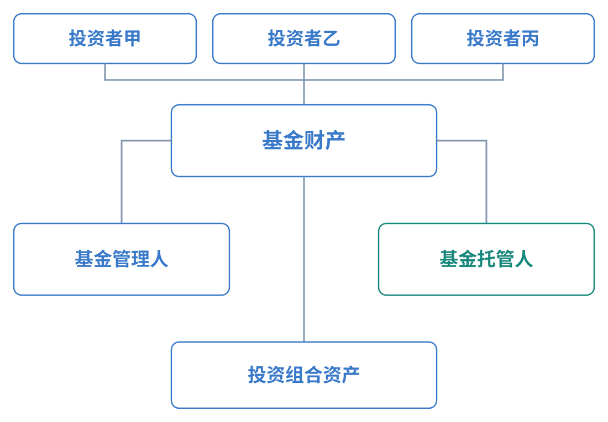

集合投资基金的概念结构。具体参与主体及法律权责取决于基金组织形式。

### 19.1.1 基金的主要参与主体

- 基金投资者：购买基金份额或取得相关基金权益。
- 基金管理人：按照投资目标和规则进行资产管理。
- 基金托管人：负责基金资产保管、监督及相关服务。
- 基金销售机构：向符合条件的客户提供基金销售服务。
- 其他服务机构：承担登记、估值、行政管理和审计等职责。

### 19.1.2 基金资产与基金管理公司资产

基金投资者投入的相关资金与基金管理公司自身资产通常需要按照相应法律制度进行区分和独立管理。

购买基金份额，并不等于直接购买基金管理公司的股票。

## 19.2 基金的多维分类

### 19.2.1 按募集方式分类

- 公募基金：按照相应规则向公众募集资金。
- 私募基金：面向符合条件的特定投资者进行非公开募集。

### 19.2.2 按份额申购赎回安排分类

- 开放式基金：通常允许投资者按照规定申购和赎回。
- 封闭式基金：在约定期间内通常不能通过普通开放式赎回机制退出。

### 19.2.3 按法律组织形式分类

- 契约型基金：主要依据基金合同建立。
- 公司型基金：以公司等法人组织形式开展基金业务。
- 合伙型基金：以合伙企业等结构开展投资活动。
  - 普通合伙人（GP）：通常承担基金组织和管理等职责。
  - 有限合伙人（LP）：通常主要提供资本并按照规定承担责任。

### 19.2.4 按投资对象分类

- 货币市场基金。
- 债券基金。
- 股票基金。
- 混合资产基金。
- 商品基金。
- 房地产基金。
- 私募股权基金。
- 基金中的基金（FOF）：主要投资其他基金。
- 管理人组合基金（MOM）：通过委托多个投资管理人等方式进行组合管理。

### 19.2.5 按投资管理方式分类

- 主动管理基金。
- 被动指数基金。
- 指数增强基金。
- 系统化投资基金。

## 19.3 ETF及交易所交易产品

ETF是按照相应制度在交易所上市交易、具有特定申购赎回机制的投资基金。

### 19.3.1 ETF的两层市场

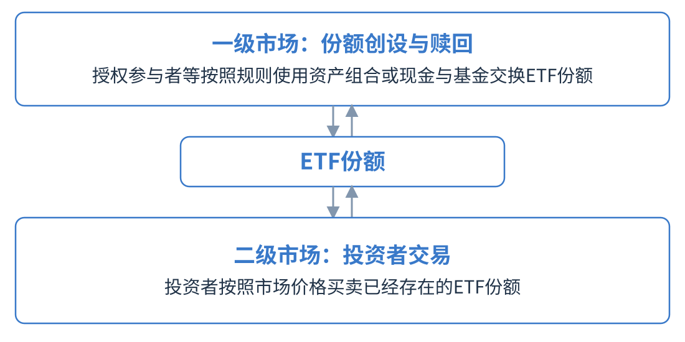

### 19.3.2 ETF的相关概念

- 基金净值（NAV）：基金资产扣除负债后形成的相关份额价值。
- ETF市场价格：份额在二级市场的交易价格。
- 溢价：市场价格高于相关基金净值。
- 折价：市场价格低于相关基金净值。
- 跟踪差异：基金收益与目标指数收益之间的差额。
- 跟踪误差：跟踪差异随时间变化的波动程度。

### 19.3.3 ETF的类别

- 股票ETF。
- 债券ETF。
- 商品ETF。
- 行业及主题ETF。
- 主动管理ETF。
- 杠杆和反向ETF：按照规定目标提供放大或反向风险敞口的产品。

ETF与指数基金存在交叉，但并非同义词。指数基金不一定在交易所交易，ETF也不一定采用被动指数投资。

## 19.4 基金费用及业绩分析

- 管理费：支付给基金管理人的相关费用。
- 托管费：支付给托管机构的相关费用。
- 申购赎回费用。
- 销售服务费用。
- 交易成本。
- 业绩报酬：按照规定业绩条件向管理人支付的报酬。
- 高水位线：部分基金用于确定业绩报酬的历史净值基准。
- 门槛收益率：达到某个收益要求后才计提相应业绩报酬等安排。

对于私募股权等基金，还需要了解：

- 承诺资本：投资者承诺投入的资本金额。
- 实缴资本：已经实际缴付的资金。
- DPI：已分配金额相对于实缴资本的倍数。
- RVPI：剩余投资价值相对于实缴资本的倍数。
- TVPI：已分配金额及剩余投资价值之和相对于实缴资本的倍数。

## 19.5 资产管理业务

- 集合资产管理：汇集多个投资者的资金进行管理。
- 专户资产管理：针对特定客户建立独立投资安排。
- 机构资产管理：管理养老金、保险资金等机构资产。
- 委托投资管理：按照客户授权和相关投资政策开展投资。

## 19.6 财富管理与个人金融

### 19.6.1 个人财务状况分析

- 个人收入。
- 日常消费支出。
- 储蓄与应急资金。
- 个人资产及负债。
- 个人净财富。
- 现金流与偿债能力。

### 19.6.2 个人融资管理

- 消费贷款。
- 住房贷款。
- 教育融资。
- 信用卡信用。
- 债务偿还与信用管理。

### 19.6.3 个人财富配置

- 流动性储备。
- 保险保障。
- 中长期投资。
- 住房等重大支出安排。
- 退休与养老规划。
- 教育及家庭财务规划。
- 财富传承和遗产规划。

财富管理不等于单纯购买高收益金融产品，其核心是在个人目标、时间、流动性和风险之间进行综合安排。

### 19.6.4 高净值财富管理

- 私人银行服务。
- 家族办公室：围绕家族财富提供投资、治理及相关专业服务。
- 信托：通过一定法律安排由受托人按照约定管理相关财产。
- 家族治理与代际传承。
- 合法税务规划与跨境财富管理。

---

# 第二十章　保险学与保险精算

保险学研究如何通过风险集中和分担机制，将个人或企业可能遭遇的重大不确定损失转化为相对可安排的经济成本。

## 20.1 保险产生的经济基础

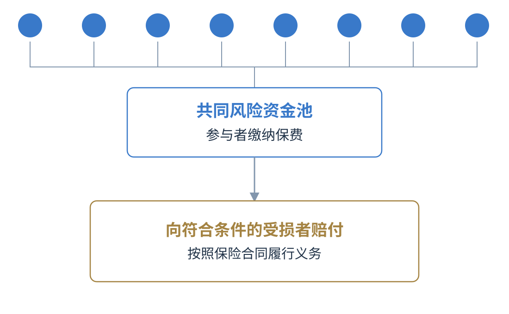

保险的风险汇集和分担原理。实际保险机构还需要建立资本、准备金及再保险等风险保障机制。

- 风险汇集：将大量风险对象集中到共同保障体系。
- 大数定律：在相应统计条件下，大量风险对象的平均损失可能更加稳定。
- 风险转移：通过保险合同将部分约定风险转移给保险机构。
- 风险自留：自行承担没有转移的部分风险。

## 20.2 保险合同的基本要素

- 投保人：与保险机构订立合同并承担相关交费义务的主体。
- 被保险人：受到保险合同保障的相关主体。
- 受益人：按照合同及法律规定取得相关保险金的人。
- 保险人：承担约定保险义务的机构。
- 保费：为取得保险保障支付的金额。
- 保险金额：保险合同约定的相关保障金额。
- 保险责任：保险机构需要承担的约定风险和支付义务。
- 责任免除：合同规定不承担保障义务的相关事项。
- 免赔额：按照合同约定由被保险人等自行承担的相关损失部分。
- 保险期限：保险保障有效的时间范围。

## 20.3 保险产品的分类

### 20.3.1 按保障对象分类

- **人身保险**
  - 人寿保险：与人的生命、生存或死亡等情况相关。
    - 定期寿险。
    - 终身寿险。
    - 两全保险等。
  - 健康保险：与医疗费用、疾病等风险相关。
    - 医疗保险。
    - 疾病保险。
  - 意外伤害保险：保障符合合同条件的意外伤害风险。
  - 年金保险：按照约定提供长期或定期给付。
- **财产保险**
  - 机动车辆保险。
  - 家庭及企业财产保险。
  - 货物运输保险。
  - 工程保险。
  - 其他财产损失保障。
- **责任与信用保证类保险**
  - 责任保险：保障依法承担的相关赔偿责任。
  - 信用保险：保障约定信用风险造成的损失。
  - 保证保险：按照合同保障相关义务履行风险。

### 20.3.2 按制度性质分类

- 商业保险：依据商业保险合同和经营机制提供保障。
- 社会保险：由公共制度建立的养老、医疗、失业等社会风险保障安排。

### 20.3.3 按风险承担层次分类

- 原保险：保险机构直接向客户提供保障。
- 再保险：保险机构将自身承担的部分保险风险转移给其他保险机构。
  - 比例再保险：按照约定比例分担保费与赔付等。
  - 非比例再保险：按照损失层次和额度等分担风险。

## 20.4 保险经营机制

- 核保：评价风险并确定是否承保及相关条件。
- 保险定价：根据预期损失、费用、资本和其他因素确定保费。
- 承保：正式承担保险合同义务。
- 理赔：核实保险事故并按照合同处理赔付。
- 准备金管理：为未来保险义务确认相应负债和准备。
- 保险资金运用：在资产负债管理和监管等约束下开展投资。

## 20.5 保险精算

保险精算利用概率、统计和金融数学研究保险合同的未来现金流及风险成本。

### 20.5.1 风险模型

- 死亡率与生存模型。
- 疾病及医疗费用模型。
- 损失频率模型：研究事故发生次数。
- 损失程度模型：研究事故发生后的损失金额。
- 巨灾模型：研究低频但可能造成重大损失的事件。

### 20.5.2 精算定价

- 纯保费：主要用于覆盖预期保险赔付的相关保费部分。
- 附加保费：考虑经营费用、风险成本及其他因素的部分。
- 保费充足性：评价保费能否支持相应保险义务及经营成本。

### 20.5.3 保险准备金与偿付能力

- 未到期责任等准备：与未来保障期间的合同责任相关。
- 未决赔款等准备：与已经发生但尚未完全处理的赔付责任相关。
- 长期保险合同负债：反映长期保险合同的未来相关义务。
- 偿付能力：保险机构履行未来保险责任及承担风险的能力。

## 20.6 保险经营的特殊风险

- 逆向选择：高风险对象可能更愿意购买保险。
- 道德风险：获得保险后相关行为可能发生变化。
- 承保风险：实际赔付超过定价和准备金假设。
- 长寿风险：被保险人寿命长于预期，增加部分长期给付负担。
- 巨灾风险：大量保险损失因共同事件集中发生。
- 资产负债错配风险：保险资产与未来赔付义务之间存在期限、利率等差异。

保险学与经济学中的信息不对称、风险分担及契约理论直接相连。

---

# 第二十一章　国际金融与跨境金融业务

国际金融与外汇市场并不完全相同。外汇市场主要研究货币交易，国际金融则研究不同经济体之间完整的融资、投资、支付、信用及风险管理体系。

## 21.1 国际金融活动的分类

- 国际投资：跨境配置金融资产和企业资本。
- 国际融资：通过境外贷款、债券或股权等方式取得资金。
- 国际支付：完成不同经济体主体之间的资金转移。
- 国际结算：按照跨境合同和金融安排履行支付义务。
- 国际风险管理：处理汇率、国家信用、法律和市场风险。

## 21.2 国际资本市场

### 21.2.1 国际股权市场

- 境外股票投资。
- 企业境外上市。
- 多地上市。
- 存托凭证：代表相关境外证券权益的凭证。
  - ADR：美国存托凭证。
  - GDR：全球存托凭证。

### 21.2.2 国际债券市场

- 外国债券：境外发行人在某个国内债券市场按照相关制度发行的债券，通常以该市场货币计价。
- 欧洲债券（Eurobond）：通常指在计价货币所属司法管辖区之外等国际市场发行的债券。
- 全球债券：面向多个市场组织发行的债券等国际融资安排。

欧洲债券不是专指以欧元计价的债券，也不一定在欧洲发行。

### 21.2.3 国际银行融资

- 跨境银行贷款。
- 国际银团贷款。
- 离岸存贷款。
- 国际项目融资。
- 跨境贸易融资。

## 21.3 在岸与离岸金融

- 在岸金融市场：主要在相关货币发行地或国内金融制度框架中运行的市场。
- 离岸金融市场：相关货币和金融业务主要在发行地之外等市场环境中运行的安排。
- 离岸货币市场：在某种货币发行地之外开展该货币相关存贷款及融资等业务的市场。
- 国际金融中心：集中提供跨境融资、投资、交易和相关专业服务的城市或经济区域。

例如，欧洲美元是美国境外银行体系中形成的美元存款等相关市场概念，并不意味着美元转换成了欧元。

## 21.4 国际支付与结算体系

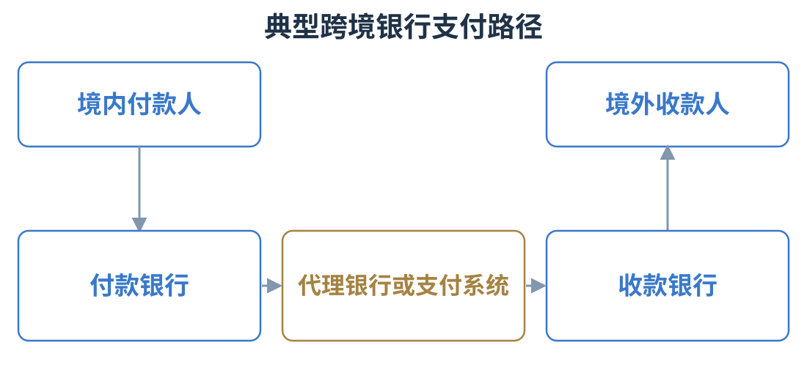

跨境付款可能经过一个或多个代理机构，也可能采用具有直接参与者的支付系统。信息传输路径与实际资金结算路径并不一定相同。

### 21.4.1 跨境支付的基础机制

- 代理银行：为其他银行提供账户、支付及相关跨境金融服务。
- 往来账户：银行在其他银行开立或为其他银行管理的相关账户。
- Nostro账户：从本行角度看，本行在其他银行持有的账户。
- Vostro账户：从本行角度看，其他银行在本行持有的账户。
- 跨境清算：确定跨境资金支付义务。
- 跨境结算：完成相关货币资金的最终交付。

### 21.4.2 国际金融基础设施

| 系统或机构 | 主要功能 |
|---|---|
| SWIFT | 提供金融机构间标准化金融报文传输服务 |
| CIPS | 提供人民币跨境支付清算等服务 |
| Fedwire Funds Service | 美国相关实时全额资金结算服务 |
| CHIPS | 提供美元大额支付清算和结算服务 |
| CLS | 提供符合条件货币的外汇同步交收等服务 |
| Euroclear、Clearstream | 提供证券结算、托管等金融基础设施服务 |

**特别辨析：** SWIFT主要是金融信息传输网络，并不是一个统一保管和转移全球资金的银行。金融报文、银行账户余额变化以及最终清算结算属于不同层次。

## 21.5 国际贸易金融

国际贸易金融研究如何为跨境商品和服务交易提供支付保障、短期融资及信用风险管理。

### 21.5.1 国际贸易结算方式

- 汇款：付款人通过金融机构向收款人转移资金。
- 托收：通过银行等机构按照委托要求收取相关款项。
  - 付款交单（D/P）。
  - 承兑交单（D/A）。
- 信用证（L/C）：银行按照信用证条款，在符合相关单据条件时承担付款等义务的安排。

### 21.5.2 贸易融资工具

- 保理：围绕应收账款提供融资、管理或信用保障等服务。
- 福费廷：通过买断符合条件的贸易债权等方式提供融资。
- 出口信贷：支持出口交易的相关融资。
- 进口融资：为进口商提供采购所需要的资金。
- 供应链金融：围绕供应链交易、信用及现金流提供融资服务。

## 21.6 跨国公司金融管理

- 全球资金管理：协调不同国家子公司的资金余额及融资需求。
- 资金归集：按照制度和业务安排集中管理相关资金。
- 多币种融资：选择不同计价货币的融资工具。
- 跨境资金调拨。
- 外汇套期保值。
- 跨境项目投资评价。
- 国际税务与资本结构安排。

## 21.7 国际金融风险

- 汇率风险。
- 国家风险：政治、经济和制度变化影响境外金融权益。
- 主权信用风险：外国政府偿债能力或意愿变化。
- 转移与兑换风险：相关货币兑换或资金跨境转移受到限制。
- 跨境结算风险。
- 跨境法律与合规风险。
- 国际资本流动逆转风险。

本章与金融科技中的跨境支付系统、国际金融机构业务及经济学中的国际收支体系具有直接联系。

---

# 第五篇　金融风险、监管与法律制度

金融活动在创造融资和投资机会的同时，也会形成信用义务、杠杆、期限错配及相互关联的风险。

第五篇主要回答：金融风险如何产生、如何衡量、如何管理，以及社会如何建立制度限制金融风险。

# 第二十二章　金融风险管理

## 22.1 风险管理的基本框架

- 风险来源：可能造成不利影响的因素。
- 风险敞口：经济主体受到相关风险因素影响的程度。
- 风险事件：风险实际发生并影响经济目标。
- 风险损失：风险事件形成的经济损失。
- 风险承受能力：主体能够承担损失的客观能力。
- 风险偏好：主体在追求目标时愿意承担风险的总体程度。
- 风险容忍度：允许相关风险指标在一定范围内波动的程度。

### 22.1.1 风险管理的完整流程

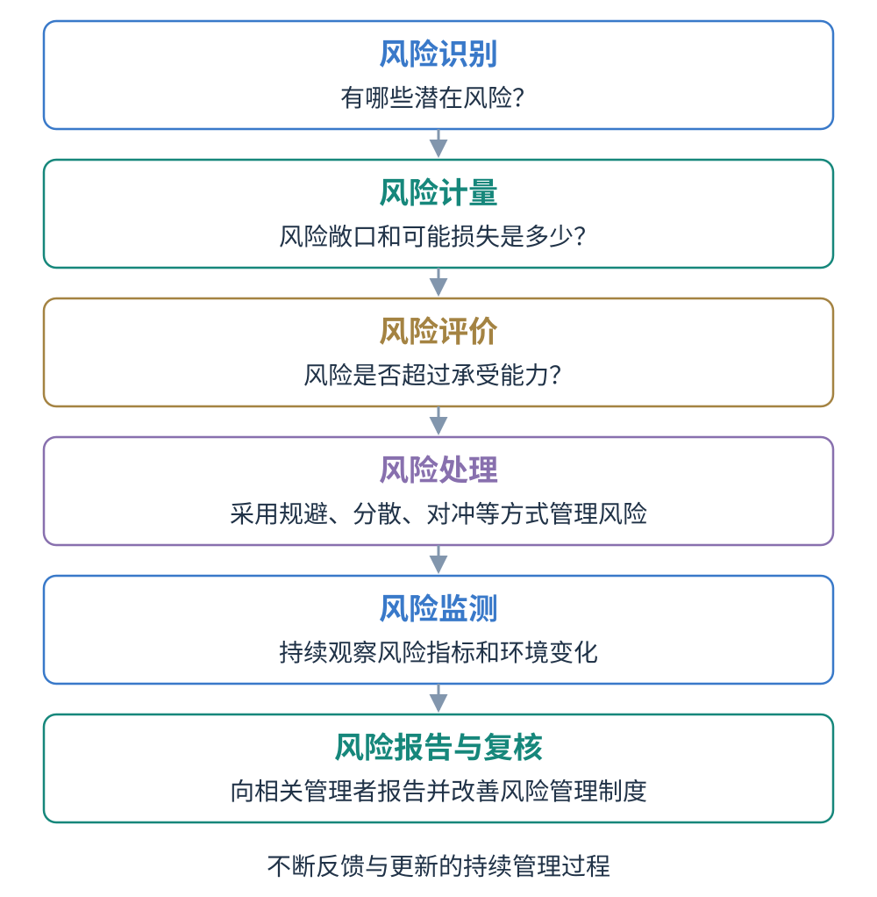

## 22.2 金融风险的总体分类

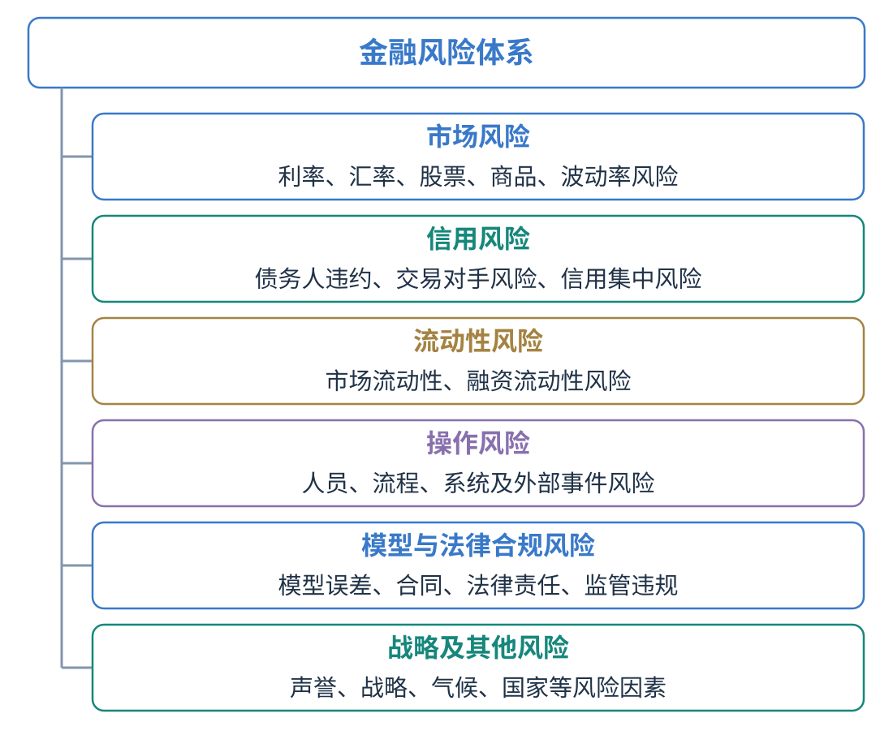

风险分类依据不同监管框架和机构业务而异，部分风险之间存在交叉及转化关系。

## 22.3 市场风险

### 22.3.1 按风险因素分类

- 利率风险：利率及收益率曲线变化造成资产价值或收益变化。
- 汇率风险：不同货币兑换比例变化造成损失。
- 股票价格风险：股票或股票指数价格变化造成损失。
- 商品价格风险：原油、黄金等商品价格变化造成损失。
- 波动率风险：市场波动率变化影响相关金融资产价值。
- 基差风险：相关资产或定价基准之间的价格关系变化造成损失。

### 22.3.2 市场风险敏感度

- Beta：衡量对市场共同风险因素的暴露。
- 久期、凸性与DV01：衡量利率风险。
- Delta、Gamma、Vega等：衡量期权等工具对不同因素的敏感程度。

这些指标主要描述风险因素变化会造成怎样的价值变化，而不是直接预测未来一定损失多少。

## 22.4 信用风险

### 22.4.1 按风险来源分类

- 借款人违约风险：借款人无法履行偿债义务。
- 交易对手信用风险：金融交易对手无法履行相关合同义务。
- 信用迁移风险：信用质量下降等变化导致资产价值下降。
- 信用集中风险：风险敞口过度集中于少数主体或相关行业。
- 主权信用风险：政府不能或不愿按照相关条件偿还债务。
- 结算信用风险：在资产或资金交付过程中产生的对手方风险。

### 22.4.2 信用风险的三个核心参数

- 违约概率（PD）：规定期限内发生违约的概率。
- 违约损失率（LGD）：违约发生后无法收回的相关风险敞口比例。
- 违约风险敞口（EAD）：违约发生时可能暴露于损失的金额。

在简化信用风险模型中：

$$
EL=PD\times LGD\times EAD
$$

其中，$EL$ 为预期损失。

### 22.4.3 信用风险模型

- 信用评分模型：利用借款人特征评价信用质量。
- 信用评级迁移模型：研究信用等级发生变化的概率。
- 结构化信用风险模型：从企业资产价值和债务结构解释违约风险。
  - Merton模型：将企业违约与资产价值低于相关债务偿付条件联系起来。
- 简约式信用模型：利用违约强度等变量描述信用事件。
- 信用组合模型：研究多个信用资产共同违约等风险。

## 22.5 流动性风险

- **市场流动性风险**
  - 无法及时出售资产。
  - 交易量不足。
  - 买卖价差扩大。
  - 大额交易产生明显市场冲击。
- **融资流动性风险**
  - 无法及时取得借款等资金。
  - 资金到期无法正常续借。
  - 追加保证金造成支付压力。
  - 大量客户提取资金。

两类风险可能相互强化：资金不足迫使机构出售资产，集中出售又可能压低价格并增加融资压力。

## 22.6 操作风险与其他风险

### 22.6.1 操作风险

- 人员风险：错误操作、内部舞弊等。
- 流程风险：业务流程、审批和控制失效。
- 系统风险：金融系统故障、数据处理错误等。
- 外部事件风险：自然灾害、外部欺诈等事件。
- 网络安全风险：系统受到攻击、信息泄露或服务中断等风险。

### 22.6.2 模型风险

- 模型假设错误。
- 数据质量不足。
- 参数估计误差。
- 模型不适用于当前市场环境。
- 模型实现错误。
- 对模型结果的误解和过度依赖。

### 22.6.3 其他重要风险

- 法律风险：合同无效、法律争议等产生损失。
- 合规风险：违反相关法律、监管要求和业务规则。
- 声誉风险：公众或客户信任下降产生经济损失。
- 战略风险：长期经营方向和重大决策不当造成损失。
- 气候风险。
  - 物理风险：极端气候等事件造成经济损失。
  - 转型风险：能源、技术及政策转型造成资产和经营价值变化。

## 22.7 风险计量理论

### 22.7.1 基础统计风险指标

- 方差与标准差。
- 下行波动率。
- 最大回撤。
- 相关性及协方差。
- 风险敞口与集中度。

### 22.7.2 风险价值（VaR）

VaR是在给定持有期、置信水平和模型条件下，对损失分布某一分位点的估计。

例如，一日99% VaR为100万元，表示按照相关模型估计，一日损失超过100万元的概率约为1%。这并不意味着100万元是最大可能损失。

### 22.7.3 预期损失尾值（ES）

ES衡量超过相关VaR分位点后的平均尾部损失，连续分布情形下可直观理解为最不利一部分情景中的平均损失。

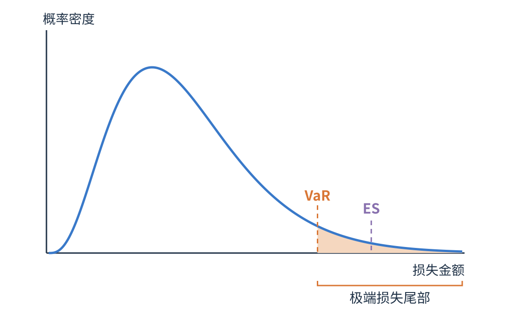

横轴越向右，代表损失越大。VaR定位损失分位点，ES进一步关注超过这一分位点后的尾部损失。

### 22.7.4 VaR与ES的计算方法

- 参数法：在特定概率分布假设下计算相关风险指标。
- 历史模拟法：利用历史市场变化模拟当前组合的损失。
- 蒙特卡洛模拟法：通过随机生成大量未来市场情景估计损失分布。

### 22.7.5 压力测试

- 历史情景测试：使用曾经发生的重大市场冲击进行模拟。
- 假设情景测试：构造未来可能出现的严重风险情景。
- 反向压力测试：寻找哪些极端情景可能导致机构无法继续正常经营等结果。
- 敏感性测试：分析单个或多个风险因素变化的影响。

VaR、ES与压力测试不是相互替代的单一风险工具，而是需要结合使用的不同分析方法。

## 22.8 风险处理方式

- 风险规避：不开展或停止相关高风险活动。
- 风险降低：通过制度、技术或经营改善减少风险。
- 风险分散：通过多资产、多主体配置降低集中风险。
- 风险转移：通过保险、担保或金融合同转移部分风险。
- 风险对冲：建立能够抵消部分已有风险敞口的头寸。
- 风险自留：在承受能力内自行承担风险。

### 22.8.1 套期保值的基本逻辑

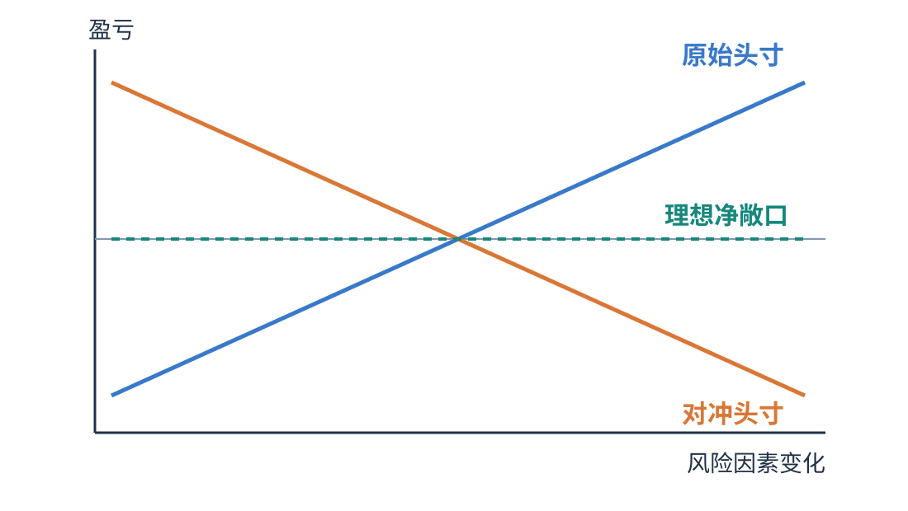

理想线性对冲示意。实际对冲可能受到基差、交易费用、期限和相关性变化等因素影响。

### 22.8.2 对冲的相关概念

- 自然对冲：通过资产负债或经营现金流匹配降低风险。
- 完全对冲：在相关假设下抵消目标风险敞口。
- 部分对冲：只降低一定比例风险。
- 动态对冲：根据市场变化持续调整对冲头寸。
- 对冲比率：用于确定对冲头寸规模与原始敞口关系的比例。

## 22.9 全面风险管理

- 企业全面风险管理（ERM）：在整个组织层面统一管理各类风险。
- 风险限额：为相关风险指标设定允许范围。
- 风险预算：将总体风险承受额度分配给不同业务和投资组合。
- 经济资本：根据内部模型估计承担相应风险所需要的资本。
- 风险调整资本回报率（RAROC）：结合风险资本和相关收益评价业务表现。
- 独立风险管理：使风险评价和监督与部分经营决策保持适当独立。
- 模型验证：评价模型的理论、数据、实现和实际表现。
- 应急与恢复计划：为重大业务中断、资金紧张等情况建立处理机制。

---

# 第二十三章　金融监管、法律与职业道德

金融监管的目的不仅是防止金融机构发生问题，还包括保护投资者、维护市场秩序、促进公平交易和降低系统性风险。

## 23.1 金融监管的基本分类

### 23.1.1 按监管目标分类

- 审慎监管：重点维护金融机构稳健经营及损失承担能力。
  - 微观审慎监管：重点研究单个金融机构是否稳健。
  - 宏观审慎监管：重点防止整个金融系统积累和扩散风险。
- 行为监管：重点维护金融业务行为、销售及交易秩序。
- 投资者保护监管：保障投资者获得必要信息及合法权益。
- 反金融犯罪监管：防止洗钱、欺诈等违法金融活动。

### 23.1.2 按监管组织方式分类

- 机构监管：根据金融机构类型安排监管职责。
- 功能监管：对具有相似经济功能的金融业务进行相应监管。
- 行为监管：围绕具体金融服务和交易行为进行监管。
- 综合监管：由相对统一的机构承担多个金融监管职能。

这些分类维度存在交叉。

## 23.2 银行审慎监管

### 23.2.1 资本监管

- 监管资本：按照监管规则确认的损失吸收资本。
  - 核心一级资本（CET1）。
  - 其他一级资本（AT1）。
  - 二级资本（Tier 2）。
- 风险加权资产（RWA）：按照不同资产及风险敞口的风险特征进行加权计算。
- 资本充足率：监管资本相对于风险加权资产的比例。
- 资本缓冲：在最低资本要求之外用于应对风险的额外资本要求等安排。
- 杠杆率监管：通过非风险加权口径等限制过度杠杆。

### 23.2.2 流动性监管

- 流动性覆盖率（LCR）：衡量高质量流动性资产对短期压力情景资金流出的覆盖能力。
- 净稳定资金比例（NSFR）：衡量中长期稳定资金对相关资金需求的支持程度。
- 流动性压力测试。
- 大额风险暴露限制等审慎措施。

### 23.2.3 巴塞尔监管框架

巴塞尔银行监管框架为银行资本、流动性及风险管理提供国际层面的监管标准和指导。

- 最低资本等相关要求。
- 监管检查。
- 市场纪律与信息披露。

具体实施要求由各司法管辖区根据本地规则确定，不能将国际标准直接视为各国完全一致的法律。

## 23.3 证券市场监管

- 证券发行与上市规则。
- 持续信息披露制度。
- 上市公司治理要求。
- 投资者适当性管理。
- 证券交易规则。
- 市场操纵监管。
- 内幕交易监管。
- 金融产品销售及投资者权益保护。

### 23.3.1 典型金融市场违法行为

- 内幕交易：在相关法律禁止的条件下利用重大非公开信息进行交易等行为。
- 市场操纵：通过违法交易、虚假信息等方式不当影响市场价格或交易量。
- 财务造假：虚构或隐瞒重要财务信息。
- 金融欺诈：通过虚假陈述等方式非法获取经济利益。
- 非法集资：违反相应法律规定进行的资金募集活动。

## 23.4 金融犯罪防控与合规

- 客户身份识别（KYC）：了解客户身份、业务性质及相关风险。
- 客户尽职调查（CDD）：按照风险和规则核实客户及交易相关信息。
- 强化尽职调查（EDD）：针对较高风险情形进行更加深入的核查。
- 实际受益所有人识别（UBO）：识别最终拥有或控制相关客户等主体的自然人。
- 反洗钱（AML）：防止违法所得通过金融系统被掩饰和转移。
- 反恐怖融资（CFT）：防止资金被用于恐怖主义活动。
- 制裁合规：识别并遵守适用的相关制裁和金融限制规定。
- 可疑交易监测：按照相应法律和风险要求监测及处理异常金融活动。
- 数据与隐私保护：保障客户金融信息的合理使用和安全。

## 23.5 金融法律的主要领域

- 公司法：规范公司组织、资本结构和公司治理等事项。
- 证券法：规范证券发行、交易及投资者保护。
- 银行法：规范银行经营及相关监管事项。
- 保险法：规范保险合同、保险机构及相关业务。
- 合同法相关制度：确定金融合同的成立、履行和违约责任。
- 担保及财产法律制度：规范抵押、质押、保证等保障安排。
- 信托法：规范信托财产管理及相关权利义务。
- 破产法：规范债务重整、破产清算及债权清偿等事项。

这些法律名称、制度范围和具体规定因国家及地区而异。

## 23.6 金融监管机构与国际标准组织

| 国家、地区或层级 | 代表性机构及组织 | 主要职能 |
|---|---|---|
| 中国内地 | 中国人民银行、国家金融监督管理总局、中国证监会 | 货币金融管理、金融机构及资本市场监管等 |
| 中国香港 | 香港金融管理局、香港证监会、保险业监管局 | 银行货币体系、证券期货及保险监管等 |
| 美国 | 美联储、SEC、CFTC等 | 银行及金融稳定、证券与衍生品市场监管等 |
| 英国 | 英格兰银行、PRA、FCA | 审慎监管、货币金融管理及金融行为监管等 |
| 国际银行领域 | 巴塞尔银行监管委员会（BCBS） | 国际银行监管标准制定 |
| 国际证券领域 | 国际证监会组织（IOSCO） | 证券市场监管合作及标准 |
| 国际保险领域 | 国际保险监督官协会（IAIS） | 保险监管合作及标准 |
| 全球金融稳定 | 金融稳定理事会（FSB） | 推动国际金融监管政策协调 |
| 反洗钱领域 | 金融行动特别工作组（FATF） | 制定反洗钱等领域国际标准 |

表格为主要机构及一般职能示例，并非各地完整的金融监管权限清单。

## 23.7 金融机构内部控制

- 第一条线：业务部门承担日常业务风险管理职责。
- 第二条线：风险管理、合规等职能提供监督、支持与挑战。
- 第三条线：内部审计提供相对独立的评价和保证。
- 董事会与高级管理层：承担相应治理、监督和管理责任。

三道防线属于治理与内部控制框架，不是三个彼此隔绝的风险管理系统。

## 23.8 金融职业道德

- 诚实与专业诚信。
- 客户利益保护。
- 独立客观的投资分析。
- 公平对待客户。
- 保密与客户信息保护。
- 利益冲突披露及管理。
- 勤勉尽责。
- 不误导投资者。
- 按照授权和合同管理客户资产。

金融职业道德与法律合规存在联系，但二者并不完全等同。有些行为虽然尚未构成法律违规，也可能不符合专业诚信和客户利益要求。

---

# 第六篇　现代金融技术与综合实践

传统金融学研究资金、资产价值及风险的基本规律，而现代金融技术进一步研究如何借助数学、统计学、计算机科学和信息技术实现这些金融功能。

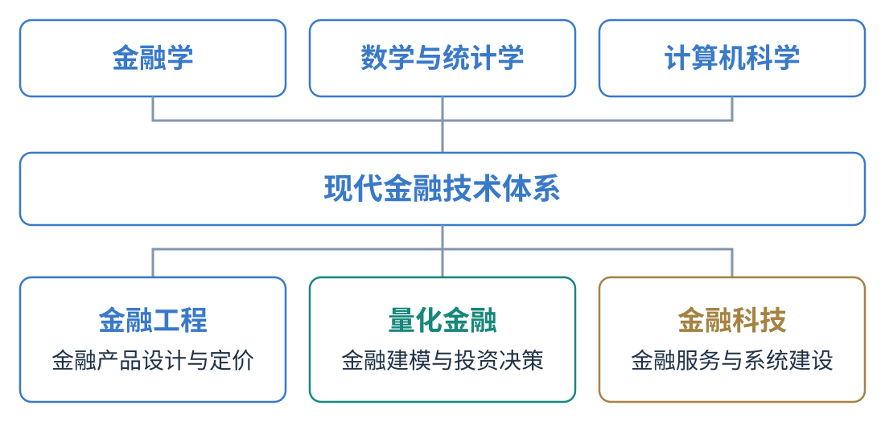

这三个领域存在大量交叉，但研究重点并不完全相同。例如，金融工程研究如何设计和定价一个期权产品，量化金融研究如何利用模型分析该期权的投资与交易机会，金融科技则可以研究如何建设支持期权交易、结算和风险监测的软件系统。

# 第二十四章　金融工程

金融工程通过数学模型、金融工具组合和计算方法解决金融产品设计、资产定价、风险管理及金融决策问题。

## 24.1 金融工程的理论基础

- **金融学基础**
  - 货币时间价值。
  - 无套利原则。
  - 资产定价理论。
  - 金融衍生品理论。
  - 投资组合理论。
- **数学基础**
  - 概率论与数理统计。
  - 随机过程。
  - 随机微积分。
  - 偏微分方程。
  - 最优化理论。
- **计算机基础**
  - 数值计算。
  - 算法设计。
  - 随机模拟。
  - 金融数据处理。
  - 高性能计算。

## 24.2 金融产品的设计原理

金融工程中的产品设计，可以理解为将不同基础金融工具进行拆分、重新组合，形成满足特定需求的现金流及风险结构。

### 24.2.1 基础金融构件

- 债务工具：提供约定本金与利息现金流。
- 权益工具：提供企业相关剩余收益权益。
- 远期工具：建立未来交易价格或现金流安排。
- 期权工具：形成非线性的或有支付结构。
- 互换工具：交换不同类型的现金流。

### 24.2.2 金融产品组合

- 本金与收益结构设计。
- 收益挂钩条件设计。
- 风险承担顺序设计。
- 现金流时间结构设计。
- 提前终止及其他嵌入式条款设计。

一种典型产品构造思路。所谓本金保护仍取决于发行人信用、合同条款及相关条件，并不等于绝对安全。

## 24.3 金融工程的定价理论

### 24.3.1 复制组合与无套利

- 复制组合：使用其他金融资产构建与目标资产相同或近似相同的未来支付结构。
- 无套利定价：根据复制组合及市场价格关系确定目标资产的理论价格。
- 动态复制：随着市场价格和风险因素变化不断调整复制组合。
- 静态复制：通过相对固定的资产组合复制目标支付。

### 24.3.2 风险中性定价

- 现实概率：用于描述实际经济事件可能发生的概率。
- 风险中性概率：在一定无套利定价框架下，用于计算折现资产价值的概率体系。
- 风险中性测度：将风险中性定价方法进一步数学化的概率测度。
- 鞅理论：研究满足特定条件的随机过程及其在金融定价中的应用。

风险中性概率是一种定价工具，并不是对市场真实涨跌概率的直接预测。

## 24.4 金融衍生品定价模型

### 24.4.1 期权定价模型

- 二叉树模型：在每个时间阶段设置不同价格变化状态，逐步计算期权价值。
- 三叉树模型：在每个阶段使用更多价格变化状态。
- Black–Scholes–Merton模型：在特定连续时间模型假设下计算期权价值。
- 随机波动率模型：允许资产波动率随时间随机变化。
  - Heston模型：经典随机波动率模型之一。
- 局部波动率模型：允许波动率随价格和时间等变量变化。
- 跳跃扩散模型：在连续价格变化之外考虑突然跳跃。

### 24.4.2 利率衍生品定价模型

- Vasicek模型：使用均值回复等机制描述利率变化。
- CIR模型：通过特定随机过程研究利率变化。
- Hull–White模型：在相关利率模型基础上适应市场期限结构等信息。
- HJM框架：从远期利率曲线出发研究利率动态变化。
- LIBOR市场模型及其后续相关模型：研究市场远期利率的联合变化。

### 24.4.3 信用衍生品定价模型

- 企业资产价值模型。
- 违约强度模型。
- 信用相关性模型。
- 信用组合损失模型。

### 24.4.4 波动率相关概念

- 历史波动率：根据历史收益率数据估计的波动率。
- 已实现波动率：根据实际市场价格变化计算的波动率。
- 隐含波动率：根据期权市场价格和相应定价模型反推的波动率。
- 波动率微笑：不同执行价格的期权隐含波动率呈现特定曲线形态。
- 波动率曲面：综合不同到期时间和执行价格的隐含波动率结构。

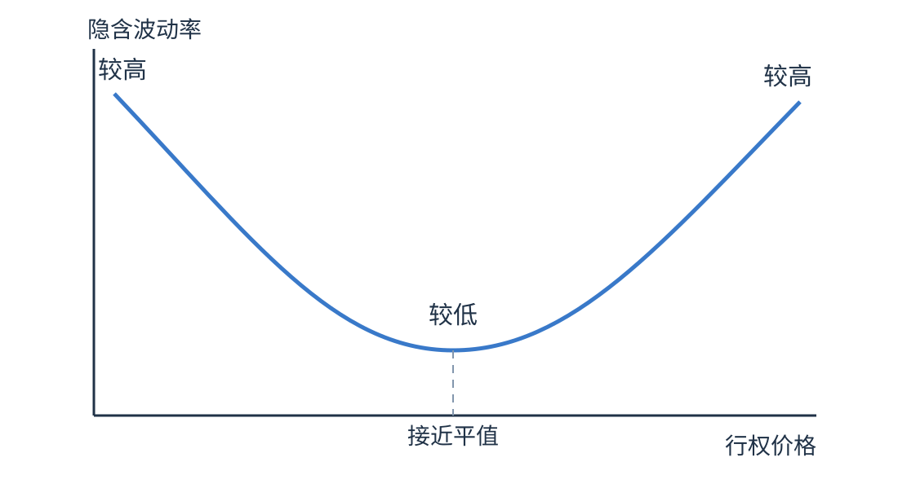

波动率微笑示意。现实市场也可能呈现不对称的波动率偏斜等形态。

## 24.5 金融工程的数值计算方法

| 计算方法 | 主要应用 |
|---|---|
| 树模型 | 离散时间期权及其他金融产品定价 |
| 蒙特卡洛模拟 | 复杂现金流、路径依赖型产品及风险计算 |
| 有限差分法 | 近似求解金融定价偏微分方程 |
| 数值积分 | 计算期望支付、概率及相关金融价值 |
| 数值优化 | 组合优化、参数估计和风险优化 |
| 求根算法 | 计算隐含波动率、内部收益率等隐含参数 |
| 曲线拟合与插值 | 构建利率曲线、波动率曲面等定价数据 |
| 自举法（Bootstrapping） | 根据市场工具价格逐步构建相关折现曲线 |

## 24.6 金融模型校准与验证

- 模型校准：调整模型参数，使模型能够较合理地解释当前市场价格等信息。
- 参数估计：利用市场或历史数据推断模型参数。
- 模型验证：独立评价模型理论、数据及计算实现。
- 敏感性分析：研究参数变化如何影响定价结果。
- 模型风险管理：限制错误模型带来的金融损失。

## 24.7 金融工程的主要应用

- 衍生品设计与定价。
- 企业套期保值。
- 银行资产负债管理。
- 金融产品收益结构设计。
- 投资组合风险管理。
- 信用风险转移。
- 金融机构估值系统建设。

**知识联系：** 金融衍生品是金融工程的重要研究对象，随机过程是其数学工具，无套利原则是其重要理论基础，计算机则负责复杂模型的数值求解和实际运行。

---

# 第二十五章　量化金融与金融数据科学

量化金融广义上包含金融建模、资产定价、风险计算、投资分析和交易执行等定量研究。本章重点研究量化投资与金融数据科学，以减少和金融工程章节的重复。

## 25.1 量化金融的知识结构

## 25.2 金融数据体系

### 25.2.1 按数据来源分类

- **市场交易数据**
  - 开盘价、收盘价、最高价、最低价。
  - 成交量与成交额。
  - 逐笔成交数据。
  - 订单簿与市场报价数据。
- **企业基本面数据**
  - 财务报表。
  - 公司公告。
  - 盈利预测。
  - 企业经营指标。
- **宏观经济数据**
  - GDP与物价。
  - 利率与货币供给。
  - 就业及消费数据。
  - 国际贸易与汇率数据。
- **另类数据**
  - 新闻与文本信息。
  - 网络搜索与市场情绪。
  - 卫星及地理空间数据。
  - 在合法合规条件下取得的消费、物流和产业数据等。

### 25.2.2 金融数据的处理

- 数据清洗：处理错误、缺失和重复数据。
- 数据对齐：协调不同资产及不同频率数据的时间关系。
- 复权处理：调整股票分红、拆分等公司行动对历史价格序列的影响。
- 标准化：将不同量纲的数据转换为可比较形式。
- 去极值：降低异常数据对统计分析的过度影响。
- 特征工程：从原始数据中构造用于模型分析的变量。
- 时点数据管理（Point-in-Time）：确保模型只使用在相关历史时点已经可以获得的信息。

## 25.3 量化投资策略

### 25.3.1 基于经济逻辑的因子策略

- 价值因子：根据资产相对于基本面价值的价格特征进行研究。
- 成长因子：根据企业收入、利润等增长特征进行研究。
- 质量因子：关注盈利能力、财务稳健性等特征。
- 动量因子：研究历史相对价格表现与未来收益之间的关系。
- 低波动因子：研究波动程度相对较低资产的表现。
- 规模因子：研究不同企业规模对应的收益特征。

### 25.3.2 基于统计关系的策略

- 均值回归策略：研究价格或价差偏离某个水平后回归的可能性。
- 趋势跟踪策略：研究市场价格趋势的持续性。
- 配对交易：分析具有一定关联性的两种资产之间的相对价格变化。
- 统计套利：利用统计模型识别相关资产之间的相对定价机会。

统计套利承担模型、价格及交易风险，不等于严格意义上的无风险套利。

### 25.3.3 基于市场事件的策略

- 盈利公告相关策略。
- 公司并购事件研究。
- 指数成分调整研究。
- 宏观经济数据发布研究。
- 企业分红及其他公司行动研究。

### 25.3.4 基于资产配置的策略

- 多因子组合。
- 风险平价。
- 波动率目标策略。
- 动态资产配置。
- 指数增强策略。

## 25.4 量化策略的完整研究流程

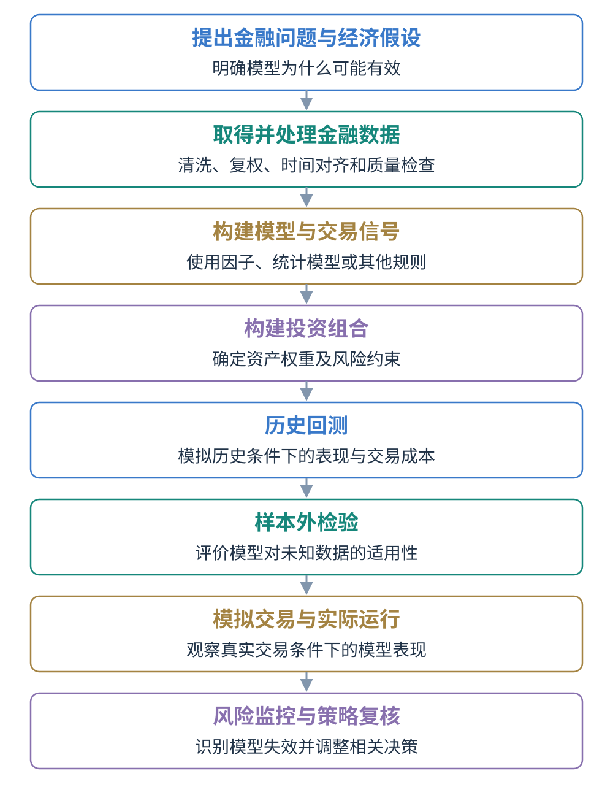

量化投资不是单纯编写一个预测股票涨跌的程序，而是一套包含经济逻辑、统计研究、组合构建、交易执行和风险控制的完整体系。

## 25.5 量化模型的评价与常见错误

### 25.5.1 数据及研究偏误

- 未来数据泄漏：模型错误使用决策时尚未公开的信息。
- 幸存者偏差：只研究当前仍存在的资产，忽略已经退出市场的对象。
- 数据窥探偏误：反复尝试大量规则后选择历史表现最好的结果。
- 选择偏差：研究样本不能充分代表实际研究对象。
- 过拟合：模型过度适应历史数据中的偶然变化，无法有效推广。

### 25.5.2 模型验证方法

- 样本内检验：使用模型开发阶段的数据评价模型。
- 样本外检验：使用未参与模型训练或参数选择的数据评价模型。
- 滚动窗口检验：随着时间推进重复训练和验证。
- 交叉验证：通过合理划分数据评价模型的泛化能力，金融时间序列需要注意时间顺序。
- 稳健性检验：改变模型参数、时期或样本条件，观察结果是否稳定。

### 25.5.3 现实交易约束

- 手续费及税费。
- 买卖价差。
- 滑点。
- 市场冲击成本。
- 融资和融券成本。
- 流动性限制。
- 策略容量：策略可以容纳的资金规模。

历史回测表现良好，并不意味着未来真实交易能够取得相同收益。

## 25.6 算法交易

算法交易是通过计算机程序组织、提交、调整和执行金融交易指令的方式。

### 25.6.1 交易执行算法

- TWAP：按照时间分配交易量。
- VWAP：根据市场成交量等因素组织交易。
- POV：按照市场成交量的一定比例执行交易。
- 最优执行模型：在市场冲击成本和等待风险之间寻找合适的执行安排。

### 25.6.2 不同交易方式的区别

- 程序化交易：利用程序自动处理部分或全部交易过程。
- 量化交易：依据定量模型形成交易判断。
- 算法交易：主要强调利用算法完成交易决策或执行。
- 高频交易（HFT）：强调较高交易频率、低延迟及快速处理市场信息的交易方式。
- 做市交易：通过买卖报价等方式提供市场流动性。

上述概念属于不同分类维度。量化投资不一定进行高频交易，算法交易也不一定包含资产收益预测。

## 25.7 金融交易系统

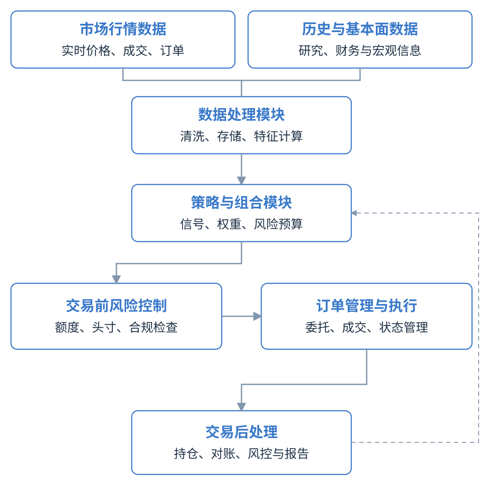

量化交易系统的简化软件架构。实际系统还需要独立的权限、安全、故障处理和审计机制。

- 行情接入系统：获取和分发金融市场数据。
- 数据存储系统：管理历史行情与相关研究数据。
- 研究平台：支持模型开发和数据分析。
- 回测引擎：模拟历史交易条件。
- 投资组合管理系统（PMS）：管理资产配置、持仓和收益风险。
- 订单管理系统（OMS）：管理交易指令及订单生命周期。
- 执行管理系统（EMS）：支持交易执行和相关订单路由。
- 风险管理系统（RMS）：进行风险检查、限额控制和监测。
- 清算及对账系统：核对成交、资金和资产记录。
- 监控与日志系统：监测交易系统状态并保留相关记录。

## 25.8 人工智能与金融数据科学

- 监督学习：使用具有已知结果的数据训练预测模型。
- 无监督学习：从数据中发现结构和模式。
- 强化学习：研究决策主体如何根据环境反馈改进策略。
- 自然语言处理（NLP）：分析金融新闻、财务报告和政策文件。
- 深度学习：利用多层神经网络处理复杂金融数据。
- 大语言模型：辅助金融信息检索、文本分析、研究和软件开发。
- 可解释人工智能：研究模型形成金融判断的依据。

人工智能在金融领域的应用仍然需要处理数据偏差、模型失效、虚假生成内容、隐私保护和监管责任等问题。

---

# 第二十六章　金融科技与数字金融

金融科技研究如何利用现代技术改善金融服务、金融业务流程和金融基础设施。

金融科技不是单纯的互联网支付，也不等同于量化交易。银行、证券、保险、财富管理、跨境结算和监管等领域均可以形成独立的金融科技应用体系。

## 26.1 金融科技的总体架构

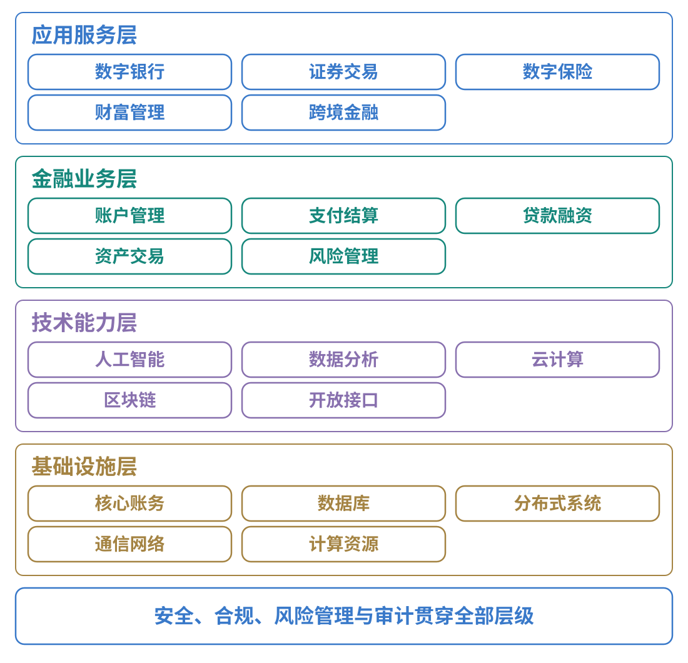

金融科技的概念性分层架构，而非某一家金融机构的实际系统设计。

## 26.2 数字支付

### 26.2.1 按支付工具分类

- 现金支付。
- 银行账户转账。
- 借记卡支付。
- 信用卡支付。
- 电子钱包支付。
- 其他符合制度要求的数字货币及支付工具。

### 26.2.2 按支付交互方式分类

- 线上支付：通过互联网应用完成支付。
- 二维码支付：利用二维码传递付款相关信息。
- NFC支付：通过近场通信完成支付交互。
- 非接触式银行卡支付。
- 自动扣款及周期性支付。

二维码、NFC和互联网属于支付交互方式或技术渠道，并不是独立的货币类型。

### 26.2.3 支付系统的参与主体

- 付款人。
- 收款人。
- 商户。
- 发卡机构。
- 收单机构。
- 支付网络。
- 支付服务机构。
- 清算与结算机构。

### 26.2.4 支付交易的基本流程

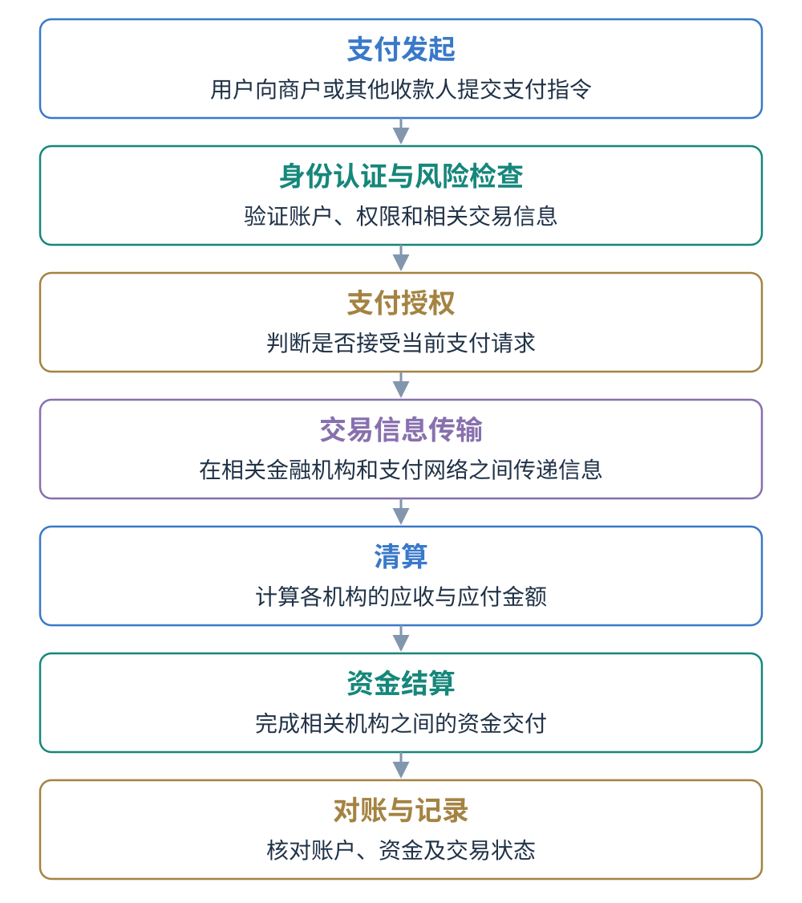

典型支付流程示意。不同支付体系可能合并部分步骤，并采用不同授权和结算安排。

支付授权成功、商户收到付款通知和金融机构完成最终资金结算，不一定发生在同一个时间。

## 26.3 数字银行与开放金融

### 26.3.1 数字银行业务

- 在线开户。
- 数字存贷款服务。
- 在线身份识别。
- 自动化信贷审核。
- 数字化客户服务。
- 银行核心业务系统。
- 线上资金管理与支付。

### 26.3.2 开放银行

开放银行通过客户授权、标准化接口及相关制度安排，使金融机构与其他合规服务主体能够共享特定金融数据或提供相关服务。

- API接口：系统之间按照规定交换数据和调用功能的接口。
- 客户授权机制。
- 数据访问权限。
- 账户信息服务。
- 支付发起服务。
- 第三方金融服务接入。

### 26.3.3 嵌入式金融

将金融服务融入非金融商业平台或应用场景。

- 电商平台嵌入支付服务。
- 企业采购系统嵌入融资服务。
- 物流平台嵌入保险服务。
- 软件平台嵌入账户和资金管理服务。

开放银行强调金融服务及数据的受控连接，嵌入式金融强调金融服务如何进入其他商业场景。

## 26.4 智能信贷与供应链金融科技

### 26.4.1 数字信贷流程

- 客户身份核验。
- 信用数据收集。
- 信用评分。
- 风险定价。
- 授信额度管理。
- 自动化审批。
- 贷款发放。
- 贷后风险监测。

### 26.4.2 智能风控技术

- 欺诈识别模型。
- 信用风险预测模型。
- 异常交易检测。
- 知识图谱：通过实体及关系网络分析相关经济主体。
- 图计算：研究大量关联账户、企业及交易关系。
- 规则引擎：根据预先设定的业务和风险规则进行判断。

### 26.4.3 供应链金融技术

- 订单与合同数据管理。
- 应收账款管理。
- 贸易真实性核验。
- 电子单据与电子仓单。
- 物流及货物状态追踪。
- 企业资金与融资系统连接。

## 26.5 区块链与分布式账本技术

### 26.5.1 基础技术概念

- 分布式账本（DLT）：由多个参与节点按照相关规则共同维护的记录系统。
- 区块链：使用相互关联的数据区块组织记录的一类分布式账本技术。
- 密码学哈希：将数据转换为固定长度的摘要。
- 公钥与私钥：用于身份验证、数字签名等密码学操作的相关密钥。
- 数字签名：用于验证消息来源及完整性等属性的技术。
- 共识机制：使分布式参与节点按照相关规则确认系统状态。
- 智能合约：按照预先编写的程序规则执行相关操作的机制。

### 26.5.2 按网络参与权限分类

- 公有链：通常允许较广泛的主体参与相关网络活动。
- 联盟链：由一定范围内的组织共同维护和管理。
- 私有链：由单个机构或受控主体管理的网络。

### 26.5.3 金融应用

- 金融交易记录。
- 跨境支付与结算。
- 资产登记。
- 贸易融资。
- 数字身份与凭证。
- 资产代币化。
- 智能合约自动化处理。

区块链能够改善部分记录共享及验证问题，但并不能自动保证原始数据真实、金融资产安全或合同具有法律效力。

## 26.6 数字资产与数字货币

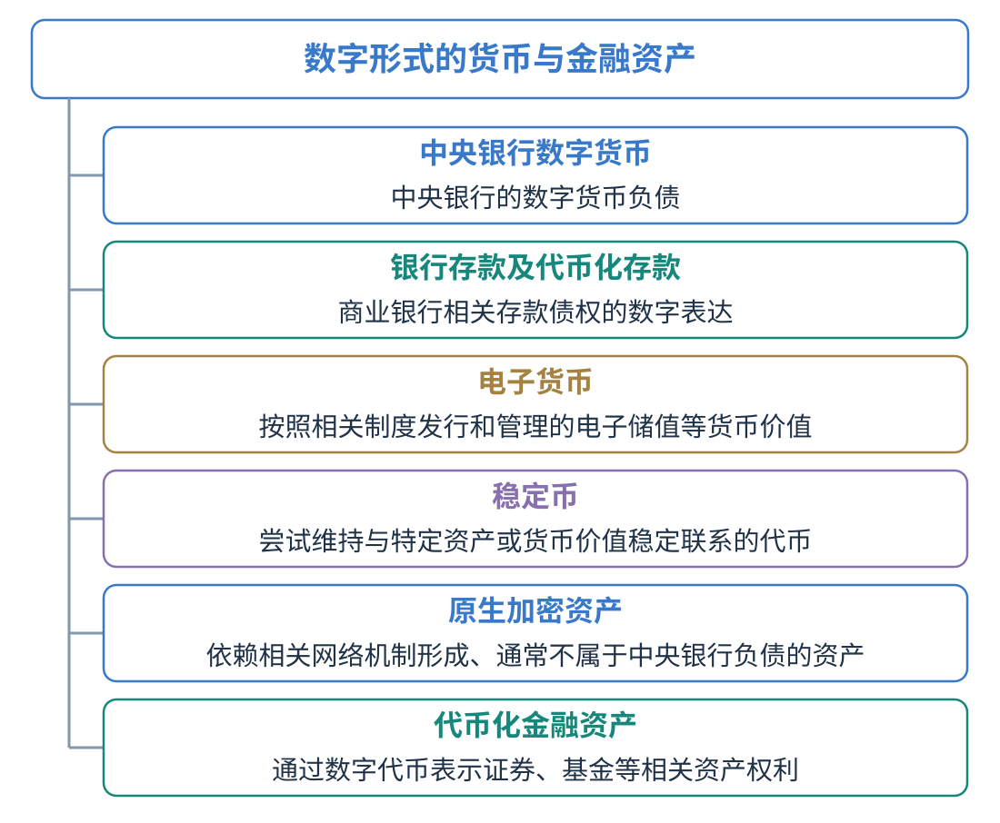

按金融权利、发行主体及技术形式进行的概念性归纳。不同类别的法律定义可能交叉。

### 26.6.1 中央银行数字货币（CBDC）

- 零售型CBDC：主要服务个人和企业等公众支付需求。
- 批发型CBDC：主要服务金融机构之间的资金交易和结算。
- 数字货币账户或钱包。
- 数字货币发行与流通机制。

### 26.6.2 稳定币

按照试图维持价值稳定的机制分类：

- 法定货币及相关资产储备支持型。
- 加密资产抵押支持型。
- 算法调节型。
- 混合机制型。

稳定币的名称不代表其价值必然稳定，仍可能面临储备资产风险、赎回风险、流动性风险和价格脱锚风险。

### 26.6.3 资产代币化

资产代币化是通过数字代币等形式表示现实资产或金融资产的相关权利。

- 代币化债券。
- 代币化基金份额。
- 代币化存款。
- 房地产相关资产代币化。
- 现实世界资产（RWA）代币化。

代币化主要改变资产权利的记录、流转或管理方式，并不会自动改变基础资产的经济价值与风险。

此处的RWA指Real-World Assets，与银行监管中的Risk-Weighted Assets（风险加权资产）是两个完全不同的概念。

### 26.6.4 去中心化金融（DeFi）

利用分布式账本、智能合约等机制提供部分金融服务的技术与业务模式。

- 去中心化交易协议。
- 自动化做市机制（AMM）。
- 链上借贷协议。
- 数字资产抵押。
- 链上资金池。
- 预言机：向智能合约提供外部数据的相关机制。

DeFi可能面临智能合约漏洞、价格操纵、流动性不足、治理集中及法律监管不确定性等风险。

## 26.7 金融基础软件与核心系统

### 26.7.1 金融业务系统

- 银行核心系统：处理账户、存贷款、资金及账务等核心业务。
- 核心账务系统：记录金融机构相关资产负债及交易变动。
- 支付网关：连接支付发起端与相关支付处理系统。
- 证券交易系统：支持证券订单、报价和交易执行。
- 清算结算系统：管理金融交易的支付及资产交付。
- 托管系统：管理金融资产记录及相关托管服务。
- 风险控制系统：识别、计量和限制业务风险。
- 客户关系管理系统（CRM）：管理客户信息及相关服务关系。

### 26.7.2 金融数据与计算基础设施

- 关系型数据库。
- 分布式数据库。
- 时间序列数据库。
- 数据仓库。
- 数据湖。
- 实时数据流处理。
- 消息队列。
- 云计算与分布式计算。
- 高性能计算。
- 容灾与备份系统。

### 26.7.3 金融软件的特殊要求

| 技术要求 | 金融领域的意义 |
|---|---|
| 准确性 | 防止金额、价格及账务计算错误 |
| 一致性 | 保证相关交易状态与账务记录正确协调 |
| 高可用性 | 减少金融服务和交易系统中断 |
| 低延迟 | 满足部分支付及交易系统的响应要求 |
| 幂等性 | 防止重复请求导致重复付款、重复记账 |
| 可审计性 | 能够追溯重要交易和操作行为 |
| 安全性 | 防止非法访问、资产损失及信息泄露 |
| 可恢复性 | 系统故障后能够按照要求恢复业务及数据 |
| 数据完整性 | 防止重要金融数据被错误修改或丢失 |

金融软件不仅需要正常运行，还必须保证资金、账户状态、交易记录和相关业务规则具有高度可靠性。

## 26.8 监管科技与合规科技

- **监管科技（RegTech）**：帮助金融机构利用技术完成风险管理和监管合规要求。
  - 自动化合规审查。
  - 反洗钱交易监测。
  - 客户身份核验。
  - 监管数据报送。
  - 合同及政策规则识别。
- **监管技术（SupTech）**：监管机构使用技术提高金融监管效率。
  - 金融风险监测。
  - 市场异常分析。
  - 监管数据平台。
  - 金融机构风险预警。

前者主要服务被监管机构的合规需求，后者主要服务监管机构自身的监督管理活动。

## 26.9 金融科技的安全体系

### 26.9.1 身份与权限安全

- 多因素身份认证。
- 权限控制。
- 最小权限原则。
- 数字证书。
- 密钥管理。

### 26.9.2 数据与交易安全

- 数据加密。
- 安全通信。
- 数据脱敏。
- 交易完整性验证。
- 防重复支付。
- 欺诈检测。

### 26.9.3 系统运行安全

- 系统监控。
- 故障隔离。
- 灾难恢复。
- 业务连续性管理。
- 软件安全测试。
- 操作日志与审计。

## 26.10 金融科技与金融学的交叉关系

| 金融学领域 | 对应金融科技应用 |
|---|---|
| 货币与支付 | 数字钱包、跨境支付、支付清算系统 |
| 商业银行 | 核心银行系统、智能信贷、数字银行 |
| 股票与证券 | 证券交易平台、行情系统、订单管理 |
| 固定收益 | 债券估值系统、利率曲线计算 |
| 衍生品 | 自动定价、交易与风险监控系统 |
| 投资组合 | 智能投顾、组合优化、自动再平衡 |
| 保险学 | 数字核保、智能理赔、精算模型 |
| 国际金融 | 多币种账户、跨境结算、贸易金融平台 |
| 风险管理 | 风险计算引擎、信用评分、压力测试 |
| 金融监管 | 反洗钱系统、监管报送、合规检查 |

---

# 第二十七章　金融历史、金融指标与现实分析

本章将前面各个金融学分支与金融发展历史、现实市场和金融数据联系起来，帮助学习者建立实际金融分析能力。

## 27.1 世界金融体系的发展历史

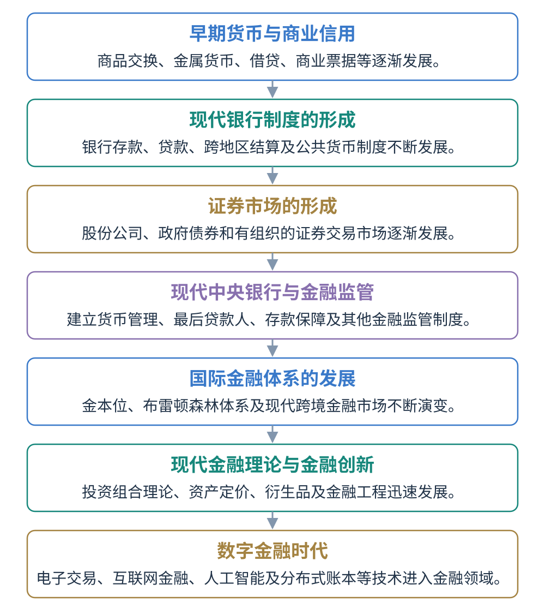

上述时间线用于概括金融体系的发展逻辑，不意味着不同国家均按照相同的历史顺序发展。

## 27.2 现代金融理论的发展脉络

| 理论方向 | 代表人物 | 主要理论贡献 |
|---|---|---|
| 货币时间价值 | 欧文·费雪 | 跨期选择、利息及价值理论 |
| 企业价值与投资 | 本杰明·格雷厄姆、多德 | 证券基本面分析与价值投资 |
| 投资组合理论 | 哈里·马科维茨 | 均值—方差分析与资产分散配置 |
| 资本资产定价 | 夏普、林特纳、莫辛等 | 系统性风险与预期收益关系 |
| 资本结构理论 | 莫迪利亚尼、米勒 | 融资结构与企业价值关系 |
| 有效市场理论 | 尤金·法玛 | 市场价格与信息效率 |
| 期权定价理论 | 布莱克、斯科尔斯、默顿 | 现代金融衍生品定价 |
| 套利定价理论 | 斯蒂芬·罗斯 | 多因素风险与资产定价 |
| 多因子投资理论 | 法玛、弗伦奇等 | 多种资产收益特征及风险因子 |
| 行为金融理论 | 卡尼曼、特沃斯基、席勒等 | 心理偏差与金融市场行为 |

这里选取的是具有代表性的理论贡献，并非完整的金融思想史。

## 27.3 金融危机与金融事件案例库

不同历史事件可以按照主要研究问题分类。

| 研究主题 | 代表性历史事件 | 主要学习价值 |
|---|---|---|
| 市场投机 | 1630年代荷兰郁金香投机热潮 | 市场价格、预期与投机 |
| 股票与政府债务 | 1720年南海泡沫 | 股票融资、公共债务和市场信心 |
| 银行流动性 | 1907年美国金融恐慌 | 银行挤兑与最后贷款人制度 |
| 系统性金融风险 | 1929年起的世界经济大萧条 | 市场崩溃、银行风险和实体经济 |
| 汇率制度 | 1970年代初布雷顿森林体系瓦解 | 国际储备货币与汇率制度 |
| 国际债务 | 1980年代拉丁美洲债务危机 | 外债风险与国际利率 |
| 市场交易机制 | 1987年全球股票市场暴跌 | 市场流动性与交易反馈机制 |
| 房地产与信用 | 1990年代初日本资产泡沫破裂 | 银行资产、债务与房地产风险 |
| 跨境资本流动 | 1997年亚洲金融危机 | 汇率、外债与资本流动逆转 |
| 高杠杆投资 | 1998年长期资本管理公司危机 | 杠杆、模型和流动性风险 |
| 科技企业估值 | 2000年前后互联网泡沫破裂 | 企业估值与过度增长预期 |
| 证券化与银行风险 | 2007—2009年全球金融危机 | 房贷证券化、信用风险与风险传染 |
| 主权债务 | 2010年代初欧洲债务危机 | 主权信用与货币联盟 |
| 衍生品交割 | 2020年WTI原油期货负价格事件 | 实物交割、仓储约束与期货定价 |
| 数字资产风险 | 2022年部分稳定币及加密金融机构危机 | 脱锚、杠杆、流动性和托管风险 |
| 银行利率风险 | 2023年硅谷银行事件 | 期限错配、利率风险及存款集中 |

经济学对这些案例主要研究经济衰退、社会影响与宏观政策；金融学则深入研究金融资产结构、合同机制、风险敞口和市场传导过程。

## 27.4 主要金融市场与国际金融中心

### 27.4.1 典型金融市场研究

| 市场 | 值得研究的主要内容 |
|---|---|
| 中国内地金融市场 | 银行信用体系、股票债券市场、期货市场、人民币金融制度 |
| 中国香港金融市场 | 国际证券融资、离岸人民币、跨境金融、联系汇率制度 |
| 美国金融市场 | 股票债券、美元货币市场、衍生品、机构投资 |
| 英国金融市场 | 国际外汇、银行、保险及跨境金融服务 |
| 欧洲金融市场 | 欧元金融体系、国际债券、银行和资产管理 |
| 日本金融市场 | 银行融资、政府债券、日元市场及保险 |
| 新加坡金融市场 | 国际银行、跨境财富管理、外汇及金融科技 |
| 中东金融市场 | 主权财富基金、能源资本及伊斯兰金融 |

### 27.4.2 国际金融中心的主要职能

- 国际银行业务。
- 全球证券交易。
- 国际债务与股权融资。
- 国际保险与再保险。
- 资产管理与财富管理。
- 跨境支付与外汇交易。
- 金融法律、会计和专业服务。
- 金融科技及金融基础设施服务。

## 27.5 金融市场核心指标体系

### 27.5.1 货币与利率指标

- 政策利率：反映中央银行货币政策的重要利率。
- 银行间利率：衡量金融机构之间的资金价格。
- 国债收益率：反映相关政府债券的市场定价及收益率。
- 收益率曲线：不同期限的相关利率结构。
- 期限利差：不同期限收益率之间的差异。
- 信用利差：信用资产相对于相关基准收益率的差异。

### 27.5.2 股票市场指标

- 股票指数：反映一组股票的价格或收益表现。
- 市场总市值：按照市场价格计算的股票权益总价值。
- 市盈率。
- 市净率。
- 股息收益率。
- 成交量与成交额。
- 换手率。
- 市场上涨和下跌股票数量。

### 27.5.3 债券市场指标

- 债券价格。
- 到期收益率。
- 信用评级。
- 久期与凸性。
- 信用利差。
- 债券发行规模。
- 债券存量规模。
- 违约率及回收率。

### 27.5.4 外汇市场指标

- 即期汇率。
- 远期汇率。
- 名义有效汇率。
- 实际有效汇率。
- 外汇成交规模。
- 跨币种融资成本及相关基差。

### 27.5.5 市场风险与情绪指标

- 历史波动率。
- 隐含波动率。
- VIX指数：根据相关标普500指数期权价格计算的隐含波动率指标。
- 信用风险溢价。
- 最大回撤。
- 买卖价差。
- 市场资金流向相关指标。

VIX主要反映特定股票市场的预期波动率，不是对整个世界金融市场恐慌程度的完整衡量。

### 27.5.6 金融机构经营指标

- 净息差。
- 净利息收入。
- 不良贷款率。
- 资本充足率。
- 流动性覆盖率。
- 资产管理规模（AUM）。
- 基金净值。
- 保险偿付能力指标。
- 承保利润及综合成本率等保险经营指标。

## 27.6 现实金融分析的核心逻辑

主要金融传导关系示意。现实市场包含双向影响、预期变化、风险反馈及政策干预。

## 27.7 权威金融数据与学习资料来源

### 27.7.1 宏观金融与货币数据

| 数据机构 | 主要用途 |
|---|---|
| [中国人民银行](https://www.pbc.gov.cn/) | 货币政策、信用及人民币金融数据 |
| [国家外汇管理局](https://www.safe.gov.cn/) | 中国外汇、国际收支及相关数据 |
| [美国联邦储备系统](https://www.federalreserve.gov/) | 美国货币政策与金融稳定资料 |
| [FRED数据库](https://fred.stlouisfed.org/) | 宏观金融及利率时间序列 |
| [香港金融管理局](https://www.hkma.gov.hk/) | 香港货币、银行及金融体系资料 |
| [国际清算银行 BIS](https://www.bis.org/) | 全球银行、外汇、衍生品及金融统计 |
| [国际货币基金组织 IMF](https://www.imf.org/) | 国际金融、金融稳定及全球宏观数据 |

### 27.7.2 证券市场及企业信息

| 数据机构 | 主要用途 |
|---|---|
| [上海证券交易所](https://www.sse.com.cn/) | 股票、债券、基金及相关市场资料 |
| [深圳证券交易所](https://www.szse.cn/) | 上市证券、市场规则与企业公告 |
| [香港交易所](https://www.hkex.com.hk/) | 香港证券与衍生品市场资料 |
| [美国SEC EDGAR](https://www.sec.gov/edgar/search/) | 企业财务报告及证券监管披露 |
| [CME Group](https://www.cmegroup.com/) | 期货、期权及相关衍生品资料 |
| [Cboe](https://www.cboe.com/) | 期权、波动率及相关市场资料 |
| [中国债券信息网](https://www.chinabond.com.cn/) | 中国债券市场及相关估值资料 |

### 27.7.3 金融理论与监管知识

| 机构 | 主要用途 |
|---|---|
| [CFA Institute](https://www.cfainstitute.org/) | 投资分析、资产定价、组合管理与职业道德 |
| [GARP](https://www.garp.org/) | 金融风险管理、风险模型及金融产品 |
| [巴塞尔监管框架](https://www.bis.org/committees/bcbs/basel-framework) | 银行资本、流动性及风险监管标准 |
| [支付与市场基础设施委员会 CPMI](https://www.bis.org/cpmi/) | 支付、清算、结算及金融基础设施 |
| [国际证监会组织 IOSCO](https://www.iosco.org/) | 国际证券监管原则 |
| [金融稳定理事会 FSB](https://www.fsb.org/) | 全球金融稳定及监管协调 |
| [金融行动特别工作组 FATF](https://www.fatf-gafi.org/) | 反洗钱等国际标准 |
| [SWIFT](https://www.swift.com/) | 国际金融报文及金融通信机制 |

其中，巴塞尔框架、FATF标准和支付结算相关资料可以作为第五篇与第六篇进一步深入学习的官方参考。

---

# 附录一　金融学核心知识图谱

## A.1 金融学的整体运行逻辑

整体知识图谱。连线代表重要的研究联系及运行关系，不全部代表严格从属关系或单向因果关系。

## A.2 核心概念的派生关系

| 基础概念 | 派生概念与理论 | 主要应用领域 |
|---|---|---|
| 货币 | 存款、支付、货币市场 | 银行学、金融科技 |
| 信用 | 债权、债务、信用风险 | 银行、债券、国际金融 |
| 时间价值 | 复利、折现、现值 | 资产定价、公司金融 |
| 利率 | 期限结构、收益率、利差 | 债券、外汇、银行 |
| 现金流 | 自由现金流、年金、净现值 | 企业估值、保险精算 |
| 股权 | 股票、股利、剩余索取权 | 股票投资、公司治理 |
| 债权 | 债券、贷款、信用评级 | 固定收益、银行信贷 |
| 风险 | 波动率、风险敞口、风险溢价 | 投资学、风险管理 |
| 资产相关性 | 协方差、分散投资 | 投资组合理论 |
| 无套利原则 | 复制组合、风险中性定价 | 金融工程 |
| 信息效率 | 有效市场假说、市场异常 | 投资分析、行为金融 |
| 市场流动性 | 买卖价差、市场深度、滑点 | 市场微观结构、算法交易 |
| 财务报表 | 盈利指标、偿债指标、现金流 | 企业估值与信用分析 |
| 企业资本 | 融资成本、资本结构、杠杆 | 公司金融 |
| 或有权利 | 期权、保险、或有支付 | 衍生品、保险学 |
| 金融数据 | 因子、统计模型、投资信号 | 量化金融 |
| 金融契约 | 权利义务、清算结算 | 金融法律、金融基础设施 |
| 金融基础设施 | 账户、交易、支付、托管 | 金融科技 |

---

# 附录二　金融学中容易混淆的知识分类

本附录专门用于区分金融学中不同层次的概念，避免将资产类别、交易场所、金融机构、投资方法和技术工具混合在一起。

## B.1 六个不同的金融分类维度

| 分类维度 | 回答的问题 | 典型概念 |
|---|---|---|
| 金融资产 | 交易的是什么？ | 股票、债券、存款 |
| 金融市场 | 在什么制度和市场中交易？ | 股票市场、货币市场、场外市场 |
| 金融机构 | 谁在提供金融服务？ | 银行、证券公司、保险公司 |
| 金融业务 | 金融机构具体做什么？ | 贷款、承销、托管、支付 |
| 投资方法 | 如何形成投资决策？ | 价值投资、指数投资、量化投资 |
| 技术工具 | 如何实现相关业务或计算？ | 人工智能、数据库、区块链 |

例如，使用人工智能管理一个股票ETF投资组合：

- 股票属于金融资产。
- ETF属于投资载体。
- 证券交易所属于相关交易组织和基础设施。
- 基金管理公司属于金融机构。
- 投资组合管理属于金融业务。
- 量化投资属于投资决策方法。
- 人工智能属于技术工具。

这些概念相互联系，但不是同一分类维度下的并列对象。

## B.2 重要概念辨析

| 容易混淆的概念 | 核心区别 |
|---|---|
| 资产与资本 | 资产强调经济资源及权利，资本强调用于投资、经营或承担损失的资源 |
| 资金与货币 | 资金强调可支配和使用的货币资源，货币强调支付与计价等职能 |
| 股权与债权 | 股权体现所有者权益，债权体现对债务人的请求权 |
| 股票与债券 | 股票主要对应股权，债券主要对应债权 |
| 利率与收益率 | 利率通常描述相关资金价格或计息条件，收益率描述投资回报等 |
| 利率与利差 | 利率表示相关资金价格，利差表示两个利率或收益率的差额 |
| 一级市场与二级市场 | 一级市场发行新证券，二级市场交易已经发行的证券 |
| 货币市场与资本市场 | 主要按照融资期限和资本配置性质进行区分 |
| 股票市场与资本市场 | 股票市场属于资本市场的重要组成部分 |
| 基金与股票 | 基金是投资载体，股票是权益证券 |
| ETF与指数基金 | ETF强调交易及申购赎回机制，指数基金强调投资管理目标 |
| 远期与期货 | 均属于远期承诺类工具，但合同标准化、交易及结算机制不同 |
| 期货与期权 | 期货双方承担相应履约义务，期权买方取得选择权 |
| 保证金与权利金 | 保证金主要保障履约，权利金主要用于购买期权权利 |
| 市值与企业现金 | 市值是市场定价形成的权益价值，不代表企业实际现金余额 |
| 利润与现金流 | 利润是会计经营成果，现金流是实际资金收付 |
| 估值与定价 | 估值通常强调价值估计，定价还涉及市场均衡及相关价格关系 |
| 波动率与最大回撤 | 前者衡量收益变化程度，后者衡量高点至低点的最大损失比例 |
| 系统性风险与系统风险 | 前者通常指难以分散的共同市场风险，后者常指系统故障风险等，需结合语境 |
| 系统性风险与系统性金融风险 | 前者多用于资产定价，后者重点关注整个金融体系失稳 |
| 清算与结算 | 清算确定交付义务，结算完成实际交付 |
| 流动性与偿付能力 | 流动性关注及时支付能力，偿付能力关注整体偿债能力 |
| 金融工程与量化金融 | 前者侧重金融产品设计、定价等工程问题，后者广泛研究金融定量建模及投资 |
| 量化交易与高频交易 | 前者强调模型与规则，后者强调交易频率及速度 |
| 金融科技与互联网金融 | 金融科技覆盖更广泛的金融技术与基础设施，互联网金融主要强调互联网渠道及相关业务 |

---

# 附录三　金融学与经济学及其他学科的知识边界

## C.1 金融学与经济学的分工

| 研究对象 | 经济学研究重点 | 金融学研究重点 |
|---|---|---|
| 货币 | 货币供给与整体经济运行 | 货币工具、信用与支付体系 |
| 利率 | 利率对消费、就业与投资的影响 | 利率期限结构、利率定价及风险 |
| 银行 | 信用创造及宏观经济传导 | 银行经营、资产负债及信贷管理 |
| 股票 | 股权融资与社会资源配置 | 股票交易、分析、估值与投资 |
| 债券 | 政府及企业债务的经济影响 | 债券定价、收益率及信用风险 |
| 企业 | 企业生产、成本与市场竞争 | 企业融资、投资、估值及资本运作 |
| 汇率 | 国际贸易及宏观经济政策 | 外汇交易、跨境融资及风险对冲 |
| 保险 | 市场失灵、风险分担和社会福利 | 保险经营、产品定价及精算 |
| 金融危机 | 经济衰退与社会影响 | 风险积累、资产负债及市场传染 |
| 数字经济 | 技术对产业、就业和增长的影响 | 数字支付、金融科技及数字资产 |

## C.2 金融学与其他关联学科

| 关联学科 | 对金融学提供的支持 |
|---|---|
| 会计学 | 企业财务信息、资产负债及经营成果 |
| 管理学 | 企业经营管理、组织治理及战略决策 |
| 法学 | 金融合同、监管、资产权利及法律责任 |
| 数学 | 金融定价、最优化与随机过程 |
| 统计学 | 金融数据分析、参数估计及风险计量 |
| 计算机科学 | 金融系统、算法、数据基础设施与人工智能 |
| 心理学 | 投资者行为与金融决策偏差 |
| 国际关系 | 国际金融制度、跨境资本及国家风险 |
| 精算学 | 保险风险、长期现金流与偿付能力 |
| 运筹学 | 组合优化、交易执行及资源配置 |
| 信息安全 | 金融数据、账户、交易及资产安全 |

这些学科属于金融学的理论基础或交叉领域，不意味着需要将其全部专业知识纳入金融学体系。

---

# 附录四　金融学的实际业务全景图

从金融行业的角度来看，可以将金融知识体系对应到现实社会的不同业务。

金融行业功能与知识领域的对应关系。

---

# 附录五　金融学知识体系的学习依赖关系

知识分类顺序不一定等于学习顺序。例如，金融数学被安排在第一篇，但零基础学习者不需要先掌握随机微积分才能了解股票和债券。

## E.1 金融学知识的学习层次

## E.2 建议学习精力分配

面向通识金融学习的建议比例，不是学术重要性的客观排名，也不是职业资格考试权重。

对于具有计算机科学背景、未来希望深入金融科技方向的学习者，第六篇中的金融工程、量化金融、支付结算和金融基础软件，可以在掌握前三篇之后作为重点专业方向深入研究。

---

# 附录六　金融学知识体系最终目录

---

# 附录七　经济学与金融学的整体知识体系

至此，经济学与金融学可以形成两套相互独立、相互支持的知识体系。

---

# 版本总结

| 建设项目 | 金融学 V2.5 |
|---|---|
| 总体结构 | 六篇、二十七章、七个附录 |
| 面向对象 | 零基础金融学学习者 |
| 知识组织方式 | 多层树状结构与跨章节知识图谱 |
| 概念解释 | 重要知识点附简明解释 |
| 分类原则 | 区分从属、并列、构成、派生及交叉关系 |
| 理论深度 | 建立基础认识，暂不展开复杂数学推导 |
| 核心知识 | 货币、信用、利率、股票、债券、外汇、衍生品、资产定价、公司金融 |
| 专业扩展 | 银行、证券、保险、资产管理、国际金融 |
| 风险体系 | 金融风险计量、管理、监管及法律制度 |
| 技术体系 | 金融工程、量化金融、金融科技 |
| 与经济学关系 | 独立建设，保留必要交叉知识 |
| 后续发展方向 | 逐个知识节点深入学习与实际应用 |

本版本采用六篇而不是经济学的五篇，是因为金融学中的市场工具、投资理论、机构业务和现代金融技术均具有足够丰富的独立内容，不适合强行合并。

部分高级模型和专业业务目前仅提供框架级解释，金融产品、会计口径、市场规则及监管制度在不同司法管辖区可能存在差异，本版本不作为具体交易操作手册或法律规则汇编。

整个金融学体系最终需要建立六种理解能力：

- **理解资金：** 资金如何产生、筹集、流动和配置。
- **理解资产：** 股票、债券及其他金融工具代表什么经济权利。
- **理解价值：** 金融资产如何根据现金流、时间和风险形成价格。
- **理解机构：** 银行、证券公司、基金和保险机构如何运行。
- **理解风险：** 金融风险如何产生、积累、转移和管理。
- **理解技术：** 数学、计算机和人工智能如何参与现代金融体系建设。

至此，金融学知识大厦的主体结构已经建立。

**经济学负责理解现代社会经济运行的底层逻辑，金融学负责理解现代社会资金、资本和风险运行的专业机制。** 两者共同构成进一步研究金融市场、企业经营、国际经济和金融科技的知识基础。

本轮仅提供 V2.5 正文及图示，暂不生成 ZIP。待内容确认后，再按照经济学 V2.5 的相同规范进行 Obsidian Markdown 和高清插图封装。
