# 投资学特别专栏——股票投资与证券交易实战

> **所属体系：** 金融学知识体系  
> **核心方向：** 股票投资、证券交易、行情分析、投资策略与风险管理  
> **面向对象：** 从未系统学习过股票投资，希望逐步建立独立投资分析能力的学习者。

本专栏以实际投资为导向，不再以金融学学科分类作为主要编排依据，而是按照普通投资者从认识股票、阅读行情、分析市场，到选择证券、制定交易方案、管理资金和评价投资收益的实际过程进行组织。

重点解决以下问题：

- 股票为什么上涨和下跌，股价究竟是怎样形成的？
- 如何阅读股票软件中的行情、盘口、K线、成交量及各项指标？
- 不同K线形态、技术指标和量价关系分别传递了什么信息？
- 如何结合市场环境、行业趋势、企业基本面和技术面分析股票？
- 如何选股、确定买卖条件、设置仓位、管理止盈止损？
- 如何建立具有统计依据、能够长期检验的投资策略？
- 基金、ETF、可转债、期货和期权如何参与证券投资？

需要特别明确的是，科学投资并不意味着能够准确预测每一次涨跌，而是通过**信息分析、概率判断、盈亏管理、资金配置和持续验证，争取建立扣除交易成本后具有正期望的投资体系。**

> [!tip] 离线交互演示
> 原文中的交互计算器已保留静态默认图，并附有可调整参数的 [离线投资计算器 HTML](#social-invest_compound)（可从资源目录用浏览器直接打开，无需联网）。检查清单同时保留为 Obsidian 可勾选的任务列表。

## 0　投资知识体系总体架构

### 0.1 股票投资的完整逻辑

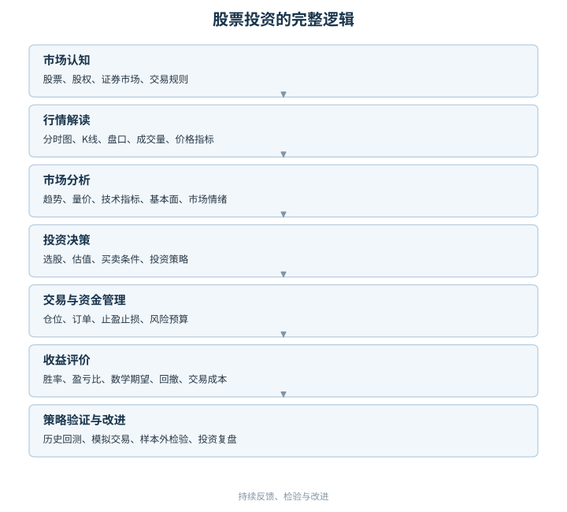

### 0.2 专栏总体目录

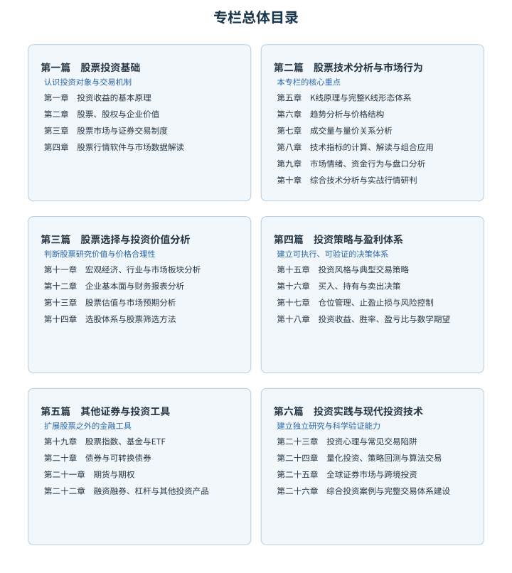

其中，第二篇与第四篇是整个专栏最重要的部分。第二篇研究如何观察和分析股票市场，第四篇研究如何将分析结果转换为实际投资决策。二者共同构成股票交易能力的主体。

---

## 第一篇　股票投资基础

### 第一章　投资收益的基本原理

#### 1.1 股票投资的两大收益来源

##### 1.1.1 资本利得

通过股票价格上涨获得收益。

例如，以10元每股购买1000股股票，随后以12元每股出售：

$$
\text{资本利得}=(12-10)\times1000=2000\text{元}
$$

##### 1.1.2 股息收益

上市公司将部分利润以现金等方式分配给股东。

如果上述股票在持有期间每股分红0.3元，则投资者额外获得300元现金股息。

##### 1.1.3 投资净收益

$$
\text{净收益}=\text{资本利得}+\text{现金股息}-\text{投资成本}
$$

投资成本不仅包括证券交易手续费，还包括税费、买卖价差、融资利息、滑点等。

#### 1.2 投资收益背后的经济来源

长期股票市场的财富增长可以来自企业创造的新增经济价值，并不意味着所有股票投资收益都必然来自其他投资者的亏损。

不过，主动投资者相互竞争产生的相对超额收益，与市场整体创造的收益是不同的问题。

#### 1.3 绝对收益与相对收益

- **绝对收益**：投资者自身获得的实际收益。
- **相对收益**：自身投资收益与市场基准之间的差异。
- **超额收益**：超过指定基准的收益。
- **Alpha收益**：在给定定价模型下，无法由相关风险因素解释的收益部分。
- **Beta收益**：市场实践中常用来描述承担市场或相关系统性风险所获得的收益部分。

例如：

| 投资表现 | 投资者收益 | 市场收益 | 相对收益 |
|---|---:|---:|---:|
| 情况一 | +15% | +10% | +5个百分点 |
| 情况二 | +15% | +25% | −10个百分点 |
| 情况三 | −5% | −20% | +15个百分点 |

盈利不一定意味着投资能力优秀，亏损也不一定意味着投资表现差于市场。需要在一致的风险和期限条件下评价。

#### 1.4 投资与交易的主要区别

| 比较维度 | 中长期投资 | 短期交易 |
|---|---|---|
| 核心依据 | 企业价值及长期市场回报 | 价格变化与市场行为 |
| 主要研究对象 | 企业、行业、经济环境 | 趋势、成交量、价格结构 |
| 持有期限 | 数月至数年或更长 | 数分钟至数周不等 |
| 交易频率 | 通常较低 | 通常较高 |
| 成本敏感度 | 相对较低 | 通常较高 |
| 核心风险 | 基本面恶化、估值过高 | 信号失效、频繁亏损、交易成本 |

中长期投资与短期交易并非完全对立。投资者也可以通过基本面筛选企业，再通过技术分析辅助选择交易时机。

#### 1.5 复利与持续盈利

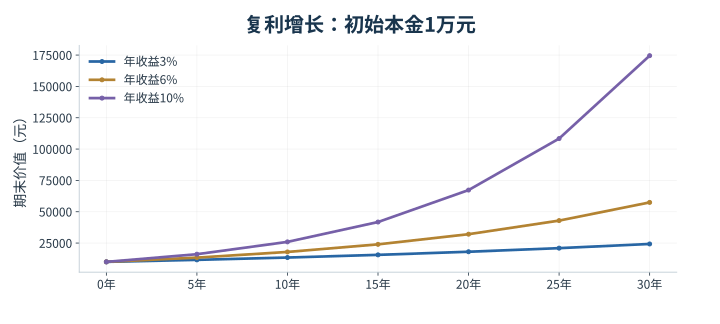

*假设初始本金1万元、年收益率恒定、全部收益再投资，不考虑税费和通胀。这是复利数学演示，不是市场收益预测。*

复利的关键并不只是提高收益率，还包括减少重大亏损、控制投资成本以及保持足够长的资金积累时间。

---

### 第二章　股票、股权与企业价值

#### 2.1 股票究竟是什么

股票是代表企业股份权益的证券。购买普通股票意味着获得相关企业的股东权益，而不是单纯购买一个不断变化的价格数字。

股东通常享有利润分配权、股份转让权、一定的公司治理权以及剩余索取权。

#### 2.2 股票的多维分类

| 分类依据 | 下属类型 | 实际投资意义 |
|---|---|---|
| 股东权利 | 普通股、优先股 | 不同收益分配与治理权利 |
| 企业规模 | 大盘股、中盘股、小盘股、微盘股 | 流动性、经营规模、波动特征 |
| 盈利增长 | 成长股、成熟企业股票 | 未来增长空间 |
| 估值特征 | 价值股、高估值股票 | 市场价格相对于基本面的水平 |
| 分红特征 | 红利股、低分红股票 | 现金收益与资本再投资 |
| 经济周期 | 周期股、防御股 | 对宏观经济变化的敏感程度 |
| 市场关注 | 热门股、冷门股、题材股 | 市场预期与交易活跃程度 |

此外，龙头股、蓝筹股、白马股、妖股等属于市场惯用术语，而不是严格的证券法律分类。

#### 2.3 股票价格的基本拆解

在企业盈利为正且计算口径一致时：

$$
P=EPS\times PE
$$

即：

$$
\text{股价}=\text{每股收益}\times\text{市盈率}
$$

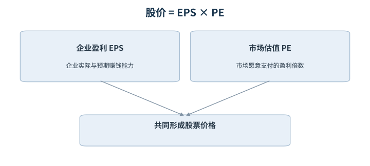

一家企业的利润即使保持不变，股价也可能因为市场估值变化而大幅上涨或下跌。

这正是股票分析需要同时研究基本面和市场预期的原因。

#### 2.4 股本、市值与流通盘

- 总股本：企业相关股份总数量。
- 流通股本：按照规则可以流通的股份数量。
- 总市值：股价乘以相关总股本。
- 流通市值：股价乘以相关流通股本。
- 自由流通股本：按照特定指数或统计规则，排除部分战略持股、受限持股等后的股份数量。

小流通盘股票可能在较少交易量下产生较大价格变化，但这也意味着投资者可能面临更严重的流动性风险和价格冲击。

#### 2.5 公司行动对股价的影响

| 公司行动 | 主要影响 |
|---|---|
| IPO | 首次公开发行股份 |
| 增发 | 增加股权融资，可能稀释原股东持股比例 |
| 配股 | 向现有股东提供新增股份认购机会 |
| 现金分红 | 企业现金减少，股东获得现金 |
| 送股与转增 | 股份数量增加，单位股份价值相应调整 |
| 股票拆分 | 调整股份数量及每股价格 |
| 股票回购 | 企业使用资金购买自身股份 |
| 限售股解禁 | 相关股份获得进一步流通的可能性 |
| 退市 | 股票终止在相关交易所上市 |

公司行动可能造成K线中的价格缺口。因此，在分析历史价格之前，需要先判断是否存在除权除息、拆股等事项。

---

### 第三章　股票市场与证券交易制度

#### 3.1 一级市场与二级市场

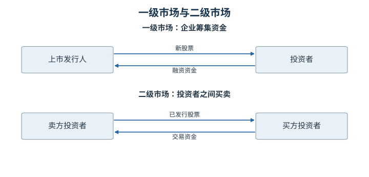

通常所说的炒股，主要发生在二级市场。

#### 3.2 股票价格的形成机制

在常见的订单驱动市场中，投资者提交买入订单与卖出订单，交易系统按照相关规则完成匹配。

例如：

| 卖方委托价格 | 数量 |
|---|---:|
| 10.03元 | 1000股 |
| 10.02元 | 500股 |
| 10.01元 | 200股 |

如果买方提交能够立即成交的600股订单，且订单簿保持不变，则会先以10.01元成交200股，再以10.02元成交400股。

此时最新成交价变成10.02元。

股票上涨并不是因为市场上只有买方，而是买方愿意接受更高的交易价格，或者卖方提高报价、减少低价出售意愿，新的成交由此在更高价格发生。

#### 3.3 股票买卖订单的分类

| 订单类型 | 主要机制 | 主要风险 |
|---|---|---|
| 市价单 | 优先争取尽快成交 | 最终价格可能偏离预期 |
| 限价单 | 只在指定价格或更有利价格成交 | 可能无法成交 |
| 止损单 | 达到触发条件后提交相应订单 | 不能保证止损成交价 |
| 止损限价单 | 触发后生成限价订单 | 快速下跌时可能无法卖出 |
| 跟踪止损单 | 根据有利价格变化调整触发水平 | 正常波动可能触发退出 |

不同交易所及证券公司支持的订单类型存在差异，尤其不能将软件中的条件单直接理解为交易所已经接受的订单。

#### 3.4 集合竞价与连续竞价

- 集合竞价：在一定时间内汇集订单，根据交易规则集中确定成交价格。
- 连续竞价：在交易过程中持续匹配能够成交的买卖订单。
- 价格优先：较有竞争力的价格优先参与成交。
- 时间优先：在相同价格等条件下，较早进入系统的订单优先。

开盘集合竞价可以反映隔夜信息变化及早期交易意愿，但挂单情况会随规则允许的撤单和新增订单发生变化，不能仅凭竞价图判断全天走势。

#### 3.5 普通投资者必须了解的市场限制

| 制度 | 核心含义 |
|---|---|
| 回转交易限制 | 买入后何时可以卖出 |
| 证券交收周期 | 成交后何时完成正式证券交付 |
| 涨跌幅限制 | 交易日允许的价格变化范围 |
| 停牌制度 | 特定情况下暂停证券交易 |
| 熔断与波动调节 | 市场剧烈波动时采取相关交易措施 |
| 最小报价单位 | 价格允许变化的最小单位 |
| 交易数量单位 | 买卖证券时适用的数量要求 |
| 交易时间 | 集合竞价、连续竞价等开放时段 |

以中国内地普通A股为例，当日买入后通常不能当日卖出，但部分基金等证券可以适用不同回转交易规则。

这意味着同一套短线策略在不同市场可能具有完全不同的执行结果。

#### 3.6 股票交易成本与滑点

假设投资者每完成一次完整买卖，需要承担总计0.2%的成本。

如果每年完成50次交易，并假设每次均使用全部资金、每次成本均按交易前资产规模计算，且忽略投资收益，则仅交易成本造成的本金损耗约为：

$$
1-(1-0.002)^{50}\approx9.53\%
$$

这个例子说明：交易次数越多，策略越需要具备足够强的盈利能力，才能覆盖不断累积的成本。

---

### 第四章　股票行情软件与市场数据解读

这是进入股票实战分析的第一步。

#### 4.1 股票行情界面全景

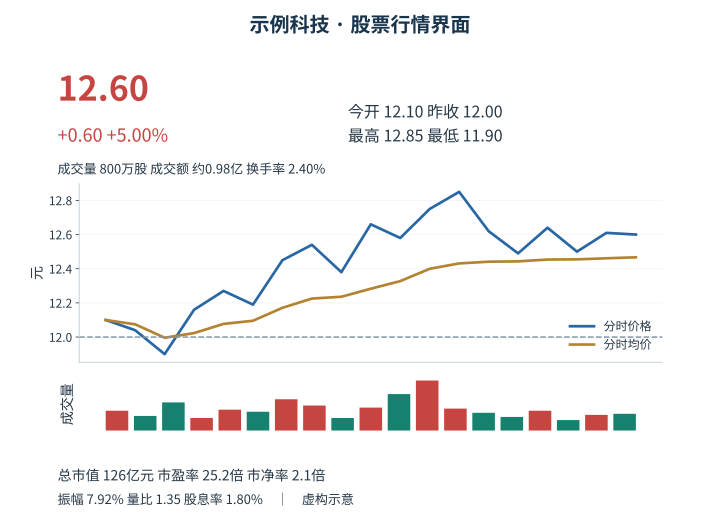

*示意行情，并非真实股票或实时数据。价格、均价和成交量曲线用于说明界面结构。*

#### 4.2 行情数据的完整分类

##### 4.2.1 价格类数据

| 指标 | 解释 | 主要用途 |
|---|---|---|
| 昨收价 | 上一个交易日的收盘价或参考价 | 判断当日涨跌 |
| 开盘价 | 当日开盘形成的价格 | 观察隔夜信息及早期预期 |
| 最高价 | 指定期间最高成交价格 | 观察上方价格极值 |
| 最低价 | 指定期间最低成交价格 | 观察下方价格极值 |
| 最新价 | 最近一次成交价格 | 观察当前交易水平 |
| 收盘价 | 交易期间结束时的规定价格 | 日线分析、收益计算 |
| 成交均价 | 按成交量等相关口径计算的价格 | 观察平均成交成本 |
| 涨跌幅 | 相对于参考价格的变动比例 | 衡量价格变化 |
| 振幅 | 最高价与最低价之差相对于参考价的比例 | 衡量日内波动范围 |

##### 4.2.2 交易活跃度数据

| 指标 | 解释 |
|---|---|
| 成交量 | 实际成交的股份数量 |
| 成交额 | 实际成交金额 |
| 换手率 | 成交股份数量占相关流通股份的比例 |
| 量比 | 当前成交速度与历史平均成交速度的比较 |
| 买卖价差 | 最优卖价与最优买价之间的差额 |
| 盘口深度 | 各个价格档位可以观察到的委托数量 |

##### 4.2.3 企业与估值数据

- 市盈率（PE）：市场价格相对于盈利的倍数。
- 市净率（PB）：市场价格相对于账面净资产的倍数。
- 市销率（PS）：股权市值相对于营业收入的倍数。
- 每股收益（EPS）：归属于相关普通股股东的每股利润。
- 净资产收益率（ROE）：股东账面权益产生利润的能力。
- 股息率：股息相对于当前股价的比例。

上述三类指标分别用于分析价格变化、交易行为和资产价值，不能相互替代。

#### 4.3 分时图的观察方法

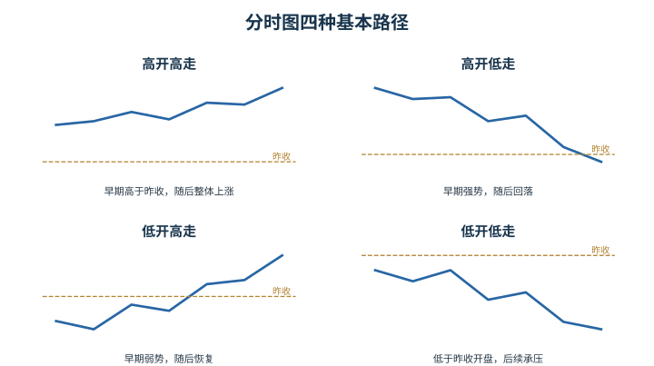

分时图主要用于观察日内价格变化速度、价格相对于均价的位置、开盘后的方向变化以及成交活跃程度。

其中：

- 分时价格持续高于分时均价，说明当前价格高于截至相应时点的加权平均成交水平。
- 分时价格跌破均价线，说明当前价格低于相应平均成交水平。
- 价格反复穿越均价线，可能说明日内方向不够明确。
- 尾盘快速上涨或下跌，需要结合成交量及相关消息判断，不能简单归因于某个机构的操作。

#### 4.4 行情软件常见周期及用途

| 图表周期 | 适合观察 |
|---|---|
| 分时图 | 当日交易过程 |
| 1分钟K线 | 极短期价格波动 |
| 5分钟K线 | 日内局部趋势 |
| 15、30分钟K线 | 日内及短周期结构 |
| 60分钟K线 | 短线趋势与波段 |
| 日K线 | 数日至数月的价格趋势 |
| 周K线 | 中期趋势及主要价格区间 |
| 月K线 | 长期市场周期 |

对于非专业日内交易者，日线和周线可以作为主要研究周期，分钟线更多用于辅助观察交易时点，而不应成为唯一投资依据。

#### 4.5 补充：同花顺分时行情界面逐项阅读

> [!note] 用户提供的行情截图（原始资料）
> 九阳股份（002242），截图显示为午间休市期间的行情快照；仅依据图中可见信息解读，不是实时行情核验或投资建议。

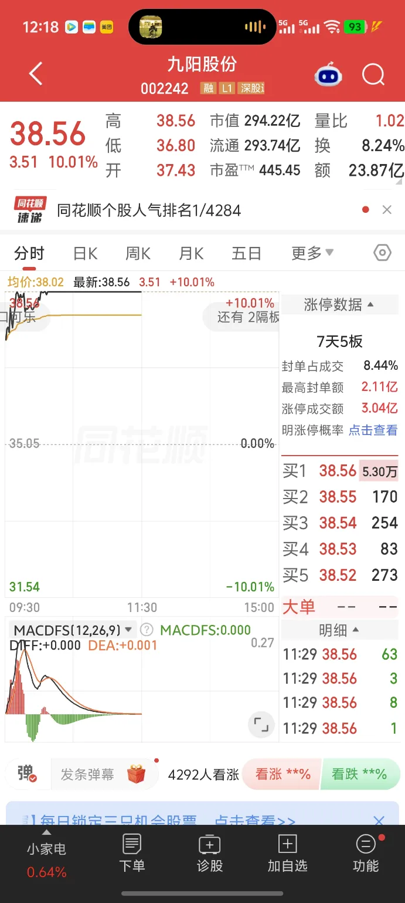

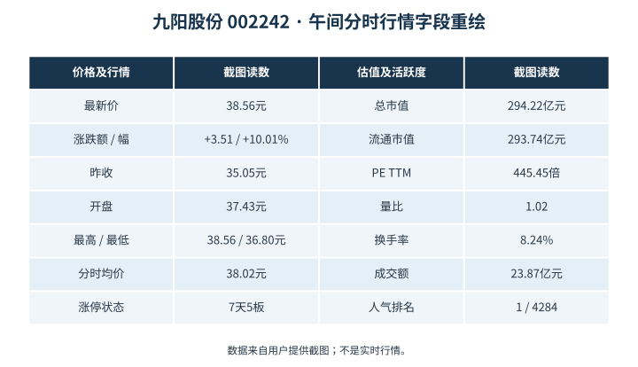

| 截图字段 | 数值 | 应如何阅读 |
|---|---:|---|
| 最新价、昨收 | 38.56元、35.05元 | 涨3.51元，约10.01%，达到截图所示涨停价；不等于当天开盘后上涨10.01% |
| 开盘、最高、最低 | 37.43、38.56、36.80元 | 高开约6.79%；开盘至最新约上涨3.02%；振幅约5.02% |
| 分时均价 | 38.02元 | 最新价较当时均价高约1.42%；均价不是所有现存股东成本 |
| 总市值、流通市值 | 294.22亿、293.74亿元 | 全部与相关流通股份按市价估值，不是当天资金净流入 |
| 成交额、换手率 | 23.87亿元、8.24% | 描述成交规模及流通股份周转程度，不能直接判定买方身份 |
| 量比 | 1.02 | 截图软件口径下，当前成交速度接近历史参考水平，不代表全日成交量已经确定 |
| PE TTM | 445.45倍 | 滚动利润口径下估值倍数很高；还须核查利润基数、非经常损益与未来增长 |
| 7天5板 | 7个交易日内5次涨停 | 不等于连续5个涨停，也不能推出完整7日收益 |
| 买一 | 38.56元、5.30万 | 涨停价上的待成交买单，通常需核对软件单位；若为手且每手100股，约530万股，名义金额约2.04亿元 |
| 封单占成交 | 8.44% | 软件统计的封单相对于成交的比例，具体口径以软件说明为准 |
| 最高封单额 | 2.11亿元 | 盘中曾显示的最大封单金额，不代表当前值 |
| 涨停成交额 | 3.04亿元 | 截图所示涨停价相关成交金额；不等同于封单 |
| MACDFS | DIF约0.000、DEA约0.001 | 分时周期的MACD；长时间价格平稳时两线和柱值可能趋近零，不能与日线MACD直接比较 |
| 人气排行 | 1/4284 | 平台关注度排名，不是企业价值、上涨概率或机构持仓的证据 |

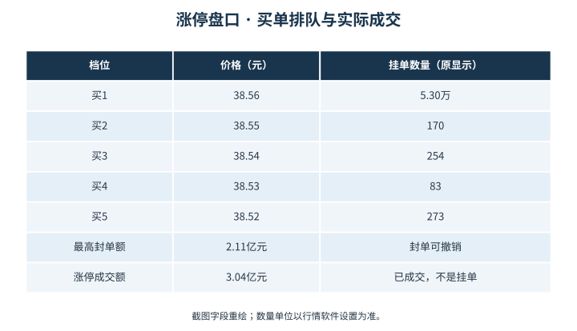

涨停时，买单可能排队而无法成交；原持有人能否卖出取决于有效买单与交易限制。封单可以变化，午间封板不保证收盘封板，更不保证次日上涨。

---

## 第二篇　股票技术分析与市场行为

技术分析主要研究历史及当前的价格、成交量、波动率和交易行为，尝试从中识别具有研究价值的市场结构。

技术分析可以提供交易规则、风险参考和市场状态信息，但其预测能力需要通过真实数据检验。学术研究发现，部分技术交易规则在特定市场与时期具有一定有效性，同时也指出数据窥探、事后选择规则以及交易成本等问题可能显著夸大策略收益。

因此，本篇采用以下分析层次：

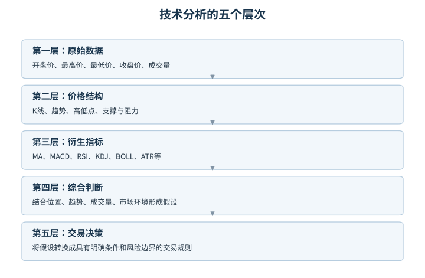

### 第五章　K线原理与完整K线形态体系

#### 5.1 K线的四大基础价格

一根K线可以将一个交易周期内的四项价格信息集中在同一图形中。

- O（Open）：开盘价。
- H（High）：最高价。
- L（Low）：最低价。
- C（Close）：收盘价。

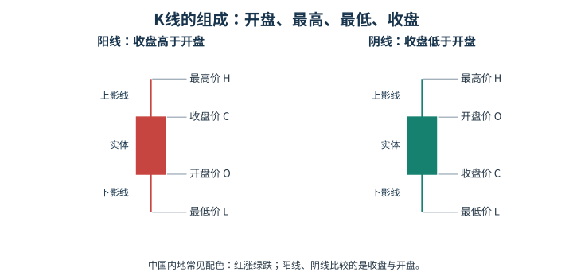

*本专栏统一采用中国内地常见的红色阳线、绿色阴线配色。部分境外软件采用相反配色。*

K线的三个组成部分分别代表：

$$
\text{实体长度}=|C-O|
$$

$$
\text{上影线长度}=H-\max(O,C)
$$

$$
\text{下影线长度}=\min(O,C)-L
$$

#### 5.2 一根K线包含哪些市场信息

| K线组成 | 可以直接观察到的信息 |
|---|---|
| 实体方向 | 收盘相对于开盘的方向 |
| 实体大小 | 开盘与收盘之间的价格变化 |
| 上影线 | 最高成交价超出实体上端的距离 |
| 下影线 | 最低成交价低于实体下端的距离 |
| 整体长度 | 该周期的价格波动范围 |
| 收盘位置 | 价格最终停留在整个波动区间中的位置 |

**K线能够确定价格曾经到达什么位置，但不能仅凭OHLC数据还原价格运行的完整先后顺序，也不能识别交易者的真实身份和动机。**

例如，某股票昨收10元，今天开盘9元、收盘9.5元，虽然形成阳线，但相对于昨日收盘仍然下跌5%。

所以，阳线不等于当天上涨，阴线也不等于当天相对于昨收下跌。

#### 5.3 单根K线的基本分类

##### 5.3.1 按实体大小与方向分类

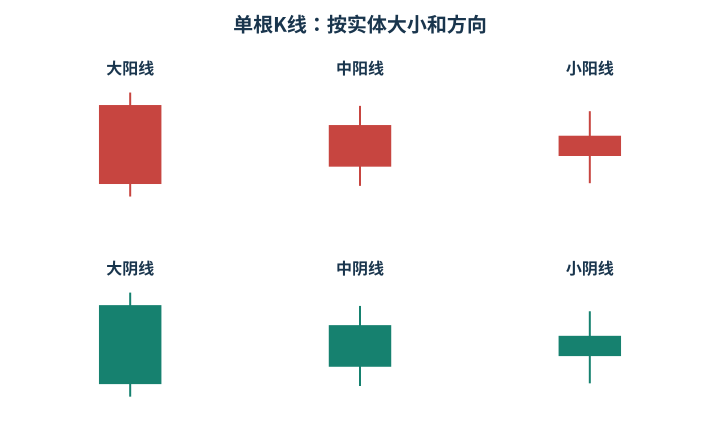

| 形态 | 常见市场含义 | 解读重点 |
|---|---|---|
| 大阳线 | 该周期价格由开盘至收盘明显上涨 | 是否突破关键区间，是否存在异常波动 |
| 中阳线 | 价格具有较明确的向上变化 | 是否延续原有趋势 |
| 小阳线 | 价格净变化较小 | 是否属于整理或上涨停顿 |
| 大阴线 | 该周期价格由开盘至收盘明显下跌 | 是否跌破支撑，是否伴随重大消息 |
| 中阴线 | 价格具有较明确的向下变化 | 是否延续下跌趋势 |
| 小阴线 | 价格净变化相对较小 | 是否属于正常回调或方向不明 |

大、中、小阳线并没有适用于所有股票的固定百分比标准。更合理的方式是将实体大小与该股票近期波动范围进行比较。

##### 5.3.2 按影线与实体结构分类

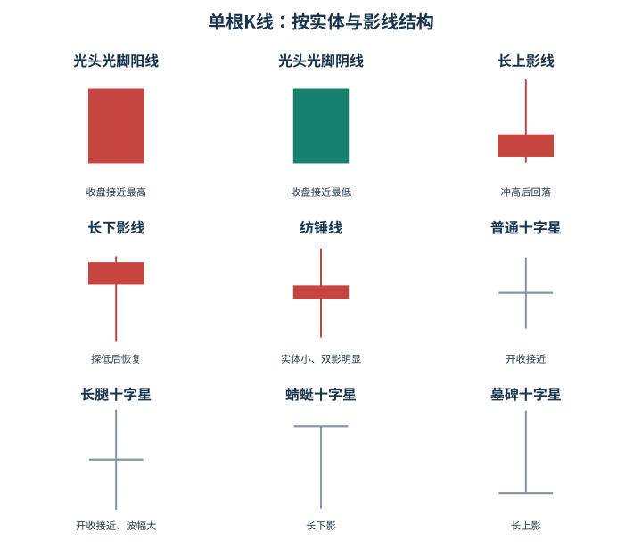

| 形态 | 核心价格信息 |
|---|---|
| 光头光脚阳线 | 开盘接近最低价，收盘接近最高价 |
| 光头光脚阴线 | 开盘接近最高价，收盘接近最低价 |
| 长上影线 | 曾经上涨至较高位置，但收盘明显低于最高价 |
| 长下影线 | 曾经下跌至较低位置，但收盘明显高于最低价 |
| 纺锤线 | 实体较小，上下影线相对明显 |
| 十字星 | 开盘与收盘基本一致 |
| 长腿十字星 | 开收接近，但周期内上下波动很大 |
| 蜻蜓十字星 | 开收接近最高位置，具有长下影线 |
| 墓碑十字星 | 开收接近最低位置，具有长上影线 |

特别注意：长下影线只能说明价格从低位有所恢复，不能直接证明有主力资金抄底；长上影线也不能直接证明庄家正在出货。

#### 5.4 单根K线的经典反转形态

四种常见反转候选形态实际上来自两种基本的K线结构：

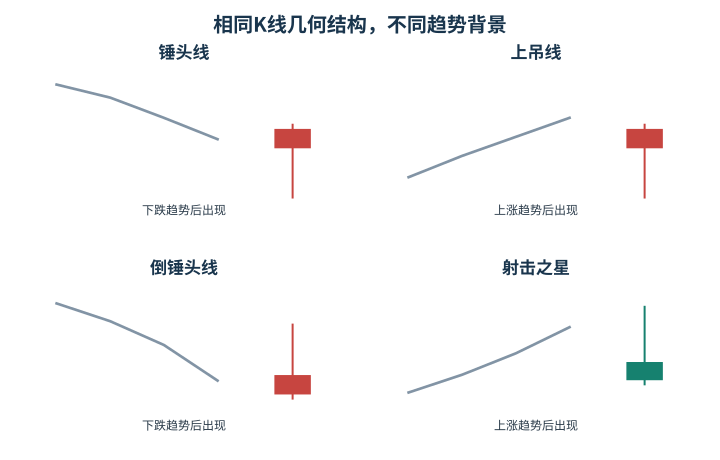

##### 5.4.1 锤头线（Hammer）

特征：实体较小，位于整个价格区间上部，下影线较长。

出现于明显下跌之后时，可以视为下跌力量受到抵抗、价格出现恢复的候选信号。

##### 5.4.2 上吊线（Hanging Man）

外形与锤头线近似，但出现在此前上涨趋势之后。

其风险信息在于：虽然收盘恢复至较高位置，但该周期曾经发生明显下跌。

##### 5.4.3 倒锤头线（Inverted Hammer）

实体位于价格区间下部，具有较长上影线，出现在下跌之后。

说明价格曾经尝试向上运行，但尚未保持全部涨幅。

##### 5.4.4 射击之星（Shooting Star）

外形与倒锤头线近似，但出现在上涨之后。

说明价格尝试创出较高水平，却在收盘前出现回落，可以作为上涨承压的观察信号。

**相同形态出现在不同趋势和价格位置，分析意义可能完全不同。**

#### 5.5 两根K线的组合形态

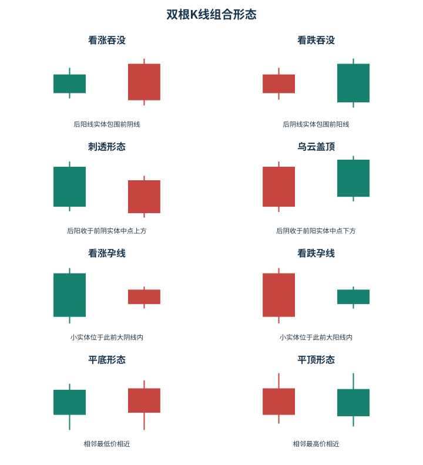

*这些形态是理想化示例，实际识别规则对跳空、实体比例及此前趋势的要求可能有所区别。*

##### 5.5.1 吞没形态

- 看涨吞没：此前阴线实体被后一根阳线实体包围，出现在下跌后的意义更值得研究。
- 看跌吞没：此前阳线实体被后一根阴线实体包围，出现在上涨后的意义更值得研究。

需要注意，经典吞没形态主要比较实体，并不要求后一根K线的最高价和最低价完全覆盖前一根K线。

##### 5.5.2 刺透与乌云盖顶

二者通常强调反向K线对前一根实体的深入程度。

刺透形态表现为下跌后出现较强价格恢复；乌云盖顶则表现为上涨后出现明显价格回落。

##### 5.5.3 孕线形态

后一根较小实体位于此前较大实体内部。

孕线主要反映价格净变化暂时收缩，可能是趋势停顿或转变的候选信号，需要观察后续突破方向。

#### 5.6 三根K线的组合形态

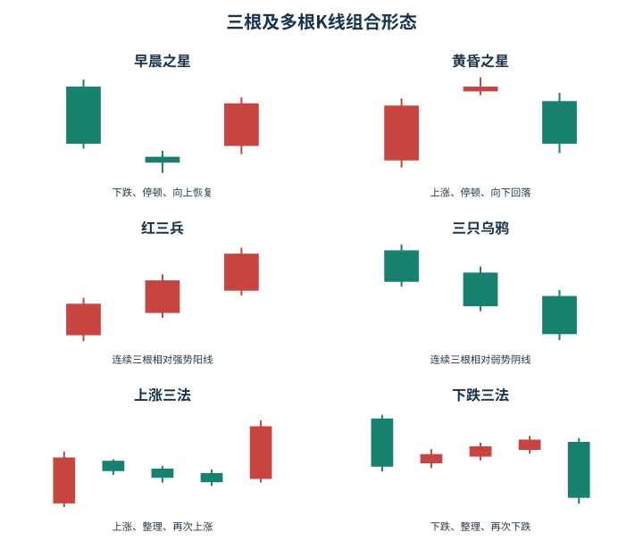

*早晨之星、黄昏之星、红三兵及三只乌鸦通常由三根K线组成；上涨三法和下跌三法是放在一起对照学习的多根K线持续形态。*

早晨之星、黄昏之星主要属于反转候选形态。上涨三法与下跌三法则主要属于趋势持续候选形态。

红三兵不一定代表值得追涨。如果三根阳线已经造成过大短期涨幅，买入时也可能面临较高价格回落风险。

#### 5.7 如何科学地量化K线形态

传统K线分析比较依赖视觉判断。可以进一步使用数学比例，将形态转化为能够程序化检验的规则。

定义：

$$
B=|C-O|,\quad R=H-L
$$

$$
U=H-\max(O,C)
$$

$$
D=\min(O,C)-L
$$

其中，$B$ 为实体长度，$R$ 为振幅价格范围，$U$ 和 $D$ 分别为上下影线长度。

以锤头线为例，可以制定一组教学研究条件：

- 下影线长度至少为实体长度的2倍。
- 实体占整个K线范围不超过35%。
- 上影线占整个K线范围不超过15%。
- 此前存在符合规则的下跌趋势。

这些数值是人为选择的待检验参数，并非经过证明的最佳阈值。

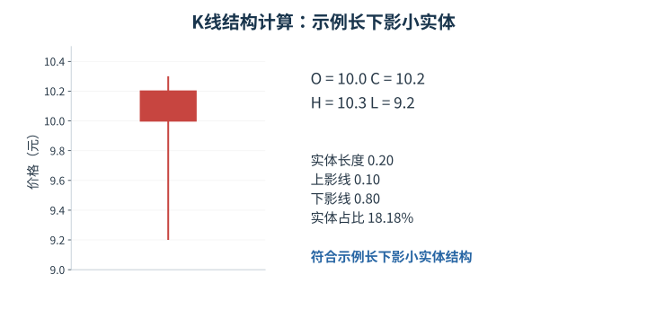

*仅识别几何结构。是否属于锤头线或其他形态，还需要结合此前趋势。*

这就是技术分析从主观观察向量化研究发展的基本过程。

#### 5.8 K线分析最重要的五个维度

| 维度 | 需要判断的问题 |
|---|---|
| 形态 | 实体、影线及收盘位置如何？ |
| 趋势 | 此前处于上涨、下跌还是震荡？ |
| 位置 | 是否接近前高、前低或重要价格区间？ |
| 成交量 | 该形态是否伴随成交活跃程度变化？ |
| 后续验证 | 下一阶段价格是否支持原有判断？ |

孤立K线的分析价值通常有限。完整技术分析必须建立在价格结构和市场环境之上。

---

### 第六章　趋势分析与价格结构

#### 6.1 趋势的三种基本类型

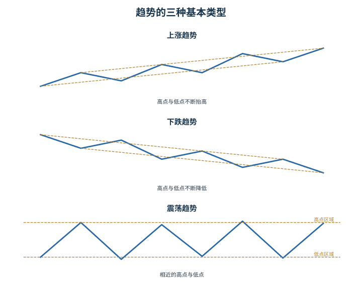

经典趋势分析使用以下术语：

- HH（Higher High）：更高的高点。
- HL（Higher Low）：更高的低点。
- LH（Lower High）：更低的高点。
- LL（Lower Low）：更低的低点。

上涨趋势通常具有HH与HL结构，下跌趋势通常具有LH与LL结构。

不过，在实际程序识别中需要明确高低点的确认规则，避免使用尚未发生的未来价格数据。

#### 6.2 趋势的不同时间层级

- 主要趋势：跨越较长时期的价格运行方向。
- 次级趋势：主要趋势内部的调整或反向运动。
- 短期趋势：较短时间尺度内的价格变化。

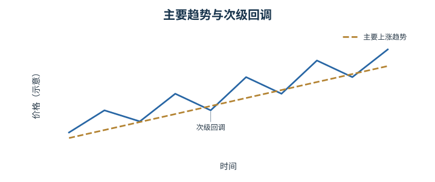

*上涨趋势内部可以包含多次下跌。短期下跌并不自动代表长期趋势结束。*

#### 6.3 支撑位与阻力位

##### 6.3.1 支撑区域

价格此前多次在某个区间附近停止下跌或出现恢复，因此交易者将其作为潜在下方参考区域。

##### 6.3.2 阻力区域

价格此前多次在某个区间附近停止上涨或出现回落，因此交易者将其作为潜在上方参考区域。

常见参考位置包括：

| 支撑或阻力来源 | 形成依据 |
|---|---|
| 历史高低点 | 此前价格转折位置 |
| 横盘区间边缘 | 过去反复发生交易的边界 |
| 重要均线 | 不同时间尺度的平均价格 |
| 整数价格 | 部分交易者关注的心理价位 |
| 缺口区域 | 此前没有连续交易覆盖的价格区域 |
| 成交密集区 | 历史交易较集中的价格区间 |

这些位置通常应当理解为区域，而不是精确到某一分钱、必然有效的价格。

#### 6.4 支撑与阻力的相互转换

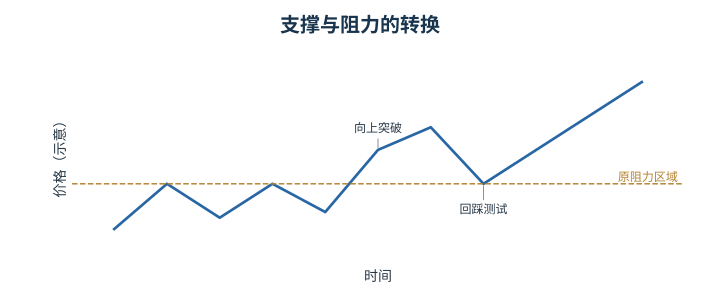

- 突破：价格越过原有重要区间。
- 回踩：突破后重新回到原有区域附近。
- 假突破：价格暂时越过区间后又返回原区间。
- 跌破：价格向下穿过原有支撑区域。
- 反抽：跌破后价格重新向原区域回升。

突破之后的原阻力可能变成支撑，跌破之后的原支撑也可能变成阻力，但这是一种待验证的市场行为假设。

#### 6.5 经典价格形态体系

##### 6.5.1 反转候选形态

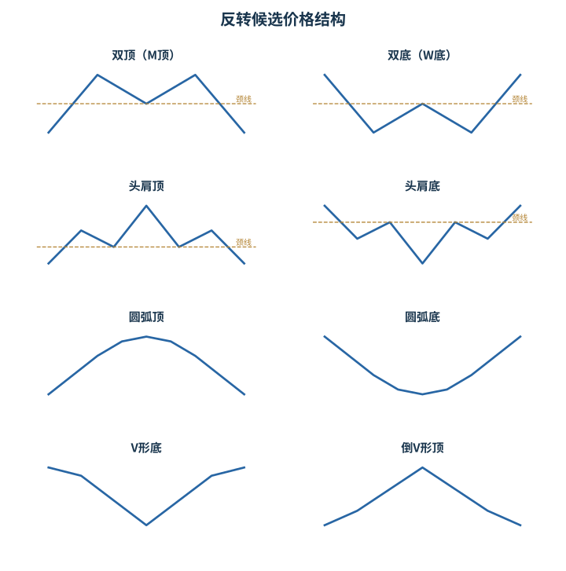

*虚线为部分形态的参考颈线。图形相似不代表反转已经完成。*

| 形态 | 主要特征 | 观察重点 |
|---|---|---|
| 双顶 | 两个相近高点 | 中间低点形成的颈线是否跌破 |
| 双底 | 两个相近低点 | 中间高点形成的颈线是否突破 |
| 头肩顶 | 三个高点，中间较高 | 颈线、右肩与此前上涨趋势 |
| 头肩底 | 三个低点，中间较低 | 颈线、右肩与此前下跌趋势 |
| 圆弧顶 | 上涨逐渐减速，随后转弱 | 长期价格结构及变化速度 |
| 圆弧底 | 下跌逐渐减速，随后恢复 | 趋势是否真正转向 |
| V形反转 | 价格短时间内大幅反向 | 消息、流动性及持续性 |

##### 6.5.2 整理与趋势持续候选形态

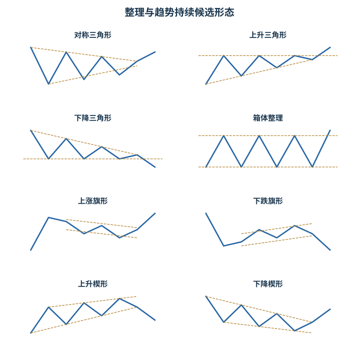

*三角形、旗形、箱体及楔形可以用于研究整理与突破，但实际突破方向不一定符合传统形态名称所暗示的方向。*

#### 6.6 缺口分析

缺口是相邻K线价格区间之间没有重叠的现象。

向上跳空缺口满足：

$$
L_t>H_{t-1}
$$

向下跳空缺口满足：

$$
H_t<L_{t-1}
$$

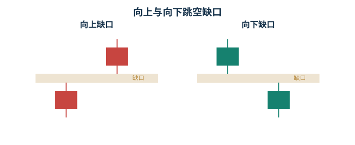

传统分析将缺口分为普通缺口、突破缺口、持续缺口、衰竭缺口等。但这些分类往往需要后续走势才能较可靠地区分。

缺口不一定回补，回补时间也无法由缺口本身确定。

#### 6.7 多周期趋势分析

不同周期可以承担不同分析任务：

| 周期 | 主要任务 |
|---|---|
| 月线 | 判断长期市场位置及大级别结构 |
| 周线 | 判断中期趋势 |
| 日线 | 判断主要交易结构及重要价格区域 |
| 60分钟线 | 观察短期调整与突破 |
| 15分钟线 | 辅助研究执行时点 |

典型分析逻辑是先确定较大周期的方向，再使用较小周期研究交易条件。

如果周线处于明确下跌趋势，而5分钟K线出现看涨形态，就不能仅依据这一短周期形态认定中长期下跌已经结束。

---
### 第七章　成交量与量价关系分析

价格反映交易发生在什么水平，成交量反映有多少资产在相应期间完成了交换。

量价分析的关键是研究**价格变化与交易活跃程度之间的关系**，而不是简单认为放量一定上涨、缩量一定下跌。

#### 7.1 成交量、成交额与换手率

##### 7.1.1 成交量

统计期间内实际成交的股票数量。

成交量通常以股或手为单位，分析前需要确认软件使用的单位。

##### 7.1.2 成交额

$$
\text{成交额}=\sum_{i=1}^{n}P_iQ_i
$$

其中，$P_i$ 与 $Q_i$ 分别表示各笔交易的价格和数量。

成交额有助于比较不同股票或不同市场的交易规模。

##### 7.1.3 换手率

$$
\text{换手率}=\frac{\text{成交股份数量}}{\text{相关流通股份数量}}\times100\%
$$

例如，一只股票流通股本为1亿股，当日成交500万股，则按此口径计算的换手率为5%。

换手率为100%并不表示所有流通股份都恰好更换了一次持有人，因为同一批股份可能发生重复交易。

##### 7.1.4 相对成交量

相对成交量用于判断当前交易活跃程度相对于历史水平是否异常。

一种简单的计算方法为：

$$
RVOL=\frac{V_t}{\overline V_{t-N:t-1}}
$$

例如，前20个交易日平均成交量为100万股，当日成交量为180万股，则相对成交量为1.8倍。

日内使用量比等指标时，还需要注意已经过去的交易时间，以及正常的早盘、尾盘成交量分布。

#### 7.2 成交量的基本形态

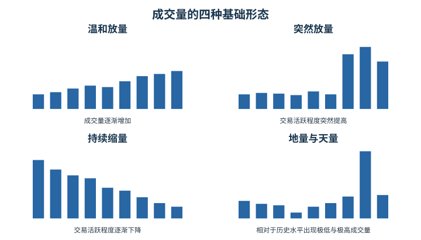

#### 7.3 四种基础量价组合

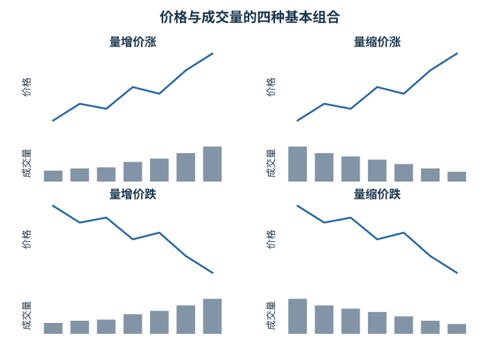

| 量价组合 | 常见分析思路 | 必须考虑的其他解释 |
|---|---|---|
| 放量上涨 | 上涨伴随更多交易参与 | 高位集中交易、短期过热 |
| 缩量上涨 | 上涨过程中交易减少 | 卖方惜售、市场流动性不足 |
| 放量下跌 | 下跌伴随较强交易活动 | 恐慌交易、止损集中触发 |
| 缩量下跌 | 下跌过程中交易减少 | 买方需求不足、缓慢阴跌 |
| 放量横盘 | 成交增加但价格变化较小 | 买卖双方大量交换筹码 |
| 缩量横盘 | 交易活跃度下降且价格趋于稳定 | 市场观望、流动性不足 |

#### 7.4 不同价格位置上的量价关系

相同的放量现象发生在不同位置，可能具有不同分析意义。

##### 7.4.1 长期下跌后的放量

可能意味着市场关注度提高、价格出现剧烈重新定价，或者原有下跌趋势受到挑战。

需要进一步观察是否出现更高低点、收盘恢复以及关键阻力突破。

##### 7.4.2 横盘区间中的放量

可能意味着交易活动增加，但未必代表方向已经确定。

需要区分放量突破、放量跌破以及放量滞涨。

##### 7.4.3 上涨趋势中的缩量回调

如果价格回调幅度较小、原有上涨结构未被破坏，成交量下降可能反映调整阶段交易活动减少。

但如果股票已经持续缩量、流动性严重下降，含义就可能不同。

##### 7.4.4 大幅上涨后的放量滞涨

股价已经显著上涨，成交量进一步增加，但价格无法明显突破此前高点。

这说明大量交易并未推动价格继续上涨，可以作为风险观察信号，但不能单独证明有机构集中卖出。

#### 7.5 放量突破与缩量回踩

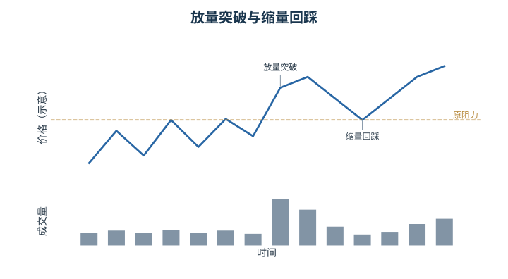

*理想化趋势持续情景。实际市场中的回踩可能继续下跌，突破也可能失效。*

分析这一结构时，重点研究：

1. 原有整理区间是否具有明确边界。
2. 价格是否真正收盘于区间之外。
3. 突破时成交活跃程度是否显著提高。
4. 回调期间是否破坏了原有价格结构。
5. 后续价格是否能够重新延续上涨趋势。

这类结构可以形成一项待检验的趋势交易策略，但不能因出现一次相似图形就认定其拥有正期望。

#### 7.6 成交密集区与筹码分布

##### 7.6.1 成交量分布（Volume Profile）

将一定时期内的成交量按照价格区间进行归类，而不是按照时间归类。

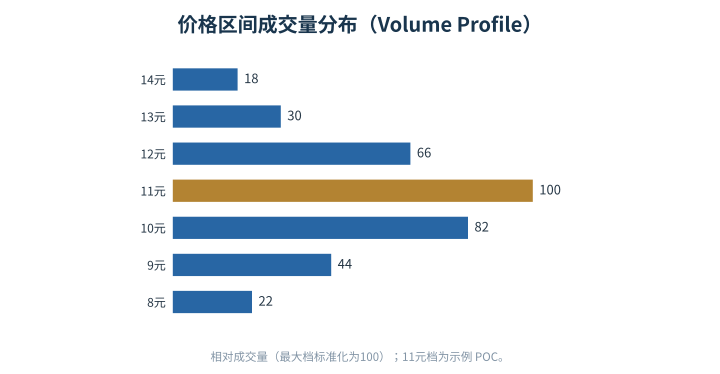

*虚构成交分布数据。反映过去交易在不同价格区间的集中程度。*

相关概念包括：

- POC：统计区间内成交量最大的价格水平或价格档位。
- 高成交量节点（HVN）：历史成交相对集中的价格区域。
- 低成交量节点（LVN）：历史成交相对稀少的价格区域。

##### 7.6.2 筹码分布

部分股票软件会根据历史成交情况、换手率以及特定模型估算市场持仓成本分布。

需要明确：

**成交量分布描述过去发生了哪些交易，筹码分布则试图估算当前持仓成本。二者不等同。**

普通行情数据通常无法准确获知所有现存股东的真实买入成本，因此筹码峰、获利盘比例和平均持仓成本等指标应当被视为模型估计，而不是已经核实的真实持仓记录。

---

### 第八章　技术指标的计算、解读与组合应用

技术指标是将原始市场数据通过数学计算转换为更加便于分析的变量。

本章不仅介绍指标名称，还进一步研究它们各自解决什么问题、如何计算、如何使用，以及什么情况下容易失效。

#### 8.1 技术指标的总体分类

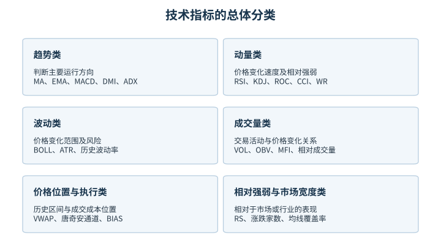

不同教材可能将同一指标归入多个类别。例如，MACD兼具趋势和动量分析用途。分类的目的是理解指标功能，而不是强行划分互不相交的类别。

#### 8.2 移动平均线（MA）

##### 8.2.1 MA的计算原理

$N$ 日简单移动平均线为最近 $N$ 个交易日收盘价的算术平均值：

$$
MA_N(t)=\frac{1}{N}\sum_{i=0}^{N-1}C_{t-i}
$$

假设连续五日收盘价为10、11、12、11、11元，则第五日的MA5为11元。

##### 8.2.2 常用均线周期

| 均线 | 常见分析用途 |
|---|---|
| MA5 | 一周左右的短期变化 |
| MA10 | 两周左右的短期趋势 |
| MA20 | 约一个交易月的趋势 |
| MA30 | 短中期趋势 |
| MA60 | 约一个季度的价格趋势 |
| MA120 | 约半年趋势 |
| MA250 | 约一年趋势 |

这些周期主要来源于交易日数量和市场使用习惯，不具有天然的预测优势。

##### 8.2.3 均线的四种主要分析方法

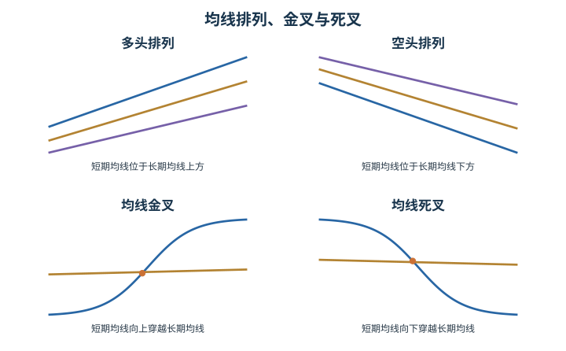

*蓝色表示较短周期均线，金色和紫色表示较长周期均线。*

观察均线时主要研究四件事：均线方向、价格相对位置、不同均线之间的排列、均线之间的距离。

均线在趋势明确的市场中可以帮助平滑价格，但在震荡市场中容易出现频繁交叉，形成反复失效的信号。

#### 8.3 指数移动平均线（EMA）

EMA对近期价格赋予相对较高的权重。

$$
EMA_t=\alpha C_t+(1-\alpha)EMA_{t-1}
$$

常用平滑系数：

$$
\alpha=\frac{2}{N+1}
$$

相比相同周期的简单移动平均线，EMA通常对近期价格变化更加敏感。

EMA也是MACD指标的基础计算工具。

#### 8.4 MACD：指数平滑异同移动平均线

这是股票技术分析中极为常用的趋势与动量指标。

##### 8.4.1 MACD的三大组成部分

经典参数通常为12、26、9。

$$
DIF=EMA_{12}-EMA_{26}
$$

$$
DEA=EMA_9(DIF)
$$

中国内地许多行情软件将柱状值计算为：

$$
MACD_{\text{柱}}=2(DIF-DEA)
$$

部分境外软件直接使用 $DIF-DEA$，因此柱状图的具体数值可能相差一倍，但正负方向不变。

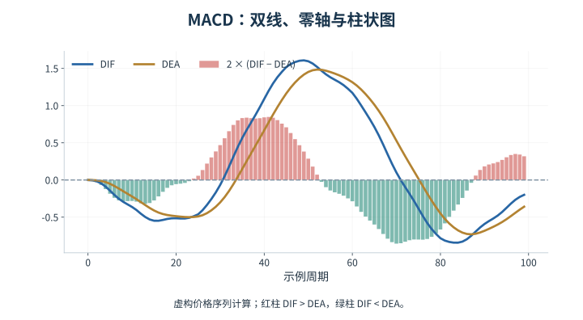

*结构示意图，用于说明两条曲线、零轴与柱状图的关系，非真实价格计算结果。*

##### 8.4.2 MACD常见状态

| 状态 | 直接数学含义 | 常见分析思路 |
|---|---|---|
| DIF高于零轴 | 短期EMA高于长期EMA | 价格短期平均水平相对较强 |
| DIF低于零轴 | 短期EMA低于长期EMA | 价格短期平均水平相对较弱 |
| 金叉 | DIF向上穿越DEA | 相对趋势动量发生向上变化 |
| 死叉 | DIF向下穿越DEA | 相对趋势动量发生向下变化 |
| 红柱扩大 | DIF与DEA的正差距增大 | 相应上涨动量差扩大 |
| 红柱缩短 | 两者正差距减小 | 相应动量差收敛 |
| 绿柱扩大 | DIF与DEA的负差距扩大 | 相应下行动量差扩大 |
| 绿柱缩短 | 两者负差距减小 | 相应动量差收敛 |

##### 8.4.3 零轴上方与下方金叉的区别

零轴上方金叉经常用于研究上涨趋势中的恢复或延续。

零轴下方金叉则经常用于研究下跌之后的反弹或潜在转向。

但是，金叉发生在哪里只是市场状态的一部分，不能单独决定是否存在投资机会。

##### 8.4.4 MACD顶背离与底背离

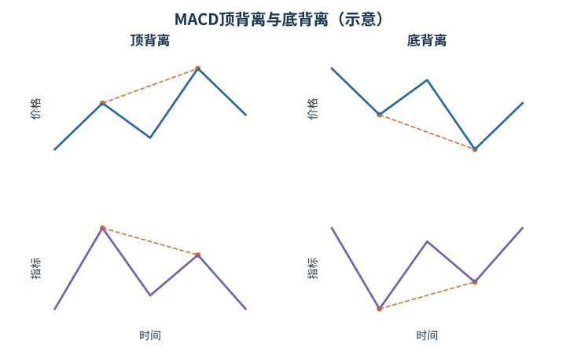

背离主要说明价格与相关动量指标的变化不完全一致，属于趋势可能减弱的线索，并不是反转已经发生的证明。

#### 8.5 RSI：相对强弱指标

RSI主要研究近期上涨和下跌幅度之间的相对关系。

常用公式：

$$
RS=\frac{\text{平均上涨幅度}}{\text{平均下跌幅度}}
$$

$$
RSI=100-\frac{100}{1+RS}
$$

经典RSI通常采用14期及Wilder平滑方法。

##### 8.5.1 RSI数值的含义

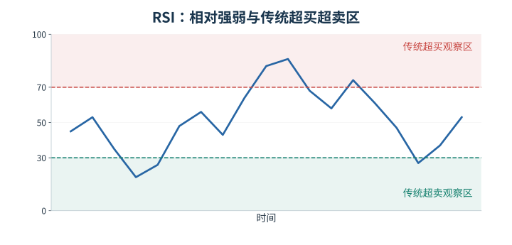

| RSI区间 | 常见解读 |
|---|---|
| 70以上 | 近期上涨幅度相对较强 |
| 50—70 | 上涨变化相对占优 |
| 50附近 | 上下变化相对均衡 |
| 30—50 | 下跌变化相对占优 |
| 30以下 | 近期下跌幅度相对较强 |

在强劲上涨趋势中，RSI可能长期处于70以上；在持续下跌趋势中，RSI也可能长期处于30以下。

因此，超买并不是必须卖出，超卖也不是必须买入。

#### 8.6 KDJ：随机指标的扩展形式

KDJ主要研究当前收盘价在近期最高价与最低价所形成区间中的相对位置。

##### 8.6.1 RSV的计算

$$
RSV=\frac{C-L_N}{H_N-L_N}\times100
$$

其中，$H_N$ 和 $L_N$ 分别为最近 $N$ 期最高价和最低价。

常见KDJ使用9期价格区间，再进行相应平滑：

$$
K_t=\frac23K_{t-1}+\frac13RSV_t
$$

$$
D_t=\frac23D_{t-1}+\frac13K_t
$$

$$
J_t=3K_t-2D_t
$$

不同软件初始化及特殊数据处理方式可能不同。

##### 8.6.2 三条线的不同作用

- K线：较为敏感的价格区间位置指标。
- D线：进一步平滑后的参考指标。
- J线：放大K与D之间变化差异的指标，数值可能超出0至100区间。

这里的K线是KDJ指标中的K值曲线，并非蜡烛图意义上的K线。

##### 8.6.3 KDJ常见观察方式

- K、D金叉和死叉。
- 20附近的相对低位。
- 80附近的相对高位。
- KDJ与价格之间的背离。
- 指标钝化：趋势较强时，指标可能长时间停留在高位或低位。

KDJ通常比长期均线更加敏感，也可能产生更多噪声和频繁信号。

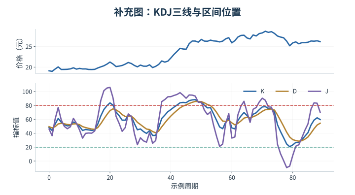

#### 8.7 BOLL：布林带

布林带通过移动平均线和价格标准差形成动态价格区间。

常见参数为20期和2倍标准差。

$$
MID=MA_{20}
$$

$$
UP=MID+2\sigma
$$

$$
LOW=MID-2\sigma
$$

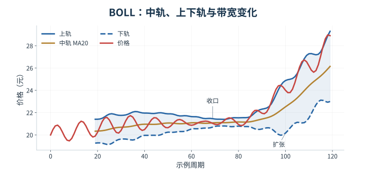

*布林带结构示意。带宽缩小反映近期价格标准差降低，带宽扩大反映近期波动增加。*

##### 8.7.1 布林带的常见状态

| 状态 | 主要信息 |
|---|---|
| 布林带收口 | 近期价格波动范围收缩 |
| 布林带扩张 | 近期价格波动范围扩大 |
| 价格靠近上轨 | 当前价格相对于近期平均价格较高 |
| 价格靠近下轨 | 当前价格相对于近期平均价格较低 |
| 价格沿上轨运行 | 可能处于较强上涨趋势 |
| 价格沿下轨运行 | 可能处于较强下跌趋势 |

布林带上下轨不是天然的买卖边界。即使采用两倍标准差，也不能直接认为未来股价有95%的概率保持在布林带内。

#### 8.8 ATR：平均真实波幅

ATR主要用于衡量价格波动范围，而不是判断上涨或下跌方向。

真实波幅：

$$
TR_t=\max\begin{cases}
H_t-L_t\\
|H_t-C_{t-1}|\\
|L_t-C_{t-1}|
\end{cases}
$$

ATR是在相应期间内对TR进行平滑计算的结果，常见参数为14期。

例如，昨收10元，今天最高9元、最低8.5元，日内最高价与最低价差只有0.5元，但真实波幅为1.5元，因为还需要计入相对于昨收的跳空变化。

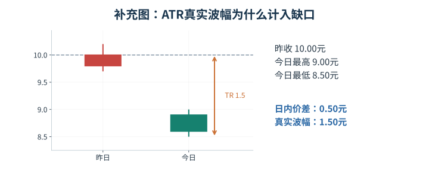

##### 8.8.1 ATR在实际交易中的用途

- 比较股票自身近期波动程度。
- 判断当前价格变化相对于正常波动是否异常。
- 研究止损距离是否过于狭窄。
- 构建跟踪退出规则。
- 按照不同股票波动程度调整风险预算。

对于价格不同的股票，可以使用相对ATR：

$$
ATR\%=\frac{ATR}{C}\times100\%
$$

#### 8.9 OBV：能量潮指标

OBV通过收盘价方向对成交量进行累积。

$$
OBV_t=\begin{cases}
OBV_{t-1}+V_t,&C_t>C_{t-1}\\
OBV_{t-1}-V_t,&C_t<C_{t-1}\\
OBV_{t-1},&C_t=C_{t-1}
\end{cases}
$$

主要用于观察价格趋势与方向性成交量统计之间的关系。

如果价格创出新高，而OBV未能同步创出新高，可以作为量价关系发生变化的线索。

但OBV会将整期成交量按照收盘变化方向进行归类，并不是真实买入资金与卖出资金之差。

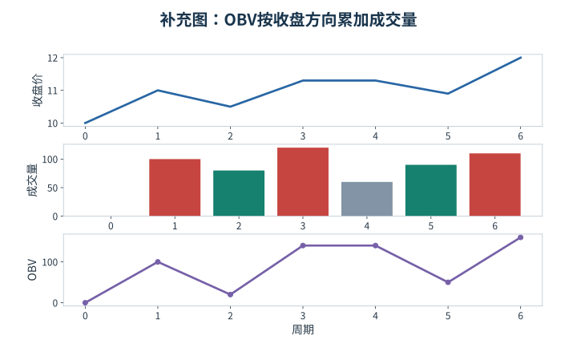

#### 8.10 VWAP：成交量加权平均价格

$$
VWAP=\frac{\sum_i P_iQ_i}{\sum_i Q_i}
$$

VWAP通常用于研究一段时间内的平均成交价格，以及实际交易执行是否取得相对合理的价格。

例如，分别在10元成交1000股、11元成交2000股、12元成交1000股，则VWAP为11元。

相关概念：

- 日内VWAP：从当日开始计算。
- 锚定VWAP（AVWAP）：从指定日期、事件或价格转折时点开始计算。
- TWAP：按照时间等权方式计算平均价格。

VWAP不是支撑位的数学证明，只是具有明确统计含义的成交价格基准。

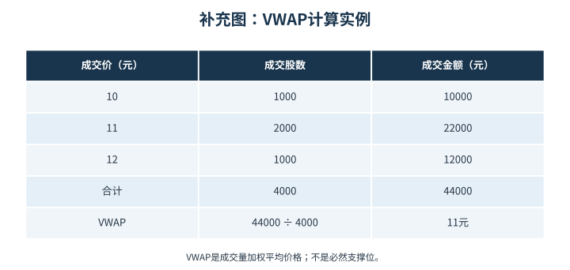

#### 8.11 其他常见技术指标

| 指标 | 所属功能 | 主要用途 |
|---|---|---|
| DMI | 趋势方向 | 比较正向和负向价格运动 |
| ADX | 趋势强度 | 判断趋势是否明显，不直接区分涨跌 |
| ROC | 动量 | 计算价格相对于过去的变化率 |
| CCI | 价格偏离 | 衡量价格相对于统计平均水平的偏离 |
| WR | 区间位置 | 衡量收盘价格在近期区间的位置 |
| MFI | 量价动量 | 将成交量与价格变化结合 |
| BIAS | 均线偏离 | 衡量股价偏离移动平均线的程度 |
| SAR | 趋势跟踪 | 提供动态趋势及潜在退出参考 |
| 唐奇安通道 | 区间突破 | 使用历史最高价和最低价形成通道 |
| Ichimoku一目均衡表 | 综合趋势 | 结合不同周期价格区间研究趋势 |
| Fibonacci回撤 | 价格区间划分 | 使用特定比例划分潜在观察区域 |

斐波那契回撤、波浪理论、江恩理论、缠论等在市场中具有一定传播范围，可以作为特定技术分析框架进行了解，但不能仅凭理论叙述、历史图形吻合或个别成功案例认定其具备可靠预测能力。

#### 8.12 技术指标的联合使用

普通投资者没有必要同时使用几十种技术指标。更合理的分析方式，是从不同功能类别中分别选择具有代表性的变量。

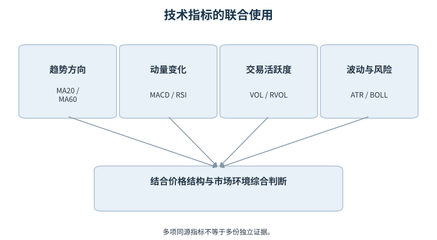

常见错误是同时使用MA、EMA、MACD、KDJ、RSI，然后认为出现五个看涨信号就相当于获得了五份独立证据。

实际上，这些指标多数来自相同的历史价格序列，具有较强相关性。

选择技术指标时，重点不是数量，而是它们能否提供不同维度的信息，以及组合规则能否在样本外产生更好的风险调整后结果。

---

### 第九章　市场情绪、资金行为与盘口分析

#### 9.1 市场情绪的基本含义

市场情绪描述投资者对未来市场走势和风险的总体态度，包括乐观、谨慎、恐慌、投机热情等。

市场情绪并不是可以直接精确测量的单一变量，通常需要通过多项市场数据间接观察。

#### 9.2 市场宽度分析

指数上涨不意味着多数股票都在上涨。

假设市场中存在两个交易日：

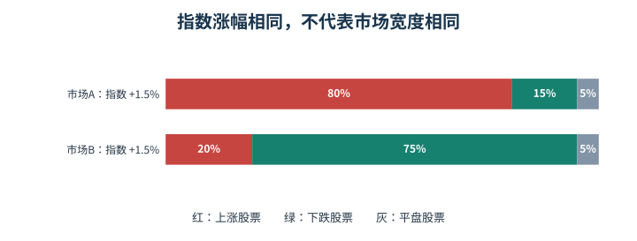

虽然两个市场的指数涨幅完全相同，但市场整体参与程度存在明显差异。

##### 9.2.1 常见市场宽度指标

- 上涨家数与下跌家数。
- 涨停家数与跌停家数。
- 创新高股票数量与创新低股票数量。
- 上涨股票成交额与下跌股票成交额。
- 站在20日、60日或200日均线以上的股票比例。
- 腾落线（A/D Line）：累积上涨家数与下跌家数之间的差异。

市场宽度有助于研究指数走势究竟由广泛股票共同推动，还是主要由少数权重股票推动。

#### 9.3 板块轮动与市场热点

##### 9.3.1 板块的分类

- 行业板块：银行、证券、半导体、医药、制造业等。
- 主题板块：人工智能、机器人、数字经济等。
- 地域板块：按照企业所在地等特征划分。
- 风格板块：价值、成长、红利、大盘、小盘等。
- 特定概念板块：根据数据服务商设定的相关经济或市场主题分类。

##### 9.3.2 板块分析的核心数据

| 数据 | 主要作用 |
|---|---|
| 板块涨跌幅 | 判断板块近期价格表现 |
| 相对市场收益 | 判断是否跑赢整体市场 |
| 板块成交额 | 判断交易活动规模 |
| 成交额占比变化 | 判断市场关注程度变化 |
| 板块上涨家数占比 | 判断上涨是否具有普遍性 |
| 龙头股票表现 | 观察主要代表性股票的相对强弱 |
| 行业基本面 | 判断市场热点是否具有经营及盈利依据 |

#### 9.4 个股相对强弱分析

相对强弱（RS）与RSI不是同一个指标。

RS主要比较个股与市场、行业或其他资产之间的相对表现。

可以使用标准化价格比值：

$$
RS_t=\frac{P_t/P_0}{I_t/I_0}
$$

其中，$P$ 为个股价格，$I$ 为相应市场指数。正式业绩比较宜使用口径一致的复权或总收益数据。

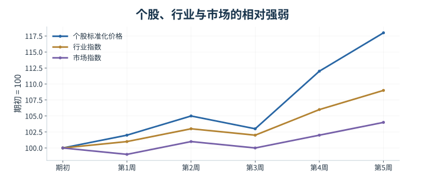

在这个虚构案例中，个股上涨18%，行业指数上涨9%，市场指数上涨4%。

这表明该股票在观察期内具有明显的相对强势特征，但并不能由此确定其未来一定继续领先。

#### 9.5 盘口数据分析

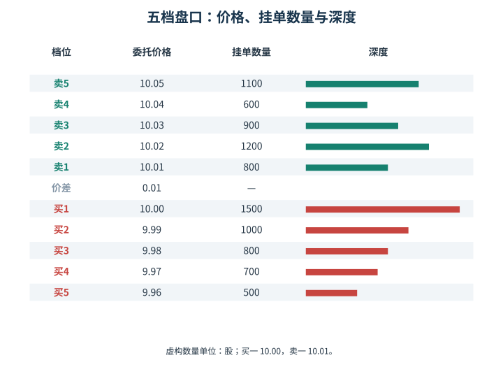

*虚构数据，假设数量单位为股。*

##### 9.5.1 委比与委差

在明确统计档位的情况下：

$$
\text{委差}=\text{委买数量}-\text{委卖数量}
$$

$$
\text{委比}=\frac{\text{委买数量}-\text{委卖数量}}{\text{委买数量}+\text{委卖数量}}\times100\%
$$

委比描述可观察的买卖委托数量差异，不代表市场中全部交易意愿。

委托订单可能被撤销，交易者也可能提交新的订单。因此，买盘挂单数量大于卖盘挂单数量并不代表股价一定上涨。

##### 9.5.2 常见盘口术语

| 术语 | 实际含义 |
|---|---|
| 托单 | 买方某一价格存在相对较大挂单 |
| 压单 | 卖方某一价格存在相对较大挂单 |
| 扫单 | 主动订单迅速与多个价格档位成交 |
| 撤单 | 取消尚未成交的订单 |
| 大单 | 根据软件或研究规则划分的大额订单 |
| 封单 | 涨跌停等价格处尚未成交的相关委托 |
| 炸板 | 股票触及涨停后，成交价格重新离开涨停价等市场现象 |
| 回封 | 股价离开涨停位置后再次达到涨停等市场现象 |

仅凭某一时刻的盘口截图无法可靠识别某个机构真实的资金规模和交易目的。

#### 9.6 内盘、外盘与资金流向

内盘和外盘通常根据成交价格与买卖报价之间的关系，尝试判断成交的主动方向。

数据软件还可能按照单笔订单金额等方式划分超大单、大单、中单、小单，并计算所谓主力资金净流入。

其计算思路可以概括为：

$$
\text{方向性资金指标}=\text{归类为主动买入的金额}-\text{归类为主动卖出的金额}
$$

必须理解，这属于交易方向分类指标。

每一笔股票交易都存在买卖双方，不能将主动买入额理解为市场凭空增加的资金，也不能将所谓主力净流入直接理解为所有专业机构的真实净买入金额。

#### 9.7 主力、庄家、游资与机构

这些市场术语需要区分真实主体和推测性解释。

- 机构投资者：基金、保险机构、养老金等具有明确组织身份的投资者。
- 大股东：按照股份持有情况确定的相关股东。
- 游资：市场中对部分活跃短期交易资金的俗称。
- 主力资金：没有统一严格定义，通常指被认为具有较大交易影响力的资金。
- 庄家：市场中对试图控制或显著影响特定股票价格的主体等的俗称。

常见的吸筹、洗盘、拉升、出货模型，可以用于描述某些假设性价格行为，但不能仅通过K线和成交量确定这些行为确实发生。

投资分析应当优先使用可以观察和验证的数据，例如价格突破、成交量变化、持股披露及实际公司公告，而不是将一切市场变化归因于不可证实的幕后意图。

---

### 第十章　综合技术分析与实战行情研判

前五章技术分析内容必须形成一个完整体系。实际分析一只股票时，不能看到金叉就买入、看到死叉就卖出，而需要逐步完成多层次判断。

#### 10.1 股票分析的六层结构

此外，在形成实际交易之前，还需要核查企业公告、重大事件、财务风险及适用交易限制。

#### 10.2 实战案例一：上涨趋势中的回调

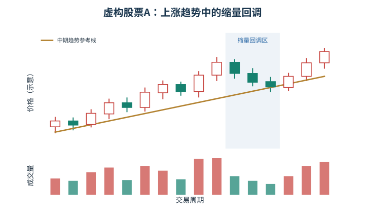

##### 分析过程

| 分析项目 | 观察结果 |
|---|---|
| 中期趋势 | 高点、低点整体抬高 |
| 当前状态 | 上涨趋势中的局部回调 |
| 成交量 | 回调期间逐渐减少 |
| 价格位置 | 接近原有上升结构参考区域 |
| 后续确认 | 价格出现恢复，成交活动有所提高 |
| 风险条件 | 如果价格有效跌破此前关键低点，原上涨结构受到挑战 |

此时适合提出的研究假设是：原上涨趋势可能在调整之后继续。

但仍需要排除行业转弱、重大负面公告及估值风险，并制定交易失效条件。

#### 10.3 实战案例二：高位放量但上涨乏力

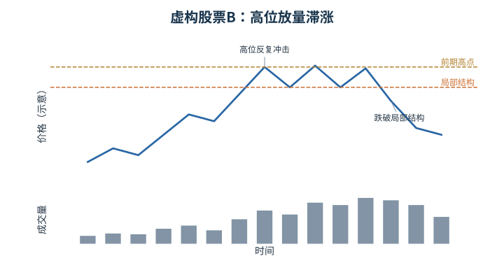

*示例中成交活动提高，但价格未能持续突破前高。*

分析时应关注：

- 股票是否已经积累较大涨幅。
- 成交量明显增加后，价格是否仍能创出并维持新高。
- 是否出现连续上影线、价格高点降低等结构变化。
- 企业盈利和市场预期是否能够支持进一步估值扩张。
- 如果关键价格结构被破坏，应当重新评价继续持有的逻辑。

不能仅凭放量滞涨断言必然存在出货，但可以将其作为风险进一步增加的候选信号。

#### 10.4 实战案例三：震荡突破与假突破

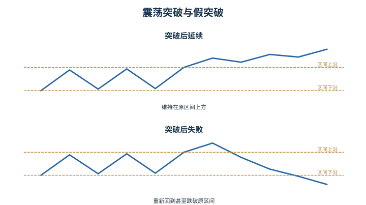

面对突破形态，可以研究三种不同的交易思路：

| 方式 | 进入条件 | 优势 | 局限 |
|---|---|---|---|
| 提前布局 | 整理尚未突破时进入 | 潜在买入成本较低 | 方向尚未确认 |
| 突破确认 | 价格满足突破规则后进入 | 获得初步方向信息 | 可能遇到假突破 |
| 回踩确认 | 突破后再次测试原区间并恢复 | 有机会建立较明确的失效条件 | 可能没有回踩机会 |

三种方式不存在天然的绝对优劣，需要依据策略统计结果、风险和交易成本评价。

#### 10.5 不同技术信号发生冲突时如何分析

| 冲突情况 | 分析思路 |
|---|---|
| 周线下跌，但日线MACD金叉 | 可能只是大级别下跌中的短期恢复 |
| 股价创新高，但RSI出现背离 | 关注动量减弱，但不直接认定顶部 |
| 均线多头排列，但成交量下降 | 原有趋势仍然存在，需要观察参与程度及价格结构 |
| RSI超卖，但价格持续创新低 | 下跌趋势可能尚未结束 |
| 个股上涨，但行业和大盘走弱 | 具有相对强势，也可能受到市场整体风险影响 |
| 技术形态看涨，但企业重大利空 | 必须重新评价消息及企业价值，技术形态可能失效 |
| 利好公告发布，但股价下跌 | 可能存在预期已经提前反映等情况 |

#### 10.6 技术分析综合练习

假设有三只虚构股票，均不存在已知重大公告事件：

| 指标 | 股票甲 | 股票乙 | 股票丙 |
|---|---:|---:|---:|
| 当前股价 | 20元 | 10元 | 35元 |
| MA20 | 19元 | 11元 | 30元 |
| MA60 | 17元 | 13元 | 26元 |
| RSI14 | 57 | 25 | 85 |
| 相对成交量 | 1.2 | 1.8 | 3.5 |
| 近期价格结构 | 上涨后回调 | 持续创新低 | 连续大幅上涨 |
| 行业表现 | 强于市场 | 弱于市场 | 强于市场 |
| ATR占股价 | 2% | 5% | 6% |

##### 分析结论

**股票甲：趋势回调研究对象。** 均线方向及价格位置相对有利，RSI尚未处于极端区间，波动幅度较小。但仍需研究回调是否结束，以及企业估值是否合理。

**股票乙：下跌趋势及潜在反转研究对象。** RSI很低只能说明近期相对弱势，不能直接证明价格已经见底。成交量增加也可能对应进一步下跌。需要等待符合预定规则的结构变化。

**股票丙：强势动量与过热风险研究对象。** 价格表现强劲，但已经明显偏离中期平均价格，波动较大，成交活动异常活跃。趋势可能延续，也可能出现剧烈回调。

这张表不能直接确定哪只股票应该买入，因为最终投资决策还缺少估值、财务状况、交易成本、持有期限、策略历史表现等信息。

真正成熟的分析，应当从寻找「上涨概率似乎较大」的股票，进一步发展为判断「哪些机会具有可验证的风险收益优势」。

#### 10.7 补充：同花顺日K线案例——九阳股份

> [!note] 用户提供的日线截图（原始资料）
> 图中日期轴截至2026年11月25日，行情截图时点为12:17左右。以下仅对截图中可辨认的数值及结构进行教学解读，不补造历史OHLC或未显示的消息，不预测下一交易日行情。

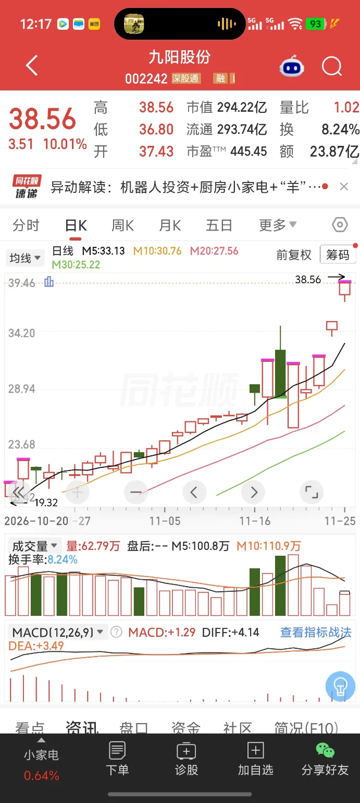

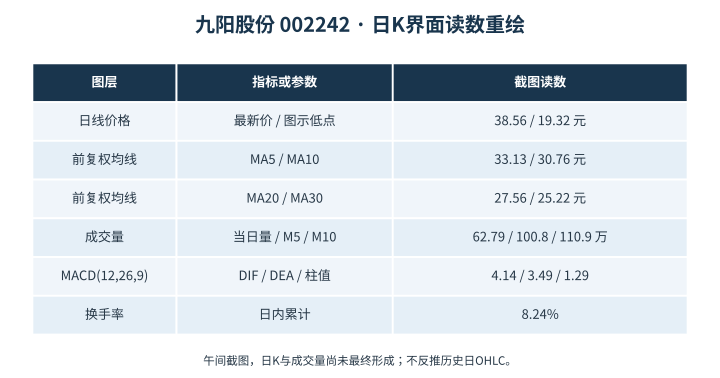

##### 10.7.1 趋势、均线及偏离

| 指标 | 截图数值 | 解读 |
|---|---:|---|
| 最新价 | 38.56元 | 最新价位于图示近期高位，午间日K尚未最终确定 |
| MA5 | 33.13元 | 最新价相对MA5高约16.39% |
| MA10 | 30.76元 | 最新价相对MA10高约25.36% |
| MA20 | 27.56元 | 最新价相对MA20高约39.91% |
| MA30 | 25.22元 | 最新价相对MA30高约52.89% |
| 近期图示低点 | 19.32元 | 从该图示低点至38.56元涨幅约99.59%，不等于任意持有人实际收益 |

MA5 > MA10 > MA20 > MA30，显示这些均线在截图时点呈多头排列。价格远离平均水平表明前期上涨强劲，同时也需要评估回撤风险。均线不等于必然回归的目标价。

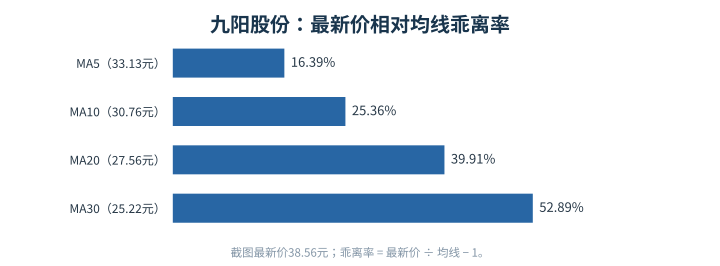

##### 10.7.2 成交量与MACD

- 截图当日量62.79万（需核对软件单位），M5为100.8万，M10为110.9万。由于是午间快照，不能直接将未结束的当日成交量与完整历史日成交量相比后认定全天缩量。
- 日线MACD显示DIF约4.14、DEA约3.49、柱值约1.29。按照双倍柱值公式，$2(4.14-3.49)=1.30$，与界面1.29的微小差异可由显示数值四舍五入解释。
- 分时MACD接近零，而日线MACD仍为正并不矛盾：两个指标使用的时间周期不同。
- 前复权是将历史价格调整到当前价格基准的方式；历史图上价格不一定等于当时可成交的原始价格。此案例不能仅凭图像反推每一交易日的准确OHLC。

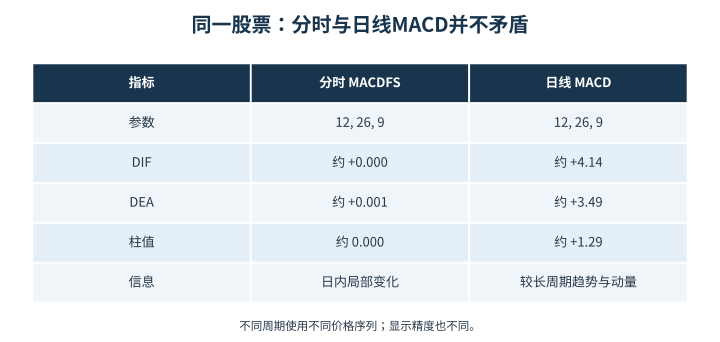

##### 10.7.3 交易风险与验证

- 7天5板、人气排名与技术强势共同反映较高关注度，不足以证明今后仍有持续超额收益。
- 市盈率TTM约445.45倍，需另行研究真实财报、业绩变化、非经常损益、估值与预期；截图中的异动解读标题不能证明公司已产生相应盈利。
- 涨停价排队买入可能无法成交；普通A股当日买入通常不能当日卖出，次日若跳空下跌，预定止损价也可能无法成交。
- 对此类行情的科学处理方式是记录观察时点，分别建立趋势延续、横盘整理、突破失败三种条件化假设，再根据真实后续数据验证，而非把封单金额或涨停次数直接换算为明日涨停概率。

---

## 第三篇　股票选择与投资价值分析

技术分析研究股票在市场上如何运行，基本面分析则研究股票所代表的企业究竟具有怎样的经济价值。

两类分析可以结合使用：

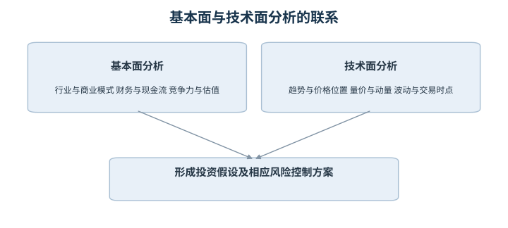

### 第十一章　宏观经济、行业与市场板块分析

#### 11.1 宏观经济对股票市场的传导关系

| 宏观因素 | 可能影响的股票市场变量 |
|---|---|
| 经济增长 | 企业销售、盈利及投资需求 |
| 通货膨胀 | 原材料成本、消费需求、实际购买力 |
| 市场利率 | 企业融资成本、估值折现率 |
| 货币政策 | 信用条件、市场预期与资金成本 |
| 财政政策 | 政府支出、税收及产业需求 |
| 汇率 | 海外收入、进口成本、外币债务 |
| 就业与收入 | 居民消费能力及企业销售 |
| 国际贸易 | 出口需求、供应链及经营成本 |

#### 11.2 利率与股票估值

在最简单的永续现金流模型中：

$$
V=\frac{CF}{r}
$$

假设企业每年永久产生10亿元现金流，其他条件不变：

| 折现率 | 理论现值 |
|---|---:|
| 5% | 200亿元 |
| 8% | 125亿元 |
| 10% | 100亿元 |

折现率上升可能降低资产估值。但实际降息或加息还可能同时改变企业盈利预期、经济需求和风险溢价，因此不能仅凭政策方向预测股票市场涨跌。

#### 11.3 行业生命周期与股票投资

| 行业阶段 | 研究重点 | 主要风险 |
|---|---|---|
| 导入期 | 技术可行性、市场接受程度 | 商业模式失败 |
| 成长期 | 收入增长、市场份额、竞争优势 | 估值过高、竞争加剧 |
| 成熟期 | 盈利稳定性、现金流、股息 | 增长放缓、竞争格局变化 |
| 衰退期 | 剩余资产价值、经营转型 | 需求下降、价值陷阱 |

#### 11.4 行业竞争力分析

使用波特五力模型研究：

- 行业内现有企业竞争强度。
- 潜在进入者带来的压力。
- 替代产品的威胁。
- 供应商的议价能力。
- 购买者的议价能力。

一个行业具有巨大市场空间，不代表其中的企业一定具有高利润。新能源汽车、互联网平台、人工智能等产业都需要分别研究收入增长能否真正转化为可持续利润与现金流。

#### 11.5 不同行业的重点经营指标

| 行业 | 重点关注指标 |
|---|---|
| 银行 | 净息差、不良贷款率、资本充足率 |
| 证券公司 | 市场成交额、承销业务、资产管理规模 |
| 保险 | 新业务价值、赔付率、偿付能力 |
| 制造业 | 产能利用率、订单、存货、毛利率 |
| 半导体 | 出货量、平均售价、库存周期、研发支出 |
| 软件与云计算 | 经常性收入、客户留存、自由现金流 |
| 零售消费 | 同店销售、毛利率、存货周转 |
| 能源与矿业 | 商品价格、生产成本、储量、资本支出 |
| 房地产 | 销售回款、负债期限、库存及现金流 |
| 航运 | 运价、运力供需、燃料成本 |

行业研究的核心，是识别真正能够影响企业收入、利润及估值的经营变量。

---

### 第十二章　企业基本面与财务报表分析

#### 12.1 企业基本面的六个分析维度

| 维度 | 核心问题 |
|---|---|
| 商业模式 | 企业如何赚钱？ |
| 竞争优势 | 企业为什么能够持续赚钱？ |
| 盈利能力 | 企业实际能够赚多少钱？ |
| 财务安全 | 企业能否正常履行债务义务？ |
| 成长潜力 | 企业未来还能够增长多少？ |
| 公司治理 | 管理层能否有效配置资本并保护股东利益？ |

#### 12.2 商业模式与经济护城河

企业收入可能来源于商品销售、服务收费、软件订阅、广告、平台佣金、技术授权及金融利差等。

经济护城河主要来源于成本优势、规模经济、品牌、网络效应、客户转换成本、技术壁垒、关键资源与渠道等。

分析时应当进一步判断这些优势是否最终反映为：

- 更稳定的市场份额。
- 更高或更稳定的利润率。
- 更低的经营成本。
- 更强的资本回报能力。
- 更可持续的自由现金流。

#### 12.3 三大财务报表

##### 12.3.1 利润表分析

需要重点关注营业收入、营业成本、毛利润、经营费用、营业利润、净利润及扣非净利润。

企业利润增长可能来自主营业务改善，也可能来自资产出售、投资收益等非经常性项目。因此，需要进一步研究利润的可持续性。

##### 12.3.2 资产负债表分析

基本关系：

$$
\text{资产}=\text{负债}+\text{所有者权益}
$$

重点检查货币资金、应收账款、存货、固定资产、商誉、有息债务及负债期限。

一家企业即使拥有大量资产，也可能因为短期现金流不足而陷入偿债困难。

##### 12.3.3 现金流量表分析

- 经营现金流：日常经营形成的现金流。
- 投资现金流：购建长期资产、投资与资产出售形成的现金流。
- 筹资现金流：借款、偿债、股权融资及分红等形成的现金流。

简化自由现金流：

$$
FCF=\text{经营现金流}-\text{资本性支出}
$$

完整的企业自由现金流及股权自由现金流需要进一步进行融资、税收等口径调整。

#### 12.4 财务分析的核心指标

| 指标 | 计算思路 | 分析目的 |
|---|---|---|
| 毛利率 | 毛利润÷营业收入 | 产品及服务盈利空间 |
| 净利率 | 净利润÷营业收入 | 最终盈利能力 |
| ROE | 相关净利润÷平均净资产 | 股东权益回报 |
| ROA | 相关利润÷平均资产 | 资产使用效率 |
| ROIC | 税后经营利润÷投入资本 | 经营资本回报 |
| 资产负债率 | 总负债÷总资产 | 总体负债程度 |
| 流动比率 | 流动资产÷流动负债 | 短期偿债能力 |
| 利息保障倍数 | 息税前利润÷利息费用 | 利息偿付能力 |
| 应收账款周转率 | 相关收入÷平均应收账款 | 回款效率 |
| 存货周转率 | 营业成本÷平均存货 | 库存经营效率 |

所有财务指标均应使用一致会计口径，并结合行业特征和多年历史数据判断。

#### 12.5 如何进行财务数据的横向与纵向比较

##### 12.5.1 纵向比较

比较同一家企业连续多个时期的经营表现。

| 财务指标 | 第一年 | 第二年 | 第三年 |
|---|---:|---:|---:|
| 营业收入 | 100亿 | 120亿 | 150亿 |
| 净利润 | 10亿 | 14亿 | 20亿 |
| 经营现金流 | 12亿 | 15亿 | 22亿 |
| 应收账款 | 15亿 | 17亿 | 19亿 |
| 净利率 | 10% | 11.67% | 13.33% |

这一虚构企业的收入、利润及经营现金流共同增长，净利率也逐步提高，可以进一步研究其经营改善的原因与持续性。

##### 12.5.2 横向比较

比较具有相似商业模式的同行企业，重点研究：

- 收入增长是否高于同行。
- 毛利率是否具有竞争优势。
- ROIC是否持续较高。
- 债务水平是否明显偏高。
- 企业估值是否能够由经营差异解释。

#### 12.6 财务风险预警

需要重点调查的情况包括：利润增长而现金流长期下降、应收账款增长远快于营业收入、库存大量积压、有息债务快速扩张、频繁融资、商誉减值风险、重大关联交易及审计异常等。

这些属于需要调查的风险信号，而不是单独证明财务造假的证据。

---

### 第十三章　股票估值与市场预期分析

#### 13.1 股票估值的分类

#### 13.2 市盈率PE

$$
PE=\frac{\text{股权市值}}{\text{相关净利润}}
$$

例如，公司市值为200亿元，年度净利润为10亿元，则PE为20倍。

市盈率可以按照利润口径划分为静态市盈率、滚动市盈率（TTM）、预测市盈率等。

低PE可能意味着价格较低，也可能意味着市场预期未来企业利润下降。因此，PE不能脱离增长、风险及盈利质量进行比较。

#### 13.3 市净率PB与市销率PS

$$
PB=\frac{\text{股权市值}}{\text{相关账面净资产}}
$$

$$
PS=\frac{\text{股权市值}}{\text{营业收入}}
$$

PB通常适合与资产质量及ROE结合研究；PS常用于收入已经形成、但利润尚不稳定的企业。

对于亏损企业，普通PE可能失去比较意义，但使用PS也不能忽略企业最终盈利的能力。

#### 13.4 PEG与EV/EBITDA

PEG将PE与预期盈利增长率结合起来：

$$
PEG=\frac{PE}{\text{盈利增长率的百分数数值}}
$$

例如，PE为30倍，预期年盈利增长20%，则PEG为1.5。

简化企业价值：

$$
EV=\text{股权市值}+\text{有息债务}-\text{现金}
$$

EV/EBITDA可以用于比较相关经营价值与经营收益，但仍需考虑资本支出、行业差异及债务结构。

#### 13.5 自由现金流折现估值

$$
V=\sum_{t=1}^{n}\frac{FCF_t}{(1+r)^t}+\frac{TV}{(1+r)^n}
$$

DCF的核心工作不是将数字机械代入公式，而是研究未来收入、利润率、资本投入、自由现金流及风险等假设是否合理。

#### 13.6 戴维斯双击与戴维斯双杀

股价由盈利与估值共同影响。

- 戴维斯双击：企业盈利增长与估值扩张共同推动股价上涨。
- 戴维斯双杀：企业盈利下降与估值收缩共同推动股价下跌。

#### 13.7 市场预期与预期差

股票价格往往提前反映投资者对未来经营结果的判断。

| 实际业绩 | 市场原有预期 | 可能形成的预期差 |
|---|---|---|
| 盈利增长20% | 盈利增长40% | 低于预期 |
| 盈利增长5% | 盈利下降10% | 好于预期 |
| 盈利下降20% | 盈利下降40% | 好于预期 |
| 盈利增长30% | 盈利增长30% | 基本符合预期 |

因此，好公司不等于好股票，好业绩也不必然带来股价上涨。

投资者需要分析的不是企业未来会不会增长这么简单，而是未来增长能否支持当前价格，以及实际结果是否可能与市场已经反映的预期存在差异。

#### 13.8 估值情景分析

假设某虚构企业目前股价为30元，未来可能出现以下三种经营情况：

| 情景 | 未来EPS | 对应PE | 情景股价 |
|---|---:|---:|---:|
| 悲观 | 1元 | 15倍 | 15元 |
| 基准 | 2元 | 20倍 | 40元 |
| 乐观 | 2.5元 | 24倍 | 60元 |

投资分析不能只观察乐观情景中可能上涨100%，还需要研究悲观情景发生的可能性及承担50%亏损的后果。

---

### 第十四章　选股体系与股票筛选方法

#### 14.1 选股的基本思路

选股不是立即找出明天涨幅最大的股票，而是从大量证券中逐层缩小研究范围。

#### 14.2 基本面选股

按照不同投资理念，可使用不同筛选条件。

| 选股方向 | 主要观察变量 |
|---|---|
| 价值选股 | PE、PB、现金流收益率、盈利稳定性 |
| 成长选股 | 收入增长、利润增长、市场空间 |
| 质量选股 | ROIC、ROE、现金流、负债 |
| 红利选股 | 股息率、分红持续性、资本支出需求 |
| 周期选股 | 行业库存、产能利用率、商品价格 |
| 困境反转选股 | 债务状况、业务改善、经营恢复证据 |

#### 14.3 技术面选股

##### 14.3.1 趋势型筛选

研究具有明确上涨趋势的股票。

可使用以下待检验变量：

- 价格位于中长期均线上方。
- 中长期均线具有向上斜率。
- 高点及低点整体抬高。
- 相对于行业或市场具有较强表现。

##### 14.3.2 突破型筛选

研究价格即将或已经越过历史整理区间的股票。

可考察历史高点、通道宽度、突破幅度及相对成交量。

##### 14.3.3 回调型筛选

研究上涨趋势中出现局部调整的股票。

可考察回调深度、调整期限、成交量变化、原有趋势是否受到破坏。

##### 14.3.4 反转型筛选

研究原有下跌趋势可能发生变化的股票。

重点不是股价已经下跌多少，而是新的价格结构、企业信息及市场行为是否支持趋势改变的假设。

#### 14.4 综合选股评分体系

例如，可以为候选股票建立五个研究维度：

*权重及评分均为教学示例，不代表经过验证的最佳选股模型，也不能将得分直接换算为上涨概率。*

评分体系的作用，是将研究过程标准化，避免因为单条新闻或某个指标突然变化，就完全改变对股票的总体认识。

---
## 第四篇　投资策略与盈利体系

这一篇是技术分析之后最重要的实战部分。

会看K线、会看财务报表，并不意味着已经具备盈利能力。因为从分析股票到取得实际收益，中间还存在交易规则、仓位分配、执行价格、盈亏结构和交易成本等环节。

### 第十五章　投资风格与典型交易策略

#### 15.1 按收益来源划分投资策略

#### 15.2 按持有时间划分交易风格

| 风格 | 典型持有时间 | 核心研究对象 |
|---|---|---|
| 超短线 | 数分钟至数日 | 短期价格行为、流动性 |
| 短线交易 | 数日至数周 | 短期趋势、交易事件 |
| 波段交易 | 数周至数月 | 中短期趋势、价格结构 |
| 中期投资 | 数月至一年或更久 | 行业周期、盈利变化 |
| 长期投资 | 数年至更长时间 | 企业价值、长期复利 |

时间只是交易风格的一种分类维度。短线交易不一定采用技术分析，长期投资也可以通过量化模型进行。

下面介绍的具体交易方案均属于**能够进行程序化研究的示例策略**，参数并非经过验证的最优参数，不是直接用于真实交易的盈利公式。

#### 15.3 策略一：趋势跟踪

趋势跟踪不试图精确判断股票底部与顶部，而是尝试在趋势已经形成之后参与，在趋势受到破坏时退出。

*趋势策略通常不会买在最低点、卖在最高点。*

##### 15.3.1 示例研究规则

| 组成部分 | 一组示例规则 |
|---|---|
| 股票范围 | 具有足够流动性的普通股票 |
| 趋势过滤 | MA20高于MA60，MA60高于10日前的数值 |
| 进入条件 | 日收盘价突破此前20个交易日最高价 |
| 交易执行 | 信号确认后的下一可交易时点，模拟真实成交 |
| 退出条件 | 收盘价跌破此前10个交易日最低价，或达到另行设定的风险退出条件 |
| 风险管理 | 按波动率及组合风险限制仓位 |

其研究假设是价格趋势可能具有一定持续性。

##### 15.3.2 适用市场与失败原因

趋势策略可能在具有持续上涨或下跌方向的市场中发挥作用，但容易在震荡市场中出现连续假突破及重复小额亏损。

趋势交易的盈利特征可能表现为较多小亏损与少数较大盈利，因此不能只用交易胜率评价。

#### 15.4 策略二：上涨趋势中的回调交易

该策略主要研究已经形成上涨趋势的股票，在局部回调之后是否重新恢复原有趋势。

##### 15.4.1 示例研究方案

- 趋势条件：价格及中期均线呈相对明确的上涨结构。
- 回调条件：价格出现局部下降，但尚未破坏设定的中期趋势条件。
- 确认条件：价格重新突破短期回调高点，或者满足事先定义的恢复规则。
- 失效条件：价格跌破关键回调低点等预设位置。
- 退出方案：固定收益风险比例、跟踪退出或趋势失效退出。

需要特别区分正常回调与趋势反转。不能因为此前属于上涨趋势，就将任何程度的下跌解释为洗盘或买入机会。

#### 15.5 策略三：整理区间突破

通过观察长期横盘后的价格变化，研究新趋势形成的可能性。

典型研究变量包括：

- 过去20日或60日最高价。
- 整理区间宽度。
- 突破后收盘位置。
- 相对成交量。
- ATR及价格波动范围。

例如，可以将突破定义为收盘价超过此前20日最高价，并要求成交量高于此前20日平均量的1.5倍。然后分别研究下一交易日进入、等待回踩进入等方式的实际结果。

是否增加放量条件，需要比较有条件策略与无条件策略的样本外表现，而不能默认增加条件一定更好。

#### 15.6 策略四：区间交易与均值回归

均值回归研究价格偏离一定参考水平后，是否具有返回相应水平的统计倾向。

常用研究工具：

- 布林带。
- RSI。
- 价格相对于均线的偏离程度。
- 历史价格区间。
- 价格或价差的标准化分数。

标准化分数可表示为：

$$
Z=\frac{P-\mu}{\sigma}
$$

均值回归不是指股价下跌之后必然重新上涨。对于企业持续恶化、出现新趋势或失去原有经济价值的股票，旧有平均价格可能已经不再具有参考意义。

区间交易最主要的风险是原有区间突然被打破，产生比过去区间内盈利更大的损失。

#### 15.7 策略五：价值投资

价值投资从企业未来经济利益出发，研究市场价格是否低于合理价值。

完整过程包括商业模式分析、财务分析、企业估值、风险识别及安全边际判断。

价值投资需要特别避免：

- 将低股价误认为低估。
- 将低PE直接误认为价值机会。
- 在企业价值持续下降时反复补仓。
- 将长期持有理解为永远不卖出。
- 忽略企业现金流与股东实际回报。

价值投资的退出条件可以是企业经营逻辑破坏、价格显著超过合理估值范围、风险条件发生变化，或者出现更适合投资目标的机会。

#### 15.8 策略六：成长与质量投资

成长投资重点关注企业未来收入、利润及自由现金流的增长。

质量投资重点关注较高资本回报、稳定盈利能力、可靠现金流与财务稳健性。

二者可以结合形成成长质量策略。

例如，研究持续增长、ROIC较高、现金流能够支持经营扩张的企业，再进一步判断当前估值是否已经充分反映增长预期。

#### 15.9 策略七：强势股与相对动量

相对动量研究一定时期内表现强于其他股票的资产，是否可能在后续阶段继续具有相对优势。

一种研究流程为：

1. 建立合格股票范围。
2. 计算不同股票过去一定时期的复权收益。
3. 按收益或相对于市场的表现排序。
4. 构建受行业集中度和流动性约束的投资组合。
5. 按预定周期进行重新评价。
6. 计算扣除交易成本后的收益及风险。

它与单纯追涨的区别，在于规则、研究期限、组合构建和风险管理具有明确规定，并能够进行历史检验。

#### 15.10 策略八：指数定投与长期配置

指数投资不是寻找短期上涨股票，而是通过持有市场组合获取长期市场风险收益敞口。

定投可以分散投入时点，帮助组织持续储蓄，但不能保证降低最终成本或提高收益。

定投与一次性投资之间的选择，需要考虑资金究竟是逐步获得，还是已经全部可以投资，以及投资期限和风险承受能力。

#### 15.11 常见策略的横向比较

| 策略 | 主要市场条件 | 常见失败方式 |
|---|---|---|
| 趋势跟踪 | 趋势持续 | 震荡市场频繁亏损 |
| 突破交易 | 整理后形成新方向 | 假突破 |
| 回调交易 | 原趋势尚未破坏 | 回调演变为反转 |
| 均值回归 | 相对稳定的价格关系 | 均值发生结构性改变 |
| 价值投资 | 估值与价值存在差异 | 价值陷阱 |
| 成长投资 | 增长持续且估值合理 | 增长低于预期 |
| 红利投资 | 分红能力具有持续性 | 股息削减及盈利恶化 |
| 指数投资 | 适合相应风险与投资期限 | 市场长期回撤与集中风险 |

**策略应当与市场环境、投资期限和风险结构相匹配，而不是追求在所有市场情况下都使用同一个买卖信号。**

---

### 第十六章　买入、持有与卖出决策

#### 16.1 买入前必须完成的四项判断

如果只能说出买入理由，却无法说明什么情况下判断会失效，就尚未形成完整的投资方案。

#### 16.2 常见建仓方式

| 方式 | 核心含义 | 风险与局限 |
|---|---|---|
| 一次性建仓 | 一次投入目标仓位 | 对单次进入价格较敏感 |
| 分批建仓 | 分多个时点建立目标持仓 | 需要明确每批条件 |
| 试探性建仓 | 先建立相对较小头寸 | 小仓位不能弥补错误策略 |
| 确认后增仓 | 原有假设获得进一步支持后增加头寸 | 后续买入价格可能更高 |
| 定期投入 | 按固定周期投入资金 | 不能消除资产下跌风险 |

#### 16.3 加仓、减仓与补仓

- 加仓：增加已经持有的投资头寸。
- 减仓：减少投资头寸。
- 补仓：通常指价格下跌后继续买入。
- 清仓：将相关头寸全部关闭。
- 调仓：调整投资组合中的资产及权重。

补仓可以降低账面平均买入成本，但同时增加实际风险敞口。

例如，10元买入1000股，股价跌至8元后再买入1000股：

$$
\text{平均成本}=\frac{10000+8000}{2000}=9\text{元}
$$

平均成本从10元下降到9元，但总投入从1万元增加到1.8万元。若股价继续跌至5元，总亏损将达到8000元，而不是原先只持有1000股时的5000元。

所以，降低成本不等于降低风险。

#### 16.4 持有股票期间应该观察什么

持有期间不应该每次价格波动都重新制定策略。主要检查的是：

| 检查对象 | 核心问题 |
|---|---|
| 企业基本面 | 最初研究的经营逻辑是否仍然成立？ |
| 估值水平 | 当前价格是否已显著脱离合理假设？ |
| 市场结构 | 所依据的趋势或价格关系是否失效？ |
| 行业环境 | 是否出现重大竞争、政策及需求变化？ |
| 投资组合 | 单项资产权重是否因上涨而过度集中？ |
| 资金需求 | 持有期限及流动性是否仍符合自身目标？ |

#### 16.5 卖出决策的主要类型

##### 16.5.1 价值型卖出

当资产估值明显高于研究价值范围，或者企业长期经营逻辑发生重大变化时重新评价持有价值。

##### 16.5.2 技术型卖出

当价格触及预先定义的趋势失效、区间跌破、波动退出等条件时执行相应规则。

##### 16.5.3 风险型卖出

由于组合集中度、资金用途、债务风险、流动性或者其他风险约束而减少持仓。

##### 16.5.4 配置型卖出

为了恢复目标资产配置比例，对不同投资资产进行调整。

#### 16.6 交易计划的基本模板

| 计划项目 | 虚构案例 |
|---|---|
| 研究对象 | 示例股票A |
| 策略类型 | 上涨趋势回调 |
| 观察价格 | 20元 |
| 进入条件 | 收盘确认突破短期回调高点 |
| 理论进入价 | 20元 |
| 假设失效价格 | 19元 |
| 初始目标情景 | 22元 |
| 单股计划风险 | 1元 |
| 单股潜在收益 | 2元 |
| 计划收益风险比 | 2:1 |
| 特殊事件 | 检查财报、停牌及其他公司公告 |
| 执行要求 | 考虑实际成交价及交易费用 |

这一方案只有在相关策略具有可验证的统计优势，并符合资金与风险约束时，才具有进一步研究意义。

---

### 第十七章　仓位管理、止盈止损与风险控制

#### 17.1 仓位的本质

仓位决定了某项投资判断正确或者错误时，对全部资产产生多大影响。

如果投资者拥有10万元本金：

| 股票投入金额 | 股价下跌20%时的亏损 | 总资产损失比例 |
|---|---:|---:|
| 1万元 | 2000元 | 2% |
| 3万元 | 6000元 | 6% |
| 5万元 | 10000元 | 10% |
| 10万元 | 20000元 | 20% |

因此，相同的股票分析结果，使用不同仓位，会形成完全不同的投资风险。

#### 17.2 止损的主要分类

##### 17.2.1 固定比例止损

根据进入价格预先设置一定比例的不利变动条件。

优点是容易计算和执行，缺点是可能忽略不同股票的正常波动差异。

##### 17.2.2 价格结构止损

根据重要低点、价格区间边界或其他技术结构确定失效条件。

##### 17.2.3 ATR波动止损

根据资产自身波动水平确定研究用止损距离。

$$
\text{假设止损距离}=k\times ATR
$$

参数 $k$ 需要经过策略验证。

这种方式可以使高波动和低波动股票采用不同的风险距离，而不是机械地使用相同百分比。

##### 17.2.4 时间止损

如果交易信号出现后，在预先设定的时间内没有发生原本预期的价格变化，则重新评价或退出。

##### 17.2.5 基本面止损

企业主营业务、盈利能力、竞争优势或偿债状况发生重大变化，使原有投资逻辑失效。

需要注意，基本面止损并不必然对应某一个固定股票价格。

#### 17.3 止盈的主要分类

- 固定比例止盈：达到预先设定收益条件后退出。
- 固定收益风险比止盈：根据初始计划风险确定相应收益目标。
- 分批止盈：按照规则逐步减仓。
- 跟踪止盈：随着有利价格变化提高退出参考水平。
- 趋势止盈：趋势受到破坏时退出。
- 估值止盈：当前价格达到或超过研究价值区间后重新评价。

*跟踪止盈示意。实际交易能否按参考价格成交，取决于市场流动性及可用订单机制。*

止盈与止损应当与投资策略匹配。趋势策略可能需要允许一定回撤以争取趋势收益，而均值回归策略可能更强调在价格恢复至目标区域后退出。

#### 17.4 风险预算与仓位计算

假设总资金为 $A$，对单次交易设定的计划风险比例为 $r$，预计进入价格为 $P$，失效参考价格为 $S$。

在普通股票多头、无杠杆条件下，简化理论持股数量：

$$
Q=\frac{Ar}{P-S}
$$

实际持股数量还需要按照交易单位向下取整，并考虑可用资金、手续费、滑点及组合风险限制。

*仅用于理解数学关系，未考虑交易单位、费用和跳空。预算不代表实际亏损上限，也不构成适合个人的仓位建议。*

这一计算方式的重要意义，是将仓位管理与资产自身风险联系起来。

#### 17.5 投资组合的集中风险

即使对每只股票分别设置风险预算，也不能简单认为整个组合一定安全。

例如，持有十只高度相关的同一行业股票，当行业受到共同冲击时，十只股票可能同时下跌。

需要从多个维度研究集中程度：

- 单只股票集中度。
- 单一行业集中度。
- 单一地区集中度。
- 同一经济风险因子集中度。
- 同一交易策略集中度。
- 同一流动性来源集中度。

#### 17.6 最大回撤与本金保护

最大回撤是投资资产价值从历史高点下降至后续低点的最大比例。

亏损与回本所需收益存在明显的非对称性。

控制严重亏损并不意味着完全避免风险，而是避免单次或一系列错误决策对长期资本积累造成难以恢复的损害。

---

### 第十八章　投资收益、胜率、盈亏比与数学期望

这是将炒股从单纯猜测涨跌转化为科学策略研究的核心章节。

#### 18.1 胜率

$$
p=\frac{\text{盈利交易次数}}{\text{总交易次数}}
$$

如果100次交易中有60次盈利，则历史样本胜率为60%。

历史胜率并不代表未来胜率，也必须与盈利幅度及亏损幅度结合评价。

#### 18.2 平均盈利、平均亏损与盈亏比

$$
\text{盈亏比}=\frac{\text{平均盈利金额}}{\text{平均亏损金额}}
$$

这里将平均亏损金额按照正数表示。

例如，平均每次盈利300元、平均每次亏损100元，则盈亏比为3。

需要区分：

- 计划收益风险比：交易之前估计的潜在收益与风险。
- 实际盈亏比：完成大量交易后，真实平均盈利与平均亏损之比。

二者可能存在显著差异。

#### 18.3 数学期望

简化情况下：

$$
E=pW-(1-p)L-C
$$

其中：

- $p$：盈利概率。
- $W$：平均盈利。
- $L$：平均亏损的绝对值。
- $C$：每次交易平均成本。
- $E$：单次交易的理论净期望。

*期望合计假设每次交易金额与概率结构保持不变，不考虑复利。正期望不代表100次交易一定盈利。*

#### 18.4 盈亏平衡胜率

忽略交易成本时：

$$
p_{\min}=\frac{1}{1+b}
$$

其中，$b$ 为盈亏比。

| 盈亏比 | 理论盈亏平衡胜率 |
|---:|---:|
| 0.5:1 | 66.67% |
| 1:1 | 50.00% |
| 1.5:1 | 40.00% |
| 2:1 | 33.33% |
| 3:1 | 25.00% |
| 4:1 | 20.00% |

*未考虑手续费、滑点及其他成本。实际达到净盈利通常需要更好的盈亏结构。*

#### 18.5 为什么高胜率不等于高收益

假设两种策略各交易100次：

| 指标 | 策略A | 策略B |
|---|---:|---:|
| 胜率 | 80% | 40% |
| 平均盈利 | 100元 | 400元 |
| 平均亏损 | 500元 | 100元 |
| 总盈利 | 8000元 | 16000元 |
| 总亏损 | 10000元 | 6000元 |
| 未扣成本净收益 | −2000元 | +10000元 |

策略A虽然大多数时候盈利，但少数严重亏损抵消了之前的利润。

策略B虽然多数交易亏损，但少数盈利交易能够覆盖全部亏损。

这意味着科学投资研究的重点，应当从单次交易成功率转移至长期盈亏分布。

#### 18.6 连续亏损的概率

假设某策略真实胜率为50%，且每次交易相互独立。

指定连续五次交易全部亏损的概率为：

$$
(1-0.5)^5=3.125\%
$$

这并不表示整个交易生涯中出现五连亏的概率只有3.125%。随着交易次数增加，出现某一段连续亏损的机会会明显提高。

现实市场交易还可能具有相关性，市场环境恶化可能使同一策略连续多次失效。

#### 18.7 利润因子（Profit Factor）

$$
PF=\frac{\text{全部盈利交易的总盈利}}{\text{全部亏损交易的总亏损}}
$$

在统一交易成本口径下：

- PF大于1：样本内总盈利高于总亏损。
- PF等于1：样本内盈亏平衡。
- PF小于1：样本内总亏损超过总盈利。

PF需要与交易数量、最大回撤、成本及样本外表现联合评价。

#### 18.8 投资绩效的综合指标

| 指标 | 研究目的 |
|---|---|
| 累计收益率 | 投资期间总回报 |
| 年化收益率 | 不同投资期限的收益比较 |
| 胜率 | 盈利交易频率 |
| 盈亏比 | 盈利与亏损幅度 |
| 数学期望 | 平均单次交易净收益假设 |
| 利润因子 | 总盈利与总亏损关系 |
| 波动率 | 收益变化程度 |
| 最大回撤 | 历史最大阶段性损失 |
| 夏普比率 | 单位总波动风险对应的超额收益 |
| 索提诺比率 | 单位下行风险对应的相关收益 |
| 卡玛比率 | 年化收益与最大回撤的关系 |
| 跟踪误差 | 投资收益相对于基准的波动 |
| 信息比率 | 单位跟踪误差对应的主动超额收益 |

#### 18.9 正期望并不自动意味着策略可以安全使用

一项策略即使历史平均收益为正，也可能具有：

- 很大的单次极端损失。
- 严重的阶段性回撤。
- 样本量不足导致的统计误差。
- 难以真实成交的交易条件。
- 不同市场环境下完全不同的表现。
- 随投资者增加而逐渐消失的收益机会。

因此，真正的盈利体系需要同时满足四项要求：

---

## 第五篇　其他证券与投资工具

股票不是证券市场中唯一的投资工具。指数、基金、可转债、期货和期权可以用于扩大投资范围、构建不同风险收益结构以及管理既有风险。

不过，不能因为某项产品能够像股票一样在交易软件中买卖，就将其按照普通股票的逻辑进行投资。

### 第十九章　股票指数、基金与ETF

#### 19.1 股票指数

股票指数是根据一定规则计算的一组股票的综合价格或收益指标。

##### 19.1.1 按覆盖范围分类

- 综合指数：反映某个市场较广泛的股票表现。
- 宽基指数：按照规则选择具有市场代表性的股票。
- 行业指数：反映特定行业的股票表现。
- 主题指数：围绕特定技术、产业或经济主题构建。
- 风格指数：依据规模、价值、成长、红利等特征构建。

##### 19.1.2 按权重计算方式分类

- 总市值加权。
- 自由流通市值加权。
- 价格加权。
- 等权重。
- 基本面及因子加权。

##### 19.1.3 主要股票指数

| 市场 | 指数 | 主要代表范围 |
|---|---|---|
| 中国内地 | 上证综合指数 | 上海证券市场较广泛表现 |
| 中国内地 | 沪深300 | 沪深市场代表性大型股票 |
| 中国内地 | 中证500 | 相对中等市值股票 |
| 中国内地 | 中证1000 | 相对较小市值股票 |
| 中国内地 | 科创50 | 科创板代表性股票 |
| 中国内地 | 创业板指 | 创业板代表性股票 |
| 中国香港 | 恒生指数 | 香港市场代表性大型股票 |
| 中国香港 | 恒生科技指数 | 香港市场代表性科技企业 |
| 美国 | 标普500 | 美国大型上市企业 |
| 美国 | 纳斯达克100 | 纳斯达克上市的大型非金融企业 |
| 美国 | 道琼斯工业平均指数 | 代表性大型上市企业 |
| 美国 | 罗素2000 | 代表性小盘股票 |
| 日本 | 日经225 | 日本代表性上市企业 |
| 新加坡 | 海峡时报指数 | 新加坡代表性大型股票 |
| 全球 | MSCI World | 发达市场大中型股票 |
| 全球 | MSCI ACWI | 发达与新兴市场大中型股票 |

#### 19.2 基金的总体分类

基金是投资载体，其风险取决于基础资产、投资策略、费用、流动性、杠杆等因素。

#### 19.3 ETF与指数基金

ETF将集合投资与交易所交易机制相结合。

ETF和指数基金不是完全相同的概念：

- ETF强调交易及申购赎回安排。
- 指数基金强调跟踪指数的投资管理目标。

ETF可以采用主动管理方式，指数基金也可以通过普通场外基金形式存在。

#### 19.4 ETF的投资方向

| 类型 | 主要资产敞口 |
|---|---|
| 宽基ETF | 广泛股票市场 |
| 行业ETF | 特定行业 |
| 主题ETF | 特定产业主题 |
| 红利ETF | 红利相关股票组合 |
| 成长ETF | 成长特征股票 |
| 债券ETF | 债券市场 |
| 黄金ETF | 黄金或黄金相关资产 |
| 跨境ETF | 境外市场 |
| 杠杆ETF | 特定周期内放大基准收益 |
| 反向ETF | 特定周期内取得反向收益敞口 |

#### 19.5 ETF的分析指标

| 指标 | 主要意义 |
|---|---|
| 基金规模 | 基金所管理的资产规模 |
| 单位净值 | 每份基金权益对应的净资产 |
| 市场价格 | ETF二级市场交易价格 |
| 折溢价率 | 市场价格相对于净值的偏离 |
| 跟踪差异 | 基金与目标指数收益差额 |
| 跟踪误差 | 跟踪差异的波动 |
| 管理费 | 持有期间的相关管理成本 |
| 买卖价差 | 实际交易流动性及成本 |
| 前十大持仓占比 | 基金集中程度 |

例如，ETF参考净值为1元，市场交易价格为1.10元，则溢价率为10%。

即使其底层资产价格保持不变，ETF市场价格也可能因为溢价收缩而下跌。

#### 19.6 杠杆ETF的路径依赖

假设指数第一天上涨10%，第二天下跌10%，最终累计亏损1%。

每日两倍杠杆产品则先上涨20%，再下跌20%，最终累计亏损4%。

因此，具有每日重置机制的杠杆ETF长期收益并不一定等于指数长期收益的固定倍数。

---

### 第二十章　债券与可转换债券

#### 20.1 债券投资的基本逻辑

股票代表股权，债券主要代表债权。

债券收益来自合同利息、价格变化及再投资收益。主要风险则包括利率风险、信用风险、流动性风险及提前偿付风险。

普通固定利率债券在其他条件不变时，市场要求收益率越高，其未来现金流现值越低。

#### 20.2 债券价格与市场利率

*在现金流固定、正常履约的简化假设下，收益率与债券价格反向变化。*

#### 20.3 可转换债券的金融本质

可转债通常同时受到发行人信用、市场利率、正股价格、波动率及特殊合同条款影响。

#### 20.4 可转债必须了解的核心指标

| 指标 | 含义 |
|---|---|
| 正股 | 可转债所对应的公司股票 |
| 转股价 | 按照合同转换股票时使用的价格 |
| 转股期 | 可以申请转股的相关期间 |
| 转股价值 | 按照当前正股价格计算的转换价值 |
| 转股溢价率 | 转债价格相对于转股价值的溢价 |
| 纯债价值 | 不考虑转股等选择权时的估计债券价值 |
| 到期收益率 | 根据约定债券现金流及价格计算的收益率 |
| 剩余期限 | 距离合同到期的时间 |

以面值100元的可转债为例：

$$
\text{转股价值}=\frac{100}{\text{转股价}}\times\text{正股价格}
$$

$$
\text{转股溢价率}=\frac{\text{转债价格}}{\text{转股价值}}-1
$$

*忽略实际转股单位、费用、转股期限及其他合同限制，仅展示计算关系。*

#### 20.5 可转债的三种经济状态

- 偏债型：相对更加依赖债券信用与现金流价值。
- 平衡型：债权价值与转股选择权均具有较大影响。
- 偏股型：价格对正股变化相对敏感。

所谓债底属于估计的纯债价值，并非实际市场价格不可跌破的保证。

#### 20.6 可转债的特殊条款

- 强制赎回：满足相关合同条件时，发行人可能提前赎回转债。
- 回售：满足规定条件时，投资者可能有权要求发行人购回。
- 转股价格调整：因分红送股等公司行动发生相应调整。
- 转股价格下修：按照合同和公司决策程序降低转股价格。

忽视强赎公告、购买高溢价转债、误认为可转债必然保本，都是可转债投资中需要特别警惕的问题。

#### 20.7 可转债常见研究策略

- 偏债价值研究：重点分析信用质量与纯债价值。
- 偏股趋势研究：重点分析正股价格和转股相关价值。
- 双低策略：同时研究转债价格与转股溢价率相对较低的资产。
- 可转债组合策略：通过配置多只转债分散部分个别风险。
- 条款事件研究：分析下修、强赎、回售等事件的影响。

双低、低价、高到期收益率等指标均需要结合信用风险与条款进行研究，不能独立作为安全保证。

---

### 第二十一章　期货与期权

#### 21.1 期货的本质及分类

期货是标准化的未来履约合约，并不是直接持有对应企业的股票。

对于股票投资者，股指期货是最直接相关的期货工具之一，可以用于建立指数风险敞口或管理股票组合的市场风险。

#### 21.2 期货交易的核心术语

- 多头：合约价格上涨时通常获益。
- 空头：合约价格下跌时通常获益。
- 开仓：建立合约头寸。
- 平仓：关闭已有头寸。
- 保证金：用于履约保障的资金或其他资产。
- 每日盯市：根据相关结算价格计算并调整盈亏。
- 追加保证金：账户保障资金不足时补充资金。
- 强制平仓：符合风险条件时按照规定处理头寸。
- 展期：关闭临近到期头寸并建立其他期限头寸。
- 基差：通常指现货价格与期货价格之差。

#### 21.3 期货杠杆的数学原理

假设某股指期货报价为4000点，合约乘数为每点100元，保证金比例为10%。

名义合约价值：

$$
4000\times100=400000\text{元}
$$

初始保证金：

$$
400000\times10\%=40000\text{元}
$$

*实际交易可能提前触发追加保证金或强制平仓。初始保证金并非最大亏损金额。*

#### 21.4 股指期货与股票组合对冲

股票组合受到市场整体下跌影响时，可以通过建立相反的指数期货敞口减少部分共同市场风险。

但实际对冲需要考虑：

- 股票组合与标的指数之间的相关关系。
- Beta风险暴露。
- 期货名义合约价值。
- 基差变化。
- 保证金及流动性。
- 合约期限与展期成本。

对冲并非无风险套利，也可能在市场上涨时抵消股票组合的部分收益。

#### 21.5 期权的本质

期权买方通过支付权利金取得相关选择权，期权卖方则按照合同承担履约义务。

- 看涨期权（Call）：取得按照约定条件买入标的等权利。
- 看跌期权（Put）：取得按照约定条件卖出标的等权利。
- 欧式期权：通常只能在到期时行权。
- 美式期权：通常可以在到期前规定期间内行权。

#### 21.6 四种基本期权头寸

*普通期权到期盈亏示意，包含权利金，不考虑交易费用。横轴为标的价格。*

普通期权买方的到期盈亏公式分别为：

$$
\Pi_{Call}=\max(S_T-K,0)-C
$$

$$
\Pi_{Put}=\max(K-S_T,0)-P
$$

其中，$K$ 是行权价格，$S_T$ 是到期标的价格，$C$ 和 $P$ 分别为相应权利金。

#### 21.7 为什么判断股价方向正确，期权仍可能亏损

期权价格不仅受标的股票价格影响，还受到时间期限、波动率、利率及买入时的权利金等影响。

| 风险敏感度 | 主要衡量内容 |
|---|---|
| Delta | 标的价格变化对期权价格的影响 |
| Gamma | 标的价格变化对Delta的影响 |
| Theta | 时间经过对期权价值的影响 |
| Vega | 波动率变化对期权价值的影响 |
| Rho | 利率变化对期权价值的影响 |

购买行权价100元、权利金5元的看涨期权时，标的到期上涨至103元，虽然股票上涨方向判断正确，但期权到期净亏损仍为2元。

因此，期权交易不仅需要判断方向，还需要研究价格变化幅度、时间、波动率及合约成本。

#### 21.8 常见期权组合

| 组合 | 构成逻辑 | 主要用途 |
|---|---|---|
| 保护性看跌 | 持有标的＋买入看跌期权 | 限制部分下跌风险 |
| 备兑看涨 | 持有标的＋卖出看涨期权 | 获得权利金，同时让渡部分上涨收益 |
| 垂直价差 | 不同行权价的相关期权组合 | 构造有限风险收益区间 |
| 跨式组合 | 同行权价、同期限的看涨与看跌期权 | 研究波动机会 |
| 宽跨式组合 | 不同行权价的看涨与看跌期权 | 构造不同波动风险结构 |

上述名称属于不同金融支付结构，并不代表某一种期权组合必然比普通股票具有更优收益。

---

### 第二十二章　融资融券、杠杆与其他投资产品

#### 22.1 融资买入

使用借入资金购买股票。

假设自有资金1万元，借款1万元，购买2万元股票：

| 股价变化 | 自有权益变化（未计成本） |
|---:|---:|
| +20% | +40% |
| +10% | +20% |
| −10% | −20% |
| −20% | −40% |
| −40% | −80% |

融资还会产生利息费用、担保比例限制及可能的强制平仓。

#### 22.2 融券卖出与做空

做空股票可能面临借券费用、股息补偿、借券召回、流动性及理论上没有固定上涨损失上限等风险。

#### 22.3 逼空与轧空

当股票价格快速上涨，空头可能因亏损或保证金压力买回股票。

集中回补可能进一步增加买入需求，使价格继续上涨。

相反，杠杆多头集中被迫卖出，也可能进一步放大下跌。

#### 22.4 其他常见投资产品

| 产品 | 本质 | 需要特别了解的风险 |
|---|---|---|
| REITs | 房地产、基础设施等相关投资载体 | 经营现金流、债务、利率 |
| 存托凭证 | 代表境外相关证券权益的凭证 | 汇率、托管、法律结构 |
| 权证 | 相关证券的选择权工具 | 时间价值、杠杆、发行人风险 |
| 牛熊证 | 具有杠杆及强制收回机制的结构化产品 | 提前终止及重大亏损 |
| ETN | 与相关标的收益挂钩的债务工具 | 发行人信用 |
| CFD | 根据标的价格差额结算的合同 | 杠杆、交易对手及费用 |
| 结构化票据 | 债务工具与衍生支付安排的组合 | 信用及复杂合同条款 |

#### 22.5 各类投资工具的总体比较

| 工具 | 收益来源 | 主要分析重点 |
|---|---|---|
| 股票 | 企业经营、股息及股价变化 | 基本面、估值、趋势 |
| 股票ETF | 股票组合收益 | 指数、费率、折溢价 |
| 债券 | 利息及价格变化 | 利率、信用、期限 |
| 可转债 | 债权价值及转股权 | 正股、溢价、信用、条款 |
| 股指期货 | 指数合约价格变化 | 基差、期限、保证金 |
| 股票期权 | 标的价格及期权价值变化 | 行权价、期限、波动率 |
| REITs | 资产经营分配及价格变化 | 现金流、资产价值、利率 |
| 融资融券 | 杠杆或空头敞口产生的收益 | 融资成本、风险限额 |

---
## 第六篇　投资实践与现代投资技术

### 第二十三章　投资心理与常见交易陷阱

#### 23.1 投资者的常见认知偏差

| 心理偏差 | 实际交易表现 |
|---|---|
| 损失厌恶 | 不愿承认亏损，长期持有错误头寸 |
| 处置效应 | 盈利后急于卖出，亏损后长期不卖 |
| 锚定效应 | 过度重视买入价、历史最高价 |
| 确认偏误 | 只寻找支持原有判断的信息 |
| 过度自信 | 连续盈利后认为自己拥有准确预测能力 |
| 从众效应 | 因市场热度或他人推荐而买入 |
| 近因效应 | 将近期表现直接外推到未来 |
| 后见之明偏差 | 事后认为市场变化早就可以准确预测 |
| 赌徒谬误 | 认为连续下跌后下一次必然上涨 |
| 沉没成本效应 | 因已经投入大量资金而继续错误投资 |

#### 23.2 股市中的典型情绪循环

*市场情绪变化的概念模型，并非每轮行情都按照相同顺序运行，也不能用于直接预测市场顶部与底部。*

市场上涨过程中，投资者可能逐渐由谨慎变为乐观；市场下跌过程中，投资者也可能逐渐由乐观变为悲观。

情绪分析的目的，是研究判断是否受到市场价格和其他投资者行为的过度影响，而不是根据情绪标签直接进行反向交易。

#### 23.3 普通投资者常见的交易错误

| 错误 | 根本问题 |
|---|---|
| 看到上涨就追买 | 没有研究上涨后的风险收益关系 |
| 看到大跌就抄底 | 将价格下降等同于价值提高 |
| 亏损后无限补仓 | 不断扩大错误判断的风险敞口 |
| 盈利后随意扩大杠杆 | 将阶段性盈利误认为稳定能力 |
| 频繁更换策略 | 无法形成有效统计样本 |
| 不计算交易费用 | 高估实际盈利能力 |
| 依赖所谓内幕消息 | 信息真实性与法律风险 |
| 过度相信技术指标 | 将历史数据计算结果视为确定预测 |
| 随意修改止损条件 | 使原有风险预算失效 |
| 持仓过度集中 | 单一事件可能造成严重损失 |

#### 23.4 如何建立交易纪律

交易纪律不是要求投资者永远执行某一个错误规则，而是要求策略修改、投资决策与风险承担具有明确依据。

比较科学的方式是将策略研究与实际执行分开：

---

### 第二十四章　量化投资、策略回测与算法交易

量化投资在本专栏中的重要意义，是能够帮助普通投资者检验所学习的K线形态、技术指标、选股条件和交易方案究竟是否具有实际研究价值。

#### 24.1 将主观交易思路转换为量化规则

例如，传统技术分析可能提出：

> 一只股票长期上涨，经过缩量回调之后重新放量突破，可能继续上涨。

但这句话不足以直接进行科学检验，因为其中存在多个模糊概念。

| 主观描述 | 可供检验的量化定义示例 |
|---|---|
| 长期上涨 | MA20高于MA60，且MA60较10日前提高 |
| 股价强势 | 过去60日收益高于相应行业指数 |
| 回调 | 价格相对于过去20日最高收盘价下降3%至8% |
| 缩量 | 最近5日平均成交量低于前20日平均量 |
| 放量 | 当日成交量超过此前20日均量的1.5倍 |
| 突破 | 收盘价高于此前5日最高价 |
| 后续上涨 | 信号出现后10个交易日的累计收益 |
| 交易失败 | 满足事先定义的价格结构失效条件 |

这些阈值只是为了演示如何建立数学定义，尚未证明具有盈利优势。

#### 24.2 量化研究的完整流程

#### 24.3 如何检验一种K线形态是否具有预测价值

以锤头线为例，可以设计以下研究。

##### 24.3.1 建立研究对象

选取具有完整历史价格数据的股票，并确保历史退市股票等对象没有被不当地排除。

##### 24.3.2 定义形态

通过实体长度、上下影线比例及此前趋势建立可以重复使用的规则。

##### 24.3.3 统计形态出现后的收益

分别研究未来1日、5日、10日及20日的收益变化。

##### 24.3.4 设置对照组

比较锤头线出现后的收益与类似市场状态、波动程度、行业及此前跌幅条件下的普通交易日收益。

否则，观察到锤头线之后经常上涨，可能只是因为研究期间整体市场本来就在上涨。

##### 24.3.5 将预测研究转化为交易研究

进一步模拟真实交易时点、成交价格、退出规则及交易成本。

需要避免使用收盘之后才确认的K线形态，却在回测中假设自己已经以当天收盘价完成交易。

#### 24.4 样本内与样本外检验

*金融时间序列通常需要保持时间顺序。最终测试数据不应被反复用于修改策略参数。*

- 样本内：用于提出、建立或训练模型的数据。
- 验证集：用于比较参数及候选模型的数据。
- 样本外测试集：用于评价已经确定的策略在未使用数据中的表现。
- 滚动检验：随着时间推进，按照固定研究规则进行重新训练与测试。

#### 24.5 回测中最常见的错误

| 错误 | 具体表现 |
|---|---|
| 未来数据泄漏 | 提前使用尚未公开的财报或未来价格 |
| 幸存者偏差 | 只研究现在仍然上市的股票 |
| 过拟合 | 反复调整参数以匹配历史走势 |
| 数据窥探 | 尝试大量策略后只展示最成功的一项 |
| 成本遗漏 | 不计手续费、税费、借贷费用及滑点 |
| 成交假设错误 | 假定涨跌停、停牌或低流动性股票一定能够成交 |
| 复权错误 | 将分红、送股产生的价格调整误认为真实涨跌 |
| 基准不合理 | 使用不包含股息的指数比较包含股息的策略收益 |

一个历史回测收益非常高的策略，首先需要检查这些问题，而不是立即投入真实资金。

#### 24.6 策略回测结果的正确阅读方式

假设两个虚构策略经过相同期限测试：

| 评价指标 | 策略甲 | 策略乙 |
|---|---:|---:|
| 累计收益 | +70% | +48% |
| 最大回撤 | 40% | 15% |
| 年均交易次数 | 240次 | 35次 |
| 盈亏比 | 1.2 | 2.1 |
| 交易成本敏感度 | 高 | 相对低 |
| 样本外表现 | 明显下降 | 相对稳定 |

不能仅凭策略甲累计收益更高就判断它优于策略乙。

真正的评价还包括风险、回撤、市场敞口、交易容量、真实执行以及统计可信度。

#### 24.7 投资软件的核心架构

对于具有计算机学习背景的投资研究者，适合从以下实用软件项目入手：

| 项目 | 主要知识 |
|---|---|
| 股票行情分析程序 | API、JSON、时间序列 |
| 技术指标计算器 | 数组、滑动窗口、统计计算 |
| K线可视化平台 | OHLC数据、前端图表 |
| 自动选股工具 | 数据筛选、多条件查询 |
| 投资收益计算器 | 现金流、收益率、复利 |
| 策略回测引擎 | 事件驱动、数据结构、订单模拟 |
| 投资组合风险分析工具 | 概率论、矩阵、协方差 |
| 投资交易日志系统 | 数据库、数据分析及可视化 |

这些项目可以完全使用历史数据和虚拟资金开展，不需要直接使用真实证券账户进行程序化交易。

---

### 第二十五章　全球证券市场与跨境投资

#### 25.1 中国内地证券市场

主要包括上海证券交易所、深圳证券交易所、北京证券交易所及全国中小企业股份转让系统等。

普通投资者需要了解主板、科创板、创业板及北交所之间的交易规则、投资者适当性和风险特征差异。

常见术语包括A股、B股、ST及其他风险警示、龙虎榜、大宗交易、限售股解禁、停复牌等。

#### 25.2 香港证券市场

香港市场主要提供普通股票、ETF、REITs、衍生权证、牛熊证、指数及股票相关衍生品等金融工具。

H股、红筹股及其他香港上市公司股票具有不同的注册及权益结构背景。

对于香港上市股票，需要额外了解每手交易数量、碎股处理、交易费用、外汇风险、托管及适用交易制度。

#### 25.3 美国证券市场

主要股票交易场所包括纽约证券交易所、纳斯达克等。

常见投资产品包括股票、ETF、股票期权、指数期权、存托凭证及房地产投资信托等。

需要进一步研究盘前盘后交易、现金账户与保证金账户的区别、证券借贷、交易结算、企业财报披露与税务等问题。

#### 25.4 不同市场进行交易时需要检查的制度

| 比较维度 | 必须确认的问题 |
|---|---|
| 回转交易 | 当日买入后能否当日卖出 |
| 证券交收 | 交易后何时完成资产交付 |
| 涨跌幅与波动限制 | 极端价格变化时适用什么制度 |
| 交易单位 | 是否允许按股买卖，是否存在每手要求 |
| 交易时间 | 盘前、正常交易及盘后时段 |
| 订单类型 | 支持哪些限价、条件及其他订单 |
| 市场费用 | 佣金、交易税及其他费用 |
| 投资者资格 | 是否存在资金或专业资格限制 |
| 资产托管 | 资产在哪里持有，如何获得法律保障 |

具体交易制度会变化，应以交易所及监管机构届时公布的规则为准，不能直接将一个市场的回测结果无条件应用于另一个市场。

#### 25.5 跨境投资的汇率收益

$$
1+R_{\text{本币}}=(1+R_{\text{外币资产}})(1+R_{\text{汇率}})
$$

其中，汇率收益率按照一单位外币所对应本币金额的变化计算。

例如，以7200元人民币兑换1000美元并购买资产，一年后资产增值至1100美元，但美元兑人民币汇率从7.20变为6.80。

最终人民币价值为7480元，人民币收益率约3.89%，而非美元计价的10%。

跨境投资还需要考虑税务、兑换费用及相关跨境资金管理制度。

---

### 第二十六章　综合投资案例与完整交易体系建设

#### 26.1 综合研究案例

假设需要研究一家虚构的上市科技企业。

##### 26.1.1 第一阶段：观察市场与行业

| 项目 | 研究结果 |
|---|---|
| 大盘 | 中期温和上涨 |
| 行业 | 过去60日表现强于大盘 |
| 行业需求 | 出现一定增长 |
| 行业竞争 | 竞争仍然激烈 |
| 宏观风险 | 利率变化及企业估值较敏感 |

##### 26.1.2 第二阶段：企业基本面

| 指标 | 虚构数据 |
|---|---:|
| 年度营业收入 | 100亿元 |
| 年度净利润 | 10亿元 |
| 年度经营现金流 | 12亿元 |
| 资本性支出 | 4亿元 |
| 简化自由现金流 | 8亿元 |
| 平均净资产 | 50亿元 |
| ROE | 20% |
| 总股本 | 5亿股 |
| 每股收益 | 2元 |
| 当前股价 | 40元 |
| 总市值 | 200亿元 |
| PE | 20倍 |

企业当前盈利与现金流具有一定研究价值，但还需要检查历史增长、债务、行业地位及相关会计口径。

##### 26.1.3 第三阶段：估值情景

| 情景 | 未来EPS | 假设PE | 对应股价 |
|---|---:|---:|---:|
| 悲观 | 1.5元 | 16倍 | 24元 |
| 基准 | 2.2元 | 20倍 | 44元 |
| 乐观 | 2.8元 | 24倍 | 67.2元 |

当前40元价格相对于这些假设情景，存在上涨空间，也存在明显下跌风险。

不能仅依据基准情景44元或者乐观情景67.2元形成买入结论。

##### 26.1.4 第四阶段：技术面研究

*虚构行情。图中均线为说明价格结构的示意曲线，并非对图示K线进行完整历史数据计算所得。*

假设当前观察数据：

- 股价：40元。
- MA20：39元。
- MA60：36元。
- RSI14：56。
- ATR14：1.2元。
- 回调期间成交量有所下降。
- 此前重要局部低点约38元。

综合判断：此前价格趋势相对向上，当前处于调整阶段，但是否能够重新上涨尚未得到确认。

##### 26.1.5 第五阶段：制定研究方案

假设研究一项趋势回调策略，设置如下教学条件：

| 项目 | 假设内容 |
|---|---|
| 候选进入条件 | 后续收盘价满足恢复上涨规则 |
| 假设进入价格 | 41元 |
| 结构失效参考价 | 38元 |
| 每股初始计划风险 | 3元 |
| 第一收益情景 | 44元 |
| 第二收益情景 | 47元 |
| 对应计划收益风险比 | 分别为1:1及2:1 |
| 主要风险 | 假突破、估值收缩、行业转弱、跳空 |

值得注意的是，基本面基准估值为44元。如果计划以41元进入并以38元作为失效参考，第一收益情景的计划收益风险比只有1:1。

47元目标虽然能够形成2:1的计划收益风险比，但它高于基准估值，需要额外分析实现条件，不能为了获得漂亮的盈亏比而人为提高目标价。

**综合分析不是强行使所有指标支持买入，而是寻找相互矛盾的地方，并判断交易假设是否足够充分。**

#### 26.2 投资交易前的综合自检清单

- [ ] 了解该股票代表的企业及相关股权
- [ ] 核查近期重大公告和财务信息
- [ ] 了解大盘、行业及个股趋势
- [ ] 明确当前价格处于什么结构位置
- [ ] 了解成交量、技术指标的实际含义
- [ ] 具有明确而可检验的投资逻辑
- [ ] 知道什么情况意味着原判断失效
- [ ] 分析了估值及悲观经营情景
- [ ] 考虑真实交易费用与成交限制
- [ ] 设定符合资金目标的风险预算
- [ ] 检查了组合集中度与流动性
- [ ] 不会因短期情绪随意修改交易计划

*全部勾选仅代表完成相关自检，不代表投资一定能够盈利。*

#### 26.3 交易日志与投资复盘

建立交易日志，是帮助投资者识别自身能力及常见错误的重要工具。

| 记录项目 | 主要内容 |
|---|---|
| 交易日期 | 信号发生、进入与退出日期 |
| 证券名称 | 股票或其他投资工具 |
| 策略名称 | 使用的投资策略 |
| 市场状态 | 上涨、下跌、震荡等 |
| 投资逻辑 | 买入之前的原始研究依据 |
| 计划进入价格 | 预期执行条件 |
| 实际成交价格 | 最终交易价格 |
| 计划风险 | 预计损失与失效条件 |
| 持有数量 | 实际持仓规模 |
| 交易费用 | 佣金、税费、其他成本 |
| 最终收益 | 扣除相关成本的收益 |
| 最大期间亏损 | 持有期间经历的不利变化 |
| 是否遵守规则 | 记录执行情况 |
| 复盘结论 | 区分策略问题、执行问题及随机结果 |

##### 投资复盘需要区分四种情况

| 决策质量 | 投资结果 | 正确评价方式 |
|---|---|---|
| 决策合理 | 盈利 | 检查盈利是否符合原有假设 |
| 决策合理 | 亏损 | 判断是否属于策略正常风险 |
| 决策错误 | 盈利 | 不应因为运气获利而强化错误行为 |
| 决策错误 | 亏损 | 识别研究或执行错误并改进 |

判断投资能力不能仅依据某一次交易是否盈利，而应当依据大量交易结果及其决策过程。

---

## 附录一　股票技术指标综合速查表

| 指标 | 中文名称 | 主要输入 | 主要用途 | 观察周期或范围 |
|---|---|---|---|---|
| OHLC | 四价数据 | 开高低收 | K线及价格结构 | 全周期 |
| MA | 简单移动平均线 | 价格 | 趋势 | 5、10、20、60期等 |
| EMA | 指数移动平均线 | 价格 | 较敏感趋势 | 多种周期 |
| MACD | 指数平滑异同移动平均线 | EMA | 趋势、动量 | 常见12、26、9 |
| RSI | 相对强弱指标 | 涨跌变化 | 动量 | 常见14期 |
| KDJ | 随机指标扩展 | 高低收 | 区间位置、动量 | 常见9期 |
| BOLL | 布林带 | 均线、标准差 | 波动及位置 | 常见20期、2倍标准差 |
| ATR | 平均真实波幅 | 高低收、昨收 | 波动风险 | 常见14期 |
| VOL | 成交量 | 成交数量 | 交易活跃度 | 全周期 |
| RVOL | 相对成交量 | 当前及历史成交量 | 异常成交活动 | 自定 |
| OBV | 能量潮 | 价格方向、成交量 | 量价关系 | 累积 |
| MFI | 资金流量指标 | 价格、成交量 | 量价动量 | 常见14期 |
| VWAP | 成交量加权均价 | 成交价、成交量 | 成交成本基准 | 日内等 |
| ROC | 价格变化率 | 历史价格 | 动量 | 自定 |
| ADX | 平均趋向指数 | 方向变化、波幅 | 趋势强度 | 常见14期 |
| BIAS | 乖离率 | 价格、均线 | 价格偏离 | 自定 |
| SAR | 抛物线转向指标 | 价格 | 趋势跟踪 | 参数化 |
| RS | 相对强弱 | 个股、基准价格 | 相对表现 | 自定 |
| Volume Profile | 成交量价格分布 | 成交价、成交量 | 成交密集区 | 自定 |

---

## 附录二　K线与价格形态速查图谱

---

## 附录三　不同市场状态下的策略选择框架

*市场状态识别本身也可能发生错误，策略适用性需要验证。*

---

## 附录四　股票投资最常见的概念辨析

| 容易混淆的概念 | 核心区别 |
|---|---|
| 阳线与上涨 | 阳线比较开盘与收盘，上涨通常比较当前与前一参考价格 |
| 成交量与成交额 | 前者是成交数量，后者是成交金额 |
| 成交量与换手率 | 前者是绝对数量，后者是相对流通规模的比例 |
| 量比与换手率 | 前者比较交易速度，后者比较成交规模与流通股本 |
| 挂单与成交 | 挂单表示委托，成交表示已经完成匹配 |
| 资金流向与真实资金余额 | 方向性统计不等于真实账户资金变化 |
| MACD与均线 | MACD由EMA之间的关系进一步计算 |
| RSI与RS | RSI研究自身近期涨跌强弱，RS比较资产相对表现 |
| ATR与涨跌方向 | ATR衡量波动范围，不直接衡量方向 |
| K线与KDJ中的K线 | 前者是四价图形，后者是统计指标曲线 |
| 筹码分布与真实持仓 | 前者通常是模型估计，后者是实际资产记录 |
| 突破与反转 | 突破是越过区间，反转是原有趋势发生改变 |
| 回调与反转 | 回调是趋势内调整，反转是主要方向改变 |
| 超买与卖出信号 | 超买描述相对强势，不必然要求卖出 |
| 超卖与买入信号 | 超卖描述相对弱势，不必然构成买入机会 |
| 低价股与低估股票 | 单股价格低不代表企业权益被低估 |
| 加仓与补仓 | 加仓泛指增加持仓，补仓常指下跌后继续投入 |
| 计划盈亏比与实际盈亏比 | 前者为事前目标，后者由真实交易结果统计 |
| 止损价与实际成交价 | 触发或参考价格并非保证成交价格 |
| 胜率与盈利能力 | 盈利能力还取决于盈亏幅度、费用和风险 |
| 预测能力与交易能力 | 预测方向正确仍可能因成本、价格和仓位而亏损 |
| 正期望与必然盈利 | 正期望描述长期概率性质，不保证实际结果 |
| 量化投资与高频交易 | 前者是定量决策方法，后者强调交易频率及低延迟 |

---

## 附录五　股票投资的学习路线

### 建议学习顺序

### 建议学习精力分配

*面向本专栏实战学习目标的精力分配建议，不是投资资金配置比例。*

前十章合计占建议学习精力的47%，技术分析与投资策略、盈利体系两篇合计占60%。

---

## 附录六　投资研究与学习资料来源

### 一、官方市场信息

| 机构 | 主要资料 |
|---|---|
| [上海证券交易所](https://www.sse.com.cn/) | 股票、基金、交易制度及相关公告 |
| [深圳证券交易所](https://www.szse.cn/) | 股票、可转债、ETF及交易制度 |
| [中国金融期货交易所](https://www.cffex.com.cn/) | 股指期货、国债期货、相关期权 |
| [香港交易所](https://www.hkex.com.hk/) | 港股、ETF、衍生工具 |
| [巨潮资讯网](https://www.cninfo.com.cn/) | 上市公司公告与财务报告 |
| [香港披露易](https://www.hkexnews.hk/) | 香港上市公司公告 |
| [美国SEC EDGAR](https://www.sec.gov/edgar/search/) | 美国证券市场监管披露 |
| [Investor.gov](https://www.investor.gov/) | 投资者教育、投资工具与风险 |
| [FRED](https://fred.stlouisfed.org/) | 宏观经济与金融时间序列 |

### 二、技术分析与科学投资研究

| 学习资料 | 重点内容 |
|---|---|
| [Fidelity技术指标指南](https://www.fidelity.com/learning-center/trading-investing/technical-analysis/technical-indicator-guide) | 技术指标的分类、计算及市场用途 |
| [SEC订单类型教育资料](https://www.investor.gov/introduction-investing/investing-basics/how-stock-markets-work/types-orders) | 市价单、限价单及止损单等 |
| [技术分析盈利能力研究综述](https://doi.org/10.1111/j.1467-6419.2007.00519.x) | 技术交易策略的实证研究及方法缺陷 |
| [中国股票市场技术交易规则研究](https://doi.org/10.1111/irfi.12161) | 技术交易规则及数据窥探问题 |

### 三、经典投资书籍

**《金融市场技术分析》**  
约翰·墨菲 John J. Murphy

系统介绍趋势、价格形态、成交量、移动平均线及技术指标，适合配合本专栏第二篇阅读。

**《日本蜡烛图技术》**  
史蒂夫·尼森 Steve Nison

专门研究K线结构及组合形态，适合深化第五章内容。书中传统形态解释仍需要结合现代统计方法检验。

**《聪明的投资者》**  
本杰明·格雷厄姆 Benjamin Graham

重点研究投资价值、安全边际及市场价格波动，适合深化价值投资与风险管理。

**《漫步华尔街》**  
伯顿·马尔基尔 Burton Malkiel

从市场效率、投资成本及长期资产配置角度理解证券投资，也有助于批判性看待技术分析。

**《量化交易》（Quantitative Trading）**  
Ernest P. Chan

重点了解交易策略如何转化为定量规则，以及历史回测和实际交易之间的差异。

---

## 附录七　投资学整体知识关联图谱

---

## 专栏总结

| 建设项目 | 内容 |
|---|---|
| 总体结构 | 六篇、二十六章、七个附录 |
| 核心章节 | 第一至第十章 |
| 第一重点 | K线、趋势、量价关系及技术指标 |
| 第二重点 | 投资策略、交易方案与科学盈利体系 |
| 基本面知识 | 宏观经济、行业、财务报表、企业估值 |
| 实战分析 | 行情软件、盘口、市场热点、相对强弱 |
| 交易决策 | 选股、建仓、加减仓、退出 |
| 资金管理 | 仓位、风险预算、止盈止损 |
| 盈利理论 | 胜率、盈亏比、利润因子、数学期望 |
| 扩展工具 | 基金、ETF、可转债、期货、期权 |
| 科学验证 | 量化研究、历史回测、样本外检验 |
| 综合实践 | 虚构企业案例、交易日志、自检清单 |

本次重构将原先第十三章的技术分析拆分为六个独立的核心章节，放在第五至第十章，并大幅扩展了K线形态、量价关系、技术指标计算、市场行为及综合案例。

此外，我将投资策略、买卖决策、仓位管理与数学期望独立组织成第四篇，因为这些才是将行情分析转换为实际投资能力的关键环节。示例交易策略尚未进行真实历史回测，不能视为已经验证的盈利策略；具体证券交易规则也需要在实际使用时重新核查。

本专栏最终希望建立的不是单纯认识股票术语的能力，而是六种相互联系的实际能力：

**看懂行情 → 分析股票 → 识别机会 → 制定方案 → 控制风险 → 检验盈利能力。**
