# 会计学知识体系

**Accounting**

会计学是研究经济活动的确认、计量、记录、报告、分析与监督的学科，通过系统化的财务信息，反映企业的财务状况、经营成果、现金流量及资源使用效率，为企业经营管理、投资决策、融资决策、风险控制和战略发展提供依据。

学习会计学，不应仅仅停留在记账、报税和编制财务报表的层面，更重要的是理解企业资产与债务、利润与现金、成本与资本效率、投资融资、预算与风险管理，以及支撑企业长期发展的财务体系。

本体系以全球通用会计原理、IFRS、中国企业会计准则及企业财务管理为主线，参考 OpenStax 与 ACCA 知识框架。所有未特别标明来源的数字均为教学假设，金额及税率并非现实企业数据。

## 总体知识架构

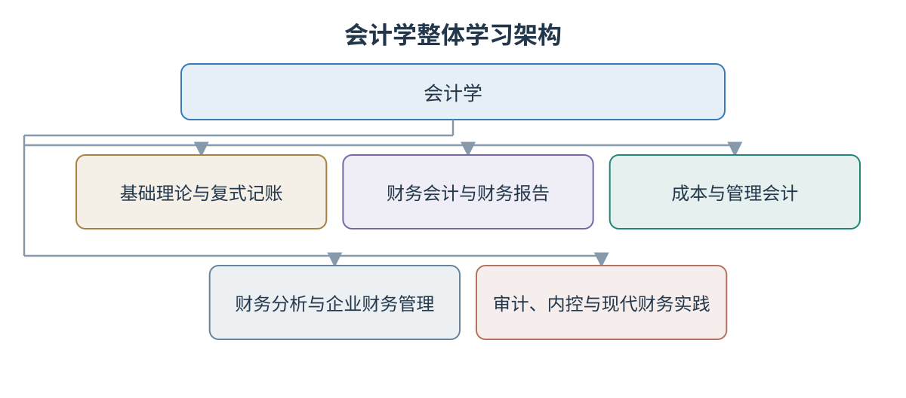
*图 1　会计学整体学习架构*

会计学；基础理论与复式记账；财务会计与财务报告；成本与管理会计；财务分析与企业财务管理；审计、内控与现代财务实践

- **第一篇　会计学基础理论**
  - 第一章　会计学的本质与学科体系
  - 第二章　会计目标、基本假设与信息质量
  - 第三章　会计要素与会计恒等式
  - 第四章　会计确认、计量与报告
  - 第五章　会计准则与国际会计体系
- **第二篇　会计核算与复式记账**
  - 第六章　会计科目与账户
  - 第七章　借贷记账法
  - 第八章　会计凭证、账簿与试算平衡
  - 第九章　权责发生制与会计调整
  - 第十章　会计循环与期末结账
- **第三篇　财务会计：企业经济业务核算**
  - 第十一章　货币资金与应收款项
  - 第十二章　存货与营业成本
  - 第十三章　固定资产与折旧
  - 第十四章　无形资产与研发支出
  - 第十五章　金融资产与长期股权投资
  - 第十六章　负债、借款与债券
  - 第十七章　所有者权益与利润分配
  - 第十八章　收入确认与费用核算
  - 第十九章　所得税会计与递延所得税
  - 第二十章　租赁、减值、预计负债及其他事项
- **第四篇　财务报表与企业财务报告**
  - 第二十一章　资产负债表
  - 第二十二章　利润表
  - 第二十三章　现金流量表
  - 第二十四章　所有者权益变动表
  - 第二十五章　财务报表附注与信息披露
  - 第二十六章　合并财务报表与企业合并
- **第五篇　成本会计与管理会计**
  - 第二十七章　成本分类与成本性态
  - 第二十八章　成本归集与成本核算方法
  - 第二十九章　本量利分析与盈亏平衡
  - 第三十章　全面预算管理
  - 第三十一章　标准成本与差异分析
  - 第三十二章　经营决策与相关成本
  - 第三十三章　责任会计与绩效管理
- **第六篇　财务报表分析与企业经营诊断**
  - 第三十四章　财务分析的基本方法
  - 第三十五章　偿债能力与财务结构分析
  - 第三十六章　营运能力与现金转换周期
  - 第三十七章　盈利能力与杜邦分析
  - 第三十八章　现金流量与盈利质量分析
  - 第三十九章　财务风险、异常识别与企业估值基础
- **第七篇　企业财务管理**
  - 第四十章　货币时间价值与风险收益
  - 第四十一章　投资决策与资本预算
  - 第四十二章　融资管理与资本结构
  - 第四十三章　营运资金与现金管理
  - 第四十四章　利润分配与股利政策
  - 第四十五章　企业财务战略与财务预测
- **第八篇　审计、内部控制与财务合规**
  - 第四十六章　审计原理与审计意见
  - 第四十七章　内部控制与企业风险管理
  - 第四十八章　税务会计与税务管理
  - 第四十九章　财务舞弊、职业道德与合规
- **第九篇　现代会计与企业财务实践**
  - 第五十章　会计信息系统与 ERP
  - 第五十一章　数字化会计与人工智能
  - 第五十二章　集团财务、资金管理与跨国会计
  - 第五十三章　特殊行业会计与可持续披露
  - 第五十四章　企业完整财务核算与经营分析案例

## 第一篇　会计学基础理论

### 第一章　会计学的本质与学科体系

#### 1.1 会计的基本职能

会计的核心是将企业真实发生的经济活动转化为具有明确含义、能够进行比较和分析的财务信息。

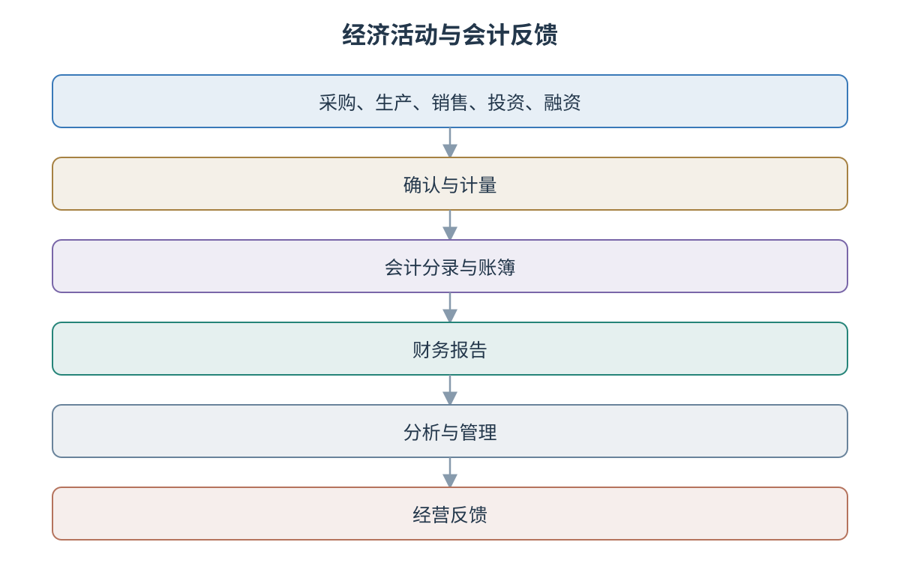
*图 2　经济活动与会计反馈*

采购、生产、销售、投资、融资 → 确认与计量 → 会计分录与账簿 → 财务报告 → 分析与管理 → 经营反馈

中国会计教学通常将会计核算与会计监督概括为两项基本职能，并延伸至预测、决策、控制与评价。

#### 1.2 会计学的主要分支

| 学科分支 | 英文名称 | 核心研究内容 |
| --- | --- | --- |
| 基础会计 | Principles of Accounting | 会计原理、账户、记账及会计循环 |
| 财务会计 | Financial Accounting | 经济业务核算及对外财务报告 |
| 成本会计 | Cost Accounting | 产品、服务及经营活动成本计算 |
| 管理会计 | Management Accounting | 内部计划、决策、控制及绩效评价 |
| 高级财务会计 | Advanced Accounting | 合并、外币等复杂事项 |
| 税务会计 | Tax Accounting | 税收相关处理及税会差异 |
| 审计学 | Auditing | 财务信息及相关事项的独立鉴证 |
| 会计信息系统 | Accounting Information Systems | 财务信息数字化处理与控制 |
| 国际会计 | International Accounting | 国际准则、跨国核算及报告差异 |
| 法务会计 | Forensic Accounting | 财务调查、舞弊分析与证据研究 |
| 政府与非营利组织会计 | Governmental and Nonprofit Accounting | 公共部门及非营利组织核算 |
| 环境与社会会计 | Environmental and Social Accounting | 环境、社会与可持续发展相关信息 |

#### 1.3 会计、财务管理、金融与经济学

| 学科 | 核心关注 | 典型问题 |
| --- | --- | --- |
| 会计学 | 经济活动的记录与反映 | 实际实现多少利润？ |
| 管理会计 | 内部信息改善经营 | 哪种产品值得扩大生产？ |
| 财务管理 | 筹集、配置及管理资金 | 借款还是发行股票？ |
| 金融学 | 金融资产、资本市场与风险定价 | 金融资产如何定价？ |
| 经济学 | 稀缺资源配置及经济运行规律 | 利率如何影响投资消费？ |


*图 3　从会计信息到企业价值*

企业经济活动 → 财务会计：记录与报告 / 管理会计：成本与效率 → 财务管理：投资、融资与资金配置 → 企业价值、经营效率与长期发展

#### 1.4 财务会计与管理会计

| 比较维度 | 财务会计 | 管理会计 |
| --- | --- | --- |
| 主要使用者 | 投资者、债权人、管理层及监管机构等 | 内部管理人员 |
| 信息重点 | 财务状况、经营成果及现金流量 | 成本、预算、效率与决策 |
| 时间方向 | 主要反映已发生业务 | 历史、现在与未来 |
| 范围 | 企业整体及规定报告范围 | 产品、项目、部门、客户 |
| 约束 | 适用准则及法律 | 管理需求 |
| 信息形式 | 以财务信息为主 | 财务及非财务信息 |
| 频率 | 按规定定期编制 | 按实际需求 |

两者共享基础数据，目的与分析方式不同。财务管理与报表分析密切关联，但不等于会计核算。

### 第二章　会计目标、基本假设与信息质量

#### 2.1 会计信息的主要使用者

| 使用者 | 主要关注 |
| --- | --- |
| 股东与潜在投资者 | 盈利、回报及企业价值 |
| 银行与债权人 | 偿债能力、信用风险及现金流 |
| 管理层 | 成本效率、绩效及战略 |
| 供应商 | 信用及支付能力 |
| 员工 | 经营稳定及持续发展 |
| 税务机关 | 税收义务及合规 |
| 监管机构 | 信息披露及市场秩序 |

通用目的财务报告的重要服务对象是现有及潜在投资者、贷款人和其他债权人。

#### 2.2 会计基本假设

| 假设 | 含义 |
| --- | --- |
| 会计主体 Economic Entity | 明确核算主体，区分企业与股东个人财产 |
| 持续经营 Going Concern | 通常假定企业在可预见未来继续经营 |
| 会计分期 Accounting Period | 将连续活动划分为报告期间 |
| 货币计量 Monetary Measurement | 以货币作为主要计量尺度 |

会计主体不一定是法律主体；多个法律实体可构成合并报告主体。

#### 2.3 会计信息质量要求

| 中国准则质量要求 | 核心含义 |
| --- | --- |
| 可靠性 | 真实、完整反映经济事项 |
| 相关性 | 影响经济决策 |
| 可理解性 | 表达清晰 |
| 可比性 | 不同企业与期间具有比较基础 |
| 实质重于形式 | 依据经济实质核算 |
| 重要性 | 关注影响使用者决策的信息 |
| 谨慎性 | 不确定条件下审慎判断 |
| 及时性 | 在信息仍有决策价值时提供 |

IFRS 概念框架将相关性和如实反映作为基本质量特征，可比性、可验证性、及时性和可理解性为增强特征。谨慎性并不意味着故意少计资产收入、多计负债费用。

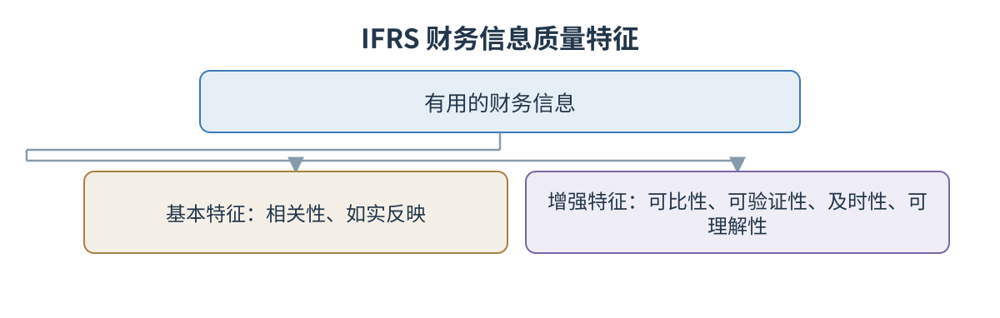
*图 4　IFRS 财务信息质量特征*

有用的财务信息；基本特征：相关性、如实反映；增强特征：可比性、可验证性、及时性、可理解性

### 第三章　会计要素与会计恒等式

#### 3.1 六大会计要素

| 要素 | 英文 | 主要含义 |
| --- | --- | --- |
| 资产 | Assets | 企业控制的经济资源 |
| 负债 | Liabilities | 企业承担的现时义务 |
| 所有者权益 | Equity | 扣除负债后的剩余权益 |
| 收入 | Revenue | 日常活动形成的经济利益流入 |
| 费用 | Expenses | 日常活动形成的经济利益流出 |
| 利润 | Profit | 一定期间的经营成果 |

IFRS 概念框架采用资产、负债、权益、收益（Income）及费用五类要素。Income 比狭义营业收入 Revenue 更广；利润为收益与费用等形成的结果。

#### 3.2 会计基本恒等式

$$
\boxed{A=L+E}
$$
即资产 = 负债 + 所有者权益。企业资产 1,000 万元、负债 400 万元、权益 600 万元。


*图 5　会计恒等式：资产与资金来源*

离线交互演示：[会计恒等式交互演示（HTML）](#social-accounting_balance)


#### 3.3 资产与所有者权益的区别

净资产 = 资产总额 − 负债总额。账面净资产不必然等于企业市场价值或股东清算所得。

#### 3.4 利润与所有者权益的关系

$$
\text{利润}=\text{收益}-\text{费用}
$$
$$
\begin{aligned}\text{期末权益}={}&\text{期初权益}+\text{本期综合收益}\\&+\text{所有者投入}-\text{向所有者分配}\\&\pm\text{其他直接权益调整}\end{aligned}
$$
股东投入不属于营业收入，股利分配不属于日常经营费用。

#### 3.5 经济业务对恒等式的影响

| 经济业务 | 资产 | 负债 | 权益 |
| --- | --- | --- | --- |
| 股东投入现金 | 增加 | 不变 | 增加 |
| 银行借款 | 增加 | 增加 | 不变 |
| 现金购买设备 | 一增一减 | 不变 | 不变 |
| 赊购材料 | 增加 | 增加 | 不变 |
| 偿还本金 | 减少 | 减少 | 不变 |
| 实现利润并留存 | 视业务而定 | 视业务而定 | 增加 |
| 支付已确认应付股利 | 减少 | 减少 | 不变 |
| 宣告现金股利并确认支付义务 | 不变 | 增加 | 减少 |

任何正确记录的经济业务都不会破坏会计恒等式。负净资产不等于已进入法律意义上的破产程序。

### 第四章　会计确认、计量与报告

#### 4.1 四个主要环节

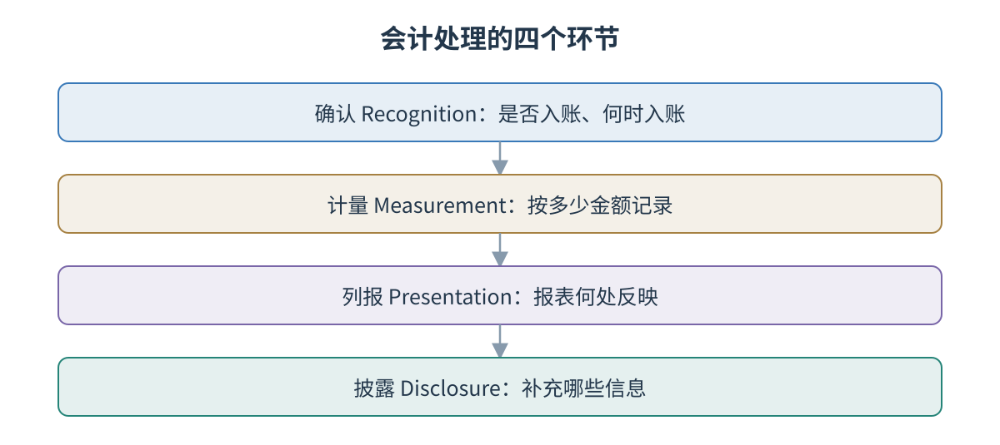
*图 6　会计处理的四个环节*

确认 Recognition：是否入账、何时入账 → 计量 Measurement：按多少金额记录 → 列报 Presentation：报表何处反映 → 披露 Disclosure：补充哪些信息

一项经济活动发生并不意味着必须立即确认收入或费用，应依据要素定义及具体准则。

#### 4.2 主要会计计量属性

| 计量属性 | 核心含义 |
| --- | --- |
| 历史成本 | 取得资产或承担负债时的交易金额为基础 |
| 重置成本 | 目前重新取得相同或相似资产所需金额 |
| 可变现净值 | 预计售价减完工成本及销售所需成本 |
| 现值 | 未来现金流按适当折现率折算为当前金额 |
| 公允价值 | 计量日市场参与者有序交易中出售资产可收到或转移负债需支付的价格 |

设备原价 100 万元、累计折旧 30 万元，账面价值可能为 70 万元；市场价格可能为 55 万元，重置成本可能为 85 万元。各金额回答不同问题，不能任意互换。

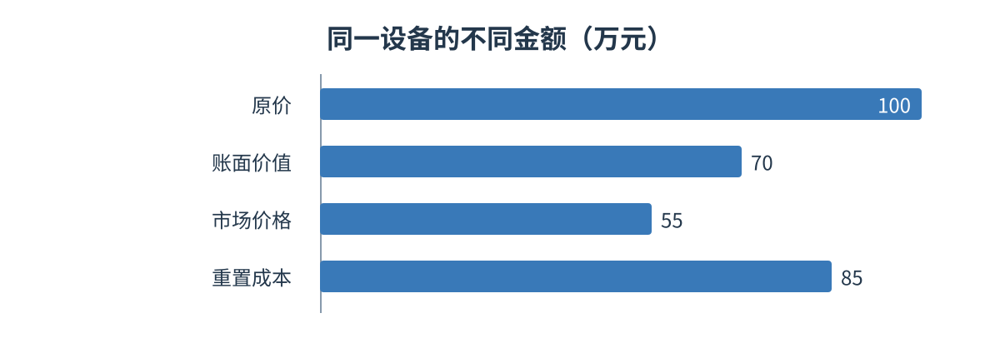
*图 7　同一设备的不同金额（万元）*

#### 4.3 会计估计、会计政策与会计差错

| 概念 | 示例 | 通常处理 |
| --- | --- | --- |
| 会计政策 | 选择符合准则的存货计价方法 | 追溯调整等，考虑过渡规定 |
| 会计估计 | 设备使用寿命和净残值 | 未来适用 |
| 会计差错 | 计算错误导致费用漏记 | 重要前期差错通常追溯重述 |

还需考虑不可行等例外条件及具体准则。

### 第五章　会计准则与国际会计体系

#### 5.1 世界主要会计准则体系

| 准则体系 | 制定机构 | 主要适用范围 |
| --- | --- | --- |
| IFRS Accounting Standards | IASB | 采用该准则的司法管辖区及企业 |
| US GAAP | FASB 等 | 美国相关报告主体 |
| CAS / ASBE | 中国财政部 | 执行企业会计准则的企业 |
| HKFRS | HKICPA | 采用香港财务报告准则的主体 |
| IFRS for SMEs | IASB | 符合条件的中小企业 |
| IPSAS | IPSASB | 采用相应准则的公共部门 |

GAAP 泛指公认会计原则，US GAAP 特指美国体系。不同体系基本原理共通，但具体确认、计量、列报和披露存在差异。

#### 5.2 重要国际准则索引

| 准则 | 内容 |
| --- | --- |
| IAS 1 / IFRS 18 | 财务报表列报 |
| IAS 2 | 存货 |
| IAS 7 | 现金流量表 |
| IAS 8 | 会计政策、估计、差错等相关要求 |
| IAS 12 | 所得税 |
| IAS 16 | 不动产、厂房及设备 |
| IAS 19 | 职工福利 |
| IAS 21 | 外币汇率变动的影响 |
| IAS 23 | 借款费用 |
| IAS 28 | 联营和合营企业投资 |
| IAS 36 | 资产减值 |
| IAS 37 | 预计负债、或有负债及或有资产 |
| IAS 38 | 无形资产 |
| IFRS 3 | 企业合并 |
| IFRS 9 | 金融工具 |
| IFRS 10 | 合并财务报表 |
| IFRS 13 | 公允价值计量 |
| IFRS 15 | 客户合同收入 |
| IFRS 16 | 租赁 |
| IFRS 17 | 保险合同 |
| IFRS 18 | 财务报表列报与披露 |
| IFRS 19 | 无公众受托责任子公司的简化披露 |

#### 5.3 中国企业会计准则体系


*图 8　中国企业会计准则体系*

基本准则：目标、假设、质量、要素及计量 → 具体准则：具体业务处理 → 应用指南：实施指导 → 准则解释及相关规定：进一步规范

#### 5.4 IFRS 与 US GAAP 的部分差异

| 事项 | IFRS | US GAAP |
| --- | --- | --- |
| 存货计价 | 不允许后进先出法 | 符合条件时允许 |
| 研发 | 研究费用化，满足条件的开发资本化 | 通常费用化，软件开发等有专门规定 |
| 固定资产后续计量 | 符合条件可用成本或重估模式 | 一般采用历史成本基础 |
| 长期资产减值转回 | 部分非商誉资产符合条件可以转回 | 持有使用的相关长期资产通常不得转回 |

#### 5.5 准则更新与过渡

IFRS 18 对 2027 年 1 月 1 日或以后开始的年度报告期间生效，允许提前采用，将进一步规范利润表分类、营业利润等小计及管理层界定的业绩指标披露。
原整理所列中国新版第30号准则时间表：2027 年先适用于通知规定的境内外同时上市及相关境外上市企业，2029 年其他境内上市企业，2030 年执行企业会计准则的非上市企业。具体范围、提前实施、过渡安排等应以财政部正式通知为准。
> [!note] 准则时效
> 本文沿用原整理的时间口径（2026 年 11 月 25 日）；实际报告应核对 [IFRS Foundation](https://www.ifrs.org/) 及 [财政部会计司](https://kjs.mof.gov.cn/) 的适用版本。

## 第二篇　会计核算与复式记账

### 第六章　会计科目与账户

#### 6.1 会计科目

| 类别 | 常见科目 |
| --- | --- |
| 资产类 | 库存现金、银行存款、应收账款、原材料、固定资产 |
| 负债类 | 短期借款、应付账款、合同负债、应付职工薪酬 |
| 所有者权益类 | 实收资本、资本公积、盈余公积、利润分配 |
| 成本类 | 生产成本、制造费用 |
| 损益类 | 主营业务收入、主营业务成本、管理费用、销售费用 |
| 共同类 | 衍生工具、套期工具等适用科目 |

共同类是科目设置类别，不是独立会计要素。

#### 6.2 账户的基本结构


*图 9　T 形账户：银行存款（元）*

正常借方余额的资产账户：期末余额 = 期初余额 + 借方发生额 − 贷方发生额。正常贷方余额的负债及权益账户方向相反。

### 第七章　借贷记账法

#### 7.1 基本规则

> [!important] 有借必有贷，借贷必相等。
> 借贷首先是两个记账方向，不等于借款、贷款、收入或支出。

| 账户类型 | 借方 | 贷方 | 通常余额方向 |
| --- | --- | --- | --- |
| 资产 | 增加 | 减少 | 借方 |
| 负债 | 减少 | 增加 | 贷方 |
| 所有者权益 | 减少 | 增加 | 贷方 |
| 收入 | 减少 | 增加 | 结转前贷方 |
| 费用 | 增加 | 减少 | 结转前借方 |
| 成本 | 增加 | 结转或减少 | 通常借方 |

累计折旧、坏账准备等备抵账户与对应资产账户的正常余额方向相反。

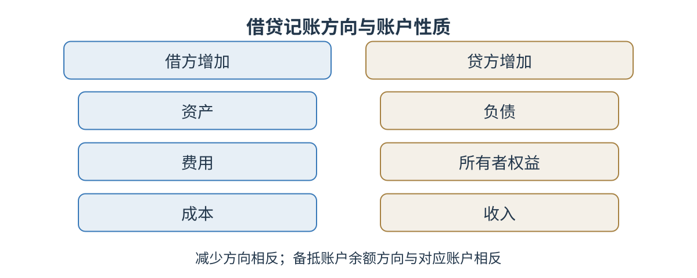
*图 10　借贷记账方向与账户性质*

#### 7.2 典型业务

金额单位：元，暂不考虑增值税及其他税费。
```text
1. 股东投入现金
借：银行存款        500,000
    贷：实收资本        500,000
2. 银行短期借款
借：银行存款        200,000
    贷：短期借款        200,000
3. 现金购买设备
借：固定资产        100,000
    贷：银行存款        100,000
4. 赊购库存商品
借：库存商品         80,000
    贷：应付账款         80,000
5. 赊销并结转成本
借：应收账款        120,000
    贷：主营业务收入    120,000
借：主营业务成本     70,000
    贷：库存商品         70,000
6. 收到客户货款
借：银行存款        120,000
    贷：应收账款        120,000
```
第六项不再形成收入，收入已经在第五项确认。

### 第八章　会计凭证、账簿与试算平衡

#### 8.1 会计核算的证据链

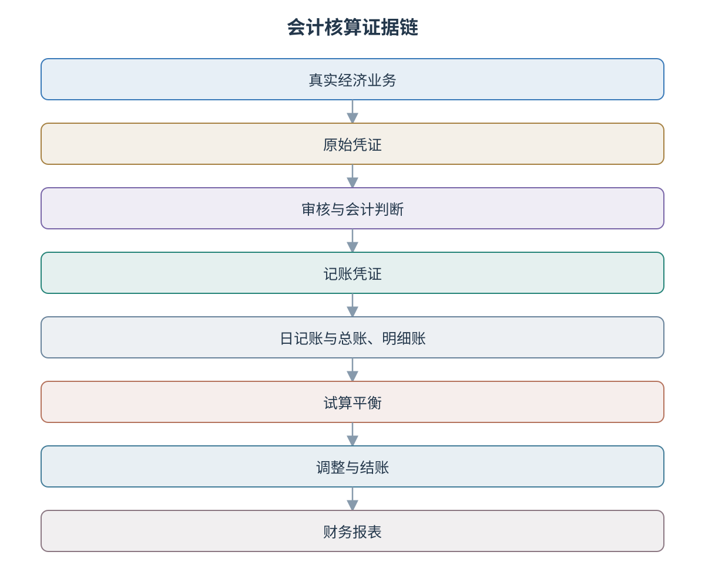
*图 11　会计核算证据链*

真实经济业务 → 原始凭证 → 审核与会计判断 → 记账凭证 → 日记账与总账、明细账 → 试算平衡 → 调整与结账 → 财务报表

| 名称 | 作用 |
| --- | --- |
| 原始凭证 | 证明业务及相关事实，如合同、发票、银行回单 |
| 记账凭证 | 确定记账内容 |
| 日记账 | 按时间顺序记录业务 |
| 总分类账 | 按总分类科目汇总 |
| 明细分类账 | 记录客户、供应商及资产明细 |
| 辅助账簿 | 补充管理和核算信息 |

#### 8.2 试算平衡

$$
\sum\text{借方发生额}=\sum\text{贷方发生额}
$$
$$
\sum\text{借方余额}=\sum\text{贷方余额}
$$
试算平衡不能发现所有错误，例如漏记整笔交易、双方同时记错同一金额或使用错误科目。

### 第九章　权责发生制与会计调整

#### 9.1 权责发生制与收付实现制

| 维度 | 权责发生制 Accrual Basis | 收付实现制 Cash Basis |
| --- | --- | --- |
| 收益确认 | 按取得收益的相关条件 | 主要按现金流入 |
| 费用确认 | 按发生及归属期间 | 主要按现金流出 |
| 应收应付款项 | 反映 | 通常不反映未收付事项 |
| 用途 | 企业财务报告 | 部分特定核算及管理场景 |

#### 9.2 收入确认与收款时间

11 月履行销售义务，确认收入 10 万元并形成应收账款；12 月客户付款，收回现金并减少应收账款。

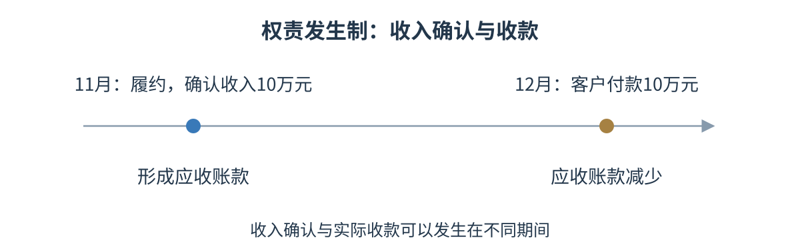
*图 12　权责发生制：收入确认与收款*

#### 9.3 常见调整事项

| 类型 | 示例 |
| --- | --- |
| 应计收入 | 已提供服务但尚未结算 |
| 应计费用 | 已发生但未支付工资、利息 |
| 预付费用 | 提前支付未来租金、保险 |
| 合同负债 | 收到客户款项但未履约 |
| 折旧与摊销 | 系统分配长期资产金额 |
| 资产减值 | 确认资产价值下降损失 |

年初预付全年保险费 12,000 元，每月确认费用 1,000 元：
```text
预付：借：预付账款    12,000
          贷：银行存款    12,000
月末：借：管理费用     1,000
          贷：预付账款     1,000
```
现金支出并不意味着当月必须确认相同金额费用。

### 第十章　会计循环与期末结账

#### 10.1 完整会计循环

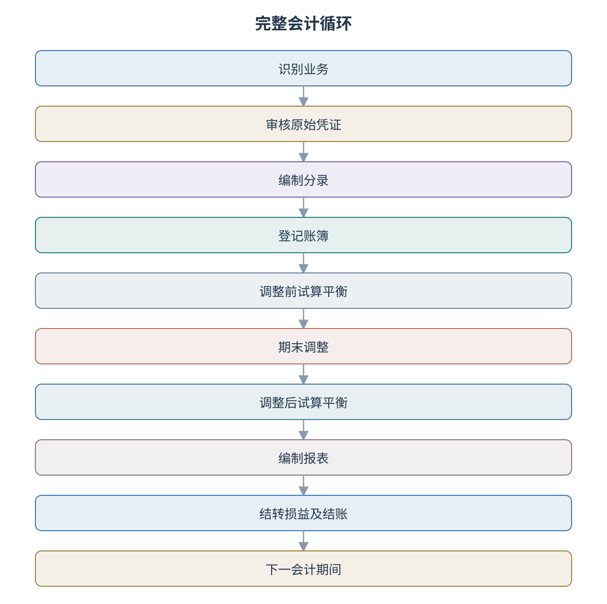
*图 13　完整会计循环*

识别业务 → 审核原始凭证 → 编制分录 → 登记账簿 → 调整前试算平衡 → 期末调整 → 调整后试算平衡 → 编制报表 → 结转损益及结账 → 下一会计期间

#### 10.2 永久性账户与临时性账户

永久性账户（资产、负债及权益等）余额通常延续；临时性账户（收入、费用等）期末结转，下一期间重新累计。
营业收入 300,000 元、相关费用 220,000 元，不考虑所得税，利润 80,000 元。
```text
借：主营业务收入      300,000
    贷：本年利润          300,000
借：本年利润          220,000
    贷：相关成本费用科目  220,000
```
年末转入利润分配，需结合其他损益、税费及利润分配事项。

## 第三篇　财务会计：企业经济业务核算

### 第十一章　货币资金与应收款项

#### 11.1 货币资金

包括库存现金、银行存款及其他货币资金。受限资金、期限较长的存款及价格波动较大的金融资产不一定属于现金及现金等价物。

#### 11.2 应收款项的分类

| 科目 | 含义 |
| --- | --- |
| 应收账款 | 销售商品或提供服务产生的无条件收款权利等 |
| 应收票据 | 相关交易取得的票据债权 |
| 其他应收款 | 非主要销售业务形成的应收款项 |
| 预付账款 | 提前支付给供应商的款项 |
| 合同资产 | 已履约但收款权利仍取决于时间流逝之外条件 |

#### 11.3 坏账准备与预期信用损失

应收款项账面净额 = 账面余额 − 损失准备。
应收账款 1,000,000 元，根据账龄、客户信用及预期经济情况估计信用损失 50,000 元。
```text
借：信用减值损失      50,000
    贷：坏账准备          50,000
```
账面净额 950,000 元。金融工具准则强调预期信用损失，并非等到实际违约才确认。


*图 14　应收账款账面金额（万元）*

### 第十二章　存货与营业成本

#### 12.1 存货的主要类型

原材料、在产品、半成品、产成品、库存商品、周转材料。原材料用于生产，在产品尚未完成，半成品完成部分阶段，产成品准备销售，库存商品用于销售，周转材料可在一定条件下反复使用。

#### 12.2 制造企业的成本流转


*图 15　制造企业成本流转*

原材料：采购 → 在产品：直接材料、人工及制造费用 → 产成品：生产完成 → 营业成本：销售后结转

#### 12.3 存货成本

包括采购成本、加工成本及使存货达到当前场所和状态的其他必要成本。异常损耗、不必要的储存费、一般销售费用通常不能计入存货成本。

#### 12.4 存货计价方法

| 批次 | 数量 | 单价 | 总成本 |
| --- | --- | --- | --- |
| 第一批 | 100 件 | 10 元 | 1,000 元 |
| 第二批 | 100 件 | 14 元 | 1,400 元 |
| 合计 | 200 件 | — | 2,400 元 |

出售 120 件：

| 方法 | 销售成本 | 期末存货 |
| --- | --- | --- |
| 先进先出 FIFO | 1,280 | 1,120 |
| 期末一次加权平均 | 1,440 | 960 |

$$
C_{FIFO}=100\times10+20\times14=1280
$$
$$
\bar c=2400/200=12,\quad C_{WA}=120\times12=1440
$$

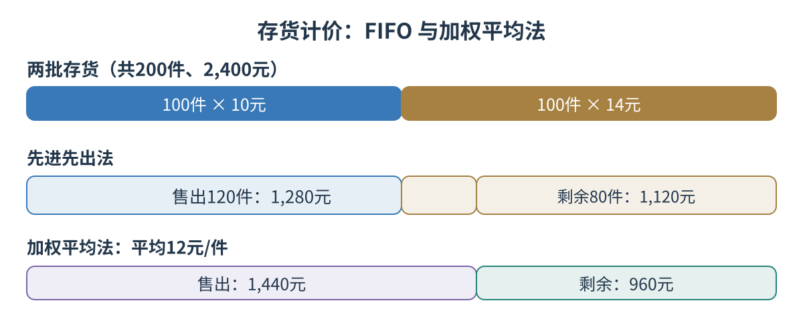
*图 16　存货计价：FIFO 与加权平均法*

不同合法计价方法可能影响当期利润与资产，但不直接改变实际采购与销售现金流。

#### 12.5 存货跌价

存货通常按成本与可变现净值孰低计量。
$$
\text{跌价损失}=\max(0,\text{成本}-\text{可变现净值})
$$
成本 100 万元，可变现净值 85 万元，确认损失 15 万元。

### 第十三章　固定资产与折旧

#### 13.1 固定资产的基本处理

| 环节 | 主要内容 |
| --- | --- |
| 初始确认 | 购买、自建及其他符合条件的取得成本 |
| 后续支出 | 判断费用化或资本化 |
| 折旧 | 在使用寿命内系统分配可折旧金额 |
| 减值 | 判断并确认相关减值损失 |
| 处置 | 出售、报废、终止确认与损益 |

#### 13.2 主要折旧方法

| 方法 | 特点 |
| --- | --- |
| 年限平均法 | 各期通常相同 |
| 工作量法 | 按实际使用量分配 |
| 双倍余额递减法 | 前期多、后期少 |
| 年数总和法 | 逐年递减比例分配 |

$$
D=\frac{C-S}{n}
$$
原价 C = 100 万元、净残值 S = 10 万元、寿命 n = 5 年，每年折旧 18 万元。

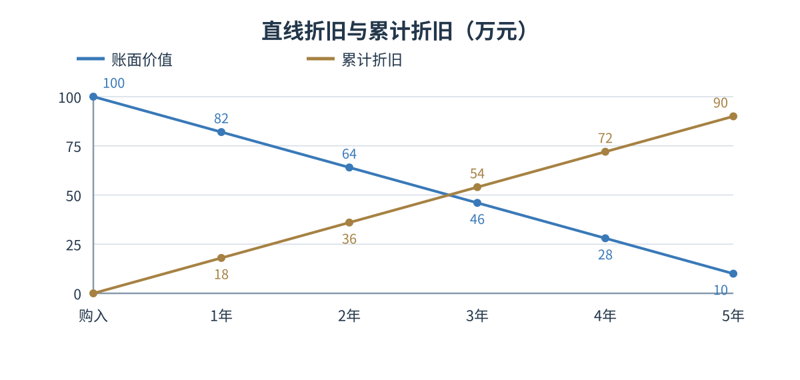
*图 17　直线折旧与累计折旧（万元）*

#### 13.3 固定资产账面价值

账面价值 = 原价 − 累计折旧 − 累计减值准备。折旧是成本系统分配，不是直接测量市场价格，也不是当期现金支出。

离线交互演示：[固定资产直线折旧计算器（HTML）](#social-accounting_line_5cbcb66a)


### 第十四章　无形资产与研发支出

#### 14.1 无形资产

无形资产通常为可辨认的无实物形态非货币性资产。包括符合条件的专利、著作权、软件、外购商标、特许经营权及中国准则下的相关土地使用权。自创品牌、员工知识及客户忠诚度虽可能有价值，但不能任意确认为资产。

#### 14.2 研究与开发支出

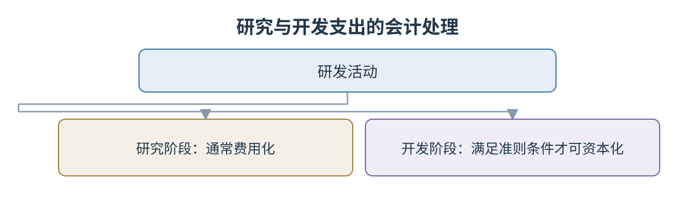
*图 18　研究与开发支出的会计处理*

研发活动；研究阶段：通常费用化；开发阶段：满足准则条件才可资本化

开发资本化条件包括技术可行性、完成并使用或出售的意图、未来经济利益、资源保障、可靠计量等。费用化与资本化影响当期利润和资产，并不直接改变已投入研发现金。

### 第十五章　金融资产与长期股权投资

#### 15.1 金融工具分类

| 类别 | 示例 |
| --- | --- |
| 金融资产 | 现金、应收款项、债券及股票投资 |
| 金融负债 | 借款、应付债券及相关应付款项 |
| 权益工具 | 符合定义的普通股等 |
| 衍生金融工具 | 期货、远期、期权、互换 |

#### 15.2 金融资产的主要计量类别

| 类别 | 特点 |
| --- | --- |
| 摊余成本 AC | 实际利率法等后续计量 |
| FVOCI | 公允价值变动按准则计入其他综合收益等 |
| FVTPL | 公允价值变动通常直接计入当期损益 |

债务工具分类主要取决于业务模式及合同现金流量特征；权益工具适用专门规定。

#### 15.3 股权投资的核算逻辑

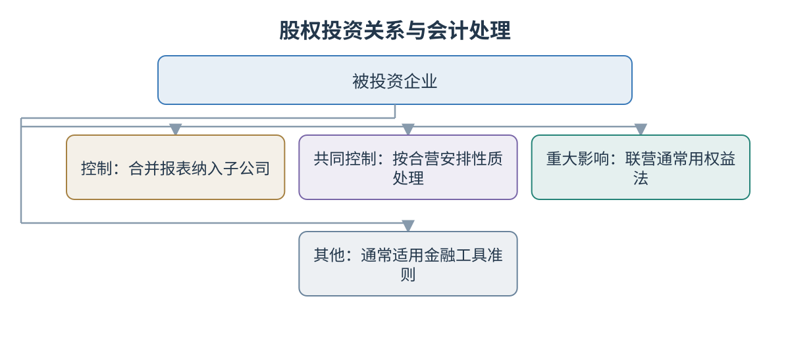
*图 19　股权投资关系与会计处理*

被投资企业；控制：合并报表纳入子公司；共同控制：按合营安排性质处理；重大影响：联营通常用权益法；其他：通常适用金融工具准则

持股比例是重要信息，但不是唯一依据。

### 第十六章　负债、借款与债券

#### 16.1 负债分类

| 流动负债 | 非流动负债 |
| --- | --- |
| 短期借款 | 长期借款 |
| 应付账款 | 应付债券 |
| 应付职工薪酬流动部分 | 租赁负债非流动部分 |
| 应交税费 | 长期应付款 |
| 一年内到期相关非流动负债 | 递延所得税负债 |

流动性分类需结合营业周期、报告日到期情况及延期清偿权利等，不只看原始借款期限。

#### 16.2 本金与利息

借入 100 万元、年利率 6%、全年占用，单利 6 万元。本金偿还为负债减少，不是费用；利息通常计入费用，符合资本化条件除外。

#### 16.3 债券及实际利率法

$$
P=\sum_{t=1}^{n}\frac{C}{(1+r)^t}+\frac{F}{(1+r)^n}
$$
C 为每期票息，F 为面值，r 为实际利率。票面利率与市场要求收益率不同可能导致溢价或折价发行。

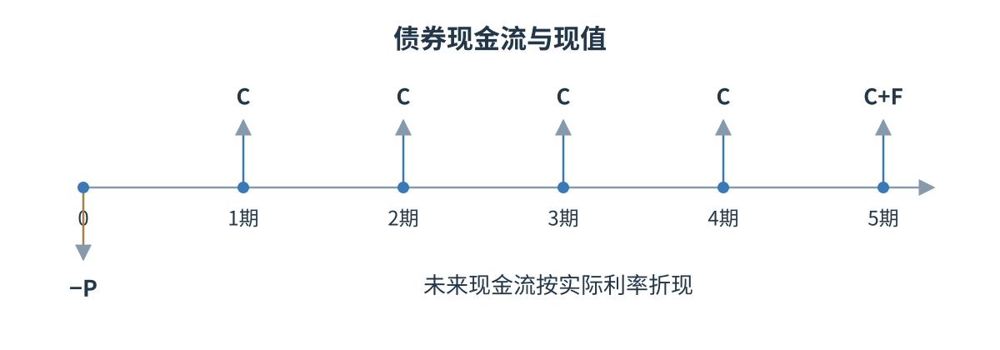
*图 20　债券现金流与现值*

### 第十七章　所有者权益与利润分配

#### 17.1 权益构成

| 项目 | 含义 |
| --- | --- |
| 实收资本／股本 | 投资者投入的相应资本 |
| 资本公积 | 资本溢价及其他规定事项 |
| 其他综合收益 | 按准则不计入当期损益的相关利得损失 |
| 盈余公积 | 按规定从利润中提取的积累 |
| 未分配利润 | 尚未分配的累计利润或亏损 |
| 其他权益项目 | 其他权益工具、库存股等 |

#### 17.2 留存收益

留存收益通常包括盈余公积与未分配利润。
$$
\text{期末留存收益}=\text{期初留存收益}+\text{净利润}-\text{向所有者分配}
$$
不考虑前期差错等调整；提取盈余公积是留存收益内部转移。

#### 17.3 股东权益与企业现金

未分配利润 100 万元不代表账户中有同等现金。利润可能已经转为应收账款、设备、存货、投资。股利分配还受现金、法律、债务契约及发展需求约束。

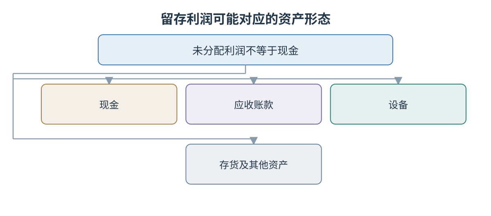
*图 21　留存利润可能对应的资产形态*

未分配利润不等于现金；现金；应收账款；设备；存货及其他资产

### 第十八章　收入确认与费用核算

#### 18.1 收入确认五步法

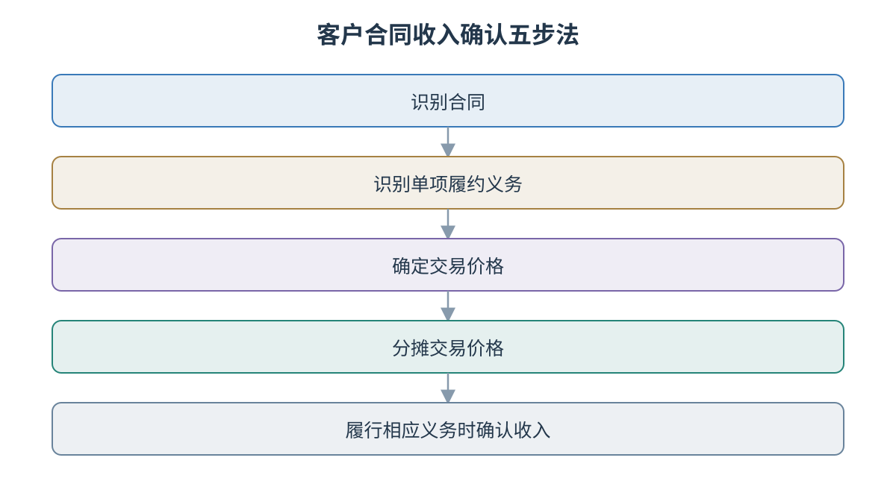
*图 22　客户合同收入确认五步法*

识别合同 → 识别单项履约义务 → 确定交易价格 → 分摊交易价格 → 履行相应义务时确认收入

IFRS 15 与中国相应收入准则以履约义务和控制权转移为核心。

#### 18.2 时点与时段确认

商品控制权在交付时转移，通常在时点确认；满足条件的持续服务或项目在时段内确认。并非所有长期项目都可按完工进度确认。

#### 18.3 软件订阅收入案例

年初收到全年订阅费 12,000 元，全年均匀服务。
```text
收款：借：银行存款      12,000
          贷：合同负债      12,000
每月：借：合同负债       1,000
          贷：主营业务收入   1,000
```

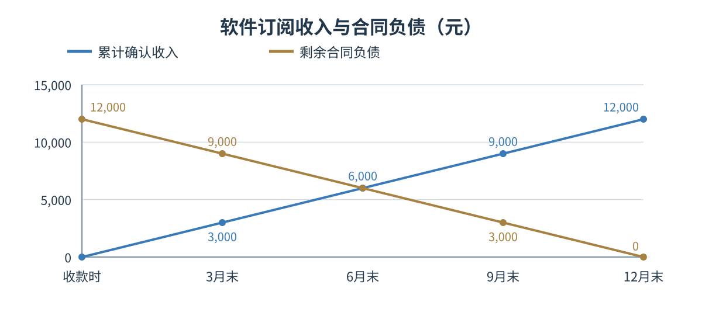
*图 23　软件订阅收入与合同负债（元）*

#### 18.4 企业主要费用

| 费用 | 主要内容 |
| --- | --- |
| 营业成本 | 已销售商品或服务的对应成本 |
| 销售费用 | 广告、销售人员薪酬等 |
| 管理费用 | 行政及一般管理支出 |
| 研发费用 | 不符合资本化条件的研发支出 |
| 财务费用 | 利息等符合规定的融资相关费用 |
| 所得税费用 | 当期及递延所得税相关费用 |

### 第十九章　所得税会计与递延所得税

#### 19.1 会计利润与应纳税所得额

会计利润按会计准则计算，应纳税所得额按税法计算。永久性差异不会在以后期间反向消除；暂时性差异是资产或负债账面价值与计税基础之间的相关差异，可能影响未来税款。

#### 19.2 递延所得税

资产账面价值 80 万元、计税基础 60 万元、未来适用税率假设 25%。若为应纳税暂时性差异并符合确认条件：
$$
DTL=(80-60)\times25\%=5\text{万元}
$$

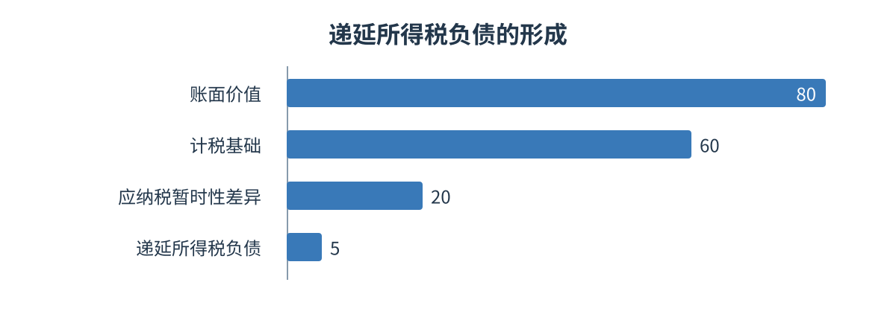
*图 24　递延所得税负债的形成*

递延所得税资产反映满足确认条件的未来税收利益。通常所得税费用 = 当期所得税费用 + 递延所得税费用。与其他综合收益或直接计入权益事项相关的税务影响需在对应位置确认。

### 第二十章　租赁、减值、预计负债及其他事项

#### 20.1 租赁会计

IFRS 16 下承租人通常确认使用权资产与租赁负债，短期、低价值租赁等可适用豁免。

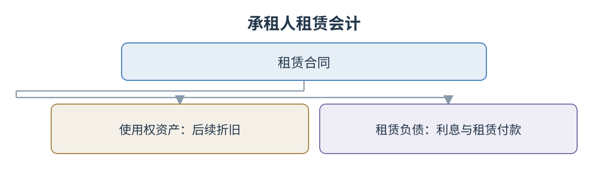
*图 25　承租人租赁会计*

租赁合同；使用权资产：后续折旧；租赁负债：利息与租赁付款

#### 20.2 长期资产减值

$$
\text{可收回金额}=\max(\text{使用价值},\text{公允价值减处置费用})
$$
$$
\text{减值损失}=\max(0,\text{账面价值}-\text{可收回金额})
$$
账面价值 100 万元，可收回金额 75 万元，确认减值 25 万元。

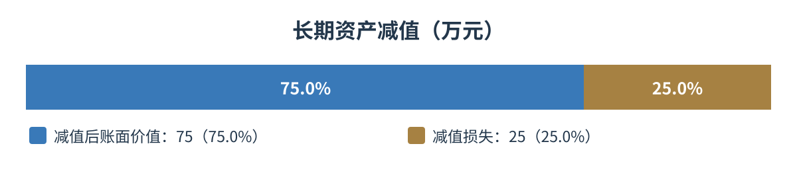
*图 26　长期资产减值（万元）*

#### 20.3 预计负债与或有事项

| 概念 | 含义 |
| --- | --- |
| 预计负债 | 现时义务，满足相关流出可能性及可靠计量条件 |
| 或有负债 | 可能义务，或未满足预计负债确认条件的现时义务 |
| 或有资产 | 由未来不确定事项进一步确认的可能资产 |

产品质保、未决诉讼、环境恢复义务可能涉及上述判断。不能因存在潜在支出就一律确认同额负债。

#### 20.4 其他重要领域

| 领域 | 知识点 |
| --- | --- |
| 职工薪酬 | 工资、社会保险、退休福利 |
| 股份支付 | 权益工具或现金结算激励 |
| 政府补助 | 资产或收益相关补助 |
| 借款费用 | 费用化及符合条件资本化 |
| 投资性房地产 | 确认、成本或公允价值模式 |
| 非货币性资产交换 | 计量及相关损益 |
| 债务重组 | 债权债务条件变化 |
| 资产负债表日后事项 | 调整事项与非调整事项 |

## 第四篇　财务报表与企业财务报告

财务报表是企业会计信息的核心载体，对于企业管理者和投资者尤为重要。

### 第二十一章　资产负债表

#### 21.1 资产负债表基本结构

资产负债表（Balance Sheet / Statement of Financial Position）反映企业在特定日期的财务状况。教学数据，单位万元。

| 资产 | 金额 | 负债与权益 | 金额 |
| --- | --- | --- | --- |
| 货币资金 | 150 | 短期借款 | 100 |
| 应收账款 | 200 | 应付账款 | 150 |
| 存货 | 250 | 其他流动负债 | 50 |
| **流动资产合计** | **600** | **流动负债合计** | **300** |
| 固定资产 | 500 | 长期负债 | 400 |
| 无形资产 | 100 | **负债合计** | **700** |
| **非流动资产合计** | **600** | 实收资本 | 350 |
| — | — | 留存收益 | 150 |
| — | — | **权益合计** | **500** |
| **资产总计** | **1,200** | **负债和权益总计** | **1,200** |

#### 21.2 企业资产结构

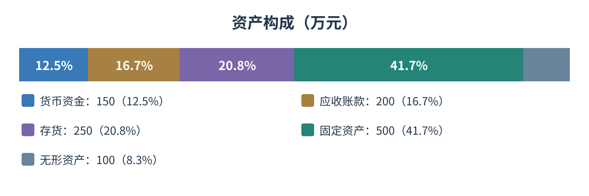
*图 27　资产构成（万元）*

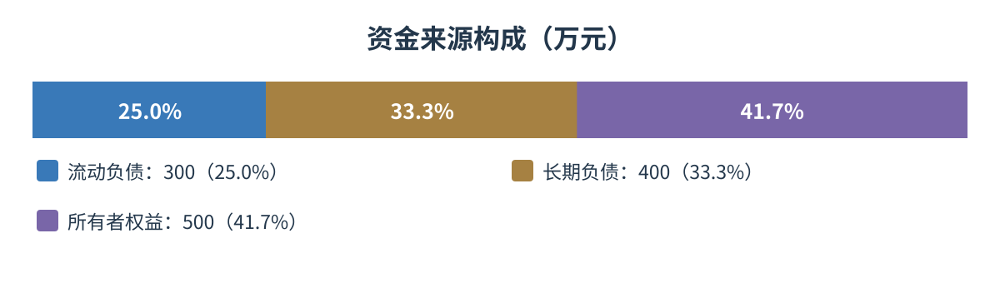
*图 28　资金来源构成（万元）*

资产负债表用于研究资产配置、流动性、负债期限、资本结构及账面净资产，单独阅读无法判断当期盈利及现金创造能力。

### 第二十二章　利润表

#### 22.1 利润表基本结构

利润表（Income Statement / Statement of Profit or Loss）反映一定期间经营成果。下表为简化教学版，非任一准则全部法定项目，单位万元。

| 项目 | 金额 |
| --- | --- |
| 营业收入 | 1,500 |
| 减：营业成本 | 900 |
| **毛利润** | **600** |
| 减：销售费用 | 100 |
| 减：管理费用 | 120 |
| 减：研发费用 | 80 |
| **经营利润（简化口径）** | **300** |
| 减：利息费用 | 40 |
| 利润总额（税前利润） | 260 |
| 减：所得税费用 | 65 |
| **净利润** | **195** |

#### 22.2 利润形成的层次

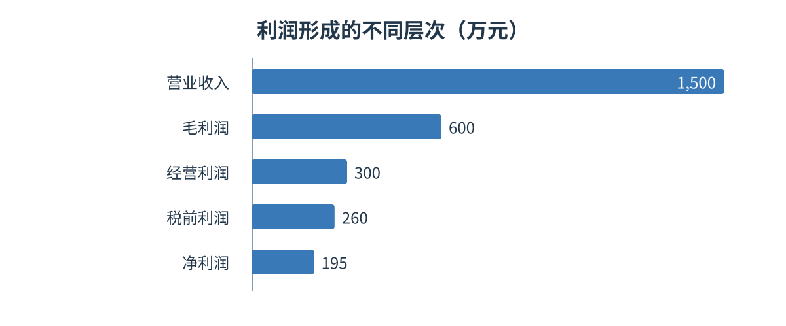
*图 29　利润形成的不同层次（万元）*

#### 22.3 毛利润、营业利润与净利润

毛利润 = 营业收入 − 营业成本；净利润 = 利润总额 − 所得税费用。中国准则营业利润、分析师经营利润及 IFRS 18 营业利润定义不同，不能不加区分地使用。

#### 22.4 EBIT 与 EBITDA

| 指标 | 常见含义 |
| --- | --- |
| EBIT | 息税前利润 |
| EBITDA | 息税折旧摊销前利润 |
| EBT | 税前利润 |
| Net Income | 净利润 |

在简化且无其他口径调整的情况下：
$$
EBIT=\text{净利润}+\text{所得税费用}+\text{利息费用}
$$
$$
EBITDA=EBIT+\text{折旧}+\text{摊销}
$$
EBITDA 不等于经营现金流或自由现金流，不能忽略资本支出、营运资金占用及偿债需求。

### 第二十三章　现金流量表

#### 23.1 三类现金流量

| 类别 | 主要内容 |
| --- | --- |
| 经营活动 CFO | 销售收款、采购付款、职工薪酬等日常经营现金 |
| 投资活动 CFI | 购建设备、处置资产、相关投资收付等 |
| 筹资活动 CFF | 股东投入、借款、偿还本金等 |

利息和股利的分类因准则及适用期间而异。

#### 23.2 现金流量表案例

| 项目 | 金额（万元） |
| --- | --- |
| 期初现金及现金等价物 | 100 |
| 经营活动现金流量净额 | +200 |
| 投资活动现金流量净额 | -180 |
| 筹资活动现金流量净额 | +30 |
| 汇率变动影响 | 0 |
| 现金净增加额 | +50 |
| 期末现金及现金等价物 | 150 |

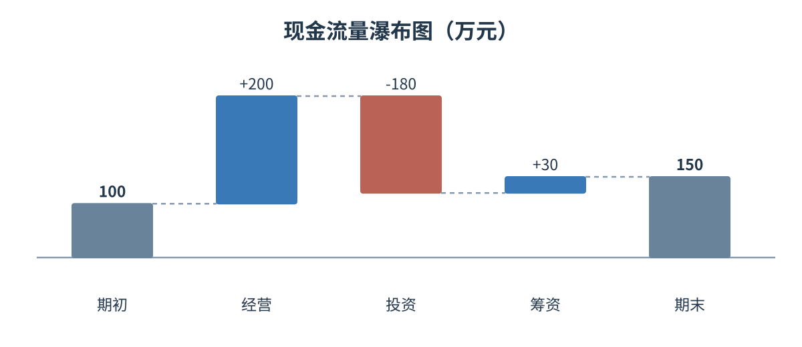
*图 30　现金流量瀑布图（万元）*

#### 23.3 直接法与间接法

直接法根据经营现金收入和支出列示；间接法从相应利润指标出发，调整非现金事项、营运资金变化及其他项目。

| 调整项目 | 金额（万元） |
| --- | --- |
| 净利润 | 195 |
| 加：折旧及摊销 | 80 |
| 减：应收账款增加 | -70 |
| 减：存货增加 | -30 |
| 加：经营性应付款项增加 | 25 |
| **经营现金流量净额** | **200** |

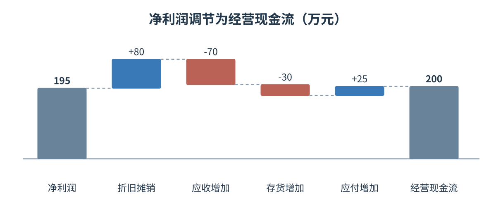
*图 31　净利润调节为经营现金流（万元）*

应收账款增加意味着部分收入尚未转化为现金；折旧减少利润但未产生当期现金支付。

#### 23.4 现金流典型模式

| 企业阶段或情形 | 经营现金流 | 投资现金流 | 筹资现金流 |
| --- | --- | --- | --- |
| 初创扩张 | 可能为负 | 通常为负 | 可能为正 |
| 成熟经营 | 通常为正 | 经常为负 | 视偿债与分配而定 |
| 大规模资本扩张 | 可能为正 | 大额流出 | 可能为正 |
| 出售资产维持经营 | 可能为负 | 可能为正 | 不确定 |

仅属典型模式，不能单独判断企业阶段或经营质量。

### 第二十四章　所有者权益变动表

所有者权益变动表（Statement of Changes in Equity）解释权益在报告期间的变化。单位万元，假设无其他综合收益及其他权益调整。

| 项目 | 实收资本 | 留存收益 | 权益合计 |
| --- | --- | --- | --- |
| 期初余额 | 300 | 100 | 400 |
| 本期股东投入 | 50 | 0 | 50 |
| 本期净利润 | 0 | 195 | 195 |
| 本期利润分配 | 0 | -145 | -145 |
| 期末余额 | 350 | 150 | 500 |

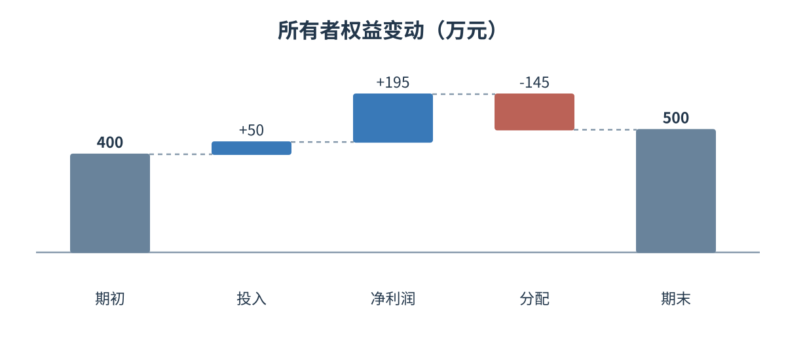
*图 32　所有者权益变动（万元）*

权益增加100万元不意味着本期利润只有100万元。

### 第二十五章　财务报表附注与信息披露

#### 25.1 财务报表附注主要内容

| 披露内容 | 用途 |
| --- | --- |
| 重要会计政策 | 了解确认与计量方法 |
| 重大会计估计及判断 | 了解数字背后的假设 |
| 主要资产明细 | 应收、存货及固定资产结构 |
| 债务及到期情况 | 偿债压力及融资安排 |
| 关联方交易 | 集团内及其他关联交易 |
| 承诺及或有事项 | 尚未完全反映在报表的风险 |
| 分部信息 | 不同业务及地区表现 |
| 金融工具风险 | 信用、流动性及市场风险 |
| 日后事项 | 报告日后的重要变化 |

附注是完整财务报告的重要组成部分。

#### 25.2 四张报表的勾稽关系

利润表净利润进入权益变动表，并作为间接法现金流调节的起点之一；权益变动表期末权益与资产负债表对应，现金流量表期末现金及现金等价物与资产负债表相关项目调节勾稽。

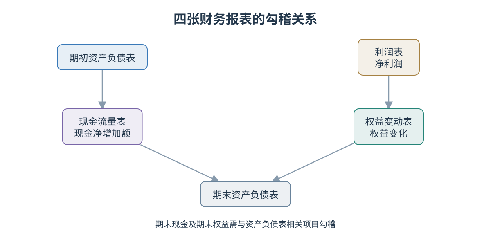
*图 33　四张财务报表的勾稽关系*

现金流量表的现金及现金等价物与资产负债表货币资金可能需要进一步调节。

### 第二十六章　合并财务报表与企业合并

#### 26.1 企业集团基本结构

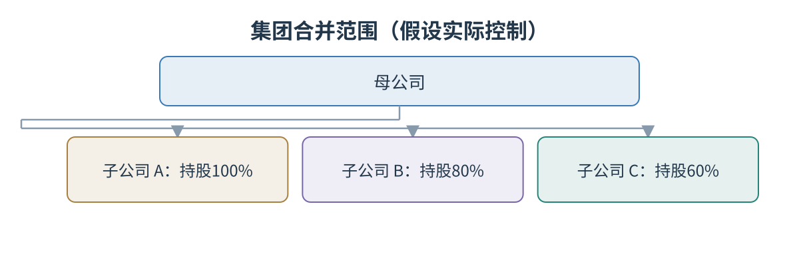
*图 34　集团合并范围（假设实际控制）*

母公司；子公司 A：持股100%；子公司 B：持股80%；子公司 C：持股60%

#### 26.2 合并原则

合并报表将母公司及纳入合并范围的子公司视为一个报告主体。抵销母公司长期股权投资与相应子公司权益；抵销集团内部债权债务、内部销售及未实现损益；确认非控制性权益；统一会计政策及报告期间。

#### 26.3 集团内部交易抵销案例

母公司将成本 60 万元商品以 100 万元售给子公司，年末尚未对集团外部出售。母公司个别报表毛利润 40 万元；集团整体不能确认内部未实现利润，应抵销内部收入、成本和存货内未实现利润。

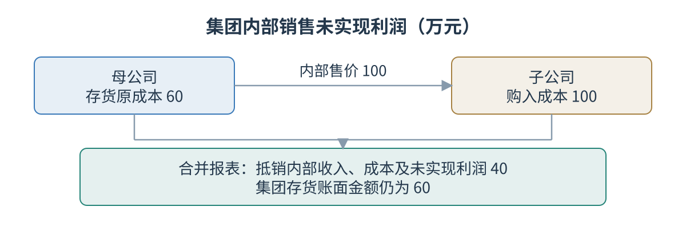
*图 35　集团内部销售未实现利润（万元）*

#### 26.4 企业合并与商誉

购买法下简化 100% 收购：
$$
\text{商誉}=\text{合并对价}-\text{可辨认净资产公允价值}
$$
支付 1,000 万元，取得可辨认净资产公允价值 800 万元，商誉 200 万元。


*图 36　收购对价与商誉（万元）*

实际可能涉及非控制性权益、原持股、公允价值调整与递延所得税。商誉不是品牌市场价值，不能脱离相关现金产生单元或资产组任意估值。

## 第五篇　成本会计与管理会计

管理会计将会计信息转化为经营管理工具，对创业、产品定价、部门管理和商业模式分析具有重要价值。

### 第二十七章　成本分类与成本性态

#### 27.1 成本的主要分类

| 分类依据 | 主要类型 |
| --- | --- |
| 与产品关系 | 直接成本、间接成本 |
| 与业务量关系 | 固定成本、变动成本、混合成本 |
| 财务核算用途 | 产品成本、期间费用 |
| 决策相关性 | 相关成本、无关成本 |
| 可控制程度 | 可控成本、不可控成本 |
| 决策机会 | 机会成本、沉没成本、增量成本 |
| 发生方式 | 显性成本、隐性成本 |

#### 27.2 固定成本与变动成本

$$
TC=F+vQ
$$
F 为固定成本，v 为单位变动成本，Q 为业务量，在线性相关范围内成立，实际固定成本可能呈阶梯变化。

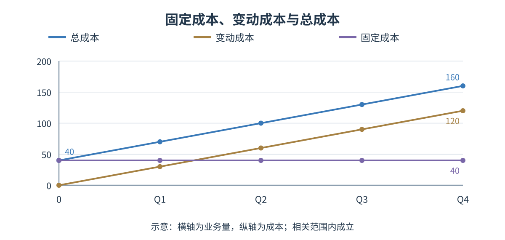
*图 37　固定成本、变动成本与总成本*

#### 27.3 沉没成本与机会成本

沉没成本已发生且无法通过当前决策收回；机会成本为放弃最佳可行替代方案的收益。已投入100万元开发软件，如追加20万元只能收回10万元新增现金且无其他影响，不应仅凭历史投入继续开发。

### 第二十八章　成本归集与成本核算方法

#### 28.1 产品成本构成

产品生产成本 = 直接材料 + 直接人工 + 制造费用。

#### 28.2 成本核算方法

| 方法 | 适用场景 |
| --- | --- |
| 品种法 | 大量生产，按产品品种核算 |
| 分批法 | 定制生产、项目或订单 |
| 分步法 | 多阶段连续加工 |
| 作业成本法 ABC | 复杂产品及较多间接成本 |
| 标准成本法 | 成本控制及差异分析 |
| 变动成本法 | 内部经营决策 |

变动成本法固定制造费用通常作为期间成本，不可直接替代财务报告存货成本核算。

#### 28.3 制造费用分配

车间制造费用 100,000 元，机器工时 5,000 小时，分配率为 20 元/小时；产品耗用 800 小时，分配费用 16,000 元。
$$
\frac{100000}{5000}=20,\quad 800\times20=16000
$$

#### 28.4 作业成本法

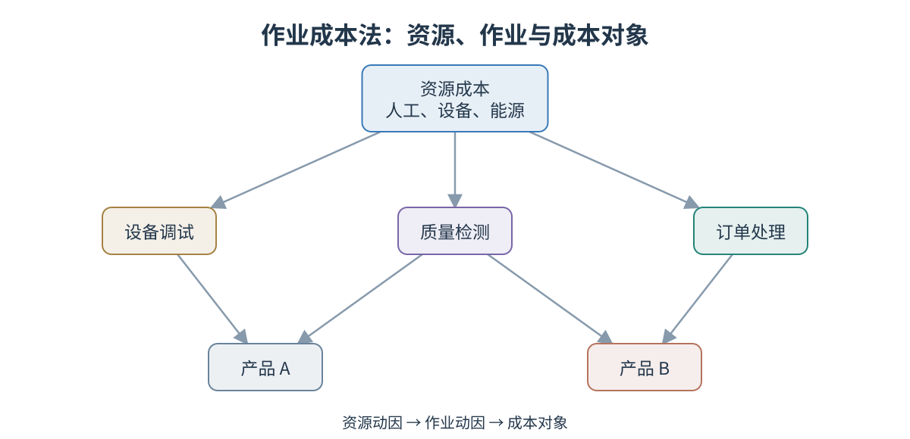
*图 38　作业成本法：资源、作业与成本对象*

作业成本法通过资源动因和作业动因，将资源耗费分配给成本对象。

### 第二十九章　本量利分析与盈亏平衡

#### 29.1 边际贡献

$$
CM=(p-v)Q,\qquad \text{边际贡献率}=\frac{p-v}{p}
$$
p 为单位售价，v 为单位变动成本。

#### 29.2 盈亏平衡点

单一产品、成本及售价稳定等假设下：
$$
\pi=(p-v)Q-F
$$
$$
\boxed{Q_{BE}=\frac{F}{p-v}},\qquad \boxed{S_{BE}=\frac{F}{\text{边际贡献率}}}
$$
售价100元，单位变动成本60元，固定成本40万元，盈亏平衡销量10,000件。预计销量15,000件，则预计利润20万元，边际贡献率40%。

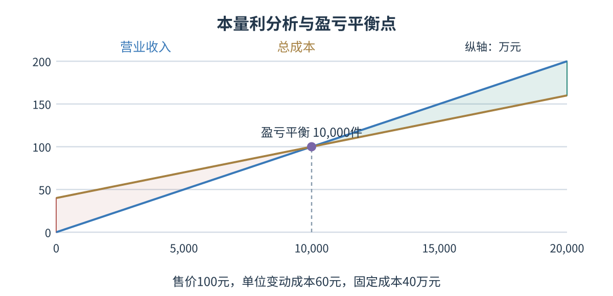
*图 39　本量利分析与盈亏平衡点*

离线交互演示：[盈亏平衡分析计算器（HTML）](#social-accounting_breakeven)


#### 29.3 安全边际

$$
\text{安全边际量}=\text{预计销量}-\text{盈亏平衡销量}
$$
$$
\text{安全边际率}=\frac{\text{安全边际量}}{\text{预计销量}}
$$
预计15,000件、平衡10,000件，安全边际率33.33%。表示销量距离亏损临界点的缓冲空间。

### 第三十章　全面预算管理

#### 30.1 企业全面预算体系

从战略和经营目标出发编制销售预算，再形成生产、采购、人工、制造费用、销售管理费用及资本支出预算；综合预计现金收付，编制现金预算，最终形成预计利润表、预计资产负债表及预计现金流量表。

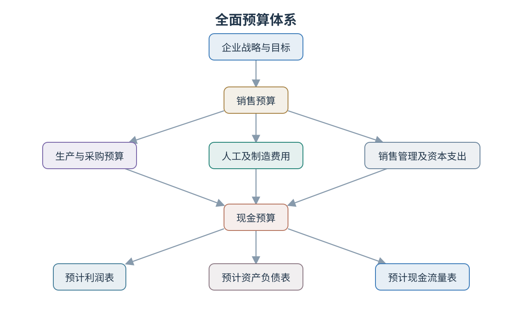
*图 40　全面预算体系*

#### 30.2 主要预算方法

| 方法 | 特点 |
| --- | --- |
| 固定预算 | 按既定业务量编制 |
| 弹性预算 | 根据不同实际业务量调整 |
| 增量预算 | 以历史预算或实际数据为基础 |
| 零基预算 | 重新论证项目必要性及金额 |
| 滚动预算 | 持续更新未来预算 |
| 情景预算 | 不同经营情景的备选方案 |

#### 30.3 现金预算示例

| 项目（万元） | 第一月 | 第二月 | 第三月 |
| --- | --- | --- | --- |
| 期初现金 | 80 | 60 | 30 |
| 预计收款 | 50 | 70 | 100 |
| 预计付款 | 70 | 100 | 80 |
| 期末现金 | 60 | 30 | 50 |

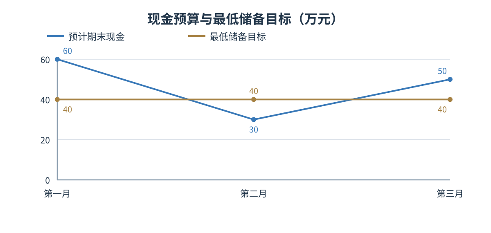
*图 41　现金预算与最低储备目标（万元）*

第二月现金30万元，若最低储备40万元，存在10万元缺口，需提前安排融资、加快收款或调整支出。

### 第三十一章　标准成本与差异分析

#### 31.1 标准成本

在一定技术、价格和效率假设下设置的成本基准，应与实际产量、条件及可达到效率匹配。成本差异 = 实际成本 − 标准成本。

#### 31.2 直接材料差异

实际用量 AQ，实际价格 AP，标准价格 SP，实际产量允许标准用量 SQ。
$$
\text{材料价格差异}=AQ(AP-SP)
$$
$$
\text{材料用量差异}=SP(AQ-SQ)
$$

| 项目 | 标准 | 实际 |
| --- | --- | --- |
| 材料用量 | 1,000 kg | 1,100 kg |
| 材料单价 | 10 元 | 11 元 |
| 材料成本 | 10,000 元 | 12,100 元 |

价格差异 = 1,100 元，用量差异 = 1,000 元，总超支 = 2,100 元。

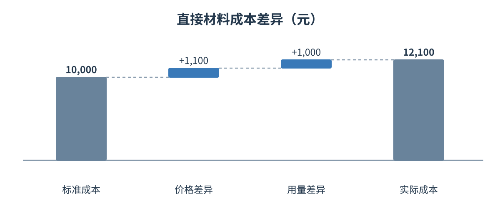
*图 42　直接材料成本差异（元）*

类似方法适用于人工工资率、人工效率及制造费用差异。

### 第三十二章　经营决策与相关成本

#### 32.1 主要经营决策

| 类型 | 核心分析内容 |
| --- | --- |
| 特殊订单 | 增量收入与增量成本 |
| 自制或外购 | 可避免成本及供应条件 |
| 产品组合 | 单位稀缺资源边际贡献 |
| 停产或继续 | 可避免固定成本与失去的边际贡献 |
| 深加工 | 增量加工成本与增量收入 |
| 定价 | 成本、需求、竞争及目标收益 |
| 设备更新 | 未来相关现金流及机会成本 |

#### 32.2 自制与外购案例

| 成本项目（年需求10,000件） | 自制 | 外购 |
| --- | --- | --- |
| 单位可避免变动成本 | 20 元 | — |
| 年度可避免固定成本 | 30,000 元 | — |
| 单位采购价格 | — | 25 元 |
| 相关总成本 | 230,000 元 | 250,000 元 |


*图 43　自制与外购相关成本（元）*

无其他机会成本、质量及交付差异时，自制低20,000元。释放产能可创造超过20,000元其他净收益时结论可能改变。

#### 32.3 稀缺资源与产品组合

| 产品 | 单位边际贡献 | 单位设备工时 | 每设备小时边际贡献 |
| --- | --- | --- | --- |
| A | 60 元 | 3 小时 | 20 元 |
| B | 50 元 | 2 小时 | 25 元 |

若仅设备工时受限且边际贡献稳定，优先安排 B 产品。

### 第三十三章　责任会计与绩效管理

#### 33.1 责任中心

| 类型 | 管理责任 |
| --- | --- |
| 成本中心 | 成本及资源耗费 |
| 收入中心 | 营业收入 |
| 利润中心 | 收入、成本及利润 |
| 投资中心 | 利润及占用资本效率 |

#### 33.2 投资报酬率与剩余收益

$$
ROI=\frac{\text{相关经营利润}}{\text{平均投资资产}}
$$
$$
RI=\text{经营利润}-\text{投资资产}\times\text{要求报酬率}
$$
仅用 ROI 考核可能使部门拒绝提升企业价值、但降低部门平均 ROI 的项目。

#### 33.3 平衡计分卡

| 维度 | 内容 |
| --- | --- |
| 财务 | 盈利、现金流及资本回报 |
| 客户 | 满意度、留存率、市场份额 |
| 内部流程 | 质量、效率、交付、创新 |
| 学习与成长 | 人才、知识、技术与组织能力 |


*图 44　平衡计分卡的战略联系*

不能仅用短期利润评价绩效，还应研究长期竞争力及其形成条件。

## 第六篇　财务报表分析与企业经营诊断

记账回答企业发生了什么，财务分析进一步研究数字背后的原因、经营能力与潜在风险。

### 第三十四章　财务分析的基本方法

#### 34.1 主要分析方法

| 方法 | 作用 |
| --- | --- |
| 水平分析 | 不同期间财务变化 |
| 垂直分析 | 各项目占报表基准项目比例 |
| 趋势分析 | 多个期间长期变化 |
| 比率分析 | 不同经营维度指标 |
| 同业比较 | 业务模式及阶段相近的企业比较 |
| 因素分析 | 分解指标变化来源 |
| 现金流分析 | 现金创造及资金使用 |
| 情景分析 | 不同假设下结果 |

#### 34.2 水平分析

$$
\text{同比增长率}=\frac{\text{本期金额}-\text{上年同期金额}}{\text{上年同期金额}}\times100\%
$$

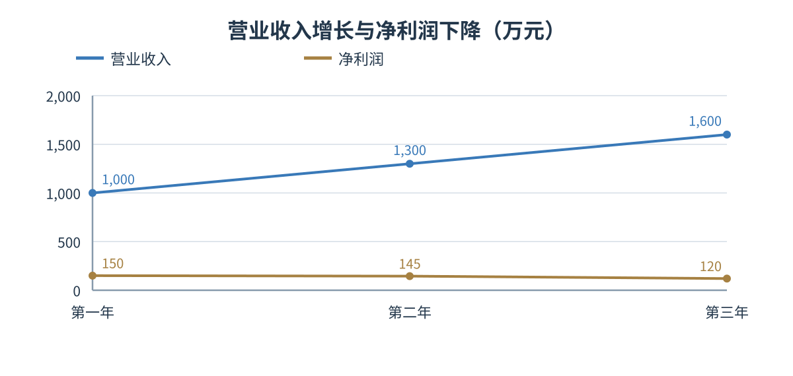
*图 45　营业收入增长与净利润下降（万元）*

净利率从15%降到7.5%。需要研究毛利率、价格竞争、销售费用、研发、减值等因素，而非仅凭营收增长判断经营改善。

#### 34.3 垂直分析

利润表通常以营业收入为基准，资产负债表可用资产总额为基准。例如存货占资产比例 = 存货 ÷ 资产总额。结构分析减少规模差异的影响。

### 第三十五章　偿债能力与财务结构分析

#### 35.1 短期偿债能力

| 指标 | 公式 |
| --- | --- |
| 流动比率 | 流动资产 ÷ 流动负债 |
| 速动比率 | 速动资产 ÷ 流动负债 |
| 现金比率 | 现金及相应高流动性资产 ÷ 流动负债 |
| 净营运资本 | 流动资产 − 流动负债 |

速动资产通常剔除存货、预付款等流动性相对较弱或不能直接偿债的资产，口径需一致。用第21章数据：
$$
\text{流动比率}=600/300=2.0
$$
$$
\text{速动比率}=(150+200)/300\approx1.17
$$
$$
NWC=600-300=300\text{万元}
$$

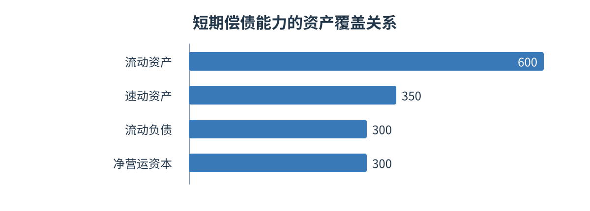
*图 46　短期偿债能力的资产覆盖关系*

#### 35.2 长期偿债能力

| 指标 | 公式 |
| --- | --- |
| 资产负债率 | 负债总额 ÷ 资产总额 |
| 产权比率 | 负债总额 ÷ 所有者权益 |
| 权益乘数 | 资产总额 ÷ 所有者权益 |
| 利息保障倍数 | EBIT ÷ 相应利息费用 |
| 净债务 | 有息债务 − 按分析口径扣除的现金及现金等价物 |

案例资产负债率 700/1200 = 58.33%，产权比率 700/500 = 1.4，利息保障倍数 300/40 = 7.5。没有普适的行业绝对指标标准。

### 第三十六章　营运能力与现金转换周期

#### 36.1 主要周转率

| 指标 | 公式 |
| --- | --- |
| 应收账款周转率 | 赊销净收入 ÷ 平均应收账款 |
| 存货周转率 | 营业成本 ÷ 平均存货 |
| 应付账款周转率 | 赊购金额 ÷ 平均应付账款 |
| 总资产周转率 | 营业收入 ÷ 平均总资产 |
| 固定资产周转率 | 营业收入 ÷ 平均固定资产净额 |

如赊销或赊购数据无法获取，可用营业收入、采购额估计或营业成本作为近似，并说明口径。

#### 36.2 现金转换周期

$$
DIO=\frac{\text{平均存货}}{\text{营业成本}}\times365
$$
$$
DSO=\frac{\text{平均应收账款}}{\text{赊销净收入}}\times365
$$
$$
DPO=\frac{\text{平均应付账款}}{\text{赊购金额}}\times365
$$
$$
\boxed{CCC=DIO+DSO-DPO}
$$

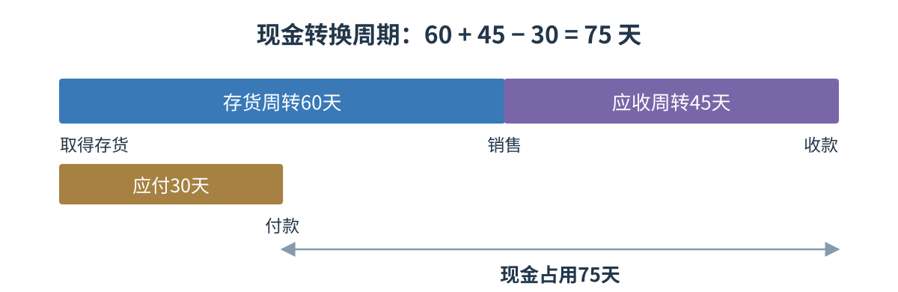
*图 47　现金转换周期：60 + 45 − 30 = 75 天*

离线交互演示：[企业现金转换周期计算器（HTML）](#social-accounting_ccc)


负 CCC 可能表示支付供应商货款前已收到客户款项。

#### 36.3 局限

过高库存周转率可能意味着缺货风险，过高应收周转率也可能源于信用收紧而影响销售。需结合商业模式及经营约束。

### 第三十七章　盈利能力与杜邦分析

#### 37.1 主要盈利能力指标

| 指标 | 公式 |
| --- | --- |
| 毛利率 | 毛利润 ÷ 营业收入 |
| 净利率 | 净利润 ÷ 营业收入 |
| 营业利润率 | 一致口径营业利润 ÷ 营业收入 |
| 总资产净利率 ROA | 净利润 ÷ 平均总资产 |
| 净资产收益率 ROE | 净利润 ÷ 平均所有者权益 |
| 投入资本回报率 ROIC | 税后净营业利润 ÷ 平均投入资本 |

ROA、ROIC 的实际口径存在差异，需保证分子分母资本和收益范围对应。

#### 37.2 杜邦分析

$$
\boxed{ROE=\frac{\text{净利润}}{\text{营业收入}}\times\frac{\text{营业收入}}{\text{平均资产}}\times\frac{\text{平均资产}}{\text{平均权益}}}
$$

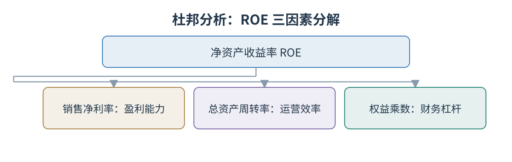
*图 48　杜邦分析：ROE 三因素分解*

净资产收益率 ROE；销售净利率：盈利能力；总资产周转率：运营效率；权益乘数：财务杠杆

离线交互演示：[杜邦分析交互演示（HTML）](#social-accounting_tree_f334)


#### 37.3 ROE 与 ROIC 的区别

ROE 关注股东权益回报，受资本结构影响；ROIC 更关注经营投入资本回报。高 ROE 可能来自经营能力，也可能来自高杠杆或较小权益基数，不能单独证明长期优秀。

### 第三十八章　现金流量与盈利质量分析

#### 38.1 盈利质量

| 研究方向 | 核心问题 |
| --- | --- |
| 现金支持 | 利润能否转化为现金？ |
| 经营持续性 | 是否来自可持续经营？ |
| 会计估计 | 是否受重大估计变更影响？ |
| 非经常性事项 | 是否主要源于一次性事项？ |
| 资本投入 | 维持利润需投入多少？ |
| 客户信用 | 应收账款收回风险？ |

#### 38.2 自由现金流

常见简化口径 FCF = 经营现金流量 − 资本性支出；估值中需区分 FCFF 与 FCFE。

#### 38.3 企业自由现金流

$$
\boxed{FCFF=EBIT(1-T)+D\&A-CapEx-\Delta NWC}
$$
EBIT 为息税前经营利润，T 为税率假设，D&A 为折旧摊销，CapEx 为资本性支出，ΔNWC 为经营性净营运资本增加额。
$$
FCFF=300(1-25\%)+80-180-75=50\text{万元}
$$

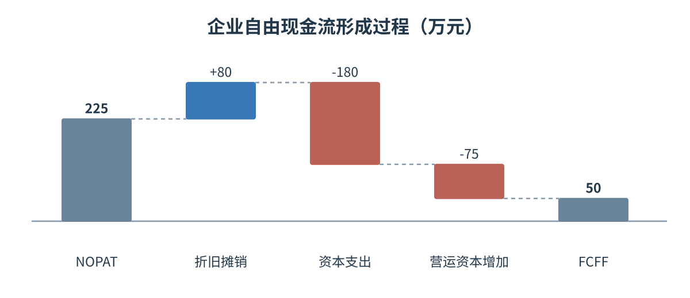
*图 49　企业自由现金流形成过程（万元）*

净利润为195万元，考虑资本投入与营运资金占用后，简化企业自由现金流仅50万元。

#### 38.4 盈利企业为何可能资金危机


*图 50　从盈利到流动性压力*

确认大量销售收入 → 客户未付款、库存积压、设备投资、债务到期 → 现金储备减少 → 可能无法按时支付工资、货款及债务

> [!important] 利润与现金
> 利润反映会计期间经营成果，现金反映企业实际可使用的支付资源。两者均重要，但不能替代。

### 第三十九章　财务风险、异常识别与企业估值基础

#### 39.1 财务异常的识别线索

| 异常现象 | 应研究的问题 |
| --- | --- |
| 收入增长，应收增长更快 | 客户信用、销售真实性与收款条件 |
| 利润增长，经营现金流下降 | 权责发生项目、营运资金与非现金利润 |
| 存货显著增加，销售增长慢 | 需求、积压及跌价风险 |
| 研发资本化比例明显上升 | 是否符合资本化条件 |
| 依靠非经常性收益 | 核心业务持续性 |
| 短债大量用于长期投资 | 资金期限匹配 |
| 高商誉伴随并购 | 预期实现与减值风险 |
| 频繁变更政策估计 | 原因及利润影响 |
| 关联交易扩大 | 定价、商业实质、利益冲突 |

仅是调查线索，不直接证明财务舞弊。

#### 39.2 估值主要方法

| 方法 | 核心思想 |
| --- | --- |
| DCF | 未来现金流按风险折现 |
| PE | 净利润与股权市场价值关系 |
| PB | 账面权益与股权市场价值关系 |
| EV/EBITDA 等 | 企业价值倍数 |
| PS | 营业收入与股权市场价值关系 |
| 资产基础法 | 资产及负债价值 |

$$
PE=\frac{\text{股权市场价值}}{\text{相应净利润}},\qquad PB=\frac{\text{股权市场价值}}{\text{相应账面权益}}
$$
$$
EV\approx\text{股权市场价值}+\text{净债务}
$$
实际可能需考虑非控制性权益、优先股、非经营资产等调整。

#### 39.3 三种价值概念

账面净资产是会计资产减负债；股权价值是股东权益的经济或市场价值；EV 是对应口径下经营资产对资本提供者的价值。技术优势、客户网络及未来增长潜力可能使股权价值高于账面净资产，但仍需合理预期与估值假设。

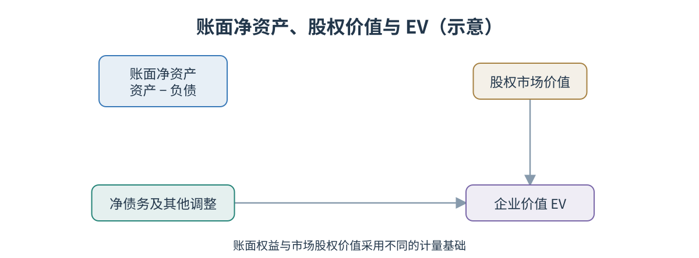
*图 51　账面净资产、股权价值与 EV（示意）*

## 第七篇　企业财务管理

企业财务管理（Corporate Financial Management）研究资金如何筹集、配置、使用、控制与分配。会计是其信息基础，财务管理决定企业如何利用资金开展未来经营活动。

### 第四十章　货币时间价值与风险收益

#### 40.1 货币时间价值

存在资金机会成本时，不同时点的相同金额具有不同经济价值。
$$
FV=PV(1+r)^n,\qquad PV=\frac{FV}{(1+r)^n}
$$
$$
PV_{\text{普通年金}}=A\frac{1-(1+r)^{-n}}{r}
$$
$$
PV_{\text{普通永续年金}}=\frac{A}{r}
$$
假设期间利率一致，普通年金在期末支付，永续年金折现率为正；普通年金 r=0 时现值为 nA。

#### 40.2 复利增长示例

初始100万元，年收益率5%。

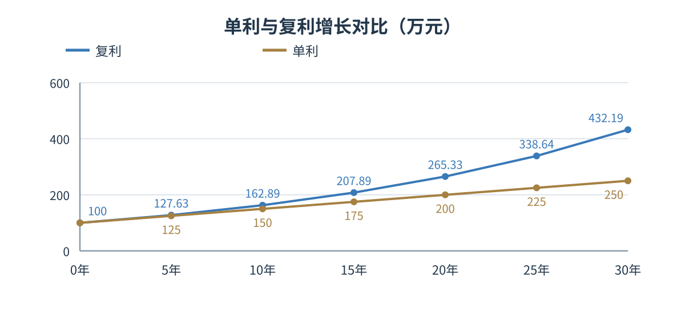
*图 52　单利与复利增长对比（万元）*

固定利率为数学演示，不代表现实投资能取得稳定收益。

#### 40.3 风险与资本成本

| 概念 | 含义 |
| --- | --- |
| 无风险利率 | 理论上不承担相应违约风险的基准收益率 |
| 风险溢价 | 承担风险要求的额外预期收益 |
| 机会成本 | 放弃替代方案的收益 |
| 资本成本 | 资本提供者要求的相应报酬率 |
| 折现率 | 未来现金折算当前价值的比率 |

折现率必须与现金流的风险、币种、通胀口径及资本归属匹配。

### 第四十一章　投资决策与资本预算

#### 41.1 投资决策基本流程

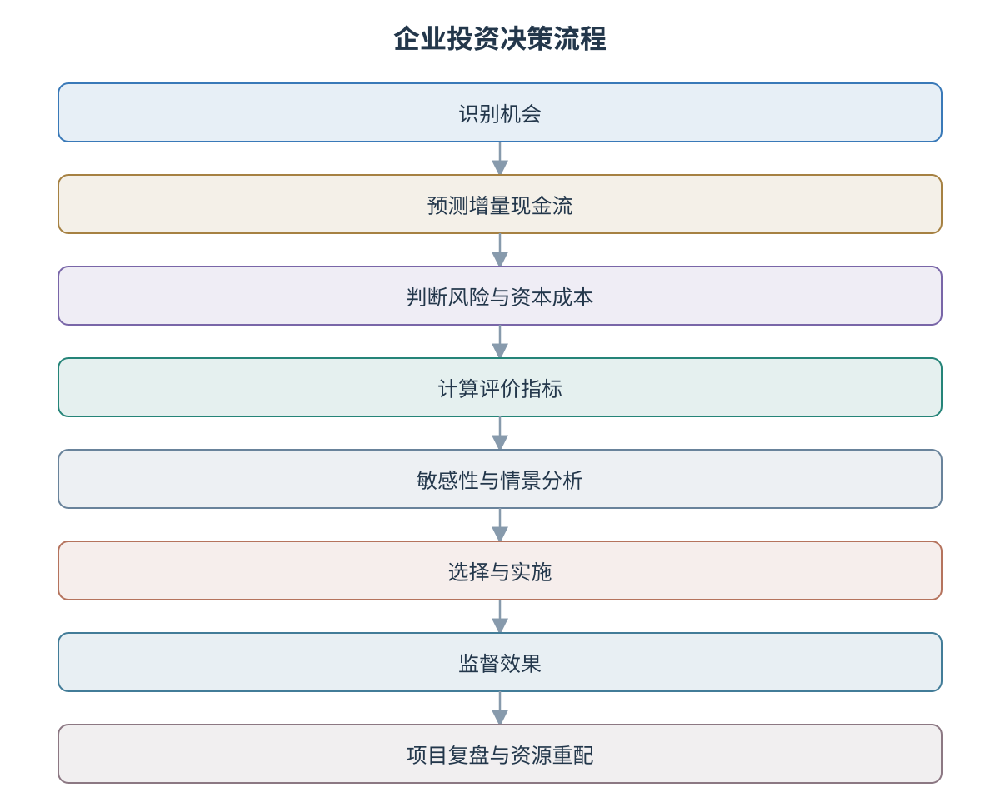
*图 53　企业投资决策流程*

识别机会 → 预测增量现金流 → 判断风险与资本成本 → 计算评价指标 → 敏感性与情景分析 → 选择与实施 → 监督效果 → 项目复盘与资源重配

#### 41.2 净现值 NPV

$$
\boxed{NPV=\sum_{t=1}^{n}\frac{CF_t}{(1+r)^t}-I_0}
$$
I₀ 为初始投入，CFₜ 为各期净现金流。在独立项目、现金流及折现率假设合理时，正 NPV 表示预期创造超过资本机会成本的价值。

#### 41.3 其他投资评价方法

| 指标 | 主要含义 | 主要局限 |
| --- | --- | --- |
| NPV | 折现净价值 | 依赖现金流与资本成本估计 |
| IRR | 使 NPV 为零的折现率 | 非常规现金流可能多解或无有效解 |
| 回收期 | 收回初始投入的时间 | 忽略时间价值与回收期后现金流 |
| 折现回收期 | 基于折现现金流计算 | 仍可能忽略后续现金流 |
| PI 获利指数 | 未来现金流现值与初始投入比率 | 不一定适合直接比较互斥项目 |

#### 41.4 软件平台投资项目

初始100万元，未来5年每年期末净现金流30万元，折现率10%，无残值：

| 期间 | 净现金流（万元） | 现值（万元） |
| --- | --- | --- |
| 0 | -100 | -100 |
| 1 | 30 | 27.27 |
| 2 | 30 | 24.79 |
| 3 | 30 | 22.54 |
| 4 | 30 | 20.49 |
| 5 | 30 | 18.63 |

未来现金流现值113.72万元，净现值13.72万元（按未舍入数值计算），获利指数1.137；简单回收期约3.33年（假设回收期内流入均匀）。

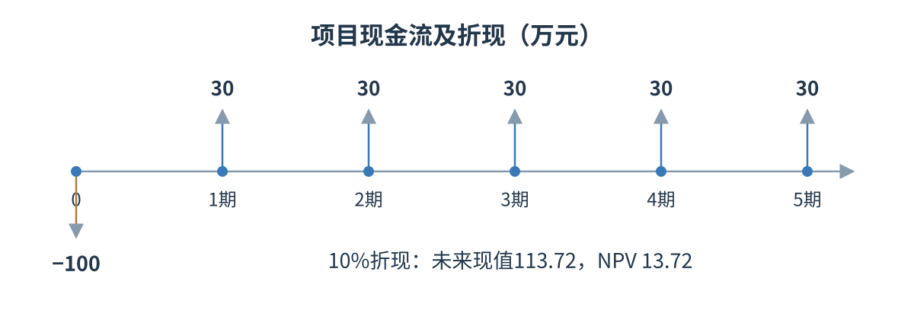
*图 54　项目现金流及折现（万元）*

离线交互演示：[企业投资项目 NPV 计算器（HTML）](#social-accounting_npv)


不单独考虑税收、追加投资、残值及其他资金占用。

### 第四十二章　融资管理与资本结构

#### 42.1 主要融资方式

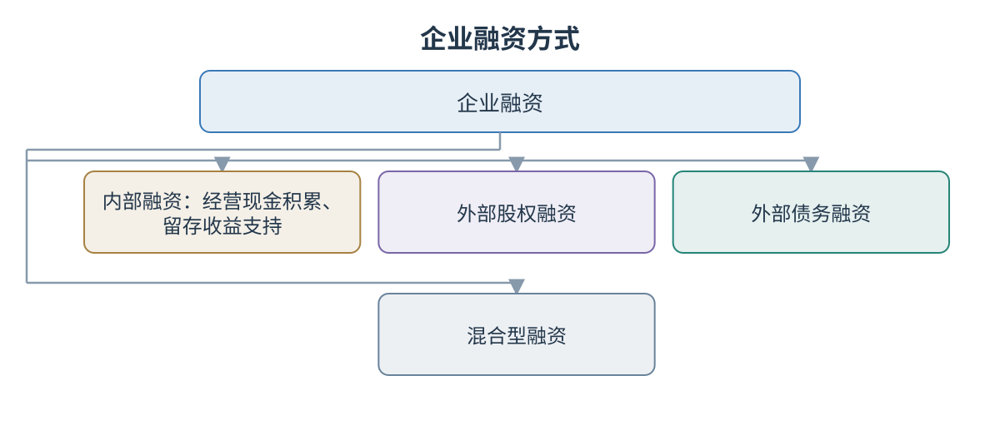
*图 55　企业融资方式*

企业融资；内部融资：经营现金积累、留存收益支持；外部股权融资；外部债务融资；混合型融资

典型工具包括银行贷款、债券、增资扩股、风险投资、可转换债券、租赁及其他合规融资安排。

#### 42.2 债务与股权融资

| 维度 | 债务融资 | 股权融资 |
| --- | --- | --- |
| 资金提供者 | 债权人 | 股东 |
| 收益形式 | 约定利息等 | 股利与权益价值变化 |
| 本金偿付 | 通常有约定期限或条件 | 通常无普通债务式固定本金偿还要求 |
| 控制权 | 一般不直接取得普通股表决权 | 可能影响控制权及权益比例 |
| 财务风险 | 固定偿债压力 | 通常降低固定偿债压力 |
| 税收影响 | 符合条件利息可能形成税盾 | 普通股股利通常不作所得税前费用 |

#### 42.3 加权平均资本成本 WACC

$$
\boxed{WACC=\frac{E}{D+E}R_e+\frac{D}{D+E}R_d(1-T)}
$$
E 与 D 为权益、债务资本市场价值；Rₑ、R_d 为相应资本成本。权益60%、成本12%，债务40%、成本6%，税率25%且税盾可实现：
$$
WACC=60\%\times12\%+40\%\times6\%\times(1-25\%)=9\%
$$

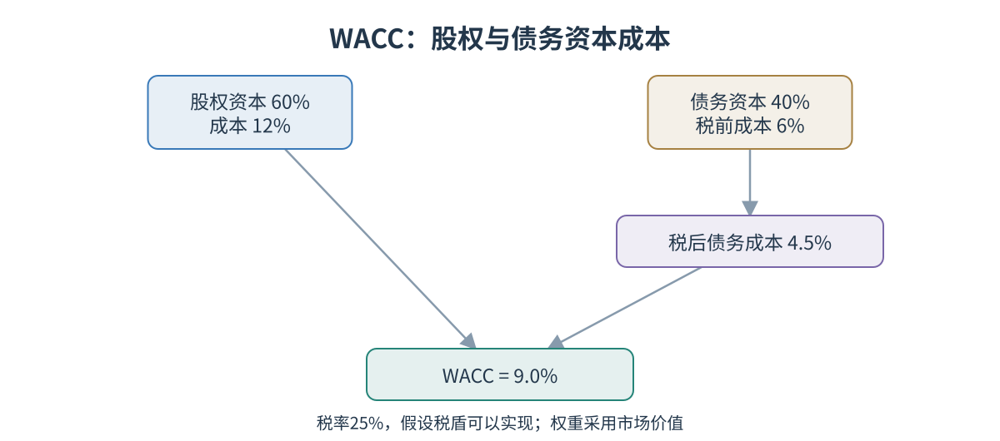
*图 56　WACC：股权与债务资本成本*

#### 42.4 CAPM

$$
R_e=R_f+\beta(R_m-R_f)
$$
R_f 为无风险利率，R_m−R_f 为市场风险溢价，β 为相对市场组合的系统性风险。实际应用受模型假设、数据和估计限制。

#### 42.5 财务杠杆与股东收益

总资产1,000万元，EBIT 120万元，所得税率25%。

| 项目 | 无债务企业 | 有债务企业 |
| --- | --- | --- |
| 资产 | 1,000 | 1,000 |
| 有息债务 | 0 | 500 |
| 股东权益 | 1,000 | 500 |
| EBIT | 120 | 120 |
| 利息费用 | 0 | 30 |
| 净利润 | 90 | 67.5 |
| ROE | 9% | 13.5% |

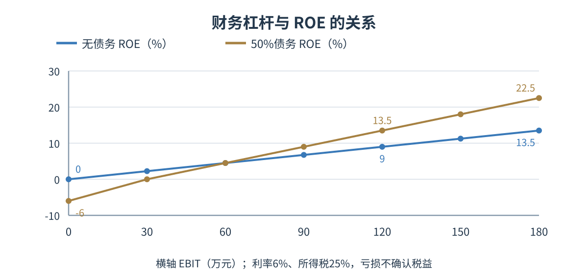
*图 57　财务杠杆与 ROE 的关系*

离线交互演示：[财务杠杆与股东回报（HTML）](#social-accounting_leverage)


有债务企业净利润较低但权益更少，ROE 较高。杠杆既可放大收益，也可放大亏损，增加负债不自动增加企业价值。

#### 42.6 资本结构理论

| 理论 | 核心思想 |
| --- | --- |
| MM 理论 | 理想市场假设下资本结构与价值关系 |
| 权衡理论 | 债务税盾与财务困境等成本的权衡 |
| 优序融资理论 | 信息不对称影响融资来源顺序 |
| 代理成本理论 | 债务、股东及管理层激励与冲突 |
| 市场择时理论 | 资本市场定价与融资环境影响选择 |

### 第四十三章　营运资金与现金管理

#### 43.1 营运资金管理对象

| 对象 | 主要任务 |
| --- | --- |
| 现金 | 支付能力及闲置资金 |
| 应收账款 | 信用、账龄及收款 |
| 存货 | 库存水平、积压与缺货风险 |
| 应付账款 | 合理付款及供应商关系 |
| 短期融资 | 经营需求及流动性波动 |

#### 43.2 现金持有动机

交易动机：日常支付；预防动机：突发支出；投资机会动机：为未来机会准备资金。不能将全部现金投入长期投资，也不宜无合理需求长期持有大量闲置资金。

#### 43.3 经济订货批量 EOQ

$$
EOQ=\sqrt{\frac{2DS}{H}}
$$
D 为年度需求，S 为每次订货成本，H 为单位存货年度持有成本。基本假设为需求、订货成本及单位持有成本稳定等。

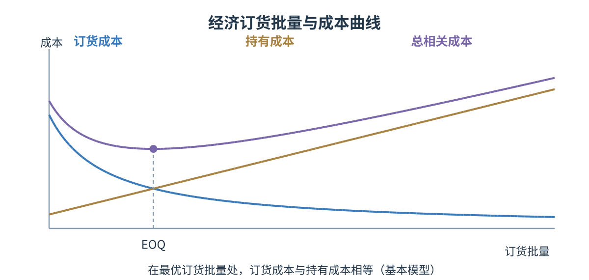
*图 58　经济订货批量与成本曲线*

现实采购还需考虑批量折扣、需求波动、安全库存及供应风险。

#### 43.4 资金期限匹配

以一年以内到期借款投资回收周期十年的项目，即使具有长期盈利潜力，也可能面临短债续借困难与现金流压力。

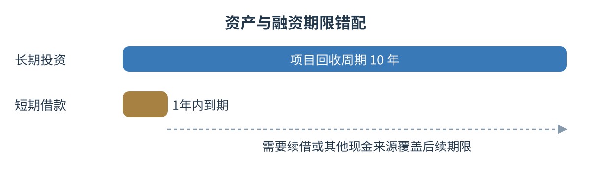
*图 59　资产与融资期限错配*

### 第四十四章　利润分配与股利政策

#### 44.1 利润的主要用途

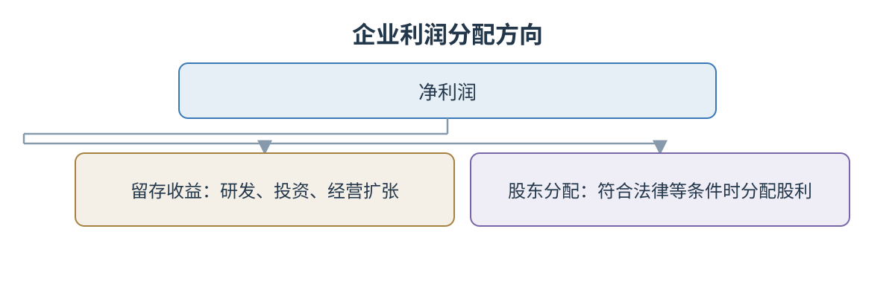
*图 60　企业利润分配方向*

净利润；留存收益：研发、投资、经营扩张；股东分配：符合法律等条件时分配股利

#### 44.2 主要股利政策

| 政策 | 特点 |
| --- | --- |
| 稳定股利 | 维持相对稳定的每股股利 |
| 固定支付率 | 按利润一定比例支付 |
| 剩余股利 | 优先满足适当投资需求 |
| 低正常股利加额外股利 | 基础分配，条件良好时增加 |

$$
\text{股利支付率}=\frac{\text{相应现金股利}}{\text{相应净利润}}
$$
增加分红需要结合投资机会、资本成本、现金、负债压力与法律限制。

### 第四十五章　企业财务战略与财务预测

#### 45.1 财务战略组成

| 战略 | 任务 |
| --- | --- |
| 投资 | 资金投向与资本配置 |
| 融资 | 资金来源、期限、成本 |
| 现金 | 流动性及持续经营 |
| 利润分配 | 股东分配与长期发展 |
| 风险 | 信用、利率、汇率等 |
| 税务 | 合规规划税务成本与风险 |
| 并购 | 交易价值、整合成本、资金安排 |

#### 45.2 三张报表联动预测


*图 61　三表联动预测与资金缺口反馈*

不能仅预测收入利润，还需同步预测资产负债与现金流量。

#### 45.3 情景分析与压力测试

| 项目（万元） | 乐观 | 基准 | 悲观 |
| --- | --- | --- | --- |
| 营业收入 | 1,200 | 1,000 | 700 |
| 变动成本率 | 55% | 55% | 55% |
| 固定成本 | 350 | 350 | 350 |
| 简化经营利润 | 190 | 100 | -35 |


*图 62　不同情景下的经营利润（万元）*

预算不是确定预测，而是基于假设的资源配置与风险准备工具。

## 第八篇　审计、内部控制与财务合规

### 第四十六章　审计原理与审计意见

#### 46.1 审计主要类型

| 类型 | 目的 |
| --- | --- |
| 财务报表审计 | 对财务报表是否按适用框架编制发表意见 |
| 内部审计 | 评价治理、风险管理及内部控制 |
| 合规审计 | 检查法规、制度或合同符合性 |
| 经营审计 | 研究经营效率、效果和经济性 |
| 信息系统审计 | 检查可靠性、安全性及控制 |
| 专项审计 | 特定事项检查与鉴证 |

#### 46.2 财务报表审计流程


*图 63　财务报表审计流程*

承接与独立性检查 → 了解企业及经营环境 → 识别和评估重大错报风险 → 设计及执行审计程序 → 获取充分适当证据 → 评价错报及结果 → 形成意见与报告

#### 46.3 审计风险模型

$$
AR=RMM\times DR
$$
$$
AR=IR\times CR\times DR
$$
AR 为审计风险，RMM 为重大错报风险，IR 为固有风险，CR 为控制风险，DR 为检查风险。主要用于规划与分析，不是精确预测审计失败概率的公式。

#### 46.4 审计意见

| 审计意见 | 基本情形 |
| --- | --- |
| 无保留意见 | 所有重大方面符合适用报告框架 |
| 保留意见 | 已识别错报重大但不广泛，或证据不足的潜在影响重大但不广泛 |
| 否定意见 | 已识别错报重大且广泛 |
| 无法表示意见 | 证据不足的潜在影响可能重大且广泛 |


*图 64　修改审计意见判断矩阵*

审计提供合理保证而非绝对保证；无保留意见不意味着不存在舞弊、经营失败或未来破产可能。

### 第四十七章　内部控制与企业风险管理

#### 47.1 COSO 内部控制整合框架

| 组成 | 含义 |
| --- | --- |
| 控制环境 | 诚信文化、治理结构、权责及人员管理 |
| 风险评估 | 识别分析影响目标的风险 |
| 控制活动 | 审批、职责分离、复核等 |
| 信息与沟通 | 可靠获取及有效传递信息 |
| 监督活动 | 持续检查控制是否有效运行 |


*图 65　COSO 内部控制五项组成*

#### 47.2 常见内部控制措施

| 措施 | 作用 |
| --- | --- |
| 不相容职责分离 | 避免同一人控制交易全部环节 |
| 授权审批 | 交易具有适当权限 |
| 银行对账 | 核对账面与银行记录 |
| 实物盘点 | 核实存货及固定资产存在 |
| 三单匹配 | 核对采购订单、收货及发票 |
| 预算控制 | 监督支出与批准预算关系 |
| 系统权限 | 防止未授权访问修改 |
| 独立复核 | 检查重要计算、估计及报告 |

#### 47.3 采购付款控制

采购订单、收货记录及供应商发票进行三单匹配，核对数量、价格、供应商及合同条件，授权审批后付款，随后记账、银行对账并开展监督。


*图 66　采购付款三单匹配*

#### 47.4 主要财务风险

| 风险 | 表现 |
| --- | --- |
| 流动性 | 无法按时支付到期债务 |
| 信用 | 客户或交易对手不能履约 |
| 市场 | 利率、汇率、资产价格变化 |
| 操作 | 人员、系统、流程失效 |
| 合规 | 违反法律、监管及合同 |
| 财务报告 | 重大错报 |
| 集中度 | 过度依赖单一客户、供应商或融资渠道 |

### 第四十八章　税务会计与税务管理

#### 48.1 常见税收类型

| 税种 | 基本征税对象 |
| --- | --- |
| 企业所得税 | 应纳税所得额 |
| 增值税 VAT | 适用税制下商品服务交易增值环节等 |
| 消费税 | 特定消费品或应税交易 |
| 个人所得税 | 个人应税所得 |
| 关税 | 特定跨境进出口货物 |
| 印花税及其他 | 税法规定的交易或事项 |

各地税种、税率、税基、优惠、申报规则存在显著差异。

#### 48.2 增值税基本逻辑

假设一般抵扣机制，统一13%教学税率，进项税额全额符合抵扣条件。

| 交易 | 不含税金额（元） | 增值税额（元） | 含税金额（元） |
| --- | --- | --- | --- |
| 采购 | 100,000 | 13,000 | 113,000 |
| 销售 | 150,000 | 19,500 | 169,500 |

$$
\text{应纳增值税额}=19500-13000=6500\text{元}
$$


*图 67　增值税销项、进项与应纳税额（元）*

该税率与抵扣条件仅用于教学，不能用于所有业务。符合条件的进项税通常不计入存货成本，代收销项税通常不属于营业收入。

#### 48.3 税务管理主要内容

| 领域 | 任务 |
| --- | --- |
| 纳税申报 | 计算与申报税款 |
| 发票管理 | 凭证及资料真实完整 |
| 税会差异 | 记录会计和税务处理差异 |
| 风险控制 | 交易、关联及跨境风险 |
| 合规税务筹划 | 依法安排经营与交易结构 |
| 档案管理 | 保存合同、凭证及申报资料 |

合法税务筹划、避税安排与违法逃税并非同一概念，应依据适用税法及交易事实判断。

### 第四十九章　财务舞弊、职业道德与合规

#### 49.1 舞弊三角理论


*图 68　舞弊三角：压力、机会、合理化*

识别风险因素的概念模型，不是判断某个人必然舞弊的依据。

#### 49.2 主要财务舞弊风险

| 类型 | 风险表现 |
| --- | --- |
| 收入虚增 | 缺乏真实业务基础 |
| 费用错报 | 金额或期间不符规定 |
| 资产虚增 | 资产不存在或不具备相应价值 |
| 负债遗漏 | 债务未完整反映 |
| 资金侵占 | 企业资金资产不当使用 |
| 关联交易披露不足 | 关系及交易信息不完整 |
| 会计估计偏差 | 对重要估计不当干预 |

#### 49.3 职业道德

| 原则 | 要求 |
| --- | --- |
| 诚信 | 诚实记录及报告经济活动 |
| 客观性 | 避免偏见、冲突及不当影响 |
| 专业胜任能力与应有关注 | 保持技能并审慎履职 |
| 保密 | 保护依法依规应保密信息 |
| 职业行为 | 遵守法律及专业规范 |

企业财务不应通过调整报表追求漂亮利润；必须建立在真实业务、可靠数据及合规经营基础上。

## 第九篇　现代会计与企业财务实践

### 第五十章　会计信息系统与 ERP

#### 50.1 企业资源计划系统

ERP（Enterprise Resource Planning）统一管理财务、采购、生产、销售、库存及人力资源。现代财务强调业务数据与财务数据自动联动。


*图 69　ERP 业务模块与财务系统*

#### 50.2 核心模块

| 模块 | 功能 |
| --- | --- |
| GL 总账 | 凭证、账户、结账 |
| AR 应收 | 客户欠款、信用、收款 |
| AP 应付 | 供应商欠款、付款 |
| FA 固定资产 | 登记、折旧、处置 |
| INV 库存 | 数量、价值及成本 |
| CO 成本控制 | 成本中心、产品成本及利润 |
| TR 资金管理 | 银行账户、现金、融资及风险 |
| FP&A 财务计划与分析 | 预算、预测及经营分析 |
| Consolidation 合并报表 | 内部抵销与合并 |

企业管理系统例：SAP S/4HANA、Oracle Fusion Cloud ERP、Microsoft Dynamics 365、用友及金蝶。

#### 50.3 业财一体化


*图 70　销售业务与财务系统联动*

业务发生时按规则形成财务记录，自动生成凭证不意味着省略判断、权限及数据核查。

#### 50.4 财务系统数据结构

| 数据实体 | 内容 |
| --- | --- |
| Account | 会计科目及账户属性 |
| JournalEntry | 凭证主表 |
| JournalEntryLine | 借贷明细 |
| FiscalPeriod | 期间与结账状态 |
| Customer | 客户及信用信息 |
| Supplier | 供应商与结算信息 |
| Invoice | 发票与业务金额 |
| Payment | 收付款记录 |
| FixedAsset | 固定资产及折旧 |
| CostCenter | 成本中心与归属 |
| ExchangeRate | 汇率与币种转换 |
| AuditLog | 操作记录及审计追踪 |


*图 71　复式记账系统实体关系图*

可靠财务信息系统需要凭证借贷平衡、事务一致性、期间控制、历史数据可追溯，以及币种、核算维度、辅助账、冲销和审批等功能。金额应使用十进制定点数、适当最小货币单位整数等方式，避免直接以二进制浮点数处理精确金额。

### 第五十一章　数字化会计与人工智能

#### 51.1 财务数字化发展方向

| 技术 | 用途 |
| --- | --- |
| OCR | 发票、票据及凭证识别 |
| RPA | 自动化重复财务流程 |
| 数据仓库 | 汇总业务系统财务数据 |
| BI | 财务可视化与经营分析 |
| 机器学习 | 异常交易、现金流预测 |
| 大语言模型 | 文档检索、整理与辅助分析 |
| 区块链 | 特定场景交易记录及追溯 |
| XBRL | 财务与商业报告标准化数字表达 |

#### 51.2 智能财务处理流程


*图 72　智能财务处理流程*

业务数据采集：合同、订单、银行交易 → 识别与结构化：OCR、接口、转换 → 规则校验与分类：科目、税务、审批 → 自动核算：凭证及账簿 → 异常检测：重复付款及冲突 → 分析预测：预算、现金、风险 → 人工审核与责任确认

#### 51.3 应用边界

AI 提高提取、异常识别与分析效率，但不能替代企业对信息真实性、会计政策及专业判断的责任。应关注模型错误、隐私、商业秘密、权限、可解释性及人工复核。

### 第五十二章　集团财务、资金管理与跨国会计

#### 52.1 集团财务管理体系

集团资金中心负责融资、现金配置及流动性；财务共享中心负责标准化核算及重复性流程；财务管理中心负责预算、分析及绩效；税务与风险中心负责税务合规、内控和风险管理。


*图 73　集团财务集中管理体系*

实际组织方式需结合业务性质、当地法律和子公司治理要求。

#### 52.2 跨国企业财务管理

| 领域 | 核心内容 |
| --- | --- |
| 外币交易 | 初始确认与期末重新计量 |
| 外币报表折算 | 境外经营报表折算为集团列报货币 |
| 汇率风险 | 跨币种收入、支出、资产负债风险 |
| 国际资金管理 | 跨国流动性及资金调度 |
| 转让定价 | 关联交易定价及税务合规 |
| 国际税务 | 税收协定、预提税及跨境纳税 |
| 集团合并 | 统一政策与内部交易抵销 |
| 跨境合规 | 当地监管、外汇、数据及资金流动规则 |

#### 52.3 功能货币与列报货币

| 概念 | 含义 |
| --- | --- |
| 功能货币 Functional Currency | 主要经济环境的货币 |
| 列报货币 Presentation Currency | 用于编制及列报报表的货币 |
| 外币 Foreign Currency | 相对于功能货币的其他货币 |

集团可以有不同功能货币的子公司，合并报表使用统一列报货币。


*图 74　跨国集团的功能货币与列报货币*

### 第五十三章　特殊行业会计与可持续披露

#### 53.1 不同行业特点

| 行业 | 重点核算与分析事项 |
| --- | --- |
| 制造 | 原材料、在产品、制造费用、生产成本 |
| 零售 | 存货、毛利率、周转及供应商结算 |
| 软件互联网 | 研发、订阅收入、合同负债、客户获取成本 |
| 银行 | 金融资产、存贷款、利息、预期信用损失 |
| 保险 | 保险合同、服务结果及金融风险 |
| 房地产 | 开发成本、存货、预售、收入及资金监管 |
| 建筑工程 | 长期合同、履约进度及合同资产 |
| 航运航空 | 大额固定资产、租赁、燃料及汇率 |
| 能源 | 资源开发资产、资本支出及环境恢复义务 |
| 政府及非营利 | 公共资金、专项资金及受托责任 |

#### 53.2 软件企业的经营指标

| 指标 | 含义 |
| --- | --- |
| MRR | 月度经常性收入 |
| ARR | 年度经常性收入 |
| CAC | 客户获取成本 |
| LTV | 客户生命周期价值 |
| Churn Rate | 客户或经常性收入流失率 |
| NRR | 净收入留存率 |
| Burn Rate | 一定期间资金消耗速度 |
| Cash Runway | 按相应资金消耗假设估算的维持时间 |

这些经营指标不一定等于准则下确认的收入或资产。创业型科技企业应同时关注增长、单位经济效益及现金消耗，而非只关注用户量。

#### 53.3 可持续发展相关财务信息

| 标准或框架 | 研究方向 |
| --- | --- |
| IFRS S1 | 可持续发展相关财务信息披露一般要求 |
| IFRS S2 | 气候相关披露 |
| GRI Standards | 对经济、环境及人员的相关影响 |
| ESRS | 欧盟可持续发展报告标准 |

可持续披露与传统财务会计相关但不同，是否必须采用取决于所在地及监管规则。

### 第五十四章　企业完整财务核算与经营分析案例

本章连接会计分录、试算平衡、财务报表、现金流及经营分析。假设新企业第一个年度，单位万元，不考虑增值税及复杂税会差异，所得税率25%，不另行区分盈余公积等利润分配事项。

#### 54.1 企业经济业务

| 编号 | 经济业务 | 金额 |
| --- | --- | --- |
| 01 | 股东投入现金 | 500 |
| 02 | 向银行取得借款 | 200 |
| 03 | 现金购买设备 | 100 |
| 04 | 赊购库存商品 | 80 |
| 05 | 赊销商品 | 120 |
| 06 | 结转销售商品成本 | 70 |
| 07 | 收回客户货款 | 90 |
| 08 | 偿付供应商货款 | 50 |
| 09 | 支付管理人员工资 | 10 |
| 10 | 计提设备折旧，全部归属管理活动 | 5 |
| 11 | 支付借款利息 | 2 |
| 12 | 确认并支付所得税 | 8.25 |

#### 54.2 完整会计分录

```text
01
借：银行存款          500
    贷：实收资本          500

02
借：银行存款          200
    贷：短期借款          200

03
借：固定资产          100
    贷：银行存款          100

04
借：库存商品           80
    贷：应付账款           80

05
借：应收账款          120
    贷：主营业务收入      120

06
借：主营业务成本       70
    贷：库存商品           70

07
借：银行存款           90
    贷：应收账款           90

08
借：应付账款           50
    贷：银行存款           50

09
借：管理费用           10
    贷：银行存款           10

10
借：管理费用            5
    贷：累计折旧            5

11
借：财务费用            2
    贷：银行存款            2

12
借：所得税费用       8.25
    贷：应交税费         8.25

借：应交税费         8.25
    贷：银行存款         8.25
```

#### 54.3 调整后试算平衡表

| 会计科目 | 借方余额 | 贷方余额 |
| --- | --- | --- |
| 银行存款 | 619.75 | — |
| 应收账款 | 30.00 | — |
| 库存商品 | 10.00 | — |
| 固定资产 | 100.00 | — |
| 累计折旧 | — | 5.00 |
| 短期借款 | — | 200.00 |
| 应付账款 | — | 30.00 |
| 实收资本 | — | 500.00 |
| 主营业务收入 | — | 120.00 |
| 主营业务成本 | 70.00 | — |
| 管理费用 | 15.00 | — |
| 财务费用 | 2.00 | — |
| 所得税费用 | 8.25 | — |
| **合计** | **855.00** | **855.00** |

借贷平衡检查通过。

#### 54.4 利润表

| 项目 | 金额（万元） |
| --- | --- |
| 营业收入 | 120.00 |
| 减：营业成本 | 70.00 |
| 毛利润 | 50.00 |
| 减：管理费用 | 15.00 |
| 经营利润（简化口径） | 35.00 |
| 减：利息费用 | 2.00 |
| 利润总额 | 33.00 |
| 减：所得税费用 | 8.25 |
| **净利润** | **24.75** |


*图 75　综合案例利润形成（万元）*

#### 54.5 资产负债表

| 资产 | 金额 | 负债与权益 | 金额 |
| --- | --- | --- | --- |
| 银行存款 | 619.75 | 短期借款 | 200.00 |
| 应收账款 | 30.00 | 应付账款 | 30.00 |
| 库存商品 | 10.00 | 负债合计 | 230.00 |
| 流动资产合计 | 659.75 | 实收资本 | 500.00 |
| 固定资产净额 | 95.00 | 未分配利润 | 24.75 |
| — | — | 权益合计 | 524.75 |
| **资产总计** | **754.75** | **负债和权益总计** | **754.75** |

$$
754.75=230+524.75
$$


*图 76　综合案例资本结构（万元）*

#### 54.6 现金流量表

按中国企业现金流量表常见列报规则，本案例将支付借款利息计入筹资活动。

| 项目 | 金额（万元） |
| --- | --- |
| **经营活动** | — |
| 销售商品收到现金 | 90.00 |
| 支付供应商货款 | -50.00 |
| 支付职工工资 | -10.00 |
| 支付所得税 | -8.25 |
| 经营现金流量净额 | **21.75** |
| **投资活动** | — |
| 购建设备支付现金 | -100.00 |
| 投资现金流量净额 | **-100.00** |
| **筹资活动** | — |
| 股东投入现金 | 500.00 |
| 取得借款收到现金 | 200.00 |
| 支付借款利息 | -2.00 |
| 筹资现金流量净额 | **698.00** |
| 现金净增加额 | **619.75** |
| 期末现金余额 | **619.75** |

$$
21.75-100+698=619.75
$$


*图 77　综合案例现金流量（万元）*

图中按经营、投资、筹资类别依次汇总，并非企业实际收付款的时间顺序；中间负值不代表企业当时账户实际出现负余额。

经营现金流间接调节：
$$
CFO=24.75+5+2-30-10+30=21.75
$$
加回2万元利息，因为本案例现金利息属于筹资活动。

#### 54.7 所有者权益变动表

| 项目 | 实收资本 | 未分配利润 | 合计 |
| --- | --- | --- | --- |
| 期初余额 | 0 | 0 | 0 |
| 股东投入 | 500 | 0 | 500 |
| 本期净利润 | 0 | 24.75 | 24.75 |
| 期末余额 | 500 | 24.75 | 524.75 |

尚无利润分配、其他综合收益或其他权益调整。

#### 54.8 企业经营分析仪表盘

| 指标 | 结果 |
| --- | --- |
| 营业收入 | 120 万元 |
| 净利润 | 24.75 万元 |
| 经营现金流 | 21.75 万元 |
| 期末现金 | 619.75 万元 |
| 毛利率 | 41.67% |
| 净利率 | 20.63% |
| 资产负债率 | 30.47% |
| 经营现金流／净利润 | 87.88% |
| 流动比率 | 2.87 |
| 利息保障倍数 | 17.50 |


*图 78　综合案例经营分析仪表盘*

#### 54.9 综合经营诊断

企业实现24.75万元净利润、正经营现金流，期末现金充足。但619.75万元现金中相当大部分来自股东投入与银行借款，而非经营本身。需要进一步研究客户收款、未来销售、设备效率、融资成本、债务到期及长期经营现金流。
> [!important] 综合结论
> 现金储备充足、经营盈利与长期商业模式可持续，是三个需要分别判断的问题。

## 附录一　会计学整体知识图谱


*图 79　会计学知识图谱：核算、报告、分析与决策*

图示为知识组织关系，四张报表及附注共同构成财务报告体系。

## 附录二　会计学核心概念辨析

| 概念组合 | 核心区别 |
| --- | --- |
| 会计与财务管理 | 经济活动记录与报告；资金配置及管理决策 |
| 财务会计与管理会计 | 通用目的报告；内部经营决策支持 |
| 会计科目与会计账户 | 核算分类名称；具体记账结构 |
| 借方与贷方 | 记账方向，不等于收入与支出 |
| 资产与费用 | 经济资源；当期损益中的耗费等 |
| 资产与资本 | 经济资源；投入资金或特定资本概念 |
| 负债与有息债务 | 所有符合定义的负债；具有融资利息性质的部分 |
| 净资产与总资产 | 资产减负债；全部资产 |
| 收入与现金收入 | 会计确认收入；实际收款 |
| 费用与现金支出 | 准则确认费用；实际支付现金 |
| 成本与费用 | 成本对象资源耗费；相应损益确认 |
| 成本与沉没成本 | 一般耗费；无法通过当前决策收回的历史投入 |
| 营业收入与营业利润 | 收入规模；扣除相关成本费用等后的利润 |
| 毛利润与净利润 | 扣除营业成本后的利润；扣除全部相关损益及所得税后的利润 |
| 净利润与经营现金流 | 权责发生制成果；经营现金净流量 |
| 净利润与未分配利润 | 本期成果；尚未分配累计利润 |
| 现金与现金等价物 | 现金本身；符合条件的短期高流动性投资 |
| 应收账款与合同资产 | 无条件收款权利；仍附其他条件的权利 |
| 应付账款与合同负债 | 向供应商付款义务；向客户转让商品或服务义务 |
| 固定资产与无形资产 | 有实物形态长期资产；符合条件的无实物形态资产 |
| 折旧与摊销 | 相关有形与无形资产等金额系统分配 |
| 折旧与减值 | 系统分配成本；确认相关价值下降 |
| 资本化与费用化 | 计入资产成本；计入当期损益 |
| 历史成本与公允价值 | 历史交易金额；计量日市场参与者交易价格 |
| 账面价值与市场价值 | 会计计量；市场交易或估值 |
| 个别报表与合并报表 | 单一主体；集团整体 |
| 账面利润与应纳税所得额 | 会计准则；税法 |
| 当期所得税与递延所得税 | 当期税务义务；未来相关税收影响 |
| 内部融资与股权融资 | 内部资金积累；股东权益筹资 |
| 财务杠杆与经营杠杆 | 债务及固定融资成本；固定经营成本影响 |
| 流动性与盈利能力 | 支付及变现能力；创造利润能力 |
| ROE 与 ROIC | 股东权益回报；经营投入资本回报 |
| EBIT 与 EBITDA | 息税前利润；加回折旧摊销 |
| EBITDA 与自由现金流 | 利润指标；扣除相应现金投入后的现金流 |
| 审计与会计 | 独立鉴证；财务信息形成 |
| 审计意见与投资判断 | 报表专业意见；未来价值风险判断 |
| 预算与预测 | 资源配置及管理目标；未来情况估计 |

## 附录三　重要财务公式总表

### A. 会计基本关系

| 名称 | 公式 |
| --- | --- |
| 会计恒等式 | $A=L+E$ |
| 净资产 | $E=A-L$ |
| 毛利润 | 营业收入 − 营业成本 |
| 净利润 | 利润总额 − 所得税费用 |
| 期末现金 | 期初现金 + 现金净增加额 |
| 期末留存收益 | 期初留存收益 + 净利润 − 向所有者分配 |
| 固定资产净额（折旧后） | 原值 − 累计折旧 |
| 固定资产账面价值 | 原值 − 累计折旧 − 累计减值准备 |
| 年限平均折旧 | $D=\frac{C-S}{n}$ |

### B. 成本与管理会计

| 名称 | 公式 |
| --- | --- |
| 总成本 | $TC=F+vQ$ |
| 边际贡献 | $CM=(p-v)Q$ |
| 边际贡献率 | $\frac{p-v}{p}$ |
| 简化经营利润 | $\pi=(p-v)Q-F$ |
| 盈亏平衡销量 | $Q_{BE}=\frac{F}{p-v}$ |
| 盈亏平衡销售额 | 固定成本 ÷ 边际贡献率 |
| 安全边际率 | 安全边际销量 ÷ 预计销量 |
| 材料价格差异 | $AQ(AP-SP)$ |
| 材料用量差异 | $SP(AQ-SQ)$ |
| 经济订货批量 | $EOQ=\sqrt{\frac{2DS}{H}}$ |

### C. 财务报表分析

| 名称 | 公式 |
| --- | --- |
| 毛利率 | 毛利润 ÷ 营业收入 |
| 净利率 | 净利润 ÷ 营业收入 |
| 流动比率 | 流动资产 ÷ 流动负债 |
| 速动比率 | 速动资产 ÷ 流动负债 |
| 净营运资本 | 流动资产 − 流动负债 |
| 资产负债率 | 负债总额 ÷ 资产总额 |
| 产权比率 | 负债总额 ÷ 权益 |
| 权益乘数 | 资产 ÷ 权益 |
| 利息保障倍数 | EBIT ÷ 利息费用 |
| 存货周转率 | 营业成本 ÷ 平均存货 |
| 应收账款周转率 | 赊销净收入 ÷ 平均应收账款 |
| 总资产周转率 | 营业收入 ÷ 平均资产 |
| 现金转换周期 | $CCC=DIO+DSO-DPO$ |
| ROA | 净利润 ÷ 平均资产 |
| ROE | 净利润 ÷ 平均权益 |
| ROIC | NOPAT ÷ 平均投入资本 |
| 杜邦分析 | ROE = 净利率 × 资产周转率 × 权益乘数 |

### D. 企业财务管理

| 名称 | 公式 |
| --- | --- |
| 复利终值 | $FV=PV(1+r)^n$ |
| 复利现值 | $PV=\frac{FV}{(1+r)^n}$ |
| 普通年金现值 | $PV=A\frac{1-(1+r)^{-n}}r$ |
| 净现值 | $NPV=\sum_{t=1}^n\frac{CF_t}{(1+r)^t}-I_0$ |
| 内部收益率 | $NPV(IRR)=0$ |
| 权益资本成本 CAPM | $R_e=R_f+\beta(R_m-R_f)$ |
| 加权平均资本成本 | $WACC=\frac{ER_e+DR_d(1-T)}{D+E}$ |
| 企业自由现金流 | $FCFF=NOPAT+D\&A-CapEx-\Delta NWC$ |
| 股权自由现金流 | 净利润 + 折旧摊销 − 资本支出 − 经营性净营运资本增加 + 净借款 |
| 经济增加值 | EVA = NOPAT − 投入资本 × WACC |
| 市盈率 | 股权市场价值 ÷ 相应净利润 |
| 市净率 | 股权市场价值 ÷ 相应账面权益 |

公式需采用相应假设及一致口径；负权益、负利润、分母为零或特殊现金流时，部分指标可能失去常规解释意义。

## 附录四　中英文会计与财务术语索引

| 英文 | 缩写 | 中文 |
| --- | --- | --- |
| Accounting | — | 会计学 |
| Financial Accounting | FA | 财务会计 |
| Management Accounting | MA | 管理会计 |
| Financial Management | FM | 财务管理 |
| Financial Planning & Analysis | FP&A | 财务计划与分析 |
| Chief Financial Officer | CFO | 首席财务官 |
| General Ledger | GL | 总账 |
| Accounts Receivable | AR | 应收账款 |
| Accounts Payable | AP | 应付账款 |
| Property, Plant and Equipment | PPE | 不动产、厂房及设备 |
| Accrual Basis | — | 权责发生制 |
| Cost of Goods Sold | COGS | 销售商品成本 |
| Gross Profit | GP | 毛利润 |
| Operating Profit | OP | 经营利润／营业利润 |
| Earnings Before Interest and Taxes | EBIT | 息税前利润 |
| Earnings Before Interest, Taxes, Depreciation and Amortization | EBITDA | 息税折旧摊销前利润 |
| Net Operating Profit After Tax | NOPAT | 税后净营业利润 |
| Other Comprehensive Income | OCI | 其他综合收益 |
| Earnings Per Share | EPS | 每股收益 |
| Cash Flow from Operations | CFO | 经营活动现金流 |
| Cash Flow from Investing | CFI | 投资活动现金流 |
| Cash Flow from Financing | CFF | 筹资活动现金流 |
| Capital Expenditure | CapEx | 资本性支出 |
| Operating Expenditure | OpEx | 运营支出 |
| Free Cash Flow | FCF | 自由现金流 |
| Free Cash Flow to Firm | FCFF | 企业自由现金流 |
| Free Cash Flow to Equity | FCFE | 股权自由现金流 |
| Net Working Capital | NWC | 净营运资本 |
| Cash Conversion Cycle | CCC | 现金转换周期 |
| Return on Assets | ROA | 总资产收益率 |
| Return on Equity | ROE | 净资产收益率 |
| Return on Invested Capital | ROIC | 投入资本回报率 |
| Return on Investment | ROI | 投资报酬率 |
| Net Present Value | NPV | 净现值 |
| Internal Rate of Return | IRR | 内部收益率 |
| Weighted Average Cost of Capital | WACC | 加权平均资本成本 |
| Discounted Cash Flow | DCF | 现金流折现法 |
| Enterprise Value | EV | 企业价值 |
| Economic Value Added | EVA | 经济增加值 |
| Expected Credit Loss | ECL | 预期信用损失 |
| Activity-Based Costing | ABC | 作业成本法 |
| Cost-Volume-Profit Analysis | CVP | 本量利分析 |
| Enterprise Resource Planning | ERP | 企业资源计划 |
| International Financial Reporting Standards | IFRS | 国际财务报告准则 |
| Generally Accepted Accounting Principles | GAAP | 公认会计原则 |

CFO 可以表示首席财务官，也可以表示经营活动现金流，须依据语境判断。

## 附录五　公司财务管理的完整知识结构


*图 80　企业财务职能与经营决策*

| 财务职能 | 核心内容 |
| --- | --- |
| 财务会计 Accounting & Reporting | 总账、资产负债、收入成本、财务报告 |
| 财务计划与分析 FP&A | 预算、预测、绩效分析、战略支持 |
| 资金管理 Treasury | 现金、融资、流动性、汇率与利率风险 |
| 成本与经营控制 Controlling | 产品成本、部门绩效、经营效率 |
| 税务管理 Tax | 税务核算、申报及跨境合规 |
| 内部控制与风险管理 | 流程、权限、数据可靠性及风险防范 |
| 战略财务与资本运作 | 估值、投资、并购、资本结构、长期价值 |

外部独立审计不属于企业财务部门自身的管理职能。内部审计也应具有适当组织独立性，避免由被审计部门直接控制其工作。

## 附录六　会计学常见认知误区

| 误区 | 更准确的理解 |
| --- | --- |
| 会计就是记账 | 还包括确认、计量、报告、分析与监督 |
| 企业资产就是老板财产 | 企业资产与股东个人财产应区分 |
| 借款属于收入 | 增加资产和负债，不形成营业收入 |
| 股东投入属于利润 | 属于资本交易 |
| 收到客户钱就确认全部收入 | 取决于履约等条件 |
| 没收到现金就没有收入 | 符合条件可确认赊销收入 |
| 购买设备应全计当期费用 | 符合条件确认资产并后续核算 |
| 折旧就是市场价格下跌 | 可折旧金额的系统分配 |
| 折旧意味着再次付款 | 通常不直接产生当期现金流出 |
| 偿还本金属于费用 | 负债减少 |
| 利润越高现金一定越多 | 营运资金和非现金事项造成差异 |
| 未分配利润就是银行存款 | 可能已经转化为其他资产 |
| 负债越多一定越差 | 需分析成本、期限、收益与偿债能力 |
| 盈利不会破产 | 可能因流动性不足陷入困境 |
| 高 ROE 一定优秀 | 可能受到高杠杆影响 |
| EBITDA 就是自由现金流 | 未反映资本支出与营运资金等 |
| 账面净资产就是市场价值 | 价值衡量基础不同 |
| 存货越多越有实力 | 可能积压及资金占用 |
| 试算平衡说明账务全对 | 仍可能漏记、错记或科目错误 |
| 无保留意见说明绝对安全 | 审计不保证未来经营或偿债能力 |
| 财务指标越高越好 | 结合性质、行业、经营约束 |
| 财务预测等于真实结果 | 依赖假设，具有不确定性 |

## 附录七　会计学经典教材与学习资料

### 1. 基础会计与财务会计

| 教材 | 作者或机构 | 用途 |
| --- | --- | --- |
| Principles of Accounting, Volume 1: Financial Accounting | OpenStax | 免费系统入门 |
| 《会计学原理》 | 国内高校通用教材 | 中国术语及复式记账 |
| Financial Accounting | Libby 等 | 报表及企业业务 |
| Intermediate Accounting | Kieso、Weygandt、Warfield 等 | 中级财务会计、复杂业务 |
| 《会计》 | 中国注册会计师协会组织编写的考试辅导教材 | 中国准则及进阶核算 |

### 2. 成本会计与管理会计

| 教材 | 作者或机构 |
| --- | --- |
| Principles of Accounting, Volume 2: Managerial Accounting | OpenStax |
| Horngren's Cost Accounting: A Managerial Emphasis | Horngren 系列教材 |
| Managerial Accounting | Garrison、Noreen、Brewer 等 |
| 《管理会计》 | 国内高校通用教材 |

### 3. 企业财务管理与估值

| 教材 | 作者 |
| --- | --- |
| 《公司理财》 Corporate Finance | Stephen A. Ross 等 |
| 《公司财务原理》 Principles of Corporate Finance | Brealey、Myers 等 |
| 《投资估值》 Investment Valuation | Aswath Damodaran |
| Valuation: Measuring and Managing the Value of Companies | McKinsey & Company 等 |
| Financial Statement Analysis and Security Valuation | Stephen Penman |

### 4. 审计与财务合规

| 教材 | 作者或机构 |
| --- | --- |
| Auditing and Assurance Services | Arens 等 |
| 《审计》 | 中国注册会计师协会组织编写的考试辅导教材 |
| 《财务成本管理》 | 中国注册会计师协会组织编写的考试辅导教材 |
| ACCA Financial Reporting、Audit and Assurance 等 | ACCA 相关教材出版机构 |

### 5. 权威开放学习资源

| 资源 | 主要用途 |
| --- | --- |
| [IFRS Foundation](https://www.ifrs.org/) | 国际准则、概念框架及实施指南 |
| [中国财政部会计司](https://kjs.mof.gov.cn/) | 中国准则、指南及解释 |
| [FASB](https://www.fasb.org/) | 美国会计准则 |
| [ACCA](https://www.accaglobal.com/) | 会计、财管及审计知识框架 |
| [CICPA](https://www.cicpa.org.cn/) | 中国注册会计师考试及规范 |
| [IMA](https://www.imanet.org/) | 管理会计、成本管理及经营决策 |
| [OpenStax 财务会计](https://openstax.org/details/books/principles-financial-accounting) | 免费财务会计教材 |
| [OpenStax 管理会计](https://openstax.org/details/books/principles-managerial-accounting) | 免费管理会计教材 |
| [Damodaran Online](https://pages.stern.nyu.edu/~adamodar/) | 估值、资本成本及公司财务开放课程 |
| [SEC EDGAR](https://www.sec.gov/edgar/search/) | 美国上市公司公开财务报告 |
| [巨潮资讯网](https://www.cninfo.com.cn/) | 中国上市公司财务报告及公告 |
| [香港交易所披露易](https://www.hkexnews.hk/) | 香港上市公司财务报告及公告 |

## 附录八　会计学学习路线与重点分配

### 1. 系统学习路线


*图 81　会计学系统学习路线*

会计基础：恒等式、要素、借贷、循环 → 财务会计：各类经济业务 → 财务报表：四表、附注与勾稽 → 成本与管理会计：成本、预算与决策 → 财务报表分析：盈利、偿债、营运、现金流 → 企业财务管理：投资、融资与资本成本 → 审计与内控：可靠性及合规 → 企业实践：ERP、集团与跨国财务

### 2. 建议学习精力分配


*图 82　建议学习精力分配（%）*

面向企业管理、投资分析及实际经营需求，非会计专业标准课时。

### 3. 相关专业资格体系

| 资格 | 主要知识方向 |
| --- | --- |
| CPA（中国注册会计师） | 中国会计、审计、税法、财务成本管理、经济法及战略 |
| ACCA | 财务会计、管理会计、审计、税务及战略财务管理 |
| CMA | 管理会计、成本、财务规划、决策及绩效 |
| US CPA | 美国会计、审计、税务及相关领域 |
| CIA | 内部审计、风险管理及内控 |
| CFA | 投资分析、金融资产估值及投资组合管理 |

可以作为学习参考，但不意味着必须参加职业资格考试。

## 附录九　企业财务报告阅读指南


*图 83　上市公司年报阅读顺序*

了解商业模式 → 阅读审计报告 → 阅读利润表 → 阅读资产负债表 → 阅读现金流量表 → 阅读权益变动表 → 阅读附注 → 计算核心财务指标 → 历史及同行比较 → 分析未来与风险

| 步骤 | 研究问题 |
| --- | --- |
| 商业模式 | 出售什么产品或服务，如何获得收入？ |
| 审计报告 | 获得怎样的审计意见？ |
| 利润表 | 收入、利润率及成本费用如何变化？ |
| 资产负债表 | 拥有何种资产及负债？ |
| 现金流量表 | 是否通过经营创造现金？ |
| 权益变动表 | 变化来自利润、融资还是其他事项？ |
| 附注 | 关键政策、重大估计与潜在风险？ |
| 指标 | 盈利、偿债、营运及资本使用效率？ |
| 历史与同行比较 | 行业共性还是企业特有问题？ |
| 未来与风险 | 现金流、资本支出、融资压力与假设是否合理？ |

阅读年报不是机械寻找指标，而是理解商业模式、经营质量、资源配置及未来发展条件。

## 知识体系总结

| 建设项目 | 主要内容 |
| --- | --- |
| 主体篇目 | 9 篇 |
| 正文章节 | 54 章 |
| 附录 | 9 个 |
| 基础核算 | 原理、要素、复式记账、循环 |
| 财务会计 | 资产、负债、权益、收入及费用 |
| 财务报告 | 四张报表、附注及集团合并 |
| 管理会计 | 成本、预算、盈亏平衡、绩效及决策 |
| 财务分析 | 偿债、盈利、营运、现金流及估值 |
| 财务管理 | 投资、融资、资本成本及资金配置 |
| 审计与合规 | 审计、内控、税务及职业道德 |
| 现代企业财务 | ERP、AI、集团及跨国会计 |
| 综合实践 | 完整分录、试算平衡、四张报表及经营诊断 |
| 交互演示 | 7 个 |

| 核心问题 | 对应领域 |
| --- | --- |
| 企业拥有什么？ | 资产核算 |
| 企业承担什么义务？ | 负债核算 |
| 股东实际拥有多少账面权益？ | 所有者权益 |
| 企业如何创造利润？ | 收入、成本与费用 |
| 经济业务如何形成财务数据？ | 复式记账与会计循环 |
| 企业是否拥有足够现金？ | 现金流与流动性管理 |
| 怎样降低成本提高效率？ | 成本与管理会计 |
| 如何判断真实经营状况？ | 财务报表分析 |
| 资金应该投入何处？ | 投资决策与资本预算 |
| 企业如何筹集资金？ | 融资决策与资本结构 |
| 如何保证财务信息真实可靠？ | 审计、内控及合规 |
| 如何支撑企业长期发展？ | 财务战略及现代财务管理 |

> [!note] 整理说明
> 本体系以全球通用会计原理及企业财务管理为主线，兼顾中国企业会计准则与 IFRS。不同司法管辖区的税务及特殊业务处理采用概览和教学模型，没有逐条展开所有准则，不能替代实际适用规定。根据上一轮聊天内容手工转录，适度压缩重复性表述，保留篇章、案例、关键公式、教材和学习资源；聊天中的引用转换为学术资源入口，未逐条恢复全部来源。

**会计让人看清企业的过去和现在，财务分析帮助人理解企业的经营质量，而财务管理决定企业如何配置资源、创造未来价值。**
