# 管理学知识体系

## ——从组织运行的基本原理到企业经营、战略决策与现代管理实践

> **知识体系定位：** 管理学全学科知识框架  
> **建设目标：** 系统理解一个组织如何建立、如何运行、如何分配资源、如何管理人员、如何制定战略，以及如何实现持续发展。  
> **组织原则：** 树状知识分类、多维管理体系、理论与实践结合、跨学科知识关联。

管理学与此前整理的经济学、金融学、投资学及心理学具有非常紧密的联系，但管理学有其独立的研究对象。

经济学研究资源如何在社会中配置，心理学研究人的思想与行为，而管理学则进一步研究：**如何将人员、资金、技术、信息及其他资源有效组织起来，使一个集体能够实现个人难以独立完成的目标。**

本体系参考国内大学《管理学原理》的课程结构，以及 OpenStax《Principles of Management》的管理职能框架。在传统的计划、组织、领导、控制与创新基础上，进一步扩展战略管理、企业经营、项目管理、运营管理、公司治理及现代技术管理等内容。

## 0　管理学总体知识架构

### 0.1 管理学究竟研究什么
管理学（Management）是研究组织如何通过决策、计划、组织、领导、控制及其他管理活动，协调和利用各种资源以实现目标的学科。

管理活动并不限于企业，也存在于政府、大学、医院、科研机构、社会组织及各类项目团队中。

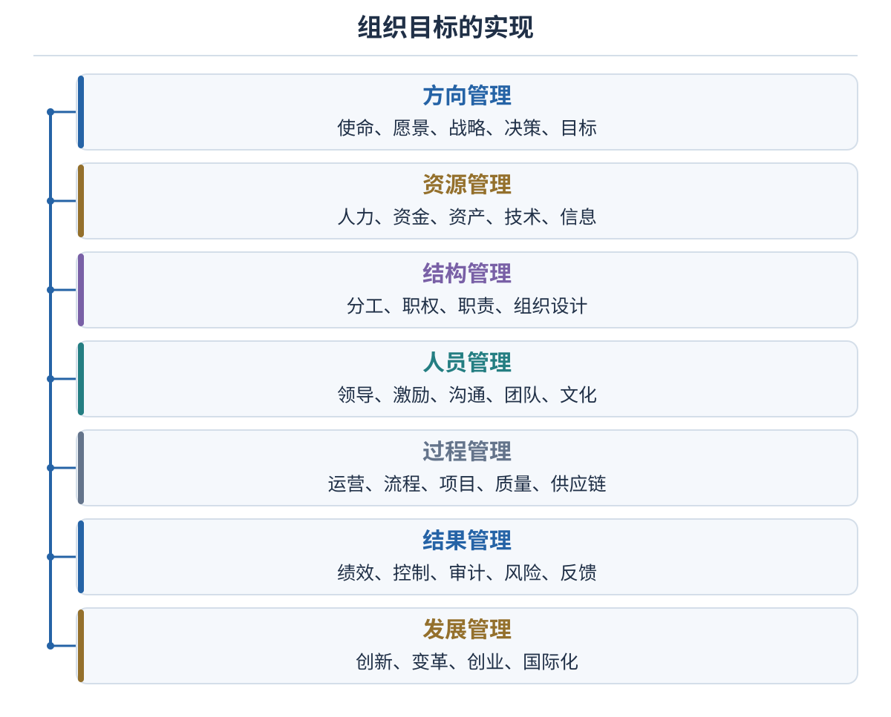
*图 001　组织目标的实现*

> [!note]- 图示文字索引
> - 方向管理：使命、愿景、战略、决策、目标
> - 资源管理：人力、资金、资产、技术、信息
> - 结构管理：分工、职权、职责、组织设计
> - 人员管理：领导、激励、沟通、团队、文化
> - 过程管理：运营、流程、项目、质量、供应链
> - 结果管理：绩效、控制、审计、风险、反馈
> - 发展管理：创新、变革、创业、国际化

### 0.2 管理学的五种分类维度
管理学的分类难点在于，不同分支往往是从不同角度研究同一个组织。

| 分类维度 | 回答的问题 | 典型分类 |
|---|---|---|
| 管理职能 | 管理者正在进行什么活动？ | 决策、计划、组织、领导、控制 |
| 管理层级 | 在组织的哪个层级管理？ | 战略层、战术层、执行层 |
| 管理对象 | 正在管理什么资源或活动？ | 人力资源、财务、生产、技术、信息 |
| 组织类型 | 管理什么性质的组织？ | 企业管理、公共管理、非营利组织管理 |
| 管理方法 | 使用什么理论及工具？ | 运筹学、系统分析、项目管理、数据分析 |

例如，人力资源管理与战略管理不是完全处于同一分类维度。

人力资源管理按照管理对象进行划分，战略管理则侧重组织的整体方向及长期发展。人力资源管理内部也可以进一步形成战略人力资源管理、人员规划、招聘、培训、绩效控制等体系。

### 0.3 组织的基本运行模型

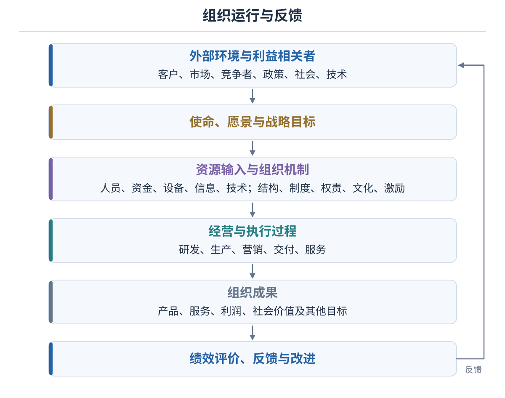
*图 002　组织运行与反馈*

> [!note]- 图示文字索引
> - 外部环境与利益相关者：客户、市场、竞争者、政策、社会、技术
> - 使命、愿景与战略目标
> - 资源输入与组织机制：人员、资金、设备、信息、技术；结构、制度、权责、文化、激励
> - 经营与执行过程：研发、生产、营销、交付、服务
> - 组织成果：产品、服务、利润、社会价值及其他目标
> - 绩效评价、反馈与改进

一个成熟的组织并不是机械执行领导者命令的系统，而是能够进行信息处理、资源协调、决策、执行、反馈和自我调整的开放系统。

### 0.4 管理学与其他学科的关系

| 学科 | 主要研究对象 | 与管理学的交叉领域 |
|---|---|---|
| 经济学 | 资源配置与经济运行 | 管理经济学、企业理论 |
| 金融学 | 资金、资产与风险 | 财务管理、资本运营 |
| 会计学 | 经济活动的确认、记录与报告 | 管理会计、成本管理 |
| 心理学 | 心理活动及行为 | 组织行为学、领导力、激励 |
| 社会学 | 社会结构与群体关系 | 组织理论、组织文化 |
| 法学 | 权利、义务及法律规范 | 公司治理、合规管理 |
| 数学 | 数量关系与抽象结构 | 运筹学、决策模型 |
| 计算机科学 | 信息及计算系统 | 管理信息系统、数字化管理 |
| 工程学 | 技术系统的设计与运行 | 工程管理、生产运营管理 |

此前已经独立建立经济学、金融学和心理学知识体系，因此本体系不再大量重复这些学科的基础理论，而重点研究它们如何应用于组织和企业管理。

### 0.5 总体目录

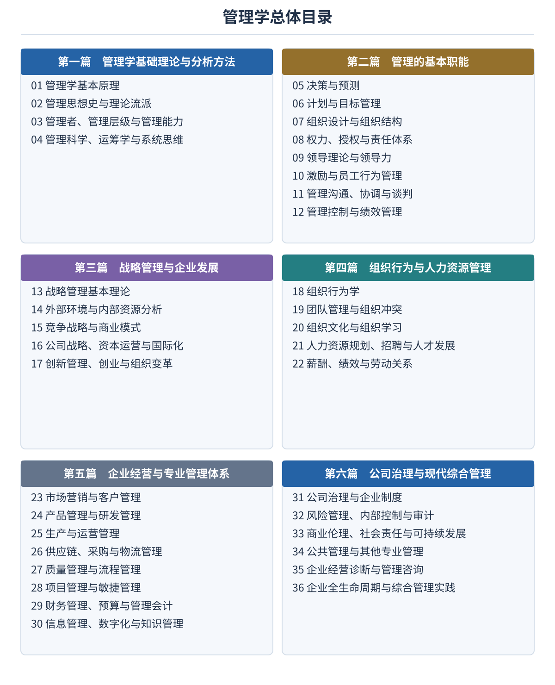
*图 003　管理学总体目录*

**第一篇　管理学基础理论与分析方法**

- 第一章　管理学基本原理
- 第二章　管理思想史与理论流派
- 第三章　管理者、管理层级与管理能力
- 第四章　管理科学、运筹学与系统思维

**第二篇　管理的基本职能**

- 第五章　决策与预测
- 第六章　计划与目标管理
- 第七章　组织设计与组织结构
- 第八章　权力、授权与责任体系
- 第九章　领导理论与领导力
- 第十章　激励与员工行为管理
- 第十一章　管理沟通、协调与谈判
- 第十二章　管理控制与绩效管理

**第三篇　战略管理与企业发展**

- 第十三章　战略管理基本理论
- 第十四章　外部环境与内部资源分析
- 第十五章　竞争战略与商业模式
- 第十六章　公司战略、资本运营与国际化
- 第十七章　创新管理、创业与组织变革

**第四篇　组织行为与人力资源管理**

- 第十八章　组织行为学
- 第十九章　团队管理与组织冲突
- 第二十章　组织文化与组织学习
- 第二十一章　人力资源规划、招聘与人才发展
- 第二十二章　薪酬、绩效与劳动关系

**第五篇　企业经营与专业管理体系**

- 第二十三章　市场营销与客户管理
- 第二十四章　产品管理与研发管理
- 第二十五章　生产与运营管理
- 第二十六章　供应链、采购与物流管理
- 第二十七章　质量管理与流程管理
- 第二十八章　项目管理与敏捷管理
- 第二十九章　财务管理、预算与管理会计
- 第三十章　信息管理、数字化与知识管理

**第六篇　公司治理与现代综合管理**

- 第三十一章　公司治理与企业制度
- 第三十二章　风险管理、内部控制与审计
- 第三十三章　商业伦理、社会责任与可持续发展
- 第三十四章　公共管理与其他专业管理
- 第三十五章　企业经营诊断与管理咨询
- 第三十六章　企业全生命周期与综合管理实践

第二篇是整个管理学的理论主干，第三篇是高层管理的核心，第五篇是企业经营实践的核心。三个部分共同回答组织如何确定方向、如何组织执行以及如何形成实际价值。

---

# 第一篇　管理学基础理论与分析方法

## 第一章　管理学基本原理

### 1.1 管理的基本构成
任何管理活动通常都可以从以下几个方面进行分析。

| 构成要素 | 含义 |
|---|---|
| 管理主体 | 承担管理活动的个人、团队或机构 |
| 管理客体 | 被管理的资源、人员、过程及活动 |
| 管理目标 | 管理活动希望实现的结果 |
| 管理职能 | 决策、计划、组织、领导、控制等活动 |
| 管理手段 | 制度、技术、经济激励、信息及沟通等 |
| 管理环境 | 影响管理活动的内部和外部条件 |

### 1.2 管理的基本职能

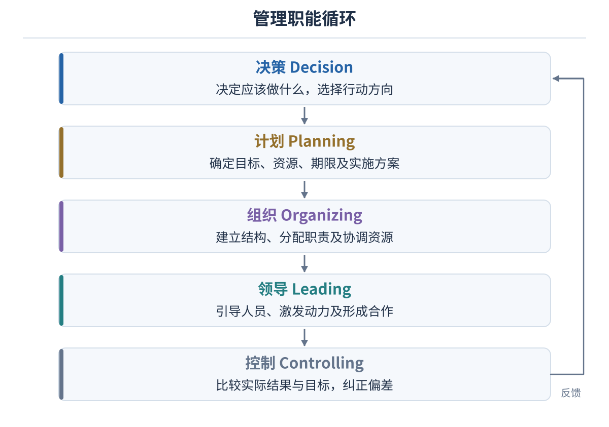
*图 004　管理职能循环*

> [!note]- 图示文字索引
> - 决策 Decision：决定应该做什么，选择行动方向
> - 计划 Planning：确定目标、资源、期限及实施方案
> - 组织 Organizing：建立结构、分配职责及协调资源
> - 领导 Leading：引导人员、激发动力及形成合作
> - 控制 Controlling：比较实际结果与目标，纠正偏差

创新与协调贯穿整个管理过程，反馈形成新一轮决策与计划。

不同管理学教材对管理职能的划分略有不同。例如，传统 POLC 模型采用计划、组织、领导、控制四项职能，有些国内教材另外突出决策与创新。

这些划分主要是理论组织方式的差异，并不代表管理者在实际工作中只能按照固定顺序开展活动。

### 1.3 效率、效果与效益
这是管理学中最基础、也最容易混淆的三个概念。

- 效率（Efficiency）：完成工作所消耗的资源是否合理。
- 效果（Effectiveness）：实际结果是否实现了预定目标。
- 效益（Benefit）：管理活动所产生的综合经济或社会收益。

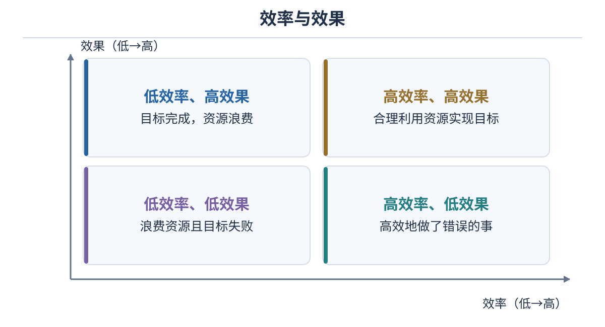
*图 005　效率与效果*

> [!note]- 图示文字索引
> - 效率（低→高）
> - 效果（低→高）
> - 低效率、高效果：目标完成，资源浪费
> - 高效率、高效果：合理利用资源实现目标
> - 低效率、低效果：浪费资源且目标失败
> - 高效率、低效果：高效地做了错误的事

例如，一家软件企业使用极高效率开发了一款没有市场需求的软件，虽然开发过程可能具有较高效率，但经营效果并不理想。

因此，管理不仅是把事情做正确，还必须判断正在做的事情是否正确。

### 1.4 管理资源的分类

| 资源类别 | 主要内容 |
|---|---|
| 人力资源 | 人员、知识、技能、经验 |
| 财务资源 | 现金、资本、信用及融资能力 |
| 物质资源 | 厂房、设备、土地、原材料 |
| 技术资源 | 专利、软件、工艺、研发能力 |
| 信息资源 | 数据、市场信息、经营记录 |
| 时间资源 | 工期、工作时间及市场机会窗口 |
| 无形资源 | 品牌、声誉、客户关系、组织知识 |
| 组织能力 | 协调资源、学习、创新及执行的能力 |

资源与能力需要特别区分。

资源是组织拥有或能够利用的要素，能力则是组织将这些要素组合起来并完成特定活动的本领。

拥有先进设备不代表具备先进生产能力；拥有优秀程序员，也不代表企业已经具有优秀的软件研发体系。

### 1.5 管理的基本原理

| 管理原理 | 核心思想 |
|---|---|
| 系统原理 | 将组织视为相互联系的整体 |
| 人本原理 | 重视人的需求、能力、权利与主体作用 |
| 责任原理 | 明确职责及相应的权力和责任 |
| 效益原理 | 评价资源投入与实际成果 |
| 权变原理 | 根据环境和具体条件调整管理方式 |
| 反馈原理 | 根据实际运行结果修正管理活动 |
| 动态原理 | 组织需要不断适应环境变化 |

### 1.6 管理、经营、治理与领导的区别

| 概念 | 核心问题 |
|---|---|
| 治理（Governance） | 谁有权决定组织的重大事项，如何约束权力？ |
| 经营（Business Operation） | 如何开展业务、创造价值并获得收益？ |
| 管理（Management） | 如何协调资源与活动，实现组织目标？ |
| 领导（Leadership） | 如何影响和引导他人共同实现目标？ |
| 执行（Execution） | 如何将决策和计划转化为实际成果？ |

这些概念并非完全独立。治理为管理建立权力框架，经营确定价值创造活动，管理协调其实施，领导影响参与人员，执行则使计划落实。

## 第二章　管理思想史与理论流派

### 2.1 管理理论的发展历史

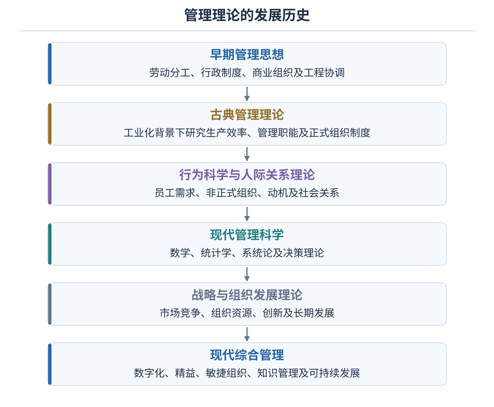
*图 006　管理理论的发展历史*

> [!note]- 图示文字索引
> - 早期管理思想：劳动分工、行政制度、商业组织及工程协调
> - 古典管理理论：工业化背景下研究生产效率、管理职能及正式组织制度
> - 行为科学与人际关系理论：员工需求、非正式组织、动机及社会关系
> - 现代管理科学：数学、统计学、系统论及决策理论
> - 战略与组织发展理论：市场竞争、组织资源、创新及长期发展
> - 现代综合管理：数字化、精益、敏捷组织、知识管理及可持续发展

管理思想的发展不是后来的理论完全取代早期理论，而是不断扩大研究范围、修正原有假设并形成新的管理工具。

### 2.2 古典管理理论的三大分支

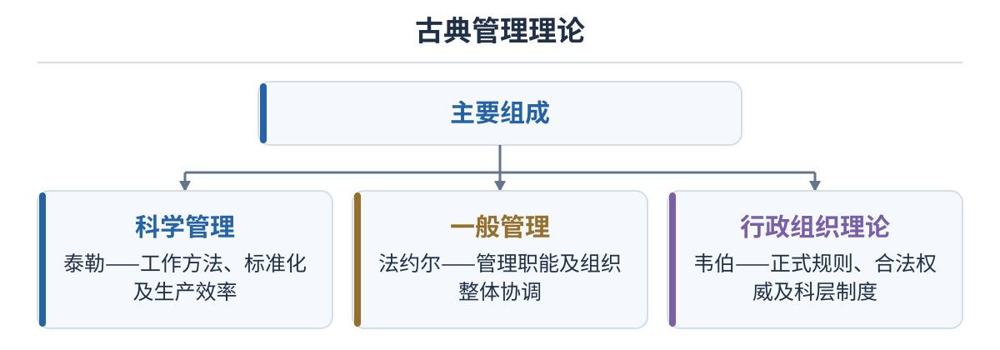
*图 007　古典管理理论*

> [!note]- 图示文字索引
> - 科学管理：泰勒——工作方法、标准化及生产效率
> - 一般管理：法约尔——管理职能及组织整体协调
> - 行政组织理论：韦伯——正式规则、合法权威及科层制度

#### 2.2.1 泰勒的科学管理理论
主要研究怎样通过科学分析改善具体工作。

核心内容包括工作研究、标准作业方法、人员选择与培训、劳动定额以及管理职责与执行职责的划分。

其历史价值在于将工作效率研究从单纯经验判断转化为系统分析，但过度机械化应用可能忽视人的自主性及工作体验。

#### 2.2.2 法约尔的一般管理理论
法约尔从组织整体角度研究管理职能，并提出十四项经典管理原则：

劳动分工、权力与责任、纪律、统一指挥、统一方向、个人利益服从整体利益、人员报酬、集权、等级链、秩序、公平、人员稳定、首创精神及团队精神。

这些原则是历史管理理论的重要组成，不是适用于所有现代组织的绝对规则。

#### 2.2.3 韦伯的行政组织理论
韦伯研究以合法理性权威、明确分工、正式规则、专业资格及职务层级为基础的科层组织。

其目的之一是减少管理活动对个人偏好及私人关系的依赖，提高组织的稳定性与可预测性。

科层制度也可能产生层级繁多、审批缓慢和规则僵化等问题。

### 2.3 行为科学管理理论

| 理论 | 主要代表 | 核心研究方向 |
|---|---|---|
| 人际关系学说 | 梅奥等 | 社会关系、非正式组织与工作行为 |
| 需要层次理论 | 马斯洛 | 人类需要及动机 |
| X理论与Y理论 | 麦格雷戈 | 管理者对员工的不同基本假设 |
| 双因素理论 | 赫茨伯格 | 工作满意及不满意的相关因素 |
| 成熟—不成熟理论 | 阿吉里斯 | 个人成长与组织制度的关系 |
| 组织协作理论 | 巴纳德 | 组织合作、沟通及权威接受 |

这些理论与此前心理学知识体系中的动机、人格和社会心理学存在直接联系。

霍桑研究等历史研究具有重要学科影响，但对其结果及因果解释也存在后续争论。

### 2.4 现代管理理论的主要分支

| 理论流派 | 主要思想 |
|---|---|
| 管理过程学派 | 围绕管理职能研究管理活动 |
| 决策理论学派 | 将决策视为管理活动的核心 |
| 管理科学学派 | 使用数学模型与定量方法优化管理 |
| 系统管理理论 | 从整体、子系统及环境关系研究组织 |
| 权变管理理论 | 管理方式取决于组织与环境条件 |
| 社会技术系统理论 | 联合研究技术系统与社会系统 |
| 经验管理学派 | 通过实际管理案例总结经验 |
| 战略管理理论 | 研究竞争优势及长期发展 |
| 组织学习理论 | 研究组织如何获得知识及改变行为 |
| 制度理论 | 研究规则、合法性及社会制度对组织的影响 |
| 资源基础理论 | 研究企业资源和能力如何形成竞争优势 |

### 2.5 现代管理学的核心思想转变

| 传统管理侧重 | 现代管理进一步关注 |
|---|---|
| 单项工作效率 | 整体系统效率与价值创造 |
| 命令与监督 | 授权、协作及自主性 |
| 固定组织结构 | 灵活组织及动态适应 |
| 经验判断 | 数据、模型及证据 |
| 短期产出 | 长期竞争能力与可持续发展 |
| 单个部门绩效 | 跨部门流程与整体成果 |

这些转变并不意味着正式制度、标准化和监督已经不再重要。现代管理需要根据工作性质，在规范性与灵活性之间取得平衡。

## 第三章　管理者、管理层级与管理能力

### 3.1 管理者的三个基本层级

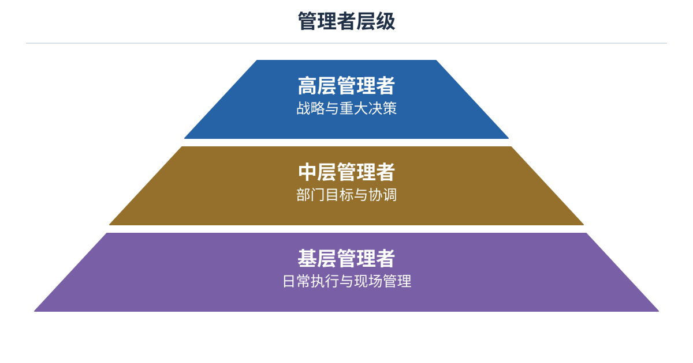
*图 008　管理者层级*

| 管理层级 | 主要任务 |
|---|---|
| 高层管理者 | 战略方向、重大决策、资源配置及组织整体责任 |
| 中层管理者 | 将战略转化为部门目标，进行跨部门协调 |
| 基层管理者 | 直接组织日常工作、任务分配及现场管理 |
| 非管理人员 | 承担专业工作及具体任务执行 |

### 3.2 按管理范围划分管理者

- 综合管理者：负责一个组织或业务单元的整体运行。
- 职能管理者：负责财务、人力资源、研发、营销等专业领域。
- 项目管理者：负责具有明确目标、期限和资源约束的项目。
- 产品管理者：负责产品方向、价值、需求及相关生命周期管理。
- 流程负责人：负责特定端到端业务流程的表现及改进。
这些角色可以交叉。例如，某项目经理可能同时负责一个职能部门。

### 3.3 明茨伯格的管理者角色理论
管理者的十种经典角色可以归为三大类。

| 角色类别 | 具体角色 | 主要功能 |
|---|---|---|
| 人际角色 | 代表人、领导者、联络者 | 建立及维持组织关系 |
| 信息角色 | 监控者、传播者、发言人 | 获取、处理及传播信息 |
| 决策角色 | 企业家、危机处理者、资源分配者、谈判者 | 作出选择及推动组织行动 |

### 3.4 卡茨的管理技能理论

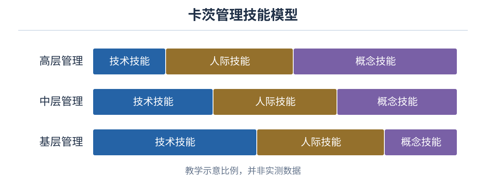
*图 009　卡茨管理技能模型*

- 技术技能：掌握特定专业工作的方法及工具。
- 人际技能：理解他人、协调关系、沟通及建立合作。
- 概念技能：从整体角度理解复杂问题及组织之间的关系。
随着管理范围扩大，管理者往往需要从解决具体技术问题，进一步转向解决资源配置、组织协调及战略判断问题。

### 3.5 企业常见高级管理职位

| 职位 | 常见职责 |
|---|---|
| CEO 首席执行官 | 企业整体经营与战略执行 |
| COO 首席运营官 | 运营体系及业务执行 |
| CFO 首席财务官 | 财务、资金、预算与资本管理 |
| CTO 首席技术官 | 技术战略与技术能力建设 |
| CIO 首席信息官 | 信息系统与数字化管理 |
| CHRO 首席人力资源官 | 人才及组织发展 |
| CMO 首席营销官 | 市场营销及品牌建设 |
| CPO 首席产品官 | 产品战略及产品体系 |
| CRO 首席风险官 | 企业风险管理 |
| CSO 首席战略官 | 战略研究及重大规划 |

实际职位设置与权力范围因企业而异。同一缩写在不同组织中也可能具有不同含义。

董事长、CEO及股东分别属于不同的治理和经营角色，将在第三十一章进行详细辨析。

## 第四章　管理科学、运筹学与系统思维

### 4.1 管理研究的主要方法

- 定性研究：访谈、观察、案例分析、专家判断。
- 定量研究：统计分析、数学建模、预测、优化。
- 实验研究：通过受控比较研究管理措施的效果。
- 系统分析：研究整体结构、内部关系及反馈机制。
- 行动研究：在实际组织问题的解决过程中研究并改进管理实践。

### 4.2 运筹学的知识结构
运筹学（Operations Research）主要研究如何运用数学模型，在资源约束下作出更加合理的决策。

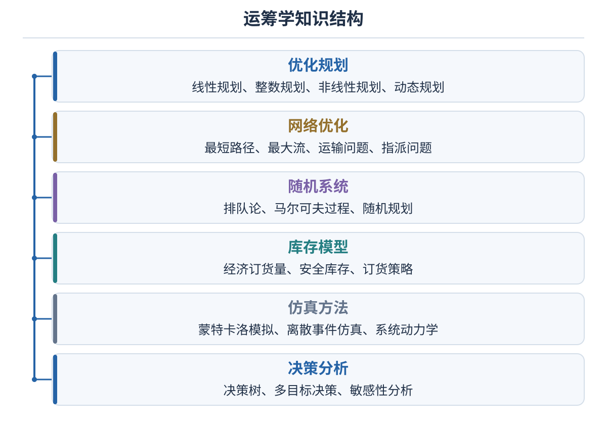
*图 010　运筹学知识结构*

> [!note]- 图示文字索引
> - 优化规划：线性规划、整数规划、非线性规划、动态规划
> - 网络优化：最短路径、最大流、运输问题、指派问题
> - 随机系统：排队论、马尔可夫过程、随机规划
> - 库存模型：经济订货量、安全库存、订货策略
> - 仿真方法：蒙特卡洛模拟、离散事件仿真、系统动力学
> - 决策分析：决策树、多目标决策、敏感性分析

### 4.3 优化问题的基本数学结构
一个简化的资源配置问题可以表示为：
$$
\max Z=c_1x_1+c_2x_2
$$
约束条件：
$$
a_{11}x_1+a_{12}x_2\leq b_1
$$
$$
a_{21}x_1+a_{22}x_2\leq b_2
$$
$$
x_1,x_2\geq0
$$
其中：

- 决策变量：管理者可以选择的数量。
- 目标函数：希望最大化或最小化的指标。
- 约束条件：资金、时间、设备、人员等限制。
- 可行解：满足全部约束条件的方案。
- 最优解：在模型假设下使目标函数达到最优的方案。

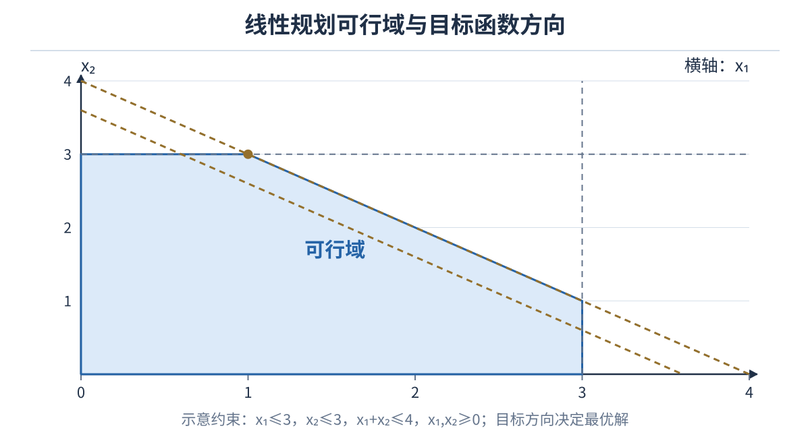
*图 011　线性规划可行域与目标函数方向*

### 4.4 系统思维
系统思维将组织视为由多个相互影响的子系统构成的整体。

核心概念包括系统边界、输入、输出、反馈、存量、流量、时间延迟、局部优化与整体优化。

#### 4.4.1 增强反馈与平衡反馈

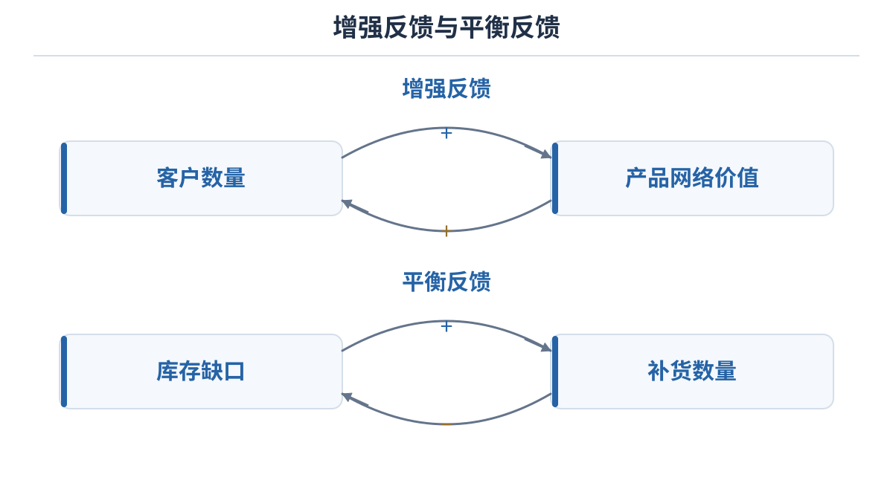
*图 012　增强反馈与平衡反馈*

正反馈与负反馈分别描述变化被增强还是受到抑制，并不意味着一个必然有益、另一个必然有害。

### 4.5 约束理论
约束理论（Theory of Constraints，TOC）强调系统整体产出可能受到关键约束的限制。

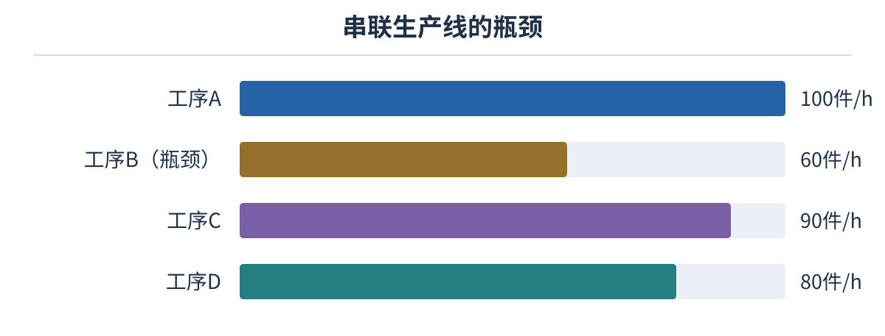
*图 013　串联生产线的瓶颈*

如果只提高工序A的产能，而不解决工序B的限制，整个系统的产出未必能够提高。

这就是局部优化与整体优化之间的重要区别。

---

# 第二篇　管理的基本职能
本篇构成整个管理学的核心主干。

一个组织无论规模大小、行业性质或发展阶段如何，通常都需要完成决策、计划、组织、领导与控制等基本活动。

## 第五章　决策与预测

### 5.1 决策的基本构成
决策（Decision-making）是为了实现特定目标，在若干可能行动方案中进行分析和选择的过程。

其基本要素包括决策主体、决策目标、备选方案、环境状态、可能结果及评价标准。

### 5.2 决策的多维分类

| 分类依据 | 主要类型 | 核心区别 |
|---|---|---|
| 管理层级 | 战略决策、战术决策、业务决策 | 影响范围与管理层次不同 |
| 问题结构 | 程序化决策、非程序化决策 | 是否具有成熟的处理规则 |
| 信息条件 | 确定型、风险型、不确定型决策 | 结果及概率是否已知 |
| 参与主体 | 个人决策、群体决策 | 谁参与方案选择 |
| 影响时间 | 长期、中期、短期决策 | 决策作用期限不同 |
| 目标数量 | 单目标、多目标决策 | 是否需要协调多个目标 |

例如，决定企业是否进入一个新的国际市场，通常属于战略性、非程序化、多目标决策，同时可能具有高度不确定性。

### 5.3 理性决策与有限理性

| 决策模型 | 核心思想 |
|---|---|
| 完全理性模型 | 在充分信息和计算条件下寻找最优方案 |
| 有限理性模型 | 在信息、时间及认知能力有限的条件下进行选择 |
| 满意化决策 | 找到符合要求的可接受方案，而不一定寻找理论最优方案 |
| 直觉决策 | 借助经验、模式识别及快速判断进行选择 |
| 渐进决策 | 通过连续的小幅调整逐步解决复杂问题 |
| 垃圾桶模型 | 研究组织中问题、方案、参与者及决策机会的非线性结合 |

现实管理通常不是在完美信息下计算最优解，而是在有限时间内作出具有合理依据、能够执行且风险可承受的选择。

### 5.4 决策的完整过程

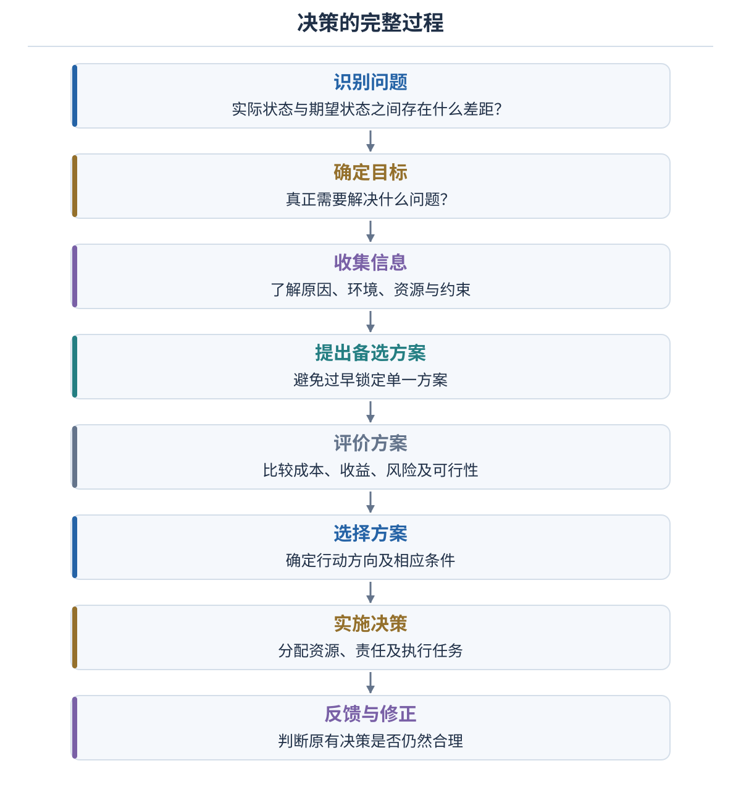
*图 014　决策的完整过程*

> [!note]- 图示文字索引
> - 识别问题：实际状态与期望状态之间存在什么差距？
> - 确定目标：真正需要解决什么问题？
> - 收集信息：了解原因、环境、资源与约束
> - 提出备选方案：避免过早锁定单一方案
> - 评价方案：比较成本、收益、风险及可行性
> - 选择方案：确定行动方向及相应条件
> - 实施决策：分配资源、责任及执行任务
> - 反馈与修正：判断原有决策是否仍然合理

### 5.5 定性决策方法

| 方法 | 基本机制 |
|---|---|
| 头脑风暴法 | 在初期减少批判，广泛产生备选方案 |
| 德尔菲法 | 通过多轮匿名专家意见逐步形成判断 |
| 名义群体法 | 独立提出意见，再进行结构化讨论及评价 |
| SWOT分析 | 综合内部优势、劣势与外部机会、威胁 |
| 情景分析 | 构建不同未来情景并研究对应方案 |
| 六顶思考帽 | 从事实、情绪、风险、收益、创造及过程等角度讨论 |
| 专家判断 | 利用专业经验评价难以直接量化的问题 |

### 5.6 定量决策方法

#### 5.6.1 确定型决策
在模型参数及相关结果已知的条件下，可以使用线性规划、成本分析及盈亏平衡分析等方法。

#### 5.6.2 风险型决策
当结果不确定，但相应概率可以合理估计时，可以使用期望值、决策树及期望效用等方法。

例如，某企业考虑推出一款新产品。

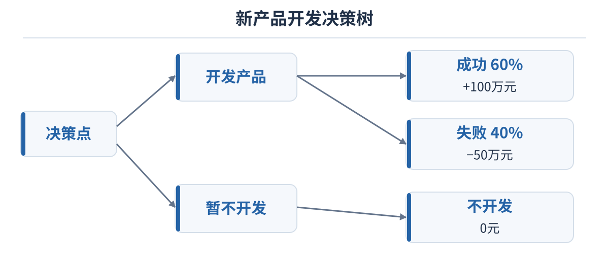
*图 015　新产品开发决策树*

开发方案的期望收益为：
$$
E=0.6\times100+0.4\times(-50)=40\text{万元}
$$
期望收益为正并不意味着一定应当开发，还需要考虑实际亏损承受能力、资金机会成本及概率估计是否可靠。

#### 5.6.3 不确定型决策
当结果概率无法可靠估计时，常见决策准则包括：

- 乐观准则：选择可能获得最高收益的方案。
- 悲观准则：比较各方案最差结果，选择其中相对较好的方案。
- 最小最大后悔值准则：尽量降低可能产生的最大机会损失。
- 稳健决策：寻找在多种情景下均能取得可接受结果的方案。

### 5.7 多目标决策与加权评分
企业往往需要同时考虑成本、收益、风险、时间、客户需求及长期战略。

一种简化的加权评分模型为：
$$
S_j=\sum_{i=1}^{n}w_i x_{ij}
$$
其中，$w_i$ 为评价指标权重，$x_{ij}$ 为方案 $j$ 在指标 $i$ 上的标准化得分。

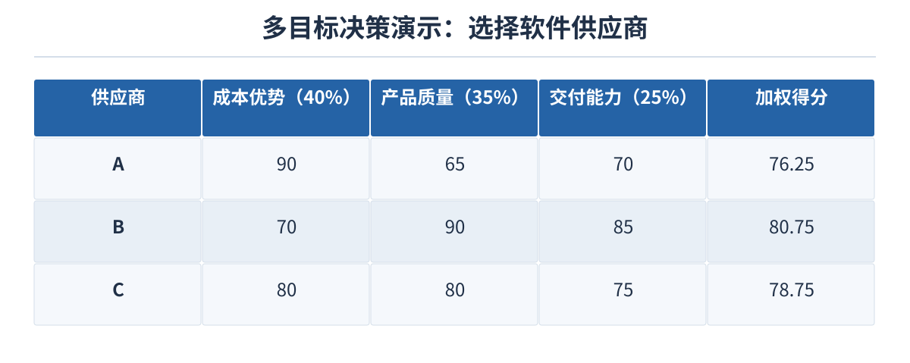
*图 016　多目标决策演示：选择软件供应商*

三家虚构供应商的成本优势、产品质量及交付能力评分分别为 A(90,65,70)、B(70,90,85)、C(80,80,75)。权重自动归一化。评分及权重属于教学示例，实际采购还可能存在必须满足的资质、安全及合规条件。

[离线交互演示：多目标决策演示：选择软件供应商](#social-management_weighted)

进一步的多目标分析方法包括层次分析法（AHP）、TOPSIS、数据包络分析（DEA）及多目标优化等。

### 5.8 预测与决策的关系

| 概念 | 作用 |
|---|---|
| 预测 | 估计未来可能发生什么 |
| 决策 | 确定面对未来应该采取什么行动 |
| 计划 | 将选定的行动方向转化为实施安排 |

预测不等于决策。企业预测某产品销量将下降，并不自动意味着必须停止生产，还需要比较降价、调整产品、开拓市场及退出业务等方案。

常见预测方法包括专家预测、市场调查、移动平均、指数平滑、回归分析及时间序列模型。

## 第六章　计划与目标管理

### 6.1 企业目标的层级结构

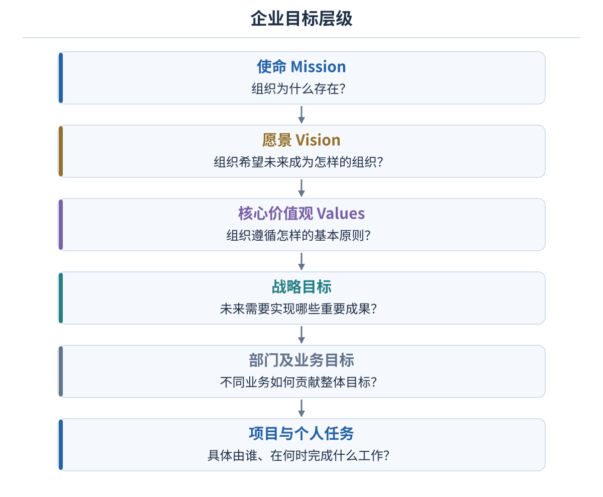
*图 017　企业目标层级*

> [!note]- 图示文字索引
> - 使命 Mission：组织为什么存在？
> - 愿景 Vision：组织希望未来成为怎样的组织？
> - 核心价值观 Values：组织遵循怎样的基本原则？
> - 战略目标：未来需要实现哪些重要成果？
> - 部门及业务目标：不同业务如何贡献整体目标？
> - 项目与个人任务：具体由谁、在何时完成什么工作？

使命、愿景、价值观相互关联，共同为后续目标和行动提供方向，并非必须依次产生。

例如，一家全球金融科技企业可以将改善金融服务的可获得性作为使命，将建立具有国际竞争力的金融技术基础设施作为愿景，将安全、合规、可信及长期主义作为核心价值观。

但这些概念都不能替代明确的经营目标及可执行计划。

### 6.2 计划的分类体系

| 分类依据 | 主要类型 |
|---|---|
| 管理层级 | 战略计划、战术计划、业务计划 |
| 时间跨度 | 长期计划、中期计划、短期计划 |
| 使用次数 | 常设计划、一次性计划 |
| 明确程度 | 具体计划、方向性计划 |
| 应对环境 | 基准计划、应急计划、情景计划 |

#### 6.2.1 常设计划
适用于反复发生的组织活动。

包括政策、规则、程序及标准作业规范。

#### 6.2.2 一次性计划
适用于具有特定目标和期限的活动。

包括项目计划、专项方案及针对特定活动制定的预算。

### 6.3 SMART目标原则

| 字母 | 含义 | 基本要求 |
|---|---|---|
| S | Specific 具体 | 目标对象及内容明确 |
| M | Measurable 可衡量 | 能够评价是否实现 |
| A | Achievable 可实现 | 考虑资源与实际能力 |
| R | Relevant 相关 | 与整体目标具有联系 |
| T | Time-bound 有时限 | 具有明确时间范围 |

例如，「改善软件质量」属于宽泛方向；「在下一个季度，将核心功能发布后的严重缺陷数量降低至预设阈值」则更接近可管理的具体目标。

SMART目标也需要避免指标过窄，例如为了减少缺陷数量而故意不记录缺陷。

### 6.4 目标管理（MBO）
目标管理由德鲁克等管理思想家系统推动，强调通过明确组织与个人目标、参与式目标制定及结果评价开展管理。

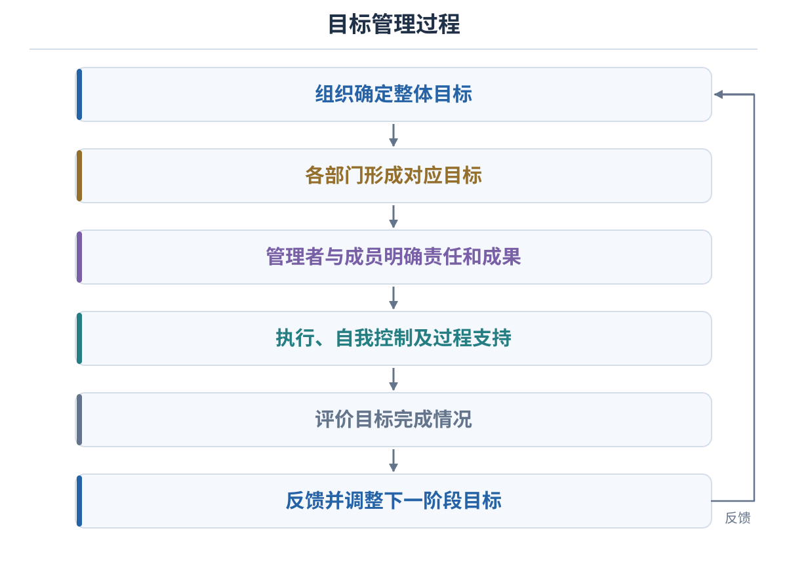
*图 018　目标管理过程*

> [!note]- 图示文字索引
> - 组织确定整体目标
> - 各部门形成对应目标
> - 管理者与成员明确责任和成果
> - 执行、自我控制及过程支持
> - 评价目标完成情况
> - 反馈并调整下一阶段目标

### 6.5 MBO、KPI与OKR的关系
这三种概念经常被企业混用，但其性质并不完全相同。

| 概念 | 本质 | 主要用途 |
|---|---|---|
| MBO | 目标管理体系 | 通过组织与个人目标协调管理活动 |
| KPI | 关键绩效指标 | 衡量关键工作及经营结果 |
| OKR | 目标与关键结果框架 | 聚焦方向并追踪可衡量的成果 |
| BSC | 平衡计分卡 | 从多个维度将战略转化为目标及指标 |

KPI是一类指标，不是一套必然完整的管理制度；OKR则是围绕目标及关键结果组织工作的方法。

四者可以组合使用，并非一定相互替代。

#### 6.5.1 OKR的组成结构

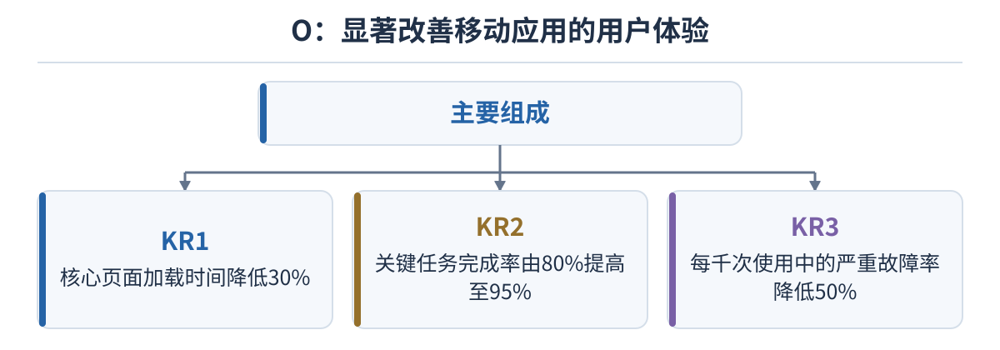
*图 019　O：显著改善移动应用的用户体验*

> [!note]- 图示文字索引
> - KR1：核心页面加载时间降低30%
> - KR2：关键任务完成率由80%提高至95%
> - KR3：每千次使用中的严重故障率降低50%

虚构产品管理目标。实际关键结果需要结合基准数据及质量约束制定。

目标回答希望实现什么，关键结果回答如何证明目标正在实现，而具体行动回答准备怎样完成目标。

### 6.6 滚动计划与应急计划
滚动计划是根据实际执行进度及环境变化，周期性修订后续计划的方法。

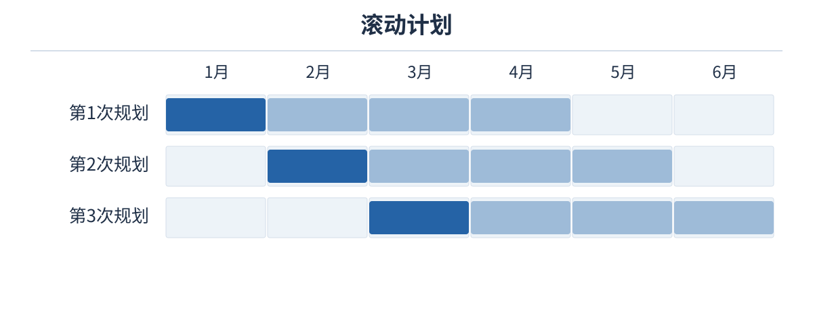
*图 020　滚动计划*

应急计划则针对系统故障、供应中断、重大人员变化及其他意外情景预先制定处理方案。

## 第七章　组织设计与组织结构

### 7.1 组织的两个层面

- 组织作为实体：具有共同目标、成员及一定结构的社会系统。
- 组织作为职能：设计结构、分配任务及协调资源的管理活动。

### 7.2 组织设计的核心要素

| 要素 | 核心问题 |
|---|---|
| 工作专业化 | 工作如何分解及分工？ |
| 部门化 | 不同岗位如何归入部门？ |
| 指挥链 | 指令及责任如何沿层级传递？ |
| 管理幅度 | 一名管理者直接管理多少人员？ |
| 管理层次 | 组织具有多少纵向层级？ |
| 集权与分权 | 决策权集中于何处？ |
| 正式化 | 工作受规则与程序约束的程度如何？ |
| 协调机制 | 不同岗位及部门如何合作？ |

### 7.3 部门化的主要类型
部门化是将相互关联的工作及人员组织到相应单位中的过程。

| 部门化方式 | 划分依据 | 示例 |
|---|---|---|
| 职能部门化 | 专业职能 | 研发部、财务部、人力资源部 |
| 产品部门化 | 产品或业务 | 支付业务部、投资业务部 |
| 地区部门化 | 地理区域 | 亚太区、欧洲区 |
| 客户部门化 | 服务对象 | 个人客户部、企业客户部 |
| 流程部门化 | 工作流程 | 加工、装配、检验、交付 |
| 混合部门化 | 多种依据结合 | 产品事业部内部再划分专业部门 |

部门化是组织设计的一项活动，组织结构则是多项设计活动共同形成的整体结果。

### 7.4 主要组织结构

#### 7.4.1 直线制

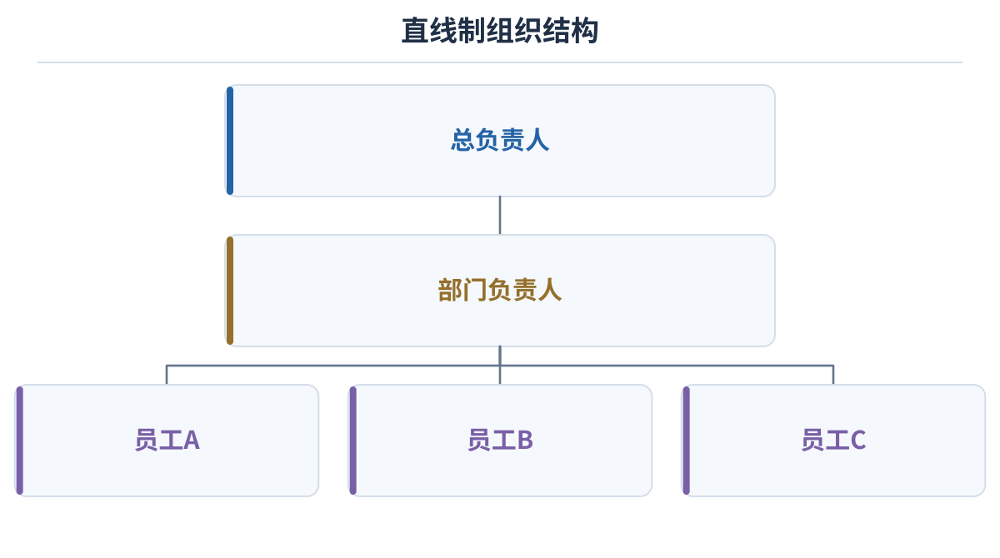
*图 021　直线制组织结构*

权力沿单一直线指挥关系传递，结构简单，但容易使管理者承担过多专业职责。

#### 7.4.2 职能型组织

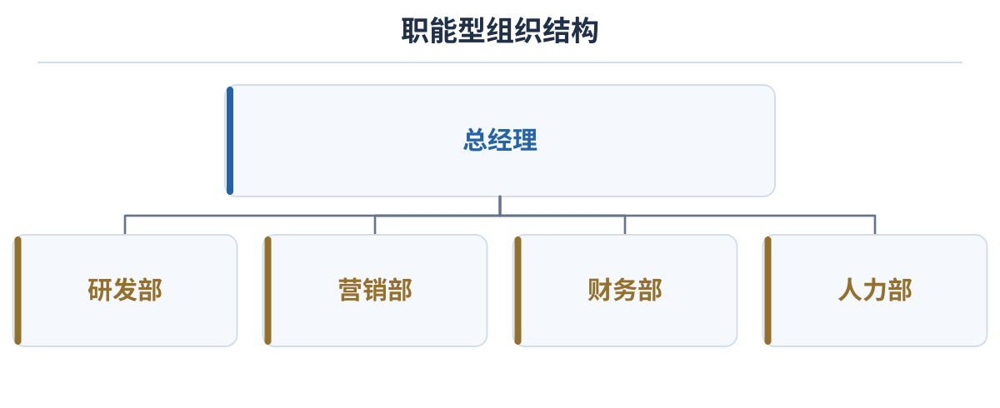
*图 022　职能型组织结构*

按专业职能进行分工，有利于专业化，但可能形成部门之间的沟通壁垒。

传统教材中的纯职能制可能允许多头专业指挥；现代广义的职能型组织并不必然如此。

#### 7.4.3 事业部制

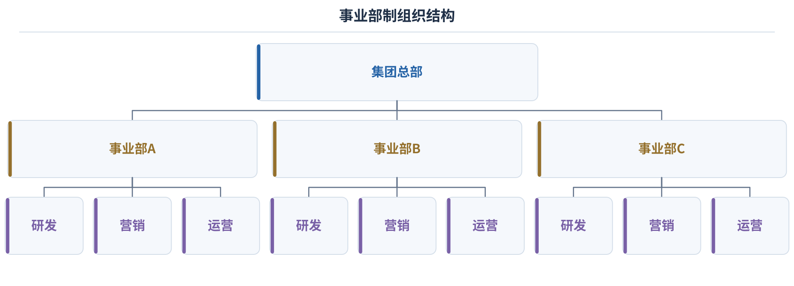
*图 023　事业部制组织结构*

事业部通常围绕特定产品、地区或业务独立组织经营，总部承担整体战略及资源配置。

#### 7.4.4 矩阵制

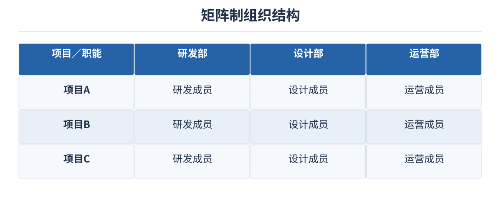
*图 024　矩阵制组织结构*

纵向按职能管理，横向按项目协调。成员可能同时接受职能负责人和项目负责人的管理。

矩阵制进一步可以按项目负责人权力大小划分为弱矩阵、平衡矩阵和强矩阵。

#### 7.4.5 其他组织结构

| 结构 | 核心特点 |
|---|---|
| 直线职能制 | 直线指挥与职能参谋相结合 |
| 项目型组织 | 围绕独立项目配置人员与资源 |
| 流程型组织 | 围绕端到端价值创造流程组织工作 |
| 网络型组织 | 通过合作伙伴及外部资源形成组织网络 |
| 虚拟组织 | 使用信息技术协调分散的人员和资源 |
| 平台型组织 | 共享基础能力支持多个业务单元 |
| 团队型组织 | 以跨职能团队作为重要工作单位 |
| 控股型组织 | 主要通过股权关系管理下属企业 |

### 7.5 组织结构的横向比较

| 结构 | 主要优势 | 主要局限 |
|---|---|---|
| 直线制 | 指挥统一、责任明确 | 管理者负担较重 |
| 职能型 | 专业化、资源共享 | 跨部门协调困难 |
| 事业部制 | 贴近业务、经营责任清晰 | 资源重复配置 |
| 矩阵制 | 灵活共享专业资源 | 双重管理与权责冲突 |
| 项目型 | 目标集中、执行协调 | 项目结束后的资源安置 |
| 网络型 | 灵活利用外部资源 | 协调、依赖及控制风险 |

### 7.6 管理幅度与管理层次

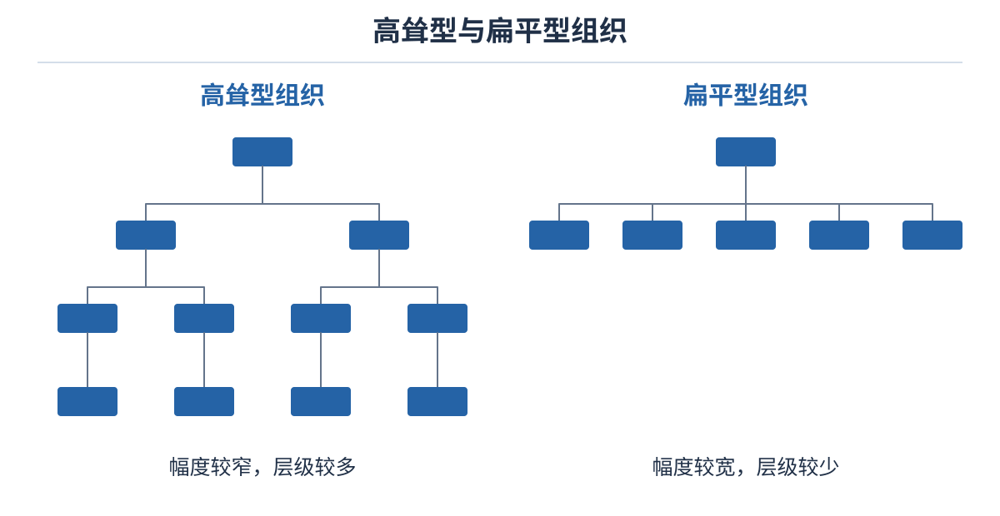
*图 025　高耸型与扁平型组织*

管理幅度受到任务复杂程度、员工能力、标准化程度、信息技术及管理者能力影响。

组织层级越少并不必然越好。高风险、复杂及高度专业化的工作可能仍然需要明确的监督和协调层级。

### 7.7 机械式组织与有机式组织

| 特征 | 机械式组织 | 有机式组织 |
|---|---|---|
| 分工 | 明确而稳定 | 灵活调整 |
| 权力 | 相对集中 | 相对分散 |
| 规则 | 正式化程度较高 | 更强调协商及适应 |
| 沟通 | 较多纵向传递 | 较多横向互动 |
| 适用情境 | 相对稳定、标准化任务 | 变化较快、创新性任务 |

现实企业可以在不同部门采用不同组织方式。例如，财务合规部门强调规则与控制，研发团队则可能需要更加灵活的协作机制。

## 第八章　权力、授权与责任体系

### 8.1 权力、职权、职责与责任

| 概念 | 核心含义 |
|---|---|
| 权力（Power） | 影响他人行为及组织结果的能力 |
| 职权（Authority） | 由正式职位、规则或授权赋予的决定权 |
| 职责（Responsibility） | 需要承担及完成的工作义务 |
| 问责（Accountability） | 对工作结果及行为承担说明和相应责任 |
| 权限（Permission） | 在特定范围内被允许执行的操作 |

具有职权的人通常拥有某些正式权力，但一个没有管理职位的技术专家，也可能凭借专业能力产生重要影响。

### 8.2 权力的主要来源

| 权力类型 | 来源 |
|---|---|
| 法定权力 | 职位及正式制度 |
| 奖赏权力 | 分配奖励及有利资源的能力 |
| 强制权力 | 实施合法处罚或不利后果的能力 |
| 专家权力 | 专业知识、能力及经验 |
| 参照权力 | 他人的认同、信任与尊重 |
| 信息权力 | 对重要信息及其传播的影响 |

正式权威和非正式影响力可以相互支持，也可能发生冲突。

### 8.3 集权、分权与授权

*图 026　集权、分权与授权*

> [!note]- 图示文字索引
> - 集权：重要决策权相对集中于较高层级
> - 分权：通过组织制度将部分决策权配置给较低层级
> - 授权：管理者将特定任务及相应权限交给其他人员

分权属于组织整体权力配置方式，授权则属于具体管理行为。

一个高度集权的企业也可以存在日常授权，只不过下级获得的自主决策范围可能比较有限。

有效授权需要明确任务、权限范围、资源支持、预期成果、报告机制及风险边界。授权并不意味着上级完全免除自身应承担的监督与管理责任。

### 8.4 直线职权、参谋职权与职能职权

- 直线职权：沿正式指挥关系对下属进行管理的权力。
- 参谋职权：为其他管理者提供分析、建议及专业支持的权力。
- 职能职权：在特定专业范围内，对其他部门相关活动实施规定或监督的权限。
例如，法务部门可以提供合同审查建议，也可能根据企业制度拥有特定合同的审核权限。这两类职能需要明确区分。

### 8.5 RACI责任分配矩阵
RACI用于描述不同人员在同一工作事项中的责任关系。

| 标记 | 含义 |
|---|---|
| R — Responsible | 实际承担并执行工作 |
| A — Accountable | 对事项结果承担最终管理责任 |
| C — Consulted | 需要征询意见的参与者 |
| I — Informed | 需要获知相关信息的人 |

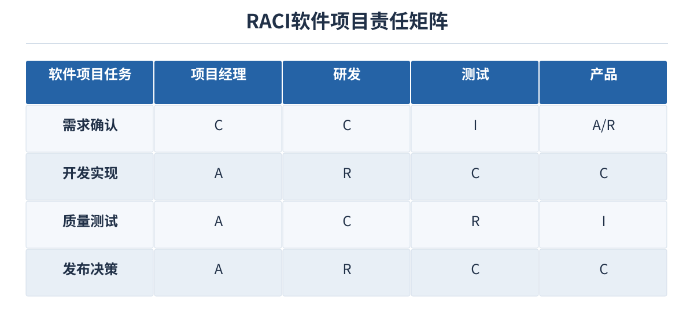
*图 027　RACI软件项目责任矩阵*

| 软件项目任务 | 项目经理 | 研发 | 测试 | 产品 |
|---|---|---|---|---|
| 需求确认 | C | C | I | A/R |
| 开发实现 | A | R | C | C |
| 质量测试 | A | C | R | I |
| 发布决策 | A | R | C | C |

虚构项目责任矩阵。通常每项工作应明确唯一的最终负责角色，但可以存在多个执行者。

RACI矩阵是责任协调工具，不等于完整组织结构，也不能替代法定职责及实际审批制度。

## 第九章　领导理论与领导力

### 9.1 管理者与领导者

| 管理活动的侧重 | 领导活动的侧重 |
|---|---|
| 建立计划与秩序 | 确立方向及形成共同愿景 |
| 分配资源与职责 | 影响、引导及激励成员 |
| 监督过程与结果 | 促进认同、承诺及合作 |
| 保持运行稳定 | 推动适应与变革 |

管理者与领导者并不是互斥的两类人。

优秀管理者通常既需要组织执行能力，也需要领导能力；没有正式管理职位的人，也可能通过专业影响力发挥领导作用。

### 9.2 领导理论的总体分类

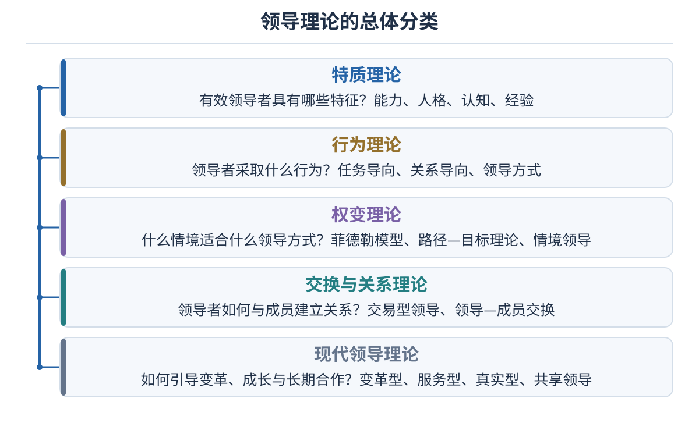
*图 028　领导理论的总体分类*

> [!note]- 图示文字索引
> - 特质理论：有效领导者具有哪些特征？能力、人格、认知、经验
> - 行为理论：领导者采取什么行为？任务导向、关系导向、领导方式
> - 权变理论：什么情境适合什么领导方式？菲德勒模型、路径—目标理论、情境领导
> - 交换与关系理论：领导者如何与成员建立关系？交易型领导、领导—成员交换
> - 现代领导理论：如何引导变革、成长与长期合作？变革型、服务型、真实型、共享领导

### 9.3 领导行为理论
经典领导行为研究通常关注任务导向与人员关系导向。

这两个维度并非简单互斥，一个领导者可以同时高度重视任务完成和成员关系。

#### 9.3.1 管理方格理论

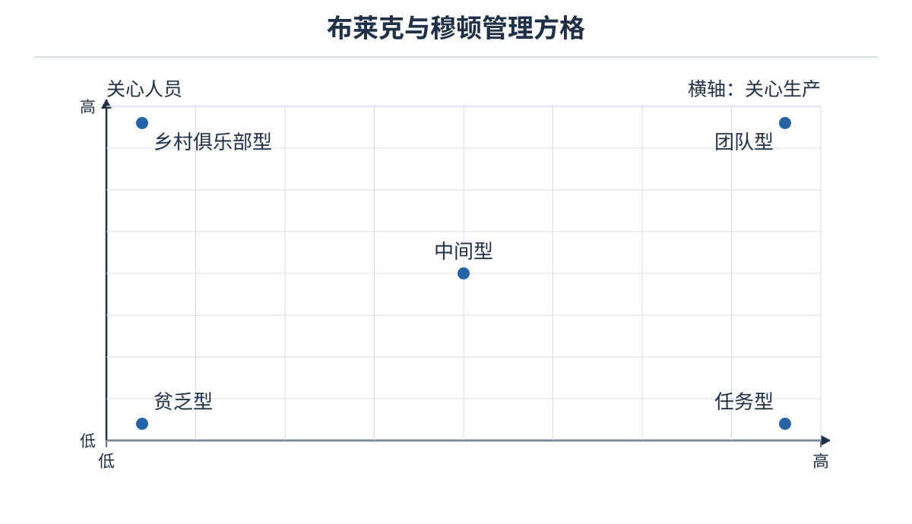
*图 029　布莱克与穆顿管理方格*

现实领导效果不能仅根据这两个维度确定。

#### 9.3.2 传统领导方式

- 专断型：重要决定主要由领导者作出。
- 民主型：重视成员参与、讨论及共同决策。
- 放任型：成员拥有较大自主空间，领导者较少直接干预。
自主空间与管理缺位不是同一个概念。有效授权仍然需要目标、责任及反馈机制。

### 9.4 权变领导理论

| 理论 | 主要研究内容 |
|---|---|
| 菲德勒权变模型 | 领导方式与领导情境的匹配 |
| 路径—目标理论 | 领导者如何帮助成员明确目标、消除障碍 |
| 情境领导理论 | 根据成员能力、意愿等调整指导和支持方式 |
| 领导决策参与模型 | 根据任务及环境决定成员参与决策的程度 |

经典情境领导理论通常区分指令、教练、支持及授权等领导方式。这些模型可用于帮助理解情境差异，但其具体预测及适用性不能不加检验地接受。

### 9.5 交易型与变革型领导

| 领导类型 | 主要机制 |
|---|---|
| 交易型领导 | 明确绩效要求、奖励及相应交换关系 |
| 变革型领导 | 共同愿景、思想激发、个人关怀及示范作用 |
| 服务型领导 | 强调成员发展、支持与服务 |
| 真实型领导 | 强调自我认识、透明及价值一致性 |
| 共享领导 | 领导作用由多个团队成员共同承担 |

这些领导方式可以同时存在于同一管理者的行为中。

### 9.6 领导力的实际构成
领导力在实际管理中通常表现为方向判断、决策能力、建立信任、沟通协调、人才培养、解决冲突、承担责任及组织变革能力。

领导力不能简单等同于个人魅力，也不应建立在员工对领导者个人的无条件服从之上。

## 第十章　激励与员工行为管理

### 10.1 激励的基本原理
激励（Motivation Management）是通过工作环境、目标、资源、奖励及其他机制，引导和支持成员产生有利于组织与个人目标的行为。

它与心理学中的动机相关，但不是同一个概念。

动机是个人内部及情境相关的心理过程，管理激励是组织影响这些过程及行为结果的管理活动。

### 10.2 激励理论的三大类别

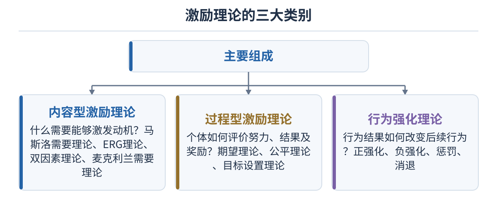
*图 030　激励理论的三大类别*

> [!note]- 图示文字索引
> - 内容型激励理论：什么需要能够激发动机？马斯洛需要理论、ERG理论、双因素理论、麦克利兰需要理论
> - 过程型激励理论：个体如何评价努力、结果及奖励？期望理论、公平理论、目标设置理论
> - 行为强化理论：行为结果如何改变后续行为？正强化、负强化、惩罚、消退

现代自我决定理论等研究可以补充传统激励理论的内容及过程解释。

### 10.3 内容型激励理论

| 理论 | 核心结构 |
|---|---|
| 马斯洛需要层次理论 | 生理、安全、归属、尊重、自我实现 |
| 奥尔德弗ERG理论 | 生存、关系、成长需要 |
| 麦克利兰需要理论 | 成就、权力、归属需要 |
| 赫茨伯格双因素理论 | 保健因素与激励因素 |
| 自我决定理论 | 自主性、胜任感、关系性 |

#### 10.3.1 赫茨伯格双因素理论

*图 031　赫茨伯格双因素理论*

> [!note]- 图示文字索引
> - 保健因素：不足时可能产生不满意。薪酬、工作环境、公司政策、管理方式、工作关系
> - 激励因素：可能促进积极工作体验。成就、认可、责任、工作内容、成长机会

现实中薪酬等因素也可能产生激励作用，不宜将两类因素理解为绝对分离。

### 10.4 弗鲁姆期望理论
期望理论关注努力、绩效和奖励之间的主观联系。

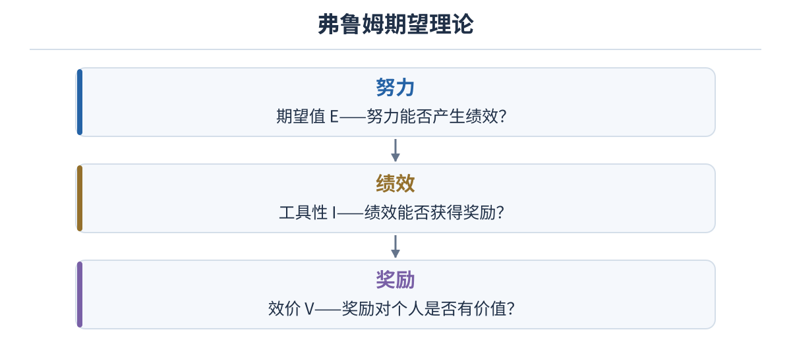
*图 032　弗鲁姆期望理论*

> [!note]- 图示文字索引
> - 努力：期望值 E——努力能否产生绩效？
> - 绩效：工具性 I——绩效能否获得奖励？
> - 奖励：效价 V——奖励对个人是否有价值？

一种常见的教学简化表达为：
$$
M=E\times I\times V
$$
如果员工认为努力不会改善绩效、绩效不会得到相应奖励，或者奖励并非自己所需要，即使管理者不断强调努力，也可能无法获得预期效果。

### 10.5 公平理论
公平理论研究员工如何比较自身与参照对象的投入和回报。
$$
\frac{\text{个人回报}}{\text{个人投入}}\quad\text{与}\quad\frac{\text{参照对象回报}}{\text{参照对象投入}}
$$
员工评价公平时，不仅关注收入，还可能关注工作量、能力、责任、成长机会及组织认可。

现代组织公平研究进一步划分为：

| 公平类型 | 核心问题 |
|---|---|
| 分配公平 | 最终奖励及资源分配是否公平？ |
| 程序公平 | 作出分配决定的程序是否公平？ |
| 人际公平 | 是否受到尊重及合理对待？ |
| 信息公平 | 相关决定是否获得充分解释？ |

### 10.6 激励方式的分类

| 类型 | 主要手段 |
|---|---|
| 物质激励 | 薪酬、奖金、津贴、股权 |
| 非物质激励 | 认可、荣誉、成长及参与机会 |
| 工作激励 | 自主权、工作意义、责任及反馈 |
| 组织激励 | 晋升机制、职业发展及制度公平 |
| 内在动机支持 | 提供自主选择、能力发展及良好关系环境 |

### 10.7 激励机制设计中的常见问题

- 只奖励短期结果，忽略长期质量。
- 只考核数量，导致成员牺牲服务质量。
- 奖励规则不透明，降低组织信任。
- 目标超出个人控制范围，却由个人承担全部责任。
- 过度强调个人排名，损害团队合作。
- 将所有成员视为具有完全相同的需求。
有效激励应当同时考虑绩效、合作、长期价值及公平性，而不是简单追求让员工付出更多劳动。

## 第十一章　管理沟通、协调与谈判

### 11.1 管理沟通的基本模型

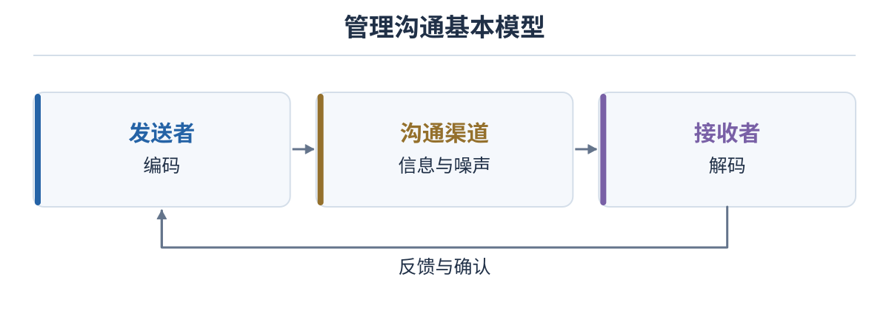
*图 033　管理沟通基本模型*

沟通的目的不是管理者已经发送了信息，而是相关人员能够正确理解信息，并形成必要的行动协调。

### 11.2 组织沟通的分类

| 分类依据 | 主要类型 |
|---|---|
| 组织方向 | 上行沟通、下行沟通、横向沟通、斜向沟通 |
| 正式程度 | 正式沟通、非正式沟通 |
| 媒介 | 口头、书面、非语言、数字媒介 |
| 反馈方式 | 单向沟通、双向沟通 |
| 组织边界 | 内部沟通、外部沟通 |
| 时间条件 | 同步沟通、异步沟通 |

### 11.3 组织沟通网络

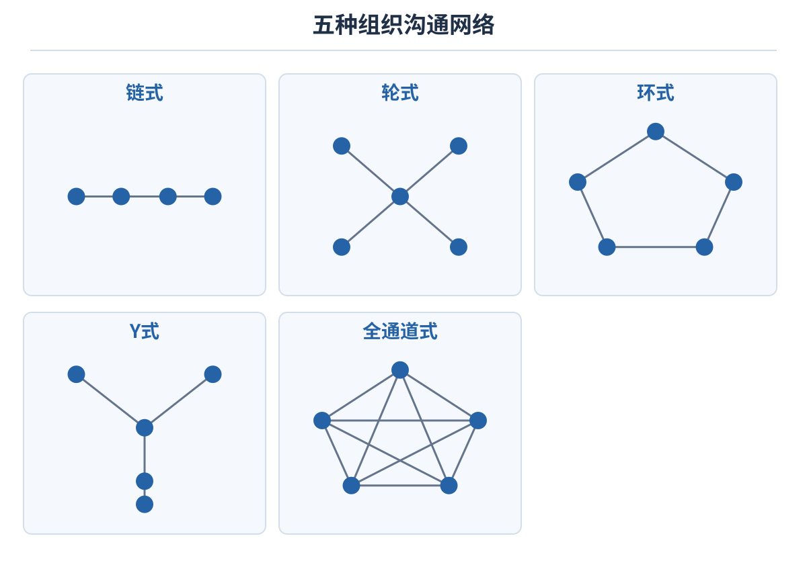
*图 034　五种组织沟通网络*

不同沟通网络在信息速度、准确性、集中程度和成员参与方面可能产生不同效果。

### 11.4 常见沟通障碍
包括信息过载、专业术语差异、选择性知觉、层级过滤、组织沉默、情绪冲突、文化差异、沟通渠道不当及反馈不足。

组织沉默尤其值得关注：当成员担心提出问题会受到不利对待时，管理层可能无法及时了解真实经营情况。

### 11.5 协调的主要机制

| 协调机制 | 基本方式 |
|---|---|
| 直接监督 | 由管理者明确安排及协调工作 |
| 相互调节 | 成员之间直接沟通协作 |
| 工作过程标准化 | 采用统一程序及操作方法 |
| 工作结果标准化 | 规定目标成果，允许不同实现方式 |
| 技能标准化 | 通过专业培训及资格形成协调基础 |
| 规范与价值协调 | 通过共同规则、文化及价值观协调 |

### 11.6 谈判的基本结构
谈判是不同主体在利益存在差异时，通过沟通、交换及协商形成可能协议的过程。

| 概念 | 含义 |
|---|---|
| 立场（Position） | 表面提出的要求 |
| 利益（Interest） | 要求背后的实际需求 |
| BATNA | 无法达成协议时的最佳替代方案 |
| 保留条件 | 可以接受的最低或最高边界 |
| ZOPA | 双方可能达成协议的条件范围 |

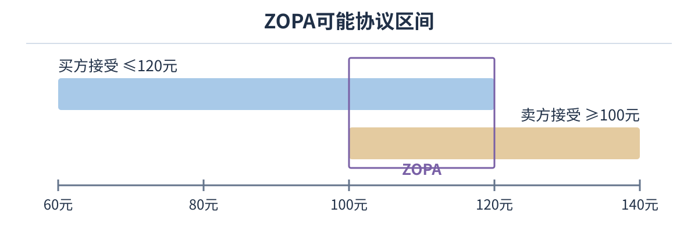
*图 035　ZOPA可能协议区间*

假设买方最高接受120元，卖方最低接受100元，则可能协议区间为100—120元。

### 11.7 谈判的主要类型

- 分配式谈判：围绕既定资源如何分配进行协商。
- 整合式谈判：探索不同需求及交换方式，尝试创造额外共同价值。
- 多方谈判：多个利益主体同时参与。
- 原则式谈判：强调区分人与问题、关注利益、寻找方案及客观标准。
谈判能力的核心不是迫使对方接受不利条件，而是理解利益关系、替代方案及长期合作价值。

## 第十二章　管理控制与绩效管理

### 12.1 管理控制的本质
管理控制是通过确定标准、收集信息、比较结果及纠正偏差，使组织活动保持在合理范围内的过程。

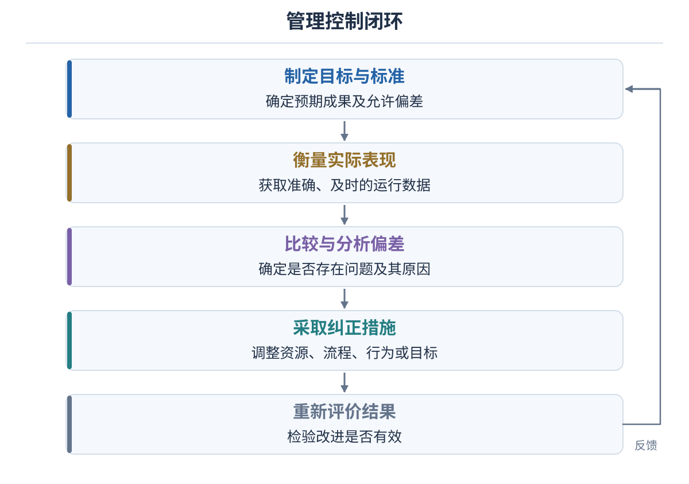
*图 036　管理控制闭环*

> [!note]- 图示文字索引
> - 制定目标与标准：确定预期成果及允许偏差
> - 衡量实际表现：获取准确、及时的运行数据
> - 比较与分析偏差：确定是否存在问题及其原因
> - 采取纠正措施：调整资源、流程、行为或目标
> - 重新评价结果：检验改进是否有效

控制并不等同于对员工进行严格监视，其重点是保证组织活动具有合理的信息反馈及调整能力。

### 12.2 控制的三种时间类型

*图 037　控制的三种时间类型*

> [!note]- 图示文字索引
> - 前馈控制：活动发生前——供应商审查、培训、风险预防
> - 同期控制：活动进行中——实时质量检测、项目进度监控
> - 反馈控制：活动结束后——财务分析、绩效评价、复盘

三个控制阶段可以共同存在于同一管理系统。

### 12.3 控制的主要机制

| 控制方式 | 主要依据 |
|---|---|
| 行为控制 | 监督活动方式是否符合要求 |
| 结果控制 | 评价实际成果是否达到标准 |
| 官僚控制 | 依靠制度、规则及正式权力 |
| 市场控制 | 依靠价格、竞争及经济结果 |
| 文化控制 | 依靠共同价值观及社会规范 |
| 自我控制 | 成员根据目标及责任自主调节行为 |

### 12.4 绩效管理与绩效考核
绩效管理是一个持续的管理过程，绩效考核则主要是对特定期间工作表现进行评价的环节。

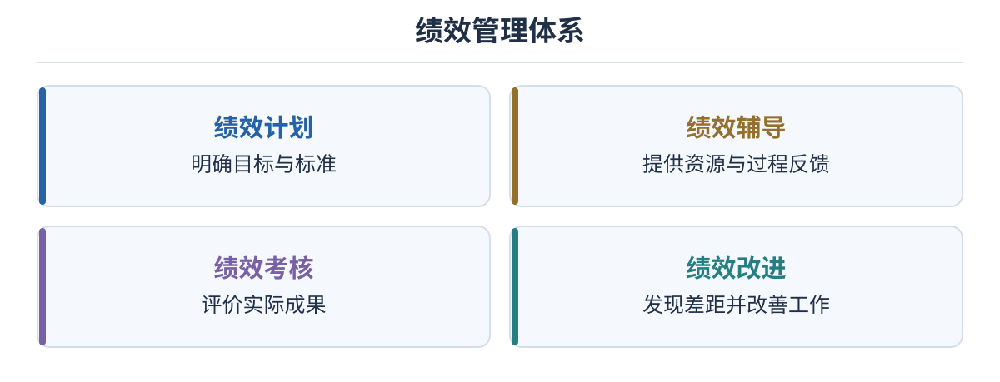
*图 038　绩效管理体系*

> [!note]- 图示文字索引
> - 绩效计划：明确目标与标准
> - 绩效辅导：提供资源与过程反馈
> - 绩效考核：评价实际成果
> - 绩效改进：发现差距并改善工作

只进行年终打分而缺少目标沟通、工作支持及持续反馈，不构成完整的绩效管理体系。

### 12.5 指标体系的主要分类

| 指标类型 | 含义 | 示例 |
|---|---|---|
| 投入指标 | 使用多少资源 | 人工、资金、设备时间 |
| 过程指标 | 工作怎样开展 | 处理时长、测试覆盖 |
| 产出指标 | 完成了什么 | 产品数量、项目交付 |
| 结果指标 | 产生什么实际效果 | 客户留存、利润、满意度 |
| 先行指标 | 可能提供未来表现线索 | 有效商机、活跃用户 |
| 滞后指标 | 已经发生的最终成果 | 营业收入、年度利润 |

### 12.6 平衡计分卡（BSC）

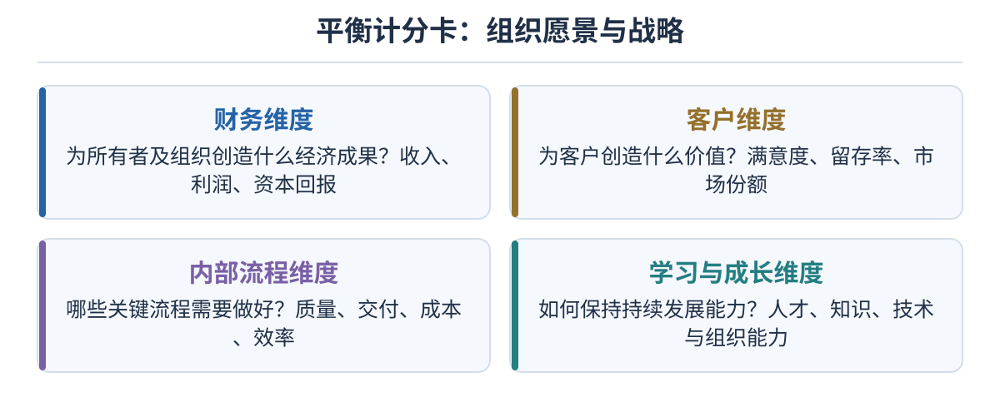
*图 039　平衡计分卡：组织愿景与战略*

> [!note]- 图示文字索引
> - 财务维度：为所有者及组织创造什么经济成果？收入、利润、资本回报
> - 客户维度：为客户创造什么价值？满意度、留存率、市场份额
> - 内部流程维度：哪些关键流程需要做好？质量、交付、成本、效率
> - 学习与成长维度：如何保持持续发展能力？人才、知识、技术与组织能力

平衡计分卡试图将长期能力建设、内部过程、客户价值及财务结果联系起来，而不是只根据利润评价所有管理活动。

### 12.7 古德哈特定律与指标异化
当某个用于测量的指标成为强制追求的目标时，成员可能改变行为，使该指标逐渐失去原有测量意义。

例如：

| 考核指标 | 可能出现的指标异化 |
|---|---|
| 代码行数 | 增加不必要的代码 |
| 客服通话数量 | 降低每次服务的解决质量 |
| 产品发布次数 | 将完整版本人为拆分 |
| 销售签约金额 | 忽略回款风险及合同质量 |
| 员工在线时长 | 追求表面忙碌而不是有效产出 |

这也是为什么科学管理不能简单理解为给所有工作设置数字考核指标。

---

# 第三篇　战略管理与企业发展
管理职能研究如何组织和执行工作，而战略管理则首先研究组织应该选择怎样的发展方向。

对于企业而言，内部管理能力再强，如果进入了错误的市场、采用了不可持续的商业模式，也可能无法取得长期经营成果。

## 第十三章　战略管理基本理论

### 13.1 战略的本质
战略（Strategy）是组织为了实现长期目标，在特定环境及资源约束下，对发展方向、竞争方式及资源配置作出的相互协调的重要选择。

战略不仅意味着决定做什么，也意味着决定不做什么。

### 13.2 战略、战术与运营的区别

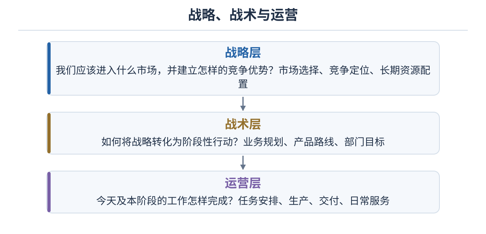
*图 040　战略、战术与运营*

> [!note]- 图示文字索引
> - 战略层：我们应该进入什么市场，并建立怎样的竞争优势？市场选择、竞争定位、长期资源配置
> - 战术层：如何将战略转化为阶段性行动？业务规划、产品路线、部门目标
> - 运营层：今天及本阶段的工作怎样完成？任务安排、生产、交付、日常服务

例如，决定进入国际金融科技市场属于战略；选择首先开展支付基础设施业务属于较具体的业务选择；确定软件上线安排及开发任务则属于项目与运营活动。

### 13.3 企业战略的三个基本层级

| 战略层级 | 核心问题 |
|---|---|
| 公司层战略（Corporate Strategy） | 企业应该经营哪些业务？ |
| 业务层战略（Business Strategy） | 某项业务如何在市场中取得竞争优势？ |
| 职能层战略（Functional Strategy） | 各专业部门如何支持业务战略？ |

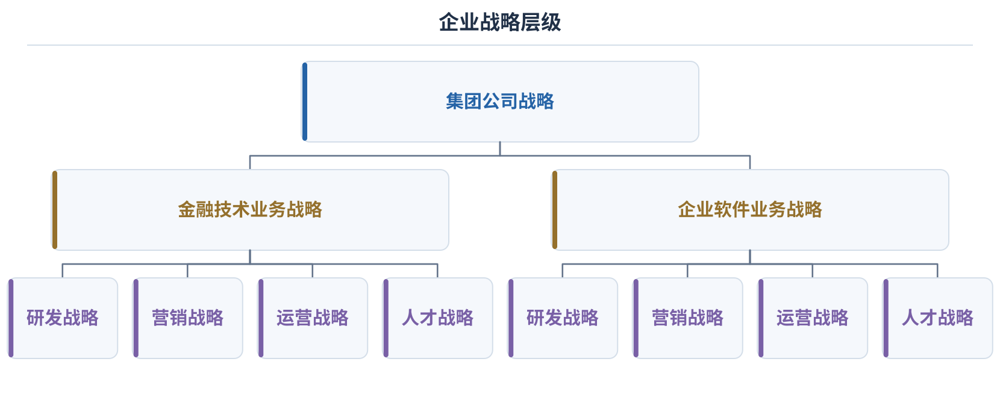
*图 041　企业战略层级*

### 13.4 战略管理的完整过程

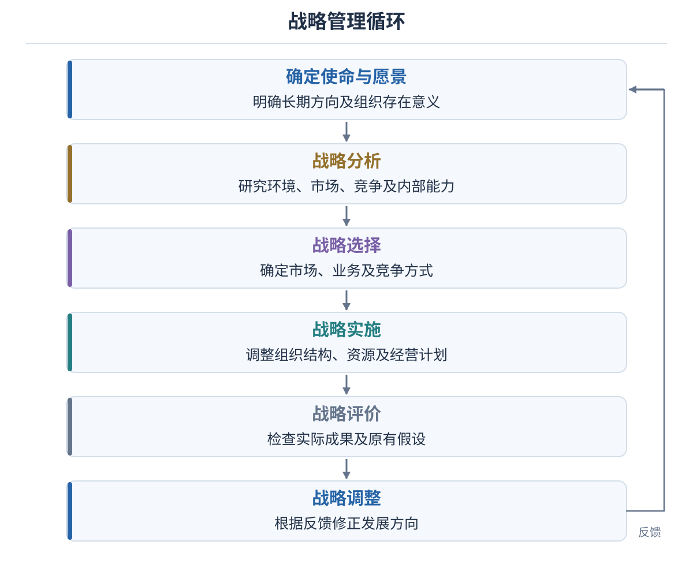
*图 042　战略管理循环*

> [!note]- 图示文字索引
> - 确定使命与愿景：明确长期方向及组织存在意义
> - 战略分析：研究环境、市场、竞争及内部能力
> - 战略选择：确定市场、业务及竞争方式
> - 战略实施：调整组织结构、资源及经营计划
> - 战略评价：检查实际成果及原有假设
> - 战略调整：根据反馈修正发展方向

战略需要不断接受实际经营结果的检验。

### 13.5 竞争优势的基本含义
竞争优势是企业相对于竞争者，在创造客户价值、控制成本或获取经济收益方面所具有的相对优势。

需要区分：

- 竞争优势：目前相对于竞争对手具有什么优势。
- 核心竞争力：组织通过知识、技术及协调形成的重要能力。
- 经济护城河：投资及商业分析中用于描述竞争优势可持续性的概念。
- 动态能力：组织识别变化、把握机会及重新配置资源的能力。
企业当前领先，不等于其领先地位能够长期维持。

## 第十四章　外部环境与内部资源分析

### 14.1 企业环境的三个分析层次

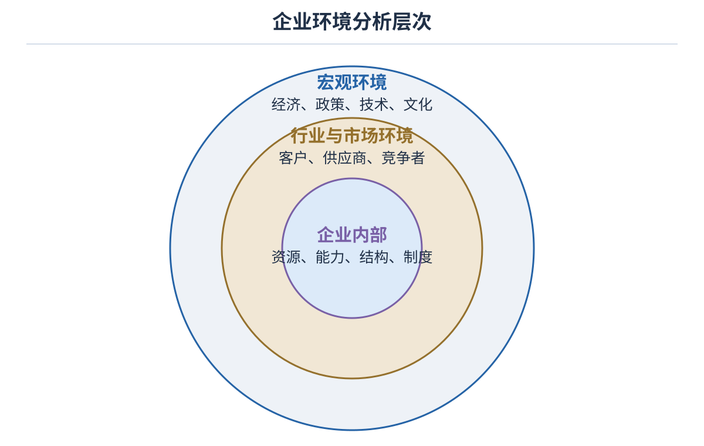
*图 043　企业环境分析层次*

三个层次分别对应不同的分析工具：宏观环境使用PESTEL，行业环境使用五力模型，企业内部可以使用资源能力分析、价值链及VRIO框架。

### 14.2 PESTEL宏观环境分析

| 维度 | 主要内容 |
|---|---|
| P — Political 政治 | 政策方向、政治稳定、国际关系 |
| E — Economic 经济 | 经济周期、收入、利率、汇率 |
| S — Social 社会 | 人口结构、文化、消费习惯 |
| T — Technological 技术 | 技术创新、自动化、研发趋势 |
| E — Environmental 环境 | 资源、气候、生态约束 |
| L — Legal 法律 | 行业监管、劳动、竞争及其他法律要求 |

PESTEL主要用于识别企业无法完全控制、但可能影响战略选择的外部变化。

### 14.3 波特五力模型

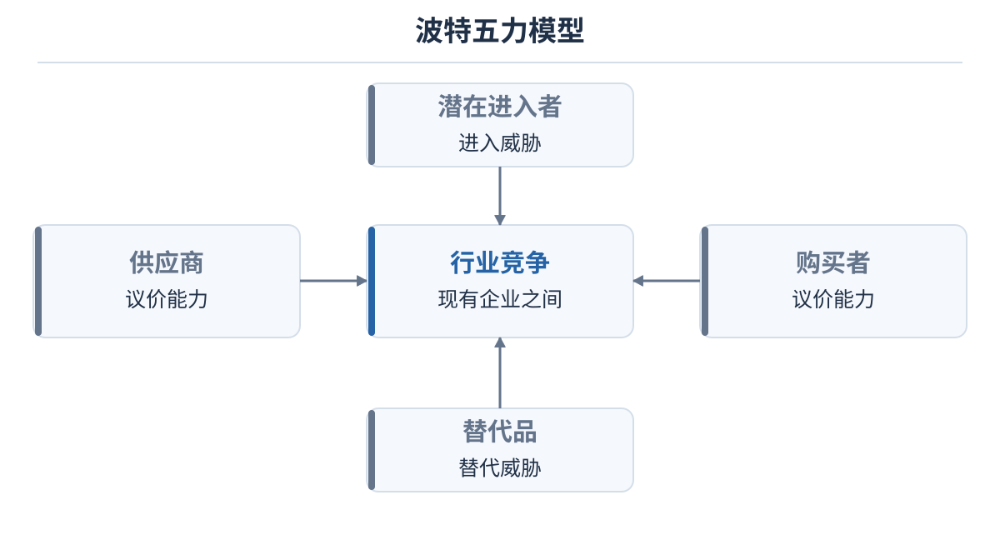
*图 044　波特五力模型*

五力模型主要研究行业结构及其对竞争和盈利能力的影响。

行业市场规模很大，不意味着该行业必然具有较高利润。如果竞争激烈、客户议价能力强、替代产品众多，企业仍可能难以形成持续盈利。

### 14.4 企业资源与能力分析
资源基础理论（RBV）认为企业之间的资源和能力差异，是竞争优势的重要研究对象。

#### 14.4.1 VRIO框架

| 维度 | 研究问题 |
|---|---|
| V — Valuable 价值性 | 能否帮助创造价值或减少风险？ |
| R — Rare 稀缺性 | 是否只有少量竞争者拥有？ |
| I — Inimitable 难以模仿性 | 竞争者是否难以复制或替代？ |
| O — Organization 组织支持 | 企业是否具备利用该资源的制度及能力？ |

一种简化的判断逻辑：

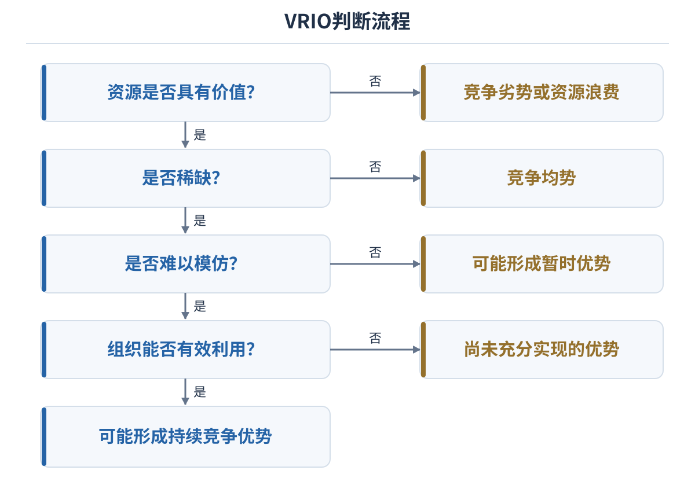
*图 045　VRIO判断流程*

### 14.5 SWOT与TOWS分析
SWOT将内部优势和劣势、外部机会和威胁结合起来研究。

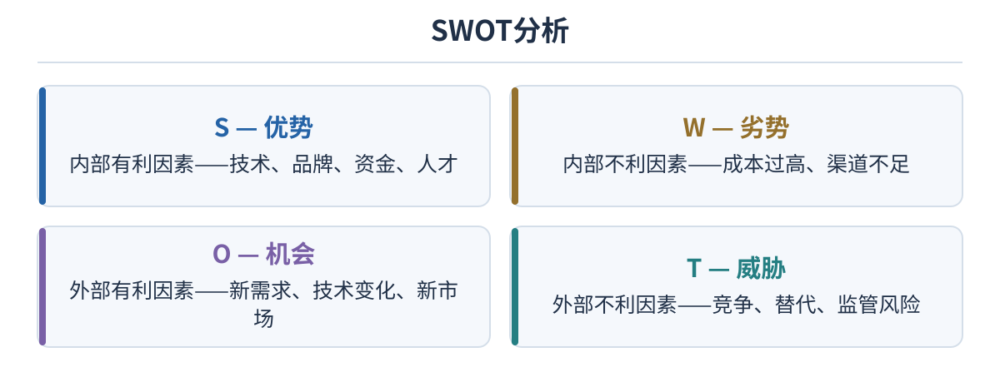
*图 046　SWOT分析*

> [!note]- 图示文字索引
> - S — 优势：内部有利因素——技术、品牌、资金、人才
> - W — 劣势：内部不利因素——成本过高、渠道不足
> - O — 机会：外部有利因素——新需求、技术变化、新市场
> - T — 威胁：外部不利因素——竞争、替代、监管风险

TOWS矩阵进一步将四类因素组合为战略行动。

| 战略组合 | 主要思想 |
|---|---|
| SO | 利用内部优势把握外部机会 |
| WO | 改善内部劣势以利用外部机会 |
| ST | 利用内部优势应对外部威胁 |
| WT | 减少内部劣势及外部风险暴露 |

SWOT是组织分析工具，而不是只要填完四个格子就自动生成正确战略的方法。

### 14.6 价值链分析
波特价值链模型将企业活动区分为基本活动与支持活动。

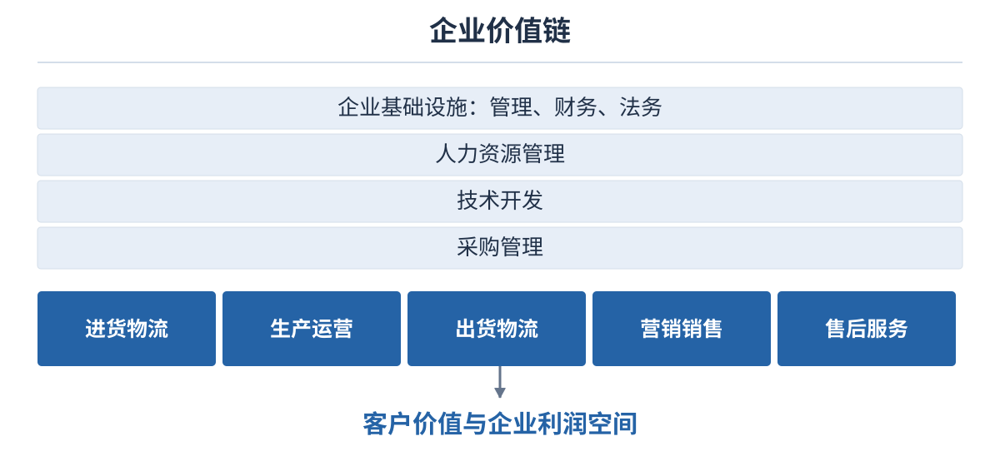
*图 047　企业价值链*

价值链分析的核心，是研究成本和价值究竟产生在哪些活动中，以及这些活动之间能否形成竞争优势。

价值链与供应链需要区分：

价值链强调价值创造活动，供应链强调不同组织之间的供应、生产、交付及相关流动。

## 第十五章　竞争战略与商业模式

### 15.1 波特基本竞争战略
竞争战略主要研究企业通过何种方式在特定市场中取得相对优势。

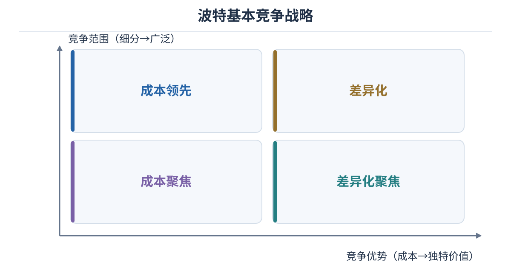
*图 048　波特基本竞争战略*

> [!note]- 图示文字索引
> - 竞争优势（成本→独特价值）
> - 竞争范围（细分→广泛）
> - 成本领先
> - 差异化
> - 成本聚焦
> - 差异化聚焦

- 成本领先：建立相对于竞争者更有利的成本结构。
- 差异化：提供客户认可且具有独特性的价值。
- 聚焦战略：集中服务特定客户群、地区或业务范围。
低成本并不等于低价格，企业也可以将成本优势转化为利润。差异化也不意味着不断增加功能，而是形成客户真正重视的区别。

### 15.2 蓝海战略与市场竞争

- 红海市场：通常用于描述竞争边界较明确、竞争者众多的市场。
- 蓝海战略：通过价值创新，尝试开辟新的需求及市场空间。
常见分析工具包括战略布局图以及剔除、减少、增加、创造四项行动框架。

蓝海不是没有风险的市场。新市场也可能缺少真实需求，或者迅速吸引竞争者进入。

### 15.3 战略与商业模式的区别

| 概念 | 核心问题 |
|---|---|
| 企业战略 | 如何在长期竞争中生存与发展？ |
| 商业模式 | 如何创造、传递及获取价值？ |
| 盈利模式 | 收入来源及利润如何形成？ |
| 产品模式 | 向客户提供怎样的产品或服务？ |
| 运营模式 | 使用怎样的资源、流程和组织方式开展业务？ |

商业模式比盈利模式范围更广，因为创造客户价值、获得客户及交付产品也是商业模式的重要部分。

### 15.4 商业模式画布（BMC）

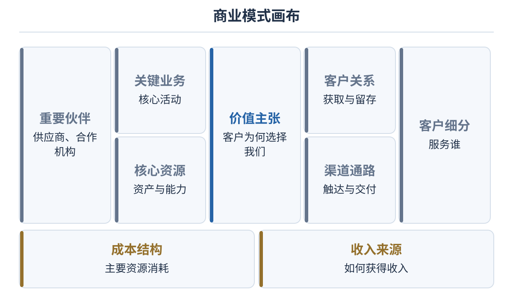
*图 049　商业模式画布*

商业模式画布将企业商业模式分解为九项相互联系的组成部分。

| 分析领域 | 对应模块 |
|---|---|
| 客户是谁 | 客户细分 |
| 提供什么价值 | 价值主张 |
| 如何接触客户 | 渠道通路、客户关系 |
| 如何完成业务 | 核心资源、关键业务、重要伙伴 |
| 如何形成经济结果 | 成本结构、收入来源 |

### 15.5 常见商业模式的分类

#### 15.5.1 按价值创造方式

| 模式 | 核心机制 |
|---|---|
| 制造模式 | 将原材料及技术转化为产品 |
| 零售模式 | 组织商品选择、销售及交付 |
| 服务模式 | 通过专业能力提供服务 |
| 软件模式 | 提供可复制的软件及技术能力 |
| 平台模式 | 连接多个相互依赖的用户群体 |
| 基础设施模式 | 提供其他业务依赖的基础能力 |
| 知识产权模式 | 通过技术、专利、内容或品牌授权创造价值 |

#### 15.5.2 按收入取得方式
商品销售、服务收费、订阅收费、交易佣金、广告收入、技术授权、租赁收入、按量收费及金融利差等。

这两类分类可以组合。例如，软件企业可以采用一次性授权收费、订阅收费或按量收费，而不是只有一种固定收入模式。

### 15.6 SaaS与平台商业模式
软件即服务（SaaS）通过持续提供软件服务，使客户不必完全自行建设相应软件基础设施。

平台商业模式则主要通过连接不同参与者，帮助他们进行交易、互动或价值交换。

| 概念 | 主要经营机制 |
|---|---|
| SaaS | 软件服务、订阅或使用量收入 |
| 双边平台 | 连接两个相互依赖的用户群体 |
| 多边平台 | 协调多个参与者群体之间的互动 |
| 生态系统 | 多个组织及产品围绕共同价值体系协作 |
| 网络效应 | 用户规模变化影响其他用户获得的价值 |

平台拥有大量用户并不必然具有强网络效应，也不代表已经具备可持续盈利能力。

### 15.7 单位经济模型（Unit Economics）
单位经济模型研究单个客户、订单或业务单位能否形成合理的经济收益。

常见指标：

| 指标 | 主要含义 |
|---|---|
| CAC | 客户获取成本 |
| LTV | 客户生命周期价值 |
| ARPU | 平均每用户收入 |
| AOV | 平均订单金额 |
| 留存率 | 客户在后续期间继续使用服务的比例 |
| 流失率 | 客户停止使用服务的比例 |
| 回收期 | 相关客户贡献收回获取成本所需时间 |
| 单位贡献利润 | 单位收入扣除相关变动成本后的贡献 |

对于具有相对稳定留存和利润率的订阅业务，可用简化模型估计：
$$
LTV\approx\frac{ARPU\times\text{毛利率}}{\text{客户流失率}}
$$
该模型要求收入与流失率采用一致的时间口径，并依赖稳定流失等简化假设。

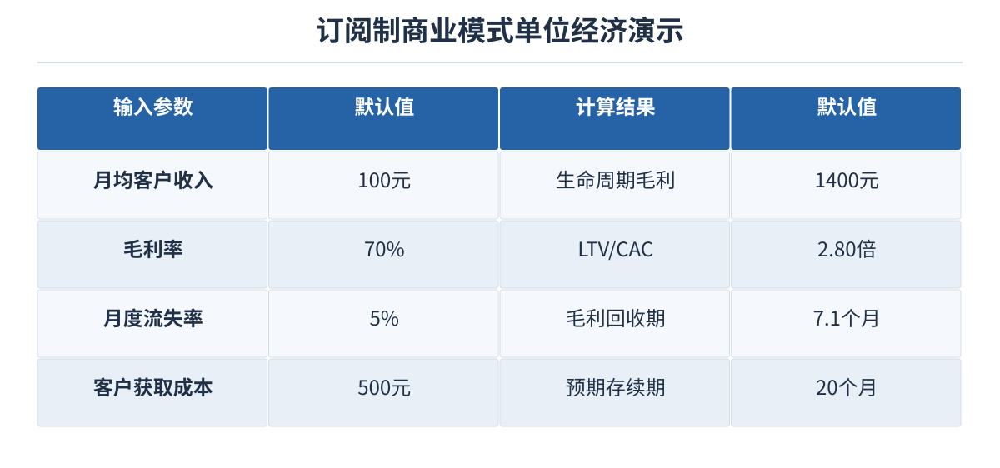
*图 050　订阅制商业模式单位经济演示*

[离线交互演示：订阅制商业模式单位经济演示](#social-management_ltv)

忽略折现、客户差异、后续成本变化及部分期间流失等因素，仅展示单位经济关系，不代表实际企业估值。

企业规模增长并不一定意味着经营状况改善。如果获取每个客户都需要承担不可持续的经济损失，扩大规模可能进一步扩大亏损。

## 第十六章　公司战略、资本运营与国际化

### 16.1 公司战略的总体分类

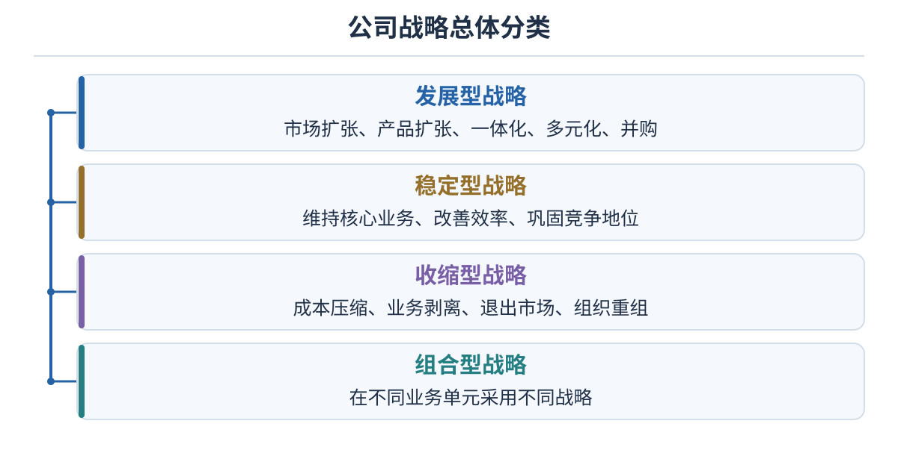
*图 051　公司战略总体分类*

> [!note]- 图示文字索引
> - 发展型战略：市场扩张、产品扩张、一体化、多元化、并购
> - 稳定型战略：维持核心业务、改善效率、巩固竞争地位
> - 收缩型战略：成本压缩、业务剥离、退出市场、组织重组
> - 组合型战略：在不同业务单元采用不同战略

### 16.2 安索夫增长矩阵

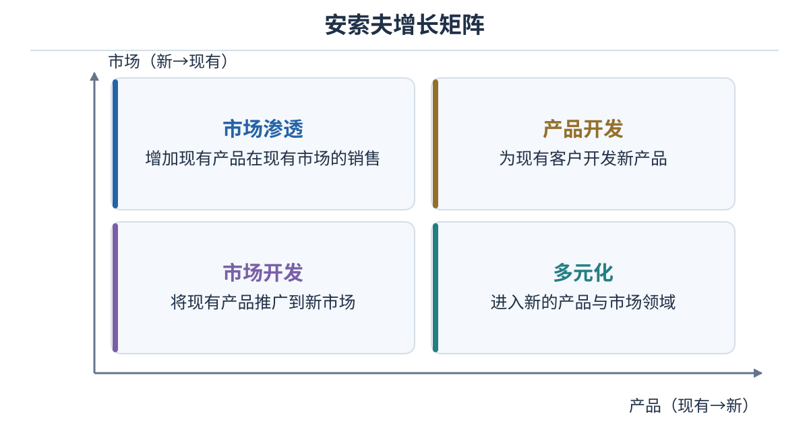
*图 052　安索夫增长矩阵*

> [!note]- 图示文字索引
> - 产品（现有→新）
> - 市场（新→现有）
> - 市场渗透：增加现有产品在现有市场的销售
> - 产品开发：为现有客户开发新产品
> - 市场开发：将现有产品推广到新市场
> - 多元化：进入新的产品与市场领域

市场开发与产品开发并不必然需要成立新公司，多元化也不一定意味着进入完全不相关的行业。

### 16.3 一体化战略

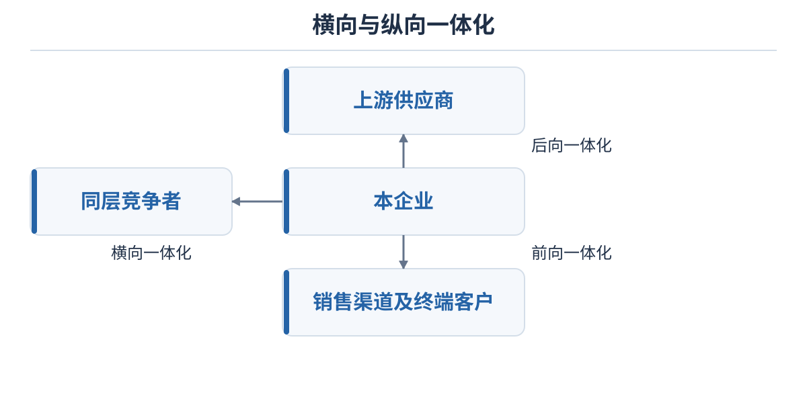
*图 053　横向与纵向一体化*

纵向一体化可能减少对外部供应商或渠道的依赖，但也会增加资本投入及管理复杂程度。

### 16.4 多元化战略

| 类型 | 特点 |
|---|---|
| 相关多元化 | 新业务与既有技术、客户或资源存在联系 |
| 非相关多元化 | 新业务与原有经营活动联系较弱 |

多元化与一体化不是同一维度的概念。一体化强调产业链及产业层次的延伸，多元化强调产品及业务范围的扩大。

### 16.5 企业业务组合管理

#### 16.5.1 波士顿矩阵（BCG）

*图 054　波士顿矩阵（BCG）*

> [!note]- 图示文字索引
> - 相对市场份额（高→低）
> - 市场增长率（低→高）
> - 明星业务：高增长、高相对份额
> - 问题业务：高增长、低相对份额
> - 现金牛业务：低增长、高相对份额
> - 瘦狗业务：低增长、低相对份额

经典业务组合分析工具。横轴为相对市场份额，从高到低排列；分类不能直接替代真实现金流及投资回报分析。

#### 16.5.2 其他业务组合模型

- GE—麦肯锡矩阵：使用行业吸引力与业务竞争实力进行综合评价。
- ADL矩阵：结合产业成熟阶段与企业竞争地位。
- 核心—相邻—新兴业务组合：按照与企业现有能力的关联程度管理增长机会。

### 16.6 企业并购与战略联盟

| 发展方式 | 核心机制 |
|---|---|
| 内部发展 | 自行建设人员、技术及业务能力 |
| 并购（M&A） | 通过合并、股权或资产收购取得相应控制或业务资源 |
| 合资企业 | 多方共同出资建立或经营企业 |
| 战略联盟 | 在保留组织独立性的条件下进行长期合作 |
| 特许经营 | 按合同许可相关品牌及经营体系 |
| 外包 | 将部分工作交由外部组织承担 |

并购只是取得资源或业务的一种方式。并购是否创造价值，还取决于交易价格、整合成本、文化冲突及实际协同效应。

### 16.7 国际化战略

| 国际经营方式 | 主要特点 |
|---|---|
| 出口 | 在本地生产，通过贸易进入境外市场 |
| 许可与授权 | 允许境外主体使用技术、品牌等资源 |
| 合资经营 | 与境外合作伙伴共同投资经营 |
| 独资设立 | 自行建立境外经营实体 |
| 跨境并购 | 通过收购取得境外业务或资源 |

跨国经营还需要研究全球标准化与本地化适应之间的关系，以及汇率、监管、文化差异、供应链及跨境管理风险。

## 第十七章　创新管理、创业与组织变革

### 17.1 创新的多维分类

| 分类依据 | 主要类型 |
|---|---|
| 创新对象 | 产品创新、流程创新、组织创新、商业模式创新 |
| 变化程度 | 渐进式创新、激进式创新 |
| 知识来源 | 内部创新、开放式创新 |
| 技术与市场关系 | 技术推动、市场需求推动及二者结合 |

颠覆式创新是具有特定理论含义的概念，主要研究某些新进入者及商业模式如何从特定市场切入，并逐步挑战既有企业。

不能将所有重大技术突破都称为颠覆式创新。

### 17.2 发明、研发与创新

| 概念 | 含义 |
|---|---|
| 发明 | 产生新的技术、方法或装置 |
| 研究 | 获取新知识并理解相关规律 |
| 开发 | 将知识转化为可用的技术、产品或流程 |
| 创新 | 将新的或显著改进的产品、流程等实际投入使用 |
| 商业化 | 将相关成果转化为市场价值与经营收入 |

发明可以尚未商业化，创新也可能来自流程与商业模式改变，而非原创技术发明。

### 17.3 创新管理的过程

*图 055　创新管理过程*

> [!note]- 图示文字索引
> - 发现问题与市场机会
> - 产生并筛选创意
> - 技术与商业可行性研究
> - 原型开发及小规模验证
> - 资源投入与正式实施
> - 用户反馈、扩张与持续改进

### 17.4 技术S曲线

*图 056　技术S曲线*

技术发展与替代的概念模型。不同技术不一定沿固定S形曲线演进，新技术也未必成功替代既有技术。

### 17.5 创业管理与精益创业
创业管理重点研究在高度不确定条件下，如何识别机会、验证需求、建立团队、获取资源及形成可持续经营模式。

精益创业强调通过小规模实验减少未经验证的资源投入。

*图 057　构建—测量—学习循环*

相关概念包括最小可行产品（MVP）、客户发现、产品市场匹配（PMF）、验证式学习、方向转变（Pivot）及增长实验。

MVP不是粗制滥造的产品，而是能够以相对较少资源检验关键假设的产品或实验形式。

### 17.6 组织变革的分类

| 变革类型 | 主要内容 |
|---|---|
| 战略变革 | 调整发展方向及业务范围 |
| 结构变革 | 改变部门、岗位及权责关系 |
| 技术变革 | 引入新的技术和生产方式 |
| 流程变革 | 重新设计工作及业务流程 |
| 人员变革 | 提升技能、调整岗位及人员配置 |
| 文化变革 | 改变组织规范、价值及行为习惯 |

### 17.7 经典组织变革模型

#### 17.7.1 勒温三阶段模型

*图 058　勒温三阶段模型*

> [!note]- 图示文字索引
> - 解冻：挑战原有状态并形成变革准备
> - 变革：建立新的制度、流程及行为
> - 再冻结：使有效的新做法得到稳定维持

经典阶段性变革模型。现代组织可能需要持续变革，而不是永久固定在一种新状态。

#### 17.7.2 科特八步变革模型
建立紧迫感、形成领导联盟、制定愿景、动员参与、消除障碍、创造短期成果、持续推进变革，以及将有效变革融入组织制度和文化。

### 17.8 组织变革的阻力
变革阻力可能来自利益受损、工作安全担忧、能力不足、变革目标不清晰、信任缺失、制度冲突及过去失败经验。

不能简单将提出异议的员工视为不愿进步。异议有时能够帮助组织发现不合理的变革方案及潜在风险。

---

# 第四篇　组织行为与人力资源管理
组织不是由机器及制度构成的静态结构，而是由具有不同目标、能力、情绪和社会关系的人共同组成的动态系统。

本篇与心理学知识体系中的人格、动机、社会心理学和组织心理学直接关联。

## 第十八章　组织行为学

### 18.1 组织行为学的三个分析层级

*图 059　组织行为学的三个分析层级*

> [!note]- 图示文字索引
> - 个体层面：人格、能力、知觉、态度、动机、工作行为
> - 群体层面：团队、领导、沟通、权力、冲突、群体决策
> - 组织层面：组织结构、文化、制度、变革及组织效能

三个层级相互作用，而非完全独立的研究系统。

### 18.2 工作态度的主要概念

| 概念 | 核心含义 |
|---|---|
| 工作满意度 | 对工作及相关条件的评价与感受 |
| 工作投入 | 对工作活动的活力、专注及参与 |
| 组织承诺 | 个体与组织之间的心理联结 |
| 组织认同 | 将组织身份纳入自我概念的程度 |
| 感知组织支持 | 认为组织重视自身贡献及福祉的程度 |
| 心理契约 | 员工与组织之间被感知的相互承诺 |

心理契约并非法律意义上的劳动合同。例如，员工可能认为持续贡献应当获得合理的发展机会，即使这种预期没有明确写入合同。

### 18.3 员工工作行为的分类

- 任务绩效：正式岗位职责所要求的工作表现。
- 组织公民行为：有利于组织或他人、超出核心任务要求的行为。
- 主动行为：个人主动发现及改善工作问题。
- 创新行为：提出并尝试实施新的工作方法。
- 反生产工作行为：损害组织、成员或正常工作活动的行为。
工作满意度、组织承诺与绩效可能存在统计联系，但不能认为满意的员工必然具有最高绩效。

### 18.4 人与组织的匹配

| 类型 | 匹配内容 |
|---|---|
| 人—岗匹配 | 个人能力与岗位要求、个人需要与岗位供给 |
| 人—组织匹配 | 个人价值与组织环境 |
| 人—团队匹配 | 个体特点与团队工作方式 |
| 人—领导匹配 | 与领导者之间的工作关系及期望 |

匹配并不意味着企业应该只招聘性格与现有人员相似的人。能力互补及观点多样性也可能具有组织价值。

## 第十九章　团队管理与组织冲突

### 19.1 群体与团队的区别

| 群体 | 团队 |
|---|---|
| 成员之间存在一定互动 | 具有相互依赖的共同任务 |
| 可能主要承担个人目标 | 具有共同成果及责任 |
| 工作可以相对独立 | 更强调协调与协作 |

团队是一种具有特定合作性质的群体，但不是所有工作都适合采用团队方式完成。

### 19.2 团队的主要类型
职能团队、跨职能团队、项目团队、自主管理团队、虚拟团队、高层管理团队及临时任务团队。

### 19.3 塔克曼团队发展模型

*图 060　塔克曼团队发展模型*

> [!note]- 图示文字索引
> - 形成期 Forming：建立关系，了解任务及角色
> - 震荡期 Storming：出现意见差异、角色及权力冲突
> - 规范期 Norming：形成合作规则与共同工作方式
> - 执行期 Performing：团队更加成熟地开展任务
> - 解散期 Adjourning：完成任务、总结及重新配置成员

团队发展的经典阶段模型，真实团队可能跳过、重复或同时经历多个阶段。

### 19.4 团队有效性的基本模型

*图 061　团队有效性模型*

> [!note]- 图示文字索引
> - 输入 Input：人员能力、任务性质、资源、组织环境
> - 过程及中间状态：沟通、协调、冲突处理、信任、共同认知
> - 输出 Output：任务绩效、成员体验、团队持续合作能力

高水平团队不是单纯集合高水平个人，而是能够有效整合不同成员的能力。

### 19.5 团队合作中的常见问题

| 问题 | 主要表现 |
|---|---|
| 社会惰化 | 集体任务中个人投入下降 |
| 责任分散 | 每个人都认为其他人会承担责任 |
| 群体思维 | 过度追求一致，缺少有效批评 |
| 信息共享偏差 | 忽略少数成员掌握的重要信息 |
| 角色冲突 | 不同责任要求发生矛盾 |
| 协调损耗 | 大量时间消耗于内部沟通及等待 |

### 19.6 组织冲突的分类
按照冲突主体，可以划分为个人内部冲突、人际冲突、团队内部冲突、部门冲突及组织之间的冲突。

按照冲突内容，则可以划分为任务冲突、关系冲突及过程冲突。

适当的观点差异可能促进问题分析，但关系敌对、责任争夺及长期冲突也可能严重损害合作。

### 19.7 冲突处理的五种方式

*图 062　托马斯—基尔曼冲突处理模型*

不存在适合全部冲突情境的唯一方式。

## 第二十章　组织文化与组织学习

### 20.1 组织文化的基本结构
组织文化是组织成员共享或受到影响的价值观、行为规范、基本假设及意义体系。

沙因的经典组织文化模型将文化划分为三个层次。

*图 063　沙因组织文化冰山模型*

办公环境、服装及企业标志只是文化的可见部分。真正的组织文化还体现在实际奖励什么行为、容忍什么问题以及如何处理利益冲突。

### 20.2 组织文化的主要类型
竞争价值框架（CVF）按照内部或外部导向、灵活性或稳定性两个维度描述组织文化。

| 类型 | 主要侧重 |
|---|---|
| 家族型文化 | 合作、归属、人员发展 |
| 创新型文化 | 灵活、探索、创业精神 |
| 市场型文化 | 竞争、成果及外部目标 |
| 层级型文化 | 秩序、规范、稳定及控制 |

同一企业可以同时具有多种文化倾向，也可能存在不同部门的亚文化。

### 20.3 组织文化与正式制度

| 组织制度 | 组织文化 |
|---|---|
| 明确规定应当怎样行动 | 实际形成怎样的共同认知及行为 |
| 依靠规则和程序 | 依靠价值、习惯和社会规范 |
| 可以通过文件发布 | 需要在长期行为及互动中形成 |

例如，企业制度声称鼓励创新，但如果员工提出新方案失败后受到不合理惩罚，其实际文化可能并不支持创新。

### 20.4 组织学习
组织学习是组织获得、解释、共享、保留及运用知识，并据此调整活动的过程。

#### 单环学习与双环学习

*图 064　单环学习与双环学习*

例如，当销售未完成目标时，单环学习主要研究怎样提高销售效率，双环学习还会研究销售目标、客户定位及产品价值主张是否合理。

### 20.5 学习型组织
彼得·圣吉提出的五项修炼包括自我超越、改善心智模式、建立共同愿景、团队学习及系统思考。

学习型组织的实际意义，在于将成员个人掌握的知识逐步转化为组织共享的能力，而不是只依赖少量关键人员。

## 第二十一章　人力资源规划、招聘与人才发展

### 21.1 人力资源管理的总体结构

*图 065　人力资源管理总体结构*

> [!note]- 图示文字索引
> - 人力资源规划：未来需要哪些人才与能力？
> - 工作分析与岗位设计：明确工作职责及任职要求
> - 招聘与甄选：寻找及评价候选人员
> - 入职与人员配置：帮助员工进入合适工作岗位
> - 培训与人才发展：提高现有及未来所需能力
> - 绩效与薪酬：评价贡献并提供合理回报
> - 员工关系与流动：维护合作关系、职业发展及合理退出

### 21.2 人力资源规划
主要研究人员需求预测、内部人才供给、外部招聘可能性、能力缺口分析及人才配置方案。

其目标不仅是确定需要多少员工，还需要确定需要什么能力、何时需要以及通过什么方式获得这些能力。

### 21.3 工作分析与岗位设计

| 概念 | 主要作用 |
|---|---|
| 工作分析 | 研究岗位的任务、职责及任职条件 |
| 岗位说明书 | 记录岗位目标、职责及相关工作关系 |
| 任职资格 | 明确完成岗位工作所需要的能力与条件 |
| 胜任力模型 | 描述与有效工作表现相关的能力及行为 |
| 工作设计 | 决定工作的组织方式、内容及责任范围 |

工作设计的主要方法包括工作专业化、工作轮换、工作扩大化、工作丰富化及自主团队设计。

### 21.4 招聘与甄选
招聘是吸引合格候选人的过程，甄选则是评价及选择合适候选人的过程。

常见甄选方法包括结构化面试、工作样本测验、专业技能测试、认知能力测验、评价中心及经过适当验证的相关心理测量。

不能仅凭学历、性格类型、面试印象或单项分数判断候选人是否适合岗位。

### 21.5 人才培养与培训管理
培训需求通常从组织、任务及个人三个层次分析。

*图 066　ADDIE培训设计框架*

> [!note]- 图示文字索引
> - 分析 Analysis：识别能力缺口及培训需求
> - 设计 Design：确定学习目标与教学方案
> - 开发 Development：制作课程、材料及实践任务
> - 实施 Implementation：开展培训及工作支持
> - 评价 Evaluation：检验学习与工作改善结果

培训效果可以通过柯氏四级评估模型研究反应、学习、行为及组织结果等方面。

参加培训不代表已经获得工作能力，能力增长也需要实际任务及应用环境支持。

### 21.6 人才发展与继任管理

- 职业生涯管理：帮助个人及组织协调长期职业发展。
- 人才梯队：为不同层级及岗位建立具有成长性的人员储备。
- 继任计划：为重要岗位识别及培养潜在继任者。
- 双通道职业发展：为管理人员与专业技术人员分别建立发展路径。
- 人才盘点：系统评价人员现有能力、绩效及发展潜力。
优秀专业技术人员不一定适合转任管理岗位。企业可以为技术专家建立不依赖人员管理职位的专业发展通道。

## 第二十二章　薪酬、绩效与劳动关系

### 22.1 全面薪酬体系

*图 067　全面薪酬 Total Rewards*

> [!note]- 图示文字索引
> - 经济性回报：基本工资、绩效奖金、津贴、福利、长期激励
> - 非经济性回报：职业发展、工作自主性、认可、工作环境

### 22.2 薪酬设计的基本依据

| 依据 | 主要内容 |
|---|---|
| 岗位价值 | 岗位责任、复杂性及对组织的贡献 |
| 个人能力 | 专业知识、技能、经验 |
| 实际绩效 | 完成工作的质量及成果 |
| 外部市场 | 同类岗位的市场薪酬水平 |
| 内部公平 | 不同岗位与员工之间的合理关系 |
| 支付能力 | 企业实际财务及经营条件 |

### 22.3 薪酬的主要形式

- 岗位薪酬：根据岗位价值决定薪酬基础。
- 技能薪酬：根据实际掌握的相关技能确定报酬。
- 绩效薪酬：与个人、团队或组织绩效相联系。
- 销售佣金：与符合条件的销售活动相联系。
- 利润分享：依据组织利润及相关规则分配收益。
- 股权激励：通过股票、期权或相关权益形成长期利益联系。
股权激励可以改善部分长期利益一致性，也可能导致股权稀释、过度追求短期股价及承担过高风险。

### 22.4 绩效考核方法

| 方法 | 主要特点 |
|---|---|
| 目标考核 | 比较实际目标完成结果 |
| 关键绩效指标考核 | 评价具有重要意义的量化指标 |
| 行为锚定等级评价 | 使用具体行为标准评价工作表现 |
| 360度反馈 | 综合上级、同事、下属及自身等反馈 |
| 强制分布 | 按预定比例划分绩效等级 |
| 相对评价 | 比较员工之间的相对表现 |

强制分布可能产生内部竞争及合作损害，不适合机械地应用于所有组织和团队。

### 22.5 人员流动与员工关系

| 概念 | 含义 |
|---|---|
| 自愿离职 | 员工主动结束雇佣关系 |
| 非自愿离职 | 由组织等因素导致的雇佣关系终止 |
| 内部流动 | 员工在组织内部调整岗位 |
| 员工留存 | 员工持续留在组织的情况 |
| 劳动关系 | 用人组织与劳动者之间的权利义务及合作关系 |

劳动关系管理涉及劳动合同、工作时间、薪酬福利、劳动安全、员工申诉、集体协商及争议处理等问题。具体法律要求需要依据组织所在地的实际法律制度判断。

---

# 第五篇　企业经营与专业管理体系
前面四篇分别研究管理原理、管理职能、战略方向及组织人员。

本篇则进入真实企业的经营系统，研究不同部门如何完成价值创造活动，以及企业如何将战略转化为产品、服务、收入和持续经营能力。

*图 068　企业价值创造链*

> [!note]- 图示文字索引
> - 企业整体战略
> - 市场营销：识别客户需求与市场机会
> - 产品与研发：设计并实现能够满足需求的产品
> - 采购与供应链：获得必要资源及外部支持
> - 生产与运营：持续创造产品及服务
> - 销售与交付：完成交易并向客户提供价值
> - 客户服务：维护产品体验、客户关系及反馈
> - 横向支持体系：财务、人力资源、信息技术、项目管理、质量管理、法务及风险控制

企业价值创造链的教学模型。真实经营过程往往存在并行活动及反复反馈。

## 第二十三章　市场营销与客户管理

### 23.1 营销、销售、市场与品牌

| 概念 | 核心含义 |
|---|---|
| 市场 | 潜在需求、购买者及相应交易环境 |
| 营销 | 识别、创造、传递及沟通客户价值的活动 |
| 销售 | 将产品或服务转化为实际交易的活动 |
| 品牌 | 用于识别、区分及形成相关认知的标识与价值联结 |
| 广告 | 通过特定传播媒介传递商业或其他信息 |
| 公共关系 | 管理组织与相关公众之间的关系及沟通 |

营销不等于广告，销售也不等于整个营销体系。

如果产品本身没有明确的客户价值，仅靠广告和销售技巧也很难形成持续经营。

### 23.2 市场营销观念的发展

| 观念 | 主要侧重 |
|---|---|
| 生产观念 | 提高生产效率及产品可获得性 |
| 产品观念 | 改善产品质量及功能 |
| 推销观念 | 通过销售和推广促进交易 |
| 市场营销观念 | 从目标客户需求出发创造价值 |
| 社会营销观念 | 综合客户、企业与社会长期利益 |
| 关系营销观念 | 建立长期客户关系及合作价值 |

### 23.3 STP市场战略

*图 069　STP市场战略*

> [!note]- 图示文字索引
> - S — 市场细分 Segmentation：按照需求、行为及其他相关特征划分客户群体
> - T — 目标市场 Targeting：选择企业具有能力及意愿服务的客户群体
> - P — 市场定位 Positioning：确定产品希望在目标客户认知中形成的独特价值

#### 23.3.1 市场细分的主要依据

| 细分维度 | 主要变量 |
|---|---|
| 地理细分 | 国家、地区、城市 |
| 人口统计细分 | 年龄、收入、职业、家庭结构等 |
| 心理细分 | 价值观、生活方式、偏好 |
| 行为细分 | 使用频率、购买动机、价格敏感性 |
| 企业客户细分 | 行业、企业规模、技术需求、采购方式 |

### 23.4 市场规模与TAM、SAM、SOM

*图 070　TAM、SAM、SOM市场规模*

- TAM：在特定产品及市场定义下的总体潜在需求。
- SAM：考虑产品能力、地区及经营范围后可以服务的市场。
- SOM：在实际竞争及资源约束下，预期能够获得的市场部分。
市场规模估算需要明确时间范围及金额或用户数量口径。TAM很大并不能证明企业可以获得相应收入。

### 23.5 营销组合：4P、7P与4C

*图 071　4P营销组合*

> [!note]- 图示文字索引
> - Product 产品：向客户提供什么价值？
> - Price 价格：采用怎样的定价及收费方式？
> - Place 渠道：如何使客户获得产品？
> - Promotion 促销：如何传播价值并促进购买？

4P是营销活动的经典分类框架。

服务营销的7P在4P基础上增加人员（People）、过程（Process）及有形展示（Physical Evidence）。

4C则从客户角度强调顾客需求、顾客成本、购买便利性与沟通。

### 23.6 定价管理

| 定价方式 | 核心依据 |
|---|---|
| 成本加成定价 | 在相关成本基础上增加利润 |
| 竞争导向定价 | 参考竞争产品价格及市场定位 |
| 价值导向定价 | 参考客户获得的经济或使用价值 |
| 渗透定价 | 以相对较低价格扩大市场进入机会 |
| 撇脂定价 | 初期采用较高价格，服务具有较高支付意愿的客户 |
| 分层定价 | 根据功能、服务及客户需求建立不同价格层级 |
| 捆绑定价 | 将多个产品或服务组合销售 |
| 动态定价 | 根据需求、供给及其他条件调整价格 |

定价不仅影响单笔交易收入，还会影响市场定位、客户结构、长期留存及竞争关系。

### 23.7 客户生命周期与营销漏斗

*图 072　客户生命周期与营销漏斗*

虚构客户路径。图形宽度用于说明阶段收缩，并非严格人数比例，实际购买路径可能发生跳跃及循环。

### 23.8 客户关系管理（CRM）
CRM既指客户关系管理活动，也常指支持这些活动的信息系统。

其主要内容包括客户信息管理、销售线索、商机管理、客户服务、客户分层、留存分析及长期关系维护。

常见客户指标包括转化率、复购率、留存率、流失率、客户满意度（CSAT）及净推荐值（NPS）。

这些指标各自测量不同问题，客户推荐意愿高并不必然代表实际购买频率或利润贡献高。

## 第二十四章　产品管理与研发管理

### 24.1 产品管理的基本结构
产品管理主要研究如何识别用户问题、确定产品价值、协调产品开发及管理产品生命周期。

*图 073　产品管理过程*

> [!note]- 图示文字索引
> - 市场与用户研究：发现真实需求和问题
> - 产品战略：确定产品服务对象、定位与目标
> - 产品规划：安排功能、优先级及发展路线
> - 产品设计与研发：将需求转化为解决方案
> - 发布与运营：交付产品并观察使用结果
> - 持续迭代：改进体验、价值及经营表现

### 24.2 产品经理、项目经理与技术负责人

| 角色 | 核心责任 |
|---|---|
| 产品经理 | 产品为什么做、为谁做、应该优先做什么 |
| 项目经理 | 如何协调资源、时间、风险及交付 |
| 技术负责人 | 如何建立合理、可靠的技术实现 |
| 用户体验设计师 | 如何使产品能够被用户有效、便利地使用 |
| 运营人员 | 如何支持持续使用、服务及实际经营活动 |

产品经理不一定是其他团队成员的行政上级，项目经理也不一定拥有产品方向的最终决定权。

### 24.3 需求管理
产品需求可以按照不同维度分类。

| 分类依据 | 主要类型 |
|---|---|
| 需求主体 | 用户需求、客户需求、业务需求 |
| 技术性质 | 功能需求、非功能需求 |
| 明确程度 | 显性需求、尚未明确表达的潜在需求 |
| 重要程度 | 核心需求、一般需求、改进需求 |
| 时间范围 | 当前需求、未来需求 |

非功能需求包括性能、安全性、可靠性、可维护性、可访问性及扩展性等。

#### 24.3.1 卡诺模型

*图 074　卡诺需求模型*

三类需求与满意度关系的定性示意。卡诺模型还包括无差异需求、反向需求等类别。

例如，对手机应用而言，能够正常启动可能属于基本需求；运行速度可能属于期望需求；具有超出用户预期的便捷功能则可能属于魅力需求。

随着市场发展，原本的魅力需求可能逐渐成为基本需求。

### 24.4 产品需求优先级

| 方法 | 基本思想 |
|---|---|
| MoSCoW | 必须有、应该有、可以有、本阶段不做 |
| RICE | 覆盖人数、影响、置信度与投入 |
| 价值—成本矩阵 | 比较潜在价值及实现成本 |
| Kano模型 | 根据需求对满意度的影响分类 |
| WSJF | 比较延迟成本与工作规模 |

RICE的常见形式：
$$
RICE=\frac{Reach\times Impact\times Confidence}{Effort}
$$
这些评分方法用于组织讨论及比较优先级，不能替代安全、法律和技术可行性等必须满足的约束。

### 24.5 产品生命周期

*图 075　产品生命周期*

经典产品生命周期概念图。导入期利润可能为负，成熟或衰退阶段也可能因创新而改变。

### 24.6 研发管理的分类
研究与开发通常进一步划分为基础研究、应用研究和试验发展。

企业研发管理主要涉及技术战略、技术路线图、研发项目组合、研发资源、知识产权、技术评审、成果转化及技术债务管理。

技术债务是软件等技术系统中，为了短期交付采取某些实现方案而可能形成的未来额外改进成本。

它并不意味着所有临时方案都是错误的，但需要被识别、评估和适当管理。

## 第二十五章　生产与运营管理

### 25.1 运营管理的本质
运营管理（Operations Management）研究组织如何将人力、设备、资金、材料及信息等输入转化为产品或服务。

*图 076　运营管理输入—转换—输出模型*

运营管理不仅适用于制造业，也适用于银行、医院、互联网平台、软件企业及其他服务组织。

### 25.2 生产运营的五项经典绩效目标

| 目标 | 核心含义 |
|---|---|
| 质量 Quality | 产品及服务符合相关需求 |
| 速度 Speed | 减少完成任务和交付所需时间 |
| 可靠性 Dependability | 按承诺完成交付 |
| 灵活性 Flexibility | 适应产品、需求及数量变化 |
| 成本 Cost | 合理利用资源，控制经营成本 |

这些目标可能相互促进，也可能发生权衡。例如，追求更快交付可能增加资源投入，而减少冗余设备可能降低应对突发需求的能力。

### 25.3 生产过程的主要类型

*图 077　生产数量与品种多样性*

进一步按照订单与生产关系，可以划分为：

| 类型 | 含义 |
|---|---|
| MTS 按库存生产 | 在客户订单之前生产标准产品 |
| ATO 按订单装配 | 预先准备部件，接单后完成装配 |
| MTO 按订单生产 | 获得订单后开展生产 |
| ETO 按订单设计 | 获得订单后进行专项设计及生产 |

### 25.4 产能管理
产能是组织在特定时间及运行条件下能够完成的工作数量。

需要区分设计产能、有效产能及实际产出。
$$
\text{产能利用率}=\frac{\text{实际产出}}{\text{设计产能}}\times100\%
$$
$$
\text{效率}=\frac{\text{实际产出}}{\text{有效产能}}\times100\%
$$
实际使用时应明确具体行业和指标口径。

### 25.5 节拍时间、周期时间与提前期

| 概念 | 含义 |
|---|---|
| 节拍时间（Takt Time） | 根据客户需求计算的理想生产节奏 |
| 周期时间（Cycle Time） | 完成一个工作循环或单位任务的时间 |
| 提前期（Lead Time） | 从需求提出到相关产品或服务完成的总时间 |
| 吞吐率（Throughput） | 单位时间内完成的工作数量 |
| 在制品（WIP） | 系统中已经进入但尚未完成的工作 |

例如，每日可用生产时间420分钟，客户需求为210件：
$$
\text{节拍时间}=\frac{420}{210}=2\text{分钟/件}
$$
节拍时间由需求决定，周期时间则反映实际工作过程，两者不能混淆。

### 25.6 利特尔定律
对于满足相应稳定性及统计条件的系统：
$$
L=\lambda W
$$
其中：

- $L$：系统内平均任务数量。
- $\lambda$：平均有效任务流率。
- $W$：任务在系统中的平均停留时间。
例如，软件开发团队平均每天完成2项任务，任务平均从开始到结束需要5天，则平均在系统中约有10项任务。

*图 078　利特尔定律*

这一关系能够帮助理解为什么同时启动过多任务，可能导致实际交付时间增加。

### 25.7 排队管理
排队论主要研究随机到达的客户或任务如何等待接受服务。

常见变量包括到达率、服务率、服务台数量、队列长度、等待时间及资源利用率。

*图 079　利用率与排队等待时间*

简化M/M/1排队模型中的关系示意。在相应随机到达与服务假设下，利用率接近100%时，平均等待时间会急剧增加。

因此，将所有人员和设备安排到长期满负荷运行，并不一定能够获得最好的整体运营效果。

### 25.8 生产计划系统

| 系统或计划 | 主要用途 |
|---|---|
| S&OP 销售与运营计划 | 协调市场需求与供应能力 |
| MPS 主生产计划 | 确定主要产品生产数量及时间 |
| MRP 物料需求计划 | 计算物料需求数量与时间 |
| MRP II 制造资源计划 | 扩展至产能及其他制造资源 |
| ERP 企业资源计划 | 整合企业多个职能领域的信息及流程 |
| MES 制造执行系统 | 支持生产现场执行及追踪 |
| APS 高级计划与排程 | 在复杂约束下进行计划优化 |

这些系统具有不同管理层次及功能，ERP并不是所有生产管理系统的简单替代品。

## 第二十六章　供应链、采购与物流管理

### 26.1 供应链的基本结构

*图 080　供应链：物流、资金流与信息流*

简化供应链示意。现实中还存在逆向物流、金融服务、多级供应商及复杂信息网络。

### 26.2 供应链管理与物流管理

| 概念 | 主要范围 |
|---|---|
| 供应链管理 | 从供应商到最终客户的整体协作及资源流动 |
| 采购管理 | 获得外部产品、材料及服务 |
| 物流管理 | 运输、仓储、配送及相关流动安排 |
| 库存管理 | 管理物料及商品的持有数量与时点 |
| 供应商管理 | 评价、选择、发展及协调供应伙伴 |
| 需求管理 | 预测并协调客户需求及供应能力 |

物流管理是供应链管理的重要组成部分，但供应链还包括跨组织计划、采购、生产协作、风险及价值关系。

### 26.3 采购管理的基本过程
需求识别、采购规格制定、供应商寻源、资格审查、询价或招标、谈判、合同签订、交付验收、付款及供应商绩效评价。

常见采购方式包括集中采购、分散采购、战略采购、电子采购及框架协议采购。

### 26.4 克拉利奇采购矩阵

*图 081　克拉利奇采购矩阵*

> [!note]- 图示文字索引
> - 供应风险（低→高）
> - 采购影响（低→高）
> - 杠杆类物资：发挥采购规模及议价能力
> - 战略类物资：建立重要供应关系及风险保障
> - 常规类物资：简化及标准化采购流程
> - 瓶颈类物资：确保供应连续性

采购不能只追求最低价格，还需要考虑质量、交付、供应稳定性及长期总成本。

### 26.5 库存的分类

- 按位置：原材料库存、在制品库存、产成品库存、在途库存。
- 按功能：周期库存、安全库存、季节性库存、预期库存。
- 按状态：正常库存、滞销库存、呆滞库存及不合格品库存。

### 26.6 经济订货量（EOQ）
经典EOQ模型研究如何在订货成本与库存持有成本之间取得平衡。
$$
Q^*=\sqrt{\frac{2DS}{H}}
$$
其中，$D$ 为年度需求量，$S$ 为每次订货成本，$H$ 为单位商品年度持有成本。

*图 082　经济订货量模型*

[离线交互演示：经济订货量模型演示](#social-management_eoq)

曲线为归一化示意。经典模型假设需求及成本等相对稳定，不考虑数量折扣和缺货等因素。

### 26.7 安全库存与再订货点
在简单的连续检查库存模型中：
$$
ROP=\text{提前期内预期需求}+\text{安全库存}
$$
安全库存主要用于应对需求波动、供应延迟及其他不确定性。

库存越多不一定越安全，还可能增加资金占用、过期、贬值及仓储成本。

### 26.8 ABC库存分类
ABC分类通常依据年度耗用金额等重要性指标，将物品划分为A、B、C三类。

*图 083　ABC库存分类曲线*

ABC分类的典型曲线示意。分界比例应依据实际数据确定，不存在所有企业统一的80/20划分。

### 26.9 牛鞭效应
牛鞭效应是指供应链中订单及需求信息波动可能沿着上游方向逐渐放大的现象。

*图 084　供应链牛鞭效应*

虚构数据，用于说明小幅终端需求变化可能形成更大幅度的上游订单变化。

主要原因可能包括预测更新、批量订货、价格促销、供应短缺预期及信息不透明。

供应链管理因此需要关注信息共享、库存协同、供应多元化及组织之间的信任与合同安排。

## 第二十七章　质量管理与流程管理

### 27.1 质量管理的基本结构

| 组成 | 核心作用 |
|---|---|
| 质量策划 | 确定质量目标及实现条件 |
| 质量保证（QA） | 建立能够支持质量要求的管理过程 |
| 质量控制（QC） | 检测实际产品及过程表现 |
| 质量改进（QI） | 系统减少缺陷并提高过程能力 |

质量保证强调建立可靠过程，质量控制强调实际结果是否达到标准，两者不能简单等同。

### 27.2 质量成本
质量成本通常可以按照预防、鉴定及失败成本分类。

*图 085　质量成本*

> [!note]- 图示文字索引
> - 符合性相关成本：预防成本——培训、流程设计；鉴定成本——检测、质量评审
> - 不符合性相关成本：内部失败——返工、报废；外部失败——退货、赔偿、维修

适当提高预防成本可能有助于降低后续失败成本。但具体投入仍需要研究实际风险、质量要求及经济效益。

### 27.3 PDCA循环

*图 086　PDCA持续改进循环*

PDSA循环则将检查进一步强调为研究（Study），更加突出通过观察结果获得知识的过程。

### 27.4 全面质量管理、精益管理与六西格玛

| 体系 | 核心思想 |
|---|---|
| TQM 全面质量管理 | 以客户需求及全员参与为基础持续改善质量 |
| 精益管理（Lean） | 减少浪费，改善价值流动 |
| 六西格玛（Six Sigma） | 使用数据及统计方法减少过程变异与缺陷 |
| 精益六西格玛 | 将减少浪费与控制变异结合 |
| ISO 9001质量管理体系 | 建立符合相关标准要求的质量管理体系 |

这些概念并不完全处于同一层级。ISO 9001是管理体系标准，精益和六西格玛则属于管理思想及改进方法体系。

### 27.5 精益管理的主要知识

#### 27.5.1 三类工作活动

- 增值活动：直接形成客户所需要的价值。
- 必要但不直接增值的活动：出于合规、安全或现有条件必须进行的活动。
- 非增值活动：可以进一步消除或减少的浪费。

#### 27.5.2 常见八类浪费
过量生产、等待、运输、过度加工、库存、无效动作、缺陷返工及未充分利用人员能力。

#### 27.5.3 精益管理工具

| 工具 | 主要用途 |
|---|---|
| 5S | 整理、整顿、清扫、清洁、素养 |
| 看板（Kanban） | 可视化任务及控制工作流 |
| 准时制（JIT） | 按实际需求协调供应及生产 |
| 防错（Poka-Yoke） | 通过设计减少错误发生 |
| 标准作业 | 建立相对稳定、可改进的工作方法 |
| 持续改善（Kaizen） | 不断发现问题并进行改进 |
| 价值流图（VSM） | 分析端到端的活动及信息流 |
| 安灯（Andon） | 可视化异常及快速求助 |

精益管理不等于单纯裁员及削减成本。其核心是改善价值创造过程，而非将必要资源压缩至无法可靠运行。

### 27.6 六西格玛DMAIC方法

*图 087　六西格玛DMAIC*

> [!note]- 图示文字索引
> - D — Define 定义：明确问题、客户要求及改善目标
> - M — Measure 测量：建立可靠的数据及过程基准
> - A — Analyze 分析：研究偏差和问题的实际原因
> - I — Improve 改进：实施并验证解决方案
> - C — Control 控制：维持改进成果，防止问题再次发生

### 27.7 常见质量分析工具

| 工具 | 主要作用 |
|---|---|
| 检查表 | 结构化收集缺陷数据 |
| 分层法 | 按相关特征区分数据 |
| 直方图 | 观察过程数据分布 |
| 散点图 | 研究变量之间的统计联系 |
| 帕累托图 | 识别数量或影响较集中的问题 |
| 鱼骨图 | 组织可能原因 |
| 控制图 | 识别过程中的统计异常变化 |
| 流程图 | 明确活动顺序及判断条件 |

传统七种质量工具的具体清单在不同教材中存在差异。

#### 27.7.1 帕累托图

*图 088　软件缺陷帕累托图*

虚构软件缺陷统计，共100项。接口与配置问题合计占70%，可作为优先调查方向。

#### 27.7.2 鱼骨图与根因分析

*图 089　鱼骨图：经典6M原因分类*

鱼骨图提出的是潜在原因，仍需通过实际数据验证。

### 27.8 统计过程控制（SPC）

*图 090　统计过程控制图*

控制限依据过程统计特征确定，不等同于客户或工程规格限。

过程变异可以进一步区分为普通原因变异与特殊原因变异。对于不同来源的变异，需要采用不同的改善方式。

### 27.9 流程管理与业务流程再造

| 概念 | 主要含义 |
|---|---|
| 流程 | 具有一定输入、活动、责任及输出的工作过程 |
| SOP | 标准作业程序 |
| BPM | 对业务流程进行识别、设计、实施、监测及改进 |
| BPI | 业务流程持续改善 |
| BPR | 对重要业务流程进行较根本的重新设计 |
| 流程自动化 | 使用技术减少重复性人工操作 |

部门管理关注不同部门各自的职责，流程管理则跨越部门边界，关注从需求提出到最终成果形成的全过程。

## 第二十八章　项目管理与敏捷管理

### 28.1 项目与运营的区别

| 项目 | 运营 |
|---|---|
| 具有相对明确的开始及结束 | 具有持续性及重复性 |
| 创造特定成果 | 持续提供产品与服务 |
| 资源根据项目进行配置 | 资源按照日常经营安排 |
| 项目结束后可能解散团队 | 团队通常持续存在 |

开发一款新的股票分析软件属于项目，而软件上线之后的日常维护、客户服务及系统运行属于运营活动。

### 28.2 项目、项目集与项目组合

*图 091　项目组合、项目集与项目*

项目管理关注特定成果，项目集管理关注相关项目之间的整体收益，项目组合管理关注哪些项目值得获得组织资源。

### 28.3 项目管理的主要约束

*图 092　项目管理三重约束*

经典项目管理三重约束模型。现代项目管理还需要考虑资源、风险、利益相关者及实际收益。

### 28.4 项目管理生命周期与管理过程
需要区分项目生命周期阶段与管理过程组。

生命周期是项目成果从形成到交付所经历的阶段；启动、规划、执行、监控和收尾则是传统过程组框架，可能在项目的不同阶段反复发生。

### 28.5 工作分解结构（WBS）
WBS是将项目范围及可交付成果按照层级分解的工具。

*图 093　软件开发项目工作分解结构*

WBS主要回答需要完成哪些成果，甘特图及网络计划进一步回答工作在什么时候开展及如何衔接。

### 28.6 甘特图（Gantt Chart）

*图 094　八周软件开发项目甘特图*

虚构八周软件开发项目计划。实际甘特图还可以显示进度、依赖关系及里程碑。

### 28.7 关键路径法（CPM）
关键路径法通过活动依赖关系计算项目的时间安排。

*图 095　关键路径法*

假设两条路径可并行执行且不存在额外资源限制。

路径A—C需要10天，路径B—D需要7天。

因此，在给定模型条件下，A—C为关键路径，项目最短工期为10天。

相关概念包括最早开始时间、最迟开始时间、最早完成时间、最迟完成时间及总时差。

### 28.8 PERT与工期估计
计划评审技术（PERT）可以使用乐观时间 $a$、最可能时间 $m$ 和悲观时间 $b$ 估计活动工期：
$$
t_e=\frac{a+4m+b}{6}
$$
简化方差估计：
$$
\sigma^2=\left(\frac{b-a}{6}\right)^2
$$
实际项目工期还受到活动相关性、资源限制及风险事件等影响。

### 28.9 挣值管理（EVM）
挣值管理将项目计划、完成情况及成本联系起来。

| 指标 | 含义 |
|---|---|
| PV | 计划价值 |
| EV | 已完成工作的预算价值 |
| AC | 实际成本 |
| BAC | 完工预算 |

常用计算：
$$
CV=EV-AC
$$
$$
SV=EV-PV
$$
$$
CPI=\frac{EV}{AC},\qquad SPI=\frac{EV}{PV}
$$

*图 096　项目挣值管理演示*

[离线交互演示：项目挣值管理计算器](#social-management_evm)

CPI低于1表示相应成本效率低于预算基准；SPI低于1表示完成工作价值低于计划。SV不直接等于延误天数。

### 28.10 瀑布式、敏捷式与混合管理

| 管理方式 | 主要特点 |
|---|---|
| 预测型／瀑布式 | 前期明确较多需求及计划，按阶段开展工作 |
| 迭代型 | 通过多个循环不断完善成果 |
| 增量型 | 分批交付可用功能或成果 |
| 敏捷型 | 强调适应变化、短周期反馈及价值交付 |
| 混合型 | 根据实际需要结合预测型及适应型方法 |

敏捷不等于没有计划、文档和管理，瀑布式也不意味着任何变更都不允许发生。

### 28.11 Scrum框架

*图 097　Scrum框架*

> [!note]- 图示文字索引
> - 产品待办列表 Product Backlog
> - Sprint规划
> - Sprint：短周期开发、每日Scrum、检查及调整
> - 符合完成定义的产品增量
> - Sprint评审与Sprint回顾

持续检查、适应及交付价值。

Scrum的三类责任为产品负责人、Scrum Master及开发人员；三项工件为产品待办列表、Sprint待办列表和增量，并分别关联产品目标、Sprint目标和完成定义。

### 28.12 看板与在制品限制

*图 098　看板与在制品限制*

看板管理不仅是展示任务卡片，还包括控制在制工作、管理流动及持续改进。

## 第二十九章　财务管理、预算与管理会计
财务管理与金融学、会计学存在大量交叉。此前金融学知识体系已经对融资、投资、资产估值及金融风险进行了独立整理，因此本章重点研究企业内部如何利用财务信息进行经营管理。

### 29.1 会计、财务管理与金融学的区别

| 学科或领域 | 核心研究内容 |
|---|---|
| 财务会计 | 确认、计量及报告企业经济活动 |
| 管理会计 | 为组织内部决策、计划和控制提供信息 |
| 财务管理 | 管理企业投资、融资、资金及利润分配 |
| 金融学 | 研究更广泛的资金、资产、金融市场及风险 |
| 审计 | 对相关信息、制度及控制进行评价与鉴证 |

### 29.2 财务管理的主要组成

*图 099　财务管理的主要组成*

> [!note]- 图示文字索引
> - 投资管理：资金应投入哪些资产和项目？
> - 融资管理：如何取得经营所需资本？
> - 营运资金管理：如何保持日常资金周转？
> - 利润分配管理：如何协调分红、留存及再投资？
> - 财务控制：如何监督资金使用、预算及财务风险？

### 29.3 三大财务报表在管理中的用途

| 报表 | 管理者主要关注 |
|---|---|
| 利润表 | 收入、成本、费用及利润形成过程 |
| 资产负债表 | 资产配置、债务负担及资本结构 |
| 现金流量表 | 实际现金来源、用途及资金安全 |

企业盈利不等于拥有足够现金，收入增长也不一定代表经营效率改善。

管理者需要将财务报表与真实业务数据结合分析。

### 29.4 成本的多维分类

| 分类依据 | 主要类型 |
|---|---|
| 成本性态 | 固定成本、变动成本、混合成本 |
| 归集方式 | 直接成本、间接成本 |
| 经营职能 | 生产成本、销售费用、管理费用等 |
| 决策相关性 | 相关成本、不相关成本 |
| 可控程度 | 可控成本、不可控成本 |
| 发生状态 | 沉没成本、未来成本 |
| 经济选择 | 显性成本、机会成本等 |

例如，服务器租赁费用可能同时属于间接成本、固定成本及某个管理层级可以控制的成本。

不同成本分类用于解决不同管理问题。

### 29.5 成本核算与成本管理方法

| 方法 | 主要应用 |
|---|---|
| 品种法 | 按产品品种归集成本 |
| 分批法 | 按订单或生产批次归集成本 |
| 分步法 | 按生产步骤核算成本 |
| 标准成本法 | 比较实际成本与预设标准 |
| 作业成本法（ABC） | 根据活动及成本动因分配间接成本 |
| 目标成本法 | 从市场价格及目标利润反推允许成本 |
| 生命周期成本法 | 研究资产或产品整个生命周期的成本 |

作业成本法中的ABC与第二十六章的ABC库存分类是完全不同的概念。

### 29.6 本量利分析与盈亏平衡点
假设单位销售价格为 $p$，单位变动成本为 $v$，销售数量为 $Q$，固定成本为 $F$。
$$
\pi=(p-v)Q-F
$$
其中，$p-v$ 为单位贡献毛益。

在单位价格大于单位变动成本的条件下：
$$
Q_{BE}=\frac{F}{p-v}
$$

*图 100　企业盈亏平衡分析*

[离线交互演示：企业盈亏平衡分析](#social-management_bep)

简化本量利模型。假设售价、单位变动成本及固定成本在相关范围内保持稳定。

### 29.7 预算管理体系
预算是将组织计划转换为一定时期内的数量及财务安排。

*图 101　全面预算管理*

> [!note]- 图示文字索引
> - 经营预算：销售、生产、采购、人工、费用
> - 资本预算：长期资产、技术项目及投资
> - 财务预算：现金、融资及预计财务报表

预算编制 → 审批 → 执行 → 差异分析 → 调整。

常见预算方法包括固定预算、弹性预算、增量预算、零基预算及滚动预算。

零基预算强调重新论证资源需求，而不是无条件以上一期预算为基础增加金额。

### 29.8 责任会计与责任中心

| 责任中心 | 主要考核范围 |
|---|---|
| 成本中心 | 相关成本及质量、服务结果 |
| 收入中心 | 销售收入及相关市场成果 |
| 利润中心 | 可归属收入、成本及利润 |
| 投资中心 | 利润及其所占用的投资资本 |

责任中心属于管理会计中的责任划分方式，不一定与企业法律实体或正式部门完全一致。

### 29.9 营运资金与现金周转
$$
\text{净营运资金}=\text{流动资产}-\text{流动负债}
$$
现金转换周期：
$$
CCC=DIO+DSO-DPO
$$
其中：

- DIO：存货周转天数。
- DSO：应收账款周转天数。
- DPO：应付账款周转天数。

*图 102　现金转换周期*

假设先采购、后付款及销售收款的典型经营流程，实际企业现金转换周期也可能为负。

### 29.10 资本支出决策
企业评价长期投资项目时，常见方法包括净现值（NPV）、内部收益率（IRR）、投资回收期及盈利指数（PI）。

净现值的基本关系为：
$$
NPV=-I_0+\sum_{t=1}^{n}\frac{CF_t}{(1+r)^t}
$$
资本支出决策不仅需要计算预期收益，还需要研究项目风险、资本机会成本、资源限制及对企业战略的影响。

## 第三十章　信息管理、数字化与知识管理

### 30.1 数据、信息、知识与智慧

*图 103　DIKW知识层级*

> [!note]- 图示文字索引
> - 数据 Data：未经充分解释的记录——某日完成订单1000笔
> - 信息 Information：经过组织并具有相关含义的数据——订单量较昨日提高20%
> - 知识 Knowledge：能够用于理解及行动的经验与规律——订单增长与新渠道活动存在相关联系
> - 智慧 Wisdom：在目标、证据、风险及价值约束下作出合理判断——检验长期收益后决定是否继续投入

DIKW知识层级的常见教学框架。数据并不会自动转化为可靠知识，仍需要分析及验证。

### 30.2 企业管理信息系统的层级

| 系统 | 主要服务对象及功能 |
|---|---|
| TPS 事务处理系统 | 记录日常交易及业务活动 |
| MIS 管理信息系统 | 提供常规管理报告与信息 |
| DSS 决策支持系统 | 支持复杂决策及方案比较 |
| EIS／ESS 高层信息支持系统 | 提供整体战略及经营信息 |
| BI 商业智能 | 数据分析、指标管理及可视化 |

### 30.3 企业常见专业信息系统

*图 104　企业数字化经营体系*

> [!note]- 图示文字索引
> - ERP：企业资源与跨部门业务整合
> - CRM：客户关系与销售管理
> - SCM：供应链计划及协调
> - HRIS／HRMS：人力资源信息管理
> - MES：制造过程执行管理
> - WMS：仓储管理
> - PLM：产品生命周期管理
> - OA／BPM：办公协作及业务流程
> - 财务系统：会计、资金及预算
> - BI与数据平台：经营分析及决策支持

共享数据、系统集成、权限及安全治理。

### 30.4 信息化、数字化与数字化转型

| 概念 | 主要含义 |
|---|---|
| 数据数字化 | 将纸质或模拟信息转换为数字数据 |
| 信息化 | 使用信息技术支持已有工作与管理 |
| 业务数字化 | 将业务流程、交易和协作转化为数字化活动 |
| 数字化转型 | 利用数字技术重新设计经营方式、组织及价值创造体系 |
| 智能化 | 利用分析、自动化及人工智能增强相关能力 |

企业安装新的管理软件，并不自动意味着已经完成数字化转型。

### 30.5 数据管理与数据治理

| 领域 | 主要内容 |
|---|---|
| 数据架构 | 数据结构、系统及相互关系 |
| 数据质量 | 准确性、完整性、一致性、及时性 |
| 主数据管理 | 客户、产品、供应商等核心数据的统一 |
| 元数据管理 | 数据定义、来源及相关描述 |
| 数据生命周期管理 | 数据产生、使用、存储、归档及处置 |
| 数据安全 | 权限控制、加密、备份及安全保护 |
| 数据治理 | 数据相关决策权、责任、政策及管理机制 |

例如，销售部门统计的「客户数」可能包括所有注册用户，而财务部门只统计付费客户。若没有统一指标定义，就难以开展可靠的跨部门经营分析。

### 30.6 知识管理
知识管理研究如何使组织中的知识得到获取、创造、保存、共享及应用。

#### 30.6.1 显性知识与隐性知识

- 显性知识：能够较容易通过文档、代码、流程及数据进行表达的知识。
- 隐性知识：较难完整语言化的经验、技能及判断能力。

#### 30.6.2 SECI知识转换模型

*图 105　SECI知识转换模型*

> [!note]- 图示文字索引
> - 知识去向（隐性→显性）
> - 知识来源（显性→隐性）
> - 社会化 S：观察、实践与经验交流
> - 外化 E：将经验表达为文档或模型
> - 内化 I：通过学习及实践形成能力
> - 组合 C：整理、整合已有知识资料

例如，将资深工程师的经验整理为技术文档属于外化；新员工通过阅读及实践逐步掌握相应技能，则涉及内化。

### 30.7 人工智能在管理中的应用
人工智能可以支持需求预测、客服辅助、代码开发、数据分析、供应链优化、风险识别及知识检索等活动。

但自动化决策需要注意数据质量、模型偏差、权限、信息安全、可解释性、人类监督及责任归属。

AI可以改变企业内部的任务分工，并不意味着管理者能够将所有判断及责任完全交给算法。

---

# 第六篇　公司治理与现代综合管理
前面各篇主要研究组织如何提高效率、创造价值及实现发展目标。

本篇进一步研究：组织的权力究竟如何配置，经营者如何受到合理约束，企业如何管理风险，以及如何将各种管理理论整合为一套能够长期运行的制度体系。

## 第三十一章　公司治理与企业制度

### 31.1 企业、公司、法人及集团

| 概念 | 核心含义 |
|---|---|
| 企业 | 从事生产经营等经济活动的组织 |
| 公司 | 依照相应法律制度设立的一类企业组织形式 |
| 法人 | 依法具有相应民事权利能力及行为能力的组织 |
| 母公司 | 通过股权或其他控制关系控制其他公司的公司 |
| 子公司 | 受到其他公司控制、通常具有独立法人地位的公司 |
| 分公司 | 总公司设立的分支机构，通常不具有独立法人地位 |
| 集团 | 通过资本、控制、经营或其他关系形成的企业集合 |

公司、企业与法人并非完全等同的概念。集团也不意味着所有成员企业已经合并为同一个法人。

具体法律含义需要依据不同司法辖区的法律制度。

### 31.2 现代企业组织形式

*图 106　现代企业组织形式*

> [!note]- 图示文字索引
> - 个人经营及独资企业：主要由个人出资经营，责任规则依适用法律确定
> - 合伙企业：多个合伙人按照相关协议及法律共同开展经营
> - 有限责任公司：由出资人持有相应权益，通常承担有限责任
> - 股份有限公司：资本划分为股份的公司组织形式
> - 其他组织形式：合作社、特殊目的实体及其他依法建立的经营载体

上市公司是其证券符合相应上市条件并在交易场所上市的公司，不是与有限责任公司、股份有限公司完全处于同一分类维度的概念。

### 31.3 所有权、控制权与经营权

- 所有权：对相应财产享有的法定权利。
- 股权：股东根据持有的公司权益享有的相关权利。
- 控制权：影响重大决策、人员任免及组织活动方向的能力。
- 经营管理权：在授权范围内管理公司业务和资源的权力。
- 剩余索取权：在履行其他约定义务后，对剩余收益的相关索取权。
- 剩余控制权：在合同未完全规定的事项上作出相应决定的权利。
股东持有公司股权，并不意味着直接拥有公司账户、设备等具体财产，公司的财产与股东个人财产原则上需要区分。

现代企业所有权与经营管理权可以分离，这使公司治理及代理问题成为重要管理研究对象。

### 31.4 公司治理与经营管理

*图 107　公司治理与经营管理关系*

> [!note]- 图示文字索引
> - 所有者与其他利益相关者：选任、授权及监督机制
> - 董事会及治理机构：重大决策、战略监督、管理层评价
> - 高级管理层：CEO及其他经营管理人员；经营授权及问责
> - 业务部门、专业职能部门、项目及运营团队：经营报告、风险信息及绩效反馈

典型公司治理与经营管理关系示意，不代表所有司法辖区及公司均采用相同法定组织结构。

### 31.5 股东、董事会、董事长与CEO

| 角色 | 主要性质 |
|---|---|
| 股东 | 持有公司权益并依法行使相应股东权利 |
| 股东会 | 股东行使相关重大决策权的组织机制 |
| 董事会 | 承担相应公司治理、决策及监督职责 |
| 董事长 | 承担董事会领导及相关职责的人员 |
| CEO | 负责企业整体经营执行的高级管理者 |
| 监事或监督机构 | 按适用治理制度承担相关监督职责 |

董事长与CEO的区别，不仅在于谁的职位更高，更在于两者承担的治理和经营职责不同。

企业创始人也不一定是董事长、最大股东或CEO。

### 31.6 委托—代理理论
当所有者将经营管理交给其他人时，可能由于信息不对称、目标差异及监督成本形成代理问题。

*图 108　委托—代理关系*

代理成本通常可以从监督成本、代理人保证成本及剩余损失等方面理解。

公司治理并非只需要解决股东与管理层之间的关系，还可能涉及控股股东与中小股东、债权人与股东之间的利益冲突。

### 31.7 股权结构与控制结构

| 概念 | 主要含义 |
|---|---|
| 股权比例 | 某股东持有公司权益的比例 |
| 表决权比例 | 在相关事项中拥有的投票权比例 |
| 控股股东 | 根据适用规则具有相应控制地位的股东 |
| 实际控制人 | 通过股权、协议或其他关系实际支配公司行为的主体 |
| 一致行动关系 | 多方按照相关安排共同影响表决或控制 |
| 双重股权结构 | 不同类别股份可能具有不同表决权 |
| 股权稀释 | 原有股东权益比例因新权益发行等原因降低 |

股权比例和表决权比例可能不同，控制权也不一定完全取决于直接持有股份的比例。

### 31.8 集团管控模式

| 管控模式 | 总部主要职责 |
|---|---|
| 财务管控型 | 投资回报、资本配置及财务监督 |
| 战略管控型 | 战略方向、重大资源及业务绩效 |
| 运营管控型 | 深入参与日常业务及专业管理 |
| 混合管控型 | 根据不同子企业性质采取不同方式 |

集团总部是否应该集中管理子公司的研发、营销和人事活动，需要结合业务相关性、子公司能力、治理要求及协同价值判断。

## 第三十二章　风险管理、内部控制与审计

### 32.1 风险的基本含义
风险是由于不确定性而影响组织目标实现的可能性及相关后果。

风险管理不是彻底消除所有风险，而是研究组织能够承担哪些风险、应当如何控制风险，以及怎样保持目标与风险之间的合理关系。

### 32.2 企业风险的分类体系

*图 109　企业风险分类*

> [!note]- 图示文字索引
> - 战略风险：方向错误、市场变化、竞争优势消失
> - 财务风险：流动性、信用、市场价格、债务及资本结构
> - 运营风险：人员错误、流程缺陷、系统故障、供应中断
> - 合规与法律风险：违反法律、监管要求及合同义务
> - 技术与信息风险：网络安全、数据泄露、技术失效、系统依赖
> - 声誉风险：公众信任下降及利益相关者关系受损
> - 外部与系统性风险：宏观经济、灾害、国际关系、行业共同冲击

各类风险具有交叉关系。例如数据泄露可以同时造成运营、合规、财务及声誉风险。

### 32.3 风险偏好、风险容忍度与风险承受能力

| 概念 | 核心问题 |
|---|---|
| 风险偏好 | 为实现目标愿意承担怎样的风险？ |
| 风险容忍度 | 特定目标允许出现多大偏差或风险暴露？ |
| 风险承受能力 | 实际能够承受多少损失而不破坏基本生存及目标？ |
| 固有风险 | 未考虑相关控制措施前的风险 |
| 剩余风险 | 实施相应控制措施后仍然存在的风险 |

企业愿意承担的风险不能脱离其资金、人员、制度及实际承受能力。

### 32.4 风险管理过程

*图 110　风险管理过程*

> [!note]- 图示文字索引
> - 明确目标及环境：风险相对于什么目标存在？
> - 风险识别：可能发生什么不利事件？
> - 风险分析：发生条件、可能性及影响如何？
> - 风险评价：是否超出组织可接受范围？
> - 风险应对：规避、降低、转移、接受等
> - 监测与报告：风险及控制效果是否发生变化？

### 32.5 风险矩阵

*图 111　风险矩阵*

使用1—5等级构建的教学风险矩阵。乘积分数及颜色边界是示例规则，不代表精确概率或真实经济损失。

风险矩阵适合组织初步比较，但对于低概率、极高损失等风险，还需要结合压力测试、情景分析及更详细的定量模型。

### 32.6 风险应对策略

| 应对方式 | 核心含义 |
|---|---|
| 风险规避 | 停止或不进入相关风险活动 |
| 风险降低 | 采取措施降低发生概率或影响 |
| 风险转移／分担 | 通过保险、合同或其他方式分配风险 |
| 风险接受 | 在明确风险及承受能力后保留风险 |
| 风险利用 | 对具有积极机会性质的不确定性进行管理 |

购买保险可以转移部分财务后果，但并不一定消除事故、服务中断及声誉损失等风险。

### 32.7 内部控制体系
内部控制是由组织治理机构、管理层及相关人员建立和实施的过程，用于为经营、报告及合规目标的实现提供合理保证。

COSO内部控制框架通常从五个组成方面研究内部控制。

*图 112　COSO内部控制框架*

> [!note]- 图示文字索引
> - 控制环境：治理、诚信、组织责任及管理基础
> - 风险评估：识别和分析影响目标的风险
> - 控制活动：通过审批、职责分离等措施应对风险
> - 信息与沟通：提供及时、适当的控制相关信息
> - 监督活动：持续评价控制设计及执行效果

### 32.8 常见内部控制措施

| 控制措施 | 主要目的 |
|---|---|
| 职责分离 | 避免同一人员独立完成不相容活动 |
| 授权审批 | 保证相关交易符合权限要求 |
| 实物控制 | 保护资金、设备及其他资产 |
| 会计核对 | 比较不同记录并识别差异 |
| 访问控制 | 限制信息系统及数据使用权限 |
| 预算控制 | 监督资源投入及支出 |
| 异常监测 | 识别可疑交易、错误及故障 |
| 审计追踪 | 保留相关操作及决策记录 |

例如，采购、验收、付款审批及财务记录不宜在缺少补偿性控制的情况下全部由同一人员独立负责。

### 32.9 三线模型

*图 113　三线模型：治理机构总体监督及问责*

> [!note]- 图示文字索引
> - 第一线：业务及运营管理——承担及管理实际风险
> - 第二线：风险、合规等支持职能——提供专业支持、监测及挑战
> - 第三线：内部审计——提供相对独立的保证及建议

经典三线模型的简化结构。各线需要协调，内部审计同时应保持适当的组织独立性。

### 32.10 风险管理、内部控制、合规与审计

| 领域 | 核心作用 |
|---|---|
| 风险管理 | 识别及应对影响组织目标的不确定性 |
| 内部控制 | 建立并实施具体制度及控制措施 |
| 合规管理 | 识别及遵循适用法律、规则及相关义务 |
| 内部审计 | 独立评价治理、风险管理及控制体系 |
| 外部审计 | 由外部专业主体开展相应审计或鉴证 |

审计部门不是所有风险的最终承担者。真正经营业务的部门仍然需要对自身活动及风险负责。

### 32.11 业务连续性与灾难恢复

- BCM：业务连续性管理，研究如何在重大中断时维持或恢复关键业务。
- BCP：业务连续性计划。
- DRP：灾难恢复计划，通常更侧重技术系统与数据恢复。
- RTO：目标恢复时间。
- RPO：目标恢复点，用于描述可接受的数据丢失时间范围。
对于金融科技、云计算等依赖信息系统的企业，这些概念与可靠性工程、信息安全及运营风险直接相关。

## 第三十三章　商业伦理、社会责任与可持续发展

### 33.1 法律、伦理与合规

| 概念 | 核心含义 |
|---|---|
| 法律 | 由相应公共权力制定并实施的规则 |
| 合规 | 遵守组织适用的法律、监管及其他相关义务 |
| 伦理 | 研究行为是否符合合理道德及价值原则 |
| 企业制度 | 组织内部规定的行为及管理规则 |

合法不一定意味着所有相关行为都具有充分的伦理正当性，企业内部规则也不能凌驾于适用法律之上。

### 33.2 企业伦理决策的主要视角

| 伦理视角 | 主要判断依据 |
|---|---|
| 功利主义 | 行为产生的总体后果及福祉 |
| 义务伦理 | 是否遵循相应原则、责任与义务 |
| 权利视角 | 是否尊重相关主体的权利 |
| 公平正义视角 | 利益、风险及机会分配是否公平 |
| 德性伦理 | 是否体现诚信、责任及良好品格 |

现实管理可能需要协调多个伦理要求，而不是只选择对企业短期收益最有利的解释。

### 33.3 利益相关者理论

*图 114　企业利益相关者网络*

利益相关者是能够影响组织目标实现，或者受到组织活动影响的相关主体。

股东只是利益相关者中的一类，不代表其他主体均不具有合法权益或重要利益。

### 33.4 企业社会责任（CSR）
企业社会责任涉及企业经济责任、法律责任、伦理责任及其他社会影响。

其中包括产品安全、员工权益、消费者保护、环境影响、供应链责任、诚信经营及社会贡献等内容。

企业社会责任并不等于慈善捐款。企业如何开展自身主营业务，往往比单独进行公益活动更加重要。

### 33.5 ESG体系

| 维度 | 主要研究内容 |
|---|---|
| E — Environmental 环境 | 能源、排放、资源利用、生态影响 |
| S — Social 社会 | 员工权益、产品责任、客户、供应链及社区 |
| G — Governance 治理 | 董事会、股东权利、商业道德、风险及内部控制 |

CSR更强调企业承担的社会责任，ESG则常用于将环境、社会及治理因素纳入组织管理、信息披露及投资分析。

不同ESG评价体系的指标及权重可能不同，不能直接将某个评分视为企业社会价值的完整评价。

### 33.6 可持续发展与长期主义
长期主义不仅意味着追求长期利润，也意味着重视组织的持续经营能力、技术积累、人才发展、客户信任、资源约束及社会影响。

长期战略并不等同于不关注短期风险。相反，必要的现金流、合规及经营安全，是企业得以持续实现长期目标的重要基础。

## 第三十四章　公共管理与其他专业管理
管理学并非仅指工商企业管理。不同类型的组织具有不同的目标结构及问责机制，需要进一步发展各自的专业管理体系。

### 34.1 公共管理
公共管理主要研究政府、公共机构及其他公共服务主体如何配置公共资源、提供公共服务及实现公共目标。

| 企业管理侧重 | 公共管理侧重 |
|---|---|
| 客户需求及经营价值 | 公共需求及公共价值 |
| 盈利及持续经营 | 公共服务及社会结果 |
| 市场竞争 | 公共责任、制度与公平 |
| 所有者及利益相关者问责 | 法律、公共监督及多方问责 |

这种区别是侧重点上的差异。企业也具有社会责任，公共组织同样需要效率、成本控制和绩效评价。

### 34.2 公共管理的主要分支

*图 115　公共管理主要分支*

> [!note]- 图示文字索引
> - 公共行政管理：政府组织、行政制度及公共权力运行
> - 公共政策管理：政策议程、制定、实施、评价
> - 公共财政管理：公共预算、财政支出及资金绩效
> - 公共服务管理：教育、医疗、交通及社会服务
> - 社会治理：社区、多主体协作及社会组织
> - 应急管理：风险预防、应急响应及恢复重建

### 34.3 公共管理理论的发展
包括传统公共行政理论、新公共管理、公共治理、新公共服务及公共价值管理等不同理论方向。

其中，新公共管理强调绩效、效率及相关市场化管理方法；公共治理则进一步关注政府、企业、社会组织与公众之间的协同机制。

公共服务不能简单套用企业利润最大化原则。

### 34.4 公共政策的基本过程

*图 116　公共政策过程*

> [!note]- 图示文字索引
> - 公共问题识别
> - 政策议程设置
> - 政策方案设计
> - 政策决定及合法程序
> - 政策执行
> - 政策评价
> - 政策调整或终止

政策过程的分析框架，现实政策活动可能并行、反复或受到多种制度约束。

### 34.5 非营利组织管理
非营利组织通常围绕特定社会、公益或成员服务目标开展活动。

主要管理问题包括使命管理、资源筹集、志愿者管理、项目执行、社会影响评价、治理及资金使用监督。

非营利不意味着不能取得收入或形成经营结余，关键在于相关组织宗旨及利益分配约束。

### 34.6 其他专业管理分支

| 专业领域 | 主要管理对象 |
|---|---|
| 工程管理 | 工程项目、技术、成本及进度 |
| 建筑管理 | 建筑项目、施工、安全及质量 |
| 医院管理 | 医疗服务、人员、资源及患者安全 |
| 教育管理 | 学校组织、课程资源及教育质量 |
| 科研管理 | 科研项目、经费、成果及研究团队 |
| 旅游管理 | 旅游产品、目的地及服务运营 |
| 酒店管理 | 住宿服务、收益及客户体验 |
| 物流管理 | 运输、仓储及配送系统 |
| 金融机构管理 | 金融业务、资金、风险及合规 |
| 保险管理 | 承保、理赔、销售及偿付能力 |
| 信息技术管理 | IT基础设施、服务及信息安全 |
| 体育管理 | 体育组织、赛事及场馆运营 |
| 房地产管理 | 房地产开发、资产及物业运营 |
| 农业管理 | 农业生产、供应链及资源配置 |
| 文化产业管理 | 文化产品、知识产权及传播经营 |

这些分支有些是按照行业划分，有些是按照专业管理对象划分，不能将它们全部视为严格互斥的类别。

## 第三十五章　企业经营诊断与管理咨询

### 35.1 管理诊断的本质
管理诊断是系统研究组织当前运行状态、发现经营问题及其形成机制，并提出改善方案的过程。

诊断不能从某种流行管理工具出发，强迫所有企业使用同一种解决方案。

例如，企业利润下降可能来自市场需求减少、成本上升、产品质量、组织效率或资本结构等多种因素。

### 35.2 企业诊断的主要维度

*图 117　企业诊断的主要维度*

> [!note]- 图示文字索引
> - 战略诊断：发展方向及竞争方式是否合理？
> - 市场诊断：是否存在真实客户需求及有效市场？
> - 财务诊断：盈利、现金流及资本回报是否健康？
> - 运营诊断：成本、质量、速度及交付存在哪些问题？
> - 组织诊断：结构、权责及协作机制是否合理？
> - 人才诊断：人员能力、激励及配置是否支持经营？
> - 技术诊断：技术能力、系统及数据是否支持长期发展？
> - 治理与风险诊断：权力、监督及风险机制是否健全？

### 35.3 麦肯锡7S模型

*图 118　麦肯锡7S模型*

7S模型强调组织多个要素之间的一致性，而不是单独改善某一要素即可解决全部问题。

### 35.4 问题树与MECE原则
MECE是指相互独立、完全穷尽的分析思想，用于帮助结构化问题。

在管理实践中，完全互斥及穷尽并不总能严格实现，因此需要明确分类维度及模型边界。

假设某企业利润下降。

*图 119　利润下降问题树*

上述为简化经营利润问题树，还需要根据企业情况加入其他收益、损失、税费及更细致的业务结构。

### 35.5 根因分析
根因分析（Root Cause Analysis）旨在区分问题表象、直接原因及更深层次的制度或系统原因。

| 方法 | 主要用途 |
|---|---|
| 5 Why | 通过连续追问研究问题的形成过程 |
| 鱼骨图 | 系统组织不同类别的潜在原因 |
| 帕累托分析 | 识别影响相对集中的问题 |
| 故障树分析 | 研究导致特定故障的逻辑组合 |
| 数据分析 | 检验不同变量之间的关系 |
| 流程走查 | 观察实际工作过程及制度执行 |

连续追问五次不是保证找到真正原因的科学定律。复杂组织问题可能存在多个共同原因，需要证据验证。

### 35.6 标杆管理（Benchmarking）
标杆管理是比较其他组织、部门或流程的表现与方法，识别改善机会。

其主要类型包括内部标杆、竞争标杆、职能标杆及通用流程标杆。

标杆管理不是盲目复制成功企业，因为不同组织的资源、业务、制度及发展阶段可能完全不同。

### 35.7 管理咨询的完整过程

*图 120　管理咨询过程*

> [!note]- 图示文字索引
> - 明确咨询问题及目标
> - 收集经营数据与开展访谈
> - 建立问题树及分析假设
> - 验证关键问题及原因
> - 制定备选改善方案
> - 评价收益、成本及实施风险
> - 制定实施路线与责任体系
> - 支持执行并评估改善成果

一份优秀的管理咨询方案不能仅提出企业应该提高效率、加强管理、重视人才等原则性建议，还需要明确问题原因、行动安排、资源需求及效果评价方式。

## 第三十六章　企业全生命周期与综合管理实践
这一章将此前各个知识模块重新连接起来，研究一家企业从创立到成长、成熟乃至转型的完整过程。

### 36.1 企业生命周期

*图 121　企业生命周期与再增长*

企业生命周期的概念模型。企业可能经历反复成长、收缩和重组，并不一定遵循统一时间表。

| 发展阶段 | 主要管理任务 | 常见风险 |
|---|---|---|
| 创业期 | 验证需求、建立产品、保持现金安全 | 无真实需求、资源耗尽 |
| 成长期 | 扩大客户、完善组织、建立运营体系 | 增长失控、质量下降 |
| 成熟期 | 提高效率、巩固竞争优势、配置资本 | 官僚化、创新不足 |
| 转型期 | 重新定位、调整业务及资源 | 原有利益冲突、战略失误 |
| 衰退期 | 现金保护、业务收缩、重组及退出 | 债务、人才流失、持续亏损 |

### 36.2 从创业团队到集团组织

*图 122　组织规模扩大的可能演进方式*

> [!note]- 图示文字索引
> - 创业团队：少数核心人员共同完成研发、销售及经营
> - 职能分工：形成研发、营销、运营、财务等专业岗位
> - 部门体系：建立明确管理层级、责任及工作流程
> - 业务单元：根据产品、市场等建立相对独立的经营单位
> - 集团组织：通过资本、战略及治理体系协调多项业务
> - 跨国经营：协调不同国家及地区的制度、市场与资源

企业不必追求集团化或跨国化，也不必按照上述顺序发展。

### 36.3 格雷纳组织成长模型

| 成长方式 | 可能形成的后续管理危机 |
|---|---|
| 创造力推动成长 | 领导与专业管理不足 |
| 指导推动成长 | 下级自主权不足 |
| 授权推动成长 | 总部控制及协调不足 |
| 协调推动成长 | 规则及官僚体系过度复杂 |
| 合作推动成长 | 持续协调、创新及资源整合压力 |

该模型说明，曾经有效的管理方式，可能在企业规模和经营复杂程度发生变化之后成为新的发展约束。

### 36.4 企业管理体系的基本制度文件

| 文件类型 | 主要作用 |
|---|---|
| 公司章程及治理文件 | 明确法定组织结构及治理规则 |
| 战略规划 | 确定长期发展方向 |
| 组织架构图 | 明确组织单位及管理关系 |
| 部门职责说明 | 明确各部门承担的职能 |
| 岗位说明书 | 明确个人岗位责任及任职条件 |
| 授权审批矩阵 | 确定各层级及角色的决策权限 |
| 管理政策 | 建立相关管理原则 |
| 业务流程及SOP | 规定具体工作运行方式 |
| 财务与预算制度 | 规范资源配置及资金使用 |
| 风险及应急制度 | 应对经营风险与业务中断 |
| 绩效管理制度 | 明确目标、评价及改进方式 |

制度体系的目的不是制造大量文件，而是使工作具有可预测性、可协调性和明确的责任基础。

### 36.5 综合案例：建立一家金融科技企业
下面以虚构的金融科技企业为例，将管理学的主要知识联系起来。

#### 第一阶段：确定企业战略

| 战略项目 | 示例内容 |
|---|---|
| 使命 | 通过技术改善金融服务的效率及可获得性 |
| 愿景 | 建立安全、可信并具有国际适应能力的金融技术体系 |
| 初始业务 | 为企业客户提供金融数据及业务分析软件 |
| 客户范围 | 中小金融机构及具有金融数据需求的企业 |
| 价值主张 | 降低数据处理成本，提高业务分析与系统协作效率 |
| 商业模式 | 软件订阅、技术服务及相关解决方案收费 |

这里采用软件与技术服务业务作为教学案例，而不是默认初创企业可以直接从事受监管的金融业务。

#### 第二阶段：建立企业组织结构

*图 123　金融科技企业组织结构*

初创企业可以按职责划分工作，而不必立即设立四个完整部门。岗位及部门应随规模、业务及风险要求发展。

#### 第三阶段：建立产品研发与交付流程

*图 124　产品研发与交付流程*

> [!note]- 图示文字索引
> - 客户需求与市场机会
> - 业务及产品评估
> - 技术与风险评审
> - 产品计划和资源配置
> - 软件开发与测试
> - 安全及质量检查
> - 客户交付与运营
> - 客户反馈和经营数据

这一流程结合了市场营销、产品管理、研发管理、项目管理、质量管理及风险管理。

#### 第四阶段：建立企业经营指标

| 业务领域 | 建议观察的指标 |
|---|---|
| 市场与销售 | 有效客户、转化率、签约收入、回款 |
| 产品 | 活跃客户、关键功能使用、留存 |
| 研发 | 交付周期、质量、技术稳定性 |
| 运营 | 服务质量、故障恢复、客户问题处理 |
| 财务 | 营业收入、毛利、现金流、资金储备 |
| 人力资源 | 核心岗位能力、人员发展、团队稳定性 |
| 风险 | 安全事件、控制缺陷、合规问题 |

指标需要相互制衡。例如，不能为了缩短研发交付周期而忽略必要的安全测试。

#### 第五阶段：建立基本财务模型
假设企业存在以下月度经营数据：

| 项目 | 虚构数据 |
|---|---:|
| 付费客户 | 100家 |
| 平均月度客户收入 | 3000元 |
| 月度营业收入 | 30万元 |
| 直接服务及运营成本 | 9万元 |
| 简化毛利 | 21万元 |
| 研发、销售及管理等费用 | 16万元 |
| 简化经营利润 | 5万元 |

*图 125　金融科技企业简化经营模型*

教学用简化经营模型，未单独考虑税收、融资费用、应收账款及其他会计事项。

如果营业收入增长，企业还需要检查客户增长成本、研发投入、服务容量及现金流变化，而不能单独通过收入判断经营状况。

#### 第六阶段：建立风险与治理体系

| 风险对象 | 主要管理安排 |
|---|---|
| 客户及商业风险 | 客户调查、合同审核、回款管理 |
| 技术风险 | 代码评审、测试、故障监控及恢复方案 |
| 数据安全风险 | 权限控制、加密、备份、操作审计 |
| 财务风险 | 预算管理、支出审批、现金预测 |
| 人员风险 | 关键知识共享、权限交接及人才培养 |
| 合规风险 | 识别业务适用法律及相关许可要求 |
| 组织风险 | 明确决策权、执行责任及监督机制 |

### 36.6 企业经营管理的整体闭环

*图 126　企业经营管理的整体闭环*

> [!note]- 图示文字索引
> - 确定长期方向：使命、愿景、战略
> - 制定经营计划：目标、预算、资源配置
> - 建立组织体系：人员、结构、权责、流程
> - 开展价值创造：产品、研发、营销、运营
> - 管理经营风险：控制、合规、安全与监督
> - 评价实际成果：客户、财务、质量、人才
> - 持续学习及发展：复盘、创新、变革、战略调整

---

# 附录一　管理学整体知识关联图谱

## A.1 管理学的总体知识网络

*图 127　管理学总体知识网络*

知识关联示意。治理、风险控制、信息支持等活动实际贯穿组织运行全过程，并非只在经营结束后开展。

## A.2 二十条核心管理知识链

| 基础知识 | 中间机制 | 实际应用 |
|---|---|---|
| 管理目标 | 决策与计划 | 项目及经营方案 |
| 资源约束 | 运筹学与优化 | 人员、设备及资金配置 |
| 系统思维 | 瓶颈及反馈 | 运营整体优化 |
| 战略分析 | 竞争定位 | 市场选择 |
| 企业资源 | 核心能力 | 持续竞争优势 |
| 商业模式 | 单位经济模型 | 可持续经营 |
| 组织分工 | 部门化与权责 | 组织结构设计 |
| 授权 | 集权与分权 | 集团及事业部管理 |
| 动机理论 | 激励与公平 | 薪酬及绩效 |
| 人格与社会心理 | 组织行为 | 团队及人员管理 |
| 沟通 | 协调机制 | 跨部门合作 |
| 客户需求 | STP与营销组合 | 市场营销 |
| 产品价值 | 需求及优先级 | 产品管理 |
| 产能与库存 | 流程优化 | 生产运营 |
| 供应关系 | 采购及物流 | 供应链管理 |
| 统计与反馈 | 质量控制 | 持续改善 |
| 时间与资源 | 关键路径及预算 | 项目管理 |
| 成本与收益 | 管理会计 | 经营决策 |
| 股权与代理关系 | 公司治理 | 权力监督 |
| 风险识别 | 内部控制及审计 | 组织安全与稳定 |

# 附录二　管理学重要概念分类与辨析
本附录与此前经济学、金融学及心理学知识体系的建设思路一致，专门处理概念之间的层级关系及相似概念之间的区别。

## B.1 具有明确分类关系的概念

| 上位类别 | 下位类别 |
|---|---|
| 管理基本职能 | 决策、计划、组织、领导、控制等 |
| 管理层级 | 高层管理、中层管理、基层管理 |
| 决策的信息条件 | 确定型、风险型、不确定型 |
| 组织部门化 | 职能、产品、地区、客户、流程部门化 |
| 纵向一体化 | 前向一体化、后向一体化 |
| 多元化战略 | 相关多元化、非相关多元化 |
| 权力来源 | 法定、奖赏、强制、专家、参照、信息权力 |
| 激励理论 | 内容型、过程型、行为强化等理论 |
| 管理控制时间类型 | 前馈控制、同期控制、反馈控制 |
| 营销战略STP | 市场细分、目标市场、市场定位 |
| 营销组合4P | 产品、价格、渠道、促销 |
| 质量管理活动 | 策划、保证、控制、改进 |
| 质量成本 | 预防、鉴定、内部失败、外部失败成本 |
| 责任中心 | 成本、收入、利润、投资中心 |
| 风险应对 | 规避、降低、转移、接受等 |

## B.2 容易混淆的管理学概念

| 概念组合 | 核心区别 |
|---|---|
| 管理与经营 | 协调组织活动与开展价值创造业务 |
| 管理与治理 | 组织执行与权力配置监督 |
| 管理与领导 | 资源协调与人员影响 |
| 效率与效果 | 资源使用程度与目标实现程度 |
| 目标与指标 | 希望达到的状态与评价状态的变量 |
| 预测与决策 | 估计未来与选择行动 |
| 决策与计划 | 选择方向与制定实施安排 |
| 使命与愿景 | 为什么存在与未来希望成为什么 |
| 战略与战术 | 长期整体选择与阶段性实现方式 |
| 战略与商业模式 | 竞争发展选择与价值创造获取结构 |
| 商业模式与盈利模式 | 整体价值创造机制与利润形成机制 |
| 资源与能力 | 拥有的要素与利用要素完成工作的本领 |
| 核心能力与竞争优势 | 组织能力基础与相对市场优势 |
| 部门化与组织结构 | 工作归类过程与整体组织设计结果 |
| 权力与职权 | 广义影响能力与正式授权 |
| 职责与权限 | 应完成的义务与可以采取行动的范围 |
| 分权与授权 | 组织权力配置与具体权力委托 |
| 直线职权与参谋职权 | 指挥关系与建议支持关系 |
| 领导力与个人魅力 | 引导共同目标的能力与个人吸引力 |
| 群体与团队 | 存在互动与承担相互依赖的共同任务 |
| 动机与激励 | 个体心理过程与组织管理措施 |
| 组织文化与制度 | 实际共享的观念行为与正式规则 |
| 招聘与甄选 | 吸引候选人和评价选择候选人 |
| 绩效管理与绩效考核 | 持续管理过程与评价环节 |
| KPI与OKR | 关键绩效指标与目标关键结果框架 |
| 市场营销与销售 | 整体客户价值活动与交易实现 |
| 产品经理与项目经理 | 产品方向价值与项目协调交付 |
| 功能需求与非功能需求 | 需要做什么与需要达到怎样的属性 |
| 项目与运营 | 临时性成果创造与持续性业务活动 |
| WBS与甘特图 | 工作范围分解与时间进度安排 |
| 甘特图与关键路径法 | 时间安排展示与依赖工期分析 |
| 供应链与价值链 | 跨组织流动协调与价值创造活动 |
| 采购与物流 | 外部资源获取与资源运输存储 |
| 节拍时间与周期时间 | 客户需求节奏与实际工作周期 |
| 质量保证与质量控制 | 建立可靠过程与检测实际表现 |
| 质量控制限与规格限 | 统计过程边界与产品要求边界 |
| 精益与六西格玛 | 减少浪费与减少变异缺陷 |
| 成本与费用 | 资源耗费与相应会计期间的确认 |
| 利润与现金流 | 会计经营结果与实际资金流动 |
| 财务会计与管理会计 | 财务报告与内部经营决策支持 |
| ERP与CRM | 企业资源整合与客户关系管理 |
| 信息化与数字化转型 | 技术支持既有业务与经营体系重构 |
| 股东与董事长 | 公司权益持有者与董事会相关职位 |
| 董事长与CEO | 治理领导职责与经营执行职责 |
| 分公司与子公司 | 分支机构与受到控制的独立公司 |
| 风险与风险事件 | 不确定性对目标的影响与具体事件 |
| 风险管理与内部控制 | 整体风险应对与相关制度措施 |
| 内部控制与内部审计 | 建立执行控制与独立评价控制 |
| CSR与ESG | 社会责任理念与环境社会治理分析框架 |

## B.3 具有交叉关系的概念

| 概念组合 | 具体联系 |
|---|---|
| 战略管理与目标管理 | 战略确定方向，目标管理协调行动与成果 |
| 组织设计与人力资源管理 | 组织设计确定岗位与关系，人力资源管理配置及发展人员 |
| 领导与激励 | 激励是领导的重要手段，但领导还包括方向、沟通及协调 |
| 绩效管理与薪酬管理 | 绩效可以作为薪酬依据，但薪酬还取决于岗位价值及公平等 |
| 项目管理与产品管理 | 同一产品可能通过多个项目完成开发及改进 |
| 质量管理与流程管理 | 流程改进可以改善质量，质量评价也可以推动流程改进 |
| 创新管理与变革管理 | 创新可能引发变革，变革也可以为创新创造条件 |
| 财务控制与风险管理 | 财务控制属于组织管理风险的重要组成 |
| 公司治理与企业战略 | 治理确定权责及监督机制，战略研究长期发展选择 |
| 数字化与组织变革 | 技术变化可能需要流程、人员及权责关系同步调整 |

# 附录三　管理学主要模型与工具速查表

| 模型或工具 | 主要用途 | 对应章节 |
|---|---|---|
| POLC | 管理基本职能 | 第1章 |
| 明茨伯格管理角色 | 管理者工作性质 | 第3章 |
| 卡茨技能模型 | 管理者能力结构 | 第3章 |
| 线性规划 | 资源优化 | 第4章 |
| 约束理论 TOC | 识别及改善系统瓶颈 | 第4章 |
| 德尔菲法 | 专家判断与预测 | 第5章 |
| 决策树 | 不确定结果及方案比较 | 第5章 |
| AHP层次分析 | 多指标决策 | 第5章 |
| SMART | 目标设计 | 第6章 |
| MBO | 目标管理体系 | 第6章 |
| OKR | 目标与关键结果 | 第6章 |
| RACI | 责任与协作划分 | 第8章 |
| 管理方格 | 领导行为分析 | 第9章 |
| 期望理论 | 员工激励机制 | 第10章 |
| 公平理论 | 员工公平感知 | 第10章 |
| BATNA | 谈判替代方案 | 第11章 |
| ZOPA | 可能协议范围 | 第11章 |
| KPI | 关键绩效评价 | 第12章 |
| BSC | 战略绩效管理 | 第12章 |
| PESTEL | 宏观环境分析 | 第14章 |
| 波特五力 | 行业竞争结构 | 第14章 |
| VRIO | 资源竞争优势 | 第14章 |
| SWOT／TOWS | 综合战略分析 | 第14章 |
| 价值链 | 价值创造活动分析 | 第14章 |
| 商业模式画布 | 商业模式设计 | 第15章 |
| 单位经济模型 | 客户或订单经济收益 | 第15章 |
| 安索夫矩阵 | 企业增长方向 | 第16章 |
| BCG矩阵 | 业务组合分析 | 第16章 |
| MVP | 验证产品及商业假设 | 第17章 |
| 勒温模型 | 组织变革 | 第17章 |
| 科特八步法 | 推动组织变革 | 第17章 |
| 塔克曼模型 | 团队发展 | 第19章 |
| 托马斯—基尔曼模型 | 冲突处理 | 第19章 |
| 沙因文化模型 | 组织文化分析 | 第20章 |
| ADDIE | 培训设计 | 第21章 |
| 柯氏四级评估 | 培训结果评价 | 第21章 |
| 360度反馈 | 多来源绩效反馈 | 第22章 |
| STP | 目标市场选择与定位 | 第23章 |
| 4P／7P | 营销组合 | 第23章 |
| TAM、SAM、SOM | 市场规模分析 | 第23章 |
| Kano | 产品需求价值分类 | 第24章 |
| RICE | 需求优先级 | 第24章 |
| 利特尔定律 | 工作流及排队分析 | 第25章 |
| EOQ | 经济订货量 | 第26章 |
| ABC分类 | 库存重要性分析 | 第26章 |
| 克拉利奇矩阵 | 采购策略 | 第26章 |
| PDCA | 持续改进 | 第27章 |
| DMAIC | 过程质量改善 | 第27章 |
| SPC | 统计过程控制 | 第27章 |
| 鱼骨图 | 潜在原因分析 | 第27章 |
| WBS | 项目范围分解 | 第28章 |
| 甘特图 | 项目时间安排 | 第28章 |
| CPM／PERT | 项目工期分析 | 第28章 |
| EVM | 项目成本与进度控制 | 第28章 |
| Scrum | 复杂产品的敏捷开发管理 | 第28章 |
| Kanban | 工作流可视化及改进 | 第28章 |
| CVP | 本量利分析 | 第29章 |
| ABC作业成本法 | 间接成本分配 | 第29章 |
| CCC | 经营现金周转 | 第29章 |
| SECI | 组织知识转换 | 第30章 |
| COSO | 内部控制及风险管理相关框架 | 第32章 |
| 三线模型 | 风险、控制及审计职责协调 | 第32章 |
| 7S模型 | 组织综合诊断 | 第35章 |
| MECE | 结构化问题分析 | 第35章 |
| 格雷纳模型 | 企业成长及管理危机 | 第36章 |

# 附录四　企业常见经营指标与数学公式

## D.1 财务及经营指标

| 指标 | 常见计算方式 |
|---|---|
| 营业收入增长率 | 本期收入÷上期收入−1 |
| 毛利率 | 毛利润÷营业收入 |
| 净利率 | 净利润÷营业收入 |
| ROE | 相关净利润÷平均净资产 |
| ROIC | 税后经营利润÷投入资本 |
| 资产负债率 | 总负债÷总资产 |
| 流动比率 | 流动资产÷流动负债 |
| 存货周转率 | 营业成本÷平均存货 |
| 应收账款周转率 | 相关营业收入÷平均应收账款 |
| 盈亏平衡销量 | 固定成本÷单位贡献毛益 |
| 现金转换周期 | DIO＋DSO−DPO |

## D.2 市场与客户指标

| 指标 | 常见计算方式 |
|---|---|
| 市场份额 | 企业相关销售额÷对应市场销售额 |
| 转化率 | 完成目标行为人数÷对应基准人数 |
| 客户获取成本CAC | 相关获客投入÷获得的新客户数量 |
| ARPU | 相关收入÷平均用户数量 |
| 平均订单金额AOV | 订单总金额÷订单数量 |
| 客户留存率 | 期初客户中仍保留的数量÷期初客户数量 |
| 客户流失率 | 期初客户中流失数量÷期初客户数量 |
| 净推荐值NPS | 推荐者比例−贬损者比例 |
| 广告支出回报ROAS | 归因于广告的收入÷广告支出 |

## D.3 生产与运营指标

| 指标 | 常见计算方式 |
|---|---|
| 劳动生产率 | 产出÷劳动投入 |
| 产能利用率 | 实际产出÷设计产能 |
| 生产效率 | 实际产出÷有效产能 |
| 节拍时间 | 可用生产时间÷需求数量 |
| 一次合格率 | 首次检验合格数量÷投入检验数量 |
| 缺陷率 | 缺陷产品数量÷相关产品总数 |
| OTIF | 按时足量交付订单÷相关订单总数 |
| OEE设备综合效率 | 可用率×性能效率×质量率 |
| 利特尔定律 | 平均在制数量＝吞吐率×平均停留时间 |

## D.4 人力资源及项目指标

| 指标 | 常见计算方式或用途 |
|---|---|
| 员工离职率 | 期间离职人数÷相关平均员工人数 |
| 招聘周期 | 从明确招聘起点至相应招聘终点的时间 |
| 人均营业收入 | 营业收入÷相关平均员工人数 |
| 人均利润 | 相关利润÷相关平均员工人数 |
| 缺勤率 | 缺勤工作时间÷计划工作时间 |
| 项目成本偏差CV | EV−AC |
| 项目进度偏差SV | EV−PV |
| 成本绩效指数CPI | EV÷AC |
| 进度绩效指数SPI | EV÷PV |

## D.5 企业指标的分解关系

### 杜邦分析模型
$$
ROE=\frac{\text{净利润}}{\text{营业收入}}\times\frac{\text{营业收入}}{\text{平均总资产}}\times\frac{\text{平均总资产}}{\text{平均净资产}}
$$

*图 128　净资产收益率 ROE*

> [!note]- 图示文字索引
> - 净利率：盈利能力
> - 总资产周转率：运营效率
> - 权益乘数：财务杠杆

这说明企业ROE增长可能来自盈利能力改善、资产利用效率提高，也可能来自财务杠杆增加。

因此，同样的财务指标变化，可能具有完全不同的经营含义。

### 软件订阅企业收入分解
$$
\text{经常性收入}\approx\text{付费客户数量}\times\text{平均付费客户收入}
$$

*图 129　月度经常性收入 MRR*

> [!note]- 图示文字索引
> - 付费客户数量：期初客户＋新增客户−流失客户等变化
> - 平均客户经常性收入：产品定价、升级、降级及客户结构

对企业经营进行深入分析，不能只看最终指标，还应研究指标由哪些下级变量共同形成。

所有经营指标都需要明确统计对象、时间范围、会计口径及数据质量。

# 附录五　常见管理错误与科学误区

| 常见管理误区 | 更合理的认识 |
|---|---|
| 管理就是指挥别人 | 管理还包括决策、资源配置、制度与协调 |
| 老板可以随意支配公司财产 | 公司与个人财产、治理权及经营权限需要区分 |
| 员工越忙，企业效率越高 | 忙碌程度不等于有效成果 |
| 让所有人员长期满负荷最有效 | 过高利用率可能增加等待及系统风险 |
| 管理层级越少越好 | 结构需要适应任务、能力与风险 |
| 所有决策都应该由领导作出 | 可以通过合理分权发挥专业能力 |
| 授权就是把责任完全交出去 | 授权仍需要适当支持及监督 |
| 高工资能够解决所有激励问题 | 公平、成长、工作内容及组织环境同样重要 |
| 员工不服从就缺少团队精神 | 合理异议可能发现重大问题 |
| KPI越多，管理越科学 | 过多指标可能造成注意分散与指标异化 |
| OKR可以取代所有绩效制度 | 不同管理工具具有不同作用 |
| 企业文化就是宣传标语 | 实际制度与长期行为更加重要 |
| 战略就是制定远大目标 | 战略还需要明确选择、取舍与资源配置 |
| 市场规模大就一定值得进入 | 需要分析竞争、需求及经营收益 |
| 市场占有率高就必然盈利 | 还需要检查成本、收入及资本占用 |
| 低价一定具有竞争优势 | 价格优势必须得到成本或经营能力支持 |
| 多元化能够彻底分散风险 | 可能增加组织复杂性及资本负担 |
| 规模越大，企业越安全 | 大企业也可能发生流动性及治理危机 |
| 并购能够立即取得协同效应 | 需要完成组织、文化及业务整合 |
| 精益管理就是削减员工数量 | 精益强调减少浪费及改善价值流 |
| 敏捷开发不需要计划和制度 | 敏捷强调灵活规划及短周期反馈 |
| ERP可以解决所有管理问题 | 软件不能自动解决不合理的制度和流程 |
| 有利润就不会倒闭 | 利润与现金流及偿债能力不同 |
| 风险管理就是避免一切风险 | 需要在风险与收益之间合理选择 |
| AI能够替代全部管理判断 | 仍需要目标、责任、治理及专业判断 |

# 附录六　管理学主要理论与代表人物

| 代表人物 | 主要关联理论或研究 |
|---|---|
| 亚当·斯密 | 劳动分工 |
| 弗雷德里克·泰勒 | 科学管理 |
| 弗兰克与莉莲·吉尔布雷斯 | 动作研究、工作方法 |
| 亨利·甘特 | 工作进度与甘特图 |
| 亨利·法约尔 | 一般管理理论及管理原则 |
| 马克斯·韦伯 | 科层组织及权威理论 |
| 玛丽·帕克·福列特 | 协调、冲突及参与式管理 |
| 埃尔顿·梅奥 | 人际关系学说 |
| 切斯特·巴纳德 | 组织协作及权威接受理论 |
| 赫伯特·西蒙 | 有限理性、组织决策 |
| 彼得·德鲁克 | 现代管理、目标管理、知识工作 |
| 罗伯特·卡茨 | 管理技能理论 |
| 亨利·明茨伯格 | 管理者角色、组织结构及战略研究 |
| 道格拉斯·麦格雷戈 | X理论与Y理论 |
| 亚伯拉罕·马斯洛 | 需要层次理论 |
| 弗雷德里克·赫茨伯格 | 双因素理论 |
| 戴维·麦克利兰 | 成就等需要理论 |
| 维克托·弗鲁姆 | 期望理论 |
| 约翰·斯塔西·亚当斯 | 公平理论 |
| 埃德温·洛克与加里·莱瑟姆 | 目标设置理论 |
| 弗雷德·菲德勒 | 权变领导理论 |
| 布莱克与穆顿 | 管理方格理论 |
| 迈克尔·波特 | 五力模型、竞争战略、价值链 |
| 伊戈尔·安索夫 | 企业战略及增长矩阵 |
| 布鲁斯·亨德森 | BCG业务组合分析 |
| 杰伊·巴尼 | 资源基础理论及竞争优势 |
| 戴维·蒂斯等 | 动态能力理论 |
| 克莱顿·克里斯坦森 | 颠覆式创新研究 |
| 亚历山大·奥斯特瓦德与伊夫·皮尼厄 | 商业模式画布 |
| 库尔特·勒温 | 组织变革、群体动力 |
| 约翰·科特 | 组织变革管理 |
| 埃德加·沙因 | 组织文化理论 |
| 克里斯·阿吉里斯与唐纳德·舍恩 | 组织学习、双环学习 |
| 彼得·圣吉 | 学习型组织、系统思考 |
| 菲利普·科特勒 | 市场营销理论 |
| 威廉·爱德华兹·戴明 | 质量管理及持续改善 |
| 约瑟夫·朱兰 | 质量策划、控制及改进 |
| 石川馨 | 质量管理与鱼骨图 |
| 大野耐一 | 丰田生产方式 |
| 艾利·高德拉特 | 约束理论 |
| 迈克尔·哈默与詹姆斯·钱皮 | 业务流程再造 |
| 罗伯特·卡普兰与戴维·诺顿 | 平衡计分卡 |
| 野中郁次郎与竹内弘高 | 组织知识创造及SECI模型 |
| 迈克尔·詹森与威廉·麦克林 | 代理理论与企业所有权结构 |
| 奥利弗·威廉姆森 | 交易成本经济学与组织治理 |
| 爱德华·弗里曼 | 利益相关者理论 |
| 拉里·格雷纳 | 企业成长及组织管理危机 |

此表用于建立代表人物与理论之间的联系，并不代表每项理论完全由单个人独立创造，也不意味着所有历史理论都具有相同的现代实证支持。

# 附录七　管理学专业分支扩展索引

## G.1 按学科性质划分

*图 130　管理学专业分支*

> [!note]- 图示文字索引
> - 基础管理理论：管理学原理、组织理论、组织行为学、管理思想史
> - 定量与技术管理：管理科学、运筹学、系统工程、工业工程、管理信息系统
> - 企业经营管理：战略、营销、财务、人力资源、运营、供应链、质量、项目
> - 公共与社会管理：行政管理、公共政策、社会保障、应急管理、非营利管理
> - 行业专业管理：金融机构、医疗、教育、工程、旅游、交通及其他行业管理

## G.2 管理学与管理科学的区别
广义管理学研究组织管理的各种理论与实践问题。

管理科学（Management Science）则通常更强调数学、统计学、运筹学及计算模型在管理决策中的应用。

管理科学与工程、工业工程、系统工程又具有不同的专业培养方向及研究侧重，并非几个完全相同的名称。

## G.3 管理学的教育与专业方向

| 专业或培养方向 | 主要内容 |
|---|---|
| 工商管理 | 企业整体经营与管理 |
| 管理科学 | 定量方法及决策优化 |
| 工业工程 | 生产、流程、人因及系统效率 |
| 信息管理与信息系统 | 组织信息资源及技术应用 |
| 人力资源管理 | 人才、薪酬、组织与劳动关系 |
| 市场营销 | 客户、市场、产品与传播 |
| 会计学 | 经济活动确认、报告及相关分析 |
| 财务管理 | 企业资金、投资与融资管理 |
| 物流与供应链管理 | 物资、信息及相关供应活动 |
| 工程管理 | 工程技术与项目管理 |
| 公共管理 | 公共组织、政策及服务 |
| 创业与创新管理 | 新业务、技术商业化及组织创新 |

MBA（工商管理硕士）、EMBA（高级管理人员工商管理硕士）、MPA（公共管理硕士）、MEM（工程管理硕士）等属于不同教育或专业学位方向，而不是管理学内部严格互斥的基础理论分支。

# 附录八　管理学与其他知识体系的联系

*图 131　管理学与其他知识体系的联系*

## H.1 五套知识体系的核心区别

| 学科 | 核心问题 |
|---|---|
| 经济学 | 社会中的资源如何配置，经济体系如何运行？ |
| 金融学 | 资金与金融资产如何配置、定价及管理风险？ |
| 投资学 | 如何分析资产并构建合理的收益风险结构？ |
| 心理学 | 人为什么产生特定思想、情绪及行为？ |
| 管理学 | 如何组织人员与资源，使集体实现共同目标？ |

## H.2 主要交叉领域

| 交叉领域 | 主要知识来源 |
|---|---|
| 管理经济学 | 管理学＋微观经济学 |
| 企业财务管理 | 管理学＋金融学＋会计学 |
| 资本运营 | 企业战略＋金融学＋公司治理 |
| 组织行为学 | 管理学＋心理学＋社会学 |
| 消费者行为学 | 市场营销＋心理学＋经济学 |
| 行为决策研究 | 管理学＋认知心理学＋行为经济学 |
| 战略管理 | 管理学＋产业经济学＋组织理论 |
| 管理科学 | 管理学＋数学＋计算机科学 |
| 公司治理 | 管理学＋经济学＋金融学＋法学 |
| 金融科技企业管理 | 管理学＋金融学＋计算机科学 |

## H.3 计算机科学与管理学的实际联系
对于具有计算机背景、未来希望从事技术创业及金融科技业务的人而言，以下领域尤其值得深入研究。

| 管理领域 | 可结合的技术项目 |
|---|---|
| 项目管理 | 项目进度、任务依赖及资源调度工具 |
| 产品管理 | 需求管理、用户反馈及产品数据平台 |
| 运营管理 | 队列、任务调度及系统性能分析 |
| 财务管理 | 企业预算、成本及现金流分析工具 |
| 供应链管理 | 库存优化、需求预测及物流路径规划 |
| 人力资源管理 | 人员配置、招聘流程及能力管理系统 |
| 质量管理 | 软件缺陷统计及自动化测试平台 |
| 知识管理 | 组织知识库、文档搜索与权限管理 |
| 管理信息系统 | ERP、CRM及业务数据整合系统 |
| 风险管理 | 风险监测、异常识别及操作审计系统 |

从软件开发者逐步成长为技术负责人、产品负责人或者企业经营者，并不只是技术水平的提高，还涉及工作对象的变化：从管理代码与技术系统，进一步发展到管理任务、人员、资源、组织以及长期经营方向。

# 附录九　管理学学习路线与后续特别专栏

## I.1 建议学习依赖关系

*图 132　管理学学习依赖关系*

> [!note]- 图示文字索引
> - 第一层：管理学基本认识——管理原理、管理者、管理理论及系统思维
> - 第二层：基本管理职能——决策与计划、组织与授权、领导与激励、沟通与控制
> - 第三层：战略管理与组织管理——竞争、商业模式、企业发展；人员、团队、文化与制度
> - 第四层：企业经营实践——营销与产品、生产与供应链、项目与质量、财务与信息系统
> - 第五层：现代综合管理——公司治理、风险、内部控制、创新及企业诊断
> - 完整的组织经营与管理能力

## I.2 建议学习精力分配

*图 133　建议学习精力分配*

以理解现代企业经营及实际管理活动为目标的学习建议，并非管理学专业统一课程学时标准。

第二、第三、第五篇合计占68%，构成面向企业管理实践的主要学习内容。

## I.3 后续值得独立建设的特别专栏
类似此前金融学知识体系中的投资学特别专栏，管理学也可以进一步建立若干实战性知识体系。

| 特别专栏 | 主要学习内容 |
|---|---|
| 企业经营管理特别专栏 | 公司创立、组织设计、制度建设、部门运作、经营分析 |
| 战略与商业模式特别专栏 | 行业分析、竞争战略、商业模式、企业增长 |
| 领导力与团队管理特别专栏 | 授权、激励、沟通、冲突、团队及人才 |
| 产品与软件项目管理特别专栏 | 产品规划、需求分析、研发组织、敏捷与交付 |
| 公司治理与资本运营特别专栏 | 股权、控制权、董事会、集团管理、并购 |
| 商业谈判与管理沟通特别专栏 | 利益分析、谈判方案、合作及冲突解决 |
| 企业财务与经营分析特别专栏 | 报表、成本、预算、现金流及经营诊断 |
| 数字化企业与智能管理特别专栏 | ERP、知识管理、自动化、人工智能及数据治理 |

其中，**企业经营管理特别专栏**最适合作为管理学体系的下一阶段实战延伸。

它与整个管理学的关系，类似于投资学特别专栏与金融学知识体系的关系：不再追求涵盖所有专业分支，而是重点研究如何建立、经营、发展及管理一家真正的企业。

# 附录十　管理学权威学习资源

## J.1 基础与综合管理教材

| 书籍 | 主要学习方向 |
|---|---|
| 《管理学》——斯蒂芬·罗宾斯、玛丽·库尔特 | 系统覆盖管理者、决策、计划、组织、领导和控制，适合作为综合管理学入门教材。 |
| 《管理学》——周三多等 | 国内高校常见的管理学教材，适合了解中文管理学课程体系、基础理论及专业术语。 |
| 《管理的实践》——彼得·德鲁克 | 从企业经营、管理者职责及组织目标角度理解现代管理。 |
| 《竞争战略》——迈克尔·波特 | 重点研究行业结构、竞争方式及战略分析。 |
| 《组织行为学》——斯蒂芬·罗宾斯、蒂莫西·贾奇 | 系统研究组织中的个体、团队及组织层面行为。 |
| 《商业模式新生代》——奥斯特瓦德、皮尼厄 | 适合学习商业模式画布及商业模式设计。 |
| 《第五项修炼》——彼得·圣吉 | 重点研究系统思考、组织学习及共同愿景。 |
| 《目标》——艾利·高德拉特等 | 通过经营故事理解生产瓶颈、约束理论及整体运营效率。 |

## J.2 专业管理教材

| 书籍 | 主要学习方向 |
|---|---|
| 《营销管理》——菲利普·科特勒等 | 市场营销、客户及品牌 |
| 《运营管理》——斯莱克等 | 运营体系、产能、质量及流程 |
| 《人力资源管理》——加里·德斯勒 | 人才招聘、培训、绩效及薪酬 |
| 《管理信息系统》——劳登夫妇 | 企业信息系统及数字化管理 |
| 《管理会计》——霍恩格伦等 | 成本、预算及内部经营决策 |
| 《项目管理知识体系指南》（PMBOK Guide） | 项目管理原理及实践 |
| 《精益思想》——沃麦克、琼斯 | 价值流、浪费及持续改善 |
| 《精益创业》——埃里克·莱斯 | 创业实验、MVP及验证式学习 |
| 《好战略，坏战略》——理查德·鲁梅尔特 | 战略问题诊断及协调行动 |
| 《高效能人士的七个习惯》——史蒂芬·柯维 | 个人管理与合作思考 |

经典管理著作适合帮助理解管理思想，但个别企业案例、经验总结及历史理论不能替代严格的研究证据。

## J.3 学习及专业机构资源

| 机构或资源 | 主要内容 |
|---|---|
| [OpenStax Principles of Management](https://openstax.org/details/books/principles-management) | 免费大学管理学综合教材 |
| [Academy of Management](https://aom.org/) | 管理与组织研究 |
| [Harvard Business Review](https://hbr.org/) | 战略、领导力及企业经营案例 |
| [MIT Sloan Management Review](https://sloanreview.mit.edu/) | 现代管理、技术与创新 |
| [INFORMS](https://www.informs.org/) | 运筹学、管理科学及分析方法 |
| [PMI](https://www.pmi.org/) | 项目管理专业知识 |
| [Scrum Guide](https://scrumguides.org/) | Scrum框架原始指南 |
| [ASQ](https://asq.org/) | 质量管理及过程改进 |
| [ISO](https://www.iso.org/) | 国际管理体系及相关标准 |
| [COSO](https://www.coso.org/) | 内部控制及企业风险管理 |
| [IIA](https://www.theiia.org/) | 内部审计专业知识 |
| [OECD](https://www.oecd.org/) | 公司治理、公共政策及经济研究 |
| [IFRS Foundation](https://www.ifrs.org/) | 国际财务报告及可持续披露相关资料 |

# 知识体系总结

| 建设项目 | 管理学知识体系 |
|---|---|
| 主体结构 | 六篇、三十六章 |
| 附录 | 十个 |
| 理论基础 | 管理原理、管理思想史、管理科学 |
| 第一核心 | 决策、计划、组织、领导、控制 |
| 第二核心 | 战略、竞争、商业模式、企业发展 |
| 人员管理 | 组织行为、团队、人力资源、文化 |
| 企业经营 | 营销、产品、运营、供应链、质量 |
| 技术管理 | 项目、研发、敏捷、信息系统 |
| 财务管理 | 成本、预算、现金流及资本配置 |
| 制度体系 | 公司治理、风险管理、内控、审计 |
| 综合应用 | 企业诊断、生命周期及经营实践 |
| 知识组织 | 分类树、多维矩阵、流程图、关联图谱 |

整个管理学知识体系最终可以归纳为十个核心问题。

*图 134　十个核心管理问题*

> [!note]- 图示文字索引
> - 01 组织为什么存在？：使命、愿景、价值及组织目标
> - 02 组织应该选择什么方向？：战略分析、竞争及商业模式
> - 03 如何作出合理的选择？：决策、预测、系统分析与运筹学
> - 04 如何将目标转化为行动？：计划、预算及资源配置
> - 05 如何建立组织结构？：分工、部门、权责及授权
> - 06 如何使人员共同工作？：领导、激励、沟通、团队与文化
> - 07 如何创造真正的客户价值？：营销、产品、研发、生产及运营
> - 08 如何衡量及改善经营成果？：绩效、质量、财务、数据与反馈
> - 09 如何防止权力失控及重大风险？：公司治理、内部控制、合规、审计
> - 10 如何保持组织长期发展？：创新、学习、变革及持续竞争优势

本次体系建设采用以管理职能为理论主干、以企业经营为实践主干的组织方式，同时将公司治理、战略发展及专业管理领域纳入整体框架。

考虑到此前已经独立建立经济学、金融学、投资学和心理学知识体系，本次没有重复展开这些学科的全部理论，而是保留与管理实践直接相关的部分。公共管理及特定行业管理也暂时作为扩展分支，不在第一阶段进行教材级展开。

**管理学最终需要建立的能力，不仅是管理人员，而是管理一个能够创造价值、承担责任、控制风险并持续发展的完整组织。**
