# 心理学知识体系

## ——从心理活动的基本原理到人格、行为、社会关系与现代心理科学

> **知识体系定位：** 心理学全学科知识框架  
> **建设目标：** 系统理解人类如何感知世界、形成思想、产生情绪、作出决策、发展人格、建立社会关系以及改变自身行为。  
> **组织原则：** 树状知识分类、概念关系辨析、理论机制解释、实际应用与科学证据相结合。

心理学与此前整理的经济学、金融学存在一个明显区别：心理学很难仅通过一棵严格的分类树完整组织。

例如，焦虑既是一种情绪体验，也涉及认知加工、生理唤醒、人格差异、社会环境和临床心理学；依恋既属于发展心理学的重要理论，也与人格、人际关系及亲密关系有关。

因此，本知识体系采用：**主干知识树＋跨章节关系网络＋多维分类体系。**

既要明确知识点属于哪个主要研究领域，也要解释它与其他领域之间存在什么联系。

本体系参考美国心理学会（APA）的学科分支、英国心理学会相关认证课程的核心领域，以及 OpenStax 大学心理学教材的内容范围，并在此基础上重新组织，更加重视认知、情绪、人格、人际交往、社会行为和决策心理等具有实际应用价值的知识。

## 0　心理学总体知识架构

### 0.1 心理学究竟研究什么

心理学（Psychology）是研究心理过程与行为及其相关机制的科学。

其研究对象不仅包括情绪、性格和心理疾病，还包括感觉、知觉、注意、记忆、学习、语言、思维、意识、动机、决策、社会互动等大量基础问题。

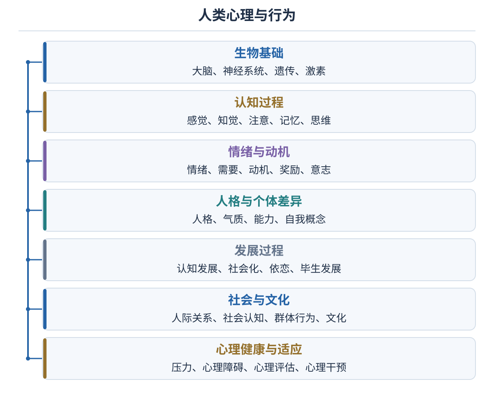
*图 001　人类心理与行为*

> [!info]- 图示文字索引
> - 生物基础：大脑、神经系统、遗传、激素
> - 认知过程：感觉、知觉、注意、记忆、思维
> - 情绪与动机：情绪、需要、动机、奖励、意志
> - 人格与个体差异：人格、气质、能力、自我概念
> - 发展过程：认知发展、社会化、依恋、毕生发展
> - 社会与文化：人际关系、社会认知、群体行为、文化
> - 心理健康与适应：压力、心理障碍、心理评估、心理干预

### 0.2 心理学的四种分类维度

这是理解整个心理学知识体系的前提。

| 分类维度 | 回答的问题 | 典型分类 |
|---|---|---|
| 研究对象 | 研究什么心理现象？ | 认知心理学、人格心理学、社会心理学 |
| 理论视角 | 如何解释心理现象？ | 行为主义、认知理论、精神分析 |
| 研究方法 | 如何获得心理学证据？ | 实验法、观察法、心理测量、脑成像 |
| 应用领域 | 将心理学用于什么场景？ | 教育、医疗、商业、司法、组织管理 |

例如，认知心理学与行为主义并不是完全处于同一分类层级的概念。认知心理学主要是一个研究领域，行为主义则首先是一种理论传统。一位教育心理学研究者，可以同时采用认知理论、行为学习理论以及实验研究方法。

### 0.3 人类心理活动的基本运行模型

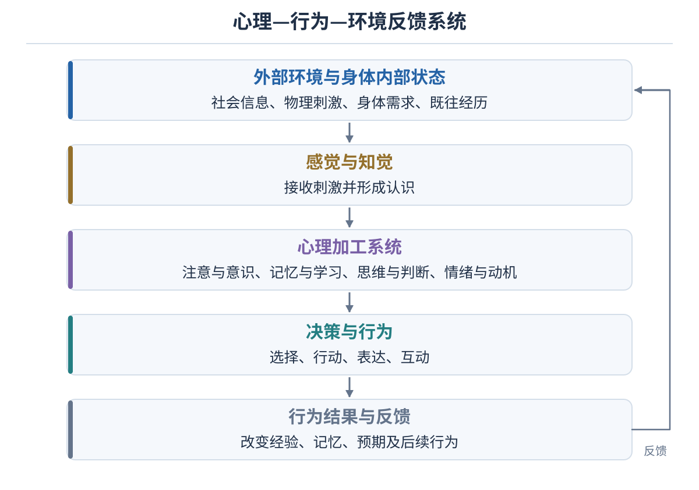
*图 002　心理—行为—环境反馈系统*

> [!info]- 图示文字索引
> - 外部环境与身体内部状态：社会信息、物理刺激、身体需求、既往经历
> - 感觉与知觉：接收刺激并形成认识
> - 心理加工系统：注意与意识、记忆与学习、思维与判断、情绪与动机
> - 决策与行为：选择、行动、表达、互动
> - 行为结果与反馈：改变经验、记忆、预期及后续行为

人格、遗传、生理状态、社会文化等因素贯穿整个过程。实际心理加工也存在并行、双向和循环作用，并非严格的单向流水线。

### 0.4 心理学与其他学科的关系

| 学科 | 核心研究对象 | 与心理学的交叉领域 |
|---|---|---|
| 生物学 | 生命活动及其机制 | 生物心理学、行为遗传学 |
| 神经科学 | 神经系统的结构与功能 | 认知神经科学、神经心理学 |
| 医学 | 健康、疾病及其治疗 | 精神病学、临床心理学 |
| 哲学 | 存在、知识、意识与价值 | 心灵哲学、意识研究 |
| 社会学 | 社会结构、制度及群体 | 社会心理学、文化心理学 |
| 经济学 | 稀缺资源配置与经济行为 | 行为经济学、经济心理学 |
| 金融学 | 资金、资产、收益与风险 | 行为金融学、投资心理学 |
| 教育学 | 教育与人才培养 | 教育心理学、学习科学 |
| 计算机科学 | 信息、算法与计算系统 | 计算心理学、人机交互、人工智能 |
| 法学 | 法律、权利及社会规范 | 法律心理学、司法心理学 |
| 管理学 | 组织运行与资源管理 | 组织心理学、领导力研究 |

### 0.5 总体目录

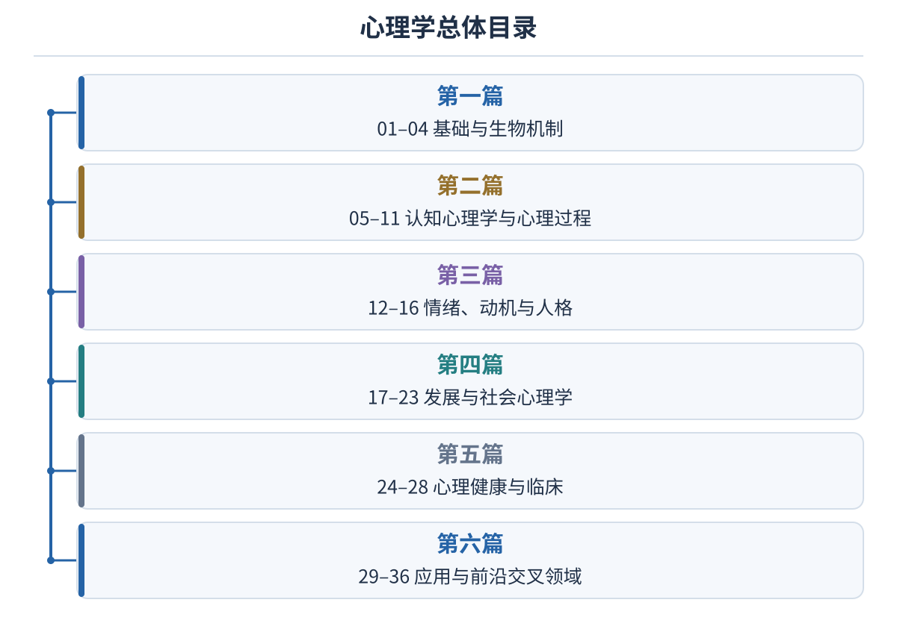
*图 003　心理学总体目录*

> [!info]- 图示文字索引
> - 第一篇：01–04 基础与生物机制
> - 第二篇：05–11 认知心理学与心理过程
> - 第三篇：12–16 情绪、动机与人格
> - 第四篇：17–23 发展与社会心理学
> - 第五篇：24–28 心理健康与临床
> - 第六篇：29–36 应用与前沿交叉领域

**第一篇　心理学基础与生物机制**
- 第一章　心理学基本原理
- 第二章　心理学思想史与理论流派
- 第三章　心理学研究方法与心理测量
- 第四章　生物心理学与神经科学

**第二篇　认知心理学与心理过程**
- 第五章　感觉与知觉
- 第六章　注意、意识与睡眠
- 第七章　学习心理学与行为形成
- 第八章　记忆心理学
- 第九章　思维、语言与问题解决
- 第十章　判断、决策与认知偏差
- 第十一章　智力、能力与创造力

**第三篇　情绪、动机与人格心理学**
- 第十二章　情绪心理学
- 第十三章　动机、需要与奖励机制
- 第十四章　意志、自我控制与习惯
- 第十五章　人格心理学与个体差异
- 第十六章　自我意识、身份认同与心理防御

**第四篇　发展心理学与社会心理学**
- 第十七章　毕生发展心理学
- 第十八章　依恋、家庭与社会化
- 第十九章　社会认知与归因
- 第二十章　态度、说服与社会影响
- 第二十一章　人际交往与亲密关系
- 第二十二章　群体心理与群际关系
- 第二十三章　文化心理学与社会行为

**第五篇　心理健康与临床心理学**
- 第二十四章　压力、应对与心理韧性
- 第二十五章　异常心理学与心理障碍
- 第二十六章　临床评估与心理咨询
- 第二十七章　心理治疗与心理干预
- 第二十八章　积极心理学与幸福感

**第六篇　应用心理学与前沿交叉领域**
- 第二十九章　教育心理学与学习科学
- 第三十章　工业与组织心理学
- 第三十一章　消费者心理学与营销心理学
- 第三十二章　经济心理学、行为经济学与行为金融学
- 第三十三章　法律、司法与犯罪心理学
- 第三十四章　健康、运动与环境心理学
- 第三十五章　工程心理学、人机交互与数字心理学
- 第三十六章　计算心理学、人工智能与现代心理科学

其中，第二篇、第三篇和第四篇是本体系的核心。这三个部分分别回答：人是怎样思考的？人为什么会产生特定的情绪和行为？人怎样形成自己的性格，又怎样与他人相处？第五篇虽然十分重要，但不应将整个心理学等同于心理咨询或心理疾病研究。

# 第一篇　心理学基础与生物机制

## 第一章　心理学基本原理

### 1.1 心理学的基本研究对象

传统普通心理学通常将个体心理现象概括为心理过程与个性心理等方面。现代心理学则进一步研究这些现象的神经基础、发展过程及社会环境。

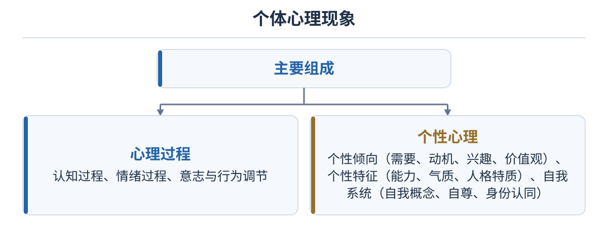
*图 004　个体心理现象*

> [!info]- 图示文字索引
> - 心理过程：认知过程、情绪过程、意志与行为调节
> - 个性心理：个性倾向（需要、动机、兴趣、价值观）、个性特征（能力、气质、人格特质）、自我系统（自我概念、自尊、身份认同）

采用便于入门的传统分类。动机、自我及人格并非彼此完全独立的心理系统。

### 1.2 心理、意识、认知与行为的区别

| 概念 | 基本含义 |
|---|---|
| 心理（Mind） | 感知、思想、情绪、动机等心理现象的广泛概念 |
| 意识（Consciousness） | 对自身状态及外部环境的主观觉知等现象 |
| 认知（Cognition） | 获取、加工、储存及使用信息的心理过程 |
| 情绪（Emotion） | 对具有个人意义的事件产生的体验、生理及行为反应 |
| 动机（Motivation） | 激发、维持并引导行为方向的心理过程 |
| 行为（Behavior） | 个体能够被观察、记录或测量的活动 |
| 人格（Personality） | 相对稳定的思维、情绪和行为特征模式 |

认知只是心理活动的一部分，心理活动也不一定全部进入意识。例如，一个人可以有意识地决定阅读某本书，也可能在没有主动察觉的情况下受到环境刺激、既往经验和自动化习惯的影响。

### 1.3 心理现象的不同解释层次

同一种心理现象可以具有多种层次的解释。假设一个人在公开演讲之前感到紧张：

| 分析层次 | 可能研究的问题 |
|---|---|
| 神经生物层次 | 自主神经系统及压力反应发生了什么变化？ |
| 认知层次 | 是否预期自己会失败或受到负面评价？ |
| 情绪层次 | 如何体验焦虑、恐惧与羞耻？ |
| 学习层次 | 过去是否经历过不愉快的演讲？ |
| 人格层次 | 是否具有较高的负性情绪敏感性？ |
| 社会层次 | 听众、身份和社会评价带来了什么影响？ |
| 文化层次 | 所处文化如何看待公开失败与个人表现？ |

不同层次的解释并不一定互相排斥。现代心理科学通常强调将多个层次结合起来。

### 1.4 生物—心理—社会模型

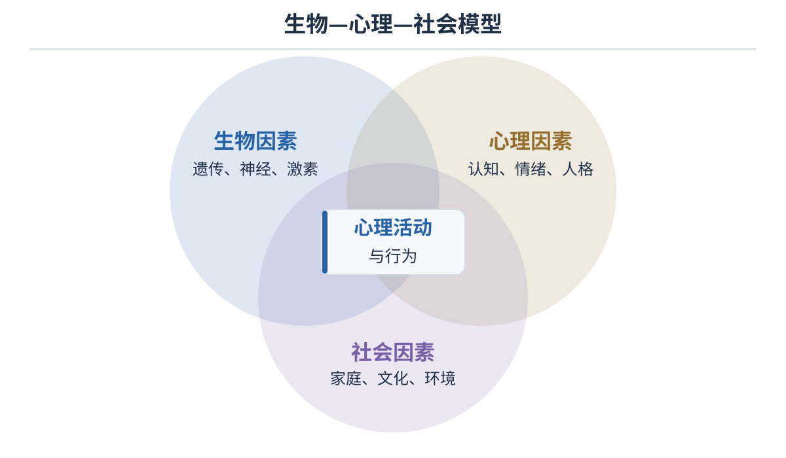
*图 005　生物—心理—社会模型*

- 生物因素：遗传、脑神经活动、内分泌、睡眠及身体健康等。
- 心理因素：思维方式、学习经历、情绪调节、人格及动机等。
- 社会因素：家庭、教育、经济条件、社会关系及文化环境等。

该模型尤其适合解释复杂心理现象，避免将所有行为简单归因于基因、童年经历或个人意志。

### 1.5 心理学的四项基本任务

| 任务 | 研究目的 | 示例 |
|---|---|---|
| 描述 | 确定现象是什么 | 统计学生考试焦虑的程度 |
| 解释 | 研究现象为何发生 | 研究失败预期与焦虑的关系 |
| 预测 | 估计何种条件下可能发生 | 研究哪些因素能够预测考试焦虑 |
| 干预 | 改善相关心理及行为结果 | 检验某种减压方法是否有效 |

预测是概率性的，心理干预也必须遵循伦理原则，不能将心理学理解为操纵他人思想的技术。

## 第二章　心理学思想史与理论流派

### 2.1 心理学的发展历史

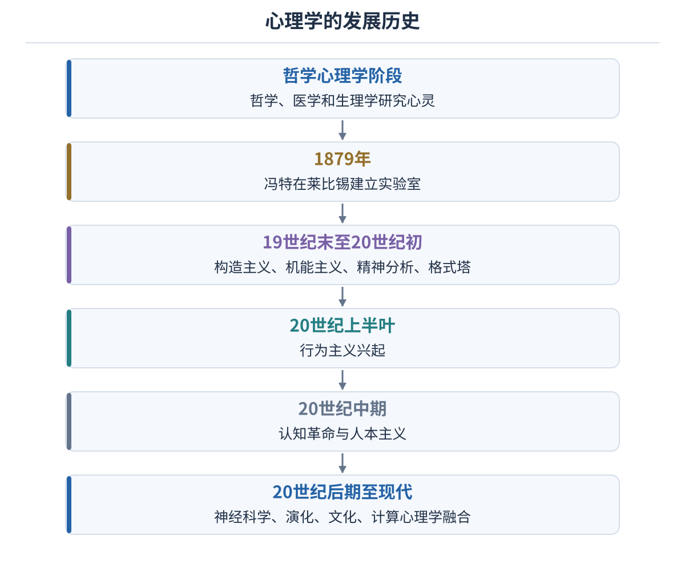
*图 006　心理学的发展历史*

> [!info]- 图示文字索引
> - 哲学心理学阶段：哲学、医学和生理学研究心灵
> - 1879年：冯特在莱比锡建立实验室
> - 19世纪末至20世纪初：构造主义、机能主义、精神分析、格式塔
> - 20世纪上半叶：行为主义兴起
> - 20世纪中期：认知革命与人本主义
> - 20世纪后期至现代：神经科学、演化、文化、计算心理学融合

各个学派并不是按照简单的时间顺序依次取代。许多理论至今仍然以修订、融合或受到批判的方式存在。

### 2.2 主要心理学理论流派

| 理论流派 | 主要代表人物 | 核心研究思想 |
|---|---|---|
| 构造主义 | 铁钦纳 | 分析意识经验的基本组成成分 |
| 机能主义 | 威廉·詹姆斯 | 研究心理活动的功能及适应价值 |
| 精神分析 | 弗洛伊德 | 强调无意识、内部冲突和早期经验 |
| 格式塔心理学 | 韦特海默、苛勒、考夫卡 | 研究知觉与心理活动的整体组织 |
| 行为主义 | 华生、斯金纳 | 研究环境刺激、行为及学习机制 |
| 人本主义 | 马斯洛、罗杰斯 | 强调个人体验、自我发展与成长 |
| 认知心理学 | 奈瑟等 | 研究内部信息加工与心理表征 |
| 社会认知理论 | 班杜拉 | 强调认知、行为与环境之间的相互作用 |
| 演化心理学 | 多学者发展 | 从演化历史研究心理特征的可能功能 |
| 生物心理学视角 | 多学者发展 | 从神经、生理及遗传机制解释心理 |

### 2.3 几种最重要理论视角的关系

假设一个学生不愿意主动回答课堂问题：

- 行为主义可能研究：过去回答错误是否产生了不愉快后果。
- 认知理论可能研究：学生是否存在「回答错误就会被所有人否定」的信念。
- 心理动力学可能探索：该行为是否与内部冲突、早期关系经验有关。
- 人本主义可能研究：学生是否缺少安全感、自我接纳和成长空间。
- 社会心理学可能研究：班级氛围、群体规范及他人评价如何影响行为。
- 生物心理学可能研究：个体的生理唤醒及压力敏感性。

*图 007　同一个心理或行为现象*

> [!info]- 图示文字索引
> - 学习视角：行为如何形成？
> - 认知视角：如何理解事件？
> - 动力学视角：内部冲突和关系经验
> - 人本主义视角：需求与主观体验
> - 社会文化视角：环境与他人
> - 生物视角：生理机制

需要注意，不同理论的科学证据强度并不相同。历史影响较大，不等于理论的所有主张都已得到现代实证研究支持。

## 第三章　心理学研究方法与心理测量

心理学与日常经验判断的重要区别，在于心理学需要借助可检验的证据研究心理现象。

### 3.1 心理学研究的基本过程

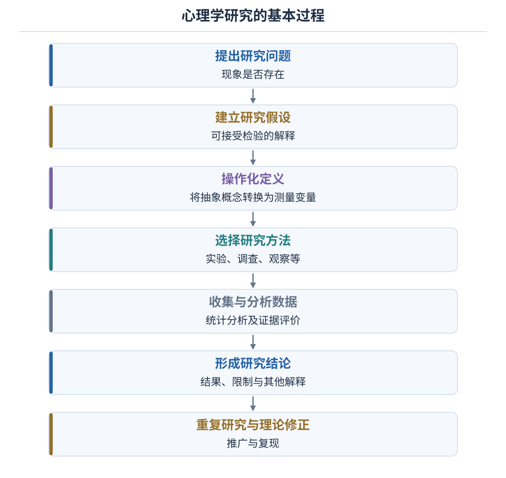
*图 008　心理学研究的基本过程*

> [!info]- 图示文字索引
> - 提出研究问题：现象是否存在
> - 建立研究假设：可接受检验的解释
> - 操作化定义：将抽象概念转换为测量变量
> - 选择研究方法：实验、调查、观察等
> - 收集与分析数据：统计分析及证据评价
> - 形成研究结论：结果、限制与其他解释
> - 重复研究与理论修正：推广与复现

例如，「短视频是否会损害注意力」是一个宽泛的研究问题，需要进一步定义短视频使用方式、注意力指标、研究对象及观察期限，才能进行科学研究。

### 3.2 心理学研究方法的分类

#### 3.2.1 描述性研究

- 自然观察法：在自然环境中记录行为。
- 实验室观察法：在相对受控的环境中记录行为。
- 个案研究：深入研究单个个体、群体或特殊事件。
- 访谈法：通过交流获取个人经历及心理信息。
- 问卷调查法：通过标准化问题收集数据。
- 经验取样法：在日常生活的多个时点记录实际体验。

#### 3.2.2 相关研究

研究两个或多个变量之间是否具有统计联系。相关系数通常用 $r$ 表示，取值范围为：

$$
-1\leq r\leq1
$$

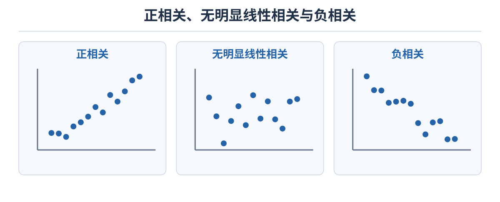
*图 009　正相关、无明显线性相关与负相关*

#### 3.2.3 实验研究

通过操纵研究条件、控制其他变量，研究某种因素是否对心理或行为产生因果影响。

| 实验概念 | 含义 |
|---|---|
| 自变量 | 研究者操纵或比较的条件 |
| 因变量 | 被测量的结果变量 |
| 控制变量 | 尽可能保持一致的其他因素 |
| 混淆变量 | 可能导致无法正确判断因果关系的因素 |
| 实验组 | 接受相应实验条件的组别 |
| 对照组 | 提供比较基准的组别 |
| 随机分配 | 随机将参与者分配至不同实验条件 |
| 盲法 | 尽可能减少参与者或研究人员的预期影响 |

#### 3.2.4 按研究时间分类

| 类型 | 研究方式 |
|---|---|
| 横断研究 | 同一时期比较不同研究对象 |
| 纵向研究 | 在多个时间点追踪同一批对象 |
| 序列研究 | 结合横断与纵向设计 |
| 日记研究 | 连续记录个体日常体验与行为 |

实验设计、数据收集方式和研究时间是不同的分类维度。一项研究可以同时属于纵向研究、实验研究和问卷研究。

### 3.3 相关关系与因果关系

假设研究发现睡眠时间较短的学生成绩也较差。可能存在以下几种解释：

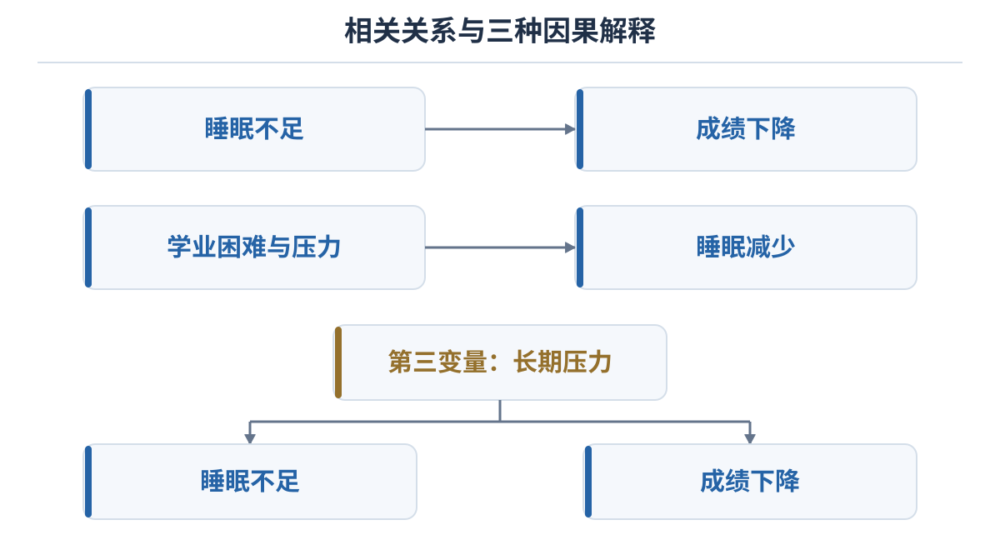
*图 010　相关关系与三种因果解释*

相关数据本身不足以确定因果方向，也不能自动排除共同原因。

### 3.4 心理测量学

心理测量学研究如何对智力、人格、焦虑、态度等难以直接观察的心理属性进行科学测量。

#### 3.4.1 心理测量工具

- 能力测验：测量认知能力、技能或知识水平。
- 人格问卷：测量相对稳定的人格特征。
- 临床评估量表：测量症状或心理功能相关信息。
- 态度量表：测量个人对特定对象的评价与倾向。
- 行为测量：通过反应时、正确率、行为频率等数据评价心理过程。
- 生理测量：通过心率、皮肤电、脑电等数据研究心理活动。

#### 3.4.2 信度与效度

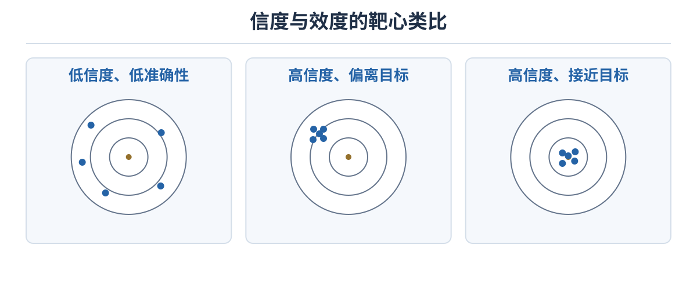
*图 011　信度与效度的靶心类比*

靶心图是测量稳定性与准确性的直观类比，实际心理测量效度比简单的命中靶心更加复杂。

| 概念 | 下属类型与含义 |
|---|---|
| 信度 | 测量结果的一致性与可靠性，包括重测信度、内部一致性、评分者一致性 |
| 效度 | 证据是否支持对测验分数作出特定解释及使用，包括内容、结构、效标关系等证据 |
| 常模 | 特定参考群体的测验结果分布 |
| 标准化 | 统一测验实施、评分及解释程序 |
| 测量误差 | 观测分数中不代表目标心理属性的变化部分 |
| 测量不变性 | 不同群体或时期的测量是否具有可比较的含义 |

进一步的理论包括经典测验理论（CTT）、项目反应理论（IRT）、因素分析及结构方程模型。

### 3.5 心理统计与数据分析

| 知识类别 | 主要内容 |
|---|---|
| 描述统计 | 均值、中位数、标准差、分布 |
| 统计推断 | 假设检验、置信区间、效应量 |
| 变量关系 | 相关分析、回归分析 |
| 组间比较 | t检验、方差分析 |
| 潜在变量分析 | 探索性与验证性因素分析 |
| 机制研究 | 中介分析、调节分析 |
| 综合证据 | 系统综述、元分析 |
| 高级方法 | 贝叶斯统计、多层模型、计算建模 |

中介与调节尤其容易混淆：中介变量回答「为什么会发生」「通过什么机制发生」；调节变量回答「什么情况下更明显」「对哪些人更明显」。

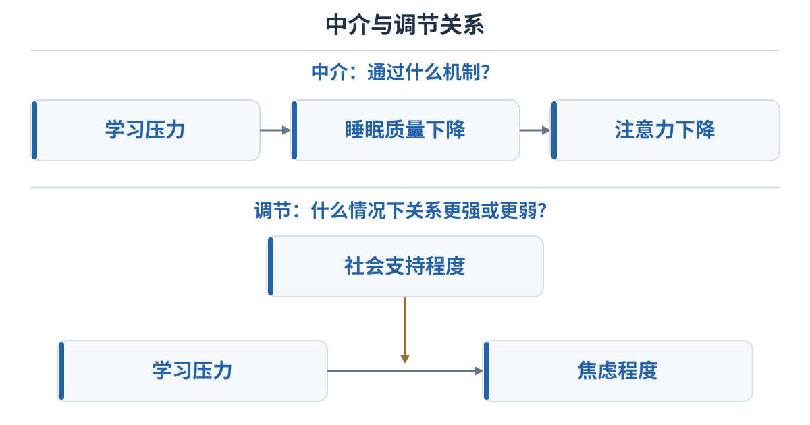
*图 012　中介与调节关系*

以上是研究假设示意，不是已经建立的具体因果结论。

### 3.6 心理学研究的可信度与伦理

心理学研究必须注意样本代表性、研究重复性、发表偏差、过度解释、选择性报告及因果推断问题。

常见研究伦理包括知情同意、自愿参与、隐私保护、风险最小化、必要的事后说明及特殊群体保护。

**判断心理学结论时，应当优先研究证据质量，而不是只看理论是否听起来合理。**

## 第四章　生物心理学与神经科学

### 4.1 神经系统的整体结构

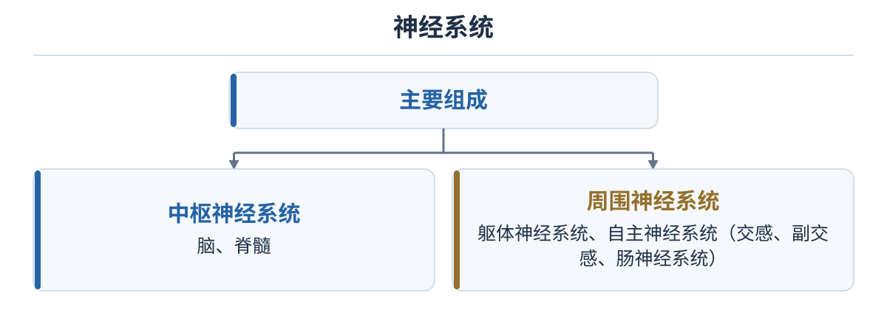
*图 013　神经系统*

> [!info]- 图示文字索引
> - 中枢神经系统：脑、脊髓
> - 周围神经系统：躯体神经系统、自主神经系统（交感、副交感、肠神经系统）

简化功能分类。肠神经系统也常被单独描述，具体教材分类略有区别。

- 中枢神经系统：承担信息整合及行为调节等重要功能。
- 周围神经系统：连接中枢神经系统与身体其他部分。
- 交感神经：参与机体应对挑战、能量动员等活动。
- 副交感神经：参与休息、消化及恢复等活动。

交感神经与副交感神经并不是简单的「兴奋」与「抑制」两个开关，其作用需要结合具体器官及身体状态理解。

### 4.2 神经元与信息传递

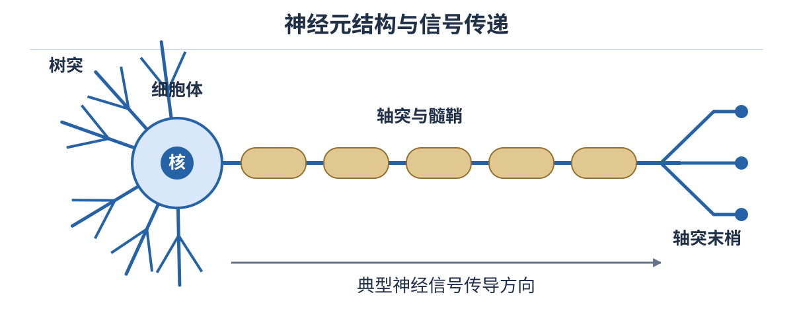
*图 014　神经元结构与信号传递*

神经元的主要组成包括树突、细胞体、轴突及轴突末梢。神经胶质细胞则参与神经支持、免疫、髓鞘形成等重要过程。

- 静息电位：神经元未发生相应兴奋时的膜电位状态。
- 动作电位：沿神经元膜传播的快速电信号。
- 突触：神经细胞之间或神经细胞与其他细胞之间的信号传递连接。
- 神经递质：参与化学突触信息传递的物质。
- 神经可塑性：神经系统在经验、学习、损伤等因素影响下发生变化的能力。

### 4.3 大脑结构与心理功能

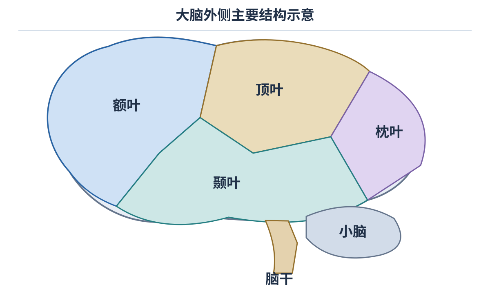
*图 015　大脑外侧主要结构示意*

大脑外侧主要结构的简化示意，非精确解剖图。不同脑区的功能存在广泛重叠与网络协作。

| 脑结构 | 主要相关功能 |
|---|---|
| 额叶 | 计划、决策、运动控制及执行功能 |
| 顶叶 | 躯体感觉、空间加工及多种信息整合 |
| 颞叶 | 听觉、语言、记忆及物体识别等 |
| 枕叶 | 视觉信息加工 |
| 海马及相关系统 | 情景记忆形成、空间导航 |
| 杏仁核及相关网络 | 生物意义、威胁与情绪信息加工 |
| 丘脑 | 多类信息传递及调节 |
| 下丘脑 | 体温、饥饿、内分泌及身体稳态调节 |
| 基底神经节 | 行为选择、运动及习惯学习 |
| 小脑 | 运动协调及部分认知过程 |
| 脑干 | 多种生命维持功能及觉醒调节 |

不能将复杂心理活动简单归属于单一脑区。例如，杏仁核并不是专门负责恐惧的唯一结构，前额叶也不是独立于其他脑区的「理性中心」。

### 4.4 神经递质与心理活动

| 神经递质 | 主要相关功能 |
|---|---|
| 多巴胺 | 奖励学习、动机、运动及行为选择 |
| 血清素（5-HT） | 情绪、睡眠及多种生理心理调节 |
| 去甲肾上腺素 | 觉醒、注意及应激反应 |
| 乙酰胆碱 | 注意、学习、记忆及肌肉活动 |
| 谷氨酸 | 中枢神经系统主要兴奋性递质、学习及可塑性 |
| GABA | 中枢神经系统主要抑制性递质 |
| 内源性阿片肽 | 疼痛调节、奖赏与应激等 |

多巴胺不等于快乐，血清素也不等于幸福。神经递质的作用取决于受体、神经回路、释放方式以及个体的生理状态。

### 4.5 遗传、环境与心理发展

- 行为遗传学：研究遗传差异与环境差异如何关联行为和心理特征。
- 遗传率：特定群体及环境中，某种特征的个体差异可由遗传差异解释的统计比例。
- 基因—环境交互作用：相同环境可能对不同遗传背景个体产生不同影响。
- 基因—环境相关：遗传倾向与个体所经历或选择的环境可能存在关联。
- 表观遗传学：研究不改变DNA序列而影响基因表达的相关机制。

遗传率不是某个人的性格由基因决定了百分之多少，也不代表具有较高遗传率的心理特征无法改变。

### 4.6 神经心理学的研究技术

| 技术 | 主要研究用途 |
|---|---|
| EEG脑电图 | 测量头皮电活动，研究时间过程 |
| ERP事件相关电位 | 研究与特定事件相关的脑电变化 |
| MRI磁共振成像 | 观察脑结构 |
| fMRI功能磁共振 | 通过血氧相关信号间接研究脑活动 |
| PET正电子发射断层成像 | 研究相关代谢及分子活动 |
| 眼动追踪 | 记录视觉注视及眼球运动 |
| 脑损伤研究 | 研究特定损伤与心理功能变化的关系 |
| TMS经颅磁刺激 | 在专业研究或医疗条件下调节相关脑区活动 |

这些技术提供不同层面的证据，脑成像图中的活动增强并不能直接等同于读出了一个人的具体思想。

# 第二篇　认知心理学与心理过程

认知心理学（Cognitive Psychology）研究人类如何获得信息、形成心理表征、储存经验、理解事物并作出判断。

如果借用计算机科学的思路，可以将认知系统理解为一套具有信息输入、资源分配、加工、记忆、推理及输出能力的复杂系统。但人脑不是简单的冯·诺依曼计算机，其加工过程具有高度并行性、可塑性，并受到情绪、身体和环境影响。

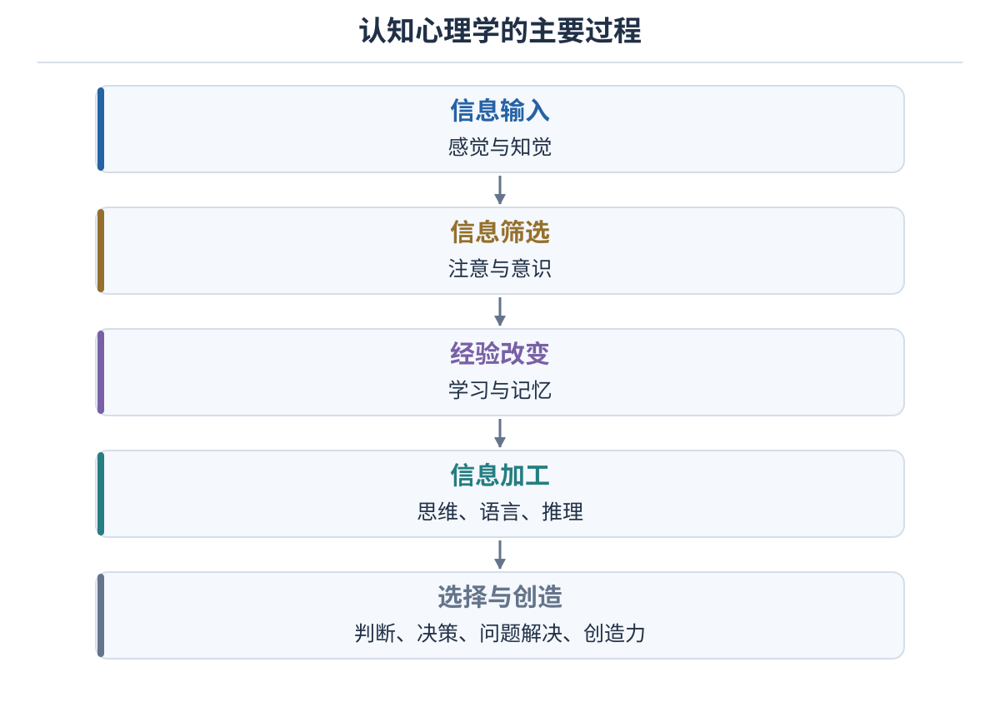
*图 016　认知心理学的主要过程*

> [!info]- 图示文字索引
> - 信息输入：感觉与知觉
> - 信息筛选：注意与意识
> - 经验改变：学习与记忆
> - 信息加工：思维、语言、推理
> - 选择与创造：判断、决策、问题解决、创造力

既有知识、目标及行为反馈反过来影响认知。

## 第五章　感觉与知觉

### 5.1 感觉与知觉的区别

- 感觉（Sensation）：感受器接收刺激并形成相关神经信号的过程。
- 知觉（Perception）：对感觉信息进行组织、解释及赋予意义的过程。

例如，阅读一本书时，视觉系统接收到光线和文字形状属于感觉加工；将这些形状识别为具有意义的汉字，则涉及知觉及进一步的语言加工。

### 5.2 感觉系统的分类

| 感觉系统 | 主要信息 |
|---|---|
| 视觉 | 光线、颜色、形状、运动 |
| 听觉 | 声音频率、强度及空间位置 |
| 嗅觉 | 空气中的相关化学物质 |
| 味觉 | 食物中的相关化学刺激 |
| 躯体感觉 | 触觉、压力、温度等 |
| 痛觉 | 实际或潜在组织损伤相关体验 |
| 本体感觉 | 身体及关节的位置和运动 |
| 前庭感觉 | 身体平衡及头部运动 |
| 内感受 | 心跳、饥饿及其他身体内部状态 |

人类的感觉并不只有传统所说的五种。

### 5.3 心理物理学：刺激如何转化为感受

#### 5.3.1 感觉阈限

- 绝对阈限：在规定条件下达到特定检测概率所需要的刺激强度。
- 差别阈限：能够以规定概率察觉到的最小刺激差异。
- 最小可觉差（JND）：差别阈限的另一常见表述。
- 阈下刺激：低于特定检测阈限的刺激。

#### 5.3.2 韦伯定律与费希纳定律

韦伯定律研究可觉察变化量与原有刺激强度之间的关系：

$$
\frac{\Delta I}{I}=k
$$

费希纳定律在相应假设下描述主观感觉强度与物理刺激强度之间的对数关系：

$$
S=k\ln\frac{I}{I_0}
$$

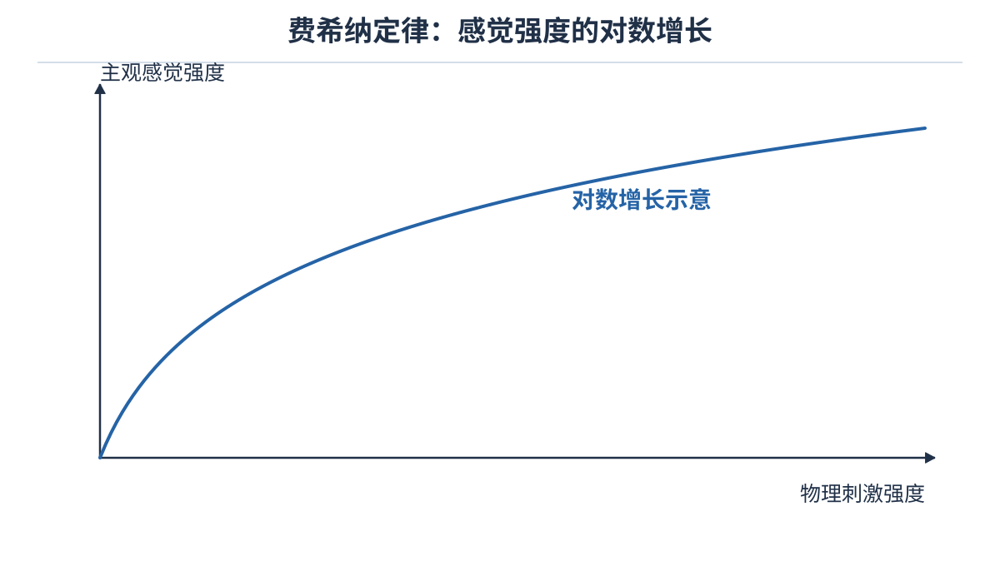
*图 017　费希纳定律：感觉强度的对数增长*

心理物理关系存在适用范围，不同感觉系统也可能更适合其他数学模型。

#### 5.3.3 信号检测理论

信号检测理论将个体辨别刺激的能力与作出判断时的反应标准区分开来。

| 实际状态 | 判断存在信号 | 判断不存在信号 |
|---|---|---|
| 确实存在信号 | 命中 | 漏报 |
| 实际不存在信号 | 虚报 | 正确拒绝 |

例如，机场安检、医疗影像判断、股票交易信号识别，都可以借鉴这种区分检测能力与判断标准的思路。降低判断标准可能提高命中率，同时增加虚报率。

### 5.4 知觉的两类加工方向

*图 018　知觉的两类加工方向*

> [!info]- 图示文字索引
> - 自下而上加工：原始刺激 → 特征识别 → 形成知觉
> - 自上而下加工：已有知识与预期 → 影响信息选择 → 形成知觉

例如，在一个英文句子中，即使个别字母不清晰，也可能根据上下文识别出单词。这体现了已有知识对知觉加工的影响。

### 5.5 格式塔知觉组织原则

格式塔心理学强调人类倾向于将局部刺激组织为整体结构。

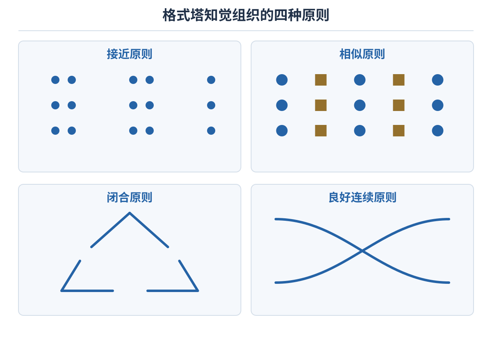
*图 019　格式塔知觉组织的四种原则*

- 接近原则：空间上接近的元素容易被组织在一起。
- 相似原则：颜色、形状等特征相似的元素容易被归为同组。
- 闭合原则：即使图形缺失部分边界，仍可能知觉到完整图形。
- 良好连续原则：连续、平滑的路径容易被知觉为统一结构。

其他原则还包括共同命运、共同区域、连接性、图形与背景等。

这些知觉原则在平面设计、网页布局、数据可视化及用户界面设计中具有实际价值。

### 5.6 知觉恒常性与错觉

知觉恒常性是指外部刺激发生一定变化时，人对物体某些属性的知觉仍然相对稳定。包括大小恒常性、形状恒常性、颜色恒常性及明度恒常性。

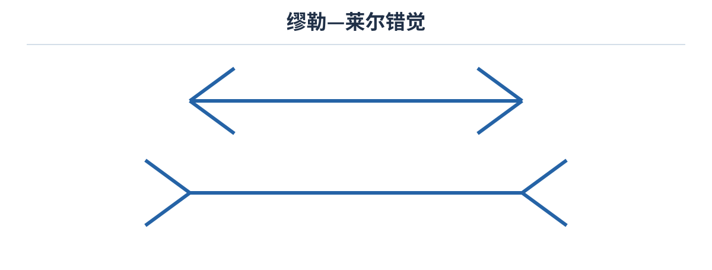
*图 020　缪勒—莱尔错觉*

两条水平主线的实际长度完全相同，但不同端点形状可能使人产生长度差异的知觉体验。错觉并不意味着感官损坏，而可以反映正常知觉加工机制如何受到上下文影响。

## 第六章　注意、意识与睡眠

### 6.1 注意的本质

注意是心理资源对特定信息、任务或内部活动进行选择及分配的过程。

#### 6.1.1 按注意控制方式分类

- 不随意注意：受到显著刺激等因素吸引，不需要事先确立明确目标。
- 随意注意：根据明确目标主动分配注意资源。
- 随意后注意：原本需要主动控制的活动，在兴趣或熟练化等条件下变得相对轻松。

#### 6.1.2 按注意功能分类

| 类型 | 含义 |
|---|---|
| 选择性注意 | 从大量信息中优先加工某些信息 |
| 持续性注意 | 在一定时间内维持任务相关注意 |
| 分配性注意 | 在多个任务之间分配有限资源 |
| 交替性注意 | 在不同任务或规则之间切换 |
| 执行性注意 | 处理目标冲突、干扰及主动控制 |

两组分类依据不同，不能将不随意注意与选择性注意简单视为并列种类。

### 6.2 注意选择与资源限制

*图 021　注意选择与资源分配*

> [!info]- 图示文字索引
> - 外部声音、手机消息、当前任务、身体感受、内部思想
> - 注意选择与资源分配：目标、刺激显著性、经验
> - 优先加工的信息／未被优先加工的信息

经典注意理论包括早期选择理论、衰减理论、晚期选择理论及注意资源理论。这些理论分别研究信息在哪个阶段被筛选，以及有限心理资源如何分配。

### 6.3 经典注意现象

| 现象 | 含义 |
|---|---|
| 鸡尾酒会效应 | 在复杂声音环境中选择性关注特定声音 |
| 斯特鲁普效应 | 自动化加工与任务目标发生冲突，影响反应 |
| 注意瞬脱 | 短时间内识别一个目标后，对紧接出现的另一目标识别可能下降 |
| 无意视盲 | 因注意集中于某项任务而没有察觉其他显著刺激 |
| 变化盲视 | 未察觉视觉场景中发生的变化 |
| 任务切换成本 | 从一种任务切换至另一任务时产生的效率损耗 |

*图 022　斯特鲁普效应体验*

请读出图中文字的**字体颜色**，而不是汉字本身表达的颜色。汉字意义与字体颜色不一致时，自动阅读可能干扰颜色命名。这只是原理体验，并非标准化心理测验。

### 6.4 执行功能

执行功能是帮助个体围绕目标组织认知和行为的一组控制过程。

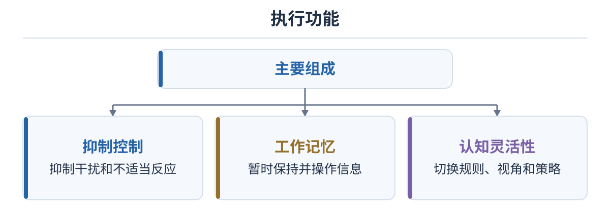
*图 023　执行功能*

> [!info]- 图示文字索引
> - 抑制控制：抑制干扰和不适当反应
> - 工作记忆：暂时保持并操作信息
> - 认知灵活性：切换规则、视角和策略

这三个核心组成支持计划、推理、问题解决、目标管理。执行功能与注意、记忆、意志和自我控制均存在密切联系。

### 6.5 意识与非意识加工

#### 6.5.1 意识的研究维度

- 觉醒水平：机体处于怎样的清醒状态。
- 意识内容：当前能够体验到什么。
- 自我意识：对自身心理状态及身份的认识。
- 元意识：对自己正在经历的心理活动的觉察。

#### 6.5.2 非意识加工

某些信息加工、习惯行为、联想及熟练技能，可以在缺少明确主动觉察的情况下发生。现代认知心理学中的非意识加工，与弗洛伊德精神分析理论中的动力性无意识并不是完全相同的概念。

### 6.6 睡眠与生物节律

#### 6.6.1 睡眠的基本调节机制

- 昼夜节律：机体接近24小时的周期性生理变化。
- 睡眠稳态压力：清醒时间增加后睡眠需求通常提高。
- 生物钟：参与时间节律调节的内在系统。

#### 6.6.2 睡眠阶段

睡眠主要分为非快速眼动睡眠（NREM）和快速眼动睡眠（REM）。

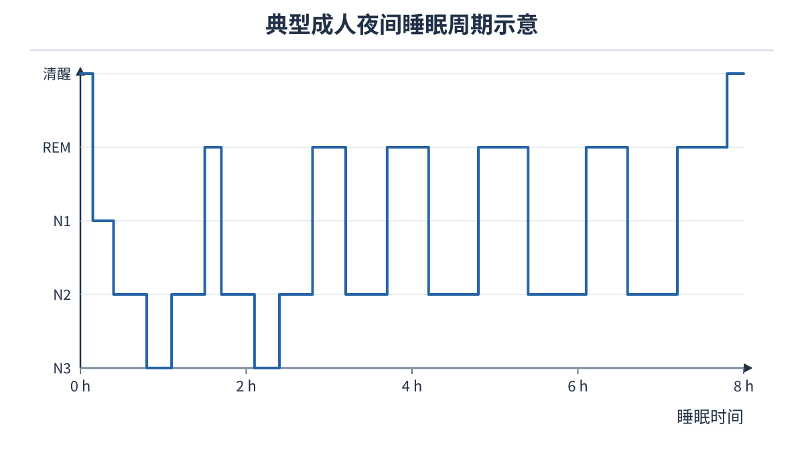
*图 024　典型成人夜间睡眠周期示意*

前半夜深睡眠通常较多，后半夜REM睡眠比例可能提高，实际个体差异明显。

| 阶段 | 基本特征 |
|---|---|
| N1 | 清醒向睡眠过渡 |
| N2 | 较稳定的非快速眼动睡眠 |
| N3 | 慢波睡眠，通常称深睡眠 |
| REM | 快速眼动、特定脑活动及肌张力变化 |

睡眠与注意、学习、记忆巩固、情绪调节及身体恢复密切相关。梦境也可能出现在非REM睡眠阶段。

## 第七章　学习心理学与行为形成

学习是经验导致知识、行为能力或行为倾向发生相对持久变化的过程。它并不仅指学校中的读书和考试，还包括习惯形成、技能训练、情绪联结及社会行为习得。

### 7.1 学习的总体分类

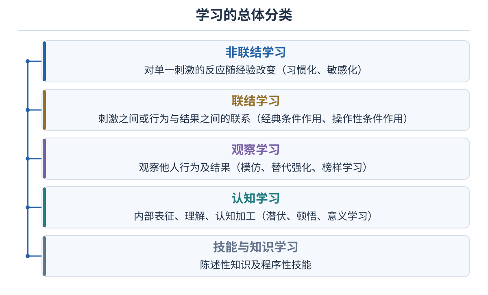
*图 025　学习的总体分类*

> [!info]- 图示文字索引
> - 非联结学习：对单一刺激的反应随经验改变（习惯化、敏感化）
> - 联结学习：刺激之间或行为与结果之间的联系（经典条件作用、操作性条件作用）
> - 观察学习：观察他人行为及结果（模仿、替代强化、榜样学习）
> - 认知学习：内部表征、理解、认知加工（潜伏、顿悟、意义学习）
> - 技能与知识学习：陈述性知识及程序性技能

这些类别使用了不同研究维度，认知加工可以参与联结学习及观察学习。

### 7.2 非联结学习

- 习惯化（Habituation）：对反复出现、没有重大意义的刺激，反应逐渐减弱。
- 敏感化（Sensitization）：受到某些刺激或经验影响后，对相关刺激的反应增强。

例如，在环境稳定且安全的情况下，逐渐不再注意空调的背景噪声，可能属于习惯化。

### 7.3 经典条件作用

经典条件作用（Classical Conditioning）主要研究刺激与刺激之间形成的联结。最经典的研究来自巴甫洛夫的条件反射实验。

*图 026　经典条件作用*

> [!info]- 图示文字索引
> - 形成前：食物（US）→ 唾液反应（UR）；铃声（NS）→ 无相应唾液反应
> - 形成期间：铃声＋食物 → 唾液反应
> - 形成后：铃声（CS）→ 条件反应（CR）

#### 7.3.1 核心概念

| 缩写 | 中文名称 | 含义 |
|---|---|---|
| US | 无条件刺激 | 不需要特定联结学习即可诱发相应反应的刺激 |
| UR | 无条件反应 | 无条件刺激引发的反应 |
| NS | 中性刺激 | 最初不会引发目标反应的刺激 |
| CS | 条件刺激 | 经过学习后能够诱发条件反应的刺激 |
| CR | 条件反应 | 条件刺激引发的学习性反应 |

#### 7.3.2 条件作用的进一步现象

- 习得：条件刺激与相应结果逐渐形成联结。
- 消退：条件刺激不再伴随预期结果时，条件反应逐渐减弱。
- 自发恢复：消退后经过一定时间，条件反应可能重新出现。
- 刺激泛化：类似刺激也可能诱发相应反应。
- 刺激辨别：学习区分不同刺激所对应的结果。
- 高阶条件作用：新的刺激通过已经形成的条件刺激获得联结意义。

条件作用的消退通常不能简单理解为原有记忆被彻底删除。

### 7.4 操作性条件作用

操作性条件作用（Operant Conditioning）主要研究行为及其后果如何影响未来行为发生的可能性。这是理解习惯、激励、奖惩、拖延及大量现实行为的重要理论。

#### 7.4.1 强化与惩罚的完整分类

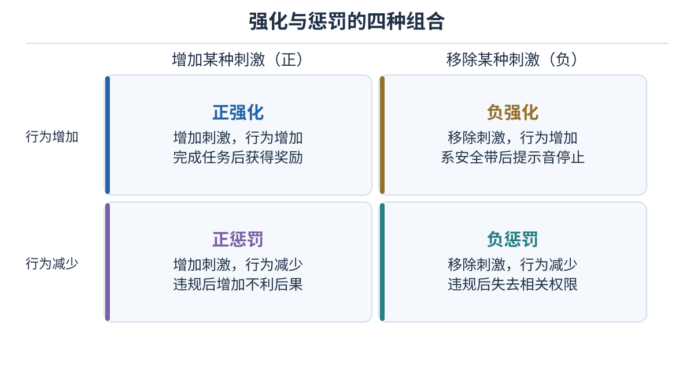
*图 027　强化与惩罚的四种组合*

| 行为变化 | 增加某种刺激（正） | 移除某种刺激（负） |
|---|---|---|
| 行为增加 | 正强化：完成任务后获得奖励，完成任务行为增加 | 负强化：系好安全带后提示音停止，系安全带行为增加 |
| 行为减少 | 正惩罚：违规后增加罚款等后果，违规行为减少 | 负惩罚：违规后失去相关权限，违规行为减少 |

**正与负描述刺激的增加或移除；强化与惩罚描述行为发生频率的增加或减少。** 因此，负强化不是惩罚。而且，某项后果是否构成强化或惩罚，需要依据行为实际发生的变化判断，不能只依据实施者的主观意图。

#### 7.4.2 强化物的分类

- 初级强化物：食物等具有相应生物价值的刺激。
- 条件强化物：通过学习获得强化功能的刺激。
- 泛化条件强化物：能够与多种强化结果建立联系的刺激，例如金钱。

#### 7.4.3 强化程序

强化程序规定行为在什么条件下获得强化。

| 类型 | 基本机制 | 示例 |
|---|---|---|
| 连续强化 | 每次目标行为均得到强化 | 每次正确反应均获得反馈 |
| 固定比率（FR） | 完成固定数量反应后强化 | 每完成规定数量任务获得奖励 |
| 可变比率（VR） | 所需反应次数围绕平均数量变化 | 不确定次数后获得奖励 |
| 固定时距（FI） | 固定时间经过后的首次合格反应得到强化 | 固定期限后检查并奖励 |
| 可变时距（VI） | 不固定时间经过后的首次合格反应得到强化 | 随机时间间隔后的行为检查 |

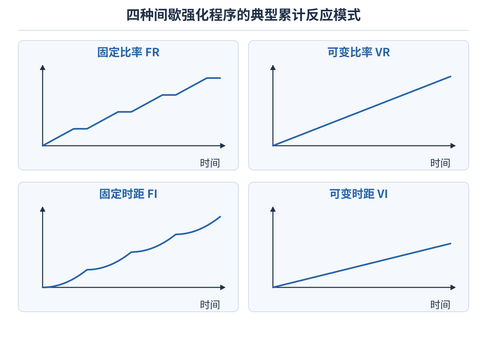
*图 028　四种间歇强化程序的典型累计反应模式*

纵轴表示累计反应次数，曲线为经典强化程序下可能出现的理想化反应模式，并不代表所有个体都会产生相同结果。不确定奖励在电子游戏、社交媒体及其他活动中可能影响持续参与行为，但不能将所有持续使用行为都简单归因于某一种强化程序。

#### 7.4.4 行为塑造

- 塑造：逐步强化接近目标的行为。
- 行为链：将复杂行为分解为多个相互连接的行为环节。
- 刺激控制：行为在特定环境信号下更容易发生。
- 消退：当原有强化关系不再存在时，相关行为可能减少。

### 7.5 观察学习与社会认知理论

观察学习主要研究个体如何通过观察他人的行为及结果学习。班杜拉提出的经典观察学习过程包括：

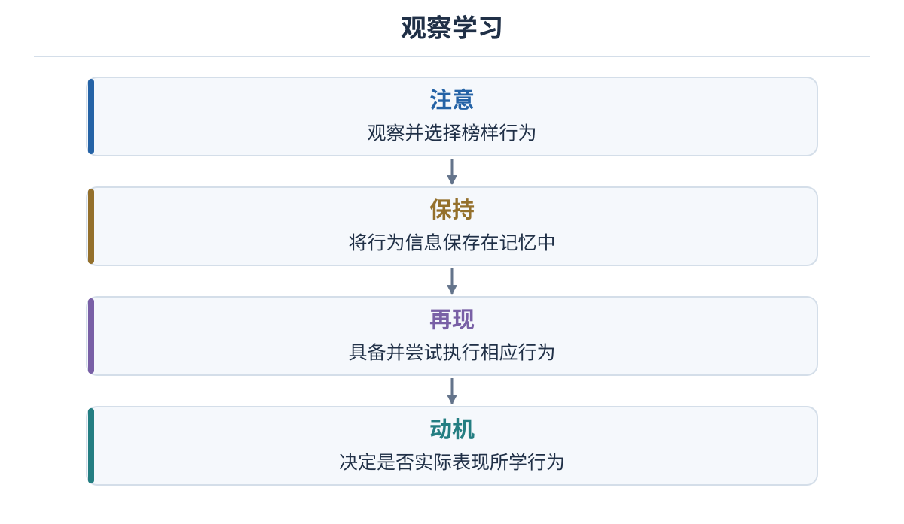
*图 029　观察学习*

> [!info]- 图示文字索引
> - 注意：观察并选择榜样行为
> - 保持：将行为信息保存在记忆中
> - 再现：具备并尝试执行相应行为
> - 动机：决定是否实际表现所学行为

观察学习不等于机械模仿。个人可以已经学会某种行为，但暂时没有表现出来。社会认知理论进一步研究个人认知、行为及环境之间的相互作用，其中自我效能感是重要概念，将在第十三章及第十六章继续展开。

### 7.6 三类学习机制的区别

| 对比维度 | 经典条件作用 | 操作性条件作用 | 观察学习 |
|---|---|---|---|
| 主要联结 | 刺激与刺激 | 行为与后果 | 他人行为、结果与自身表征 |
| 典型现象 | 条件性恐惧、条件反应 | 习惯、奖励及行为塑造 | 模仿、榜样作用 |
| 代表研究 | 巴甫洛夫 | 桑代克、斯金纳 | 班杜拉 |

同一种现实行为可能受到多种学习机制共同影响。

## 第八章　记忆心理学

### 8.1 记忆的三个基本过程

*图 030　记忆的三个基本过程*

> [!info]- 图示文字索引
> - 编码 Encoding：将当前信息转换为可保存的心理表征
> - 储存 Storage：使相关信息在一定时间内得到保持
> - 提取 Retrieval：在需要时重新获得或使用相关信息

记忆失败可能发生在任何一个环节。无法回忆某项知识，不一定说明该知识已经完全消失，也可能是提取线索不足。

### 8.2 按信息保持与加工方式划分记忆

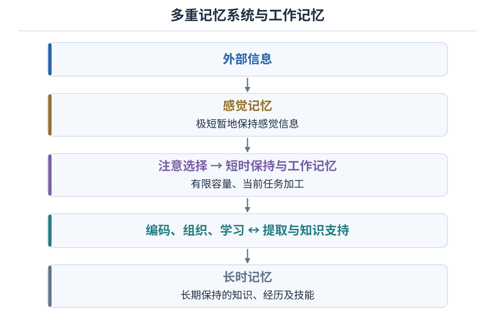
*图 031　多重记忆系统与工作记忆*

> [!info]- 图示文字索引
> - 外部信息
> - 感觉记忆：极短暂地保持感觉信息
> - 注意选择 → 短时保持与工作记忆：有限容量、当前任务加工
> - 编码、组织、学习 ↔ 提取与知识支持
> - 长时记忆：长期保持的知识、经历及技能

经典多重记忆系统与现代工作记忆概念的简化整合示意，并非所有记忆都必须经过完全相同的固定路径。

### 8.3 长时记忆的分类体系

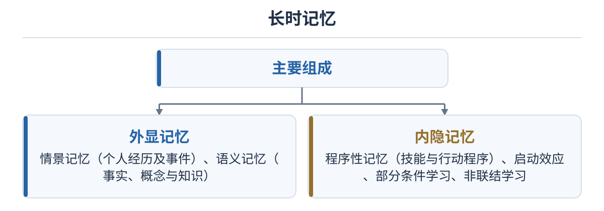
*图 032　长时记忆*

> [!info]- 图示文字索引
> - 外显记忆：情景记忆（个人经历及事件）、语义记忆（事实、概念与知识）
> - 内隐记忆：程序性记忆（技能与行动程序）、启动效应、部分条件学习、非联结学习

例如，记住自己昨天去了哪里，主要涉及情景记忆；知道二叉树的定义，主要涉及语义记忆；熟练地骑自行车、使用键盘，主要涉及程序性记忆。

### 8.4 工作记忆

工作记忆不仅负责暂时保持信息，还承担对信息的主动操作。巴德利的经典多成分模型包括：

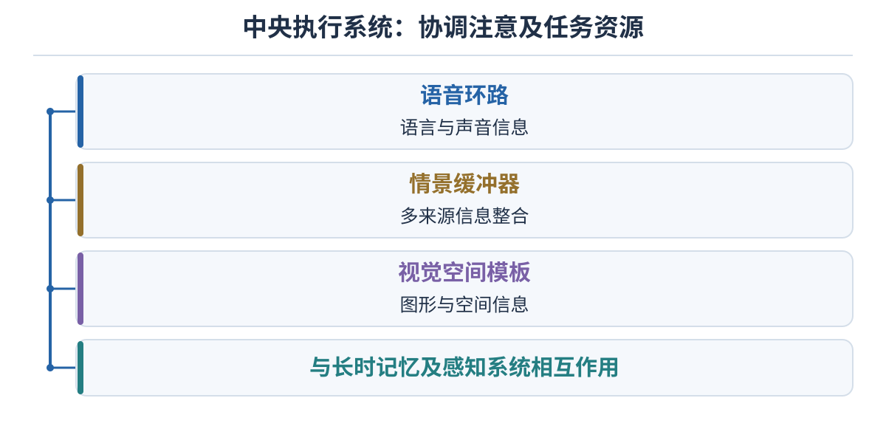
*图 033　中央执行系统：协调注意及任务资源*

> [!info]- 图示文字索引
> - 语音环路：语言与声音信息
> - 情景缓冲器：多来源信息整合
> - 视觉空间模板：图形与空间信息
> - 与长时记忆及感知系统相互作用

工作记忆容量有限，具体容量取决于任务、信息组块及测量方法，不能机械理解为每个人只能记住固定数量的信息。

### 8.5 记忆编码的主要机制

| 机制 | 解释 |
|---|---|
| 复述 | 重复接触或重复保持信息 |
| 精细加工 | 将新知识与已有知识建立联系 |
| 组织加工 | 将零散信息组织为结构 |
| 组块 | 将多个信息单位组合为更有意义的整体 |
| 双重编码 | 结合语言表征与图像等表征 |
| 自我参照效应 | 将信息与自身经历或自我知识关联 |
| 生成效应 | 主动生成信息可能比被动接收更有利于记忆 |

将庞大的知识体系按照树形结构整理，就是组织加工与组块化思想的一种实际应用。

### 8.6 遗忘的主要理论

- 痕迹衰退：记忆表征可能随时间及缺少使用发生变化。
- 干扰理论：不同信息之间相互影响。
  - 前摄干扰：旧知识干扰新知识。
  - 倒摄干扰：新知识干扰旧知识。
- 提取失败：缺少适当线索，导致已有信息无法被顺利提取。
- 动机性遗忘：特定目标和控制过程可能影响信息提取。
- 编码不足：信息最初就没有得到充分加工。

### 8.7 遗忘曲线与间隔学习

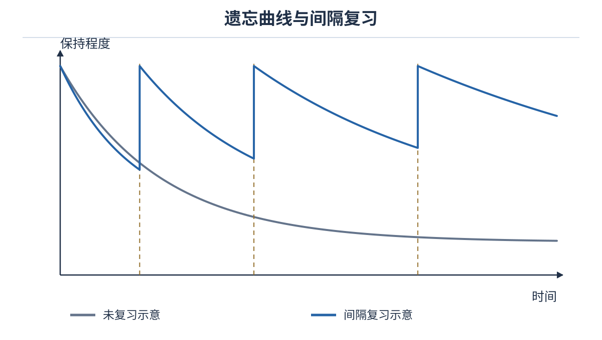
*图 034　遗忘曲线与间隔复习*

遗忘及间隔复习的概念图。实际遗忘速度因材料、学习程度、个体及提取条件而变化，不存在人人适用的固定百分比曲线。

常见的有效学习方法包括间隔学习、提取练习、交错练习、精细解释及适当反馈。反复阅读能够产生熟悉感，但熟悉感不一定代表已经能够独立回忆及应用知识。

### 8.8 记忆的重构性

记忆并非像摄像机一样忠实记录全部过去事件，而可能在编码、储存和提取时受到已有知识、当前情绪及外部信息影响。

- 错误记忆：记住了未实际发生的内容，或错误记忆事件细节。
- 来源监控错误：记错信息来自哪里。
- 误导信息效应：事后获得的信息影响原事件记忆。
- 闪光灯记忆：对重要或具有强烈情绪意义事件的鲜明记忆体验。
- 再巩固：已经形成的某些记忆在重新激活后可能进入可改变状态。

记忆非常鲜明、个人非常确信，并不等于记忆完全准确。

## 第九章　思维、语言与问题解决

### 9.1 思维的本质

思维是对信息、概念及心理表征进行加工，以实现理解、推理、计划和问题解决的过程。

### 9.2 思维的多维分类

| 分类依据 | 主要类型 |
|---|---|
| 表征方式 | 动作思维、形象思维、抽象逻辑思维 |
| 推理方式 | 演绎思维、归纳思维、类比思维 |
| 思维方向 | 聚合思维、发散思维 |
| 加工控制 | 自动化加工、控制性加工 |
| 目标与功能 | 批判性思维、创造性思维、系统思维 |

例如，解决一道编程题时，可能同时使用抽象逻辑思维、演绎推理和控制性加工。

### 9.3 概念与心理表征

心理表征是信息在心理系统中的表达形式。

- 概念：对具有共同属性的事物进行抽象分类。
- 原型：某一类别中具有代表性的心理表征。
- 样例：个体储存的具体类别成员及其相关信息。
- 图式（Schema）：关于特定事物、事件或领域的组织化知识结构。
- 脚本（Script）：关于常见事件顺序的知识结构。
- 心理模型：个体对事物如何运行形成的内部理解。

*图 035　心理表征与知识组织*

> [!info]- 图示文字索引
> - 概念：银行是一类金融机构
> - 图式：关于银行业务及运行方式的知识
> - 脚本：进入银行办理业务的典型过程
> - 心理模型：存款、贷款和货币创造如何相互联系

这些是相互关联的表征形式，而不是必须依次经过的四个加工阶段。

### 9.4 推理的三种主要形式

| 类型 | 核心机制 | 示例 |
|---|---|---|
| 演绎推理 | 从前提依据逻辑规则推出结论 | 依据一般规则判断具体情况 |
| 归纳推理 | 根据多个观察形成具有不确定性的一般结论 | 从历史样本推测总体规律 |
| 类比推理 | 根据不同事物之间的结构相似性进行推理 | 使用计算机模型理解信息加工 |

进一步需要研究溯因推理，即从现有证据提出可能的最佳解释，以及反事实思维，即研究「如果当时采取不同选择，可能发生什么」。

### 9.5 问题解决的主要方法

- 算法：通过明确的步骤及规则解决问题。
- 启发式方法：使用经验规则缩小搜索范围，不保证得到最优解。
- 试误法：通过尝试不同方案逐步改进。
- 手段—目的分析：比较当前状态与目标状态，逐步减少差距。
- 逆向思维：从目标状态反向研究所需条件。
- 类比迁移：使用过去相似问题的解决经验。
- 顿悟：对问题结构产生较突然的新理解。

常见障碍包括功能固着、思维定势、知识迁移失败、目标表征错误及过度依赖原有经验。

### 9.6 语言心理学

#### 9.6.1 语言的结构

| 层次 | 主要含义 |
|---|---|
| 音位 | 能够区别语言意义的基本语音单位 |
| 语素 | 具有意义或语法功能的最小单位 |
| 词汇 | 词及相关词义知识 |
| 句法 | 词语及句子的组合规则 |
| 语义 | 语言所表达的意义 |
| 语用 | 特定社会语境中的语言使用 |
| 语篇 | 超越单句的连贯语言结构 |

#### 9.6.2 语言加工过程

包括语言理解、词汇提取、句子加工、阅读理解、语言产生及会话互动。

#### 9.6.3 语言与思维的关系

- 语言相对论：语言结构与使用经验可能影响认知过程。
- 语言决定论：认为语言决定思维的强版本观点，缺少充分支持。
- 双语认知研究：研究多语言经验对注意、语言加工和认知控制的影响。

语言可能影响思维方式，但不能认为人类只能思考其语言中已经存在的概念。

## 第十章　判断、决策与认知偏差

这是整个心理学体系中最具现实应用价值的章节之一，与经济学、金融学、商业管理及日常生活密切相关。

### 10.1 判断与决策的区别

- 判断（Judgment）：评价某件事的性质、概率、价值或可信程度。
- 决策（Decision-making）：在多个可能方案中作出选择。
- 风险决策：结果具有不确定性，但相应概率可以描述或估计。
- 模糊性决策：连结果的概率分布也难以可靠确定。

### 10.2 双加工理论

双加工理论是一组用于解释不同认知加工方式的理论模型，其中最广为人知的是系统一与系统二的划分。

*图 036　双加工理论*

> [!info]- 图示文字索引
> - 系统一：快速、自动化加工；依赖直觉与联想；较少消耗主动控制资源；快速识别熟悉情境；可能受到启发式与偏差影响
> - 系统二：相对缓慢、控制性加工；依赖主动注意；规则、推理与计算；复杂问题解决；仍可能发生判断错误

系统一与系统二不是大脑中两个能够被独立定位的具体器官，也不是简单的感性与理性、错误与正确的二元对立。

### 10.3 启发式判断

启发式是帮助人们在复杂信息环境中快速作出判断的经验规则。

| 启发式 | 核心机制 | 实际例子 |
|---|---|---|
| 可得性启发式 | 根据事例容易被想起的程度判断概率 | 看过多起事故报道后高估事故概率 |
| 代表性启发式 | 根据对象与典型类别的相似程度判断 | 根据职业刻板印象推测一个人的职业 |
| 锚定与调整 | 以初始数值作为参考，再进行调整 | 受到商品原价影响而改变价格判断 |
| 情感启发式 | 根据整体情感反应快速评价风险及收益 | 因喜欢某家公司而低估其经营风险 |

启发式并非必然有害。在适当环境中，它们能够帮助个体高效率地处理信息。

### 10.4 常见认知偏差的分类体系

#### 10.4.1 信息选择与证据加工偏差

| 偏差 | 主要表现 |
|---|---|
| 确认偏误 | 更倾向寻找、接受支持原有观点的信息 |
| 信念偏差 | 根据结论是否符合既有信念判断推理是否正确 |
| 选择性知觉 | 对符合自身目标及预期的信息更加敏感 |
| 动机性推理 | 推理过程受到希望得到某种结论的动机影响 |
| 信念固着 | 原有观点在支持证据受到挑战后仍持续存在 |

#### 10.4.2 概率与统计判断偏差

| 偏差 | 主要表现 |
|---|---|
| 基础概率忽视 | 忽略事件的基础发生概率 |
| 赌徒谬误 | 误认为独立事件的过去结果会迫使未来结果反转 |
| 热手信念偏差 | 在缺乏充分依据时过度推断成功的连续性 |
| 小数定律信念 | 认为很小的样本也一定具有总体代表性 |
| 合取谬误 | 将多个条件同时成立判断为比单一条件更可能 |
| 忽视回归均值 | 将极端表现后的正常恢复错误归因于某项措施 |
| 幸存者偏差 | 只观察成功或存留下来的对象，忽略失败者 |

#### 10.4.3 自我判断偏差

| 偏差 | 主要表现 |
|---|---|
| 过度自信 | 高估自身能力、知识或判断精确程度 |
| 自利偏差 | 倾向将成功归于自己，将失败归于外部因素 |
| 控制错觉 | 高估自己对随机事件的影响能力 |
| 计划谬误 | 低估完成任务所需时间及成本 |
| 乐观偏差 | 相对低估自身发生某些负面结果的可能性 |
| 聚光灯效应 | 高估他人对自己外表及行为的关注程度 |

#### 10.4.4 评价与选择偏差

| 偏差 | 主要表现 |
|---|---|
| 框架效应 | 同一结果的不同表述影响选择 |
| 损失厌恶 | 相对于参考点，同等损失可能比收益具有更强影响 |
| 禀赋效应 | 对自己拥有的物品给予较高评价的倾向 |
| 现状偏差 | 偏向维持已有状态 |
| 沉没成本效应 | 因无法收回的既往投入而继续投入资源 |
| 诱饵效应 | 第三个选项改变原有选项间的偏好关系 |
| 心理账户 | 将经济资源划分到不同主观账户中区别对待 |

#### 10.4.5 时间与记忆相关偏差

| 偏差 | 主要表现 |
|---|---|
| 近因效应 | 对最近出现的信息赋予较高权重 |
| 首因效应 | 较早信息对印象或记忆产生较强影响 |
| 后见之明偏差 | 知道结果后认为结果原本很容易预测 |
| 结果偏差 | 仅依据结果好坏评价原先决策质量 |
| 当下偏好 | 对即时收益赋予相对过高权重 |
| 峰终效应 | 某些体验的回顾性评价受到高峰与结束阶段显著影响 |

这些偏差存在重叠关系，并不是几十种彼此独立的脑内故障。例如，确认偏误可能与动机性推理共同出现；过度自信可能进一步增强控制错觉。

### 10.5 基础概率忽视与贝叶斯思维

假设某种疾病在人群中的发生率为1%，某检测方法的敏感度为90%，特异度为95%。一个人检测呈阳性，实际患病概率是多少？

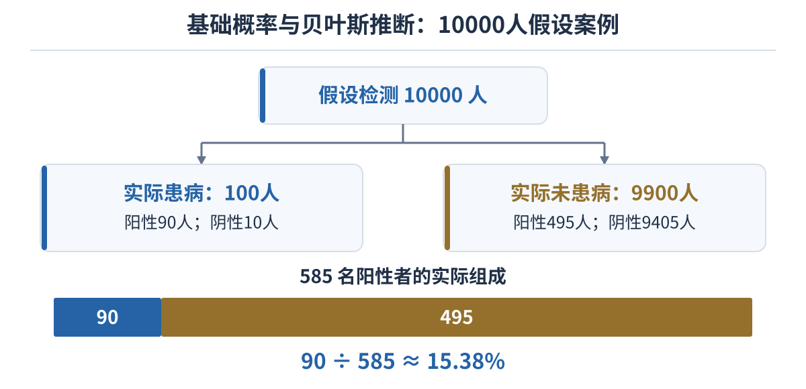
*图 037　基础概率与贝叶斯推断：10000人假设案例*

实际患病100人，阳性90人，阴性10人；实际未患病9900人，阳性495人，阴性9405人。585名阳性者中90名实际患病，理论概率为15.38%。虚构的统计学示例，不对应任何具体医疗检测项目。

其数学关系为：

$$
P(A|B)=\frac{P(B|A)P(A)}{P(B)}
$$

这一案例说明，仅关注检测准确性而忽略基础发生概率，可能导致严重错误的概率判断。同样的逻辑可以用于分析商业预测、交易信号及其他不确定事件。

### 10.6 前景理论与损失厌恶

前景理论（Prospect Theory）主要研究人们如何在具有风险的条件下评价收益与损失。

- 参考点依赖：收益和损失往往相对于某个心理参考点进行评价。
- 敏感性递减：随着收益或损失金额扩大，单位金额变化的主观影响可能减弱。
- 损失厌恶：在许多条件下，损失的主观影响大于同等收益。
- 概率加权：人们对概率的主观决策权重可能不同于客观概率。

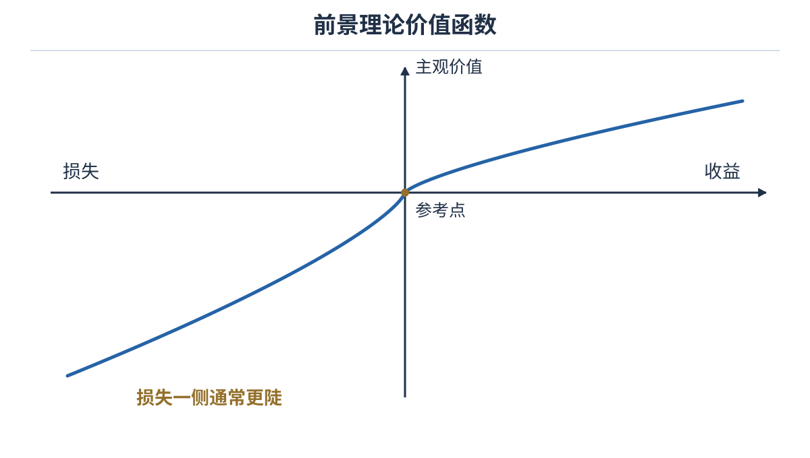
*图 038　前景理论价值函数*

损失厌恶的程度随研究任务、个体及情境变化，不应机械使用固定倍数解释所有行为。

### 10.7 时间折扣与跨期决策

时间折扣描述人们可能给予较早发生的收益或损失更高权重。

指数折扣模型：

$$
V=\frac{A}{(1+r)^t}
$$

双曲折扣模型：

$$
V=\frac{A}{1+kt}
$$

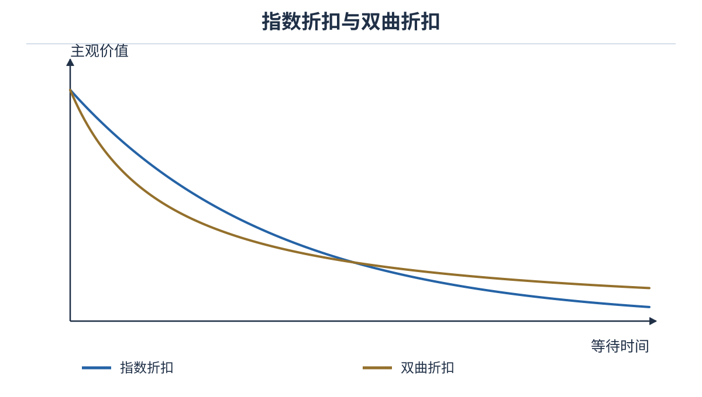
*图 039　指数折扣与双曲折扣*

不同参数下的数学模型示意。双曲折扣能够描述某些随时间距离变化而发生的偏好反转现象。拖延、即时消费、储蓄决策和长期投资都可能涉及跨期选择。

### 10.8 如何减少判断与决策错误

有效的纠偏思路包括：寻找反面证据、考虑基础概率、使用多个独立信源、明确参考基准、区分事实与推测、进行情景分析、事前记录决策依据，以及通过反馈检验判断能力。

心理学上的理性并不意味着消除所有情绪，而是尽可能使判断与证据、目标及实际风险相匹配。

## 第十一章　智力、能力与创造力

### 11.1 能力的基本分类

| 概念 | 含义 |
|---|---|
| 一般能力 | 在多种活动中发挥作用的能力 |
| 特殊能力 | 与特定任务或领域相关的能力 |
| 知识 | 已经学习并掌握的信息及理解 |
| 技能 | 通过学习与练习形成的活动能力 |
| 潜能 | 在相关条件下可能发展出的能力 |

### 11.2 智力理论

| 理论 | 核心观点 |
|---|---|
| 斯皮尔曼二因素理论 | 一般智力因素g与特殊能力因素 |
| 瑟斯顿基本心理能力理论 | 智力具有多个基本能力维度 |
| 卡特尔理论 | 区分流体智力与晶体智力 |
| CHC理论 | 使用层级结构组织一般及广泛认知能力 |
| 斯滕伯格三元理论 | 强调分析性、创造性与实践性智力 |
| 加德纳多元智力理论 | 提出多种相对不同的人类能力领域 |

各种理论具有不同的研究目标及证据基础。多元智力理论在教育领域影响较大，但其各类智力作为独立心理测量结构的证据存在争议。

#### 11.2.1 流体智力与晶体智力

- 流体智力：面对新问题时进行抽象推理、模式识别及问题解决的能力。
- 晶体智力：通过教育及经验积累形成的知识和相关能力。

两类能力相互作用，不能分别简单等同于先天能力和后天能力。

### 11.3 智力测验与智商

现代智商测验通常根据同年龄等参考群体的标准化分数评价认知能力表现，常用均值100、标准差15的量尺。

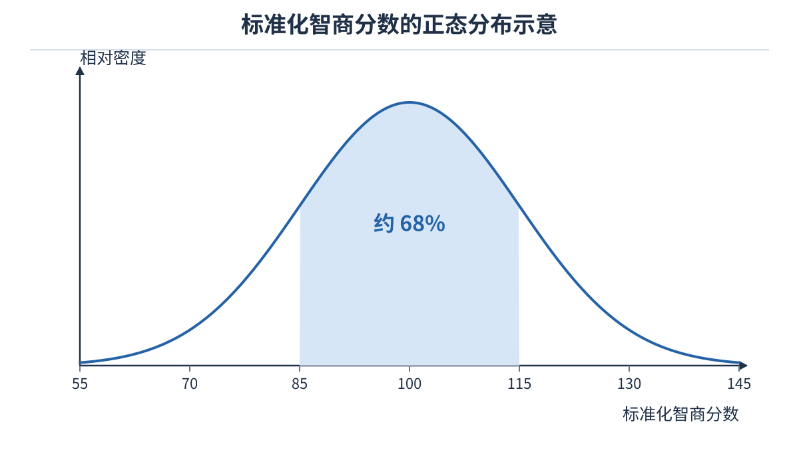
*图 040　标准化智商分数的正态分布示意*

假设分数服从均值100、标准差15的正态分布。85至115之间约占68%。实际测验分数分布及解释规则由具体测验决定。智商分数不等于一个人的全部能力、潜在成就、道德水平或社会价值。

### 11.4 情绪智力

情绪智力（Emotional Intelligence）主要研究识别、理解、利用及调节情绪的相关能力。

- 能力型情绪智力模型：将其研究为特定信息加工能力。
- 特质型情绪智力模型：关注个人对自身情绪能力的评价及相关人格倾向。
- 混合模型：将情绪能力、人格、动机和社会技能等结合。

日常所说的「情商」比专业研究中的情绪智力概念更加宽泛。

### 11.5 创造力

创造力通常涉及产生具有新颖性和适切性的想法、方案或产品。其核心过程包括发散思维、聚合思维、知识重组、联想、问题重新定义及方案检验。

经典创造过程模型分为准备期、酝酿期、明朗期和验证期，但实际创造活动可能不断往返于各阶段。

# 第三篇　情绪、动机与人格心理学

认知心理学主要解释人如何处理信息，而本篇进一步研究：人为什么感到快乐、愤怒、悲伤和恐惧？为什么渴望某些事物、逃避某些事物？为什么面对相同的外部环境，不同的人会作出截然不同的选择？

## 第十二章　情绪心理学

### 12.1 情绪的组成结构

情绪不是单一的主观感受，而通常涉及多个相互联系的方面。

*图 041　情绪反应的组成*

> [!info]- 图示文字索引
> - 认知评价：这件事对我意味着什么？
> - 主观体验：我感到恐惧、快乐还是愤怒？
> - 生理反应：心率、呼吸等发生什么变化？
> - 外部表达：面部表情、声音与身体姿态
> - 行动倾向：接近、逃避、对抗或寻求帮助
> - 调节过程：怎样改变情绪及相应行为？

### 12.2 情绪、心境、情感与情绪特质

| 概念 | 主要特点 |
|---|---|
| 情绪（Emotion） | 通常具有特定诱因，伴随体验和反应 |
| 心境（Mood） | 相对持久且较弥散，未必具有明确对象 |
| 情感（Affect） | 在英文心理学中常作为情绪、心境及相关体验的广义概念 |
| 激情 | 日常及部分传统心理学教材中指强烈的情绪或情感状态 |
| 情绪特质 | 个体相对稳定的情绪反应倾向 |
| 情绪状态 | 某个具体时刻的情绪表现 |

一个人今天感到焦虑属于状态层面的问题；长期对不同情境具有较高焦虑倾向，则涉及特质层面的研究。

### 12.3 情绪的分类体系

#### 12.3.1 基本情绪理论

经典基本情绪理论常研究快乐、悲伤、愤怒、恐惧、厌恶和惊讶等类别。

| 情绪 | 典型相关功能或情境 |
|---|---|
| 快乐 | 奖励、目标实现、社会联结 |
| 悲伤 | 失去、挫折、关系变化 |
| 愤怒 | 目标受阻、边界侵犯或不公平评价 |
| 恐惧 | 感知到威胁 |
| 厌恶 | 对某些刺激产生排斥 |
| 惊讶 | 事件与原有预期发生明显差异 |

这是一种有影响力的理论分类，并不是现代心理学唯一公认的基本情绪清单。

#### 12.3.2 复杂情绪及社会情绪

- 自我意识情绪：羞耻、内疚、骄傲、尴尬等。
- 社会关系情绪：嫉妒、羡慕、感恩、同情、敬佩等。
- 认识相关情绪：好奇、困惑、兴趣、惊奇等。
- 道德情绪：与道德评价及社会规范相关的愤慨、内疚、同情等体验。

#### 12.3.3 情绪的维度模型

除了按名称分类，还可以通过效价与唤醒程度描述情绪体验。

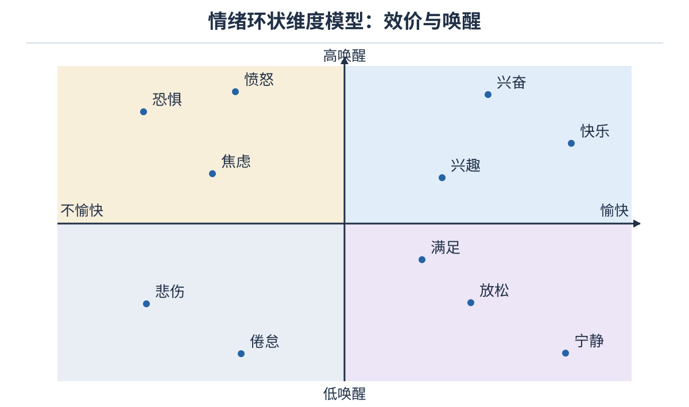
*图 042　情绪环状维度模型：效价与唤醒*

具体情绪位置会受到个体、情境及测量方式影响。这个模型有助于解释为什么愤怒与兴奋虽然主观效价不同，但都可能具有较高唤醒水平；快乐与宁静都可能是愉快体验，但激活程度不同。

### 12.4 经典情绪理论

| 理论 | 核心解释 |
|---|---|
| 詹姆斯—兰格理论 | 身体反应的感知在情绪体验形成中具有重要作用 |
| 坎农—巴德理论 | 强调情绪体验与身体反应可并行发生 |
| 沙赫特—辛格二因素理论 | 强调生理唤醒与情境认知解释 |
| 认知评价理论 | 事件对个体目标和需求的意义影响情绪形成 |
| 情绪建构理论 | 强调身体信号、概念知识及情境在情绪建构中的作用 |

*图 043　经典情绪理论的加工模型*

> [!info]- 图示文字索引
> - 詹姆斯—兰格理论：事件 → 身体反应 → 情绪体验
> - 坎农—巴德理论：事件 → 情绪与身体反应并行
> - 二因素理论：事件 → 唤醒与情境解释 → 情绪体验
> - 认知评价理论：事件 → 意义评价 → 情绪及行动倾向

各理论的经典教学模型。现代研究中的情绪、生理及评价过程可能发生并行与循环作用。

### 12.5 情绪的主要功能

情绪可以帮助个体识别具有重要意义的事件、组织行动、学习经验、传达社会信息、调节人际关系及应对威胁。恐惧、愤怒、悲伤等通常被称为负性情绪，但它们并不必然有害。例如，适度的恐惧可能促进风险规避，愤怒可能使个体关注自身边界受到侵犯的问题。关键在于情绪反应是否与实际情境匹配，以及如何进行行为调节。

### 12.6 情绪调节

格罗斯的情绪调节过程模型将不同策略放在情绪生成过程的不同阶段。

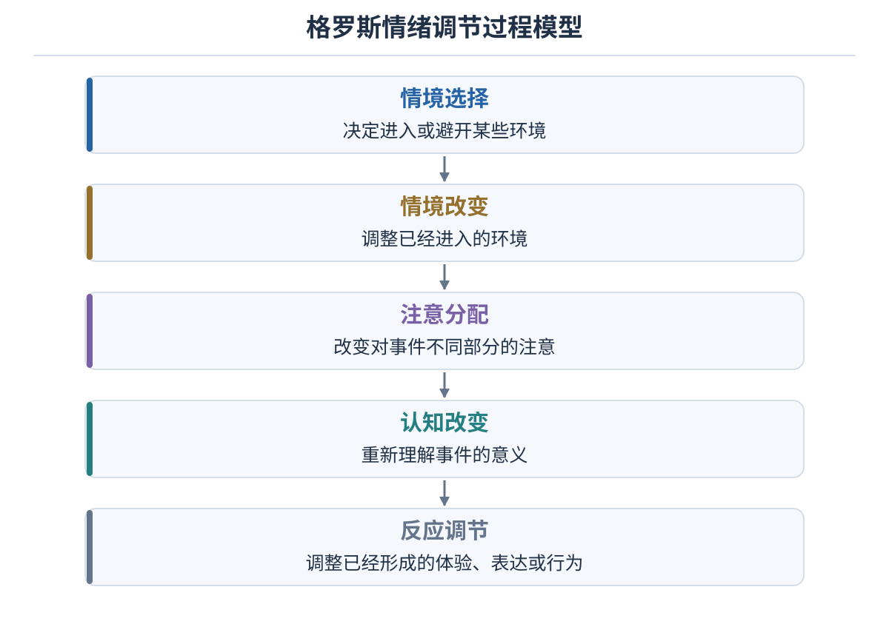
*图 044　格罗斯情绪调节过程模型*

> [!info]- 图示文字索引
> - 情境选择：决定进入或避开某些环境
> - 情境改变：调整已经进入的环境
> - 注意分配：改变对事件不同部分的注意
> - 认知改变：重新理解事件的意义
> - 反应调节：调整已经形成的体验、表达或行为

调节可以发生在不同阶段，也可以在情绪形成后重新回到前面阶段。

#### 12.6.1 常见调节策略

| 策略 | 含义 |
|---|---|
| 认知重评 | 改变对事件意义的解释 |
| 表达抑制 | 减少已经产生的外部情绪表达 |
| 注意转移 | 暂时将注意转向其他对象 |
| 接纳 | 允许情绪体验存在，不急于进行负面评价 |
| 问题解决 | 改变引发情绪的实际问题 |
| 寻求社会支持 | 通过他人获得理解、信息或帮助 |
| 情绪标记 | 更明确地识别及描述自己的情绪 |
| 反刍 | 反复思考负面事件、原因及后果，可能维持困扰 |

不存在适用于所有环境的唯一最佳情绪调节方式。灵活选择策略往往比机械使用同一种方式更重要。

### 12.7 情绪与认知的相互作用

- 情绪一致性加工：当前情绪可能影响对相应情绪信息的注意和提取。
- 情绪记忆：具有情绪意义的事件可能具有不同的记忆特征。
- 情绪性注意偏向：注意资源可能优先分配给威胁或奖励相关信息。
- 情绪决策：情绪影响风险判断、偏好、社会互动及行动速度。

情绪并不是理性的敌人。它既可能提供重要信息，也可能使判断受到与任务无关的因素影响。

## 第十三章　动机、需要与奖励机制

### 13.1 需要、动机、目标与行为

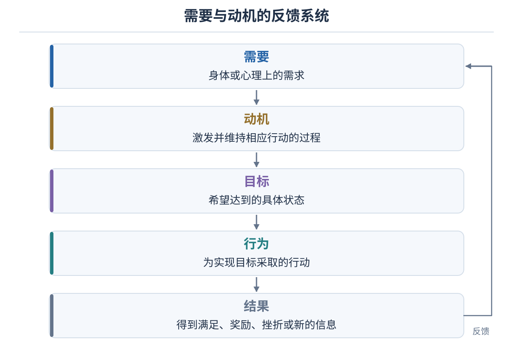
*图 045　需要与动机的反馈系统*

> [!info]- 图示文字索引
> - 需要：身体或心理上的需求
> - 动机：激发并维持相应行动的过程
> - 目标：希望达到的具体状态
> - 行为：为实现目标采取的行动
> - 结果：得到满足、奖励、挫折或新的信息

结果可以改变未来的需要、预期及动机。例如，获得知识可以是需要，通过学习提升能力可以是目标，而学习动机则影响是否开始学习、投入多大努力及坚持多久。

### 13.2 人类需要的分类

#### 13.2.1 按需要内容分类

- 生理需要：食物、水、睡眠等。
- 安全与稳定需要：减少危险及保持可预测环境。
- 社会联结需要：归属、友谊及亲密关系。
- 成就与能力需要：掌握任务、发展技能。
- 自主需要：体验选择及行动的自主性。
- 地位与尊重需要：获得评价、尊重及社会地位。
- 意义与价值需要：追求具有个人意义的目标。

#### 13.2.2 马斯洛需要层次理论

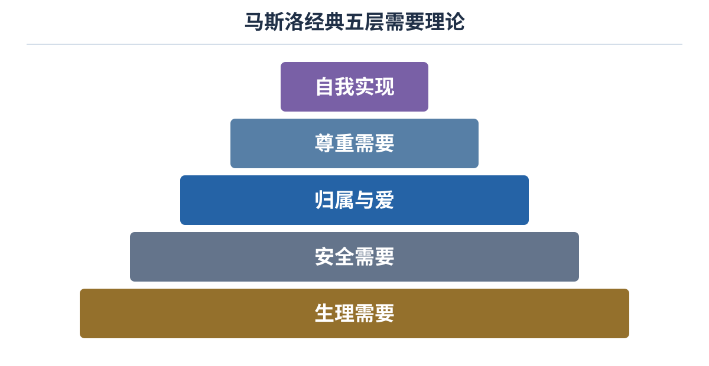
*图 046　马斯洛经典五层需要理论*

不同需要可以同时存在，人并不一定严格按照由低到高的固定顺序满足需要。马斯洛理论适合帮助理解人类需要的多样性，但其严格层次关系并没有得到充分普遍的实证支持。

### 13.3 自我决定理论

自我决定理论（Self-Determination Theory）强调三种基本心理需要：

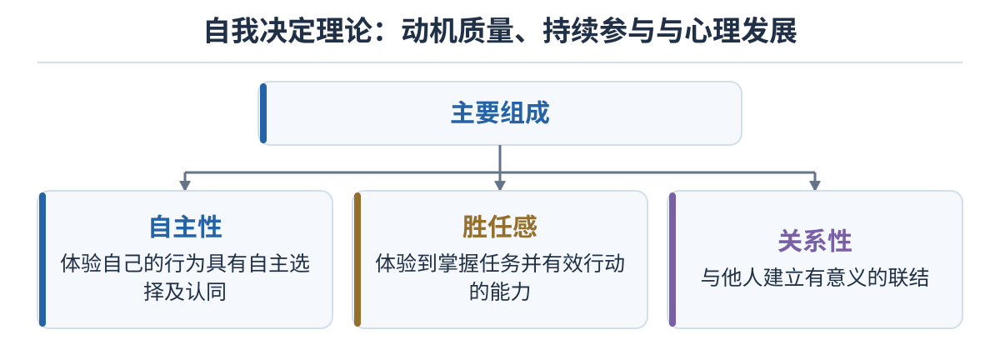
*图 047　自我决定理论：动机质量、持续参与与心理发展*

> [!info]- 图示文字索引
> - 自主性：体验自己的行为具有自主选择及认同
> - 胜任感：体验到掌握任务并有效行动的能力
> - 关系性：与他人建立有意义的联结

自主性并不等于拒绝所有规则，也不等于独立于他人。一个人可以在认同规则意义的情况下自主地遵守规则。

### 13.4 内在动机与外在动机

- 内在动机：因为活动本身具有兴趣或满足感而参与。
- 外在动机：为了活动之外的可分离结果而参与。
- 无动机：缺少明确行动意愿或行动与结果之间的联系感。

自我决定理论进一步将外在动机按照内化程度划分：

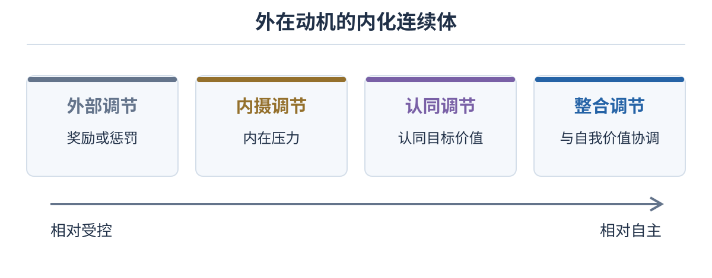
*图 048　外在动机的内化连续体*

整合后的外在动机仍然可能是为了可分离的结果，不等同于对活动本身具有兴趣的内在动机。

例如，同样是学习编程：为了避免考试不及格而学习；因为不学习会感到内疚而学习；因为认可编程对未来发展的价值而学习；因为它已经成为自己长期发展目标的一部分而学习；因为编程本身具有乐趣而学习。表面行为相同，其动机质量却可能明显不同。

### 13.5 其他主要动机理论

| 理论 | 核心思想 |
|---|---|
| 驱力降低理论 | 行为可能用于降低身体需求引发的驱力 |
| 唤醒理论 | 个体可能寻求适合自身及任务的唤醒水平 |
| 诱因理论 | 外部奖励及目标吸引力可以激发行为 |
| 期望—价值理论 | 行为动机与成功预期及结果价值有关 |
| 成就动机理论 | 研究追求成功及避免失败等动机 |
| 目标定向理论 | 区分掌握任务与表现能力等目标取向 |
| 目标设置理论 | 研究目标清晰度、挑战性及反馈对行动的影响 |
| 自我效能理论 | 对完成特定任务的能力信念影响行为选择及努力 |

### 13.6 接近动机、回避动机与动机冲突

- 接近动机：促使个体接近希望获得的目标。
- 回避动机：促使个体避开不希望发生的结果。

*图 049　常见动机冲突类型*

> [!info]- 图示文字索引
> - 双趋冲突：两个想要的目标难以同时取得（有利A、有利B）
> - 双避冲突：必须在两个不希望的结果中选择（不利A、不利B）
> - 趋避冲突：同一个目标既有吸引力又有不利后果
> - 双重趋避冲突：两个选项各自具有正负属性

### 13.7 奖励机制与奖励预测误差

奖励系统涉及对有价值结果的学习、预测、追求及体验。需要区分三个相关方面：

- Wanting：对奖励的动机性追求。
- Liking：获得奖励时的愉悦体验。
- Learning：通过经验形成对未来奖励的预测。

奖励预测误差可以简化表达为：

$$
\delta=\text{实际奖励}-\text{预期奖励}
$$

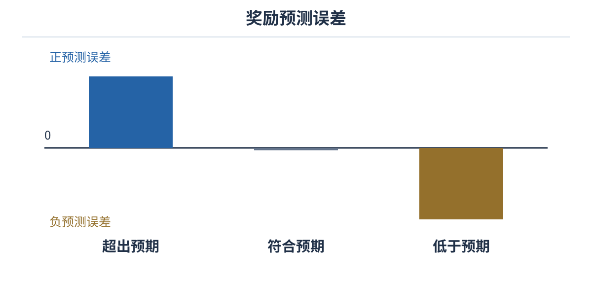
*图 050　奖励预测误差*

奖励预测误差是部分强化学习模型和神经科学研究中的重要概念，但并非所有多巴胺活动都可以用同一个简单公式解释。

## 第十四章　意志、自我控制与习惯

### 14.1 意志与自我调节

- 意志：围绕目标进行主动行为组织及坚持的心理活动。
- 自我调节：监测自身状态、比较目标并作出调整的过程。
- 自我控制：在存在冲突的情况下调节冲动、情绪及行为的过程。
- 延迟满足：放弃或推迟即时奖励，以争取未来更有价值的结果。

自我调节范围比自我控制更广，并不是每一次行为调节都需要抑制强烈冲动。

### 14.2 自我调节的反馈机制

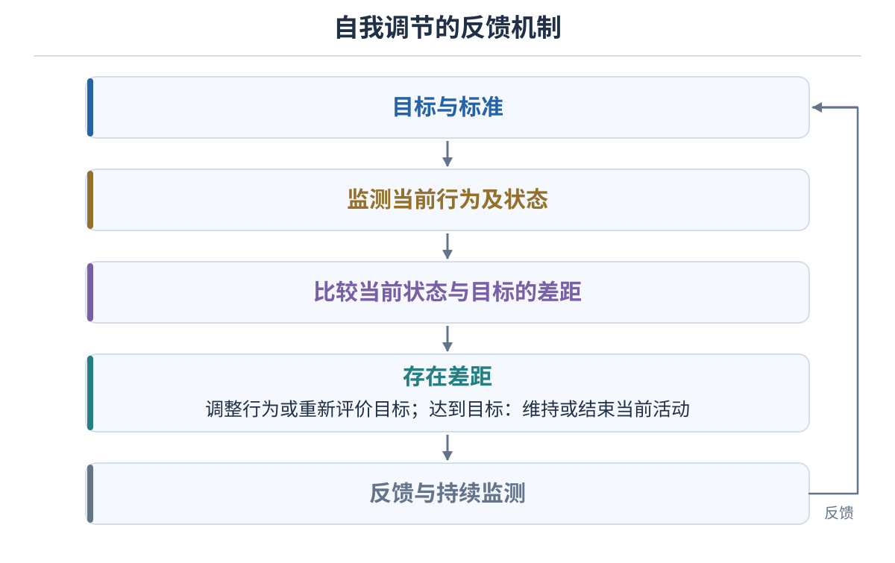
*图 051　自我调节的反馈机制*

> [!info]- 图示文字索引
> - 目标与标准
> - 监测当前行为及状态
> - 比较当前状态与目标的差距
> - 存在差距：调整行为或重新评价目标；达到目标：维持或结束当前活动
> - 反馈与持续监测

### 14.3 习惯的形成机制

习惯是行为经过反复学习后，在特定情境线索下能够相对自动触发的倾向。

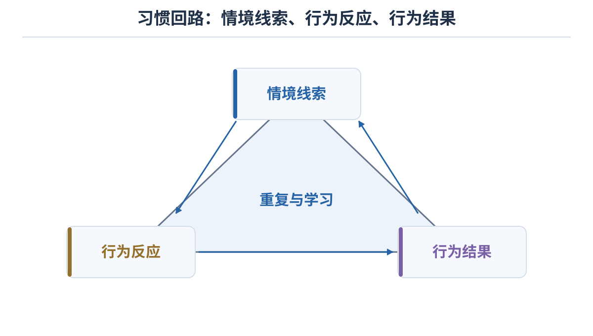
*图 052　习惯回路：情境线索、行为反应、行为结果*

习惯回路的实用简化模型。习惯形成还涉及环境稳定性、行为重复、自动化及多种学习机制。

| 特征 | 习惯行为 | 目标导向行为 |
|---|---|---|
| 主要触发 | 情境线索与既往联结 | 当前目标及结果评价 |
| 自动化程度 | 相对较高 | 通常需要较多主动控制 |
| 结果变化后的调整 | 可能较不敏感 | 通常更加敏感 |

不存在普遍适用于所有行为的「21天必然形成习惯」规律。

### 14.4 拖延的心理机制

拖延通常指在预期延迟可能造成不利后果的情况下，仍然推迟原本打算完成的任务。常见相关因素包括任务厌恶、失败恐惧、完美主义担忧、时间折扣、情绪调节困难、目标不明确以及执行控制问题。

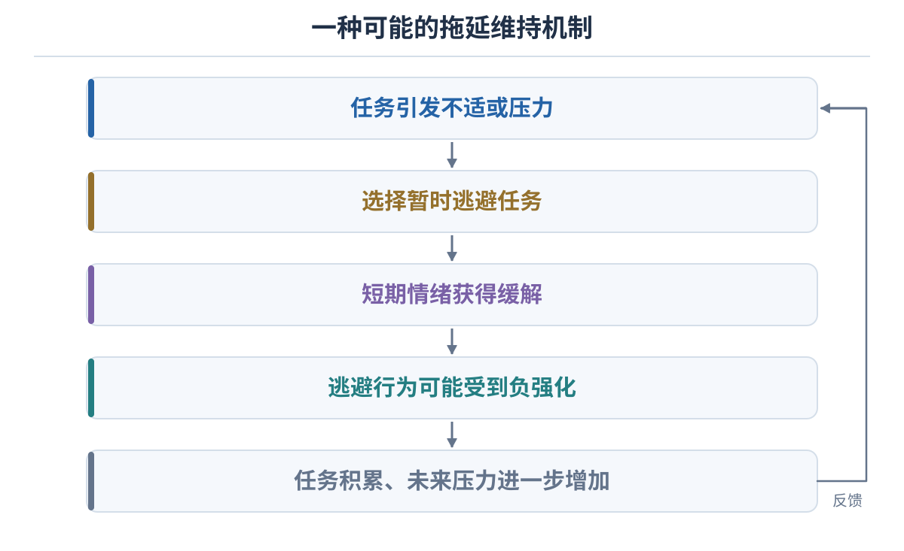
*图 053　一种可能的拖延维持机制*

> [!info]- 图示文字索引
> - 任务引发不适或压力
> - 选择暂时逃避任务
> - 短期情绪获得缓解
> - 逃避行为可能受到负强化
> - 任务积累、未来压力进一步增加

这解释了为什么拖延有时不是时间规划不足那么简单，而是个体通过逃避暂时缓解不愉快情绪。

### 14.5 行为改变的主要工具

| 方法 | 主要机制 |
|---|---|
| 目标分解 | 将复杂目标转化为可执行的小任务 |
| 执行意图 | 建立「如果出现X情境，就执行Y行为」的计划 |
| 环境设计 | 改变行为触发线索及行动阻力 |
| 自我监测 | 记录行为频率、时间及实际结果 |
| 即时反馈 | 缩短行为与反馈之间的距离 |
| 承诺机制 | 预先设置限制，减少未来冲动选择 |
| 渐进塑造 | 逐步建立接近目标的行为 |
| 复发预防 | 提前识别行为改变过程中可能遇到的困难 |

关于意志力的有限资源模型及所谓自我损耗效应，现代重复研究结果存在争议。因此，不宜将意志力理解为一种已经证实、每天固定消耗的单一心理燃料。

## 第十五章　人格心理学与个体差异

### 15.1 人格的本质

人格是个体相对稳定的思维、情绪及行为模式。人格的稳定性不意味着人格完全无法改变，也不意味着一个人会在所有情境中表现出完全相同的行为。

### 15.2 人格及相关概念

| 概念 | 主要含义 |
|---|---|
| 人格 | 广泛而相对稳定的心理与行为模式 |
| 气质 | 较早表现出的情绪反应性、活动水平及调节特征 |
| 性格 | 中文语境中常指个体相对稳定的行为、态度及心理特点 |
| 人格特质 | 可以沿连续维度描述的稳定个体差异 |
| 人格类型 | 按照特征组合将个人归为若干类别 |
| 人格状态 | 在特定时间和情境中的暂时表现 |
| 个体差异 | 人与人之间在心理及行为特征上的差别 |

### 15.3 人格理论的主要分支

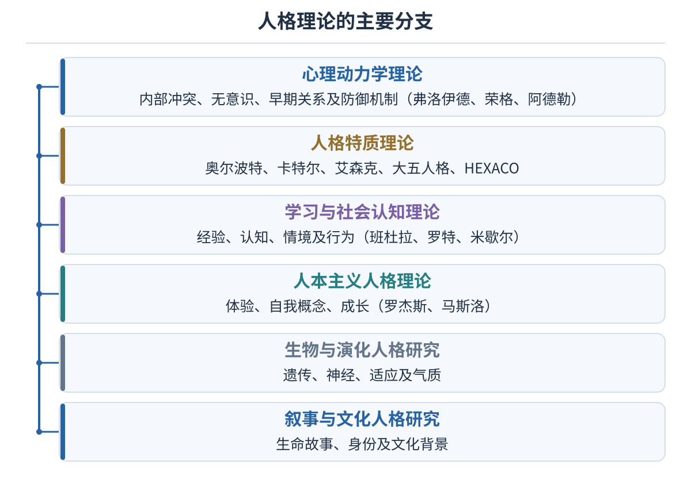
*图 054　人格理论的主要分支*

> [!info]- 图示文字索引
> - 心理动力学理论：内部冲突、无意识、早期关系及防御机制（弗洛伊德、荣格、阿德勒）
> - 人格特质理论：奥尔波特、卡特尔、艾森克、大五人格、HEXACO
> - 学习与社会认知理论：经验、认知、情境及行为（班杜拉、罗特、米歇尔）
> - 人本主义人格理论：体验、自我概念、成长（罗杰斯、马斯洛）
> - 生物与演化人格研究：遗传、神经、适应及气质
> - 叙事与文化人格研究：生命故事、身份及文化背景

### 15.4 精神分析的人格结构理论

弗洛伊德的经典结构模型将人格中的心理动力划分为本我、自我和超我。

| 结构 | 理论功能 |
|---|---|
| 本我（Id） | 原始欲望及即时满足倾向 |
| 自我（Ego） | 根据现实条件调节内部需求与行动 |
| 超我（Superego） | 内化的道德标准及理想要求 |

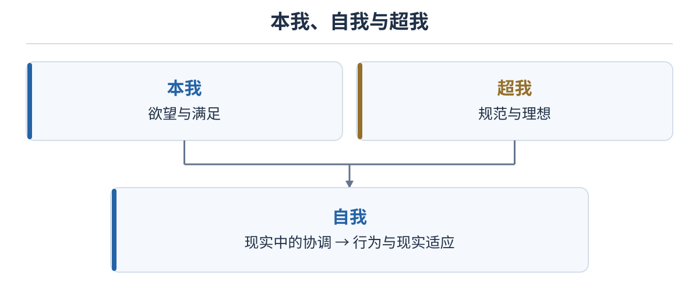
*图 055　本我、自我与超我*

精神分析的历史理论模型，不代表大脑真实存在三个能够独立定位的人格结构。弗洛伊德另外提出意识、前意识和无意识的地形模型。这两种模型是不同的理论划分，不能简单将本我等同于无意识、超我等同于意识。

### 15.5 特质人格理论的发展

| 理论 | 主要结构 |
|---|---|
| 奥尔波特特质理论 | 首要特质、中心特质、次要特质 |
| 卡特尔人格理论 | 运用因素分析研究多种人格因素 |
| 艾森克PEN模型 | 精神质、外向性、神经质 |
| 大五人格模型 | 开放性、尽责性、外向性、宜人性、神经质 |
| HEXACO模型 | 诚实—谦逊、情绪性、外向性、宜人性、尽责性、开放性 |

艾森克模型中的「精神质」是历史人格特质术语，并不等于已经患有精神病。

### 15.6 大五人格（Big Five）

大五人格是现代人格研究中具有广泛实证基础的特质分类框架之一。

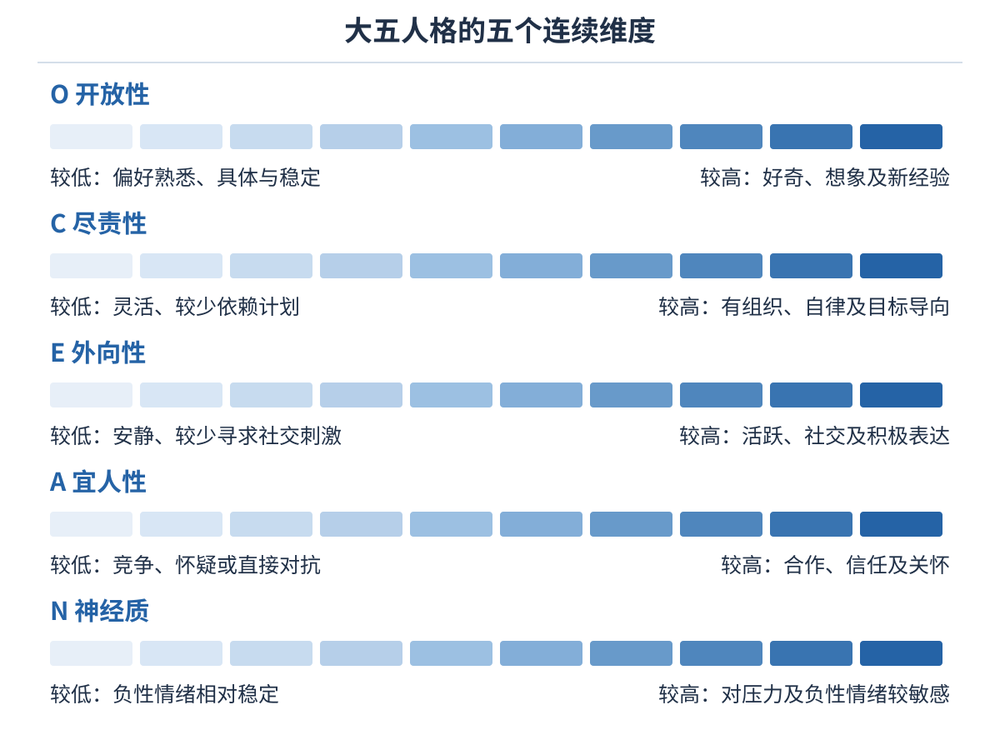
*图 056　大五人格的五个连续维度*

五个连续人格维度不存在统一的理想分数。实际表现还与情境、具体下位特质及个人目标有关。

#### 15.6.1 大五人格的下位特质

以常见大五测量结构为例：

| 上位特质 | 常见下位特征 |
|---|---|
| 开放性 | 想象力、审美兴趣、求知欲、思想开放 |
| 尽责性 | 组织性、责任感、自律、成就追求 |
| 外向性 | 社交性、主张性、活跃程度、积极情绪 |
| 宜人性 | 同情、信任、礼貌、合作倾向 |
| 神经质 | 焦虑倾向、情绪波动、易受压力影响 |

具体下位分类会因测量工具不同而有所变化。

#### 15.6.2 人格特质与人格类型的区别

大五人格研究通常将一个人表示为多个连续维度上的分数，而不是直接将人划分成几个固定类型。

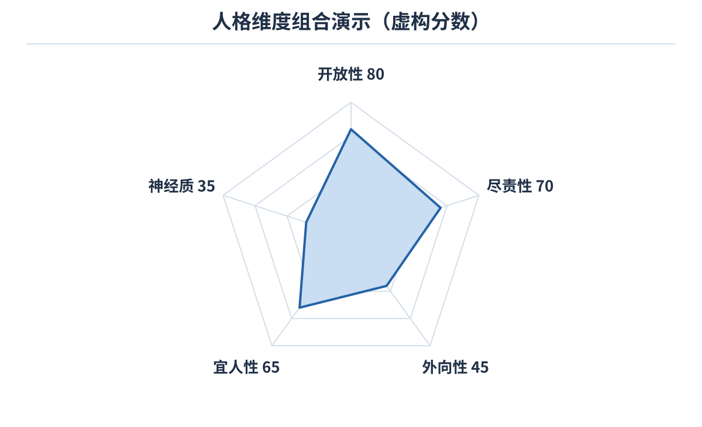
*图 057　人格维度组合演示（虚构分数）*

该演示不是人格测验，分数不能用于个人评估或心理诊断。

[离线交互演示：大五人格维度组合](#social-psych_radar)

### 15.7 MBTI、九型人格与传统气质类型

#### 15.7.1 MBTI

MBTI采用四组偏好划分，组合形成16种类型。

| 维度 | 两端偏好 |
|---|---|
| 精力与注意取向 | E外向 / I内向 |
| 信息获取 | S感觉 / N直觉 |
| 判断方式 | T思考 / F情感 |
| 外部生活方式 | J判断 / P知觉 |

MBTI可以作为自我讨论或团队交流的参考工具，但其二分类型、重复测量稳定性及预测能力存在局限，不能替代经过充分验证的维度化人格测量。

#### 15.7.2 传统四气质学说

胆汁质、多血质、黏液质、抑郁质。这是历史上的气质分类传统，其原始体液解释已不属于现代科学的有效生理理论。

#### 15.7.3 九型人格

九型人格试图根据核心动机、恐惧及行为模式划分人格类型，在自我探索领域具有一定传播范围，但其科学测量和理论证据相对有限。

### 15.8 黑暗人格特质

黑暗三联征通常指：

| 特质 | 核心研究内容 |
|---|---|
| 马基雅维利主义 | 策略性操纵、功利及犬儒主义倾向 |
| 自恋特质 | 自我重要性、优越感及对认可的需求等 |
| 精神病态特质 | 冷酷、低内疚及相关冲动或反社会倾向 |

黑暗四联征进一步加入日常施虐倾向。这些属于人格特质研究，不应仅凭某次自私行为就认定他人具有某类人格障碍。自恋特质与自恋型人格障碍也是两个不同层级的概念。

### 15.9 人格的稳定性与改变

人格受到遗传、气质、成长经历、家庭环境、社会角色、生活事件及主动行为改变等因素共同影响。现代人格研究同时关注：

- 排序稳定性：人与人之间的相对特质排名是否保持。
- 平均水平变化：某一群体的平均人格特征是否随年龄改变。
- 个体变化：同一个人的人格特征是否发生改变。
- 情境特异性：同一个人在不同环境中是否具有不同表现。

## 第十六章　自我意识、身份认同与心理防御

### 16.1 自我系统的总体结构

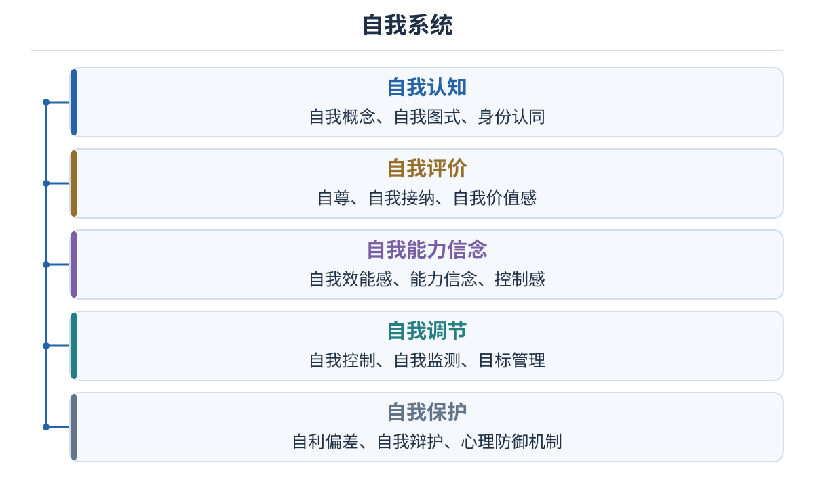
*图 058　自我系统*

> [!info]- 图示文字索引
> - 自我认知：自我概念、自我图式、身份认同
> - 自我评价：自尊、自我接纳、自我价值感
> - 自我能力信念：自我效能感、能力信念、控制感
> - 自我调节：自我控制、自我监测、目标管理
> - 自我保护：自利偏差、自我辩护、心理防御机制

### 16.2 自我概念、自尊与自我效能

| 概念 | 核心问题 |
|---|---|
| 自我概念 | 我认为自己是什么样的人？ |
| 自尊 | 我怎样评价自己的总体价值？ |
| 自我效能感 | 我相信自己能够完成某项具体任务吗？ |
| 自信 | 对自身能力、判断及行为具有怎样的信心？ |
| 自我接纳 | 我能否接纳自己的优点、局限与现实状态？ |
| 自我同情 | 面对自身困难和失败时，能否以理解而非苛责的态度对待自己？ |

一个人可以具有较高的整体自尊，但对某项不熟悉的技能具有较低的自我效能感。

#### 16.2.1 自我效能感的四种经典来源

- 掌握经验：通过亲自完成任务获得能力信念。
- 替代经验：观察相似他人的成功。
- 言语劝导：获得可信、具体的鼓励及反馈。
- 生理与情绪状态：对紧张、疲劳等内部状态的解释。

### 16.3 自我差异理论

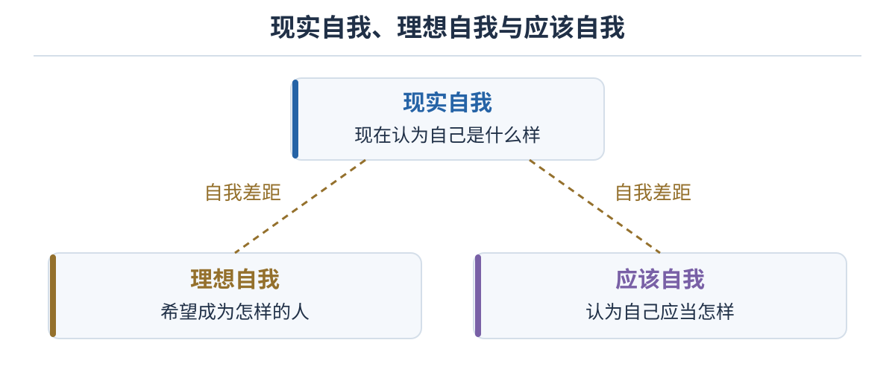
*图 059　现实自我、理想自我与应该自我*

现实自我与理想自我之间的差距，可能与失落、失望等体验相关；现实自我与应该自我之间的差距，可能与压力、内疚及焦虑相关。这些属于理论研究中的倾向性关系，不代表可以依据某类情绪反向确定一个人的全部自我结构。

### 16.4 控制点与习得性无助

- 内控倾向：较倾向认为结果受到自身行为影响。
- 外控倾向：较倾向认为结果受到运气、他人及外部条件影响。
- 感知控制：个体认为自己能够影响当前情境的程度。
- 习得性无助：在反复经历难以控制的结果后，可能减少后续控制尝试的现象。

合理的控制感不是相信所有事情都由自己决定，而是能够识别哪些因素可以改变、哪些因素需要接受或适应。

### 16.5 心理防御机制

心理防御机制源于心理动力学传统，主要描述个体在面对内部冲突、焦虑或自我威胁时可能采用的保护性心理过程，许多被描述为自动或非意识的。

| 机制 | 基本含义 |
|---|---|
| 否认 | 不承认具有威胁性的现实信息 |
| 压抑 | 理论上将引发冲突的心理内容排除在意识之外 |
| 抑制 | 有意识地暂时搁置某些思想或感受 |
| 投射 | 将自身难以接受的特征或冲动归于他人 |
| 合理化 | 用看似合理的解释掩盖其他可能的动机 |
| 转移 | 将情绪反应转向其他对象 |
| 反向形成 | 表现出与难以接受的倾向相反的态度 |
| 退行 | 在压力下出现较早发展阶段的行为方式 |
| 分裂 | 以极端、相互割裂的方式评价自我或他人 |
| 理智化 | 过度借助抽象分析处理情绪冲突 |
| 补偿 | 通过发展其他领域弥补感受到的不足 |
| 升华 | 将难以接受的冲动转化为社会可接受的活动 |
| 幽默 | 通过幽默处理压力及不愉快体验 |

部分心理动力学模型进一步将防御机制划分为较成熟、神经症性及较不成熟等类别，但分类方式并不完全统一。

#### 16.5.1 防御机制与应对策略的区别

防御机制重点研究自我威胁与内部冲突的处理方式；应对策略重点研究个体如何面对压力、改变问题及调节体验。二者可能重叠，但并不等同于「无意识」与「有意识」两类绝对分离的过程。更重要的是，不能仅凭别人一句话或者一次行为，就推断对方正在投射、压抑或合理化。

# 第四篇　发展心理学与社会心理学

本篇从个人内部心理活动进一步扩展到时间与社会环境两个维度。发展心理学研究人如何在一生中发生变化，社会心理学则研究人的思想、情绪及行为如何受到他人和社会环境影响。

## 第十七章　毕生发展心理学

### 17.1 心理发展的基本研究维度

*图 060　毕生心理发展*

> [!info]- 图示文字索引
> - 生理与神经发展：身体、大脑、感觉及运动能力
> - 认知发展：注意、记忆、语言、推理与知识
> - 情绪与人格发展：情绪调节、气质及稳定心理特征
> - 社会性发展：依恋、道德、身份与人际关系

发展心理学研究遗传与环境、连续变化与阶段变化、稳定性与可塑性，以及关键期和敏感期等重要问题。

### 17.2 人类毕生发展的主要阶段

| 阶段 | 主要发展任务与研究对象 |
|---|---|
| 胎儿期 | 身体及神经系统早期发展 |
| 婴儿期 | 感知运动、早期沟通、依恋 |
| 幼儿期 | 语言、象征思维、情绪调节 |
| 儿童期 | 知识技能、同伴关系、规则及自我评价 |
| 青少年期 | 身体变化、身份探索、自主性与同伴影响 |
| 成年早期 | 职业探索、独立生活、亲密关系 |
| 成年中期 | 工作与家庭角色、社会责任、生活调整 |
| 成年晚期 | 认知与身体变化、适应、社会关系及生命意义 |

具体年龄范围受到教材定义、文化、个人经历和生理发展差异的影响。

### 17.3 皮亚杰的认知发展理论

| 阶段 | 经典理论年龄范围 | 主要特征 |
|---|---|---|
| 感知运动阶段 | 0—2岁 | 通过感觉与动作探索世界 |
| 前运算阶段 | 2—7岁 | 象征思维发展，部分逻辑操作尚不成熟 |
| 具体运算阶段 | 7—11岁 | 能够对具体事物进行较系统的逻辑操作 |
| 形式运算阶段 | 约11岁以后 | 抽象及假设演绎思维进一步发展 |

皮亚杰提出的相关概念包括：

- 图式：组织经验及行动的认知结构。
- 同化：将新经验纳入已有图式。
- 顺应：修改原有图式以适应新经验。
- 平衡化：在认知冲突与重新组织之间实现动态协调。
- 客体永久性：理解物体离开视野后仍然可能存在。
- 守恒：理解物体形态变化不一定改变其数量等属性。

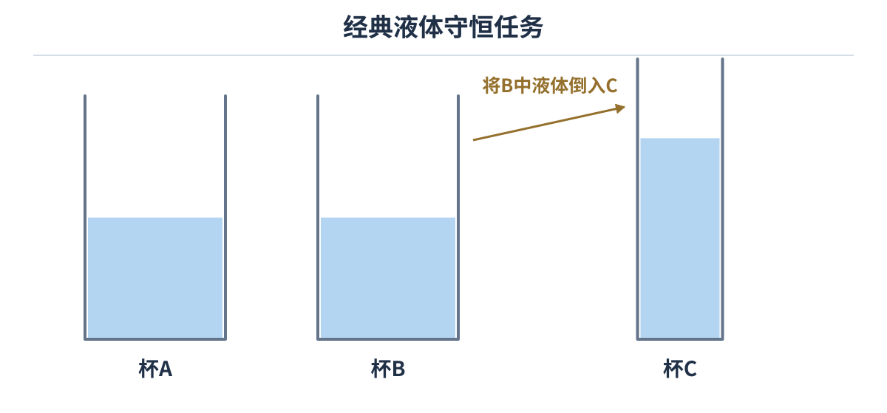
*图 061　经典液体守恒任务*

假设A与B装有等量液体，再将B的全部液体倒入较细的C。任务研究儿童能否理解液体高度改变并不意味着总量增加。图形为示意。现代研究指出，儿童在适当任务和支持条件下，可能比经典阶段理论预测更早表现出部分认知能力。

### 17.4 维果茨基的社会文化发展理论

维果茨基强调社会互动、语言及文化工具在认知发展中的作用。

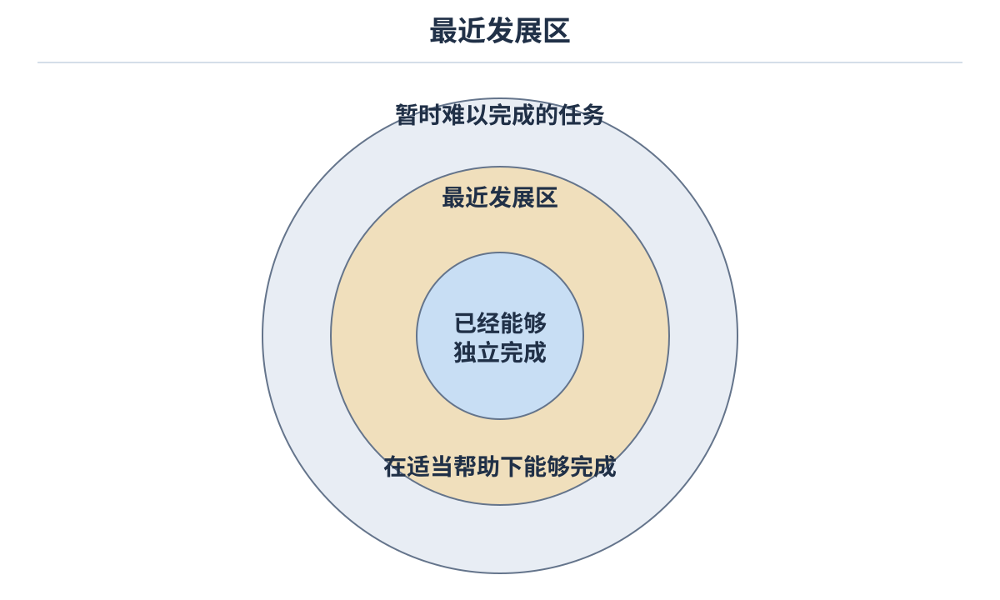
*图 062　最近发展区*

- 最近发展区（ZPD）：独立完成任务的水平与在适当帮助下可能达到的水平之间的区域。
- 支架式教学：根据学习者当前能力提供支持，并逐步撤除支持。
- 内化：社会互动及外部工具逐步转化为内部心理活动的过程。

### 17.5 埃里克森心理社会发展理论

| 阶段 | 经典发展冲突 |
|---|---|
| 婴儿期 | 基本信任与不信任 |
| 幼儿早期 | 自主与羞愧、怀疑 |
| 学前期 | 主动与内疚 |
| 学龄期 | 勤奋与自卑 |
| 青少年期 | 同一性与角色混乱 |
| 成年早期 | 亲密与孤独 |
| 成年中期 | 繁衍关怀与停滞 |
| 成年晚期 | 自我整合与绝望 |

这是理解人生发展任务的理论框架，不是每个人都必须按照固定顺序完成的心理考核标准。

### 17.6 道德与社会认知发展

相关理论及概念包括：

- 皮亚杰道德发展研究：规则理解、他律与自律。
- 柯尔伯格道德发展理论：前习俗、习俗、后习俗三个水平及其阶段。
- 道德情绪研究：同情、内疚、道德愤慨等。
- 心理理论（Theory of Mind）：理解他人可能具有与自己不同的信念、知识、愿望及意图。
- 社会观点采择：从他人的处境及视角理解问题。

道德判断能力、道德行为和道德情绪不是同一个概念。能够解释道德规则，并不保证现实中总是按照这些规则行动。

## 第十八章　依恋、家庭与社会化

### 18.1 依恋的本质

依恋（Attachment）是个体与特定照料者或重要关系对象之间形成的持久情感联结及相关调节系统。鲍尔比的依恋理论强调重要照料关系在安全感、探索行为和压力调节中的作用。

### 18.2 儿童依恋类型

经典陌生情境研究及后续发展形成了以下常见分类：

| 类型 | 典型研究表现 |
|---|---|
| 安全型 | 在适当条件下探索环境，并能够通过照料者获得安慰 |
| 不安全回避型 | 在特定分离与重聚情境中表现出较少的外部依恋寻求 |
| 不安全矛盾型／抵抗型 | 分离时较为不安，重聚时可能同时寻求接近与表现抵抗 |
| 混乱型 | 在相关观察情境中出现矛盾、失去组织性或难以形成一致策略的行为 |

这些分类依据特定研究程序，不适合只观察儿童某一次哭泣或者独处行为就进行判断。

### 18.3 成年依恋的维度模型

成年亲密关系依恋研究通常关注依恋焦虑和依恋回避两个连续维度。

*图 063　成年依恋维度四象限*

连续维度通常比固定类型更能体现个体差异，儿童依恋类别也不能与成年依恋类别直接一一对应。依恋焦虑主要涉及对拒绝、抛弃及关系安全的担忧；依恋回避主要涉及对亲密、依赖及情感接近的不适。依恋模式可能随关系经验和生活环境发生改变，并不是不可改变的终身标签。

### 18.4 家庭教养方式

经典教养方式研究通常使用回应性与要求性两个维度。

| 教养方式 | 回应性 | 要求性 |
|---|---|---|
| 权威型 | 较高 | 较高 |
| 专制型 | 较低 | 较高 |
| 放任型 | 较高 | 较低 |
| 忽视型 | 较低 | 较低 |

权威型强调温暖回应与合理规则，专制型更偏向严格要求及较少回应。不同教养方式与儿童发展结果之间的联系还需要考虑文化环境、家庭资源、儿童气质及双向互动。

### 18.5 社会化与生态系统理论

社会化是个体学习社会规范、价值、角色和行为方式的过程。布朗芬布伦纳的生态系统理论强调个体发展嵌入多层环境。

*图 064　布朗芬布伦纳生态系统理论*

- 微系统：家庭、学校、同伴等直接互动环境。
- 中间系统：家庭与学校等不同微系统之间的联系。
- 外部系统：个人未必直接参与，但仍受到影响的环境。
- 宏系统：文化、制度、价值观及社会结构。
- 时间系统：历史时期及个人生命历程中的变化。

## 第十九章　社会认知与归因

### 19.1 社会认知的本质

社会认知研究人们如何理解自己、他人、社会关系及社会事件。主要过程包括社会知觉、印象形成、归因、社会分类、心理理论及社会判断。

### 19.2 印象形成与社会知觉

| 现象 | 基本含义 |
|---|---|
| 首因效应 | 较早获得的信息可能对整体印象产生较大影响 |
| 近因效应 | 较晚获得的信息可能更显著影响评价 |
| 晕轮效应 | 某项突出特征影响对其他特征的整体评价 |
| 刻板印象 | 根据群体分类形成的概括性信念 |
| 内隐人格理论 | 认为某些人格特征往往共同出现的既有信念 |
| 印象管理 | 个体调节自身表达，以影响他人形成的印象 |

例如，因为某个人外表整洁、表达流利，就认为他在专业工作中也必然可靠，可能涉及晕轮效应。

### 19.3 归因理论

归因（Attribution）是人们对行为、事件及结果的原因进行解释的过程。

#### 19.3.1 内部归因与外部归因

- 内部归因：认为行为主要与个人能力、人格、态度或动机有关。
- 外部归因：认为行为主要与任务难度、情境压力、环境限制等有关。

#### 19.3.2 韦纳归因模型

| 原因 | 内部／外部 | 稳定性 | 可控性示例 |
|---|---|---|---|
| 能力水平 | 内部 | 相对稳定 | 短期较难直接改变 |
| 努力程度 | 内部 | 相对不稳定 | 部分可控 |
| 任务难度 | 外部 | 视任务而定 | 对个体而言可能较难控制 |
| 运气 | 外部 | 不稳定 | 通常不可控 |

三个归因维度可以共同描述某种原因，并不属于同一层级的互斥类型。

#### 19.3.3 凯利协变模型

归因可以参考三个维度的信息：

- 一致性：同一个人在相似条件下是否反复表现该行为。
- 区别性：这个人面对其他对象时是否也表现该行为。
- 共识性：其他人面对相同对象时是否表现类似行为。

例如，某员工多次抱怨同一管理制度，而其他员工也普遍抱怨该制度，这比只有一次抱怨更有理由研究制度本身是否存在问题。

### 19.4 常见归因偏差

| 偏差 | 主要表现 |
|---|---|
| 基本归因错误 | 解释他人行为时可能过度强调个人因素 |
| 自利归因偏差 | 将成功归于自身，将失败归于外部 |
| 行动者—观察者差异 | 对自身及他人行为可能采用不同解释方式 |
| 公正世界信念 | 倾向相信人们通常获得自己应得的结果 |
| 敌意归因偏差 | 在模糊情境中更倾向推断他人具有敌意 |

这些倾向受到文化、情境及研究设计影响。部分经典现象，例如行动者—观察者差异的普遍性，受到后续研究质疑。

### 19.5 自我实现预言

*图 065　自我实现预言的反馈机制*

> [!info]- 图示文字索引
> - 对他人形成某种预期
> - 预期改变自己的互动方式
> - 互动方式影响对方反应
> - 对方反应似乎验证原有预期

皮格马利翁效应、教师期待及人际行为确认等研究都涉及相关机制。它不是只要相信一件事，就能够凭借思想改变外部现实，而是预期可能通过行为和社会互动影响部分结果。

## 第二十章　态度、说服与社会影响

### 20.1 态度的三成分模型

*图 066　态度 Attitude*

> [!info]- 图示文字索引
> - 认知成分：对对象的信念与判断
> - 情感成分：对对象的喜好与感受
> - 行为倾向：采取相应行动的倾向

态度与实际行为并不总是一致。例如，一个人认同环境保护，也可能由于价格、时间及现实条件而没有采取相应行为。

### 20.2 态度形成与认知失调

认知失调理论由费斯廷格提出，研究个体在相关认知、态度和行为发生冲突时产生的不适及其调节。例如，投资者原本认为频繁交易风险较高，却在没有充分研究的情况下频繁买卖股票。此时可能采取不同方式降低冲突：

- 改变行为，减少频繁交易。
- 改变态度，重新评价频繁交易。
- 增加解释，例如认为自己的情况与他人不同。
- 回避与自身行为冲突的信息。

认知失调与合理化、确认偏误存在联系，但它们并不是同一个心理概念。

### 20.3 说服的双路径模型

精细加工可能性模型（ELM）是说服研究中的重要理论。

*图 067　接收到说服信息：个人动机、能力及可用认知资源*

> [!info]- 图示文字索引
> - 中心路径：重视论据、证据与内容质量，进行较深入的信息加工
> - 外围路径：更多受到简单线索或外部特征影响，如来源、熟悉度、情绪等

两条路径描述信息加工程度的不同侧重，不一定彼此排斥。

### 20.4 常见社会影响方式

| 概念 | 核心含义 |
|---|---|
| 从众（Conformity） | 为适应群体规范或判断而调整自身行为 |
| 依从（Compliance） | 接受他人的明确请求 |
| 服从（Obedience） | 按照被视为具有权威者的要求行动 |
| 内化（Internalization） | 将外部观点或价值真正接受为自身信念 |
| 认同（Identification） | 因认同某个人或群体而接受相关态度或行为 |

#### 20.4.1 从众的两类主要机制

- 信息性社会影响：认为其他人掌握更准确的信息。
- 规范性社会影响：为了获得接纳或避免社会排斥。

两种机制可能同时发生。

### 20.5 社会影响的相关心理原则

常见研究对象包括互惠规范、社会认同、承诺与一致性、权威线索、稀缺性、喜好及群体归属。这些机制可以解释广告、公共传播、社会规范及集体决策中的部分行为，也可以帮助人们识别误导性宣传。例如，「仅剩最后一件」可能增加消费者的稀缺感，但它并不能证明商品具有更高实际价值。使用这些知识时应尊重他人的知情权及自主选择。

## 第二十一章　人际交往与亲密关系

### 21.1 人际关系的总体研究结构

*图 068　人际关系的总体研究结构*

> [!info]- 图示文字索引
> - 关系建立：接近、熟悉、吸引、共同活动
> - 关系发展：自我表露、信任、互惠、社会支持
> - 关系维持：沟通、承诺、回应性、边界与合作
> - 关系冲突：需求差异、归因偏差、权力不平衡
> - 关系调整与结束：协商、修复、分离及重新适应

### 21.2 人际吸引的主要因素

- 接近性：空间及互动机会上的接近。
- 单纯曝光效应：在某些条件下，重复接触可能提高对刺激的喜爱程度。
- 相似性：价值观、兴趣、态度等方面的相似。
- 互补性：部分能力、需求及角色上的互补。
- 互惠性：对方的积极回应及相互投入。
- 外表吸引力：外貌评价可能影响初始社会印象。
- 感知回应性：感到对方理解、认可及关心自己。

这些因素不能单独决定两个人是否适合建立长期关系。

### 21.3 斯滕伯格爱情三角理论

*图 069　斯滕伯格爱情三角理论*

经典理论将亲密、激情和承诺作为三个组成维度，用来描述不同关系形态，并不是判断关系好坏的唯一标准。

| 组成维度 | 含义 |
|---|---|
| 亲密 | 情感联结、理解、信任与接近 |
| 激情 | 吸引、欲望及强烈情绪唤醒 |
| 承诺 | 维持关系及承担相应责任的决定 |

### 21.4 人际关系的其他主要理论

| 理论 | 核心研究内容 |
|---|---|
| 社会交换理论 | 关系中的收益、成本及比较标准 |
| 公平理论 | 双方投入与获得是否被感知为公平 |
| 投资模型 | 满意度、替代选择及已有投入如何关联承诺 |
| 依恋理论 | 关系安全感及亲密调节 |
| 相互依赖理论 | 个体选择如何影响彼此结果 |
| 社会渗透理论 | 自我表露的深度、广度与关系发展 |

社会交换理论中的收益不限于金钱，也包括情感支持、陪伴、理解及其他价值。

### 21.5 人际沟通的基本模型

*图 070　人际沟通：编码、渠道、解码与反馈*

主要沟通形式包括语言沟通、非语言沟通、书面沟通和数字媒介沟通。其中，眼神、语调、姿势及表情可以传递信息，但不存在适用于所有文化和情境的固定肢体语言解码表。不能仅凭摸鼻子、视线移动或双手交叉等动作可靠判断他人是否撒谎。

### 21.6 共情、同情与亲社会行为

| 概念 | 核心区别 |
|---|---|
| 认知共情 | 理解他人可能具有怎样的心理状态 |
| 情感共情 | 对他人的情绪产生相应体验 |
| 同情与关切 | 对他人的困境产生关心 |
| 慈悲 | 关注痛苦，并具有减轻痛苦的动机 |
| 情绪感染 | 在互动中受到他人情绪状态影响 |
| 亲社会行为 | 有助于他人或社会的行为 |

共情不等于同意对方，也不意味着必须承担对方的全部情绪。

### 21.7 人际边界与冲突处理

常见人际冲突处理模式包括竞争、回避、迁就、妥协和合作。有效沟通通常需要区分客观行为、个人解释、情绪体验、实际需求及具体请求。例如：

| 不够明确的表达 | 更具体的表达 |
|---|---|
| 你根本不尊重我 | 刚才我发言时被连续打断了三次 |
| 你总是很自私 | 这次安排没有提前与我讨论 |
| 你必须理解我 | 我希望能够先完整说明自己的想法 |

具体表达有助于降低对人格的整体否定，但不保证所有冲突都可以通过沟通解决。对于持续控制、威胁、欺骗或暴力等行为，还需要重视个人安全及适当的外部支持。

## 第二十二章　群体心理与群际关系

### 22.1 群体的基本组成

- 群体角色：成员承担的行为及责任模式。
- 群体规范：群体对适当行为的共同期待。
- 群体凝聚力：成员维持群体联结的程度。
- 群体地位：成员在群体中的相对位置。
- 群体认同：将群体成员身份纳入自我概念的程度。

### 22.2 个体进入群体后的行为变化

| 现象 | 基本机制 |
|---|---|
| 社会促进 | 他人在场可能提高熟练任务表现 |
| 社会抑制 | 他人在场也可能损害困难或不熟练任务表现 |
| 社会惰化 | 集体任务中个人努力可能下降 |
| 责任分散 | 多人共同在场时，个人责任感可能减弱 |
| 旁观者效应 | 在某些情况下，他人在场降低个体提供帮助的可能性 |
| 去个体化 | 匿名性、群体认同及情境因素改变自我关注与行为规范 |

这些都是受到任务性质、责任明确程度和群体规范影响的条件性现象。

### 22.3 群体决策中的重要问题

#### 22.3.1 群体极化

群体讨论后，成员整体态度可能沿原有倾向变得更加极端。

*图 071　群体极化的虚构示意*

极化方向取决于原有倾向、信息交换和社会比较等因素。

#### 22.3.2 群体思维

群体思维（Groupthink）是指群体过度重视一致性，可能削弱批判性评价及替代方案研究的决策过程。典型研究现象包括自我审查、压制异议、过度自信、错误的一致性印象等。群体思维是一种有影响力的理论模型，但不能用来解释所有失败的集体决策。

#### 22.3.3 信息共享偏差

群体讨论可能过度关注所有成员已经知道的共同信息，而忽略少数成员掌握的独特信息。这在团队管理、董事会决策、组织投资研究等活动中尤其值得关注。

### 22.4 社会认同与群际关系

社会认同理论研究群体身份如何影响自我评价及群际行为。其相关机制包括社会分类、群体认同及群体间比较。

*图 072　社会分类、群体认同与比较*

> [!info]- 图示文字索引
> - 内群体：被认为属于「我们」的群体
> - 外群体：被认为属于「他们」的群体

群体认同可以促进合作与归属，也可能在特定条件下增加群际偏见。

### 22.5 刻板印象、偏见与歧视

这三个概念属于社会认知、情感评价和行为三个相互关联的维度。

| 概念 | 主要维度 | 含义 |
|---|---|---|
| 刻板印象 | 认知 | 对某个群体形成的概括性信念 |
| 偏见 | 态度与情感 | 基于群体身份形成的预先评价 |
| 歧视 | 行为及制度 | 基于群体身份进行不公平区别对待 |

相关理论还包括现实群体冲突理论、社会支配研究、群际接触理论、共同内群体认同及刻板印象威胁等。

## 第二十三章　文化心理学与社会行为

### 23.1 文化心理学与跨文化心理学

- 文化心理学：研究文化与心理过程如何相互构成和影响。
- 跨文化心理学：比较不同文化环境中的心理特征及理论适用性。
- 本土心理学：从特定社会文化背景发展心理学概念和研究框架。

### 23.2 自我观与文化差异

| 自我观 | 主要研究侧重点 |
|---|---|
| 独立型自我观 | 自主性、个人特征、独立目标 |
| 相互依存型自我观 | 关系、社会角色、群体联系 |

同一个人可以在不同情境中同时表现出两类自我观。不能将所有东方人简单划分为相互依存型，也不能认为所有西方人都是独立型。

### 23.3 文化价值与社会规范

常见研究维度包括个人主义与集体主义、权力距离、不确定性规避、文化松紧度，以及社会规范、荣誉、面子和关系等概念。这些维度往往用于分析群体层面的统计差异。将群体平均特征直接套用于个人，会产生生态谬误及刻板印象。

### 23.4 文化适应与跨文化交往

- 文化适应：进入不同文化环境后发生的心理及行为调整。
- 文化冲击：面对不熟悉环境可能产生的不适及适应困难。
- 双文化认同：与多个文化身份建立联结。
- 文化智力：在不同文化情境中理解、沟通与有效行动的相关能力。
- 跨文化敏感性：意识到文化差异，并避免过度依赖原有文化标准。

### 23.5 攻击、合作与助人行为

社会行为研究还包括攻击行为、亲社会行为、利他主义、互惠、信任、合作、社会困境、公平判断及道德心理学。其中，博弈论中的囚徒困境、最后通牒博弈、公共物品博弈，也可以作为研究人类合作、公平与信任的实验工具。

# 第五篇　心理健康与临床心理学

本篇研究心理功能如何维持、失调、恢复及改善。首先需要明确，正常人也可能经历强烈焦虑、悲伤、愤怒、孤独及心理冲突。出现某种负面情绪，不等于患有心理障碍。临床心理学既研究心理问题，也研究评估、预防、干预与功能恢复。

## 第二十四章　压力、应对与心理韧性

### 24.1 压力的基本概念

| 概念 | 含义 |
|---|---|
| 压力源 | 可能引发压力反应的事件或条件 |
| 压力评价 | 个体对事件要求及自身应对资源的判断 |
| 压力反应 | 相应的生理、情绪、认知及行为变化 |
| 应对资源 | 能力、时间、资金、社会支持等 |
| 应对策略 | 个体处理压力及相关问题的方式 |
| 心理韧性 | 面对逆境时维持或恢复适应功能的动态能力 |

压力并不完全取决于外部事件的强度，也与个人如何理解事件、能够获得哪些资源有关。

### 24.2 压力源的分类

- 急性压力源：短时间内发生的挑战或事件。
- 慢性压力源：长期存在的经济、工作、家庭或健康困难。
- 重大生活事件：失业、迁居、疾病、关系变化等。
- 日常烦扰：通勤、任务积压、沟通摩擦等。
- 创伤性事件：涉及严重威胁、伤害等具有特殊性质的经历。

创伤性事件与普通生活压力不完全相同。是否形成临床意义上的创伤相关障碍，需要结合具体经历及症状进行专业判断。

### 24.3 压力的生理机制

*图 073　感知到挑战或威胁*

> [!info]- 图示文字索引
> - 交感—肾上腺髓质系统：快速应激反应，肾上腺素等参与能量动员
> - HPA轴：下丘脑—垂体—肾上腺皮质，皮质醇等参与应激调节

两条途径调整心血管、代谢、免疫及认知等活动。短期压力反应可能帮助机体应对挑战，而长期高强度压力可能增加生理与心理负担。相关概念包括稳态、适应性调节（Allostasis）及适应性负荷（Allostatic Load）。

### 24.4 压力的认知评价理论

拉扎勒斯的压力与应对理论强调两个重要评价过程：

- 初级评价：事件对自己而言是威胁、损失、挑战还是无关事件？
- 次级评价：自己是否拥有足够的能力、资源及选择应对这一事件？

*图 074　压力的认知评价与应对*

> [!info]- 图示文字索引
> - 压力事件
> - 初级评价：事件的重要性
> - 次级评价：自身应对资源
> - 情绪与生理反应
> - 选择应对方式
> - 结果与重新评价

初级与次级评价可以相互影响，并不一定按照固定顺序进行。

### 24.5 压力与任务表现

*图 075　耶克斯—多德森定律倒U形教学示意*

唤醒与表现之间的实际关系取决于任务难度、个体及情境，并非所有任务都服从相同曲线。适当的唤醒可能有助于集中注意和执行任务，但唤醒过高可能干扰复杂推理、工作记忆与决策。

### 24.6 应对策略的分类

| 应对类型 | 主要目标 | 示例 |
|---|---|---|
| 问题聚焦应对 | 改变实际压力源 | 调整任务安排、寻求资源 |
| 情绪聚焦应对 | 调节情绪体验 | 接纳、重评、休息 |
| 意义聚焦应对 | 重新理解事件及其价值 | 重新评价目标与个人意义 |
| 社会支持应对 | 获得情感或实际帮助 | 与可信赖的人沟通 |
| 回避性应对 | 暂时远离压力或相关体验 | 拖延、分散注意 |

回避并非在所有情况下都有害。例如，暂时离开激烈冲突可能有助于恢复情绪控制，但长期回避需要处理的问题，则可能维持心理困难。

### 24.7 心理韧性与职业倦怠

心理韧性研究关注逆境中的适应与恢复，与社会支持、问题解决能力、情绪调节及现实资源等因素有关。

职业倦怠研究则主要关注长期工作压力下的耗竭、对工作的心理疏离或消极态度，以及职业效能感降低。职业倦怠、普通疲劳、抑郁障碍三者并不等同，也可能同时存在。

## 第二十五章　异常心理学与心理障碍

### 25.1 正常心理与异常心理

心理状态并不总是能够简单划分为正常与异常两个完全分离的类别。许多心理特征具有连续性，临床判断还需要综合考虑持续时间、严重程度、主观痛苦、功能受损、发展阶段、文化背景及其他可能原因。

*图 076　心理困扰连续性*

心理困扰连续性的概念示意，而非统一诊断量尺。某些急性、严重表现即使持续时间较短，也可能需要及时专业评估。

### 25.2 现代心理障碍的分类标准

国际上具有重要影响力的两套分类体系是：

| 分类体系 | 制定机构 | 主要定位 |
|---|---|---|
| ICD-11 | 世界卫生组织 WHO | 国际疾病及健康相关状况分类体系 |
| DSM-5-TR | 美国精神医学学会 | 精神障碍的诊断与分类手册 |

这里的美国精神医学学会与前文的美国心理学会是不同的专业组织，尽管两者英文缩写都可以是 APA。

本章采用主要参考 ICD-11、兼顾其他常见临床术语的教学分类，而不是逐条复制临床诊断手册。WHO 的 ICD-11 临床诊断要求主要面向具备相应资质的专业人员。

### 25.3 心理障碍的主要分类树

*图 077　心理障碍的主要分类树（教学性概括）*

> [!info]- 图示文字索引
> - 神经发育障碍：注意缺陷多动障碍、孤独症谱系障碍、智力发育障碍、学习相关障碍
> - 心境障碍：抑郁障碍、双相及相关障碍
> - 焦虑或恐惧相关障碍：广泛性焦虑、惊恐障碍、社交焦虑、特定恐惧症等
> - 强迫及相关障碍：强迫障碍、躯体变形障碍、囤积障碍等
> - 应激相关障碍：创伤后应激障碍、复杂性创伤后应激障碍、适应障碍等
> - 精神分裂症及其他原发性精神病性障碍：精神分裂症、分裂情感性障碍、妄想障碍等
> - 人格障碍及相关特征：持续性人格功能受损、适应不良的人格特质模式
> - 解离障碍：解离性遗忘、人格解体—现实解体等
> - 进食与喂养障碍：神经性厌食、神经性贪食、暴食障碍等
> - 物质使用及成瘾行为障碍：物质依赖及有害使用、赌博障碍、游戏障碍等
> - 神经认知障碍：谵妄、痴呆及其他认知功能障碍
> - 其他临床分类及相关领域：躯体痛苦相关障碍、冲动控制障碍、排泄障碍、睡眠—觉醒障碍等

为学习而组织的临床知识分类。不同诊断体系存在差异，睡眠—觉醒障碍等在ICD-11中具有独立章节安排。

### 25.4 抑郁障碍与双相障碍

| 概念 | 核心区别 |
|---|---|
| 普通悲伤 | 对失去、挫折等事件产生的正常情绪体验 |
| 抑郁症状 | 低落、兴趣下降等相关心理表现 |
| 抑郁障碍 | 符合相应临床要求的持续性症状及功能受损等情况 |
| 躁狂发作 | 明显异常的心境及活动、精力等变化，可能造成严重功能受损 |
| 轻躁狂发作 | 具有相关躁狂性变化，但严重程度及功能影响有相应区别 |
| 双相障碍 | 涉及躁狂或轻躁狂等发作特征的一类心境障碍 |

双相障碍不是简单的情绪忽好忽坏，也不能因为一个人情绪容易波动，就认为其患有双相障碍。

### 25.5 焦虑、恐惧与惊恐

| 概念 | 基本区别 |
|---|---|
| 恐惧 | 通常与感知到的当前威胁有关 |
| 焦虑 | 通常涉及对未来威胁及不确定性的担忧 |
| 惊恐发作 | 突然出现强烈恐惧或不适及相应身心症状 |
| 广泛性焦虑障碍 | 涉及持续、过度且难以控制的广泛担忧等 |
| 社交焦虑障碍 | 涉及对社会评价、特定社交情境的显著恐惧或回避 |
| 特定恐惧症 | 对特定对象或情境具有显著恐惧及相关回避 |

焦虑本身是一种正常心理现象，焦虑障碍则需要专业判断症状及其影响。

### 25.6 强迫障碍的维持机制

- 强迫观念：反复出现、可能引发明显困扰的思想、冲动或意象等。
- 强迫行为：为减轻困扰或按照特定规则反复执行的行为或心理活动。

*图 078　强迫障碍的一种维持机制*

> [!info]- 图示文字索引
> - 出现侵入性思想或威胁感
> - 焦虑或不适提高
> - 执行强迫行为或心理仪式
> - 不适暂时减轻
> - 行为可能因短期缓解受到负强化

可能形成反复维持的循环。这也是第七章操作性条件作用在临床心理学中的重要应用。不过，普通人追求整洁、具有固定习惯或偶尔进行重复检查，并不等于患有强迫障碍。

### 25.7 创伤相关障碍

创伤后应激障碍（PTSD）涉及经历符合相应条件的创伤性事件后，出现特定症状及功能影响。核心研究涉及创伤记忆、重新体验、回避、持续威胁感、情绪调节及社会支持。

复杂性创伤后应激障碍（CPTSD）在 ICD-11 中具有独立分类，除PTSD相关症状外，还涉及自我组织方面的持续困难。

创伤经历并不必然导致PTSD，心理创伤也不是解释所有成年心理问题的唯一原因。

### 25.8 神经发育障碍

| 类型 | 主要研究领域 |
|---|---|
| 注意缺陷多动障碍（ADHD） | 注意调节、多动、冲动及其功能影响 |
| 孤独症谱系障碍（ASD） | 社会沟通互动、限制性及重复性行为特征 |
| 发育性学习障碍 | 阅读、书写或数学等学习能力困难 |
| 智力发育障碍 | 智力功能与适应行为方面的显著困难 |
| 发育性言语与语言障碍 | 言语产生、语言理解及表达发展困难 |

ADHD不等于单纯懒惰或缺乏自律，孤独症也不等于不喜欢社交。专业评估需要考虑发展史、功能影响及其他可能解释。

### 25.9 人格障碍

人格障碍主要涉及持续性的人格功能困难及适应不良的人格特征，不能依据短期情绪或单次行为作出判断。

传统 DSM 分类具有以下三组人格障碍：

| 传统分类 | 主要类型 |
|---|---|
| A组 | 偏执型、分裂样型、分裂型 |
| B组 | 反社会型、边缘型、表演型、自恋型 |
| C组 | 回避型、依赖型、强迫型 |

ICD-11 则更加重视人格功能受损的严重程度及特质维度，主要包括负性情感、疏离、反社会性、去抑制、强迫性等，并保留边缘型模式相关限定。

特别需要区分：

- 自恋特质与自恋型人格障碍（NPD）。
- 反社会行为与反社会型人格障碍（ASPD）。
- 强迫障碍（OCD）与强迫型人格障碍（OCPD）。
- 回避型依恋与回避型人格障碍。
- 精神分裂症与分裂样人格障碍。

这些名称相似或存在一定研究联系，但不能相互替代。

### 25.10 精神病性症状与其他心理现象

| 概念 | 含义 |
|---|---|
| 幻觉 | 缺少相应外部刺激时出现的感知样体验 |
| 妄想 | 在相应临床及文化背景下，难以通过反面证据改变的某些异常信念 |
| 思维紊乱 | 思维组织与表达出现相关困难 |
| 解离 | 意识、记忆、身份或知觉等整合过程发生相关改变 |
| 人格解体 | 对自身体验产生疏离感 |
| 现实解体 | 对外部环境产生不真实或疏离感 |

这些是不同的临床研究概念，也可能具有多种原因。精神病性症状并非只发生于精神分裂症。

### 25.11 心理障碍的多因素形成模型

*图 079　易感性—压力及多因素模型*

心理障碍的研究需要避免单一原因论。不能简单认为抑郁一定是某种神经递质不足，也不能认为所有心理障碍都来自原生家庭。

## 第二十六章　临床评估与心理咨询

### 26.1 不同专业领域的区别

| 领域 | 主要职责 |
|---|---|
| 异常心理学 | 研究心理障碍的表现、分类、机制与发展 |
| 临床心理学 | 心理评估、心理障碍研究及专业干预 |
| 咨询心理学 | 心理适应、个人发展及相关心理困扰研究与服务 |
| 精神病学 | 医学专业，研究、诊断及治疗精神障碍 |
| 神经心理学 | 研究脑功能与认知、行为的关系及相关评估 |
| 社区心理学 | 研究社区环境、预防、社会资源及群体心理健康 |

各地的职业资格、执业范围和诊断权限不同，不能仅通过「心理咨询师」等称谓确定其专业能力及法定权限。

### 26.2 心理评估的完整过程

*图 080　心理评估的完整过程*

> [!info]- 图示文字索引
> - 明确评估目的：了解困扰、功能变化与求助目标
> - 临床访谈：症状、持续时间、生活经历及当前环境
> - 选择测量工具：量表、认知测验、行为及相关评估
> - 综合资料：考虑身体健康、药物、发展史等可能因素
> - 个案概念化：形成关于问题及维持机制的专业假设
> - 制定后续方案：根据需要进行干预、转介及持续评估

### 26.3 常见心理评估工具

| 工具 | 主要测量方向 |
|---|---|
| PHQ-9 | 抑郁相关症状筛查及严重程度 |
| GAD-7 | 广泛性焦虑相关症状 |
| DASS-21 | 抑郁、焦虑及压力相关体验 |
| PSS | 感知压力 |
| MMPI系列 | 广泛的临床人格与心理特征评估 |
| WAIS系列 | 成人认知能力评估 |
| WISC系列 | 儿童认知能力评估 |
| NEO系列 | 大五人格及相关特质 |
| BFI系列 | 大五人格研究与测量 |

筛查工具不是诊断工具的完全替代品。量表分数较高，意味着可能值得进一步了解，而不是可以自行确定患有某种障碍。

### 26.4 个案概念化与5P模型

| 组成 | 主要研究问题 |
|---|---|
| Presenting：当前问题 | 目前正在发生什么困难？ |
| Predisposing：易感因素 | 哪些既往因素可能增加困难发生的风险？ |
| Precipitating：诱发因素 | 哪些近期事件可能与困难出现有关？ |
| Perpetuating：维持因素 | 哪些机制使当前困难持续存在？ |
| Protective：保护因素 | 哪些资源有助于恢复与适应？ |

个案概念化重视问题之间的具体联系，而不是只给人贴上一个疾病或人格标签。

### 26.5 心理咨询与专业伦理

专业心理服务需要重视知情同意、保密及其法定例外、专业能力边界、双重关系、利益冲突、适当转介和持续督导等问题。心理咨询不是由咨询者代替来访者决定人生，也不意味着咨询者拥有读取他人内心的特殊能力。

## 第二十七章　心理治疗与心理干预

### 27.1 心理干预的主要分类维度

心理干预可以按照理论基础、服务形式、干预对象及具体目标进行分类。例如，认知行为疗法属于治疗取向，团体治疗属于服务形式，暴露治疗属于具体干预方法。三者并不属于完全相同的分类层级。

### 27.2 主要心理治疗流派

*图 081　主要心理治疗流派*

> [!info]- 图示文字索引
> - 行为治疗：利用学习原理改变适应不良的行为及联结（暴露治疗、行为激活、行为训练）
> - 认知治疗与认知行为疗法：研究认知、情绪与行为之间的维持关系（CT、CBT、REBT）
> - 心理动力学治疗：探索情绪、内部冲突及关系模式（短程与长程）
> - 人本主义与体验性治疗：主观体验、自我理解及治疗关系（来访者中心、情绪聚焦）
> - 接纳与正念相关治疗：心理灵活性及与内部体验的关系（ACT、MBCT、DBT中的相关方法）
> - 家庭与系统治疗：关系模式及家庭系统（家庭、伴侣治疗）
> - 其他专门及整合治疗：特定问题或综合理论（IPT、EMDR、图式治疗）

教学性分类。许多现代疗法整合了认知、行为、情绪及人际干预方法。

### 27.3 认知行为疗法（CBT）

CBT重点研究个体的认知、情绪和行为如何相互影响，并通过结构化的心理干预改变相关困难的维持机制。

*图 082　认知、情绪与行为的相互作用*

常见的认知层次包括：

- 自动化思维：在具体情境中迅速出现的想法。
- 中间信念：个人的规则、态度与假设。
- 核心信念：关于自身、他人及世界的较深层信念。

常见认知加工偏差包括灾难化、非黑即白、过度概括、读心式推断、情绪化推理等。CBT并不是要求人强行积极思考，而是研究相关思维是否符合证据、是否具有实际帮助，并通过认知及行为方法改善心理功能。

### 27.4 ABC理论与理性情绪行为疗法

ABC模型是理性情绪行为疗法（REBT）中的经典概念框架。

*图 083　ABC理论*

> [!info]- 图示文字索引
> - A：诱发事件（实际发生的事情）
> - B：信念与评价（个体怎样理解和评价这件事）
> - C：结果（产生的情绪及行为反应）

例如，收到一次工作批评后，有人认为「这项工作需要改进」，也有人认为「我永远无法做好任何工作」。评价方式不同，可能形成不同的情绪与行为结果。但这不意味着外部事件没有实际影响，更不意味着心理困扰只需要改变思想就能解决。

### 27.5 其他重要治疗方法

| 方法 | 主要研究或干预方向 |
|---|---|
| 暴露治疗 | 通过专业设计的学习过程改变恐惧及回避关系 |
| 暴露与反应预防（ERP） | 常用于强迫障碍相关治疗 |
| 行为激活（BA） | 增加有意义的活动，改善回避与低活动模式 |
| 接纳承诺疗法（ACT） | 接纳、认知解离、价值澄清及心理灵活性 |
| 辩证行为疗法（DBT） | 情绪调节、痛苦耐受、人际效能及正念等 |
| 人际心理治疗（IPT） | 研究并改善特定人际问题及角色变化 |
| 眼动脱敏与再加工（EMDR） | 用于特定创伤相关问题的结构化治疗 |
| 正念认知疗法（MBCT） | 结合正念及认知方法处理相关心理困难 |
| 图式治疗 | 研究长期适应不良图式及相关模式 |

治疗方法具有不同适用对象及证据基础。对某一种障碍有效的治疗，不一定对所有心理问题都有效。

### 27.6 循证心理治疗

循证实践强调综合考虑研究证据、专业人员的临床能力，以及接受服务者的特点、需求、文化和偏好。

*图 084　循证心理治疗的三个组成*

心理治疗只是精神健康服务的一部分，某些情况还需要医学评估、药物治疗、社会支持及其他综合服务。

## 第二十八章　积极心理学与幸福感

积极心理学研究积极心理功能、心理优势、幸福感、意义以及有利于个人和社会发展的条件。它不是要求人始终保持快乐，也不是否认困难和痛苦。

### 28.1 幸福感的主要分类

| 类型 | 主要关注 |
|---|---|
| 主观幸福感 | 生活满意度、积极及消极情感体验 |
| 心理幸福感 | 自主性、个人成长、生活目标、关系及自我接纳 |
| 社会幸福感 | 社会归属、社会贡献及社会功能 |
| 享乐型幸福 | 愉悦、满意及减少痛苦 |
| 实现型幸福 | 意义、潜能发展及有价值的生活 |

### 28.2 PERMA模型

*图 085　PERMA模型*

> [!info]- 图示文字索引
> - P — Positive Emotion 积极情绪：体验愉悦、希望及积极感受
> - E — Engagement 投入：深入参与具有价值或吸引力的活动
> - R — Relationships 积极关系：形成有意义且相互支持的关系
> - M — Meaning 意义：与超越即时利益的价值及目标建立联系
> - A — Accomplishment 成就：通过努力掌握能力及实现目标

PERMA是具有代表性的幸福感理论模型之一，并不是评价每个人生活质量的唯一标准。

### 28.3 心流体验

心流（Flow）是个体深度投入活动时可能出现的高度专注体验。常见相关条件包括明确目标、及时反馈、任务具有适当挑战，以及个人技能与挑战之间具有一定匹配。

*图 086　挑战与技能匹配的心流模型*

现实心流体验还受到动机、注意资源、任务意义及其他条件影响。

### 28.4 心理优势与个人成长

相关研究包括品格优势、乐观、希望、自我同情、感恩、生活意义、心理韧性及创伤后成长等。创伤后成长指某些人在逆境经历之后报告或表现出的积极心理变化，并不意味着创伤是必要的，也不意味着经历痛苦的人必须获得成长。

# 第六篇　应用心理学与前沿交叉领域

应用心理学不是完全独立于基础心理学的另一套理论，而是将认知、学习、人格、社会行为及其他心理科学知识用于不同的实际场景。

## 第二十九章　教育心理学与学习科学

### 29.1 教育心理学的基本研究结构

*图 087　教育心理学的基本研究结构*

> [!info]- 图示文字索引
> - 学习者：认知能力、先前知识、动机、情绪及个体差异
> - 学习过程：注意、编码、记忆、理解、技能形成及知识迁移
> - 教学设计：课程结构、任务难度、教学支持及反馈
> - 学习环境：教师、同伴、家庭、技术及学校文化
> - 学习评价：形成性评价、总结性评价、能力与学习成果

### 29.2 元认知与自我调节学习

元认知（Metacognition）是对自身认知过程的认识、监测和调节。

- 元认知知识：了解自己、任务及不同认知策略。
- 元认知监测：判断自己是否真正理解或掌握知识。
- 元认知控制：根据监测结果调整学习方法。

*图 088　自我调节学习循环*

> [!info]- 图示文字索引
> - 学习计划：确定目标、任务及时间
> - 学习执行：阅读、练习及解决问题
> - 理解监测：能否独立解释、回忆和应用？
> - 策略调整：发现困难并改变方法
> - 结果评价：检验学习效果及下一阶段目标

例如，看懂参考答案产生的熟悉感，并不一定意味着自己已经掌握了解题过程。独立作答及延迟测试，可以提供更直接的学习效果信息。

### 29.3 认知负荷理论

认知负荷理论主要研究有限工作记忆容量如何影响学习。

| 负荷类型 | 含义 |
|---|---|
| 内在认知负荷 | 学习材料中相互作用的信息成分及其复杂程度所带来的负荷 |
| 外在认知负荷 | 不合理教学设计、无关信息等造成的额外负担 |
| 相关认知加工 | 用于理解、组织及形成知识图式的认知活动 |

早期认知负荷理论通常将相关认知负荷作为第三类负荷，后续理论对其定位有所修订。

*图 089　认知负荷与材料组织的示意比较*

假设完成同一项学习任务时，可用认知资源相同。虚构资源分配比例，仅用于说明减少无关负担的思想，不代表真实大脑资源可以按此精确测量。

这也是知识框架、结构化笔记、原理插图及循序渐进的案例教学能够发挥价值的理论依据之一。

### 29.4 主要学习方法及其心理机制

| 学习方法 | 主要作用机制 |
|---|---|
| 间隔学习 | 在不同时间重新接触与提取知识 |
| 提取练习 | 主动从记忆中提取信息 |
| 交错练习 | 交替练习不同类型的问题，帮助辨别与选择方法 |
| 精细解释 | 将新知识与已有知识和原因建立联系 |
| 自我解释 | 主动说明推导过程及解题依据 |
| worked examples 例题学习 | 通过完整示范降低初学者的问题解决负担 |
| 双重编码 | 将语言信息与适当图形表征结合 |
| 反馈学习 | 通过错误信息和改进建议调整知识与行为 |
| 刻意练习 | 针对能力弱点开展具有明确目标和反馈的练习 |

不同方法的效果取决于学习内容、先前知识与应用条件，并不存在所有课程都适用的固定学习时间比例。

### 29.5 学习动机与目标定向

- 掌握目标：关注理解知识及提高能力。
- 表现目标：关注证明自身能力或获得较好评价。
- 接近目标：追求希望达到的结果。
- 回避目标：避免失败或不良评价。

成长型思维研究强调个人对能力可发展性的信念；固定型思维则关注将能力理解为相对固定属性的倾向。成长型思维并不意味着单靠相信自己就能取得成功，实际学习资源、教学质量、练习方法及环境条件同样重要。

### 29.6 教育评价与学习困难

教育心理学进一步包括形成性评价、总结性评价、标准参照测验、常模参照测验、学习困难评估、特殊教育、学校心理学及学习支持等。所谓视觉型、听觉型、动觉型学习风格，不能作为已经得到充分验证的依据，要求所有学生必须按照其所属类型接受特定教学。

## 第三十章　工业与组织心理学

工业与组织心理学（Industrial-Organizational Psychology，I/O Psychology）研究人在工作环境和组织中的心理及行为。这是心理学与企业管理、人力资源及商业实践的重要交叉领域。

### 30.1 工业心理学与组织心理学

*图 090　工业与组织心理学*

> [!info]- 图示文字索引
> - 工业心理学：人岗匹配及工作表现（工作分析、人才甄选、培训发展、绩效评价）
> - 组织心理学：组织中的个人与群体行为（工作动机、领导力、团队与组织文化、工作满意度）

两类研究方向在现代组织心理学中存在大量交叉，共同关注组织效能、员工健康与职业发展。

### 30.2 人员甄选与职业匹配

- 工作分析：研究岗位的任务、责任及所需能力。
- 胜任力模型：描述与有效工作表现相关的知识、技能及其他特征。
- 结构化面试：采用相对统一的问题、评分及评价标准。
- 工作样本测验：通过实际或模拟工作任务评价能力。
- 人格及认知测验：使用具有适当信效度的工具研究岗位相关特征。
- 人—岗匹配：个人能力及需要与岗位要求之间的适配。
- 人—组织匹配：个人价值观及特点与组织环境之间的适配。

人才评价需要注意公平、隐私及测量有效性，不能仅凭面试者的第一印象或者某种人格类型决定招聘结果。

### 30.3 工作动机理论

| 理论 | 核心研究内容 |
|---|---|
| 赫茨伯格双因素理论 | 区分与工作满意及不满意相关的不同因素 |
| 弗鲁姆期望理论 | 努力、绩效及奖励之间的预期关系 |
| 亚当斯公平理论 | 个人对投入与回报比例的比较 |
| 目标设置理论 | 目标、挑战程度及反馈对绩效的影响 |
| 自我决定理论 | 自主、胜任、关系需要与工作动机 |
| 工作特征模型 | 工作设计如何影响意义、责任感与反馈 |

### 30.4 领导力理论

| 理论类型 | 主要研究方向 |
|---|---|
| 特质理论 | 领导者的相关人格及能力特点 |
| 行为理论 | 领导者的任务导向与关系导向行为 |
| 权变理论 | 领导效果与组织情境的匹配 |
| 交易型领导 | 奖励、绩效与交换关系 |
| 变革型领导 | 愿景、激励及组织发展 |
| 服务型领导 | 对成员成长、需求与服务的重视 |
| 领导—成员交换理论 | 领导者与不同成员之间的关系质量 |

领导力并不存在放之四海而皆准的人格模板。领导方式的适用性取决于组织任务、成员能力、制度及环境。

### 30.5 团队心理与组织行为

相关研究包括团队角色与责任分工、心理安全感、团队效能与共同目标、群体决策及信息共享、组织承诺、组织公民行为、组织公平、权力、地位与组织政治、工作满意度与工作投入。

心理安全感重点研究成员能否提出问题、承认错误或表达不同意见，而不必担心不合理的人际惩罚。它不等于放弃绩效要求或取消责任。

### 30.6 职业压力与工作设计

*图 091　工作要求—资源模型（JD-R）*

## 第三十一章　消费者心理学与营销心理学

### 31.1 消费决策的总体结构

*图 092　消费决策的总体结构*

> [!info]- 图示文字索引
> - 需求识别：发现当前状态与希望状态之间的差距
> - 信息搜索：了解商品、价格、品牌及替代选择
> - 方案评价：比较功能、成本、风险与个人偏好
> - 购买决策：确定是否购买及购买什么
> - 购买后评价：使用体验、满意度、后悔与再次购买

消费者的真实决策不一定经过全部阶段，也可能受到冲动、熟悉品牌及环境线索影响。

### 31.2 消费者需求与心理价值

商品除了功能价值，还可能具有情感价值、社会价值、象征价值、体验价值及身份表达价值。例如，购买电脑既可能是为了完成工作任务，也可能是为了获得更好的使用体验、满足设计偏好或表达个人身份。

### 31.3 常见消费心理效应

| 心理效应 | 实际含义 |
|---|---|
| 价格锚定 | 初始价格影响后续价格评价 |
| 价格—质量启发式 | 将较高价格作为较高质量的线索 |
| 稀缺效应 | 稀缺性可能提高主观价值或购买紧迫感 |
| 诱饵效应 | 新增选项改变原有选项的相对吸引力 |
| 默认效应 | 个人可能倾向接受预设选项 |
| 社会证明 | 根据他人的选择及评价形成判断 |
| 品牌联想 | 过去经验及传播使品牌与特定心理属性建立联系 |
| 选择过载 | 在某些条件下，过多选择可能增加决策困难 |
| 购买后失调 | 购买后出现的认知冲突及自我解释 |

### 31.4 品牌心理学

品牌的心理价值主要涉及品牌知名度、品牌识别与记忆、品牌形象、品牌信任、品牌忠诚、感知质量、品牌人格、消费者—品牌关系。

品牌忠诚与重复购买也需要区分。重复购买可能来自购买便利、较高转换成本或缺少替代选择，并不必然代表消费者对品牌具有情感认同。

### 31.5 营销研究与消费者保护

消费者心理研究常使用问卷、访谈、实验、A/B测试、眼动追踪、购买行为数据及满意度研究等方法。心理学可以帮助产品设计和营销传播更好地满足用户需求，但不应通过虚假稀缺、隐藏费用、误导性默认设置或其他欺骗性方式损害消费者自主决策。

## 第三十二章　经济心理学、行为经济学与行为金融学

这是心理学与此前经济学、金融学、投资学三套知识体系联系最为紧密的章节。

### 32.1 三个研究领域的区别

*图 093　经济心理学、行为经济学与行为金融学*

> [!info]- 图示文字索引
> - 经济心理学：以心理科学为基础研究经济行为（消费、储蓄、劳动、经济安全感、金钱观）
> - 行为经济学：将心理学证据引入经济决策及制度分析（有限理性、偏好、选择架构、公平与合作）
> - 行为金融学：研究心理及行为因素如何影响投资者与金融市场（投资偏差、交易行为、资产定价、套利限制）

### 32.2 理性决策、有限理性与行为偏差

- 完全理性模型：在特定理论假设下，个体依据偏好、信息及约束进行优化。
- 有限理性：受到信息、时间、认知能力及计算成本限制。
- 满意化决策：寻找足够满意的方案，而不一定搜索理论最优方案。
- 行为偏差：实际判断及选择相对于某种合理基准发生的系统性偏离。

有限理性并不意味着人完全不理性，而是强调现实决策具有实际资源约束。

### 32.3 投资心理学中的主要行为偏差

| 心理机制 | 股票投资中的典型表现 |
|---|---|
| 锚定效应 | 将买入成本或历史最高价作为过度重要的参考 |
| 损失厌恶 | 因害怕实现亏损而长期持有风险头寸 |
| 处置效应 | 倾向过早卖出盈利资产、延迟卖出亏损资产 |
| 确认偏误 | 只阅读支持自己持仓的研究 |
| 过度自信 | 高估预测能力并增加交易频率 |
| 从众效应 | 因其他投资者买入而跟随交易 |
| 近因效应 | 将最近上涨直接外推到未来 |
| 沉没成本效应 | 因过去投入过多而继续错误投资 |
| 控制错觉 | 将随机盈利误认为能够控制市场 |
| 结果偏差 | 因一次获利而认定整个决策过程正确 |

### 32.4 处置效应与投资行为

*图 094　处置效应与投资行为*

> [!info]- 图示文字索引
> - 盈利资产 +20%：担心已经获得的利润消失，倾向于迅速兑现
> - 亏损资产 −20%：希望避免确认损失，倾向于继续等待回本

是否应该持有，应根据未来价值、风险及投资策略判断，而不是单独根据当前浮盈浮亏。处置效应与损失厌恶、参考点依赖及心理账户具有理论联系，但也可能受到其他机制影响。

### 32.5 从个体心理到金融市场行为

*图 095　市场情绪与价格的反馈循环*

> [!info]- 图示文字索引
> - 投资者接收新闻、价格及社会信息
> - 形成盈利预期、风险判断与情绪反应
> - 作出买入、持有或卖出决策
> - 大量交易行为影响市场价格与流动性
> - 新的市场价格反过来影响投资者预期

宏观市场中的泡沫、恐慌、价格过度反应或反应不足，不能仅凭心理偏差直接解释，还需要考虑信息结构、市场制度、金融杠杆、资金约束及套利限制。

### 32.6 选择架构与助推

- 选择架构：选项、信息及决策环境的组织方式。
- 助推（Nudge）：通过改变决策环境影响行为，同时保留相应的选择自由。
- 默认选项：在没有主动更改时采用的预设选择。
- 信息披露：通过清晰提供相关事实改善判断。
- 承诺工具：帮助个人按照长期目标约束未来行为。

助推应当与透明度、选择权及个人利益相协调，不能将心理影响能力等同于可以任意操纵他人。

## 第三十三章　法律、司法与犯罪心理学

### 33.1 学科分类

| 分支 | 主要研究对象 |
|---|---|
| 法律心理学 | 法律制度及法律行为中的心理过程 |
| 司法心理学 | 调查、审判、证据评价及司法相关心理问题 |
| 犯罪心理学 | 犯罪行为的心理与社会相关因素 |
| 矫正心理学 | 违法犯罪人员的评估、心理干预及社会适应 |
| 被害心理学 | 被害经历、创伤影响及相关支持 |

### 33.2 犯罪行为的多因素解释

犯罪行为可能涉及个人发展、认知与情绪调节、家庭环境、同伴关系、社会经济条件、机会结构、规范及制度等因素。相关理论包括社会学习理论、发展与生命历程理论、自我控制理论、道德脱离理论及其他犯罪学、社会心理学模型。

犯罪行为不能由单一人格特质、心理疾病或童年经历直接推导。绝大多数具有心理障碍的人并不会实施暴力行为，也不能利用精神疾病名称预测个人是否危险。

### 33.3 证人记忆与司法判断

*图 096　证人记忆与司法判断*

> [!info]- 图示文字索引
> - 事件发生：注意范围、照明、压力等影响最初观察
> - 记忆编码：个体形成对事件的初始心理表征
> - 事后信息：新闻、询问及他人叙述可能影响记忆
> - 记忆提取：在调查或审判中进行回忆与识别
> - 证言评价：需要结合客观证据与程序可靠性

与第八章记忆心理学相关的概念包括误导信息效应、来源监控错误、错误记忆及回忆信心与准确性的关系。

### 33.4 其他主要司法心理研究

包括犯罪风险评估、司法心理鉴定、决策偏差、虚假供述、调查访谈、被害者支持、群体与制度偏见，以及违法行为的预防和矫正。影视作品中的犯罪画像、微表情识别与所谓测谎技术不能替代规范调查及可靠证据。单凭某人的人格类型或外部动作，无法可靠认定其是否犯罪。

## 第三十四章　健康、运动与环境心理学

### 34.1 健康心理学

健康心理学研究心理、行为与身体健康之间的相互联系。主要研究领域包括健康行为、疾病预防、慢性病适应、疼痛心理、医疗沟通、治疗依从性、健康风险知觉及身心相互作用。

| 理论 | 主要内容 |
|---|---|
| 健康信念模型 | 感知风险、严重程度、收益、障碍及行动线索 |
| 计划行为理论 | 态度、主观规范、感知行为控制与行为意图 |
| 跨理论模型 | 研究行为改变准备程度及相关过程 |
| 社会认知理论 | 自我效能、观察学习及环境影响 |
| COM-B模型 | 能力、机会和动机共同影响行为 |

*图 097　COM-B行为模型*

三项因素还可以相互影响。

### 34.2 运动心理学

运动心理学研究运动参与、竞技表现及身体活动中的心理过程。主要包括成就动机、竞争压力、注意控制、动作学习、运动自信、心理表象训练、团队凝聚、受伤后的心理适应，以及运动员心理健康。运动表现既受到技术、体能等因素影响，也受到心理状态、训练环境及任务性质影响。

### 34.3 环境心理学

环境心理学研究物理空间、自然环境及建筑设计如何影响心理和行为。

主要研究对象包括空间感与个人空间、拥挤感、噪声与环境压力、光线、建筑及室内环境、自然环境与心理恢复、地方依恋、环境态度与环保行为、气候风险知觉。

客观人口密度与主观拥挤感并不相同。相同空间密度在不同文化、任务及个人控制条件下，可能产生不同心理体验。

### 34.4 其他健康与社会服务相关分支

| 分支 | 主要应用领域 |
|---|---|
| 社区心理学 | 社区支持、社会预防、公共服务及社会公平 |
| 康复心理学 | 身体疾病、损伤及功能变化后的心理适应 |
| 儿童健康心理学 | 儿童疾病、治疗及家庭适应 |
| 老年心理学 | 老年认知、情绪、社会关系及生活质量 |
| 灾难心理学 | 灾害经历、应急行为及心理社会支持 |
| 职业健康心理学 | 工作压力、安全、健康及组织环境 |

## 第三十五章　工程心理学、人机交互与数字心理学

### 35.1 工程心理学与人因科学

工程心理学研究人的感知、认知、身体能力及行为特征如何影响人与技术系统之间的交互。其目标是让技术系统更符合人的实际能力及限制，减少错误，提高效率、安全性和使用体验。

### 35.2 人机交互的基本心理过程

*图 098　人机交互的基本心理过程*

> [!info]- 图示文字索引
> - 界面呈现：文字、图标、颜色、位置及反馈
> - 用户感知：发现并识别相关信息
> - 认知理解：形成对系统状态及操作方式的认识
> - 目标与选择：决定采用什么操作
> - 执行动作：点击、输入、触摸或其他操作
> - 系统反馈：观察执行结果并修正心理模型

人与系统形成持续的交互循环。

### 35.3 软件界面中的心理学原理

| 心理学原理 | 软件设计中的应用 |
|---|---|
| 格式塔原则 | 利用接近、相似及连续性建立清晰布局 |
| 选择性注意 | 突出当前任务真正重要的信息 |
| 工作记忆限制 | 减少用户必须同时记住的信息 |
| 再认与回忆 | 使用可见菜单降低记忆负担 |
| 心理模型 | 使操作方式符合用户对系统运行的预期 |
| 反馈机制 | 明确展示操作成功、失败及处理进度 |
| 认知负荷 | 减少复杂、重复及不必要的操作 |
| 刺激—反应兼容性 | 使控制方式符合合理操作直觉 |
| 错误预防 | 通过合理限制、确认及撤销功能减少损失 |

### 35.4 菲茨定律与希克定律

#### 35.4.1 菲茨定律（Fitts's Law）

常见数学表达形式为：

$$
MT=a+b\log_2\left(1+\frac{D}{W}\right)
$$

其中，$MT$ 是指向目标的运动时间，$D$ 为移动距离，$W$ 为目标沿运动方向的有效宽度。

*图 099　菲茨定律：距离与目标宽度*

通常情况下，目标越远、有效宽度越小，指向目标所需时间越长。

#### 35.4.2 希克—海曼定律（Hick-Hyman Law）

研究选择反应时间与选择信息量之间的关系。对于等概率选项，常见简化表达为：

$$
RT=a+b\log_2N
$$

其中，$N$ 为可选刺激或反应数量。该定律有特定实验及应用条件，不能机械推断所有软件菜单只要减少选项数量，就必然提高使用效率。

### 35.5 用户体验与可用性研究

| 研究概念 | 核心关注 |
|---|---|
| 可用性 | 用户能否有效、高效且满意地完成任务 |
| 可学习性 | 初次使用系统时的学习难度 |
| 可访问性 | 不同能力及条件的用户能否使用系统 |
| 用户体验 | 使用产品之前、期间及之后的综合体验 |
| 情感化设计 | 产品如何影响用户的情绪与评价 |
| 心智模型 | 用户对系统如何运行形成的内部理解 |

常用方法包括用户访谈、任务分析、可用性测试、眼动研究、行为日志分析及受控实验。

### 35.6 数字心理学与网络行为

数字心理学研究互联网、智能设备、虚拟环境及数字技术如何影响人类认知和行为。主要包括社交媒体心理、在线身份、网络自我表露、注意力与媒体切换、网络去抑制效应、在线群体行为、网络欺凌、信息茧房、数字疲劳及问题性技术使用等。

需要区分使用时间较长、普通使用习惯、问题性使用及符合临床标准的行为成瘾，不能将经常使用手机直接等同于成瘾。

## 第三十六章　计算心理学、人工智能与现代心理科学

### 36.1 心理科学的主要交叉方向

*图 100　心理科学的主要交叉方向*

> [!info]- 图示文字索引
> - 认知科学：综合心理学、神经科学、语言学、计算机科学及哲学研究认知
> - 认知神经科学：研究认知过程的神经基础
> - 情感神经科学：研究情绪、动机与情感的神经机制
> - 计算心理学：通过数学和计算模型解释心理及行为过程
> - 计算精神病学：利用计算模型研究心理障碍及相关机制
> - 社会神经科学：研究社会认知及社会行为的神经基础
> - 演化心理学：从演化历史研究心理特征的起源及功能假设

### 36.2 人类认知的计算模型

| 模型 | 核心研究内容 |
|---|---|
| 符号加工模型 | 通过规则、符号与表征研究推理 |
| 连接主义模型 | 通过相互连接的计算单元研究学习与表征 |
| 贝叶斯认知模型 | 研究先验知识与新证据如何共同影响推断 |
| 强化学习模型 | 研究个体如何依据奖励及反馈调整选择 |
| 证据积累模型 | 研究个体如何逐步积累证据并作出决策 |
| 预测加工模型 | 研究预测与实际输入之间的误差如何参与信息加工 |
| 认知架构 | 尝试综合模拟记忆、注意、学习及行为控制 |

不同模型适用于不同研究任务，并不是只要数学形式更加复杂，就具有更强的心理解释能力。

### 36.3 漂移扩散模型

漂移扩散模型（Drift Diffusion Model，DDM）用于研究部分二选一决策任务中的反应时间及选择过程。

*图 101　漂移扩散模型的两条证据积累路径*

两条虚构证据积累路径分别到达不同决策边界。模型参数可以用于研究证据积累速度、决策谨慎程度及初始偏向。它提供了一种将抽象认知过程转化为可检验数学模型的方法。

### 36.4 人类学习与机器强化学习

强化学习中的典型知识结构包括：

- 状态（State）：当前所处环境。
- 行动（Action）：能够采取的行为。
- 奖励（Reward）：相应行为之后获得的反馈。
- 策略（Policy）：在不同状态下选择行动的规则。
- 价值函数（Value Function）：对未来累计奖励的估计。
- 探索与利用：获取新信息与使用已有最优判断之间的权衡。

经典时间差分学习的一种表达为：

$$
\delta_t=r_t+\gamma V(s_{t+1})-V(s_t)
$$

这与心理学和神经科学中的奖励预测误差研究具有重要联系，但计算机强化学习与人类真实动机并不是完全等同的系统。

### 36.5 人工智能与心理学的研究边界

人工智能可以帮助模拟认知过程、分析语言及行为数据、辅助心理研究和测量、构建自适应学习系统、研究人与智能系统的交互、提供经过适当设计的辅助支持。

但是，能够生成类似人类的语言，不意味着系统已经具有与人类相同的意识、情绪、人格及主观体验。同时，利用算法推断人格、心理状态或情绪时，需要特别关注测量效度、隐私、公平、数据偏差及错误预测。

### 36.6 适合计算机与心理学交叉学习的项目

| 项目 | 涉及心理学知识 | 涉及计算机知识 |
|---|---|---|
| 斯特鲁普效应实验程序 | 注意、反应时、认知冲突 | 前端交互、数据记录 |
| 间隔复习软件 | 记忆、遗忘、提取练习 | 调度算法、数据库 |
| 知识结构可视化工具 | 组块、图式、认知负荷 | 树、图、信息可视化 |
| 决策偏差实验平台 | 概率判断、框架效应 | 随机实验、统计分析 |
| 模拟投资决策系统 | 风险偏好、损失厌恶 | 金融数据、行为记录 |
| 强化学习演示程序 | 奖励、学习、探索与利用 | 状态空间、策略算法 |
| 软件可用性测试平台 | 注意、心理模型、人因工程 | 事件日志、界面分析 |
| 心理研究数据分析工具 | 心理统计、实验方法 | Python、R、SQL |

涉及真实参与者的研究，需要遵守知情同意、隐私保护及适用的研究伦理要求。

# 附录一　心理学知识的整体关联图谱

心理学的各个章节并非相互孤立。下面通过几条主要知识链，将整个知识体系连接起来。

## A.1 心理活动的总体关联网络

*图 102　心理活动的总体关联网络*

整体知识关系图。连线表示重要研究联系，而非严格的从属关系或已经证明的单向因果关系。研究方法与证据评价适用于全部章节。

## A.2 十五条核心知识链

| 基础知识 | 中间机制 | 延伸应用 |
|---|---|---|
| 神经可塑性 | 学习、记忆形成 | 教育与康复 |
| 感觉与知觉 | 格式塔组织、知觉加工 | 软件界面设计 |
| 注意资源 | 工作记忆、执行功能 | 学习及任务管理 |
| 经典条件作用 | 条件性恐惧、刺激泛化 | 焦虑及暴露治疗研究 |
| 操作性条件作用 | 强化、行为塑造 | 习惯改变与组织激励 |
| 观察学习 | 模仿、自我效能感 | 家庭教育、社会化 |
| 记忆重构 | 错误记忆、误导信息效应 | 证人记忆及司法心理 |
| 认知图式 | 信息选择与意义评价 | 基本面分析、社会判断 |
| 情绪评价 | 情绪反应与调节 | 压力管理及心理干预 |
| 奖励与时间折扣 | 即时满足、行为选择 | 拖延、储蓄与消费 |
| 人格特质 | 个体差异与情境作用 | 职业匹配与关系研究 |
| 依恋经验 | 关系安全感及情绪调节 | 亲密关系、家庭心理 |
| 归因与社会认知 | 印象、态度及行为预期 | 人际交往、组织管理 |
| 认知偏差 | 风险判断与市场行为 | 行为经济学、行为金融学 |
| 群体认同 | 规范、社会比较及群体决策 | 团队、社会治理与文化 |

# 附录二　重要心理学概念的分类与辨析

本附录专门处理不同概念之间的关系，避免将心理学知识学习变成大量名词的机械记忆。

## B.1 具有明确上下位关系的概念

| 上位概念 | 下位概念 |
|---|---|
| 注意功能 | 选择性、持续性、分配性、交替性注意等 |
| 长时记忆 | 外显记忆、内隐记忆 |
| 外显记忆 | 情景记忆、语义记忆 |
| 联结学习 | 经典条件作用、操作性条件作用 |
| 操作性条件作用中的强化 | 正强化、负强化 |
| 操作性条件作用中的惩罚 | 正惩罚、负惩罚 |
| 间歇性强化程序 | 固定比率、可变比率、固定时距、可变时距 |
| 人格特质理论 | 大五人格、HEXACO等不同理论模型 |
| 情绪调节策略 | 认知重评、表达抑制等 |
| 神经发育障碍 | ADHD、ASD及其他相关障碍 |

## B.2 并列但容易混淆的概念

| 概念组合 | 核心区别 |
|---|---|
| 感觉与知觉 | 接收刺激与组织解释刺激 |
| 注意与意识 | 信息资源选择与主观觉知 |
| 学习与记忆 | 经验引发改变与信息的保持使用 |
| 短时记忆与工作记忆 | 暂时保持与暂时保持加主动加工 |
| 编码与提取 | 形成记忆表征与使用已有记忆 |
| 前摄干扰与倒摄干扰 | 旧信息干扰新信息与新信息干扰旧信息 |
| 习惯化与习惯形成 | 对重复刺激反应减弱与情境触发行为自动化 |
| 正强化与负强化 | 增加刺激与移除刺激，两者都使行为增加 |
| 负强化与惩罚 | 前者增加行为，后者减少行为 |
| 智力与知识 | 认知能力与已经掌握的信息 |
| 内在动机与外在动机 | 活动本身的满足与追求可分离的结果 |
| 情绪与心境 | 相对具体的情绪反应与较持久的情绪背景 |
| 恐惧与焦虑 | 当前威胁与未来威胁相关体验 |
| 气质与人格 | 较早表现的反应调节特征与广泛稳定心理模式 |
| 特质与状态 | 相对稳定倾向与当前暂时表现 |
| 自尊与自我效能 | 自身价值评价与具体任务能力信念 |
| 自我效能与控制点 | 能否完成任务的信念与对结果来源的总体判断 |
| 共情与同情 | 理解或体验他人状态与对他人的关心 |
| 从众与服从 | 适应群体影响与接受权威指令 |
| 刻板印象与偏见 | 群体概括性信念与基于群体身份的评价 |
| 偏见与歧视 | 态度评价与区别对待行为 |
| 群体极化与群体思维 | 态度向极端方向变化与批判性群体决策受损 |
| 信度与效度 | 测量稳定性与测量解释的证据支持 |
| 筛查与诊断 | 识别可能需要评估的情况与专业临床判断 |
| 心理学与精神病学 | 心理与行为科学和相关医学专业 |

## B.3 具有交叉关系而非从属关系的概念

| 概念组合 | 具体关系 |
|---|---|
| 认知失调与合理化 | 合理化可能是降低认知失调的一种方式，但二者不是同义词 |
| 确认偏误与动机性推理 | 可能共同发生，前者强调证据加工倾向，后者强调动机影响 |
| 损失厌恶与沉没成本效应 | 前者研究损失评价，后者研究不可收回投入对继续决策的影响 |
| 人格与依恋 | 两者相互关联，但属于不同研究结构 |
| 情绪调节与自我控制 | 情绪调节是特定心理过程，自我控制还涉及冲动与行为 |
| 心理防御与应对策略 | 均可能参与压力处理，但理论出发点不同 |
| 动机与奖励 | 奖励可以影响动机及学习，但动机并非全部来自奖励 |
| 注意与记忆 | 注意影响部分记忆编码，记忆也影响注意选择 |
| 自我概念与身份认同 | 身份认同是自我认识的重要组成及发展过程 |
| 心理学与行为经济学 | 心理学提供行为机制，经济学进一步研究选择及经济制度 |
| 神经科学与认知心理学 | 分别侧重神经实现与认知机制，并存在交叉领域 |

# 附录三　同一心理现象的多层次综合分析

学习心理学的最终目标之一，是面对现实问题时能够建立多个解释假设，而不是看到某种行为就立即贴上一个心理学标签。

## C.1 案例一：为什么一个人总是拖延学习

*图 103　拖延学习的多层次分析*

> [!info]- 图示文字索引
> - 认知层面：任务表征不清晰，不知道从哪里开始
> - 情绪层面：任务可能引发烦躁、焦虑或失败担忧
> - 动机层面：长期收益缺少即时吸引力
> - 学习层面：逃避任务产生短期缓解，可能受到负强化
> - 执行功能层面：任务启动、计划与干扰控制存在困难
> - 环境层面：手机消息、任务切换及其他外部干扰
> - 身体层面：睡眠不足、疲劳或其他身体因素

不同机制对应不同的解决方向：

| 可能原因 | 对应研究或调整方向 |
|---|---|
| 不知道如何开始 | 任务分解、明确第一步 |
| 害怕失败 | 检查过度负面评价及任务难度 |
| 即时奖励竞争 | 改变环境及反馈方式 |
| 已形成逃避习惯 | 调整情境线索与行为结果 |
| 睡眠不足 | 研究睡眠、休息及健康状况 |
| 长期注意与功能困难 | 必要时寻求专业评估 |

这个案例说明，拖延并不必然是某一种人格特质造成的，也不能仅靠增强意志力解决所有拖延问题。

## C.2 案例二：为什么投资者在股票亏损后不断补仓

| 知识领域 | 可能的解释 |
|---|---|
| 判断与决策 | 锚定于原买入价格 |
| 行为经济学 | 损失厌恶、参考点依赖 |
| 自我心理学 | 承认错误可能威胁自我能力评价 |
| 社会心理学 | 受到市场群体观点影响 |
| 学习心理学 | 过去补仓获利的经验可能强化相关行为 |
| 情绪心理学 | 希望减轻亏损带来的焦虑 |
| 投资学 | 没有明确风险预算及退出规则 |

如果补仓建立在新的研究证据、明确的投资策略及风险预算之上，不能仅因为价格已经下跌就将补仓行为认定为心理偏差。关键是区分基于证据的决策与基于心理压力的决策。

## C.3 案例三：为什么同一句话会让不同的人产生不同反应

*图 104　共同事件：工作成果受到批评*

> [!info]- 图示文字索引
> - 个体A：认为是具体工作存在不足 → 可能感到失望，但仍愿意改进
> - 个体B：认为这意味着自身能力受到全面否定 → 可能产生较强的羞耻或焦虑

虚构案例。认知评价、自我概念、既往经验、人格及现实权力关系都可能影响反应。这就是认知评价理论、归因理论、自我差异理论、人格心理学及社会心理学之间的实际联系。

# 附录四　心理学中常见的科学误区

心理学是公众传播中非常容易出现过度解释、伪科学及流行化误读的学科。

## D.1 常见心理学误区速查

| 常见说法 | 更准确的认识 |
|---|---|
| 人只使用了10%的大脑 | 大脑不同区域参与多种功能，不存在其余90%完全闲置的事实 |
| 左脑负责理性，右脑负责感性 | 存在功能偏侧化，但复杂心理活动依赖广泛脑区协作 |
| 多巴胺就是快乐 | 多巴胺参与奖励学习、动机及多种神经功能 |
| MBTI可以准确预测职业及爱情 | 类型工具存在测量和预测局限 |
| 内向的人不善于社交 | 外向程度与社交能力不是同一个概念 |
| 21天一定能养成习惯 | 习惯形成时间存在广泛个体及行为差异 |
| 每个人都有固定的学习风格 | 按所谓固定风格匹配教学的优势缺少充分证据 |
| 记忆越清晰越可靠 | 记忆信心与准确性并不完全一致 |
| 看眼神就能判断是否说谎 | 单一非语言行为不足以可靠识别欺骗 |
| 每一种心理问题都来自童年 | 心理问题可能具有多重发展、生物及社会原因 |
| 所有负面情绪都有害 | 负面情绪也可能具有适应功能 |
| 有焦虑就患有焦虑障碍 | 普通情绪与临床障碍存在区别 |
| 喜欢整洁就是强迫症 | 日常偏好不能替代临床诊断要求 |
| 人格障碍者一定具有恶意 | 人格障碍不是道德评价或犯罪判断 |
| 创伤必然产生心理障碍 | 创伤后的适应与发展结果具有差异 |
| 相信自己就一定能成功 | 能力信念只是影响结果的因素之一 |
| 某个心理效应可以解释所有行为 | 心理效应通常具有特定适用条件与证据边界 |

## D.2 认识不同心理学理论的证据地位

| 知识类型 | 代表内容 | 学习时的正确态度 |
|---|---|---|
| 具有广泛实证基础的机制 | 条件学习、工作记忆限制、记忆干扰、人格维度研究 | 掌握机制及其适用范围 |
| 具有影响力的理论模型 | 自我决定理论、认知评价理论、前景理论 | 理解理论结构与研究证据 |
| 历史意义较强的理论 | 传统四气质、本我自我超我、经典阶段理论 | 了解思想史价值及现代局限 |
| 证据存在争议的现象或解释 | 自我损耗、部分经典社会心理效应 | 关注重复研究与不同解释 |
| 流行但证据有限的分类工具 | 九型人格、部分人格类型测验 | 可了解其用途，不应过度依赖 |
| 明显不科学的绝对化说法 | 固定肢体语言读心术、绝对人格预测 | 不作为可靠判断依据 |

需要注意，同一种理论可能包含证据强度不同的多个主张。因此，评价心理学不能只以某个理论名称为单位，还需要进一步检查其具体假设。

# 附录五　心理学专业分支的扩展索引

前面36章主要承担系统入门及核心知识解释的任务。为了使整体框架覆盖更加充分，以下进一步补充若干独立专业领域及交叉研究方向。

| 专业分支 | 主要研究内容 | 主要知识基础 |
|---|---|---|
| 普通心理学 | 基本心理现象及一般规律 | 第1—16章 |
| 实验心理学 | 实验设计及心理机制检验 | 第3—11章 |
| 数学心理学 | 心理过程的数学表达及模型 | 第3、36章 |
| 心理物理学 | 物理刺激与感知反应 | 第5章 |
| 心理测量学 | 测验、量表及潜在心理变量测量 | 第3章 |
| 比较心理学 | 不同物种的心理及行为比较 | 第4、7章 |
| 演化心理学 | 心理特征的演化功能及历史 | 第4、36章 |
| 行为遗传学 | 遗传与环境对行为差异的影响 | 第4、15章 |
| 情感科学 | 情绪、感受、动机及调节 | 第12、13章 |
| 动作心理学 | 运动控制及技能习得 | 第4、7、11章 |
| 阅读心理学 | 文字识别与阅读理解 | 第5、8、9章 |
| 音乐心理学 | 音乐知觉、情绪与学习 | 第5、7、12章 |
| 艺术与审美心理学 | 审美体验、艺术创作及评价 | 第5、11、12章 |
| 宗教心理学 | 宗教体验、信念及社会功能 | 第16、22、23章 |
| 政治心理学 | 政治态度、群体认同、权威与决策 | 第19、20、22章 |
| 道德心理学 | 道德判断、情绪及行为 | 第17、23章 |
| 性心理学 | 性相关认知、情感、行为与关系 | 第4、13、18、21章 |
| 女性与性别心理学 | 性别发展、社会角色与个体差异 | 第15、17、23章 |
| 家庭心理学 | 家庭关系、教养及互动系统 | 第18、21章 |
| 社区心理学 | 社区资源、社会支持及预防干预 | 第23、26、34章 |
| 军事心理学 | 特殊任务环境中的行为、压力及团队适应 | 第24、30、34章 |
| 航空心理学 | 飞行环境、操作错误与人因安全 | 第30、35章 |
| 交通心理学 | 驾驶、风险知觉、注意与交通行为 | 第6、10、35章 |
| 灾难与应急心理学 | 灾害行为、心理危机与社会支持 | 第24—27、34章 |
| 媒介心理学 | 信息传播、媒体使用与认知行为 | 第6、20、35章 |
| 生态心理学 | 知觉、行动与自然环境之间的关系 | 第5、34章 |
| 积极组织心理学 | 工作优势、投入及组织幸福感 | 第28、30章 |

这部分并不表示所有分支具有相同的学科地位。有些是成熟的专业领域，有些是跨学科研究方向，还有些属于特定应用场景。

# 附录六　心理学主要理论与代表人物索引

| 代表人物 | 主要关联理论及研究 |
|---|---|
| 威廉·冯特 | 实验心理学 |
| 威廉·詹姆斯 | 机能主义、情绪理论 |
| 西格蒙德·弗洛伊德 | 精神分析、人格结构、无意识 |
| 卡尔·荣格 | 分析心理学、原型与人格类型 |
| 阿尔弗雷德·阿德勒 | 个体心理学、自卑与补偿 |
| 伊万·巴甫洛夫 | 经典条件作用 |
| 爱德华·桑代克 | 效果律与学习 |
| 约翰·华生 | 行为主义 |
| B. F. 斯金纳 | 操作性条件作用 |
| 阿尔伯特·班杜拉 | 观察学习、自我效能、社会认知理论 |
| 让·皮亚杰 | 认知发展、图式、同化与顺应 |
| 列夫·维果茨基 | 社会文化理论、最近发展区 |
| 埃里克·埃里克森 | 心理社会发展理论 |
| 约翰·鲍尔比 | 依恋理论 |
| 玛丽·安斯沃思 | 儿童依恋研究 |
| 乌里·布朗芬布伦纳 | 生态系统理论 |
| 亚伯拉罕·马斯洛 | 需要理论、人本主义 |
| 卡尔·罗杰斯 | 来访者中心疗法、自我概念 |
| 赫尔曼·艾宾浩斯 | 记忆、遗忘与实验研究 |
| 艾伦·巴德利 | 工作记忆模型 |
| 弗雷德里克·巴特利特 | 重构性记忆、图式 |
| 伊丽莎白·洛夫特斯 | 错误记忆及误导信息研究 |
| 乌尔里克·奈瑟 | 认知心理学 |
| 查尔斯·斯皮尔曼 | 一般智力因素 |
| 雷蒙德·卡特尔 | 人格特质、流体及晶体智力 |
| 汉斯·艾森克 | 人格维度理论 |
| 理查德·拉扎勒斯 | 压力、认知评价及应对 |
| 詹姆斯·格罗斯 | 情绪调节过程模型 |
| 爱德华·德西与理查德·瑞安 | 自我决定理论 |
| 丹尼尔·卡尼曼与阿莫斯·特沃斯基 | 启发式、判断偏差、前景理论 |
| 赫伯特·西蒙 | 有限理性、满意化决策 |
| 利昂·费斯廷格 | 认知失调、社会比较理论 |
| 所罗门·阿希 | 从众研究 |
| 斯坦利·米尔格拉姆 | 服从研究 |
| 亨利·泰弗尔 | 社会认同与群际关系 |
| 罗伯特·斯滕伯格 | 智力理论、爱情三角理论 |
| 阿尔伯特·艾利斯 | 理性情绪行为疗法 |
| 亚伦·贝克 | 认知治疗 |
| 马丁·塞利格曼 | 习得性无助、积极心理学 |
| 米哈里·契克森米哈赖 | 心流理论 |

此表用于建立理论与人物的对应关系，不代表每项理论只由一位研究者独立建立，也不意味着其所有历史观点都仍然得到现代科学支持。

# 附录七　心理学学习路线

## G.1 建议学习依赖关系

*图 105　心理学学习依赖关系*

> [!info]- 图示文字索引
> - 第一层：科学基础（心理学原理、主要流派、研究方法、生物机制）
> - 第二层：基本认知机制（感觉与知觉、注意与意识、学习与记忆、思维与判断）
> - 第三层：个体心理（情绪与动机、自我控制、人格与个体差异、自我意识与发展）
> - 第四层：社会心理（社会认知与归因、人际及亲密关系、态度与社会影响、群体与文化）
> - 第五层：心理健康（压力、临床心理学、心理治疗）与应用心理学（教育、商业、金融、技术及组织）
> - 综合心理学分析与独立研究能力

## G.2 建议学习精力分配

*图 106　建议学习精力分配*

| 篇目 | 建议比例 |
|---|---:|
| 第一篇：基础与生物机制 | 10% |
| 第二篇：认知心理学 | 25% |
| 第三篇：情绪、动机与人格 | 25% |
| 第四篇：发展与社会心理学 | 20% |
| 第五篇：心理健康与临床心理学 | 12% |
| 第六篇：应用及交叉领域 | 8% |

面向非心理学专业学习者、以理解人类心理与实际应用为目标的建议比例，并非心理学专业课程的统一学时标准。第二、第三、第四篇合计占70%，是整个心理学知识体系的主体。

## G.3 后续值得独立深化的特别专栏

类似金融学知识体系下独立建立投资学特别专栏，心理学也可以进一步拆分出若干专项知识体系。

| 特别专栏 | 重点学习内容 |
|---|---|
| 认知心理学与科学思维 | 记忆、思维、推理、判断、认知偏差 |
| 情绪与自我管理心理学 | 情绪调节、动机、拖延、习惯、自控 |
| 人格与人际关系心理学 | 人格、依恋、归因、沟通、信任及关系发展 |
| 社会心理与群体行为 | 社会影响、说服、从众、群体决策 |
| 商业与组织心理学 | 消费心理、领导力、组织行为、谈判 |
| 投资心理与行为金融学 | 风险偏好、损失厌恶、市场情绪、交易纪律 |
| 心理健康与自我认知 | 心理适应、压力、常见心理困扰及专业支持 |
| 人机交互与计算心理学 | 用户体验、认知建模、智能系统及行为数据 |

# 附录八　权威心理学学习资源

## H.1 学术与专业机构

| 机构或资源 | 主要学习内容 |
|---|---|
| [美国心理学会 APA](https://www.apa.org/) | 心理学研究、专业领域及心理科学资料 |
| [APA心理学词典](https://dictionary.apa.org/) | 专业心理学概念及英文术语 |
| [心理科学协会 APS](https://www.psychologicalscience.org/) | 实证心理学及现代心理科学研究 |
| [英国心理学会 BPS](https://www.bps.org.uk/) | 心理学专业教育及研究 |
| [中国心理学会](https://www.cpsbeijing.org/) | 中国心理学研究与学术交流 |
| [美国国家精神卫生研究所 NIMH](https://www.nimh.nih.gov/) | 心理健康、精神障碍及相关研究 |
| [世界卫生组织 WHO](https://www.who.int/) | 心理健康及国际疾病分类 |
| [PubMed](https://pubmed.ncbi.nlm.nih.gov/) | 心理健康、神经科学及医学研究文献 |
| [Open Science Framework](https://osf.io/) | 开放研究、预注册及可重复性研究 |

## H.2 心理学教材与学习书籍

| 书籍 | 主要学习方向 |
|---|---|
| 《普通心理学》——彭聃龄主编 | 中文心理学基础课程、基本心理过程 |
| [Psychology 2e — OpenStax](https://openstax.org/details/books/psychology-2e) | 免费大学心理学综合教材 |
| 《心理学与生活》——理查德·格里格、菲利普·津巴多等 | 心理学整体知识与日常应用 |
| 《认知心理学》——E. Bruce Goldstein | 感知、注意、记忆、思维与认知机制 |
| 《社会心理学》——戴维·迈尔斯等 | 社会认知、社会影响及人际关系 |
| 《人格心理学》——Jerry M. Burger | 人格理论、人格研究及个体差异 |
| 《发展心理学》——David R. Shaffer、Katherine Kipp | 儿童及青少年心理发展 |
| 《心理学研究方法》——John J. Shaughnessy等 | 实验、调查及心理研究设计 |
| 《行为科学统计》——Frederick J. Gravetter等 | 心理及行为科学统计分析 |
| 《思考，快与慢》——丹尼尔·卡尼曼 | 判断、决策及行为经济学 |
| 《影响力》——罗伯特·西奥迪尼 | 社会影响、说服及其现实应用 |
| 《设计心理学》——唐纳德·诺曼 | 人因科学、心理模型及产品设计 |

其中，经典大众心理学著作适合作为兴趣拓展及理论应用材料，但不能替代大学教材和最新实证研究。部分经典著作涉及后来受到质疑或修订的研究结论。

# 附录九　经济学、金融学、投资学与心理学的关系

*图 107　经济学、金融学、投资学与心理学的关系*

这四套知识体系分别从不同角度研究人类社会：

- 经济学研究社会经济如何运行。
- 金融学研究资金与金融资产如何运行。
- 投资学研究如何理解、评价及配置金融资产。
- 心理学研究人为何产生特定思想、情绪及行为。

它们并不是相互替代的学科，而是可以在很多现实问题上提供相互补充的解释。

# 知识体系总结

| 建设项目 | 心理学知识体系 |
|---|---|
| 主体结构 | 六篇、三十六章 |
| 附录 | 九个 |
| 基础知识 | 心理学原理、思想史、心理测量、神经科学 |
| 第一核心 | 感觉、知觉、注意、学习、记忆与思维 |
| 第二核心 | 情绪、动机、意志、人格与自我系统 |
| 第三核心 | 心理发展、人际关系、社会认知及群体行为 |
| 决策研究 | 启发式、认知偏差、风险偏好及行为选择 |
| 临床知识 | 心理障碍、心理评估、心理治疗与心理健康 |
| 实际应用 | 教育、管理、商业、金融、司法、技术 |
| 前沿领域 | 认知科学、神经科学、计算心理学及人工智能 |
| 知识组织 | 分类树、多维分类、关联图谱、机制模型 |
| 科学原则 | 区分理论、证据、推测与流行心理学观点 |

本次体系建设的重点不是追求收录最多的心理学名词，而是建立一个能够容纳后续知识的整体结构。

由于心理学的专业分类并不存在唯一统一的学科树，我采用了以研究对象为主干、理论与方法横向贯穿、应用学科独立延伸的组织方式。临床分类属于教学性概括，部分历史理论和现代争议也已加以区分；高级神经解剖、心理统计数学推导以及具体临床诊断标准暂不作教材级展开。

整个心理学知识体系最终可以归纳为八个核心问题：

*图 108　心理学八个核心问题*

> [!info]- 图示文字索引
> - 01 人如何感知世界？：感觉、知觉与注意
> - 02 人如何获得知识？：学习、记忆与语言
> - 03 人如何思考与选择？：推理、判断与决策
> - 04 人为什么产生情绪？：情绪、认知评价与生理机制
> - 05 人为什么采取行动？：动机、奖励、意志与习惯
> - 06 人为什么具有不同的心理特征？：人格、遗传、发展及环境
> - 07 人与人之间如何相互影响？：依恋、人际关系、群体与社会文化
> - 08 人如何改善心理及行为？：科学学习、自我调节、心理干预及实际应用
